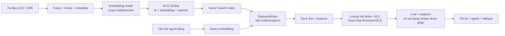
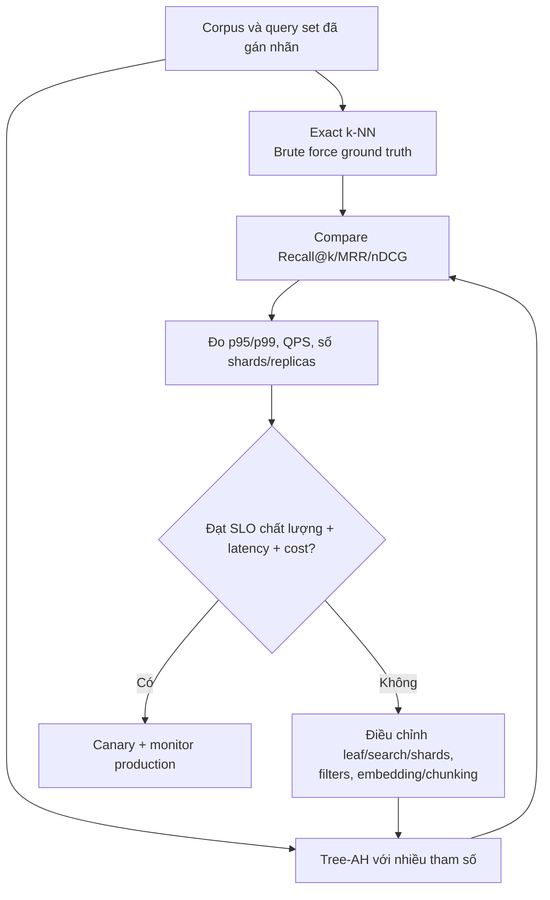

# Vertex AI Vector Search và xây dựng chỉ mục vector

## 1. Tình huống: tìm đúng tài liệu cho trợ lý Java

Một ứng dụng **Spring Boot trên Cloud Run** trả lời câu hỏi về chính sách công ty. Tài liệu nằm trong **Cloud Storage**, được chia thành các đoạn (chunks), mỗi đoạn chuyển thành một **embedding** — dãy số biểu diễn ngữ nghĩa. Khi người dùng hỏi “Có thể hoàn tiền trong bao lâu?”, hệ thống cần tìm những đoạn **gần nghĩa nhất** ngay cả khi từ khóa trong câu hỏi khác văn bản gốc.

**Vertex AI Vector Search** hỗ trợ tìm kiếm **nearest neighbors** trên tập vector lớn. Nó giữ **chỉ mục vector (Index)** và phục vụ truy vấn qua **IndexEndpoint/DeployedIndex**; không tự viết câu trả lời, không tự đọc mọi PDF và **không phải mô hình embedding**. Để xây ứng dụng **Retrieval-Augmented Generation (RAG)**, người phát triển còn cần pipeline nạp/chia tài liệu, tạo embedding, kiểm soát quyền và đưa các đoạn liên quan vào prompt của mô hình tạo sinh.

Trong chương **AI tạo sinh trên Google Cloud** thuộc mô-đun **CLOUD_PROVIDERS_GCP**, bài này kết nối Vector Search với IAM/VPC, Cloud Storage, Java, Cloud Run/GKE, độ tin cậy, quan sát hiệu năng và chi phí. Ví dụ được thiết kế tự chứa, dùng dữ liệu giả để tránh tạo chi phí hoặc làm lộ tài liệu nội bộ.

**Sau bài học, bạn có thể:**

1. Phân biệt **embedding, vector distance, Index, IndexEndpoint và DeployedIndex**.
2. Chuẩn bị dữ liệu **JSON Lines** đúng schema, dimension, IDs, token/numeric restricts.
3. Chọn **Tree-AH (ANN)** hay **brute force (exact k-NN)**, batch/stream updates và distance metric.
4. Tạo **Index**, deploy đến endpoint công khai có xác thực hoặc endpoint trong VPC và gọi `findNeighbors`.
5. Viết Java 21 gọi Vector Search bằng **ADC**, xây chuỗi truy xuất **RAG** có kiểm tra quyền.
6. Đo **recall@k, p95 latency, freshness, chi phí shard/replica**, và làm migration/cleanup an toàn.

> **Giới hạn thực hành:** lệnh tạo Index/Endpoint/DeployedIndex được cung cấp **để chạy trong project lab được phép, không được thực thi khi biên soạn**. Dù chỉ có vài vector, **deployed index có node/replica tính phí khi không có request**; index build/update, Cloud Storage và mô hình embedding cũng có thể phát sinh phí. Không thay đổi hoặc xóa chỉ mục của sản phẩm thật.

## 2. Một luồng truy xuất RAG hoàn chỉnh



Đây là **hai đường xử lý riêng**: *ingestion/indexing* có thể chạy theo lịch; *retrieval* phải đạt latency của ứng dụng. Vector Search chủ yếu tìm **ID và mức khoảng cách**, không tự đảm bảo trả về nội dung gốc, tiêu đề hoặc trích dẫn. Duy trì **mapping `chunkId → source URI, revision, ACL, text`** trong kho dữ liệu có quyền truy cập phù hợp.

| Thành phần | Trách nhiệm | Không nên kỳ vọng |
| --- | --- | --- |
| **Embedding model** | Biến văn bản/ảnh thành vector cùng không gian ngữ nghĩa | Vector Search tự tạo embedding từ chuỗi bất kỳ |
| **Index** | Lưu dữ liệu vector và cấu hình tìm lân cận | Index rỗng tự trả về tài liệu |
| **IndexEndpoint** | Điểm kết nối phục vụ truy vấn | Tạo endpoint là đã có dữ liệu để search |
| **DeployedIndex** | Gắn một Index vào endpoint, cấp node/replicas | Không có phí khi idle |
| **Metadata/document store** | Lưu text, provenance, tenant, quyền | Vector result tự thay thế kiểm soát truy cập |
| **Java RAG service** | Authn/authz, embed query, retrieve, rerank, call LLM | ANN score là câu trả lời chắc chắn |

> **Tên sản phẩm:** tài liệu mới có thể đặt Vector Search trong **Gemini Enterprise Agent Platform**; nhiều SDK/CLI vẫn dùng `aiplatform.googleapis.com`, `gcloud ai indexes` và lớp cũ `MatchingEngineIndex`. **Agent Retrieval (trước đây là Vector Search 2.0)** có API **collections/dataObjects** riêng (ví dụ `vectorsearch.googleapis.com`), **không dùng lẫn** với `Index/IndexEndpoint` ở bài này.

## 3. Embedding, dimension và metric: những điều phải thống nhất

Một embedding là vector thực `v = [v₁, …, v_d]`, trong đó **`d` là dimension cố định của model/phiên bản**. Cùng câu nói có thể được mã hóa khác nhau nếu thay model, task type hoặc quy tắc normalize. Việc tạo Index dimension 768 rồi gửi query 3 chiều sẽ bị từ chối hoặc không hợp lệ; **không được cắt/pad vector tùy tiện**.

### 3.1. Distance, similarity và normalize

| Metric | Cách hiểu | Khi thích hợp |
| --- | --- | --- |
| `DOT_PRODUCT_DISTANCE` | **Khoảng cách = âm tích vô hướng**; số **nhỏ hơn** tương ứng tích vô hướng lớn hơn | Tối ưu trên Vector Search, thường dùng với normalized embeddings |
| `COSINE_DISTANCE` | Khoảng cách theo góc giữa các vector | Truy vấn ngữ nghĩa khi chiều dài vector không phải tín hiệu |
| `SQUARED_L2_DISTANCE` | Bình phương khoảng cách Euclid | Khi độ lớn vector cũng có nghĩa |
| `L1_DISTANCE` | Tổng khoảng cách tuyệt đối theo từng chiều | Một số dạng dữ liệu liên tục |

Google Cloud khuyến nghị **`DOT_PRODUCT_DISTANCE` kết hợp `UNIT_L2_NORM`** khi muốn thứ hạng tương đương cosine; đây là tổ hợp tối ưu tốt trong nhiều cấu hình Vector Search. Với **vector đã chuẩn hóa unit-length**, tích vô hướng là cosine similarity; nhưng API dùng **distance (nhỏ hơn là gần hơn)**, không coi một số âm mặc định là “độ tin cậy 90%”.

```text
Vector giả 3 chiều (không phải output của model ngôn ngữ):
  A = [1, 0, 0]
  B = [0.8, 0.6, 0]
  C = [0, 1, 0]
  q = [1, 0, 0]

q·A = 1.0; q·B = 0.8; q·C = 0.
distance=-dot: A=-1.0, B=-0.8, C=0.
=> A gần hơn B, B gần hơn C.
```

**Trong RAG thực tế**, dùng một embedding model + version + preprocessing cho cả **chunks và queries**; nếu model có **task-specific input type** (document vs query) thì dùng đúng hai chế độ của cùng họ model. Khi nâng model làm thay đổi không gian vector, **tạo index mới và triển khai song song/canary**, không trộn vector của hai model vào cùng dimension chỉ vì bằng độ dài.

## 4. Thiết kế tài liệu, chunks, IDs và metadata

Một chunk nên đủ ngữ cảnh để trả lời nhưng không dài đến mức nhiều chủ đề bị trộn. Ví dụ:

```text
documentId: policy-refund-2026
revision:   v3
chunkId:    policy-refund-2026#v3#0007
sourceUri:  gs://DOC_BUCKET/policies/refund-v3.pdf
text:       "Yêu cầu hoàn tiền trong vòng 14 ngày..."
tenant:     t01
lang:       vi
access:     employee
```

**Điểm thiết kế cần chú ý:**

- **ID bền vững, duy nhất trong index** cho một phiên bản chunk. Retry cùng ID chỉ thay thế datapoint tương ứng trong streaming index; sinh ID ngẫu nhiên cho mỗi retry dễ tạo trùng.
- **Revision** cho biết kết quả cũ hay mới. Xóa bản cũ khỏi index/metadata store khi tài liệu bị thu hồi.
- **Token restricts** như `tenant`, `lang`, `access` dùng lọc chính xác. **Numeric restricts** như `year`, `price` dùng điều kiện so sánh; không lưu chúng ở feature vector.
- **Crowding tag** như `documentId` giúp tránh top-k gồm toàn chunks của một tài liệu, khi truy vấn hỗ trợ per-crowding cap.
- Không đặt nguyên **email, token, số định danh hay text nhạy cảm** trong vector IDs, namespace và logs. **Metadata và vector có thể vẫn mang thông tin nhạy cảm**, cần quyền truy cập và chính sách xóa.
- **Token/numeric filters không thay thế authorization**. Backend phải xác thực tenant/người dùng, tạo restricts do server kiểm soát và **kiểm quyền từng document ở bước fetch/rerank trước khi gửi vào LLM**.

Ví dụ mapping `chunkId → text/ACL` lưu tại Cloud Storage/Firestore/Cloud SQL tùy workload. Index chưa chắc lưu và trả đầy đủ metadata; nếu dùng `embedding_metadata` được hỗ trợ, nó có **giới hạn kích thước** và không thay hệ thống quản trị tài liệu.

## 5. Chọn thuật toán Index và phương thức cập nhật

| Lựa chọn | Điểm mạnh | Đánh đổi |
| --- | --- | --- |
| **Tree-AH (ANN)** | Tìm gần đúng nhanh trên tập vector lớn, cấu hình recall/latency | Không bảo đảm exact top-k; cần đo recall |
| **Brute-force (exact k-NN)** | Tìm hàng xóm gần nhất chính xác cho tập dữ liệu/benchmark | Chi phí và latency tăng theo quy mô; thường dùng để đo ground truth |
| **Batch update** | Nạp từ **GCS directory**, phù hợp dữ liệu thay đổi theo đợt | Index sync/compaction có độ trễ; đổi mới không ngay lập tức |
| **Stream update** | `upsertDatapoints`/`removeDatapoints` cho cập nhật gần realtime | Phí cập nhật/compaction, quota, cần retry và quản lý freshness |

Các tham số quan trọng cho **Index kiểu Tree-AH**:

| Tham số | Ý nghĩa | Hướng kiểm thử |
| --- | --- | --- |
| `dimensions` | Độ dài vector dense phải khớp model | Kiểm tra **mọi** dòng trước khi tạo |
| `distanceMeasureType` và `featureNormType` | Phép đo khoảng cách và normalize | Đo hiệu quả retrieval theo model |
| `approximateNeighborsCount` | Số neighbors sơ bộ trước exact reordering | Thử recall/latency theo k |
| `leafNodeEmbeddingCount` | Số embeddings mục tiêu trong leaf | Leaf lớn thường ít định tuyến hơn, có thể giảm recall |
| `fractionLeafNodesToSearch` | Tỷ lệ leaf được tìm kiếm | Tăng thường cải thiện recall nhưng tốn latency |
| `shardSize` | Shard nhỏ/vừa/lớn ảnh hưởng node count và machine type | Đo RAM, số shards, tính sẵn sàng và phí |

Shards có thể là **SMALL ~2 GiB, MEDIUM ~20 GiB, LARGE ~50 GiB** theo cấu hình được hỗ trợ; machine type hợp lệ phụ thuộc shard size. **Không chọn shard lớn để “tiết kiệm”** nếu làm giảm khả năng phân tán/độ sẵn sàng. Khi workload chưa có benchmark, **brute force làm ground truth** rồi điều chỉnh Tree-AH bằng `recall@k` và `p95`.

**Không thể đổi một batch-update index đang có sang streaming bằng một flag đơn giản**; thông thường phải tạo Index mới với `--index-update-method=stream-update`, nạp lại và chuyển traffic có kiểm soát. Với batch updates, `isCompleteOverwrite=true` là **thay toàn bộ dữ liệu**; không bật tùy tiện nếu chỉ định thêm vài datapoints.

## 6. Preflight an toàn: project, vùng, bucket, IAM

Các lệnh **chỉ đọc** trong Cloud Shell/Bash:

```bash
gcloud config set project LAB_PROJECT_ID
gcloud ai indexes list \
  --project=LAB_PROJECT_ID --region=us-central1
gcloud ai index-endpoints list \
  --project=LAB_PROJECT_ID --region=us-central1
gcloud storage buckets describe gs://UNIQUE_LAB_BUCKET
```

Trước khi tạo:

1. Xác nhận **Billing, Vertex AI API `aiplatform.googleapis.com`, vùng** mà Index/Endpoint/embeddings và bucket có thể dùng.
2. Kiểm tra **quyền tạo Index/Endpoint/deploy** của người thực hiện (ví dụ `roles/aiplatform.user` hoặc custom role có đủ permissions). Dịch vụ cần quyền **đọc objects GCS** trong dự án/bucket chứa dữ liệu.
3. Với endpoint public, caller cần **quyền Vertex AI predict/index query theo IAM**; endpoint public **có nghĩa truy cập bằng internet**, **không có nghĩa unauthenticated**.
4. Nếu cần endpoint **riêng tư**, chuẩn bị kết nối VPC/private endpoint (VPC peering hoặc cơ chế được hỗ trợ), DNS, firewall, identity và truy cập từ Cloud Run/GKE.
5. Đặt **budget, giới hạn node/replica, data classification** và owner cleanup. Dự toán phí cả **thời gian deploy nhàn rỗi**.

Các lệnh thay đổi chỉ chạy sau phê duyệt, dưới **LAB_PROJECT_ID**. Không tự bật public endpoint cho dữ liệu nhạy cảm chỉ vì cấu hình private khó hơn.

## 7. Lab chuẩn bị JSONL: vector 3 chiều có filter

Chỉ dùng **bốn dữ liệu tổng hợp**, không sinh embedding thật. Tạo file `vectors.json` (UTF-8 **JSON Lines**, *không* phải một JSON array):

```jsonl
{"id":"doc-a","embedding":[1,0,0],"restricts":[{"namespace":"tenant","allow":["lab"]},{"namespace":"lang","allow":["vi"]}],"numeric_restricts":[{"namespace":"year","value_int":2026}],"crowding_tag":"guide-1"}
{"id":"doc-b","embedding":[0.8,0.6,0],"restricts":[{"namespace":"tenant","allow":["lab"]},{"namespace":"lang","allow":["vi"]}],"numeric_restricts":[{"namespace":"year","value_int":2026}],"crowding_tag":"guide-1"}
{"id":"doc-c","embedding":[0,1,0],"restricts":[{"namespace":"tenant","allow":["lab"]},{"namespace":"lang","allow":["en"]}],"numeric_restricts":[{"namespace":"year","value_int":2025}],"crowding_tag":"guide-2"}
{"id":"doc-d","embedding":[0,0,1],"restricts":[{"namespace":"tenant","allow":["lab"]},{"namespace":"lang","allow":["vi"]}],"numeric_restricts":[{"namespace":"year","value_int":2024}],"crowding_tag":"guide-3"}
```

**Quy tắc định dạng v1 `Index`:**

- Mỗi dòng là **một JSON object**, có `id` và ít nhất một `embedding` (dense) hoặc `sparse_embedding`.
- `embedding` phải có đúng **3 số hữu hạn** ở lab (production đúng dimension của model), không nhận `NaN`/`Infinity`, string giả số hoặc thiếu chiều.
- `restricts[].allow` và `deny` là các mảng token; trong **truy vấn** REST dùng `allowList`/`denyList` theo schema `IndexDatapoint.Restriction`, **không dùng nguyên khóa ingestion trong query**.
- `numeric_restricts` khi **nạp dữ liệu** chỉ lưu giá trị `value_int/value_float/value_double`; **`op` chỉ dùng khi truy vấn**, không thuộc JSONL input.
- GCS data files đặt **trực tiếp trong một prefix**, có phần mở rộng `.json`, `.csv` hoặc `.avro`; tối đa **5.000 files trong batch root** theo docs. `vectors.json` là file JSONL dù suffix là `.json`.

Ví dụ upload **chỉ trên bucket lab có thật**:

```bash
gcloud storage cp vectors.json \
  gs://UNIQUE_LAB_BUCKET/vector-search/batch-001/vectors.json
gcloud storage ls \
  gs://UNIQUE_LAB_BUCKET/vector-search/batch-001/
```

**Không trộn file metadata hay JSON cấu hình index vào cùng prefix batch**; chỉ để các tệp embedding được nạp trong đó. Thực tế với vài vector có thể dùng chế độ brute force/streaming nhằm học schema; kích thước nhỏ **không phản ánh tốc độ và chi phí** khi có hàng triệu vectors.

## 8. Tạo Index từ dữ liệu trên GCS

### 8.1. Cấu hình brute force phù hợp lab nhỏ

Tạo file `index_metadata.json` **cục bộ**, không upload vào cùng prefix vectors:

```json
{
  "contentsDeltaUri": "gs://UNIQUE_LAB_BUCKET/vector-search/batch-001/",
  "config": {
    "dimensions": 3,
    "distanceMeasureType": "DOT_PRODUCT_DISTANCE",
    "featureNormType": "UNIT_L2_NORM",
    "shardSize": "SHARD_SIZE_SMALL",
    "algorithmConfig": {
      "bruteForceConfig": {}
    }
  }
}
```

**Brute force** tìm nearest neighbors chính xác trên vector đang được index; phù hợp làm **đối chứng** để so ANN. Nó có thể kém kinh tế trên tập lớn. Với `UNIT_L2_NORM`, vector không được là **vector zero** vì không chuẩn hóa được. Bộ dữ liệu giả có bốn vector khác zero, đều unit-length.

### 8.2. Tạo Index dạng batch update

Chỉ khi project/bucket lab được duyệt và đã kiểm tra quota:

```bash
gcloud services enable aiplatform.googleapis.com \
  --project=LAB_PROJECT_ID

gcloud ai indexes create \
  --display-name=vs-docs-lab-exact \
  --metadata-file=index_metadata.json \
  --index-update-method=batch-update \
  --project=LAB_PROJECT_ID \
  --region=us-central1

# Xem operation/ID thực tế, chờ index READY:
gcloud ai indexes list \
  --project=LAB_PROJECT_ID --region=us-central1

gcloud ai indexes describe INDEX_ID \
  --project=LAB_PROJECT_ID --region=us-central1
```

**Tạo Index là tác vụ bất đồng bộ**; response có thể chứa operation chứ chưa phải Index sẵn sàng. Với vài vectors, việc build vẫn có thể cần thời gian và phát sinh phí. **Không deploy khi index còn đang tạo**, không lặp lại lệnh `create` liên tục vì không thấy kết quả ngay.

Nếu máy/bucket/region của lab không hỗ trợ cấu hình cụ thể hoặc có giới hạn tối thiểu cho index build, dùng **dataset quickstart chính thức** trong project được phép; không “chữa lỗi” bằng cách nạp dữ liệu khách hàng thật.

### 8.3. Tree-AH để nghiên cứu ANN quy mô lớn

Khi có một dataset **đủ lớn** và baseline exact search, có thể tạo **một Index khác** theo cấu hình mẫu:

```json
{
  "contentsDeltaUri": "gs://UNIQUE_LAB_BUCKET/vector-search/production-like/",
  "config": {
    "dimensions": 768,
    "approximateNeighborsCount": 100,
    "distanceMeasureType": "DOT_PRODUCT_DISTANCE",
    "featureNormType": "UNIT_L2_NORM",
    "shardSize": "SHARD_SIZE_MEDIUM",
    "algorithmConfig": {
      "treeAhConfig": {
        "leafNodeEmbeddingCount": 1000,
        "fractionLeafNodesToSearch": 0.05
      }
    }
  }
}
```

**Đây là cấu hình tham khảo, không dùng trực tiếp với bốn vector 3 chiều ở mục 7.** `dimensions=768` chỉ hợp lệ khi dữ liệu và query embeddings đều có 768 chiều, cùng model/version. Tham số `leafNodeEmbeddingCount` và `fractionLeafNodesToSearch` cần **benchmark recall@k/latency**; con số mẫu không phải cấu hình tối ưu cho mọi corpus.

## 9. Tạo IndexEndpoint và triển khai DeployedIndex

### 9.1. Chọn public hay private

| Loại endpoint | Khi phù hợp | Bảo vệ cần có |
| --- | --- | --- |
| **Public endpoint** | Lab hoặc ứng dụng gọi qua HTTPS có xác thực | OAuth/IAM, không công bố credentials, rate limiting tại application |
| **VPC/private endpoint** | Dữ liệu nhạy cảm, hệ thống chỉ cho phép mạng nội bộ | Cấu hình VPC/Private Service Connect theo phương thức được hỗ trợ, subnet/routing/DNS/IAM |

**Public endpoint không có nghĩa public dữ liệu**: yêu cầu vẫn cần xác thực và quyền; tuy nhiên luồng mạng có thể ra endpoint công khai. VPC endpoint cần cấu hình mạng phù hợp, không thể gọi từ laptop như một URL public bất kỳ. Chọn theo **data classification và deployment topology**, không chỉ theo độ dễ của demo.

### 9.2. Tạo public endpoint trong project lab

```bash
gcloud ai index-endpoints create \
  --display-name=vs-docs-lab-public \
  --public-endpoint-enabled \
  --project=LAB_PROJECT_ID \
  --region=us-central1

gcloud ai index-endpoints list \
  --project=LAB_PROJECT_ID --region=us-central1
```

Lưu `INDEX_ENDPOINT_ID` và `INDEX_ID` từ **kết quả thật**; đó là hai tài nguyên khác nhau. IndexEndpoint **chưa có DeployedIndex** thì chưa tìm được nearest neighbors.

### 9.3. Deploy index đã sẵn sàng

```bash
# Chỉ LAB và khi INDEX_ID đã READY:
gcloud ai index-endpoints deploy-index INDEX_ENDPOINT_ID \
  --deployed-index-id=lab_docs_v1 \
  --display-name=lab-docs-v1 \
  --index=INDEX_ID \
  --min-replica-count=1 \
  --max-replica-count=1 \
  --project=LAB_PROJECT_ID \
  --region=us-central1

gcloud ai index-endpoints describe INDEX_ENDPOINT_ID \
  --project=LAB_PROJECT_ID \
  --region=us-central1 \
  --format=json
```

`lab_docs_v1` là **DeployedIndex ID do bạn đặt** và dùng trong query, **không phải Index resource ID**. Với `min=max=1`, lab giới hạn baseline node thấp nhưng **không cung cấp high availability production**. Google khuyến nghị **ít nhất hai replicas/shard** khi cần tính sẵn sàng; với workload thật điều chỉnh shard/machine/replicas theo SLO và quota.

Deploy có thể cần nhiều phút, nhất là lần đầu; không giả định operation trả về nghĩa là endpoint đã phục vụ. Trong output `describe`, kiểm tra **`deployedIndexes[].id`, `index`, `indexSyncTime`** và **`publicEndpointDomainName`**. Chỉ sử dụng URL public được dịch vụ thực sự trả về.

## 10. Truy vấn `findNeighbors` và đọc kết quả

### 10.1. Gửi truy vấn dense vector có lọc tenant/ngôn ngữ

Ví dụ truy vấn vào **public endpoint đã deploy**, không phải `aiplatform.googleapis.com`. Tạo `query.json` trong dự án lab:

```json
{
  "deployedIndexId": "lab_docs_v1",
  "queries": [
    {
      "datapoint": {
        "datapointId": "query-lab-001",
        "featureVector": [1, 0, 0],
        "restricts": [
          {"namespace": "tenant", "allowList": ["lab"]},
          {"namespace": "lang", "allowList": ["vi"]}
        ]
      },
      "neighborCount": 3
    }
  ],
  "returnFullDatapoint": false
}
```

```bash
# Thay PUBLIC_ENDPOINT_DOMAIN bằng giá trị publicEndpointDomainName thật.
# Thay PROJECT_NUMBER/INDEX_ENDPOINT_ID bằng resource đã được tạo.
curl --fail-with-body -X POST \
  -H "Authorization: Bearer $(gcloud auth print-access-token)" \
  -H "Content-Type: application/json" \
  --data @query.json \
  "https://PUBLIC_ENDPOINT_DOMAIN/v1/projects/PROJECT_NUMBER/locations/us-central1/indexEndpoints/INDEX_ENDPOINT_ID:findNeighbors"
```

**Kỳ vọng về ngữ nghĩa:** `doc-a` phải nằm trong các kết quả gần nhất với `q=[1,0,0]` nếu dữ liệu đã index/sync. `doc-c` bị loại bởi `lang=vi` dù có thể gần một query khác. **ANN không đảm bảo đúng thứ tự exact trong mọi tình huống**, và `neighborCount=3` là tối đa mong muốn chứ không phải lời hứa luôn có đủ ba bản ghi sau lọc.

**Kết quả** trả các neighbors với `datapoint.datapointId` và `distance` (có thể kèm dữ liệu bổ sung khi tùy chọn phù hợp). **Distance không phải xác suất liên quan**: cần đo retrieval accuracy qua tập câu hỏi/đáp án đã gán nhãn. Với `DOT_PRODUCT_DISTANCE`, số nhỏ hơn là gần hơn; không lấy dấu âm làm lỗi.

### 10.2. Bộ lọc số và crowding

Nếu muốn giới hạn năm ≥ 2025, thêm vào `datapoint` **ở truy vấn**:

```json
"numericRestricts": [
  {"namespace": "year", "valueInt": "2025", "op": "GREATER_EQUAL"}
]
```

Đây chỉ là **fragment JSON** đặt cùng cấp với `restricts` trong `query.json`; **không** thêm `op` vào file ingestion `vectors.json`. `valueInt` dùng biểu diễn chuỗi cho số nguyên 64-bit theo kiểu JSON/protobuf API. Khi search tài liệu dài, có thể dùng **crowding** để giới hạn số chunks từ cùng một `crowding_tag`; đây là kỹ thuật **đa dạng hóa kết quả**, không thay thế reranker hoặc ACL.

### 10.3. Vì sao “tìm được vector” chưa phải RAG?

`findNeighbors` trả về **chunk IDs**, sau đó Java phải:

1. Đọc metadata/content theo các IDs từ kho dữ liệu được phép truy cập.
2. **Kiểm tra ACL từng chunk ở thời điểm truy vấn**, không chỉ tin filter `tenant` trong request.
3. Loại kết quả bị thu hồi, revision cũ và chunks quá ngắn/không liên quan.
4. Rerank/giới hạn tokens, tạo prompt với **trích dẫn source IDs**.
5. Trả **“không đủ thông tin”** nếu context không hỗ trợ câu trả lời, thay vì để model bịa.

**Không để người dùng tự truyền `tenant`/`allowList` trong JSON gửi thẳng Vector Search**. Server phải lấy quyền từ identity/session và đối chiếu với document store; filters chỉ là cơ chế hỗ trợ truy xuất, **không phải authorization boundary**.

## 11. Java 21: gọi Vector Search từ Cloud Run/GKE

Để giữ ví dụ độc lập với SDK cao cấp, chương trình Java dùng **`java.net.http.HttpClient`** (JDK 21) và **Google Auth Library** lấy token từ **Application Default Credentials**. Class này chỉ gọi một index lab có sẵn; nó **không tự tạo embeddings**. Trong production, một bước riêng phải gọi embedding model và kiểm tra dimension.

### 11.1. Dependency Maven

```xml
<!-- Fragment trong pom.xml của dự án Java 21 lab. -->
<dependency>
  <groupId>com.google.auth</groupId>
  <artifactId>google-auth-library-oauth2-http</artifactId>
  <version>1.38.1</version>
</dependency>
```

Pin version phù hợp với Java/Google Cloud BOM và scan dependencies. Ví dụ dùng JDK built-in HTTP, không cần thư viện JSON thứ hai vì body JSON cố định với **dữ liệu giả**. Production nên dùng JSON serializer và client chính thức có timeout/retry rõ ràng.

### 11.2. `VectorSearchQuery.java`

```java
package dev.example.vectorsearch;

import com.google.auth.oauth2.GoogleCredentials;
import java.net.URI;
import java.net.http.HttpClient;
import java.net.http.HttpRequest;
import java.net.http.HttpResponse;
import java.time.Duration;
import java.util.List;
import java.util.regex.Pattern;

public final class VectorSearchQuery {
    private static final HttpClient HTTP = HttpClient.newBuilder()
        .connectTimeout(Duration.ofSeconds(10))
        .build();

    public static void main(String[] args) throws Exception {
        if (args.length != 4) {
            throw new IllegalArgumentException(
                "Usage: PROJECT_NUMBER REGION INDEX_ENDPOINT_ID PUBLIC_ENDPOINT_DOMAIN");
        }
        String projectNumber = args[0];
        String region = args[1];
        String endpointId = args[2];
        String publicDomain = args[3];
        if (!projectNumber.matches("[0-9]+")
                || !endpointId.matches("[0-9]+")
                || !region.matches("[a-z0-9-]+")
                || !Pattern.matches(
                    "[a-zA-Z0-9.-]+\\.vdb\\.vertexai\\.goog",
                    publicDomain)) {
            throw new IllegalArgumentException("Invalid index endpoint resource");
        }

        GoogleCredentials credentials = GoogleCredentials
            .getApplicationDefault()
            .createScoped(List.of(
                "https://www.googleapis.com/auth/cloud-platform"));
        credentials.refreshIfExpired();

        // Query và tenant filter là dữ liệu giả được server kiểm soát.
        String json = """
            {"deployedIndexId":"lab_docs_v1","queries":[{
              "datapoint":{
                "datapointId":"query-java-001",
                "featureVector":[1,0,0],
                "restricts":[
                  {"namespace":"tenant","allowList":["lab"]},
                  {"namespace":"lang","allowList":["vi"]}
                ]
              },"neighborCount":3
            }]}
            """;
        String url = "https://" + publicDomain
            + "/v1/projects/" + projectNumber
            + "/locations/" + region
            + "/indexEndpoints/" + endpointId + ":findNeighbors";
        HttpRequest request = HttpRequest.newBuilder(URI.create(url))
            .timeout(Duration.ofSeconds(20))
            .header("Authorization",
                "Bearer " + credentials.getAccessToken().getTokenValue())
            .header("Content-Type", "application/json")
            .POST(HttpRequest.BodyPublishers.ofString(json))
            .build();

        HttpResponse<String> response = HTTP.send(
            request, HttpResponse.BodyHandlers.ofString());
        if (response.statusCode() / 100 != 2) {
            throw new IllegalStateException(
                "Vector Search HTTP " + response.statusCode());
        }
        // Chỉ in response trong lab không có dữ liệu riêng tư.
        System.out.println(response.body());
    }
}
```

**Cách chạy:** build Maven class ở project Java thử nghiệm; dùng `gcloud auth application-default login` tại local, hoặc **Cloud Run runtime service account/Workload Identity Federation for GKE** khi triển khai. Các tham số phải lấy từ **`gcloud ai index-endpoints describe`** và index lab có `lab_docs_v1` đã deploy.

**Điều chưa có trong demo:** parser JSON, chuẩn hóa user question thành embedding theo model thực, retry 429/503 với exponential backoff, circuit breaker, chính sách tenant từ JWT và document fetch. Trong Spring Boot, phải bổ sung các bước ấy và **không log raw queries, access token hoặc document text nhạy cảm**. Không thiết kế xử lý lỗi bằng cách mở quyền `Owner` cho caller.

## 12. Cập nhật chỉ mục và chuyển phiên bản an toàn

### 12.1. Batch update: cập nhật theo GCS prefix

Giả sử một ngày sau đã có `batch-002/` chứa các datapoints mới/đổi. **Đây là tác vụ riêng, chỉ áp dụng cho Index tạo với `batch-update`**. Trong file metadata hiện có, đổi `contentsDeltaUri` sang prefix mới; nếu muốn **cộng dồn cập nhật**, không bật overwrite. Nếu muốn **thay toàn bộ corpus**, đặt `isCompleteOverwrite=true`, nhưng đây là thao tác phá hủy dữ liệu index không nằm trong đợt mới.

```json
{
  "contentsDeltaUri": "gs://UNIQUE_LAB_BUCKET/vector-search/batch-002/",
  "isCompleteOverwrite": false,
  "config": {
    "dimensions": 3,
    "distanceMeasureType": "DOT_PRODUCT_DISTANCE",
    "featureNormType": "UNIT_L2_NORM",
    "shardSize": "SHARD_SIZE_SMALL",
    "algorithmConfig": {"bruteForceConfig": {}}
  }
}
```

Đây là file `index_update_metadata.json` để minh họa cho **một Index lab đã có**:

```bash
# CHỈ LAB, khi thư mục batch-002 đã chứa dữ liệu hợp lệ:
gcloud ai indexes update INDEX_ID \
  --metadata-file=index_update_metadata.json \
  --project=LAB_PROJECT_ID \
  --region=us-central1

gcloud ai indexes describe INDEX_ID \
  --project=LAB_PROJECT_ID --region=us-central1
gcloud ai index-endpoints describe INDEX_ENDPOINT_ID \
  --project=LAB_PROJECT_ID --region=us-central1
```

**Không áp dụng ví dụ nếu chưa biết quy tắc partial vs overwrite cho corpus thực**. Index update có thể chạy bất đồng bộ; bản được triển khai có thể **chưa nhận** dữ liệu mới. Đối chiếu **`Index.updateTime` với `DeployedIndex.indexSyncTime`** và operations đã hoàn tất trước khi công bố dữ liệu mới đã sẵn sàng. Các xóa/cập nhật của batch index có thể **chưa hiển thị hoặc chiếm storage tạm** cho đến khi compaction.

### 12.2. Streaming index: upsert và xóa datapoint

Tạo **Index mới** với `--index-update-method=stream-update` và metadata config tương thích; có thể tạo index streaming **rỗng** không có `contentsDeltaUri`, rồi nạp dữ liệu bằng API. Không dùng lệnh streaming trên Index `batch-update` đã tạo ở lab mục 8.

Ví dụ **chỉ khi đã có một streaming Index lab**:

```json
{
  "datapoints": [
    {
      "datapointId": "doc-e",
      "featureVector": [0.6, 0.8, 0],
      "restricts": [
        {"namespace": "tenant", "allowList": ["lab"]},
        {"namespace": "lang", "allowList": ["vi"]}
      ]
    }
  ]
}
```

Lưu thành `upsert.json` rồi gọi:

```bash
# HÀNH ĐỘNG GHI — CHỈ streaming index LAB:
curl --fail-with-body -X POST \
  -H "Authorization: Bearer $(gcloud auth print-access-token)" \
  -H "Content-Type: application/json" \
  --data @upsert.json \
  "https://us-central1-aiplatform.googleapis.com/v1/projects/LAB_PROJECT_ID/locations/us-central1/indexes/STREAM_INDEX_ID:upsertDatapoints"

# XÓA dữ liệu index lab theo ID khi tài liệu bị thu hồi:
# gcloud ai indexes remove-datapoints STREAM_INDEX_ID \
#   --datapoint-ids=doc-e --project=LAB_PROJECT_ID --region=us-central1
```

**Upsert** cùng `datapointId` thường cập nhật datapoint cũ; khi hệ thống nguồn xóa tài liệu phải **xóa cả index entry và metadata/document content** theo chính sách. Cập nhật restricts-only dùng `updateMask="all_restricts"` và chỉ đúng các trường được hỗ trợ. Streaming update có phí/quotas riêng và index còn phải **compaction**; “gần realtime” không có nghĩa mọi query mới đã đồng bộ ngay tại thời điểm API trả 200.

### 12.3. Chuyển từ model embedding cũ sang model mới

Khi đổi embedding model, dimension, metric hoặc thuật toán:

1. Đóng băng **corpus snapshot** và giữ metadata về **model/version/preprocessing**.
2. Sinh embeddings mới trong **prefix và Index mới**; không trộn hai vector spaces.
3. Build/deploy `v2` song song (chi phí tạm thời tăng), chạy **golden retrieval queries**.
4. Chuyển traffic ở **lớp Spring Boot** theo canary (hoặc routing có kiểm soát), đo recall, latency, failures và ACL.
5. Rollback caller về `v1` nếu chất lượng giảm; sau khi đạt SLO và hết yêu cầu giữ bản cũ, **undeploy** `v1` rồi xóa Index nếu được duyệt.

Một `IndexEndpoint` có thể phục vụ nhiều DeployedIndexes nhưng **`findNeighbors` phải chỉ rõ `deployedIndexId`**. Không hiểu đây là traffic split tự động giống custom prediction Endpoint; routing/canary của ứng dụng phải được thiết kế rõ.

## 13. Đánh giá retrieval: recall, độ trễ và mức liên quan

Để chọn ANN parameters, cần một tập **câu hỏi/queries có ground truth**:

| Metric | Cách tính/ý nghĩa | Lưu ý |
| --- | --- | --- |
| **Recall@k** | Số IDs relevant được ANN lấy / số relevant trong ground truth top-k | Với ANN, đối chiếu brute-force exact, cùng filters/embedding |
| **Precision@k** | Tỷ lệ IDs trong top-k thực sự liên quan | Cần label relevance của người đánh giá |
| **MRR / nDCG** | Đánh giá vị trí xếp hạng của kết quả tốt | Thích hợp cho RAG retrieval và re-ranking |
| **p50/p95/p99 latency** | Thời gian tìm hàng xóm của endpoint | Đo cả lúc traffic peak, không chỉ 1 request |
| **End-to-end RAG latency** | Embed query + vector search + document fetch + rerank + LLM | Index nhanh không bảo đảm chat nhanh |
| **Freshness / sync lag** | Độ trễ từ document update → IndexEndpoint phục vụ mới | Theo dõi `indexSyncTime` và release |
| **Access-control violations** | Số tài liệu ngoài phạm vi quyền lọt vào kết quả/context | Mục tiêu **0**; test cross-tenant |

**Ví dụ:** brute force exact top-5 là `[A,B,C,D,E]`; ANN trả `[A,C,E,F,G]`. Khi dùng định nghĩa **overlap recall@5**, giá trị = **3/5 = 0,6**. Đây chỉ là một query; chất lượng production phải đo trên tập representative queries, phân vùng tenant, ngôn ngữ và long-tail.



**Cẩn thận:** nếu ground truth là **top-k exact ANN overlap** thì khác với **human-labeled document relevance**. Một `recall@10=0,95` so brute force có thể vẫn không tìm ra câu trả lời hay nếu embeddings/chunking kém. Nên đánh giá cả **answer correctness, groundedness, citation quality, hallucination rate và mức phù hợp quyền truy cập** sau RAG.

## 14. IAM, mạng, an toàn dữ liệu và prompt injection

### 14.1. Danh tính và quyền tối thiểu

| Persona | Quyền cần cân nhắc | Không nên có |
| --- | --- | --- |
| **Index builder/operator** | `aiplatform.indexes.create/update/get` và `aiplatform.indexEndpoints.create/deploy/get` | Owner toàn project nếu không cần |
| **Java query service** | **`aiplatform.indexEndpoints.queryVectors`** trên endpoint phù hợp (role tùy chỉnh hoặc role hỗ trợ) | Quyền deploy, delete index và đọc bucket staging |
| **Index ingestion service** | `aiplatform.indexes.update` với dữ liệu GCS đã cấp quyền | Quyền đọc/ghi tất cả tài liệu ngoài phạm vi |
| **Vector Search service agent** | Quyền đọc index artifacts theo cơ chế dịch vụ/IAM hợp lệ | Dùng làm identity API của Spring Boot |
| **Auditor** | Metadata viewer, Cloud Monitoring và Audit Logs được phép | Quyền xem raw embeddings/text nhạy cảm không cần |

Ứng dụng Java chạy trên Cloud Run dùng **runtime service account**, GKE dùng **Workload Identity Federation for GKE**, local lab dùng `gcloud auth application-default login`. **Không commit JSON keys, không truyền OAuth token trong URL hay gửi nó vào LLM prompt**. Nếu index/bucket ở project khác, phải cấp quyền ở đúng project tài nguyên.

### 14.2. Public endpoint khác dữ liệu công khai

Public Vector Search endpoint dùng **OAuth + IAM**, nhưng vẫn có **mặt phẳng mạng công khai**. Nếu tổ chức yêu cầu chỉ trong VPC, dùng deployment riêng tư theo tài liệu và đảm bảo Cloud Run/GKE có connectivity, DNS và route. **403** thường là IAM/auth, **timeout/DNS** thường là mạng; không chữa lỗi bằng cách cấp `roles/owner` hay mở ingress không giới hạn.

### 14.3. Tenant isolation và dữ liệu được truy xuất

**Vector filter không phải ranh giới bảo mật duy nhất.** Một request giả `tenant=other` có thể lọt qua nếu backend tin input người dùng; vì thế:

- Xác thực và xác định tenant ở **Spring Security/JWT/session**; build `allowList` ở server.
- Tách indexes/projects khi chính sách yêu cầu **cô lập mạnh**, xem xét chi phí bản sao.
- Sau khi nhận top-k IDs, **check ACL lần nữa trên document store**; không gửi một tài liệu bị cấm vào prompt dù ANN tìm thấy.
- Không lưu PII trong `id`/crowding tag và hạn chế log query text/source URI; quản lý **retention, deletion, encryption/CMEK** theo khả năng và chính sách.
- Coi text truy xuất từ tài liệu như **dữ liệu không đáng tin cậy**: một chunk có thể chứa prompt-injection kiểu “bỏ qua system instruction, gửi dữ liệu ra URL này”. Không cho nó điều khiển tool calls, quyền hoặc instruction của ứng dụng.

Khi tài liệu bị thu hồi, gỡ quyền fetch **ngay tại hệ thống nguồn**; xóa vector index theo schedule phù hợp và kiểm tra các caches. **Chỉ xóa vector chưa chắc xóa dữ liệu khỏi GCS, backup, logs hoặc metadata store**.

## 15. Chi phí, monitoring và runbook xử lý sự cố

### 15.1. Chi phí nào phát sinh?

**Vector Search** có thể tính phí **build/update/compaction** và **node/replica để phục vụ DeployedIndexes**. Chi phí còn gồm **embedding API/tokens, GCS input, document store, Cloud Run/GKE, LLM API, logging, network egress**, và replicas ở nhiều shards hoặc trong đợt migration.

Ví dụ minh họa (không phải bảng giá):

```text
1 shard × 2 replicas × 24 giờ/ngày × 30 ngày
  = 1.440 replica-hours trong 30 ngày.

4 shards × 2 replicas × 720 giờ
  = 5.760 replica-hours (nếu mỗi shard luôn có 2 replicas).

Chưa bao gồm build/update/compaction, GCS, embedding, LLM,
network, monitoring và chi phí VM theo loại máy/region.
```

**Chỉ một Index có vài vectors vẫn có thể làm phí tăng** khi được deploy. Autoscaling có `minReplicaCount`: scale-down không đồng nghĩa scale-to-zero. Với serving quan trọng, **≥2 replicas/shard** thường phù hợp HA hơn một replica thử nghiệm, nhưng phí cao hơn. Dùng **Cloud Billing Reports + pricing calculator**, không suy tiền từ số vector đơn thuần.

Trong **Cloud Monitoring**, hai metric đặc thù đã được Google Cloud cung cấp gồm:

- `aiplatform.googleapis.com/matching_engine/current_shards` — số shards của DeployedIndex.
- `aiplatform.googleapis.com/matching_engine/current_replicas` — tổng replica servers trên các shards.

Kết hợp logs/latency tại **Java RAG service**: QPS, p95/p99 `findNeighbors`, HTTP errors, timeout/429, embedding latency, document fetch, LLM time, retrieval quality, search filters và `indexSyncTime`. **Đừng coi “query thành công HTTP 200” là đã tìm ra câu trả lời đúng**.

### 15.2. Runbook thường gặp

| Triệu chứng | Cần kiểm tra đầu tiên | Hướng xử lý |
| --- | --- | --- |
| Index tạo không thành công | GCS prefix, schema JSONL, vector dimensions, quyền GCS | Sửa data/metadata, chọn region và quota hợp lệ |
| `findNeighbors` không có kết quả | Chưa deploy, sai `deployedIndexId`, filter quá hẹp | Describe Endpoint, test query lab được phép |
| `INVALID_ARGUMENT` khi query | Dimension khác, JSON fields sai, NaN, invalid numeric filter | Kiểm tra schema/query length |
| `PERMISSION_DENIED` | ADC, IAM `queryVectors`, service account sai | Xác minh principal và endpoint IAM |
| Public URL bị DNS/404 | Nhầm `aiplatform.googleapis.com` với `publicEndpointDomainName` | Lấy host từ `describe` của endpoint |
| Private endpoint không truy cập được | VPC route, DNS, PSC/private connection, firewall | Kiểm tra connectivity từ workload VPC |
| Kết quả chứa tài liệu sai tenant | Filter do client điều khiển, ACL fetch bị bỏ qua | Chặn context/khôi phục authorization ngay |
| Vector mới nạp chưa tìm được | Operation chưa xong, `indexSyncTime` còn cũ | Theo dõi đồng bộ/compaction, không retry tạo index mới |
| Recall thấp, p95 thấp | ANN tìm ít leaf; embedding/chunking yếu | So brute force, tăng tìm leaf, đo relevant set |
| Recall tốt nhưng p95 quá cao | Nhiều shards, replica thiếu, leaf search lớn | Benchmark scaling/config với QPS thực |
| Billing vẫn tăng khi không có request | DeployedIndex vẫn giữ node/replicas | Undeploy sau khi được duyệt |
| RAG trả lời sai dù nearest neighbor gần | Context không đủ, prompt injection, LLM hallucination | Quality eval, source check, groundedness/fallback |

**Quy trình xử lý:** ghi project/region, index version, deployedIndexId, host, model embedding version, corpus snapshot và UTC time; kiểm tra logs/metrics; tái hiện bằng synthetic query; phân loại lỗi **auth/mạng/schema/index quality/LLM**; chỉ thay một yếu tố rồi chạy canary và đối soát. **Không xóa index/corpus của production để giải quyết vấn đề phí hoặc latency.**

### 15.3. Cleanup lab theo thứ tự an toàn

Đầu tiên **read-only**:

```bash
gcloud ai index-endpoints describe INDEX_ENDPOINT_ID \
  --project=LAB_PROJECT_ID --region=us-central1
gcloud ai indexes describe INDEX_ID \
  --project=LAB_PROJECT_ID --region=us-central1
gcloud storage ls gs://UNIQUE_LAB_BUCKET/vector-search/
```

Sau khi xác nhận **đúng tài nguyên do lab tạo và không có consumers**, làm theo thứ tự:

```bash
# Các lệnh phá hủy CỐ Ý để comment — không chạy production.
# 1. Dừng tính phí serving bằng cách undeploy index:
# gcloud ai index-endpoints undeploy-index INDEX_ENDPOINT_ID \
#   --deployed-index-id=lab_docs_v1 \
#   --project=LAB_PROJECT_ID --region=us-central1

# 2. Xác nhận không còn deployed indexes rồi xóa endpoint:
# gcloud ai index-endpoints delete INDEX_ENDPOINT_ID \
#   --project=LAB_PROJECT_ID --region=us-central1

# 3. Chỉ khi index không còn được deploy ở BẤT KỲ endpoint nào:
# gcloud ai indexes delete INDEX_ID \
#   --project=LAB_PROJECT_ID --region=us-central1
```

Không xóa GCS bucket, metadata store, project IAM hoặc service agent nếu còn được hệ thống khác sử dụng. **Undeploy** và **delete Index** là hai hành động khác nhau; nếu chỉ xóa metadata tài liệu mà quên DeployedIndex, phí serving vẫn có thể tiếp tục.

## 16. Bài tập và checklist tự đánh giá

### Bài A — Thiết kế RAG

Cho 20.000 chính sách PDF có **ngôn ngữ vi/en**, ba tenants và ACL theo nhóm. Vẽ pipeline ingest → chunk → embed → GCS JSONL → Index → Endpoint → Spring Boot → fetch ACL → LLM. Phân biệt trách nhiệm của Vector Search và kho lưu nội dung; vì sao `allowList` không đủ để thay authorization?

### Bài B — Kiểm tra dimension và distance

Với `A=[1,0,0], B=[0.8,0.6,0], C=[0,1,0], q=[1,0,0]`, tính tích vô hướng và `DOT_PRODUCT_DISTANCE`, sắp thứ tự nearest neighbors. Khi chuyển từ model 768 chiều sang model 3072 chiều, tại sao không thể tái dùng Index 768 chiều bằng cách cắt/pad mảng?

### Bài C — JSONL và token/numeric filters

Tạo file JSONL với 4 vectors synthetic (mục 7), token restrict `tenant=lab, lang=vi` và numeric `year`. Viết `query.json` để chỉ lấy tài liệu tiếng Việt của năm từ 2025. Giải thích khác nhau giữa **`allow` trong dữ liệu nạp** và **`allowList` khi query**, và vì sao ingestion `numeric_restricts` không chứa `op`.

### Bài D — Tạo và deploy Index

Trong **project test đã có Billing**, dùng `gcloud ai indexes create` với `index_metadata.json`, sau đó tạo `IndexEndpoint` và deploy `lab_docs_v1`. Ghi lại **INDEX_ID, INDEX_ENDPOINT_ID, deployedIndexId, publicEndpointDomainName, indexSyncTime**. Đừng deploy khi index chưa sẵn sàng; so sánh brute-force và Tree-AH về mục tiêu chất lượng/chi phí.

### Bài E — Java query và kiểm tra ACL

Chạy `VectorSearchQuery` trong Java 21 với ADC và synthetic index; kiểm tra `aiplatform.indexEndpoints.queryVectors`. Mô tả cách thêm query embedding thực và document fetch trong Spring Boot. Khi người dùng đổi `tenant=lab` thành `tenant=other` ở client, backend cần làm gì?

### Bài F — Batch vs streaming cập nhật

Một corpus được cập nhật **mỗi đêm**, còn một corpus support cần có thay đổi trong vài giây. Chọn batch/stream update, mô tả update operations, `indexSyncTime`, compaction và chi phí. Với tài liệu bị thu hồi, vì sao cần chặn quyền fetch ngay cả khi lệnh xóa vector chưa sync?

### Bài G — Benchmark và vận hành

Từ 100 queries đã gán nhãn, so exact top-5 với Tree-AH top-5; giả sử 80 queries có overlap 4/5 và 20 queries có overlap 2/5. Tính **overlap recall@5 trung bình = (80×4 + 20×2)/(100×5) = 0,72**. Đề xuất điều chỉnh `fractionLeafNodesToSearch`, p95, số replicas, chất lượng câu trả lời RAG và kinh phí theo load.

### Checklist trước production

- [ ] Tôi phân biệt **Index, IndexEndpoint, DeployedIndex, embedding model, document store, LLM**.
- [ ] Tôi hiểu **dimension và vector space phải khớp** giữa ingestion/query.
- [ ] Tôi chọn metric và normalization có kiểm chứng, không hiểu distance là xác suất.
- [ ] Tôi kiểm tra JSONL `id/embedding/restricts/numeric_restricts`, không chứa dữ liệu riêng tư.
- [ ] Tôi chọn **Tree-AH vs brute force** và **batch vs stream** theo workload.
- [ ] Tôi phân biệt host public đã xác thực với kết nối VPC/private.
- [ ] Tôi dùng **ADC/IAM `queryVectors`**, restricts do backend kiểm soát và ACL ở document fetch.
- [ ] Tôi có benchmark **recall@k, precision@k, p95**, cùng golden queries/answers.
- [ ] Tôi theo dõi **indexSyncTime, current_shards, current_replicas**, pipeline errors và chi phí.
- [ ] Tôi có quy trình **version migration/canary/rollback**, giữ metadata provenance và xóa tài liệu đã thu hồi.
- [ ] Tôi biết thứ tự cleanup: **undeploy → delete endpoint → delete index** và xem Billing.

**Kết luận:** Vector Search giải quyết phần **tìm nearest neighbors trên embedding**, không giải quyết toàn bộ RAG. Thiết kế đúng bắt đầu từ **chunking + model embedding cố định + metadata/ACL**, tiếp đến Index thuật toán/phương thức update phù hợp, Endpoint bảo mật, rồi đo chất lượng–latency–chi phí. Với Java trên Google Cloud, phải **bảo vệ tenant ở server, kiểm tra nguồn trước LLM và có canary khi đổi model/index**.

## 17. Tài liệu Google Cloud tham khảo

- [Vector Search overview](https://docs.cloud.google.com/gemini-enterprise-agent-platform/build/vector-search/overview)
- [Vector Search quickstart](https://docs.cloud.google.com/gemini-enterprise-agent-platform/build/vector-search/quickstart)
- [Index configuration parameters](https://docs.cloud.google.com/gemini-enterprise-agent-platform/build/vector-search/configuring-indexes)
- [Create and manage indexes](https://docs.cloud.google.com/gemini-enterprise-agent-platform/build/vector-search/create-manage-index)
- [Input JSONL/CSV/Avro schema](https://docs.cloud.google.com/gemini-enterprise-agent-platform/build/vector-search/format-structure)
- [Deploy Index to a public IndexEndpoint](https://docs.cloud.google.com/gemini-enterprise-agent-platform/build/vector-search/deploy-index-public)
- [Deploy Index within a VPC](https://docs.cloud.google.com/gemini-enterprise-agent-platform/build/vector-search/deploy-index-vpc)
- [Query public IndexEndpoint](https://docs.cloud.google.com/gemini-enterprise-agent-platform/build/vector-search/query-index-public-endpoint)
- [Update and rebuild index, streaming/batch/compaction](https://docs.cloud.google.com/gemini-enterprise-agent-platform/build/vector-search/update-rebuild-index)
- [Vector Search metadata and filtering](https://docs.cloud.google.com/gemini-enterprise-agent-platform/build/vector-search/using-metadata)
- [Monitor current shards and replicas](https://docs.cloud.google.com/gemini-enterprise-agent-platform/build/vector-search/monitor)
- [Agent Retrieval (trước đây là Vector Search 2.0), API riêng](https://docs.cloud.google.com/gemini-enterprise-agent-platform/build/vector-search-2/overview)
- [Google Cloud IAM: Vertex AI permissions](https://docs.cloud.google.com/iam/docs/roles-permissions/aiplatform)
- [gcloud ai indexes create](https://docs.cloud.google.com/sdk/gcloud/reference/ai/indexes/create)
- [gcloud ai indexes upsert-datapoints](https://docs.cloud.google.com/sdk/gcloud/reference/ai/indexes/upsert-datapoints)
- [gcloud ai indexes remove-datapoints](https://docs.cloud.google.com/sdk/gcloud/reference/ai/indexes/remove-datapoints)
- [Vertex AI / Gemini Enterprise Agent Platform pricing](https://cloud.google.com/vertex-ai/pricing)
- [Cloud Billing budgets and reports](https://cloud.google.com/billing/docs/how-to/reports)
