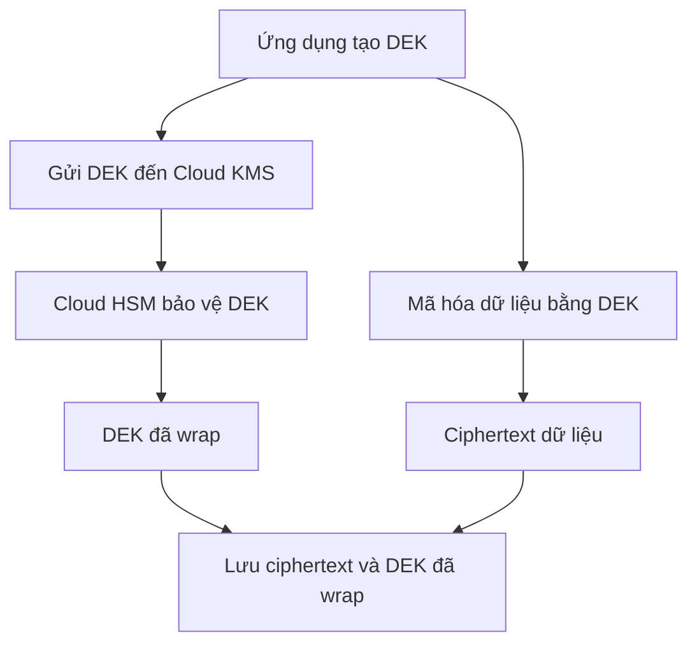
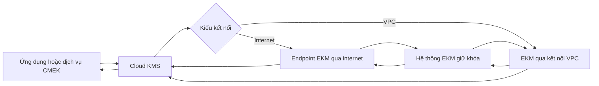

# Cloud HSM và Cloud External Key Manager

Trong chương **Khóa mã hóa và bí mật** của module `CLOUD_PROVIDERS_GCP`, bài học này tập trung vào hai cách bảo vệ khóa có yêu cầu cao hơn mức Cloud KMS xử lý hoàn toàn bằng phần mềm: **Cloud HSM** và **Cloud External Key Manager (Cloud EKM)**. Module giúp người học hiểu cách tổ chức project, IAM và VPC, lựa chọn Compute Engine, GKE, Cloud Run, dịch vụ lưu trữ và cơ sở dữ liệu, sau đó triển khai, bảo vệ tài nguyên, tự động hóa phát hành và theo dõi độ tin cậy cùng chi phí. Quản lý khóa là một phần quan trọng của chuỗi quyết định đó: một dịch vụ có thể mã hóa dữ liệu khi lưu trữ, nhưng tổ chức vẫn cần xác định ai kiểm soát khóa, khóa được bảo vệ ở đâu và điều gì xảy ra khi khóa không thể truy cập.

Cloud HSM và Cloud EKM đều được sử dụng thông qua **Cloud Key Management Service (Cloud KMS)**. Điểm khác nhau nằm ở nơi lưu giữ vật liệu khóa và nơi thực hiện phép toán mật mã. Với Cloud HSM, khóa được bảo vệ và xử lý trong phần cứng HSM do Google Cloud vận hành. Với Cloud EKM, vật liệu khóa chính nằm trong hệ thống quản lý khóa bên ngoài Google Cloud; Cloud KMS chuyển yêu cầu đến hệ thống đó khi cần thực hiện phép toán.

## Mục tiêu học tập

Sau bài học, người học có thể:

- Giải thích vai trò của Cloud KMS, Cloud HSM, Cloud EKM và CMEK trong kiến trúc bảo vệ dữ liệu trên Google Cloud.
- Phân biệt HSM đa khách hàng, HSM đơn khách hàng, EKM qua internet và EKM qua VPC.
- Mô tả luồng sử dụng khóa, vòng đời phiên bản khóa, quyền IAM và yêu cầu kết nối của từng lựa chọn.
- Tạo khóa HSM và khóa EKM mẫu bằng `gcloud` trong một project thử nghiệm.
- Đánh giá tác động của vị trí, độ trễ, tính sẵn sàng, khả năng tương thích CMEK và quy trình xoay vòng khóa trước khi triển khai production.

## 1. Đặt Cloud HSM và Cloud EKM vào kiến trúc Cloud KMS

Cloud KMS là mặt phẳng quản lý khóa tập trung của Google Cloud. Ứng dụng có thể gọi Cloud KMS API hoặc thư viện máy khách để mã hóa, giải mã, ký và xác minh chữ ký. Những dịch vụ Google Cloud có tích hợp **Customer-Managed Encryption Key (CMEK)** có thể dùng khóa Cloud KMS để bảo vệ khóa dữ liệu của chính dịch vụ đó.

Trong mô hình mã hóa phong bì (*envelope encryption*), dữ liệu lớn được mã hóa bằng một khóa dữ liệu (DEK). Cloud KMS bảo vệ DEK bằng một khóa gốc hoặc khóa mã hóa khóa (KEK). Dịch vụ lưu ciphertext cùng thông tin cần thiết để giải mã; khi cần đọc dữ liệu, dịch vụ yêu cầu Cloud KMS giải bọc DEK rồi dùng DEK để giải mã dữ liệu. Nhờ vậy, khóa quản lý trong Cloud KMS không phải trực tiếp mã hóa từng byte của một tệp lớn.

Cloud HSM và Cloud EKM là các mức bảo vệ của khóa trong Cloud KMS. Chúng không thay thế IAM, thiết kế mạng, quản lý danh tính workload hay chính sách lưu trữ. Một bucket, cơ sở dữ liệu hoặc workload GKE vẫn cần cấu hình CMEK đúng cách, cấp quyền cho danh tính dịch vụ phù hợp và đặt tài nguyên ở vị trí tương thích với khóa.

### Cấu trúc tài nguyên và phiên bản khóa

Cloud KMS tổ chức tài nguyên theo cấu trúc sau:

```text
Google Cloud organization
└── Project quản lý khóa
    └── Location
        └── Key ring
            └── CryptoKey
                ├── CryptoKeyVersion 1
                ├── CryptoKeyVersion 2
                └── CryptoKeyVersion 3 (primary)
```

- **Project** xác định ranh giới quản trị và nơi chứa tài nguyên Cloud KMS. Với hệ thống quan trọng, nên cân nhắc một project chuyên quản lý khóa để tách quyền quản trị khóa khỏi quyền vận hành ứng dụng.
- **Location** xác định vị trí địa lý của key ring và các khóa bên trong. Location phải hỗ trợ mức bảo vệ được chọn và phù hợp với dịch vụ sử dụng CMEK.
- **Key ring** là vùng chứa logic cho các khóa trong cùng location. Tên key ring có thể lặp ở location khác nhau, vì vậy luôn cần xác định cả project và location khi tham chiếu.
- **CryptoKey** là tài nguyên logic mang mục đích sử dụng, cấu hình xoay vòng, mẫu phiên bản và chính sách IAM.
- **CryptoKeyVersion** đại diện cho một phiên bản vật liệu khóa. Phiên bản có trạng thái riêng như `ENABLED`, `DISABLED` hoặc trạng thái chờ hủy. Phiên bản primary được dùng cho thao tác mã hóa mới đối với khóa đối xứng; các phiên bản cũ thường cần được giữ lại để giải mã dữ liệu đã mã hóa trước đó.

Ví dụ tên tài nguyên đầy đủ:

```text
projects/PROJECT_ID/locations/asia-southeast1/keyRings/app-ring/cryptoKeys/orders-key
```

Mỗi `CryptoKey` có một mục đích (`purpose`), chẳng hạn mã hóa/giải mã đối xứng hoặc ký/xác minh chữ ký bất đối xứng. Thuật toán hợp lệ phụ thuộc mục đích và mức bảo vệ. Khi chọn Cloud HSM hoặc Cloud EKM, cần kiểm tra thuật toán được hỗ trợ cho đúng loại khóa và đối tác EKM.

### CMEK khác gì Secret Manager?

CMEK và Cloud KMS quản lý **khóa mật mã** dùng để bảo vệ dữ liệu. Secret Manager lưu giữ **giá trị bí mật của ứng dụng**, ví dụ mật khẩu cơ sở dữ liệu, token API hoặc chứng chỉ. Một ứng dụng có thể lấy mật khẩu từ Secret Manager và dùng một khóa CMEK để bảo vệ dữ liệu trong dịch vụ lưu trữ. Hai dịch vụ giải quyết hai nhu cầu khác nhau và có thể được sử dụng cùng nhau.

## 2. Cloud HSM: khóa được bảo vệ trong phần cứng

### HSM là gì?

Hardware Security Module (HSM) là thiết bị chuyên dụng để tạo, lưu giữ và thực hiện phép toán mật mã trong một ranh giới phần cứng được bảo vệ. Cloud HSM cung cấp HSM được lưu trữ tại trung tâm dữ liệu Google Cloud. Google quản lý cụm HSM, khả năng mở rộng, tính sẵn sàng và việc bảo trì phần cứng; người dùng quản lý khóa thông qua Cloud KMS.

Theo tài liệu Cloud HSM hiện hành, các HSM sử dụng cho dịch vụ được chứng nhận **FIPS 140-2 Level 3**. Mức bảo vệ này phù hợp với tổ chức cần chứng minh vật liệu khóa và thao tác mật mã được xử lý trong phần cứng đạt yêu cầu kiểm định. Việc chọn HSM không tự động làm toàn bộ ứng dụng đạt chuẩn tuân thủ: danh tính, cấu hình dịch vụ, logging, quy trình vận hành và phạm vi kiểm định của hệ thống vẫn phải được đánh giá riêng.

Cloud HSM dùng Cloud KMS làm giao diện quản lý. Vì vậy, ứng dụng thường tiếp tục sử dụng Cloud KMS API hoặc client library hiện có; không cần viết một giao thức riêng chỉ vì khóa chuyển từ `SOFTWARE` sang `HSM`.

### HSM đa khách hàng và HSM đơn khách hàng

Cloud HSM có hai mức bảo vệ phần cứng chính:

| Mức bảo vệ | Mô hình | Khi nào cân nhắc |
|---|---|---|
| `HSM` | Khóa được lưu và xử lý trong cụm HSM đa khách hàng do Google sở hữu và vận hành. | Cần bảo vệ phần cứng đạt FIPS Level 3, nhưng muốn Google quản lý hạ tầng HSM. |
| `HSM_SINGLE_TENANT` | Khóa được lưu trong các partition HSM chuyên dụng cho một khách hàng. Khách hàng tạo và quản lý instance HSM đơn khách hàng theo cơ chế quản trị của dịch vụ. | Cần mức cô lập mật mã và quyền kiểm soát vận hành instance cao hơn. |

Cả hai mức đều được dùng thông qua Cloud KMS. HSM đơn khách hàng đòi hỏi kế hoạch quản trị instance, nhóm quản trị viên và quy trình phê duyệt phù hợp; không nên chọn chỉ vì tên gọi có chữ “single-tenant”. Cần xác định yêu cầu cô lập nào được kiểm soát bằng partition chuyên dụng và yêu cầu nào vẫn phụ thuộc vào project, IAM, ứng dụng hoặc dịch vụ Google Cloud.

### Những gì Cloud HSM bảo vệ

Khi tạo khóa có protection level `HSM`, các phép toán mật mã với phiên bản khóa đó được thực hiện trong HSM. Khóa có thể được tạo mới trong Cloud HSM hoặc nhập từ bên ngoài theo quy trình import được hỗ trợ. Các nhóm trường hợp thường gặp gồm:

- Khóa đối xứng để mã hóa và giải mã dữ liệu hoặc khóa dữ liệu.
- Khóa bất đối xứng để ký, xác minh chữ ký hoặc thực hiện các thao tác được thuật toán và mục đích khóa hỗ trợ.
- Khóa CMEK bảo vệ dữ liệu lưu trữ trong những dịch vụ Google Cloud có tích hợp tương thích.
- Khóa do ứng dụng gọi trực tiếp qua Cloud KMS API hoặc client library.

Cloud HSM phù hợp khi tổ chức cần giữ khóa trong ranh giới phần cứng do Google vận hành, cần chứng cứ về mức chứng nhận phần cứng, hoặc muốn giảm trách nhiệm tự triển khai cụm HSM. Project gửi yêu cầu mật mã tiêu thụ quota thao tác Cloud KMS; project chứa khóa HSM tiêu thụ quota HSM QPM. Hệ thống có lưu lượng lớn cần kiểm tra cả hai loại quota trước khi đưa vào production.

### Tạo key ring và khóa HSM bằng gcloud

Ví dụ sau tạo một key ring và khóa đối xứng đa khách hàng trong location `asia-southeast1`. Hãy thay `PROJECT_ID` bằng project thử nghiệm của bạn và xác nhận location hỗ trợ Cloud HSM trước khi chạy.

```bash
gcloud config set project PROJECT_ID

gcloud services enable cloudkms.googleapis.com

gcloud kms keyrings create app-ring \
  --location=asia-southeast1

gcloud kms keys create orders-data-key \
  --keyring=app-ring \
  --location=asia-southeast1 \
  --purpose=encryption \
  --protection-level=hsm
```

Để tạo khóa HSM đơn khách hàng, protection level là `hsm-single-tenant` và cần chỉ rõ tài nguyên instance HSM đơn khách hàng trong `--crypto-key-backend`. Instance và key ring phải ở cùng location. Hãy thay `LOCATION_SUPPORTING_SINGLE_TENANT_HSM` bằng một location hiện hỗ trợ HSM đơn khách hàng; không mặc định rằng location dùng cho ví dụ HSM đa khách hàng cũng hỗ trợ mức này. Ví dụ dưới đây giả định key ring `dedicated-ring` và instance HSM đã được tạo ở location đó:

```bash
gcloud kms keyrings create dedicated-ring \
  --location=LOCATION_SUPPORTING_SINGLE_TENANT_HSM

gcloud kms keys create orders-data-key-dedicated \
  --keyring=dedicated-ring \
  --location=LOCATION_SUPPORTING_SINGLE_TENANT_HSM \
  --purpose=encryption \
  --protection-level=hsm-single-tenant \
  --crypto-key-backend="projects/INSTANCE_PROJECT/locations/LOCATION_SUPPORTING_SINGLE_TENANT_HSM/singleTenantHsmInstances/INSTANCE_NAME"
```

`INSTANCE_PROJECT` và `INSTANCE_NAME` là project và tên instance đã được tạo, cấu hình và phê duyệt theo quy trình Cloud HSM đơn khách hàng. Lệnh ví dụ không tự tạo instance đó.

Sau khi tạo, kiểm tra key và phiên bản trong Cloud KMS, xác nhận protection level, purpose, algorithm, trạng thái và primary version. Không đưa khóa vào workload chỉ dựa trên việc lệnh tạo tài nguyên trả về thành công.

### Sử dụng khóa HSM cho dữ liệu lớn

Cloud HSM giới hạn kích thước plaintext/ciphertext do người dùng cung cấp cho thao tác mã hóa trực tiếp ở mức **8 KiB**, bao gồm additional authenticated data. Vì vậy, không nên gọi Cloud KMS để mã hóa trực tiếp từng tệp lớn hoặc từng payload ứng dụng.

Với dữ liệu lớn, dùng mã hóa phong bì:

1. Ứng dụng tạo một DEK ngẫu nhiên bằng bộ sinh số ngẫu nhiên mật mã phù hợp.
2. Ứng dụng dùng DEK để mã hóa dữ liệu bằng thuật toán đối xứng có xác thực, chẳng hạn AES-GCM.
3. Ứng dụng gửi DEK đến Cloud KMS để mã hóa (wrap) bằng khóa HSM.
4. Ứng dụng lưu ciphertext, DEK đã được wrap và metadata cần thiết như tên khóa, phiên bản khóa và nonce.
5. Khi đọc, ứng dụng yêu cầu Cloud KMS giải mã DEK rồi dùng DEK để giải mã dữ liệu.



Nếu sử dụng CMEK tích hợp sẵn, dịch vụ Google Cloud thường tự quản lý DEK và thao tác wrap/unwrap. Người vận hành chỉ cần cấu hình CMEK, quyền truy cập khóa và các chính sách liên quan theo hướng dẫn của dịch vụ.

## 3. Cloud External Key Manager: giữ vật liệu khóa trong hệ thống bên ngoài

### Mục đích và ranh giới tin cậy

Cloud External Key Manager cho phép sử dụng khóa do một hệ thống quản lý khóa bên ngoài Google Cloud tạo và lưu giữ. Hệ thống đó có thể do tổ chức vận hành hoặc do một đối tác EKM được hỗ trợ cung cấp. Cloud KMS giữ thông tin tham chiếu đến khóa bên ngoài và chuyển yêu cầu mật mã đến EKM khi cần.

Vật liệu khóa bên ngoài không được gửi sang Google Cloud và không được Cloud EKM lưu cache hay lưu trữ. Với khóa đối xứng, Cloud KMS còn tạo vật liệu khóa nội bộ riêng để bổ sung một lớp bảo vệ khi trao đổi với EKM. Do đó, cần phân biệt rõ **vật liệu khóa bên ngoài** và **vật liệu khóa nội bộ của Cloud KMS**. Để giải mã dữ liệu đã mã hóa bằng Cloud EKM, cần cả hai thành phần tương ứng; chỉ giữ lại URI hoặc đường dẫn đến EKM là chưa đủ.

Mỗi phiên bản Cloud EKM có các thành phần chính:

- **Vật liệu khóa bên ngoài**: được tạo và lưu trong EKM, không rời khỏi hệ thống đó.
- **Tham chiếu khóa**: URI hoặc key path định danh khóa trong EKM. Cloud EKM dùng tham chiếu này để gửi yêu cầu.
- **Vật liệu khóa nội bộ**: với khóa đối xứng, Cloud KMS tạo và giữ vật liệu bổ sung để bảo vệ luồng trao đổi. Thành phần này không áp dụng theo cùng cách cho khóa ký bất đối xứng.

Luồng xử lý khái quát:



Với thao tác đối xứng, Cloud KMS và EKM phối hợp xử lý dữ liệu theo giao thức Cloud EKM. Kết quả cuối cùng phụ thuộc vào cả phiên bản Cloud EKM và khóa trong EKM. Nếu mất phiên bản Cloud EKM hoặc mất quyền truy cập vật liệu khóa bên ngoài, dữ liệu đã mã hóa có thể không thể khôi phục.

### Hai protection level: EXTERNAL và EXTERNAL_VPC

| Protection level | Đường kết nối | Đặc điểm cần cân nhắc |
|---|---|---|
| `EXTERNAL` | Google Cloud liên lạc với EKM qua internet. | Có thể sử dụng ở nhiều location Cloud KMS, gồm một số location đa vùng. Phụ thuộc chất lượng mạng và tính sẵn sàng của endpoint EKM. |
| `EXTERNAL_VPC` | Google Cloud liên lạc với EKM qua VPC theo cấu hình EKM connection. | Giảm phụ thuộc vào đường internet công cộng và có thể cải thiện tính sẵn sàng. Hiện chỉ hỗ trợ ở các location khu vực phù hợp, không hỗ trợ location đa vùng. |

Chọn đường kết nối dựa trên kiến trúc mạng và yêu cầu sẵn sàng thực tế. EKM qua VPC vẫn cần vận hành endpoint EKM, VPC, kết nối, định tuyến, quyền truy cập và năng lực xử lý ở phía đối tác. VPC không tự động loại bỏ mọi lỗi mạng hoặc lỗi từ EKM.

### Quản lý thủ công và quản lý phối hợp

Cloud EKM có hai cách quản lý vòng đời khóa:

**Khóa bên ngoài quản lý thủ công (manually managed)**

- Quản trị viên tạo khóa trong hệ thống EKM trước.
- Quản trị viên cấp quyền cho danh tính dịch vụ Cloud EKM sử dụng khóa đó.
- Quản trị viên tạo khóa/phiên bản tương ứng trong Cloud KMS bằng URI hoặc key path.
- Xoay vòng, vô hiệu hóa và hủy khóa cần được phối hợp ở cả Cloud KMS lẫn EKM theo đúng thứ tự.
- Khóa EKM qua internet luôn thuộc mô hình quản lý thủ công. Tự động xoay vòng không được hỗ trợ cho khóa bên ngoài quản lý thủ công.

**Khóa bên ngoài quản lý phối hợp (coordinated external keys)**

- Chỉ sử dụng với EKM qua VPC và đối tác hỗ trợ Cloud EKM control plane.
- EKM connection được cấu hình ở chế độ quản lý khóa từ Cloud KMS.
- Khi tạo khóa, Cloud KMS gửi yêu cầu đến EKM; EKM tạo vật liệu khóa và trả key path.
- Các thao tác tạo phiên bản mới, xoay vòng hoặc hủy có thể được khởi tạo từ Cloud KMS và phối hợp với EKM.
- Khóa đối xứng được quản lý phối hợp có thể hỗ trợ tự động xoay vòng theo lịch cấu hình.

Không được nhầm việc xoay phiên bản trong Cloud KMS với việc xoay vật liệu khóa trong EKM. Với mô hình thủ công, phải cập nhật cả hai phía và kiểm tra phiên bản primary. Với mô hình phối hợp, vẫn cần xác nhận đối tác EKM đã hoàn thành thao tác và phiên bản mới có thể sử dụng.

### Chuẩn bị và tạo khóa EKM qua internet

Trước khi tạo khóa, cần hoàn thành các việc sau:

1. Chọn một Google Cloud project để quản lý tài nguyên Cloud KMS. Với môi trường quan trọng, cân nhắc project chuyên dụng cho khóa.
2. Bật Cloud KMS API và tạo key ring ở location hỗ trợ Cloud EKM, gần location của tài nguyên cần bảo vệ và gần EKM nhất có thể.
3. Tạo hoặc chọn khóa trong hệ thống EKM. Ghi lại URI của khóa.
4. Xác định service account Cloud EKM của project. Dạng tên thường gặp là `service-PROJECT_NUMBER@gcp-sa-ekms.iam.gserviceaccount.com`.
5. Cấp cho service account này quyền sử dụng khóa trong hệ thống EKM. Đây là quyền ở phía EKM, độc lập với IAM policy của Cloud KMS.
6. Nếu chọn EKM qua VPC, tạo và kiểm tra EKM connection trước khi tạo khóa.

Ví dụ dưới đây tạo một khóa EKM đối xứng quản lý thủ công qua internet. Hãy thay các placeholder bằng giá trị thực trong môi trường thử nghiệm. Không dùng URI minh họa hoặc service account giả trong production.

```bash
gcloud config set project PROJECT_ID

gcloud services enable cloudkms.googleapis.com

gcloud kms keyrings create app-ekm-ring \
  --location=asia-southeast1

# Tạo CryptoKey rỗng; phiên bản sẽ được liên kết ở bước tiếp theo.
gcloud kms keys create customer-data-ekm \
  --keyring=app-ekm-ring \
  --location=asia-southeast1 \
  --purpose=encryption \
  --protection-level=external \
  --skip-initial-version-creation \
  --default-algorithm=google-symmetric-encryption

# Liên kết phiên bản Cloud EKM với khóa đã tồn tại trong EKM.
gcloud kms keys versions create \
  --key=customer-data-ekm \
  --keyring=app-ekm-ring \
  --location=asia-southeast1 \
  --external-key-uri=EXTERNAL_KEY_URI \
  --primary
```

Với khóa qua VPC, cần tạo EKM connection trước và cấu hình protection level `external-vpc`, sau đó chỉ định connection trong `--crypto-key-backend`. Nếu đối tác hỗ trợ chế độ quản lý phối hợp, hãy cấu hình EKM connection ở chế độ Cloud KMS trước khi tạo khóa. Cú pháp và các trường cần thiết có thể khác theo kiểu connection và phiên bản Google Cloud CLI; kiểm tra `gcloud kms keys create --help` và tài liệu của đối tác trước khi chạy.

Sau khi tạo, kiểm tra trạng thái phiên bản. Nếu URI sai, EKM không tìm thấy khóa hoặc service account chưa được cấp quyền, phiên bản có thể không được tạo. Sửa nguyên nhân ở phía EKM hoặc cấu hình rồi thử lại; không tiếp tục gắn một khóa chưa có phiên bản dùng được vào workload.

### Key Access Justifications

Nếu tổ chức sử dụng Key Access Justifications (KAJ) với EKM được hỗ trợ, mỗi yêu cầu truy cập khóa có thể kèm mã lý do truy cập. Đối tác EKM có thể ghi nhận và cho phép hoặc từ chối yêu cầu dựa trên mã lý do theo chính sách đã cấu hình.

KAJ hữu ích khi tổ chức cần thêm bằng chứng về lý do một thao tác truy cập khóa được thực hiện. Tuy nhiên, KAJ không thay thế IAM, audit log hoặc quy trình phê duyệt thay đổi. Cần kiểm tra khả năng hỗ trợ của EKM partner, chính sách reason code và hành vi khi một yêu cầu bị từ chối.

## 4. So sánh Cloud HSM và Cloud EKM

| Tiêu chí | Cloud HSM | Cloud EKM |
|---|---|---|
| Nơi giữ vật liệu khóa chính | HSM trong hạ tầng Google Cloud. | Hệ thống EKM bên ngoài Google Cloud. |
| Nơi thực hiện phép toán | Trong HSM. | EKM thực hiện phần thao tác yêu cầu khóa bên ngoài; Cloud KMS điều phối theo giao thức EKM. |
| Mức bảo vệ | `HSM` hoặc `HSM_SINGLE_TENANT`. | `EXTERNAL` hoặc `EXTERNAL_VPC`. |
| Kết nối ngoài | Không cần gọi một EKM của khách hàng cho mỗi thao tác. | Cần kết nối tới EKM qua internet hoặc VPC. |
| Quyền kiểm soát khóa | Quản lý qua Cloud KMS; Google vận hành hạ tầng HSM. | Tổ chức/đối tác quản lý vật liệu khóa và quyền ở EKM; Cloud KMS quản lý tham chiếu và phiên bản tương ứng. |
| Xoay vòng | Có thể cấu hình lịch xoay vòng cho khóa đối xứng theo khả năng Cloud KMS. | Thủ công phải phối hợp hai phía; phối hợp qua VPC có thể hỗ trợ tự động xoay vòng khóa đối xứng. |
| Rủi ro vận hành nổi bật | Location, quota, quyền IAM, giới hạn HSM và độ trễ một số phép toán bất đối xứng. | Mất kết nối, EKM không sẵn sàng, quyền bị thu hồi, sai URI/key path và mất đồng bộ phiên bản. |
| Phù hợp khi | Cần phần cứng HSM được chứng nhận và muốn Google quản lý hạ tầng HSM. | Cần giữ vật liệu khóa trong hệ thống quản lý khóa ngoài Google Cloud hoặc cần kiểm soát truy cập ở phía EKM. |

Không có lựa chọn nào luôn tốt hơn lựa chọn còn lại. Cloud HSM thường phù hợp khi yêu cầu chính là phần cứng HSM đạt chứng nhận, tích hợp trực tiếp với Cloud KMS và giảm phụ thuộc vào hệ thống mật mã bên ngoài. Cloud EKM phù hợp khi tổ chức cần giữ vật liệu khóa trong hệ thống bên ngoài hoặc cần áp dụng chính sách kiểm soát khóa tập trung ở EKM. Đổi lại, Cloud EKM làm tăng phụ thuộc vào đối tác và đường kết nối.

## 5. IAM, phân tách nhiệm vụ và giám sát

### Phân quyền theo vai trò

Cloud KMS sử dụng Identity and Access Management (IAM). Có thể cấp quyền ở cấp key, key ring, project, folder hoặc organization; quyền ở cấp cha được kế thừa xuống tài nguyên con.

Nên tách ít nhất hai nhóm nhiệm vụ:

- **Quản trị khóa**: tạo key ring, tạo khóa, thay đổi policy, xoay vòng và lên lịch hủy phiên bản. Vai trò `roles/cloudkms.admin` có quyền quản trị rộng, vì vậy chỉ cấp cho nhóm chịu trách nhiệm quản lý khóa.
- **Sử dụng khóa**: workload hoặc service agent chỉ cần quyền thực hiện thao tác mật mã. Với trường hợp mã hóa/giải mã, vai trò thường dùng là `roles/cloudkms.cryptoKeyEncrypterDecrypter` trên đúng khóa cần dùng.

Đối với CMEK, xác định service agent của dịch vụ đang bảo vệ dữ liệu và cấp quyền Cloud KMS cần thiết cho danh tính đó. Với Cloud EKM, ngoài IAM của Cloud KMS, cần cấp quyền riêng cho service account Cloud EKM trong hệ thống EKM. Hai lớp quyền này phục vụ hai ranh giới khác nhau; cấp quyền ở một nơi không tự động cấp quyền ở nơi còn lại.

Một số nguyên tắc thực hành:

- Ưu tiên cấp quyền ở cấp key thay vì cấp rộng ở project khi workload chỉ cần một khóa.
- Dùng service account riêng cho workload và nhóm Google Group cho người quản trị; tránh dùng user cá nhân làm danh tính ứng dụng.
- Tách người có quyền dùng khóa khỏi người có quyền hủy phiên bản khóa nếu mô hình rủi ro yêu cầu phân tách nhiệm vụ.
- Rà soát quyền kế thừa từ folder và organization; một binding ở cấp cha có thể mở rộng quyền ngoài dự kiến.
- Không lưu khóa riêng, URI có thông tin nhạy cảm hoặc credential của EKM trong mã nguồn, image, biến môi trường dùng chung hay log ứng dụng.

### Audit log và quan sát vận hành

Cloud Audit Logs ghi nhận hoạt động quản trị và hoạt động truy cập dữ liệu của Cloud KMS. Có thể tìm các bản ghi của dịch vụ bằng truy vấn Logs Explorer:

```text
protoPayload.serviceName="cloudkms.googleapis.com"
```

Admin Activity logs ghi lại các thay đổi quản trị. Data Access logs cần được bật theo cấu hình logging của project hoặc organization để theo dõi các thao tác truy cập dữ liệu tương ứng. Với Cloud EKM, nên bật audit logging cả ở hệ thống EKM để đối chiếu yêu cầu đến từ Google Cloud với quyết định cho phép/từ chối ở phía đối tác.

Khi giám sát, nên theo dõi:

- Tỷ lệ lỗi mã hóa/giải mã và lỗi quyền truy cập khóa.
- Lỗi kết nối, timeout và phản hồi từ EKM partner.
- Trạng thái phiên bản khóa, phiên bản primary và các phiên bản đang được dữ liệu cũ sử dụng.
- Quota thao tác mật mã, quota HSM và quota riêng của Cloud EKM.
- Thay đổi IAM, thao tác xoay vòng, vô hiệu hóa và lịch hủy phiên bản.

Với Cloud EKM, lỗi không truy cập được khóa có thể xuất hiện dưới dạng `FAILED_PRECONDITION`. Cần đối chiếu chi tiết lỗi ở Cloud Audit Logs, Cloud KMS và log của EKM partner để xác định đó là lỗi mạng, sai tham chiếu, thiếu quyền hay EKM không phản hồi.

## 6. Xoay vòng, vô hiệu hóa và hủy khóa

Xoay vòng tạo một phiên bản khóa mới. Đối với khóa đối xứng, phiên bản primary mới được dùng cho dữ liệu mã hóa sau thời điểm xoay vòng. Ciphertext cũ vẫn cần phiên bản cũ để giải mã, vì vậy việc đổi primary không đồng nghĩa dữ liệu đã được mã hóa lại bằng phiên bản mới.

Quy trình vận hành an toàn cần có các bước:

1. Xác định hệ thống nào đang dùng khóa và phiên bản nào đã bảo vệ dữ liệu.
2. Tạo phiên bản mới theo quy trình phù hợp với HSM hoặc EKM.
3. Kiểm tra phiên bản mới ở trạng thái sử dụng được và thực hiện một phép thử mã hóa/giải mã có kiểm soát.
4. Chuyển primary nếu mục đích là dùng phiên bản mới cho các thao tác mã hóa tiếp theo.
5. Theo dõi lỗi trong thời gian chuyển đổi và giữ các phiên bản cũ cần thiết để giải mã dữ liệu hiện có.
6. Chỉ lên lịch hủy phiên bản cũ sau khi đã xác nhận không còn dữ liệu hoặc hệ thống phụ thuộc vào phiên bản đó, đồng thời đáp ứng yêu cầu lưu trữ và khôi phục.

Với EKM quản lý thủ công, thực hiện thay đổi ở EKM và Cloud KMS theo đúng trình tự của đối tác. Không xóa khóa trong EKM chỉ vì phiên bản Cloud KMS đã được xoay vòng. Với EKM quản lý phối hợp, kiểm tra kết quả thao tác ở cả hai hệ thống và lưu bằng chứng vận hành.

`DISABLED` có nghĩa là phiên bản không được dùng cho thao tác mật mã cho đến khi được bật lại; nếu một dịch vụ cần phiên bản đó để đọc dữ liệu, việc vô hiệu hóa có thể làm dữ liệu tạm thời không truy cập được. Hủy phiên bản sau thời gian chờ là thao tác không thể đảo ngược; khi vật liệu cần thiết đã bị phá hủy, dữ liệu phụ thuộc vào nó có thể mất vĩnh viễn.

## 7. Location, tương thích và các giới hạn cần kiểm tra

### Location của khóa và tài nguyên

Với CMEK, location của khóa phải khớp chính xác với location yêu cầu của dịch vụ được bảo vệ. Điều này áp dụng cho các loại location khu vực, hai vùng và đa vùng theo quy định của từng tích hợp. Cloud HSM không có ở mọi location; HSM đơn khách hàng chỉ có ở một tập con location hỗ trợ HSM đa khách hàng.

Cloud EKM cần đặt gần EKM partner để giảm độ trễ và lỗi timeout. EKM qua internet có mặt ở nhiều location Cloud KMS, còn EKM qua VPC chỉ có ở các location khu vực được hỗ trợ và không có ở location đa vùng. Một số location như `global` và `nam-eur-asia1` không hỗ trợ Cloud EKM. Danh sách location có thể thay đổi; luôn kiểm tra trang Cloud KMS locations trước khi thiết kế hoặc triển khai.

### Tương thích dịch vụ CMEK

Không phải mọi dịch vụ hỗ trợ CMEK đều hỗ trợ Cloud EKM. Một dịch vụ có thể hỗ trợ CMEK với khóa Cloud KMS phần mềm và HSM nhưng không hỗ trợ khóa EKM. Trước khi chọn EKM, hãy kiểm tra danh sách CMEK integrations và bộ lọc EKM-compatible cho đúng loại tài nguyên, ví dụ bucket, dataset, database, disk hoặc dữ liệu ở lớp ứng dụng của GKE.

### Tính sẵn sàng và rủi ro mất quyền truy cập

Cloud HSM loại bỏ một phụ thuộc vào EKM do khách hàng vận hành, nhưng vẫn phụ thuộc vào location được hỗ trợ, quota, IAM và trạng thái dịch vụ Cloud KMS/HSM.

Cloud EKM bổ sung một phụ thuộc trực tiếp vào hệ thống bên ngoài. Nếu EKM không sẵn sàng, Cloud KMS không thể hoàn tất yêu cầu cần khóa đó. Hậu quả phụ thuộc dịch vụ: workload có thể lỗi, ứng dụng không khởi động được hoặc dữ liệu không thể giải mã. Trong một số tích hợp, việc khóa không sẵn sàng kéo dài có thể dẫn tới hậu quả nghiêm trọng như mất dữ liệu. Xoay vòng sang một phiên bản mới không tự khôi phục dữ liệu đã mã hóa bằng phiên bản cũ đang không truy cập được.

Vì vậy, trước khi dùng EKM cho dữ liệu production:

- Xác nhận SLA và quy trình hỗ trợ của cả Google Cloud lẫn EKM partner.
- Thiết kế endpoint, kết nối và năng lực EKM để chịu được tải cao điểm.
- Kiểm thử tình huống mất kết nối, timeout, thu hồi quyền và khôi phục EKM.
- Duy trì bản sao lưu và diễn tập khôi phục theo đúng quy trình của dịch vụ lưu trữ hoặc cơ sở dữ liệu.
- Xác định rõ người chịu trách nhiệm xử lý sự cố ở mỗi phía và cách liên hệ hỗ trợ.

## 8. Tình huống triển khai và cách chọn dịch vụ

### Tình huống A: Bucket lưu hồ sơ cần khóa HSM

Một nhóm vận hành lưu hồ sơ khách hàng trong Cloud Storage. Chính sách nội bộ yêu cầu khóa CMEK phải được bảo vệ bằng HSM đạt chứng nhận. Nhóm có thể:

1. Tạo project chuyên quản lý khóa trong cùng organization.
2. Chọn location hỗ trợ Cloud HSM và trùng location yêu cầu của bucket.
3. Tạo key ring và khóa có protection level `HSM`.
4. Cấp quyền sử dụng khóa cho service agent Cloud Storage theo tài liệu CMEK của dịch vụ.
5. Tạo bucket với CMEK đã chọn, bật audit log cần thiết và theo dõi thao tác khóa.
6. Kiểm tra đọc/ghi dữ liệu, khôi phục dữ liệu và quy trình xoay vòng trước khi đưa vào sử dụng thật.

Trong trường hợp này, Cloud HSM đáp ứng yêu cầu phần cứng mà không cần nhóm tự vận hành một hệ thống EKM bên ngoài.

### Tình huống B: Tổ chức cần giữ khóa trong EKM riêng

Một tổ chức đã có hệ thống EKM được hỗ trợ và yêu cầu vật liệu khóa chính phải nằm trong hệ thống đó. Nhóm triển khai:

1. Chọn location Cloud KMS gần EKM và tương thích với dịch vụ CMEK đích.
2. Quyết định kết nối qua internet hay VPC theo yêu cầu mạng, độ trễ và tính sẵn sàng.
3. Cấp quyền cho Cloud EKM service account trong EKM.
4. Tạo khóa Cloud EKM bằng URI/key path và kiểm tra phiên bản.
5. Cấu hình IAM cho service agent của dịch vụ Google Cloud sử dụng CMEK.
6. Bật audit log ở Cloud KMS và EKM, thử thu hồi quyền có kiểm soát và diễn tập khôi phục.

Nếu cần quản lý xoay vòng từ Cloud KMS, nhóm phải xác nhận đối tác hỗ trợ coordinated external keys và EKM connection được cấu hình ở chế độ phù hợp. Nếu không, quy trình xoay vòng cần được điều phối thủ công ở hai hệ thống.

### Tình huống C: Dữ liệu có lưu lượng truy cập cao và yêu cầu độ sẵn sàng nghiêm ngặt

Nếu mỗi lần đọc dữ liệu đều phụ thuộc vào một EKM bên ngoài qua internet, độ trễ và tính sẵn sàng của EKM trở thành một phần của đường xử lý dữ liệu. Khi ứng dụng có mức chịu lỗi thấp, cần so sánh Cloud HSM với EKM qua VPC, kiểm tra giới hạn của dịch vụ tích hợp, tải dự kiến, SLA và chi phí. Không chọn EKM chỉ vì quyền kiểm soát vật liệu khóa cao hơn nếu tổ chức chưa có khả năng vận hành EKM ở mức độ tin cậy tương ứng.

### Bảng quyết định nhanh

| Yêu cầu chính | Hướng lựa chọn ban đầu |
|---|---|
| Cần HSM đạt FIPS Level 3, tích hợp Cloud KMS và giảm vận hành phần cứng | Cloud HSM đa khách hàng (`HSM`). |
| Cần partition HSM chuyên dụng và quyền quản lý instance riêng | Đánh giá Cloud HSM đơn khách hàng (`HSM_SINGLE_TENANT`). |
| Vật liệu khóa phải nằm trong hệ thống EKM ngoài Google Cloud | Cloud EKM (`EXTERNAL` hoặc `EXTERNAL_VPC`). |
| Cần kết nối riêng qua VPC và đối tác hỗ trợ điều khiển vòng đời từ Cloud KMS | Cloud EKM qua VPC với coordinated external keys. |
| Dịch vụ đích không hỗ trợ Cloud EKM hoặc workload không chịu được phụ thuộc EKM | Chọn Cloud HSM hoặc mức bảo vệ Cloud KMS khác phù hợp. |

## 9. Checklist trước khi đưa khóa vào production

- [ ] Xác định dữ liệu, workload và dịch vụ Google Cloud sẽ được bảo vệ bằng khóa.
- [ ] Kiểm tra dịch vụ đích hỗ trợ CMEK và protection level đã chọn.
- [ ] Chọn project quản lý khóa, location và key ring theo yêu cầu tổ chức và vị trí dữ liệu.
- [ ] Chọn `HSM`, `HSM_SINGLE_TENANT`, `EXTERNAL` hoặc `EXTERNAL_VPC` theo ranh giới tin cậy cần thiết.
- [ ] Phân tách quyền quản trị khóa và quyền sử dụng khóa; cấp IAM tối thiểu cho workload/service agent.
- [ ] Với EKM, xác nhận service account Cloud EKM được cấp quyền ở phía đối tác và kết nối đã được kiểm tra.
- [ ] Xác định lịch xoay vòng, cách xử lý phiên bản cũ và thời điểm được phép hủy.
- [ ] Bật audit log phù hợp và kiểm tra log ở cả Cloud KMS lẫn EKM partner nếu có.
- [ ] Kiểm thử quota, độ trễ, lỗi quyền, lỗi kết nối và quy trình khôi phục.
- [ ] Lưu quy trình vận hành, người trực, hợp đồng hỗ trợ và bằng chứng kiểm thử khôi phục.

## 10. Kết luận

Cloud HSM cung cấp khả năng bảo vệ và xử lý khóa trong phần cứng HSM do Google Cloud quản lý, phù hợp với yêu cầu về chứng nhận phần cứng và tích hợp Cloud KMS. Cloud EKM cho phép tổ chức giữ vật liệu khóa chính trong một hệ thống quản lý khóa bên ngoài, đồng thời dùng Cloud KMS để tích hợp với các dịch vụ Google Cloud tương thích. Lựa chọn phù hợp phụ thuộc vào ranh giới kiểm soát khóa, vị trí dữ liệu, yêu cầu tuân thủ, độ sẵn sàng, khả năng vận hành và hỗ trợ của dịch vụ đích.

Trong kiến trúc GCP thực tế, hãy xem khóa là một thành phần của thiết kế bảo mật tổng thể: project và IAM xác định ai quản lý và ai sử dụng khóa; VPC và location ảnh hưởng đến đường kết nối; dịch vụ như Compute Engine, GKE, Cloud Run, Cloud Storage và cơ sở dữ liệu quyết định cách CMEK được tích hợp; audit log, quota và diễn tập khôi phục giúp duy trì độ tin cậy. Một cấu hình khóa tốt cần được kiểm chứng cả lúc tạo, lúc sử dụng, khi xoay vòng và khi xảy ra sự cố.

## Tài liệu tham khảo

- [Cloud Key Management Service overview](https://cloud.google.com/kms/docs/key-management-service)
- [Cloud HSM](https://cloud.google.com/kms/docs/hsm)
- [Cloud External Key Manager](https://cloud.google.com/kms/docs/ekm)
- [Protection levels](https://cloud.google.com/kms/docs/protection-levels)
- [Create an external key](https://cloud.google.com/kms/docs/create-external-key)
- [Access control with IAM](https://cloud.google.com/kms/docs/iam)
- [Cloud KMS audit logging](https://cloud.google.com/kms/docs/audit-logging)
- [Cloud KMS locations](https://cloud.google.com/kms/docs/locations)
