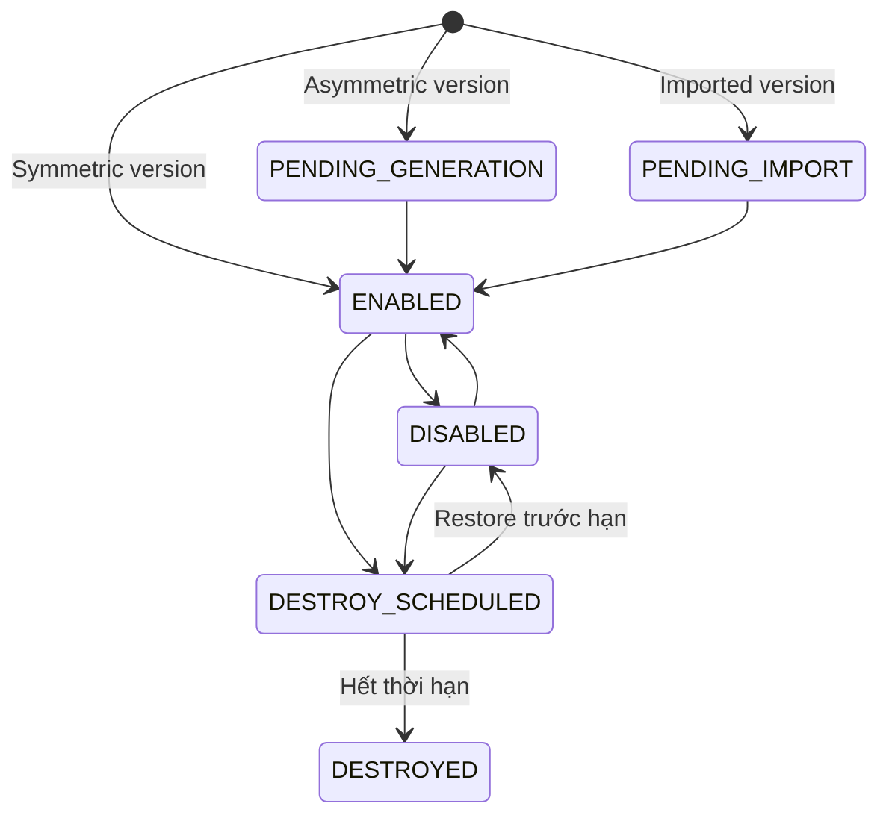
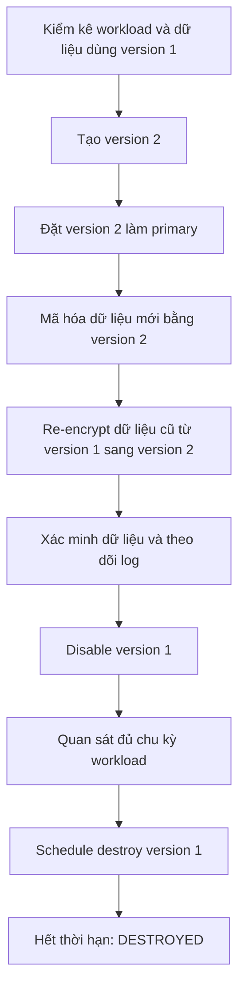

# Key rotation, disable, destroy và khôi phục key versions

Trong Google Cloud, Cloud Key Management Service (Cloud KMS) quản lý vật liệu khóa dùng để mã hóa, giải mã, ký và xác minh dữ liệu. Một CryptoKey có thể có nhiều CryptoKeyVersion. Vòng đời của từng version quyết định ứng dụng có thể tiếp tục mã hóa, giải mã hoặc xác minh dữ liệu hay không.

Chủ đề này thuộc module **CLOUD_PROVIDERS_GCP**, nơi người học khám phá cách tổ chức project, IAM, VPC, Compute Engine, GKE, Cloud Run, lưu trữ và cơ sở dữ liệu. Quản lý vòng đời khóa là năng lực bảo vệ xuyên suốt các dịch vụ đó: một thao tác disable hoặc destroy sai thời điểm có thể khiến workload ngừng hoạt động hoặc dữ liệu mất khả năng truy cập.

Sau bài học, bạn có thể:

- Phân biệt CryptoKey và CryptoKeyVersion, đồng thời giải thích vai trò của primary version.
- Thiết lập lịch rotation hoặc tạo version mới thủ công.
- Chọn đúng thời điểm disable một version để kiểm tra việc ngừng sử dụng.
- Phân biệt destroy với delete và giải thích khoảng thời gian khôi phục.
- Xây dựng quy trình kiểm kê, chuyển đổi dữ liệu, theo dõi và thu hồi version cũ.

## 1. CryptoKey và CryptoKeyVersion

**CryptoKey** là tài nguyên logic đại diện cho một khóa trong Cloud KMS. **CryptoKeyVersion** chứa vật liệu khóa mật mã thực tế. Mỗi lần tạo version mới, Cloud KMS tạo một bộ vật liệu khóa mới thuộc cùng CryptoKey.

Với khóa mã hóa đối xứng, một version được chọn làm **primary version**. Các yêu cầu mã hóa mới sử dụng primary version hiện tại. Ciphertext do Cloud KMS tạo lưu thông tin version đã dùng, vì vậy khi giải mã, Cloud KMS có thể chọn đúng version cũ miễn là version đó vẫn ở trạng thái ENABLED. Việc đổi primary không tự chuyển đổi ciphertext đã tồn tại.

Với khóa bất đối xứng, ứng dụng chỉ định version cụ thể khi mã hóa hoặc ký. Ứng dụng cần quản lý việc phân phối public key và chọn version; không có cơ chế automatic rotation như khóa mã hóa đối xứng.

Một điểm cần nhớ: **CryptoKey không có trạng thái ENABLED hay DISABLED; trạng thái được gán cho từng CryptoKeyVersion.**

| Trạng thái | Ý nghĩa | Có thể sử dụng cho thao tác mật mã? |
|---|---|---|
| PENDING_GENERATION | Cloud KMS đang tạo version bất đối xứng | Chưa |
| PENDING_IMPORT | Cloud KMS đang nhập vật liệu khóa | Chưa |
| ENABLED | Version sẵn sàng hoạt động | Có |
| DISABLED | Vật liệu khóa vẫn còn nhưng version bị chặn sử dụng | Không; có thể enable lại |
| DESTROY_SCHEDULED | Version đang chờ hết thời hạn hủy | Không; có thể restore trong thời hạn |
| DESTROYED | Vật liệu khóa đã bị hủy về mặt logic | Không; không thể khôi phục thông thường |

Luồng trạng thái chính:



Khi restore một version đang DESTROY_SCHEDULED, trạng thái sau restore là DISABLED. Bạn phải enable version riêng trước khi dùng nó cho thao tác mật mã.

## 2. Rotation: tạo version mới và chuyển primary

Rotation là quá trình tạo vật liệu khóa mới để dùng cho các thao tác mã hóa hoặc ký tiếp theo. Rotation giúp giới hạn lượng dữ liệu được bảo vệ bởi một version và hỗ trợ chính sách quản trị khóa.

### Automatic rotation

Với khóa mã hóa đối xứng, bạn có thể cấu hình:

- **Rotation period**: khoảng thời gian giữa các lần tạo version mới.
- **Next rotation time**: thời điểm thực hiện lần rotation kế tiếp.

Khi đến lịch, Cloud KMS tự tạo version mới và đặt version đó làm primary. Ví dụ, lịch 90 ngày sẽ tạo primary version mới theo chu kỳ 90 ngày. Con số này chỉ là ví dụ; chu kỳ thực tế cần dựa trên yêu cầu bảo mật, vận hành và quy định của tổ chức.

Ví dụ cập nhật lịch cho một khóa đã tồn tại:

```bash
gcloud kms keys update orders-data-key \
  --keyring=application-keyring \
  --location=asia-southeast1 \
  --rotation-period=90d \
  --next-rotation-time=2026-12-01T00:00:00Z
```

Automatic rotation không được hỗ trợ cho khóa bất đối xứng dùng để ký hoặc mã hóa. Với các khóa đó, đội vận hành phải tạo version mới, phân phối public key hoặc cập nhật cấu hình ứng dụng, rồi chuyển workload sang version mới theo quy trình riêng.

### Manual rotation

Bạn có thể tạo version mới ngay khi cần, chẳng hạn khi đến kỳ thay khóa hoặc khi chính sách yêu cầu thay đổi thuật toán. Lệnh tạo version:

```bash
gcloud kms keys versions create \
  --key=orders-data-key \
  --keyring=application-keyring \
  --location=asia-southeast1
```

Lệnh trên tạo version mới nhưng **không tự đặt version đó làm primary**. Với khóa đối xứng, hãy lấy số version vừa tạo, xác nhận version ở trạng thái ENABLED, sau đó cập nhật primary:

```bash
gcloud kms keys update orders-data-key \
  --keyring=application-keyring \
  --location=asia-southeast1 \
  --primary-version=2
```

Thay số 2 bằng version thực tế vừa tạo. Chỉ một version có thể là primary tại một thời điểm. Version được chọn làm primary phải ở trạng thái ENABLED.

### Rotation không tự mã hóa lại dữ liệu cũ

Đây là khác biệt quan trọng nhất giữa rotation và re-encryption:

- Rotation tạo version mới và chuyển các thao tác mã hóa mới sang version đó.
- Ciphertext cũ vẫn phụ thuộc vào version đã mã hóa nó.
- Các version cũ không tự động bị disable hoặc destroy sau rotation.
- Ứng dụng vẫn cần version cũ để giải mã dữ liệu đã được mã hóa bằng version đó.

Ví dụ, version 1 đã mã hóa 4 triệu bản ghi. Sau khi tạo version 2 và đặt làm primary, các bản ghi mới được mã hóa bằng version 2; 4 triệu bản ghi cũ vẫn cần version 1 để giải mã. Nếu disable hoặc destroy version 1 quá sớm, ứng dụng có thể mất khả năng đọc dữ liệu cũ.

Muốn loại bỏ sự phụ thuộc vào version cũ, ứng dụng phải thực hiện **re-encryption**:

1. Xác định dữ liệu, dịch vụ và workload đang dùng version cũ.
2. Đọc ciphertext và giải mã bằng version cũ khi version đó còn ENABLED.
3. Mã hóa plaintext bằng primary version mới.
4. Ghi ciphertext mới một cách an toàn; xác minh dữ liệu trước khi thay thế bản ghi cũ.
5. Đối chiếu số lượng bản ghi, kết quả đọc thử, tính toàn vẹn và log lỗi.
6. Chỉ sau khi xác nhận không còn phụ thuộc, chuyển version cũ sang quy trình disable rồi destroy.

Cloud KMS cung cấp thao tác mật mã nhưng không tự tìm và viết lại mọi bản sao dữ liệu do ứng dụng hoặc dịch vụ khác lưu trữ. Với tài nguyên dùng CMEK, hãy kiểm tra hướng dẫn rotation và re-encryption của dịch vụ đang bảo vệ tài nguyên đó. Key usage tracking có thể hỗ trợ kiểm kê nhưng dữ liệu theo dõi có thể trễ hoặc chưa đầy đủ.

## 3. Disable và enable version

**Disable** là biện pháp tạm thời chặn một version khỏi các thao tác mật mã. Vật liệu khóa vẫn còn trong Cloud KMS, vì vậy version có thể được enable lại. Đây là bước hữu ích khi:

- Kiểm tra xem workload còn phụ thuộc vào version cũ hay không.
- Tạm ngăn việc sử dụng một version trong quá trình điều tra sự cố.
- Tạo giai đoạn quan sát trước khi lên lịch destroy.

Khi version bị disable, các yêu cầu mã hóa, giải mã, ký hoặc xác minh cần version đó sẽ thất bại. Dữ liệu được mã hóa bằng version này có thể tạm thời không truy cập được. Nếu version đang bảo vệ tài nguyên cần thiết để khởi động instance hoặc container, việc disable có thể gây gián đoạn dịch vụ.

Trước khi disable:

1. Liệt kê các tài nguyên và workload có thể đang dùng version.
2. Kiểm tra key usage tracking, cấu hình CMEK và log của ứng dụng.
3. Nếu đây là khóa đối xứng và version đang là primary, chuyển primary sang một version ENABLED khác trước khi disable. Một primary version bị disable không thể thực hiện mã hóa.
4. Thực hiện trong cửa sổ thay đổi phù hợp và theo dõi lỗi sau thao tác.

Lệnh disable và enable:

```bash
# Tạm chặn version 1
gcloud kms keys versions disable 1 \
  --key=orders-data-key \
  --keyring=application-keyring \
  --location=asia-southeast1

# Cho phép version 1 hoạt động trở lại
gcloud kms keys versions enable 1 \
  --key=orders-data-key \
  --keyring=application-keyring \
  --location=asia-southeast1
```

Việc disable thường nhất quán trong khoảng một phút; enable thường có hiệu lực gần như ngay lập tức. Hãy xác minh trạng thái version và kiểm tra tình trạng dịch vụ sau khi thay đổi, thay vì dựa vào thời gian ước tính.

## 4. Destroy: lên lịch hủy vật liệu khóa

**Destroy** một CryptoKeyVersion là yêu cầu Cloud KMS lên lịch hủy vĩnh viễn vật liệu khóa. Yêu cầu này không xóa ngay vật liệu khóa. Version chuyển sang DESTROY_SCHEDULED và không còn dùng được cho thao tác mật mã trong thời gian chờ.

Thời hạn mặc định của trạng thái DESTROY_SCHEDULED là **30 ngày**. Khi tạo CryptoKey, bạn có thể cấu hình thời hạn riêng trong khoảng từ 24 giờ đến 120 ngày; giá trị này không thể thay đổi sau khi khóa đã được tạo và áp dụng cho các version tương lai của khóa đó. Chính sách tổ chức có thể yêu cầu thời hạn tối thiểu hoặc bắt buộc disable version trước khi destroy.

Ví dụ lên lịch destroy version 1:

```bash
gcloud kms keys versions destroy 1 \
  --key=orders-data-key \
  --keyring=application-keyring \
  --location=asia-southeast1
```

Bạn có thể lên lịch destroy một version đang ENABLED hoặc DISABLED. Tuy nhiên, quy trình vận hành an toàn nên disable trước, theo dõi đủ lâu và chỉ destroy sau khi xác nhận version không còn được sử dụng. Một số tổ chức dùng Organization Policy để bắt buộc quy trình này.

Trước khi destroy, hãy kiểm tra:

- Không còn ứng dụng, tác vụ định kỳ hoặc quy trình khôi phục cần version đó.
- Không còn dữ liệu cần giải mã bằng version đó; dữ liệu đã được re-encrypt và xác minh.
- Tài nguyên CMEK đã được xử lý theo hướng dẫn của dịch vụ tương ứng.
- Log không còn lỗi truy cập version sau giai đoạn disable. Với workload chạy theo quý hoặc theo mùa, thời gian quan sát phải bao phủ chu kỳ chạy đó.
- Yêu cầu lưu trữ, kiểm toán và thời hạn tuân thủ cho phép hủy khóa.
- Đã có phê duyệt theo quy trình quản trị khóa của tổ chức.

Key usage tracking không đảm bảo phát hiện mọi phụ thuộc. Hãy kết hợp dữ liệu này với log Cloud KMS, log ứng dụng, cấu hình dịch vụ và hiểu biết về lịch chạy thực tế.

Khi hết thời hạn DESTROY_SCHEDULED, version chuyển sang DESTROYED. Vật liệu khóa bị xóa về mặt logic khỏi các hệ thống Cloud KMS đang hoạt động và khách hàng không thể khôi phục version đó bằng thao tác restore. Google công bố thời gian xóa vật liệu khóa khỏi toàn bộ hệ thống hoạt động và bản sao lưu là trong vòng 45 ngày kể từ thời điểm hủy. Dữ liệu đã mã hóa bằng version bị destroy sẽ không thể giải mã; đây là cơ chế crypto-shredding.

**Destroy khác delete**:

- Destroy hủy vật liệu khóa của một version. Thông tin định danh và số version vẫn có thể xuất hiện trong danh sách tài nguyên.
- Delete xóa tài nguyên khỏi danh sách Cloud KMS trong những trường hợp được hỗ trợ. Delete không phải cách thay thế cho quy trình destroy vật liệu khóa.

Nếu khóa có lịch automatic rotation, destroy các version hiện tại không tự tắt lịch đó. Nếu mục tiêu là ngừng tạo version mới, hãy xóa lịch rotation riêng:

```bash
gcloud kms keys update orders-data-key \
  --keyring=application-keyring \
  --location=asia-southeast1 \
  --remove-rotation-schedule
```

## 5. Restore version đang chờ destroy

Nếu phát hiện một version vẫn cần thiết trong thời hạn DESTROY_SCHEDULED, bạn có thể gửi yêu cầu restore để hủy lịch destroy:

```bash
gcloud kms keys versions restore 1 \
  --key=orders-data-key \
  --keyring=application-keyring \
  --location=asia-southeast1
```

Sau khi restore, version trở về trạng thái DISABLED. Hãy kiểm tra trạng thái rồi enable riêng nếu cần sử dụng:

```bash
gcloud kms keys versions describe 1 \
  --key=orders-data-key \
  --keyring=application-keyring \
  --location=asia-southeast1

gcloud kms keys versions enable 1 \
  --key=orders-data-key \
  --keyring=application-keyring \
  --location=asia-southeast1
```

Restore chỉ có thể thực hiện khi version còn trong thời hạn DESTROY_SCHEDULED. Sau khi version chuyển sang DESTROYED, thao tác restore không thể hoàn tác việc hủy. Ngoại lệ được Cloud KMS hỗ trợ là nhập lại một key version đã từng được import bằng chính vật liệu khóa gốc; đây không phải khả năng khôi phục chung cho mọi loại khóa và không áp dụng để tái tạo một version Cloud EKM đã bị destroy.

## 6. Quy trình vận hành mẫu

Giả sử dịch vụ đặt hàng dùng khóa đối xứng **orders-data-key** để bảo vệ dữ liệu. Version 1 đang là primary và version 2 vừa được tạo.



Quy trình này có thể điều chỉnh theo tình huống:

| Tình huống | Hành động phù hợp | Điều cần xác minh |
|---|---|---|
| Rotation định kỳ | Tạo version mới hoặc dùng automatic rotation; chuyển primary nếu tạo thủ công | Ứng dụng mã hóa mới bằng version mới và vẫn đọc được dữ liệu cũ |
| Nghi ngờ lộ khóa | Thực hiện quy trình ứng phó sự cố, tạo version mới, đánh giá phạm vi dữ liệu bị ảnh hưởng và re-encrypt theo mức độ ưu tiên | Quyết định disable version cũ dựa trên rủi ro và khả năng tiếp tục giải mã dữ liệu |
| Ngừng sử dụng khóa | Kiểm kê, re-encrypt, disable để quan sát, sau đó schedule destroy | Không còn workload, dữ liệu lưu trữ hoặc quy trình khôi phục phụ thuộc vào version |
| Destroy nhầm | Restore khi còn trong thời hạn, sau đó enable nếu cần | Ứng dụng đọc/ghi thành công và version đã về trạng thái mong muốn |

Đối với khóa bất đối xứng, quy trình cần thêm bước phân phối public key version mới và cập nhật ứng dụng. Với dữ liệu đã mã hóa bằng public key cũ, cần giữ private key version tương ứng ở trạng thái ENABLED cho đến khi dữ liệu được giải mã hoặc chuyển đổi xong. Với chữ ký số, hệ thống xác minh có thể vẫn cần public key cũ để kiểm tra chữ ký đã phát hành trước đó.

## 7. Quyền IAM và kiểm soát thay đổi

Phân quyền theo thao tác cần thực hiện và tuân thủ nguyên tắc đặc quyền tối thiểu. Các quyền Cloud KMS thường gặp:

| Công việc | IAM permission |
|---|---|
| Tạo key version | cloudkms.cryptoKeyVersions.create |
| Đổi primary hoặc lịch rotation | cloudkms.cryptoKeys.update |
| Enable hoặc disable version | cloudkms.cryptoKeyVersions.update |
| Schedule destroy | cloudkms.cryptoKeyVersions.destroy |
| Restore version | cloudkms.cryptoKeyVersions.restore |
| Giải mã và mã hóa lại dữ liệu | cloudkms.cryptoKeyVersions.useToDecrypt và cloudkms.cryptoKeyVersions.useToEncrypt |

Vai trò Cloud KMS Admin (roles/cloudkms.admin) bao gồm các quyền quản trị khóa phổ biến. Vai trò Cloud KMS CryptoKey Encrypter/Decrypter (roles/cloudkms.cryptoKeyEncrypterDecrypter) hỗ trợ các thao tác mã hóa và giải mã. Có thể phối hợp nhiều vai trò hoặc tạo custom role hẹp hơn cho từng nhóm công việc.

Nên tách trách nhiệm quản trị khóa khỏi quyền đọc dữ liệu ứng dụng khi kiến trúc cho phép. Ghi nhận người thực hiện, CryptoKey, version, lý do thay đổi, thời điểm, kết quả kiểm tra và phê duyệt liên quan. Cấu hình cảnh báo cho sự kiện version được schedule destroy để nhóm vận hành có cơ hội phát hiện thao tác ngoài kế hoạch.

## 8. Các lỗi thiết kế thường gặp

- **Destroy ngay sau khi rotation**: version cũ có thể vẫn là chìa khóa duy nhất để giải mã dữ liệu đã lưu. Hãy re-encrypt và kiểm chứng trước.
- **Tạo version nhưng quên chuyển primary**: thao tác tạo version thủ công không tự chuyển primary. Kiểm tra primary version sau khi rotation.
- **Disable version đang được workload sử dụng**: thao tác có thể làm ứng dụng lỗi hoặc khiến dữ liệu CMEK không truy cập được. Hãy kiểm kê và theo dõi log.
- **Cho rằng restore sẽ enable version**: restore chỉ đưa version về DISABLED; cần enable riêng.
- **Chỉ dựa vào key usage tracking**: dữ liệu theo dõi có thể trễ hoặc thiếu. Kết hợp log, cấu hình và lịch chạy thực tế.
- **Quên tắt lịch rotation khi ngừng khóa**: lịch vẫn có thể tạo version mới sau khi các version hiện có đã được schedule destroy.
- **Nhầm destroy với delete**: delete tài nguyên và destroy vật liệu khóa có tác động khác nhau.

## 9. Tự kiểm tra

1. Một CryptoKey đối xứng đang có version 1 là primary. Sau khi tạo version 2 thủ công, bước nào cần thực hiện để các yêu cầu mã hóa mới dùng version 2?
2. Vì sao không nên destroy version 1 ngay sau khi đổi primary sang version 2?
3. Một version vừa được restore từ DESTROY_SCHEDULED có trạng thái gì? Cần làm gì để sử dụng lại?
4. Điều gì xảy ra với dữ liệu đã mã hóa bằng version sau khi version chuyển sang DESTROYED?
5. Vì sao key usage tracking chưa đủ để kết luận một version không còn được sử dụng?

**Gợi ý đáp án**

1. Xác nhận version 2 ENABLED rồi cập nhật primary version của CryptoKey sang version 2.
2. Dữ liệu cũ vẫn cần version 1 để giải mã cho đến khi được re-encrypt hoặc có phương án chuyển đổi phù hợp.
3. Version trở về DISABLED; cần enable riêng trước khi dùng cho thao tác mật mã.
4. Dữ liệu không thể giải mã bằng version đã destroy; vật liệu khóa không thể khôi phục thông thường.
5. Dữ liệu theo dõi có thể trễ hoặc chưa đầy đủ, và một số workload chạy không thường xuyên. Cần kiểm tra thêm log, cấu hình và lịch vận hành.

## Tài liệu tham khảo

- [Google Cloud: Rotate a key](https://cloud.google.com/kms/docs/rotate-key)
- [Google Cloud: Key version states](https://cloud.google.com/kms/docs/key-states)
- [Google Cloud: Enable and disable key versions](https://cloud.google.com/kms/docs/enable-disable)
- [Google Cloud: Destroy and restore key versions](https://cloud.google.com/kms/docs/destroy-restore)
- [Google Cloud: Control key version destruction](https://cloud.google.com/kms/docs/control-key-destruction)
