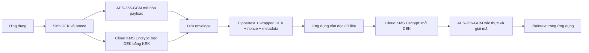

# Cloud KMS envelope encryption cho ứng dụng

Khi một ứng dụng lưu dữ liệu nhạy cảm vào Cloud Storage, cơ sở dữ liệu hoặc hệ thống lưu trữ khác, mã hóa dữ liệu giúp giảm rủi ro nếu bản sao lưu, tệp xuất hoặc kho lưu trữ bị truy cập trái phép. Tuy nhiên, nếu ứng dụng dùng một khóa duy nhất để mã hóa mọi dữ liệu, khóa đó trở thành điểm tập trung rủi ro: phải lưu ở đâu, phân quyền thế nào, luân chuyển ra sao và làm thế nào để khôi phục dữ liệu cũ khi khóa thay đổi?

**Envelope encryption** giải quyết bài toán này bằng cách dùng hai lớp khóa. Ứng dụng tạo một khóa dữ liệu ngắn hạn (*Data Encryption Key – DEK*) để mã hóa nội dung. Google Cloud Key Management Service (Cloud KMS) bảo vệ DEK bằng một khóa quản lý (*Key Encryption Key – KEK*). Ứng dụng lưu bản mã cùng DEK đã được bọc; khi cần đọc, ứng dụng nhờ Cloud KMS mở DEK rồi giải mã dữ liệu tại phía ứng dụng.

Cách làm này phù hợp khi ứng dụng cần tự kiểm soát mã hóa ở cấp bản ghi hoặc đối tượng, đồng thời muốn quản lý quyền sử dụng khóa tập trung trong Google Cloud.

## 1. Mục tiêu và phạm vi

Sau bài học, bạn có thể:

- Giải thích vai trò của DEK, KEK, bản mã và khóa đã bọc trong envelope encryption.
- Mô tả luồng mã hóa và giải mã dữ liệu bằng Cloud KMS.
- Chọn vị trí, loại khóa và quyền IAM phù hợp cho ứng dụng.
- Thiết kế định dạng lưu trữ để có thể giải mã dữ liệu sau khi triển khai phiên bản mới hoặc luân chuyển khóa.
- Nhận diện các lỗi phổ biến như tái sử dụng nonce, ghi khóa ra log hoặc vô hiệu hóa phiên bản khóa còn cần để đọc dữ liệu.

Bài này tập trung vào mã hóa ở tầng ứng dụng. Nếu một dịch vụ Google Cloud đã hỗ trợ Cloud KMS với Customer-Managed Encryption Keys (CMEK), bạn có thể cấu hình CMEK để dịch vụ đó dùng khóa do tổ chức quản lý. Với envelope encryption do ứng dụng thực hiện, chính ứng dụng mã hóa payload bằng DEK trước khi lưu trữ. Hai cách có thể bổ trợ nhau, nhưng không phải cùng một cơ chế.

## 2. Các thành phần của envelope encryption

| Thành phần | Vai trò |
|---|---|
| DEK (Data Encryption Key) | Khóa dữ liệu ngẫu nhiên, dùng để mã hóa payload bằng thuật toán đối xứng như AES-256-GCM. |
| KEK (Key Encryption Key) | Khóa trong Cloud KMS, dùng để mã hóa hoặc giải mã DEK. KEK không được xuất ra khỏi Cloud KMS. |
| Wrapped DEK | DEK sau khi được Cloud KMS mã hóa bằng KEK. Ứng dụng có thể lưu giá trị này cùng dữ liệu. |
| Ciphertext | Nội dung đã được mã hóa bằng DEK. Cloud KMS không cần nhận toàn bộ payload. |
| Nonce/IV | Giá trị đầu vào của chế độ mã hóa có xác thực. Với AES-GCM, nonce phải duy nhất cho mỗi lần mã hóa dưới cùng một DEK. |
| AAD | Dữ liệu bổ sung được xác thực nhưng không mã hóa, chẳng hạn tenant ID hoặc record ID. AAD giúp ràng buộc bản mã với đúng ngữ cảnh. |

Trong Cloud KMS, tài nguyên khóa có cấu trúc:

- **Project** xác định ranh giới quản trị và IAM.
- **Location** xác định khu vực đặt tài nguyên khóa.
- **Key ring** nhóm các khóa có cùng mục đích quản lý. Key ring không phải là một lớp mã hóa riêng.
- **CryptoKey** biểu diễn khóa logic, chẳng hạn khóa KEK dùng cho `ENCRYPT_DECRYPT`.
- **CryptoKeyVersion** là một phiên bản vật lý của khóa. Khi luân chuyển, Cloud KMS tạo phiên bản mới và có thể đặt phiên bản đó làm primary version.

Ví dụ tên tài nguyên:

```text
projects/my-project/locations/asia-southeast1/keyRings/app-keyring/cryptoKeys/customer-data-kek
```

KEK có thể có nhiều phiên bản theo thời gian. Ứng dụng nên lưu tên CryptoKey trong metadata của envelope. Với khóa đối xứng Cloud KMS, ciphertext do KMS tạo chứa thông tin cần thiết để KMS xác định phiên bản đã mã hóa; khi gọi `Decrypt`, ứng dụng truyền tên CryptoKey. Phiên bản cũ vẫn phải còn khả dụng nếu dữ liệu cũ còn cần được giải mã.

### Vì sao cần hai lớp khóa?

Nếu dùng một KEK trực tiếp để mã hóa mọi payload, ứng dụng phải gọi Cloud KMS cho từng payload và bị giới hạn bởi kích thước đầu vào của thao tác KMS. Envelope encryption chỉ gửi DEK nhỏ đến Cloud KMS để bọc hoặc mở khóa. Payload có thể được mã hóa tại ứng dụng bằng thư viện mật mã chuẩn, phù hợp với dữ liệu lớn hơn và giảm số byte phải truyền qua KMS.

KEK tập trung quyền kiểm soát trong Cloud KMS; DEK tách biệt việc mã hóa dữ liệu thực tế. Khi thay KEK, ứng dụng có thể bọc lại DEK mà không nhất thiết phải giải mã rồi mã hóa lại toàn bộ payload.

## 3. Kiến trúc và luồng xử lý

Luồng mã hóa:

1. Ứng dụng tạo DEK ngẫu nhiên bằng bộ sinh số ngẫu nhiên mật mã an toàn.
2. Ứng dụng tạo nonce riêng cho lần mã hóa và mã hóa payload bằng DEK, thường dùng AES-256-GCM.
3. Ứng dụng gửi DEK đến Cloud KMS `Encrypt` để bọc DEK bằng KEK.
4. Ứng dụng lưu ciphertext, wrapped DEK, nonce và metadata cần thiết.

Luồng giải mã thực hiện theo chiều ngược lại:

1. Ứng dụng đọc envelope và kiểm tra định dạng, ngữ cảnh bản ghi.
2. Ứng dụng gửi wrapped DEK đến Cloud KMS `Decrypt`.
3. Cloud KMS trả DEK dạng rõ cho ứng dụng.
4. Ứng dụng dùng DEK, nonce và AAD tương ứng để xác thực và giải mã ciphertext.
5. Ứng dụng loại bỏ DEK khỏi vùng nhớ có thể kiểm soát sau khi sử dụng.



Cloud KMS nhận DEK dạng rõ trong thao tác `Encrypt` và trả DEK dạng rõ trong thao tác `Decrypt`; vì vậy quyền gọi KMS là quyền có thể dẫn đến truy cập dữ liệu. **KEK không rời khỏi Cloud KMS**, nhưng DEK sẽ xuất hiện trong bộ nhớ ứng dụng khi mã hóa hoặc giải mã. Envelope encryption giúp tránh gửi payload lớn đến KMS, chứ không làm cho ứng dụng có quyền giải mã trở nên vô hại nếu tiến trình ứng dụng bị chiếm quyền.

## 4. Chuẩn bị Cloud KMS

### 4.1. Chọn location và tạo khóa

Chọn location theo yêu cầu về nơi lưu trữ khóa, độ trễ, chính sách tổ chức và vị trí của workload. Location của tài nguyên khóa cần được lựa chọn ngay từ đầu vì không thể chuyển một CryptoKey hiện có sang location khác.

Ví dụ tạo key ring và khóa đối xứng trong `asia-southeast1`:

```bash
gcloud kms keyrings create app-keyring \
  --location=asia-southeast1

gcloud kms keys create customer-data-kek \
  --location=asia-southeast1 \
  --keyring=app-keyring \
  --purpose=encryption
```

Khóa có purpose `encryption` là khóa đối xứng dùng cho thao tác mã hóa và giải mã. Hãy xác nhận project đang được chọn đúng trước khi chạy lệnh:

```bash
gcloud config get-value project
```

Tên CryptoKey đầy đủ cần được cấu hình cho ứng dụng:

```text
projects/PROJECT_ID/locations/asia-southeast1/keyRings/app-keyring/cryptoKeys/customer-data-kek
```

Không đặt tên khóa, project ID hoặc thông tin môi trường nhạy cảm trực tiếp trong mã nguồn. Hãy lấy chúng từ cấu hình triển khai hoặc cấu hình runtime được quản lý.

### 4.2. Cấp quyền IAM theo danh tính workload

Mỗi workload nên dùng service account riêng, ví dụ service account gắn với Cloud Run service hoặc workload chạy trên GKE. Dùng Application Default Credentials (ADC) để thư viện Google Cloud lấy danh tính runtime; không đóng gói service account key JSON vào container hay repository.

Có thể cấp quyền ở phạm vi CryptoKey để giới hạn ảnh hưởng:

- Danh tính chỉ cần bọc DEK: `roles/cloudkms.cryptoKeyEncrypter`.
- Danh tính chỉ cần mở DEK: `roles/cloudkms.cryptoKeyDecrypter`.
- Một workload cần cả hai thao tác: `roles/cloudkms.cryptoKeyEncrypterDecrypter`.

Ví dụ cấp quyền bọc DEK:

```bash
gcloud kms keys add-iam-policy-binding customer-data-kek \
  --location=asia-southeast1 \
  --keyring=app-keyring \
  --member="serviceAccount:app-encrypt@PROJECT_ID.iam.gserviceaccount.com" \
  --role="roles/cloudkms.cryptoKeyEncrypter"
```

Thay `PROJECT_ID` và email service account bằng giá trị của môi trường triển khai. Nếu cùng một service account thực hiện cả mã hóa và giải mã, hãy cấp role tương ứng với nhu cầu thực tế. Tránh cấp `Owner` hoặc `Editor` chỉ để làm cho thao tác KMS chạy được.

Quyền IAM của Cloud KMS chỉ quyết định danh tính nào được dùng khóa. Ứng dụng vẫn phải tự kiểm tra người dùng cuối có được phép đọc bản ghi đó hay không. Không nên xem quyền decrypt của service account là cơ chế phân quyền dữ liệu cho từng tenant.

## 5. Mã hóa dữ liệu bằng DEK

### 5.1. Sinh DEK và nonce

Với AES-256-GCM:

- DEK có độ dài 32 byte.
- Nonce thường có độ dài 12 byte.
- Authentication tag thường dài 128 bit và được thư viện mật mã gắn vào kết quả mã hóa.

Sinh DEK và nonce bằng CSPRNG, chẳng hạn `SecureRandom` trong Java. Không dùng UUID, timestamp, số tăng dần hoặc `Random` thông thường làm khóa hay nonce.

Không tái sử dụng cùng một nonce với cùng một DEK. Việc tái sử dụng nonce trong AES-GCM có thể làm suy yếu nghiêm trọng tính bí mật và tính xác thực. Thiết kế đơn giản là tạo DEK riêng cho mỗi đối tượng dữ liệu hoặc mỗi đơn vị mã hóa, sau đó tạo nonce mới cho lần mã hóa đó.

### 5.2. Mã hóa payload tại ứng dụng

Dùng thư viện mật mã đã được duy trì và thuật toán AEAD như AES-GCM. AEAD vừa mã hóa nội dung vừa phát hiện thay đổi trái phép. AAD không bị mã hóa nhưng được đưa vào phép xác thực.

Ví dụ AAD có thể được tạo từ tenant ID, record ID và phiên bản định dạng. Hãy dùng cách tuần tự hóa ổn định, có quy tắc rõ ràng về encoding và thứ tự trường. Nếu AAD thay đổi giữa lúc mã hóa và giải mã, thao tác giải mã phải thất bại.

Không tự xây dựng thuật toán mã hóa, không cắt bỏ authentication tag và không bỏ qua lỗi xác thực. Khi tag không hợp lệ, coi dữ liệu là không đáng tin cậy và dừng xử lý.

### 5.3. Bọc DEK bằng Cloud KMS

Sau khi mã hóa payload, ứng dụng gọi Cloud KMS `Encrypt` với tên CryptoKey và DEK dạng rõ. KMS trả về ciphertext của DEK; giá trị đó chính là wrapped DEK cần lưu.

Ví dụ Java rút gọn với thư viện Cloud KMS:

```java
import com.google.cloud.kms.v1.CryptoKeyName;
import com.google.cloud.kms.v1.KeyManagementServiceClient;
import com.google.protobuf.ByteString;

byte[] wrapDek(
        KeyManagementServiceClient kms,
        CryptoKeyName kekName,
        byte[] dek) {
    return kms.encrypt(kekName, ByteString.copyFrom(dek))
            .getCiphertext()
            .toByteArray();
}

byte[] unwrapDek(
        KeyManagementServiceClient kms,
        CryptoKeyName kekName,
        byte[] wrappedDek) {
    return kms.decrypt(kekName, ByteString.copyFrom(wrappedDek))
            .getPlaintext()
            .toByteArray();
}
```

Tạo `CryptoKeyName` bằng project ID, location, key ring và CryptoKey:

```java
CryptoKeyName kekName = CryptoKeyName.of(
        projectId,
        "asia-southeast1",
        "app-keyring",
        "customer-data-kek");
```

Đoạn mã minh họa hai thao tác KMS cốt lõi. Trong ứng dụng thực tế, hãy quản lý vòng đời `KeyManagementServiceClient` theo vòng đời ứng dụng, xử lý lỗi và timeout, không tạo client mới cho từng bản ghi. Thư viện dùng ADC để xác thực danh tính runtime.

Nếu cần ràng buộc wrapped DEK với một ngữ cảnh cụ thể, có thể cung cấp `additionalAuthenticatedData` cho thao tác KMS `Encrypt` và phải cung cấp đúng cùng giá trị khi gọi `Decrypt`. Đây là AAD của lớp bọc DEK. Nó độc lập với AAD mà ứng dụng dùng trong AES-GCM để bảo vệ payload.

### 5.4. Lưu envelope

Một envelope có thể được biểu diễn bằng JSON như sau:

```json
{
  "formatVersion": 1,
  "kmsKey": "projects/my-project/locations/asia-southeast1/keyRings/app-keyring/cryptoKeys/customer-data-kek",
  "algorithm": "AES-256-GCM",
  "nonce": "BASE64_NONCE",
  "wrappedDek": "BASE64_KMS_CIPHERTEXT",
  "ciphertext": "BASE64_DATA_CIPHERTEXT",
  "context": {
    "tenantId": "tenant-42",
    "recordId": "invoice-2026-001"
  }
}
```

Đây là định dạng minh họa; ứng dụng cần định nghĩa schema, giới hạn kích thước và quy tắc nâng phiên bản rõ ràng. Nếu AAD được tái tạo từ các trường `context`, phải xác định chính xác cách chuẩn hóa các trường đó. Có thể lưu AAD riêng nếu cần, nhưng hãy nhớ AAD không bí mật và cần được kiểm tra với ngữ cảnh bản ghi thực tế.

Khi lưu envelope:

- Không lưu DEK dạng rõ.
- Không ghi DEK, plaintext, wrapped DEK hoặc token xác thực vào log ứng dụng.
- Giữ nonce, wrapped DEK, ciphertext và thông tin định dạng đầy đủ; thiếu một thành phần có thể khiến dữ liệu không thể giải mã.
- Có thể lưu `kmsKey` để biết CryptoKey nào cần gọi khi giải mã.
- Xác thực độ dài và kiểu dữ liệu của các trường khi đọc để tránh lỗi giải mã hoặc tiêu thụ tài nguyên bất thường.

## 6. Giải mã dữ liệu

Khi ứng dụng cần đọc dữ liệu:

1. Đọc envelope và kiểm tra `formatVersion`, thuật toán, kích thước cùng metadata.
2. Xác định CryptoKey từ `kmsKey` đã lưu. Chỉ chấp nhận key resource thuộc danh sách cấu hình tin cậy của ứng dụng.
3. Gọi Cloud KMS `Decrypt` với wrapped DEK và AAD của lớp KMS nếu đã dùng khi mã hóa.
4. Dùng DEK nhận được để giải mã ciphertext bằng AES-GCM, với đúng nonce và AAD của payload.
5. Chỉ trả plaintext cho phần xử lý đã được phân quyền.
6. Xóa hoặc ghi đè vùng đệm DEK trong phạm vi runtime cho phép sau khi dùng.

AES-GCM kiểm tra authentication tag trong bước `doFinal`. Nếu dữ liệu, nonce hoặc AAD bị thay đổi, thư viện sẽ báo lỗi xác thực. Không được bắt lỗi rồi trả về dữ liệu chưa xác thực.

Trong Java, thao tác giải mã payload có dạng:

```java
Cipher cipher = Cipher.getInstance("AES/GCM/NoPadding");
cipher.init(
        Cipher.DECRYPT_MODE,
        new SecretKeySpec(dek, "AES"),
        new GCMParameterSpec(128, nonce));
cipher.updateAAD(aad);
byte[] plaintext = cipher.doFinal(ciphertext);
```

Đoạn mã cần được đặt trong luồng xử lý có kiểm soát lỗi và vòng đời khóa rõ ràng. Có thể dùng `Arrays.fill(dek, (byte) 0)` trong khối `finally` để ghi đè mảng byte do ứng dụng quản lý. Tuy vậy, JVM hoặc thư viện mật mã có thể tạo bản sao nội bộ; thao tác ghi đè không bảo đảm mọi bản sao trong bộ nhớ đã biến mất.

Nếu Cloud KMS từ chối quyền, không tìm thấy khóa hoặc không thể giải mã wrapped DEK, ứng dụng phải dừng thao tác đọc và trả lỗi phù hợp. Không có đường fallback sang plaintext hay một khóa mặc định khác.

## 7. Luân chuyển khóa và khả năng đọc dữ liệu cũ

Luân chuyển KEK là một phần của vòng đời dữ liệu, không chỉ là thao tác tạo phiên bản khóa mới.

Khi Cloud KMS tạo phiên bản mới và đặt làm primary version:

- Các thao tác `Encrypt` mới dùng primary version hiện tại.
- Wrapped DEK cũ vẫn cần phiên bản đã dùng để bọc nó.
- KMS có thể giải mã ciphertext bằng phiên bản cũ khi phiên bản đó vẫn khả dụng.
- Tạo phiên bản mới không tự động mã hóa lại wrapped DEK hoặc payload đã lưu.

Có hai mức thay đổi thường gặp:

**Chỉ luân chuyển phiên bản trong cùng CryptoKey.** Ứng dụng tiếp tục gọi `Encrypt` và `Decrypt` bằng tên CryptoKey. KMS dùng primary version cho thao tác mã hóa mới và nhận diện phiên bản phù hợp khi giải mã ciphertext cũ. Không vô hiệu hóa hoặc hủy phiên bản cũ khi vẫn còn dữ liệu phụ thuộc vào nó.

**Chuyển sang CryptoKey khác.** Với mỗi envelope, ứng dụng dùng khóa cũ để mở wrapped DEK, sau đó dùng CryptoKey mới để bọc lại DEK. Ciphertext của payload không cần thay đổi vì DEK vẫn giữ nguyên. Chỉ cập nhật `kmsKey` và wrapped DEK sau khi thao tác bọc mới thành công và bản ghi được ghi bền vững.

Quy trình chuyển khóa nên có thể chạy lại an toàn: ghi nhận trạng thái từng bản ghi, xử lý theo lô, kiểm tra khả năng giải mã sau khi cập nhật và giữ khóa cũ trong thời gian khôi phục. Chỉ vô hiệu hóa hoặc lên lịch hủy phiên bản khóa khi đã xác minh không còn dữ liệu, bản sao lưu hoặc bản xuất nào cần phiên bản đó. Hủy khóa có thể khiến dữ liệu không thể khôi phục.

## 8. Bảo vệ vận hành

### Phân tách quyền và môi trường

- Dùng service account riêng cho từng workload và môi trường.
- Chỉ cấp quyền encrypt hoặc decrypt theo chức năng thực tế.
- Giới hạn IAM ở CryptoKey khi phù hợp; rà soát quyền kế thừa từ project và tổ chức.
- Không chia sẻ service account giữa môi trường phát triển, kiểm thử và sản xuất nếu không có lý do rõ ràng.
- Dùng Workload Identity cho workload trên GKE hoặc danh tính runtime được nền tảng hỗ trợ thay vì lưu khóa service account dài hạn.

### Giám sát và kiểm toán

Bật và rà soát Cloud Audit Logs phù hợp cho thao tác Cloud KMS. Theo dõi danh tính gọi `Encrypt`/`Decrypt`, thời điểm, tần suất bất thường, lỗi quyền và thay đổi IAM hoặc cấu hình CryptoKey. Kết hợp cảnh báo với quy trình phản ứng sự cố để phát hiện việc sử dụng khóa ngoài dự kiến.

Log ứng dụng nên chứa mã định danh yêu cầu, record ID đã được phép ghi log và mã lỗi đã chuẩn hóa. Không ghi plaintext, DEK hoặc dữ liệu nhạy cảm chỉ để hỗ trợ debug.

### Hiệu năng và khả năng phục hồi

Mỗi envelope thường cần một lần gọi KMS để bọc DEK và một lần gọi để mở DEK khi đọc. Cloud KMS có độ trễ, quota và chi phí vận hành; hãy đo trên tải thực tế và thiết kế timeout, retry có giới hạn cùng exponential backoff cho lỗi tạm thời. Không retry vô hạn với lỗi cấu hình hoặc lỗi quyền.

Nếu workload xử lý nhiều bản ghi, hãy đánh giá cách tạo DEK theo đối tượng hoặc theo lô dựa trên mô hình đe dọa. Dùng chung DEK lâu hơn có thể giảm số lần gọi KMS nhưng làm tăng hậu quả nếu DEK bị lộ và khiến việc quản lý nonce phức tạp hơn. Nếu cần cache DEK đã mở, hãy giới hạn thời gian sống, phạm vi chia sẻ và quyền truy cập bộ nhớ; mặc định nên tránh lưu DEK dạng rõ lâu hơn thời gian xử lý cần thiết.

Nếu Cloud KMS tạm thời không khả dụng, ứng dụng có thể thử lại theo chính sách giới hạn. Nếu không thể mở DEK, dữ liệu phải tiếp tục ở trạng thái không đọc được; không bỏ qua mã hóa để duy trì hoạt động.

## 9. Các lỗi thiết kế thường gặp

| Lỗi | Hậu quả | Cách xử lý |
|---|---|---|
| Lưu DEK dạng rõ cùng ciphertext | Người đọc được kho lưu trữ có thể giải mã dữ liệu. | Chỉ lưu wrapped DEK; giữ DEK dạng rõ trong bộ nhớ khi cần. |
| Dùng một nonce nhiều lần với cùng DEK | Làm suy yếu bảo mật AES-GCM, có thể làm lộ nội dung và khả năng giả mạo. | Sinh nonce mới, duy nhất cho mỗi lần mã hóa dưới cùng DEK. |
| Không lưu nonce hoặc metadata định dạng | Không thể tái tạo đúng tham số giải mã. | Lưu đầy đủ nonce, thuật toán, phiên bản định dạng và wrapped DEK. |
| Bỏ qua AAD hoặc tái tạo AAD không ổn định | Bản mã có thể không còn gắn với đúng tenant hoặc bản ghi; giải mã thất bại. | Chuẩn hóa AAD và kiểm tra nó với ngữ cảnh thực tế. |
| Cấp quyền KMS quá rộng | Một workload bị xâm nhập có thể sử dụng nhiều khóa hơn mức cần thiết. | Dùng service account riêng và quyền ở phạm vi CryptoKey. |
| Hủy phiên bản khóa quá sớm | Dữ liệu cũ và bản sao lưu có thể mất khả năng giải mã. | Lập kiểm kê phụ thuộc, kiểm tra phục hồi và chỉ hủy sau thời gian lưu giữ cần thiết. |
| Cho rằng rotate key tự động mã hóa lại dữ liệu | Wrapped DEK cũ vẫn phụ thuộc phiên bản cũ. | Lập quy trình rewrap và xác minh từng lô dữ liệu. |
| Ghi DEK hoặc plaintext vào log | Bí mật có thể lan sang hệ thống log và công cụ phân tích. | Che dữ liệu nhạy cảm, giới hạn log và rà soát đường đi của dữ liệu. |
| Dùng KMS Encrypt trực tiếp cho payload lớn | Tăng độ trễ và gặp giới hạn kích thước đầu vào của KMS. | Mã hóa payload tại ứng dụng, chỉ dùng KMS để bọc DEK. |

## 10. Khi nào nên dùng CMEK và khi nào nên dùng envelope encryption?

| Nhu cầu | Hướng phù hợp |
|---|---|
| Một dịch vụ Google Cloud hỗ trợ CMEK và bạn muốn kiểm soát khóa mã hóa do dịch vụ sử dụng | Cấu hình CMEK cho dịch vụ đó. |
| Ứng dụng cần mã hóa từng bản ghi hoặc đối tượng trước khi ghi vào nhiều loại kho lưu trữ | Envelope encryption ở tầng ứng dụng. |
| Payload lớn, cần mã hóa tại ứng dụng và muốn KMS quản lý khóa gốc | Dùng DEK để mã hóa payload; dùng Cloud KMS để bọc DEK. |
| Cần ràng buộc bản mã với tenant hoặc record ID | Dùng AAD trong AES-GCM và kiểm tra ngữ cảnh khi giải mã. |
| Cần thay KEK mà không mã hóa lại toàn bộ payload | Mở wrapped DEK bằng khóa cũ rồi bọc lại bằng khóa mới. |

CMEK thường để dịch vụ Google Cloud thực hiện mã hóa dữ liệu bằng khóa do khách hàng quản lý. Envelope encryption ở tầng ứng dụng cho phép ứng dụng quyết định dữ liệu nào được mã hóa, thời điểm mã hóa và metadata nào được ràng buộc với ciphertext. Hãy chọn theo yêu cầu kiểm soát và trách nhiệm vận hành; không triển khai mã hóa tầng ứng dụng chỉ vì dịch vụ đã có CMEK.

## 11. Checklist trước khi đưa vào production

- [ ] CryptoKey đối xứng có purpose `ENCRYPT_DECRYPT` và location phù hợp.
- [ ] Ứng dụng dùng ADC với service account riêng cho workload.
- [ ] IAM chỉ cấp quyền encrypt/decrypt cần thiết ở phạm vi nhỏ nhất có thể.
- [ ] DEK được sinh bằng CSPRNG; nonce AES-GCM không bị tái sử dụng dưới cùng DEK.
- [ ] Payload được mã hóa bằng thư viện AEAD được duy trì.
- [ ] Wrapped DEK, ciphertext, nonce, AAD/context và format version được lưu nhất quán.
- [ ] Ứng dụng xác thực AAD và authentication tag trước khi sử dụng plaintext.
- [ ] Không có DEK, plaintext hoặc credential trong log.
- [ ] Có Cloud Audit Logs, cảnh báo và quy trình xử lý lỗi KMS.
- [ ] Có kế hoạch luân chuyển, rewrap, khôi phục và lưu giữ phiên bản khóa cũ.
- [ ] Đã thử khôi phục từ bản sao lưu trong môi trường kiểm thử.

## Kết luận

Cloud KMS envelope encryption kết hợp khả năng mã hóa dữ liệu linh hoạt ở tầng ứng dụng với quản lý KEK tập trung trong Google Cloud. Ứng dụng dùng DEK để mã hóa payload, Cloud KMS dùng KEK để bảo vệ DEK, và envelope lưu cả dữ liệu đã mã hóa lẫn thông tin cần thiết để giải mã về sau.

Thiết kế chỉ an toàn khi toàn bộ vòng đời được quản lý: sinh khóa và nonce đúng cách, phân quyền IAM tối thiểu, xác thực AAD, bảo vệ bộ nhớ và log, đồng thời giữ các phiên bản KEK cần thiết cho dữ liệu cũ.

## Tài liệu tham khảo

- [Cloud KMS: Envelope encryption](https://cloud.google.com/kms/docs/envelope-encryption)
- [Cloud KMS: Encrypt and decrypt data](https://cloud.google.com/kms/docs/encrypt-decrypt)
- [Cloud KMS: IAM roles and permissions](https://cloud.google.com/kms/docs/iam)
- [Cloud KMS: Key rotation](https://cloud.google.com/kms/docs/key-rotation)
- [Google Cloud: Customer-managed encryption keys (CMEK)](https://cloud.google.com/kms/docs/cmek)

