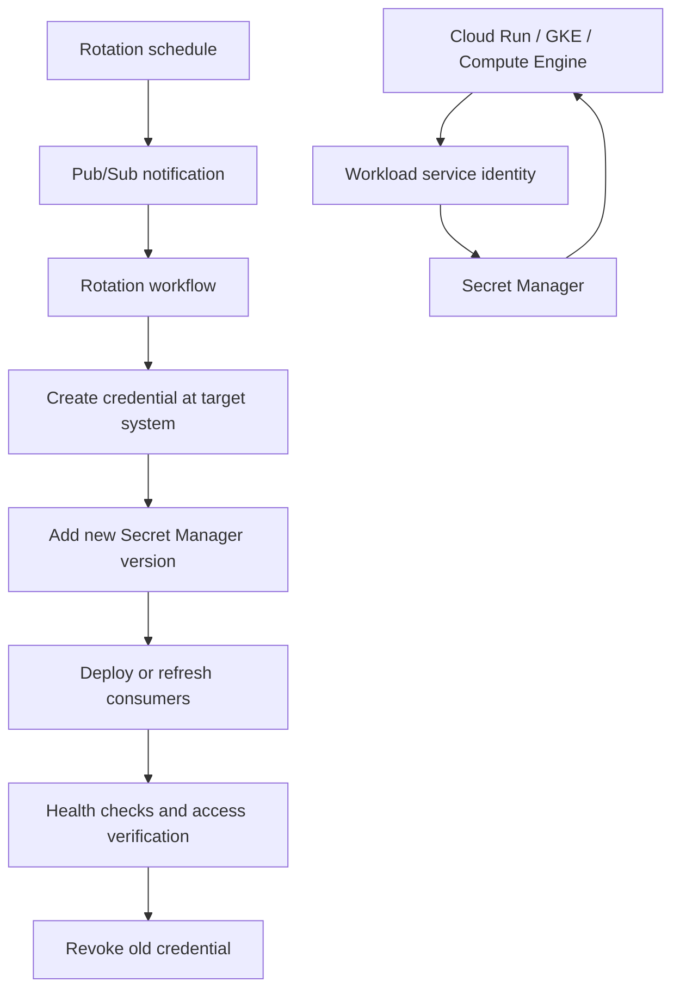

# Luân chuyển bí mật và phân phối cấu hình nhạy cảm

Một bí mật chỉ được quản lý an toàn khi toàn bộ vòng đời của nó được kiểm soát: tạo giá trị mới, lưu phiên bản, chuyển ứng dụng sang phiên bản đó, xác nhận hệ thống hoạt động và thu hồi giá trị cũ. Trên Google Cloud, **Secret Manager** cung cấp nơi lưu trữ và kiểm soát quyền truy cập bí mật; **IAM**, danh tính dịch vụ và quy trình phát hành quyết định ứng dụng nào được đọc bí mật và đọc vào thời điểm nào.

Bài học này tập trung vào mật khẩu cơ sở dữ liệu, API token, khóa riêng và thông tin xác thực của dịch vụ. Các nguyên tắc cũng áp dụng cho những cấu hình nhạy cảm khác cần phân phối có kiểm soát giữa môi trường phát triển, kiểm thử và sản xuất.

## 1. Phân biệt cấu hình thông thường và bí mật

Không phải mọi cấu hình đều cần được lưu trong Secret Manager. Việc phân loại đúng giúp giảm số lượng bí mật phải bảo vệ và tránh cấp quyền quá rộng.

| Loại dữ liệu | Ví dụ | Cách quản lý phù hợp |
|---|---|---|
| Cấu hình không bí mật | Tên feature flag, số cổng, giới hạn kết nối, tên bucket công khai | Biến môi trường, tệp cấu hình hoặc hệ thống quản lý cấu hình của nền tảng |
| Bí mật xác thực | Mật khẩu DB, API token, webhook signing secret | Secret Manager |
| Khóa mật mã | Khóa dùng để mã hóa hoặc giải mã dữ liệu | Cloud KMS khi cần quản lý vòng đời khóa mật mã; Secret Manager khi ứng dụng cần phân phối một giá trị khóa như dữ liệu bí mật |
| Cấu hình có yêu cầu toàn vẹn hoặc kiểm soát thay đổi | Endpoint nội bộ, chính sách định tuyến, cấu hình bảo mật | Kho cấu hình có phân quyền, kiểm soát phiên bản và quy trình phê duyệt phù hợp |

Một nguyên tắc hữu ích là: **cấu hình mô tả cách ứng dụng vận hành; bí mật cho phép một chủ thể xác thực hoặc truy cập tài nguyên**. Một endpoint nội bộ có thể nhạy cảm về mặt vận hành nhưng không nhất thiết là thông tin xác thực. Ngược lại, một chuỗi token ngắn vẫn là bí mật dù không có vẻ quan trọng.

Cũng cần phân biệt Secret Manager với Cloud KMS:

- Secret Manager lưu và phân phối giá trị như mật khẩu, token, chứng thư hoặc khóa riêng ở dạng dữ liệu bí mật.
- Cloud KMS quản lý các khóa mật mã và thao tác mật mã như mã hóa, giải mã, ký hoặc xác minh.
- Việc tạo phiên bản khóa mới trong Cloud KMS không tự động thay mật khẩu hoặc API token đang được ứng dụng sử dụng.
- Việc xoay khóa KMS cũng không tự động mã hóa lại mọi dữ liệu đã được mã hóa bằng phiên bản khóa cũ.

## 2. Kiến trúc quản lý và phân phối bí mật

Trong một kiến trúc điển hình, Secret Manager là điểm lưu trữ tập trung. Mỗi ứng dụng dùng danh tính dịch vụ riêng để lấy đúng bí mật cần thiết. Quy trình luân chuyển có một danh tính riêng để tạo phiên bản mới và điều phối việc chuyển đổi.



Các thành phần có trách nhiệm khác nhau:

- **Secret Manager** lưu bí mật theo từng secret và từng version, áp dụng chính sách IAM, mã hóa dữ liệu và ghi nhận hoạt động truy cập.
- **Pub/Sub** truyền thông báo khi đến thời điểm luân chuyển đã cấu hình.
- **Cloud Run, Cloud Functions hoặc Workflows** có thể thực thi quy trình tạo thông tin xác thực mới, thêm version và điều phối phát hành.
- **Danh tính dịch vụ của ứng dụng** chỉ có quyền đọc các secret mà ứng dụng thực sự cần.
- **Hệ thống đích** như cơ sở dữ liệu hoặc API bên thứ ba quyết định credential cũ còn hiệu lực trong khoảng chuyển đổi bao lâu.

Secret Manager có thể phát thông báo theo lịch luân chuyển đã cấu hình, nhưng thông báo đó không tự thay mật khẩu trong cơ sở dữ liệu, không tự tạo API token mới và cũng không tự cập nhật ứng dụng. Nhóm vận hành phải xây dựng workflow thực hiện các thao tác này.

## 3. Thiết kế một lần luân chuyển an toàn

Luân chuyển bí mật là một quy trình thay đổi trạng thái của nhiều hệ thống. Nếu thu hồi credential cũ trước khi tất cả consumer chuyển sang credential mới, ứng dụng có thể mất kết nối. Nếu giữ credential cũ quá lâu, rủi ro khi credential bị lộ vẫn tồn tại.

Với hệ thống hỗ trợ hai credential cùng hiệu lực trong một khoảng thời gian, nên áp dụng nguyên tắc **tạo mới trước, xác minh, sau đó mới thu hồi cũ**.

Một chu kỳ luân chuyển có thể gồm các bước sau:

1. **Xác định phạm vi ảnh hưởng.** Liệt kê secret, hệ thống đích, ứng dụng sử dụng, môi trường và người chịu trách nhiệm. Tìm cả những consumer chạy theo lịch hoặc chỉ hoạt động khi có sự kiện.
2. **Tạo credential mới ở hệ thống đích.** Ví dụ, tạo một tài khoản DB mới với quyền tương đương nhưng chỉ đủ cho ứng dụng. Nếu nhà cung cấp API hỗ trợ hai token đồng thời, tạo token mới trong khi token cũ vẫn hoạt động.
3. **Lưu credential mới thành một version.** Ghi giá trị vào Secret Manager bằng một quy trình bảo mật. Ghi nhận số version và thời điểm tạo, không ghi giá trị bí mật vào log.
4. **Chuyển consumer sang version mới.** Phát hành revision mới, cập nhật cấu hình workload hoặc làm mới tệp bí mật theo cơ chế đã chọn.
5. **Xác minh sau chuyển đổi.** Kiểm tra health check, kết nối DB, tỷ lệ lỗi xác thực, log truy cập và các tác vụ nền. Chỉ xác nhận hoàn tất khi tất cả consumer quan trọng đã sử dụng credential mới.
6. **Thu hồi credential cũ ở hệ thống đích.** Đây là bước chấm dứt khả năng sử dụng credential cũ. Sau đó có thể vô hiệu hóa version tương ứng trong Secret Manager.
7. **Lưu bằng chứng vận hành.** Ghi lại secret, version, thời điểm, revision triển khai, kết quả xác minh và trạng thái thu hồi. Tuyệt đối không lưu giá trị bí mật trong báo cáo.

Nếu hệ thống đích không hỗ trợ hai credential cùng lúc, cần một kế hoạch chuyển đổi riêng. Có thể dùng cửa sổ bảo trì ngắn, một proxy hỗ trợ chuyển tiếp, hoặc một cơ chế cập nhật có phối hợp. Không nên giả định rằng mọi API hoặc cơ sở dữ liệu đều cho phép thay credential mà không có gián đoạn.

### Ví dụ: luân chuyển tài khoản cơ sở dữ liệu

Giả sử dịch vụ `payments-api` dùng một tài khoản cơ sở dữ liệu để ghi giao dịch. Thay vì đổi mật khẩu của tài khoản hiện tại ngay lập tức, nhóm vận hành có thể:

- Tạo tài khoản `payments_api_next` với đúng quyền cần thiết.
- Tạo mật khẩu ngẫu nhiên và lưu vào version mới của secret `payments-db-password`.
- Cập nhật dịch vụ để dùng tài khoản và version mới.
- Chạy kiểm tra đọc/ghi và theo dõi lỗi xác thực.
- Thu hồi hoặc khóa tài khoản cũ sau khi các instance, worker và tác vụ nền đã chuyển đổi.

Cách này tạo khoảng thời gian an toàn để phát hiện lỗi và quay lại credential cũ trước khi thu hồi nó.

## 4. Quản lý version bằng Secret Manager

Một secret trong Secret Manager có thể chứa nhiều version. Mỗi lần cập nhật giá trị, hệ thống tạo một version mới; các version cũ có thể tiếp tục tồn tại để phục vụ quá trình chuyển đổi hoặc điều tra.

### Tạo secret và thêm version

Ví dụ dưới đây chạy trong môi trường shell có Google Cloud CLI và đã chọn đúng project:

```bash
gcloud secrets create payments-db-password \
  --replication-policy="automatic" \
  --project="PROJECT_ID"
```

Đưa giá trị mới vào một version bằng luồng dữ liệu chuẩn đầu vào:

```bash
printf '%s' "$DB_PASSWORD" | \
  gcloud secrets versions add payments-db-password \
    --data-file=- \
    --project="PROJECT_ID"
```

Biến `DB_PASSWORD` phải được cấp từ một nguồn bảo mật trong phiên chạy. Không đặt giá trị thật trực tiếp vào câu lệnh, lịch sử shell, mã nguồn hoặc tệp cấu hình được commit.

Secret Manager hỗ trợ chính sách sao chép tự động và chính sách sao chép do người dùng quản lý. Chọn chính sách phù hợp với yêu cầu về vị trí dữ liệu, tính sẵn sàng và tuân thủ của tổ chức. Không đưa thông tin nhạy cảm vào tên secret hoặc label; metadata cũng có thể xuất hiện trong các giao diện quản trị và log.

### Cấp quyền đọc theo từng secret

Giả sử Cloud Run chạy bằng service account `payments-api@PROJECT_ID.iam.gserviceaccount.com`. Chỉ cấp quyền đọc secret cần thiết cho danh tính này:

```bash
gcloud secrets add-iam-policy-binding payments-db-password \
  --member="serviceAccount:payments-api@PROJECT_ID.iam.gserviceaccount.com" \
  --role="roles/secretmanager.secretAccessor" \
  --project="PROJECT_ID"
```

Cấp quyền ở phạm vi secret giúp giới hạn ảnh hưởng khi một workload bị xâm nhập. Tránh cấp `roles/secretmanager.secretAccessor` ở cấp project nếu ứng dụng chỉ cần một vài secret.

Quyền của ứng dụng và quyền của quy trình luân chuyển nên tách biệt:

- Ứng dụng cần quyền truy cập version để đọc bí mật.
- Quy trình luân chuyển cần quyền tạo version mới và chỉ cần quyền đọc nếu logic của nó thực sự phải đọc giá trị hiện tại.
- Nhóm quản trị secret cần quyền quản lý cấu hình, IAM và lịch luân chuyển.
- Không cấp quyền quản trị Secret Manager cho service account chạy ứng dụng chỉ để thuận tiện triển khai.

### Trạng thái version và thu hồi

Các version có thể ở trạng thái như `ENABLED`, `DISABLED` hoặc `DESTROYED`. Vô hiệu hóa version ngăn việc truy cập version đó; hủy version là thao tác có tính phá hủy và cần tuân thủ chính sách lưu giữ dữ liệu của tổ chức.

Ví dụ vô hiệu hóa version cũ sau khi đã xác minh consumer chuyển đổi thành công:

```bash
gcloud secrets versions disable 7 \
  --secret="payments-db-password" \
  --project="PROJECT_ID"
```

Vô hiệu hóa version trong Secret Manager và thu hồi credential tại hệ thống đích là hai thao tác khác nhau. Nếu credential cũ vẫn còn hiệu lực trong cơ sở dữ liệu hoặc nhà cung cấp API, người có giá trị đó vẫn có thể sử dụng nó. Quy trình hoàn tất phải xử lý cả hai phía.

## 5. Tự động hóa lịch luân chuyển

Secret Manager hỗ trợ cấu hình lịch luân chuyển và gửi thông báo đến Pub/Sub khi đến thời điểm cần xử lý. Một workflow có thể nhận thông báo này rồi thực hiện các bước nghiệp vụ.

Ví dụ, một quy trình dùng Cloud Run Job hoặc Workflows có thể:

1. Nhận sự kiện từ Pub/Sub.
2. Xác định secret và hệ thống đích cần luân chuyển.
3. Kiểm tra lần chạy gần nhất để tránh xử lý trùng.
4. Tạo credential mới tại hệ thống đích.
5. Thêm version mới vào Secret Manager.
6. Yêu cầu phát hành consumer hoặc cập nhật cấu hình.
7. Chờ health check và xác minh kết quả.
8. Thu hồi credential cũ sau thời gian chuyển tiếp được quy định.
9. Gửi trạng thái thành công hoặc thất bại đến hệ thống giám sát.

Thông báo có thể được gửi lại khi subscriber lỗi hoặc không xác nhận sự kiện. Vì vậy, workflow phải **idempotent**: xử lý lại cùng một sự kiện không được tạo ra nhiều credential không kiểm soát, vô hiệu hóa nhầm version hoặc thu hồi credential đang được dùng. Có thể lưu mã lần chạy, secret, version dự kiến và trạng thái từng bước trong một kho trạng thái phù hợp.

Một workflow tốt cần có:

- **Retry có giới hạn:** thử lại lỗi tạm thời với backoff; không lặp vô hạn khi lỗi là do quyền hoặc cấu hình.
- **Dead-letter handling:** đưa sự kiện không xử lý được vào luồng riêng để điều tra.
- **Timeout và cảnh báo:** phát hiện một lần luân chuyển bị treo hoặc kéo dài bất thường.
- **Phân quyền riêng:** service account của workflow chỉ có quyền trên secret và hệ thống đích thuộc phạm vi phụ trách.
- **Kiểm soát đồng thời:** tránh hai lần luân chuyển cùng một secret chạy song song.
- **Nhật ký không chứa bí mật:** chỉ ghi mã secret, version, trạng thái và mã lỗi đã được làm sạch.

Nên chọn chu kỳ dựa trên mức độ nhạy cảm, yêu cầu của hệ thống đích, thời hạn credential và khả năng vận hành. Luân chuyển quá thường xuyên nhưng không có quy trình tự động đáng tin cậy có thể làm tăng nguy cơ lỗi triển khai. Với credential bị nghi ngờ lộ, cần một quy trình khẩn cấp riêng; không chờ đến lịch định kỳ.

## 6. Phân phối bí mật đến workload

Mỗi nền tảng chạy ứng dụng có cách lấy secret khác nhau. Dù dùng cách nào, workload nên xác thực bằng danh tính dịch vụ của Google Cloud thay vì lưu khóa service account trong image hoặc máy chủ.

### Cloud Run

Cloud Run có thể đưa secret vào biến môi trường hoặc mount secret thành tệp. Service account gắn với service cần có quyền `roles/secretmanager.secretAccessor` trên secret.

Ví dụ cập nhật một biến môi trường để tham chiếu version cụ thể:

```bash
gcloud run services update payments-api \
  --region="asia-southeast1" \
  --update-secrets="DB_PASSWORD=payments-db-password:8"
```

Với biến môi trường, giá trị secret được lấy khi instance khởi động. Khi dùng version cố định, cần phát hành revision mới tham chiếu version mới để rollout có thể dự đoán và kiểm soát. Cách này phù hợp khi nhóm muốn gắn rõ một revision với một version bí mật.

Mount secret thành tệp phù hợp với ứng dụng vốn đọc cấu hình từ tệp hoặc thư viện TLS cần đường dẫn đến chứng thư và khóa. Cần thiết kế rõ cách ứng dụng nạp lại nội dung khi secret thay đổi; không giả định rằng mọi ứng dụng sẽ tự đọc lại tệp hoặc tự reload kết nối. Nếu dùng `latest`, hãy xác minh hành vi cập nhật của nền tảng và cơ chế cache của ứng dụng trước khi dựa vào nó trong quy trình rotation.

### Google Kubernetes Engine (GKE)

Với GKE, nên dùng Workload Identity Federation for GKE để ánh xạ Kubernetes ServiceAccount tới danh tính Google Cloud có quyền đọc secret. Secret Manager CSI driver có thể mount secret vào Pod dưới dạng tệp để ứng dụng đọc tại runtime.

Một số điểm cần cân nhắc:

- Gán danh tính theo workload hoặc nhóm workload có cùng nhu cầu, tránh dùng một service account quyền rộng cho cả cluster.
- Chỉ mount secret vào Pod cần sử dụng; không đưa mọi secret vào mọi namespace.
- Nếu đồng bộ secret thành Kubernetes Secret, giá trị sẽ có thêm một bản sao trong cluster. Cần bảo vệ quyền đọc Kubernetes Secret, quyền truy cập etcd và cấu hình mã hóa dữ liệu lưu trữ theo chính sách của cluster.
- Xác định rõ cách cập nhật Pod hoặc reload ứng dụng khi version mới được phân phối.
- Không đưa secret vào ConfigMap, manifest được commit hoặc image container.

### Compute Engine và ứng dụng chạy ngoài Google Cloud

Ứng dụng trên Compute Engine có thể dùng service account gắn với VM và Application Default Credentials để gọi Secret Manager. Cấp quyền cho service account của workload, không tải khóa JSON về VM.

Ứng dụng chạy ngoài Google Cloud có thể dùng Workload Identity Federation để xác thực danh tính bên ngoài mà không cần tạo khóa service account dài hạn. Quyền truy cập vẫn nên giới hạn theo từng secret và theo danh tính của workload.

### CI/CD

Pipeline chỉ nên đọc secret ở bước thực sự cần, chẳng hạn lúc triển khai hoặc chạy migration. Ưu tiên danh tính liên kết và quyền ngắn hạn thay cho khóa service account tĩnh. Không in giá trị secret ra log, không truyền secret qua tham số dòng lệnh có thể bị ghi lại và không lưu chúng vào artifact build.

Nếu dùng Terraform hoặc công cụ IaC để quản lý Secret Manager, cần hiểu nơi lưu trạng thái. Một số cách khai báo payload secret có thể khiến giá trị xuất hiện trong state file dù giao diện CLI đánh dấu trường là nhạy cảm. Hãy bảo vệ backend state, giới hạn quyền đọc, mã hóa dữ liệu lưu trữ và cân nhắc tách phần tạo secret metadata khỏi quy trình nạp payload.

## 7. Chọn cách tham chiếu version

Cách consumer chọn version ảnh hưởng trực tiếp đến khả năng kiểm soát rollout.

| Cách tham chiếu | Hành vi vận hành | Khi phù hợp |
|---|---|---|
| Version cụ thể, ví dụ `8` | Consumer dùng đúng giá trị đã kiểm thử; cần cập nhật cấu hình hoặc phát hành khi rotation | Ứng dụng cần rollout có kiểm soát và khả năng tái tạo |
| Alias `latest` | Consumer tham chiếu version mới nhất qua alias tích hợp; nếu version đó bị vô hiệu hóa hoặc không khả dụng, việc đọc sẽ lỗi | Hệ thống có cơ chế refresh đã kiểm thử và chấp nhận thay đổi theo thời gian |
| Mount thành tệp | Ứng dụng đọc bí mật qua đường dẫn; cách cập nhật phụ thuộc nền tảng và cơ chế reload | Ứng dụng hỗ trợ đọc cấu hình từ tệp hoặc thư viện TLS |

Không có một lựa chọn phù hợp cho mọi workload. Với ứng dụng cần tính tái lập cao, version cố định giúp biết chính xác revision nào đang dùng giá trị nào. Với ứng dụng cần cập nhật bí mật mà không phát hành lại, có thể cân nhắc tham chiếu động hoặc mount file, nhưng phải xử lý cache, thời điểm refresh và kết nối đang mở.

Tránh truy vấn Secret Manager cho mỗi request HTTP. Việc đó làm tăng độ trễ, số lần gọi API và phụ thuộc vào dịch vụ quản lý bí mật trong đường xử lý nóng. Thường nên nạp secret khi khởi động hoặc cache trong bộ nhớ với thời hạn rõ ràng, đồng thời có kế hoạch làm mới khi rotation. Không ghi nội dung cache vào log hoặc dump chẩn đoán.

## 8. Bảo vệ quyền truy cập và dấu vết kiểm toán

Quyền đọc secret tương đương quyền sử dụng thông tin xác thực đó. Vì vậy, IAM phải phản ánh ranh giới trách nhiệm của ứng dụng.

Các thực hành nên áp dụng:

- Tạo service account riêng cho từng ứng dụng hoặc workload có ranh giới bảo mật riêng.
- Cấp `roles/secretmanager.secretAccessor` ở cấp secret khi có thể.
- Tách quyền đọc runtime khỏi quyền tạo version và quyền quản trị IAM.
- Rà soát định kỳ các principal còn quyền truy cập, kể cả service account của pipeline cũ.
- Bật và xem xét Data Access audit logs phù hợp để theo dõi hoạt động đọc secret; kiểm tra cấu hình log của project và yêu cầu lưu giữ.
- Dùng Cloud KMS với customer-managed encryption keys (CMEK) khi chính sách yêu cầu kiểm soát khóa mã hóa do khách hàng quản lý.
- Dùng cơ chế kiểm soát biên dịch vụ và mạng phù hợp với mô hình rủi ro của tổ chức.

Mã hóa dữ liệu khi lưu trữ không thay thế cho kiểm soát IAM. Một người có quyền đọc secret hợp lệ vẫn có thể lấy giá trị và sử dụng nó. Do đó, cần kết hợp phân quyền, giám sát, quy trình luân chuyển và kiểm soát hành vi của workload.

Không đặt bí mật trong:

- Mã nguồn, tệp `.env` được commit, Dockerfile hoặc image container.
- Tham số dòng lệnh, URL, tên tài nguyên, label hoặc thông báo lỗi.
- Log ứng dụng, log CI/CD, báo cáo kiểm thử hoặc ảnh chụp màn hình.
- Tệp state hoặc artifact có quyền truy cập rộng.
- Khóa service account tải xuống và lưu lâu dài trên máy chủ.

## 9. Theo dõi và xử lý lỗi trong quá trình rotation

Một lần rotation chỉ thành công khi consumer đã chuyển đổi và credential cũ đã được thu hồi theo kế hoạch. Việc tạo thành công version mới mới chỉ là một bước trung gian.

Nên theo dõi ít nhất các tín hiệu sau:

| Tín hiệu | Điều cần phát hiện |
|---|---|
| Thời điểm rotation gần nhất và thời gian hoàn thành | Secret quá hạn hoặc workflow bị kéo dài |
| Số version đang bật | Có nhiều version cũ còn được giữ ngoài thời gian chuyển tiếp |
| Pub/Sub backlog và dead-letter | Sự kiện chưa được xử lý hoặc liên tục thất bại |
| Lỗi xác thực từ DB/API | Consumer chưa chuyển sang credential mới hoặc credential mới không hợp lệ |
| Lỗi truy cập Secret Manager | Thiếu IAM, sai project, sai tên secret hoặc version không khả dụng |
| Revision và workload đang chạy | Một số instance, worker hoặc job vẫn dùng cấu hình cũ |

Một số tình huống thường gặp:

**Workflow nhận cùng một sự kiện nhiều lần.** Dùng mã sự kiện hoặc khóa idempotency, kiểm tra trạng thái lần chạy trước và tránh tạo credential mới mỗi lần retry.

**Version mới đã được tạo nhưng ứng dụng vẫn dùng version cũ.** Kiểm tra cấu hình triển khai, revision đang phục vụ traffic, worker chạy nền và cache của ứng dụng. Việc thêm version không tự thay cấu hình của mọi consumer.

**Ứng dụng đã chuyển nhưng một tác vụ nền vẫn lỗi.** Lập danh sách consumer đầy đủ, bao gồm cron job, batch job, migration, worker và hệ thống khôi phục thảm họa. Không thu hồi credential cũ cho đến khi các consumer cần thiết được xác minh.

**Credential mới không hợp lệ.** Giữ credential cũ còn hiệu lực nếu hệ thống đích cho phép. Dừng rollout, kiểm tra quyền và định dạng credential, sau đó phát hành lại version mới. Không sửa nội dung version đã phát hành bằng cách ghi đè; tạo version tiếp theo để giữ dấu vết.

**Credential cũ đã bị thu hồi quá sớm.** Tạo hoặc kích hoạt credential thay thế, lưu thành version mới và khôi phục consumer. Ghi nhận sự cố và điều chỉnh bước kiểm tra trước khi thu hồi.

Kế hoạch rollback phải được thiết kế trước. Khi credential cũ còn hiệu lực, rollback có thể là phát hành lại revision tham chiếu version cũ. Khi credential cũ đã bị thu hồi ở hệ thống đích, cần tạo credential thay thế; chỉ đổi tham chiếu Secret Manager sẽ không làm credential đã thu hồi hoạt động trở lại.

## 10. Luân chuyển khóa mã hóa với Cloud KMS

Luân chuyển khóa KMS có vòng đời khác với luân chuyển mật khẩu hoặc API token. Một Cloud KMS key có thể có nhiều key version. Khi tạo version mới và đặt nó làm primary, các thao tác mã hóa mới có thể dùng version primary mới; dữ liệu đã mã hóa trước đó vẫn cần version cũ để giải mã.

Vì vậy:

1. Xác định dữ liệu, dịch vụ và ứng dụng đang phụ thuộc vào khóa.
2. Thiết lập lịch rotation hoặc tạo key version mới theo quy trình quản trị.
3. Kiểm tra ứng dụng mã hóa dữ liệu mới bằng version primary mới.
4. Xác minh khả năng giải mã dữ liệu cũ.
5. Nếu cần chuyển dữ liệu sang version mới, thực hiện quy trình re-encryption riêng và xác minh kết quả.
6. Chỉ vô hiệu hóa hoặc hủy key version cũ khi chắc chắn không còn ciphertext, bản sao lưu hoặc dữ liệu lưu trữ nào cần nó.

Không hủy key version cũ chỉ vì version mới đã được tạo. Khả năng giải mã dữ liệu lịch sử phụ thuộc vào việc giữ lại các version cần thiết và tuân thủ chính sách lưu giữ khóa.

## 11. Tình huống thực hành: phát hành mật khẩu DB mới cho Cloud Run

Một nhóm vận hành cần đổi mật khẩu cho dịch vụ `orders-api`. Secret `orders-db-password` đang có version 12 và Cloud Run đang tham chiếu version này.

Quy trình triển khai an toàn có thể thực hiện như sau:

1. Tạo credential mới ở cơ sở dữ liệu, đồng thời giữ credential cũ hoạt động.
2. Thêm mật khẩu mới thành version 13 của `orders-db-password`.
3. Xác nhận service account của `orders-api` có quyền đọc secret.
4. Phát hành revision mới của Cloud Run tham chiếu version 13.
5. Chuyển traffic theo chiến lược rollout của dịch vụ.
6. Kiểm tra health check, thao tác đọc/ghi, tỷ lệ lỗi xác thực và các worker liên quan.
7. Khi đã xác nhận mọi consumer dùng version 13, thu hồi credential cũ trong cơ sở dữ liệu.
8. Vô hiệu hóa version 12 sau khi hoàn tất chuyển đổi và theo đúng chính sách lưu giữ.

Một số lệnh minh họa cho phần phát hành và kiểm tra metadata:

```bash
gcloud secrets versions list orders-db-password \
  --project="PROJECT_ID"

gcloud run services update orders-api \
  --region="asia-southeast1" \
  --update-secrets="DB_PASSWORD=orders-db-password:13"
```

Lệnh liệt kê version chỉ hiển thị metadata, không thay thế việc kiểm tra trạng thái workload. Sau khi cập nhật, cần xác nhận revision mới thực sự nhận traffic và kết nối DB thành công. Không dùng lệnh đọc secret để in mật khẩu ra terminal nhằm chứng minh việc phân phối.

## 12. Checklist vận hành

Trước khi bắt đầu:

- [ ] Đã xác định tất cả ứng dụng, worker, job và môi trường sử dụng secret.
- [ ] Hệ thống đích có hỗ trợ hai credential cùng hiệu lực hay cần cửa sổ bảo trì.
- [ ] Workflow có danh tính riêng và quyền tối thiểu.
- [ ] Đã xác định version mới, phương thức phân phối và cách rollback.

Trong khi luân chuyển:

- [ ] Credential mới được tạo ở hệ thống đích.
- [ ] Version mới được thêm vào Secret Manager.
- [ ] Consumer đã được cập nhật hoặc phát hành lại.
- [ ] Health check và thao tác thực tế xác nhận credential mới hoạt động.
- [ ] Log không chứa giá trị bí mật.

Khi hoàn tất:

- [ ] Tất cả consumer quan trọng đã chuyển đổi.
- [ ] Credential cũ đã được thu hồi tại hệ thống đích.
- [ ] Version cũ được vô hiệu hóa theo chính sách.
- [ ] Audit log, trạng thái workflow và kết quả kiểm tra được lưu lại.
- [ ] Cảnh báo và lịch rotation tiếp theo vẫn hoạt động.

Quản lý bí mật hiệu quả đòi hỏi phối hợp giữa nơi lưu trữ, danh tính workload, quy trình phát hành và hệ thống đích. Secret Manager cung cấp nền tảng lưu trữ theo version và kiểm soát truy cập; một quy trình rotation được thiết kế tốt bảo đảm credential mới được phân phối, kiểm chứng và thay thế credential cũ mà không làm gián đoạn dịch vụ.

