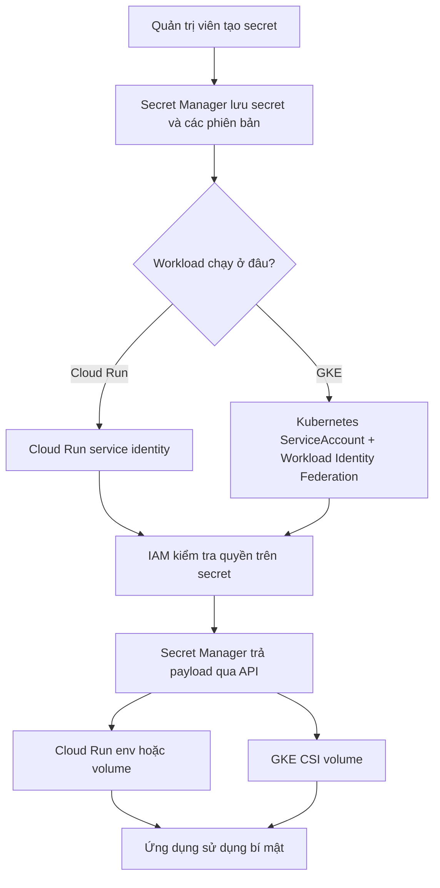

# Tích hợp Secret Manager với Cloud Run và GKE

Khi một ứng dụng kết nối cơ sở dữ liệu, gọi API bên ngoài hoặc ký một yêu cầu, ứng dụng thường cần mật khẩu, API key, token hay chứng chỉ. Những giá trị này là **bí mật (secret)**: nếu đưa vào mã nguồn, image container, cấu hình công khai hoặc log, chúng có thể bị lộ và rất khó thu hồi đồng loạt.

Google Cloud Secret Manager cung cấp nơi lưu trữ tập trung cho các bí mật, quản lý phiên bản, kiểm soát quyền truy cập bằng IAM và ghi nhật ký truy cập. Cloud Run và Google Kubernetes Engine (GKE) có thể lấy bí mật từ Secret Manager bằng danh tính runtime của workload. Nhờ vậy, nhóm phát triển có thể quản lý vòng đời bí mật độc lập với vòng đời phát hành ứng dụng.

## 1. Kiến trúc và trách nhiệm của từng dịch vụ

Ba thành phần đảm nhiệm ba vai trò khác nhau:

| Thành phần | Trách nhiệm |
| --- | --- |
| Secret Manager | Lưu payload bí mật, quản lý phiên bản, chính sách IAM, trạng thái phiên bản và nhật ký truy cập. |
| Cloud Run hoặc GKE | Chạy ứng dụng và yêu cầu Secret Manager cung cấp bí mật khi workload cần sử dụng. |
| IAM và danh tính workload | Xác định chính xác service account hoặc Kubernetes ServiceAccount nào được đọc từng bí mật. |

Luồng truy cập tổng quát:



Secret Manager mã hóa dữ liệu được lưu trữ theo cơ chế mặc định của Google Cloud. Nếu tổ chức cần kiểm soát khóa mã hóa, có thể cấu hình Customer-Managed Encryption Keys (CMEK) bằng Cloud Key Management Service (Cloud KMS). Secret Manager quản lý bí mật và phiên bản; Cloud KMS quản lý khóa mã hóa. Hai dịch vụ có vai trò liên quan nhưng không thay thế nhau.

## 2. Chuẩn bị secret và cấp quyền tối thiểu

Ví dụ xuyên suốt bài học sử dụng một bí mật tên `db-password` cho ứng dụng `orders-api`. Thay các giá trị mẫu như `PROJECT_ID`, `REGION` và tên service account bằng thông tin của môi trường thực tế.

### 2.1. Bật API và tạo secret

Trong dự án chứa secret, bật Secret Manager API:

```bash
gcloud services enable secretmanager.googleapis.com \
  --project=PROJECT_ID
```

Tạo secret với chính sách nhân bản tự động:

```bash
gcloud secrets create db-password \
  --replication-policy=automatic \
  --project=PROJECT_ID
```

Thêm phiên bản đầu tiên từ một tệp cục bộ được bảo vệ:

```bash
gcloud secrets versions add db-password \
  --data-file=./db-password.txt \
  --project=PROJECT_ID
```

Tệp `db-password.txt` chỉ là đầu vào tạm thời của ví dụ. Không commit tệp này vào Git, không đưa nó vào image container và không chia sẻ nội dung của nó qua log hoặc hệ thống theo dõi lỗi. Trong môi trường production, nên lấy giá trị từ quy trình cấp phát bí mật đã được tổ chức phê duyệt và giới hạn quyền đọc tệp đầu vào.

Mỗi lần thêm payload mới, Secret Manager tạo một **secret version** mới. Tên secret ổn định, còn phiên bản cho phép ứng dụng chuyển đổi có kiểm soát giữa giá trị cũ và mới. Không cần tạo secret có tên mới cho mỗi lần đổi mật khẩu.

### 2.2. Cấp quyền tại đúng secret

Quyền đọc payload thường dùng là `roles/secretmanager.secretAccessor`. Hãy cấp vai trò này trên từng secret mà workload cần, thay vì cấp ở cấp project nếu ứng dụng chỉ cần một vài bí mật.

Ví dụ tạo service account riêng cho Cloud Run:

```bash
gcloud iam service-accounts create run-orders \
  --display-name="Cloud Run identity for orders-api" \
  --project=PROJECT_ID
```

Gán quyền đọc `db-password` cho service account đó:

```bash
gcloud secrets add-iam-policy-binding db-password \
  --project=PROJECT_ID \
  --member="serviceAccount:run-orders@PROJECT_ID.iam.gserviceaccount.com" \
  --role="roles/secretmanager.secretAccessor"
```

Danh tính runtime chỉ cần quyền đọc những secret mà ứng dụng sử dụng. Người triển khai dịch vụ có thể cần quyền quản lý Cloud Run và quyền `iam.serviceAccounts.actAs` (thường được cấp qua `roles/iam.serviceAccountUser`) trên service account. Đây là quyền của người triển khai, khác với quyền runtime đọc payload trong Secret Manager.

Khi secret nằm ở một project khác với workload, hãy cấp IAM trên secret ở project sở hữu secret cho đúng danh tính runtime. Đồng thời dùng đúng tên tài nguyên và project chứa secret trong cấu hình workload.

## 3. Tích hợp với Cloud Run

Cloud Run dùng **service identity** để gọi Google Cloud APIs. Khi triển khai, chỉ định service account chuyên dụng cho dịch vụ; không dựa vào danh tính người dùng đã chạy lệnh deploy và không dùng service account mặc định với quyền rộng nếu không cần thiết.

### 3.1. Đưa secret vào biến môi trường

Biến môi trường phù hợp khi ứng dụng hoặc thư viện chỉ hỗ trợ đọc cấu hình từ environment. Ví dụ triển khai một revision với phiên bản secret đã ghim:

```bash
gcloud run deploy orders-api \
  --image=REGION-docker.pkg.dev/PROJECT_ID/apps/orders-api:TAG \
  --region=REGION \
  --service-account=run-orders@PROJECT_ID.iam.gserviceaccount.com \
  --update-secrets=DB_PASSWORD=db-password:5 \
  --project=PROJECT_ID
```

Trong ví dụ, `DB_PASSWORD` là tên biến môi trường bên trong container, `db-password` là tên secret và `5` là số phiên bản. Hãy thay `5` bằng phiên bản đang được phê duyệt ở môi trường của bạn.

Cloud Run lấy giá trị biến môi trường từ Secret Manager khi instance khởi động. Nếu không lấy được secret, instance có thể không khởi động. Vì vậy, Google khuyến nghị ghim biến môi trường vào một phiên bản cụ thể thay vì dùng `latest`. Khi phát hành phiên bản bí mật mới, nhóm vận hành có thể kiểm thử rồi cập nhật cấu hình và tạo revision mới để chuyển ứng dụng sang phiên bản đó.

### 3.2. Mount secret thành tệp

Nếu ứng dụng có thể đọc tệp, mount secret thành volume là một lựa chọn thuận tiện cho chứng chỉ, khóa hoặc cấu hình nhiều dòng. Ví dụ dùng Cloud Run YAML:

```yaml
apiVersion: serving.knative.dev/v1
kind: Service
metadata:
  name: orders-api
spec:
  template:
    spec:
      serviceAccountName: run-orders@PROJECT_ID.iam.gserviceaccount.com
      containers:
        - image: REGION-docker.pkg.dev/PROJECT_ID/apps/orders-api:TAG
          volumeMounts:
            - name: app-secrets
              mountPath: /var/secrets
      volumes:
        - name: app-secrets
          secret:
            secretName: db-password
            items:
              - version: latest
                path: db-password
```

Sau khi triển khai, ứng dụng đọc giá trị tại `/var/secrets/db-password`. Với secret được mount thành volume, Cloud Run lấy giá trị phiên bản mới nhất khi ứng dụng đọc tệp. Cách này hỗ trợ cập nhật bí mật mà không phải ghim số phiên bản trong cấu hình. Tuy nhiên, ứng dụng cần đọc lại tệp khi cần giá trị mới; nếu ứng dụng chỉ đọc một lần rồi lưu trong bộ nhớ, hãy thiết kế cơ chế nạp lại hoặc khởi động lại phù hợp.

Chọn cách truyền secret theo đặc điểm của ứng dụng:

| Cách dùng | Phù hợp khi | Lưu ý vận hành |
| --- | --- | --- |
| Biến môi trường | Thư viện yêu cầu biến môi trường hoặc giá trị được nạp lúc khởi động. | Ghim số phiên bản; cập nhật cấu hình và revision khi đổi secret. |
| Volume mount | Ứng dụng đọc được tệp và cần tiếp nhận phiên bản mới qua lần đọc tiếp theo. | Quản lý đường dẫn tệp và bảo đảm ứng dụng đọc lại khi cần. |

Mọi thay đổi cấu hình Cloud Run tạo revision mới. Vì vậy, hãy kiểm tra cấu hình revision đang chạy, trạng thái khởi động và khả năng kết nối phụ thuộc sau mỗi lần thay đổi secret.

## 4. Tích hợp với Google Kubernetes Engine

Trên GKE, nên để Pod truy cập Secret Manager bằng Workload Identity Federation for GKE. Mỗi workload sử dụng một Kubernetes ServiceAccount (KSA), và IAM ánh xạ danh tính KSA đó đến quyền đọc secret. Cách này tránh phải tạo, phân phối và xoay vòng tệp khóa JSON của service account.

GKE cung cấp Secret Manager add-on dựa trên Secrets Store CSI Driver. Add-on này mount secret thành tệp trong Pod thông qua volume CSI. Nó hỗ trợ cả cluster Standard và Autopilot; cluster phải được cấu hình Workload Identity Federation for GKE phù hợp.

### 4.1. Bật Secret Manager add-on

Với cluster hiện có, bật add-on bằng lệnh:

```bash
gcloud container clusters update CLUSTER_NAME \
  --location=LOCATION \
  --enable-secret-manager \
  --project=PROJECT_ID
```

Có thể bật tự động xoay vòng để các volume được cập nhật khi có phiên bản secret mới:

```bash
gcloud container clusters update CLUSTER_NAME \
  --location=LOCATION \
  --enable-secret-manager \
  --enable-secret-manager-rotation \
  --secret-manager-rotation-interval=120s \
  --project=PROJECT_ID
```

Tự động xoay vòng yêu cầu phiên bản GKE hỗ trợ tính năng này; tài liệu hiện hành nêu mức tối thiểu là `1.32.2-gke.1059000`. Nếu cluster chưa đáp ứng điều kiện, hãy nâng cấp theo quy trình vận hành của tổ chức trước khi bật rotation. Khoảng thời gian `120s` là giá trị ví dụ, không phải yêu cầu bắt buộc cho mọi workload.

### 4.2. Tạo KSA và cấp quyền đọc secret

Tạo namespace và KSA dành riêng cho ứng dụng:

```bash
kubectl create namespace orders
kubectl create serviceaccount orders-api -n orders
```

Gán quyền Secret Accessor trên secret cho danh tính KSA. Ví dụ dưới đây sử dụng principal của Workload Identity Federation for GKE; `CLUSTER_PROJECT_NUMBER` và `CLUSTER_PROJECT_ID` là project chứa cluster, còn `SECRET_PROJECT_ID` là project chứa secret:

```bash
gcloud secrets add-iam-policy-binding db-password \
  --project=SECRET_PROJECT_ID \
  --role=roles/secretmanager.secretAccessor \
  --member="principal://iam.googleapis.com/projects/CLUSTER_PROJECT_NUMBER/locations/global/workloadIdentityPools/CLUSTER_PROJECT_ID.svc.id.goog/subject/ns/orders/sa/orders-api"
```

Tên namespace `orders` và KSA `orders-api` trong principal phải khớp chính xác với Pod. Principal cũng phải dùng project number và workload identity pool của cluster. Nếu secret và cluster nằm trong cùng project, hai project ID có thể giống nhau; nếu khác project, vẫn cấp quyền trên secret ở project sở hữu secret.

### 4.3. Khai báo SecretProviderClass

Tạo `SecretProviderClass` để chỉ định secret cần mount và tên tệp bên trong volume:

```yaml
apiVersion: secrets-store.csi.x-k8s.io/v1
kind: SecretProviderClass
metadata:
  name: orders-secrets
  namespace: orders
spec:
  provider: gke
  parameters:
    secrets: |
      - resourceName: "projects/SECRET_PROJECT_ID/secrets/db-password/versions/latest"
        path: "db-password"
```

Lưu thành `orders-secrets.yaml` rồi áp dụng:

```bash
kubectl apply -f orders-secrets.yaml
kubectl get secretproviderclass orders-secrets -n orders
```

`resourceName` dùng project chứa secret, tên secret và phiên bản cần đọc. Dùng `latest` nếu muốn volume theo phiên bản mới nhất khi cơ chế rotation cập nhật; dùng số phiên bản cụ thể nếu workload cần cố định giá trị đã kiểm thử. Với regional secret, đường dẫn tài nguyên còn có phần `locations/LOCATION` trước `secrets`.

### 4.4. Mount volume vào Pod

Ví dụ Deployment tối giản:

```yaml
apiVersion: apps/v1
kind: Deployment
metadata:
  name: orders-api
  namespace: orders
spec:
  replicas: 2
  selector:
    matchLabels:
      app: orders-api
  template:
    metadata:
      labels:
        app: orders-api
    spec:
      serviceAccountName: orders-api
      # Chỉ thêm nodeSelector này cho GKE Standard khi cần chọn
      # node pool đã bật Workload Identity Federation.
      nodeSelector:
        iam.gke.io/gke-metadata-server-enabled: "true"
      containers:
        - name: orders-api
          image: REGION-docker.pkg.dev/PROJECT_ID/apps/orders-api:TAG
          volumeMounts:
            - name: app-secrets
              mountPath: /var/secrets
              readOnly: true
      volumes:
        - name: app-secrets
          csi:
            driver: secrets-store-gke.csi.k8s.io
            readOnly: true
            volumeAttributes:
              secretProviderClass: orders-secrets
```

Áp dụng và theo dõi rollout:

```bash
kubectl apply -f orders-deployment.yaml
kubectl rollout status deployment/orders-api -n orders
kubectl get pods -n orders
```

Trong GKE Standard, node pool chạy Pod phải dùng Workload Identity Federation; `nodeSelector` ở ví dụ giúp Pod được đặt lên node có GKE metadata server. Với Autopilot, mọi node đã dùng Workload Identity Federation nên bỏ `nodeSelector` này.

Khi Pod chạy, ứng dụng đọc secret từ `/var/secrets/db-password`. Secret Manager add-on mount secret dưới dạng tệp và không đồng bộ secret sang Kubernetes Secret. Điều này giúp tránh tạo thêm bản sao payload trong đối tượng Secret của Kubernetes. Nếu ứng dụng bắt buộc phải dùng Kubernetes Secret, cần đánh giá riêng cơ chế đồng bộ được hỗ trợ và rủi ro lưu trữ tương ứng.

## 5. Xoay vòng secret an toàn

Xoay vòng là thay một giá trị bí mật đã sử dụng bằng giá trị mới, đồng thời bảo đảm ứng dụng và hệ thống phụ thuộc cùng chuyển đổi thành công. Một quy trình có kiểm soát thường gồm các bước:

1. Tạo phiên bản mới trong Secret Manager; không xóa hoặc vô hiệu hóa phiên bản đang chạy ngay lập tức.
2. Cập nhật hệ thống đích, chẳng hạn đổi mật khẩu database, để chấp nhận giá trị mới. Nếu hệ thống hỗ trợ giai đoạn chuyển tiếp, cho phép cả giá trị cũ và mới trong khoảng thời gian ngắn.
3. Với Cloud Run dùng biến môi trường, cập nhật revision sang số phiên bản mới, kiểm tra instance khởi động và kiểm tra kết nối. Với volume mount, để ứng dụng đọc lại tệp sau khi phiên bản mới khả dụng.
4. Với GKE, dùng Secret Manager add-on rotation và tham chiếu `latest` nếu muốn volume nhận phiên bản mới tự động. Ứng dụng phải đọc lại tệp; việc volume được cập nhật không tự bảo đảm ứng dụng đã thay giá trị đang lưu trong bộ nhớ.
5. Theo dõi lỗi xác thực và log truy cập. Chỉ vô hiệu hóa hoặc hủy phiên bản cũ sau khi xác nhận không còn workload hợp lệ nào sử dụng nó và quy trình khôi phục đã được kiểm tra.

Không nên xoay vòng chỉ bằng cách tạo phiên bản mới trong Secret Manager nếu hệ thống đích vẫn chỉ chấp nhận mật khẩu cũ. Thứ tự cập nhật cần phù hợp với khả năng chuyển tiếp của database, API hoặc hệ thống nhận chứng chỉ.

## 6. Kiểm tra và xử lý sự cố

Có thể xác minh cấu hình và trạng thái mà không in payload bí mật ra terminal.

| Triệu chứng | Nguyên nhân thường gặp | Hướng kiểm tra |
| --- | --- | --- |
| Cloud Run revision không khởi động | Service identity thiếu quyền, tên secret hoặc phiên bản sai, secret nằm ở project khác. | Kiểm tra service account của revision, IAM binding trên đúng secret và cấu hình secret reference. |
| Cloud Run trả lỗi khi ứng dụng đọc tệp | Volume mount hoặc quyền truy cập secret không hợp lệ; ứng dụng dùng sai đường dẫn. | Kiểm tra mount path, tên tệp, service identity và log lỗi truy cập. |
| Pod GKE không mount được volume | Add-on chưa bật, `SecretProviderClass` sai, CSI driver hoặc quyền KSA chưa đúng. | Kiểm tra add-on, `kubectl describe pod`, sự kiện Pod, namespace, tên KSA và principal IAM. |
| Pod báo `PermissionDenied` | Principal trong IAM không khớp project number, workload identity pool, namespace hoặc KSA. | Đối chiếu từng thành phần của principal với cluster và Pod thực tế. |
| Secret mới chưa xuất hiện trong ứng dụng | Đang ghim phiên bản cũ, rotation chưa bật, hoặc ứng dụng cache giá trị. | Kiểm tra version reference, rotation interval và cách ứng dụng nạp lại tệp hoặc cấu hình. |

Một số lệnh kiểm tra an toàn:

```bash
# Xem metadata và trạng thái các phiên bản; không đọc payload.
gcloud secrets versions list db-password --project=PROJECT_ID

# Xem cấu hình dịch vụ Cloud Run.
gcloud run services describe orders-api \
  --region=REGION \
  --project=PROJECT_ID

# Xem Pod, sự kiện và cấu hình mount của workload GKE.
kubectl describe pod POD_NAME -n orders
kubectl get secretproviderclass orders-secrets -n orders

# Chỉ kiểm tra tệp đã được mount có tồn tại và không rỗng; không in nội dung.
kubectl exec POD_NAME -n orders -- sh -c 'test -s /var/secrets/db-password'
```

Không dùng lệnh đọc payload để đưa secret vào log hỗ trợ hoặc ảnh chụp màn hình. Khi cần xác nhận ứng dụng đã kết nối thành công, hãy dùng health check hoặc kiểm tra chức năng phụ thuộc thay vì hiển thị giá trị bí mật.

## 7. Các nguyên tắc bảo vệ cần duy trì

- **Quyền tối thiểu:** cấp `roles/secretmanager.secretAccessor` ở cấp secret cho đúng danh tính runtime. Tránh cấp quyền đọc tất cả secret ở cấp project, folder hoặc organization nếu không có nhu cầu rõ ràng.
- **Danh tính workload riêng:** dùng service account chuyên dụng cho từng dịch vụ Cloud Run và KSA chuyên dụng cho workload GKE. Tránh dùng chung một danh tính có quyền đọc nhiều bí mật không liên quan.
- **Không đóng gói bí mật:** không lưu payload trong Git, Dockerfile, image, ConfigMap, file manifest, tham số build hoặc log. Manifest chỉ chứa tên tài nguyên và tham chiếu phiên bản.
- **Ưu tiên workload identity:** để workload xác thực bằng danh tính được quản lý; không phân phối khóa JSON dài hạn trong container hoặc Pod.
- **Theo dõi truy cập:** bật và xem xét Data Access audit logs theo chính sách tổ chức; cảnh báo khi có truy cập bất thường hoặc thay đổi IAM ngoài quy trình.
- **Quản lý phiên bản:** kiểm thử phiên bản mới trước khi chuyển production; duy trì khoảng khôi phục phù hợp và chỉ vô hiệu hóa phiên bản cũ sau khi xác nhận không còn phụ thuộc.
- **Giảm truy cập lặp lại:** tránh gọi Secret Manager trên mọi request nếu không cần. Nạp và cache bí mật trong thời gian hợp lý, đồng thời có kế hoạch làm mới cache khi xoay vòng.
- **Đánh giá CMEK khi cần:** nếu yêu cầu quản trị khóa hoặc tuân thủ đòi hỏi, thiết kế quyền và vòng đời Cloud KMS key cùng Secret Manager ngay từ đầu.

## 8. Bài tập thực hành

Một nhóm đang chạy `orders-api` trên Cloud Run và một worker xử lý đơn hàng trên GKE. Cả hai cần đọc thông tin xác thực để kết nối cùng một dịch vụ dữ liệu.

Hãy thiết kế cấu hình đáp ứng các yêu cầu sau:

1. Tạo một secret trong Secret Manager và thêm phiên bản đầu tiên.
2. Tạo service account riêng cho Cloud Run; cấp quyền đọc đúng secret ở cấp secret.
3. Tạo namespace và KSA riêng cho worker GKE; dùng principal Workload Identity Federation để cấp quyền đọc cùng secret.
4. Cấu hình Cloud Run dùng biến môi trường với phiên bản được ghim hoặc volume mount tùy đặc điểm ứng dụng.
5. Cấu hình GKE Secret Manager add-on, `SecretProviderClass` và CSI volume để mount secret thành tệp.
6. Thêm phiên bản secret mới, kiểm thử quy trình cập nhật cho cả hai workload và xác nhận ứng dụng đã dùng giá trị mới mà không làm lộ payload trong log.

Khi hoàn thành, hãy giải thích vì sao người triển khai cần quyền khác với danh tính runtime, vì sao IAM nên được cấp ở cấp secret, và sự khác nhau giữa cách Cloud Run nạp secret qua biến môi trường với cách nạp qua volume.

## Tài liệu tham khảo

- [Configure secrets for Cloud Run services](https://docs.cloud.google.com/run/docs/configuring/services/secrets)
- [Use the Secret Manager add-on with Google Kubernetes Engine](https://docs.cloud.google.com/secret-manager/docs/secret-manager-managed-csi-component)
- [Secret Manager access control and IAM](https://docs.cloud.google.com/secret-manager/docs/access-control)
- [Secret Manager rotation recommendations](https://docs.cloud.google.com/secret-manager/docs/rotation-recommendations)
