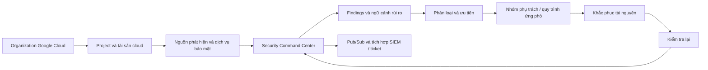
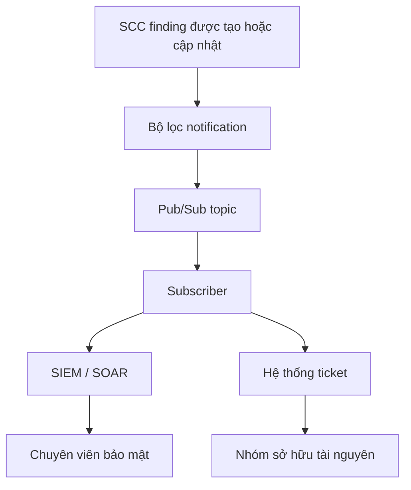

# Security Command Center và tập trung phát hiện rủi ro

Khi một tổ chức vận hành nhiều project Google Cloud, thông tin bảo mật thường nằm rải rác trong cấu hình tài nguyên, nhật ký, công cụ phát hiện mối đe dọa và hệ thống quản lý lỗ hổng. Nhóm vận hành phải trả lời đồng thời ba câu hỏi: tài nguyên nào đang có rủi ro, rủi ro đó ảnh hưởng đến hệ thống nào, và ai cần xử lý trước?

**Security Command Center (SCC)** cung cấp một điểm tập trung để quan sát tài sản cloud, thu thập phát hiện bảo mật và điều phối quá trình xử lý. Trong phạm vi module `CLOUD_PROVIDERS_GCP`, SCC kết nối các chủ đề về tổ chức project, IAM, VPC, máy ảo, GKE, dịch vụ serverless, lưu trữ và cơ sở dữ liệu thành một quy trình quản trị rủi ro liên tục. SCC giúp đội ngũ nhìn thấy và ưu tiên vấn đề; việc sửa cấu hình, thu hồi quyền hoặc cô lập tài nguyên vẫn cần được thực hiện bằng quy trình vận hành phù hợp.

## 1. Vì sao cần tập trung phát hiện rủi ro?

Một môi trường Google Cloud có thể chứa hàng chục hoặc hàng trăm project. Mỗi project có thể tạo thêm VM, bucket, service account, cluster GKE, database và các quy tắc mạng. Nếu từng nhóm chỉ theo dõi project của mình, tổ chức dễ bỏ sót những vấn đề có phạm vi ảnh hưởng rộng:

- Một firewall rule cho phép truy cập từ Internet vào cổng quản trị của nhiều VM.
- Một Cloud Storage bucket chứa dữ liệu nhạy cảm được cấu hình truy cập công khai.
- Một service account có quyền quá rộng và được dùng bởi nhiều workload.
- Một workload có dấu hiệu chạy mã độc, dò quét hoặc thực hiện hành vi bất thường.
- Một tài nguyên quan trọng chưa đáp ứng yêu cầu cấu hình an toàn của tổ chức.

Các vấn đề này khác nhau về bản chất. Một cấu hình sai có thể tồn tại nhiều tháng mà chưa có dấu hiệu bị khai thác; một cảnh báo về hành vi đáng ngờ có thể cần điều tra ngay cả khi cấu hình hiện tại trông bình thường. Nếu chỉ gom tất cả cảnh báo vào một danh sách, đội ngũ sẽ khó phân biệt việc cần khắc phục cấu hình với sự cố cần ứng phó.

SCC giúp chuẩn hóa các phát hiện thành bản ghi có ngữ cảnh, chẳng hạn nguồn phát hiện, loại vấn đề, tài nguyên liên quan, mức độ nghiêm trọng và thời điểm ghi nhận. Nhờ đó, tổ chức có thể áp dụng cùng một quy trình phân loại và xử lý trên nhiều project.

## 2. SCC nằm ở đâu trong kiến trúc Google Cloud?

SCC hoạt động như một lớp tập trung quan sát bảo mật. Các nguồn tích hợp phát hiện vấn đề; SCC lưu trữ và trình bày các finding; nhóm bảo mật dùng finding để điều tra, phân công và theo dõi khắc phục.



### Phạm vi tổ chức và project

Với môi trường doanh nghiệp, kích hoạt SCC ở cấp organization thường phù hợp khi cần một góc nhìn xuyên suốt các project thuộc tổ chức. Nhóm bảo mật có thể tổng hợp phát hiện từ nhiều project, trong khi nhóm ứng dụng vẫn chịu trách nhiệm xử lý tài nguyên thuộc phạm vi của mình.

Kích hoạt ở cấp project phù hợp với môi trường nhỏ, thử nghiệm hoặc một project cần được quản lý độc lập. Phạm vi này không tự tạo ra góc nhìn toàn tổ chức. Trước khi chọn phạm vi, cần xác định rõ cấu trúc organization, folder, project, nhóm chịu trách nhiệm và yêu cầu phân quyền.

Khả năng và nguồn phát hiện có sẵn phụ thuộc vào cấp kích hoạt, phiên bản hoặc gói dịch vụ SCC, loại tài nguyên, khu vực và các API hoặc dịch vụ liên quan. Vì vậy, không nên giả định mọi project đều có cùng độ bao phủ chỉ vì SCC đã được bật ở một nơi.

### Những khái niệm cần phân biệt

| Khái niệm | Ý nghĩa trong SCC | Cách sử dụng |
|---|---|---|
| Asset | Tài nguyên cloud được SCC hoặc nguồn tích hợp nhận diện | Xác định finding đang liên quan đến VM, bucket, cluster hay tài nguyên nào |
| Source | Dịch vụ hoặc hệ thống tạo ra phát hiện | Truy ngược công cụ đã nhận diện vấn đề và cách nó đánh giá |
| Finding | Bản ghi mô tả một vấn đề hoặc tín hiệu bảo mật | Phân loại, điều tra, giao người xử lý và theo dõi trạng thái |
| Severity | Mức độ nghiêm trọng của finding | Hỗ trợ sắp xếp thứ tự xử lý |
| Security mark | Nhãn bổ sung gắn với tài nguyên hoặc finding theo khả năng được hỗ trợ | Bổ sung ngữ cảnh phục vụ lọc và quy trình nội bộ |
| Mute | Cơ chế tạm ẩn finding khỏi luồng xử lý thông thường | Giảm nhiễu có kiểm soát; không thay thế việc khắc phục |

Finding là đơn vị làm việc trung tâm, nhưng không phải mọi finding đều chứng minh hệ thống đã bị xâm nhập. Một finding có thể mô tả cấu hình chưa an toàn, lỗ hổng, hành vi đáng ngờ hoặc một quan sát cần xác minh. Người xử lý phải đọc ngữ cảnh và bằng chứng trước khi kết luận.

## 3. SCC nhận diện những loại rủi ro nào?

SCC có thể kết hợp các dịch vụ phát hiện tích hợp sẵn với nguồn bên ngoài. Mỗi nguồn có phạm vi quan sát và điều kiện hoạt động riêng.

| Nhóm nguồn | Ví dụ khả năng | Câu hỏi mà nhóm vận hành cần trả lời |
|---|---|---|
| Security Health Analytics | Phát hiện cấu hình tài nguyên hoặc quyền chưa an toàn, chẳng hạn quy tắc mạng quá mở hay tài nguyên lưu trữ công khai | Cấu hình nào đang lệch khỏi chính sách an toàn? |
| Event Threat Detection | Phân tích tín hiệu từ nhật ký để nhận diện hoạt động đáng ngờ | Có hành vi nào cần điều tra như truy cập bất thường hoặc dấu hiệu xâm nhập? |
| Container Threat Detection | Phát hiện tín hiệu đe dọa liên quan đến workload container khi tính năng và môi trường đáp ứng yêu cầu | Workload hoặc cluster nào có dấu hiệu hoạt động bất thường? |
| VM Threat Detection | Phân tích tín hiệu đe dọa liên quan đến máy ảo theo phạm vi dịch vụ được hỗ trợ | VM nào có biểu hiện cần kiểm tra về mã độc hoặc hoạt động khai thác? |
| Web Security Scanner | Kiểm tra một số vấn đề bảo mật của ứng dụng web trong phạm vi được cấu hình | Ứng dụng web có điểm yếu nào cần nhóm phát triển xử lý? |
| Nguồn tích hợp bên ngoài | Công cụ bảo mật, hệ thống quản lý lỗ hổng hoặc nền tảng vận hành khác | Có thể tập trung phát hiện từ những hệ thống hiện có vào một quy trình chung không? |

Tên dịch vụ trong bảng giúp nhận diện nhóm năng lực; không có nghĩa mọi tính năng đều tự động bật hoặc khả dụng trong mọi gói SCC. Khi triển khai, cần kiểm tra yêu cầu về gói dịch vụ, quyền IAM, API, loại tài nguyên và cấu hình nguồn tương ứng.

Một nguyên tắc quan trọng là **phân biệt phát hiện cấu hình với phát hiện mối đe dọa**. Ví dụ, firewall cho phép Internet truy cập cổng SSH là một dấu hiệu cấu hình có rủi ro. Nếu nhật ký đồng thời ghi nhận nhiều lần đăng nhập thất bại hoặc hoạt động bất thường trên VM, nhóm ứng phó cần điều tra thêm để xác định liệu có hành vi tấn công hay không. Hai finding có thể liên quan cùng một tài nguyên nhưng yêu cầu các bước xử lý khác nhau.

## 4. Thiết kế triển khai SCC theo phạm vi tổ chức

Trước khi bật dịch vụ, hãy xác định mô hình quản trị. Một thiết kế cơ bản nên trả lời được các nội dung sau:

1. **Phạm vi quản lý:** organization nào, folder nào và project nào cần được quan sát?
2. **Chủ sở hữu tài nguyên:** nhóm nào phụ trách ứng dụng, dữ liệu, mạng, nền tảng và danh tính?
3. **Người quản trị bảo mật:** ai được cấu hình SCC, quản lý nguồn phát hiện và notification?
4. **Người xử lý finding:** ai được xem, cập nhật hoặc xác nhận finding trong từng phạm vi?
5. **Kênh điều phối:** finding nào cần gửi đến Pub/Sub, SIEM, SOAR hoặc hệ thống ticket?
6. **Yêu cầu dữ liệu:** tổ chức cần lưu giữ, xuất báo cáo và kiểm toán phát hiện trong thời gian bao lâu?

### Kích hoạt và phân quyền

Quy trình triển khai thường gồm các bước:

1. Xác nhận organization hoặc project đích và gói SCC phù hợp với yêu cầu.
2. Kiểm tra quyền cần thiết để kích hoạt SCC, cấu hình nguồn phát hiện và đọc tài sản.
3. Bật SCC theo phạm vi đã chọn; kiểm tra trạng thái các dịch vụ và nguồn phát hiện.
4. Xác minh các project và loại tài sản quan trọng đã xuất hiện trong phạm vi quan sát.
5. Cấp quyền theo vai trò: quản trị cấu hình, xem finding, điều tra và thực hiện khắc phục.
6. Tạo bộ lọc và kênh thông báo cho những finding cần xử lý kịp thời.
7. Chạy thử quy trình từ lúc nhận finding đến khi đóng việc và xác minh kết quả.

Áp dụng nguyên tắc đặc quyền tối thiểu. Không cấp quyền quản trị SCC hoặc quyền quản trị organization cho toàn bộ người dùng chỉ để họ xem cảnh báo. Nhóm bảo mật cần quyền phù hợp để điều tra; nhóm ứng dụng cần quyền xử lý tài nguyên trong project của mình; quyền thay đổi cấu hình SCC nên được giới hạn cho một nhóm quản trị nhỏ.

SCC không thay thế IAM của Google Cloud. Việc truy cập console, API, finding và tài nguyên vẫn chịu sự kiểm soát của IAM. Khi người dùng không thấy finding hoặc không thể thực hiện thao tác, hãy kiểm tra phạm vi tài nguyên, vai trò được cấp và quyền trên dịch vụ liên quan trước khi kết luận SCC không phát hiện vấn đề.

## 5. Đọc và xử lý một finding

Khi mở một finding, người xử lý nên kiểm tra ít nhất các thông tin sau:

- **Category và source:** loại phát hiện và nguồn tạo ra nó.
- **Resource:** tên tài nguyên, project và vị trí liên quan.
- **Severity:** mức độ nghiêm trọng do nguồn phát hiện gán.
- **State:** finding đang `ACTIVE` hay `INACTIVE`.
- **Event time và create time:** thời điểm sự kiện xảy ra và thời điểm bản ghi được tạo.
- **Mô tả, bằng chứng và next steps:** điều kiện tạo finding, dữ liệu hỗ trợ và hướng khắc phục được đề xuất.
- **Mute:** finding có đang được mute hoặc chịu một mute rule hay không.

`ACTIVE` cho biết điều kiện phát hiện vẫn đang được xem là tồn tại; `INACTIVE` cho biết điều kiện đó đã không còn được ghi nhận theo logic của nguồn. Mute là trạng thái quản lý riêng, không đồng nghĩa finding đã được sửa. Một finding bị mute vẫn có thể cần được rà soát theo chính sách của tổ chức.

### Quy trình phân loại

1. **Xác minh:** kiểm tra tài nguyên còn tồn tại không, finding có mới không và bằng chứng có phù hợp không.
2. **Đánh giá tác động:** xem tài nguyên có chứa dữ liệu nhạy cảm, phục vụ dịch vụ quan trọng hoặc có kết nối ra Internet không.
3. **Xác định chủ sở hữu:** tìm nhóm chịu trách nhiệm với project, workload hoặc cấu hình liên quan.
4. **Ưu tiên:** kết hợp severity với khả năng bị khai thác, mức độ phơi lộ, phạm vi ảnh hưởng và giá trị nghiệp vụ của tài sản.
5. **Khắc phục hoặc ứng phó:** sửa cấu hình, thu hồi quyền, vá lỗi, điều tra nhật ký hoặc thực hiện quy trình ứng phó sự cố.
6. **Xác minh lại:** kiểm tra điều kiện tạo finding đã được xử lý và nguồn phát hiện đã cập nhật trạng thái.
7. **Ghi nhận:** lưu người phụ trách, thời hạn, quyết định xử lý và lý do ngoại lệ nếu có.

Không nên chỉ sắp xếp theo severity. Một finding mức `HIGH` trên tài nguyên thử nghiệm ít quan trọng có thể cần ưu tiên thấp hơn một finding mức `MEDIUM` trên hệ thống thanh toán đang công khai. Severity là tín hiệu đầu vào; quyết định cuối cùng cần thêm ngữ cảnh nghiệp vụ và kỹ thuật.

| Yếu tố | Câu hỏi đánh giá | Tác động đến ưu tiên |
|---|---|---|
| Severity | Nguồn đánh giá vấn đề nghiêm trọng đến mức nào? | Tạo thứ tự xử lý ban đầu |
| Exposure | Tài nguyên có thể truy cập từ Internet hoặc từ vùng mạng rộng không? | Phơi lộ cao thường làm tăng ưu tiên |
| Exploitability | Có bằng chứng khai thác, đường tấn công hoặc điều kiện dễ bị lợi dụng không? | Khả năng bị khai thác cao cần phản ứng nhanh |
| Asset criticality | Tài nguyên có hỗ trợ nghiệp vụ trọng yếu hoặc chứa dữ liệu nhạy cảm không? | Tăng ưu tiên theo tác động kinh doanh |
| Blast radius | Quyền hoặc cấu hình có ảnh hưởng nhiều project hay workload không? | Phạm vi ảnh hưởng rộng cần phối hợp cấp tổ chức |
| Active evidence | Có nhật ký hoặc tín hiệu cho thấy hành vi đang diễn ra không? | Có thể chuyển từ xử lý cấu hình sang ứng phó sự cố |

## 6. Tìm finding bằng bộ lọc

Bộ lọc giúp nhóm bảo mật thu hẹp danh sách theo trạng thái, mức độ nghiêm trọng, category, project hoặc các thuộc tính được SCC hỗ trợ. Ví dụ, truy vấn các finding đang hoạt động ở mức cao trên phạm vi organization:

```text
state="ACTIVE" AND severity="HIGH"
```

Có thể áp dụng bộ lọc trong giao diện SCC hoặc dùng Google Cloud CLI để truy vấn. Ví dụ lệnh dưới đây minh họa việc lấy finding đang hoạt động từ các nguồn trong một organization:

```bash
gcloud scc findings list ORGANIZATION_ID \
  --source=- \
  --filter='state="ACTIVE" AND severity="HIGH"'
```

Thay `ORGANIZATION_ID` bằng mã organization thực tế. Tài khoản chạy lệnh cần có quyền đọc finding trong phạm vi đó và môi trường cần có phiên bản Google Cloud CLI hỗ trợ nhóm lệnh SCC. Nếu lệnh không trả về kết quả, hãy kiểm tra phạm vi kích hoạt, quyền IAM, nguồn được chọn và bộ lọc trước khi kết luận không có rủi ro.

Khi điều tra, nên mở rộng bộ lọc theo từng bước. Bắt đầu với project hoặc category liên quan, sau đó đối chiếu tài nguyên, thời điểm và nguồn phát hiện. Bộ lọc quá hẹp có thể che mất finding liên quan; bộ lọc quá rộng làm tăng nhiễu và kéo dài thời gian xử lý.

## 7. Gửi thông báo tập trung qua Pub/Sub

Đội ngũ không nên phụ thuộc vào việc người vận hành liên tục mở console để tìm finding mới. SCC có thể gửi thông báo về finding phù hợp với bộ lọc đến một Pub/Sub topic. Subscriber có thể chuyển sự kiện đến hệ thống ticket, SIEM hoặc một dịch vụ điều phối nội bộ.



Ví dụ tạo notification config cho finding mức cao đang hoạt động:

```bash
gcloud scc notifications create high-risk-findings \
  --organization=ORGANIZATION_ID \
  --pubsub-topic=projects/SECURITY_PROJECT_ID/topics/scc-findings \
  --filter='state="ACTIVE" AND severity="HIGH"'
```

Trước khi chạy lệnh, hãy tạo topic trong project chuyên dùng cho bảo mật và xác nhận SCC đã được kích hoạt đúng phạm vi. Tài khoản thực hiện thao tác cần quyền tạo notification config và cập nhật policy của topic. Khi tạo config, SCC tạo notification service account và tự gán role `roles/securitycenter.notificationServiceAgent` trên topic; cần giữ role này để notification tiếp tục hoạt động. Subscriber cần quyền đọc topic hoặc subscription theo thiết kế. Không cấp quyền publish cho một danh tính quá rộng chỉ để làm cho tích hợp hoạt động.

Notification phục vụ luồng sự kiện mới hoặc được cập nhật phù hợp với bộ lọc; không nên xem nó là bản sao đầy đủ của toàn bộ lịch sử finding. Khi cần báo cáo hoặc truy vấn lịch sử, hãy dùng khả năng truy vấn và xuất dữ liệu phù hợp của SCC. Hệ thống nhận sự kiện cũng nên xử lý lặp an toàn: lưu định danh finding, kiểm tra sự kiện đã xử lý và tránh tạo nhiều ticket cho cùng một vấn đề chỉ vì thông báo được gửi lại.

Khi thiết kế bộ lọc, hãy bắt đầu từ finding cần phản ứng nhanh như mức nghiêm trọng cao, dấu hiệu đe dọa hoặc tài nguyên trọng yếu. Nếu gửi mọi finding vào cùng một kênh, cảnh báo có giá trị có thể bị chìm trong số lượng lớn thông báo. Các finding mức thấp vẫn cần được rà soát theo lịch hoặc qua dashboard phù hợp.

## 8. Ví dụ thực tế: phát hiện rủi ro trên một VM công khai

Giả sử tổ chức có project `payments-prod` chứa một VM phục vụ tác vụ quản trị. SCC ghi nhận firewall rule cho phép truy cập từ `0.0.0.0/0` vào cổng quản trị. Cùng thời điểm, nguồn phân tích nhật ký tạo một finding khác về hoạt động đăng nhập bất thường trên VM.

Nhóm xử lý nên thực hiện theo trình tự:

1. Mở cả hai finding, xác minh chúng cùng trỏ đến VM và project `payments-prod`.
2. Kiểm tra firewall rule, địa chỉ IP nguồn, cổng đích và lý do nghiệp vụ của đường truy cập.
3. Trao đổi với chủ sở hữu workload để xác định cách truy cập quản trị được phê duyệt.
4. Nếu không cần truy cập công khai, giới hạn nguồn truy cập bằng dải mạng tin cậy hoặc cơ chế truy cập quản trị phù hợp; tránh xóa rule trước khi hiểu phụ thuộc vận hành.
5. Điều tra nhật ký đăng nhập, danh tính liên quan và các hành động xảy ra sau lần truy cập đáng ngờ. Nếu có dấu hiệu xâm nhập, kích hoạt quy trình ứng phó sự cố của tổ chức.
6. Kiểm tra lại cấu hình firewall và trạng thái finding sau khi khắc phục. Xác nhận nhóm ứng dụng vẫn truy cập quản trị được theo phương thức đã phê duyệt.
7. Ghi nhận nguyên nhân gốc, thời gian xử lý và biện pháp phòng ngừa tái diễn.

Ví dụ này cho thấy SCC có giá trị khi kết hợp nhiều tín hiệu. Finding về firewall mô tả một điểm phơi lộ; finding về đăng nhập bất thường cung cấp dấu hiệu cần điều tra. Nhóm vận hành cần nối chúng với cùng tài nguyên và ngữ cảnh nghiệp vụ để chọn hành động phù hợp.

## 9. Quản lý nhiễu và ngoại lệ

Trong môi trường lớn, một số finding có thể lặp lại, không còn phù hợp với kiến trúc hiện tại hoặc đã được chấp nhận theo ngoại lệ có thời hạn. Mute rule có thể giúp giảm nhiễu khi được dùng có kiểm soát.

Trước khi mute, cần ghi rõ:

- Lý do finding không cần xử lý ngay.
- Chủ sở hữu chấp thuận ngoại lệ.
- Phạm vi tài nguyên hoặc điều kiện áp dụng.
- Thời hạn xem xét lại và tiêu chí bỏ mute.
- Biện pháp bù trừ nếu rủi ro vẫn tồn tại.

Không mute hàng loạt chỉ để làm dashboard sạch hơn. Nếu một finding phản ánh cấu hình sai lặp lại trên nhiều project, giải pháp bền vững là sửa mẫu triển khai, policy hoặc quy trình tạo tài nguyên. Mute chỉ điều chỉnh cách hiển thị và điều phối finding; nó không đóng lỗ hổng, thu hồi quyền hay ngăn hành vi tấn công.

## 10. Các lỗi triển khai thường gặp

| Lỗi | Hệ quả | Cách kiểm tra hoặc khắc phục |
|---|---|---|
| Chỉ bật SCC ở một project trong khi yêu cầu là toàn organization | Các project khác không nằm trong góc nhìn mong muốn | Đối chiếu phạm vi kích hoạt với cây organization và danh sách project |
| Thiếu quyền hoặc API cần thiết cho một nguồn phát hiện | Nguồn không hoạt động đầy đủ hoặc không thu thập được dữ liệu | Kiểm tra trạng thái dịch vụ, API, service agent và IAM theo hướng dẫn của nguồn |
| Gửi mọi finding đến một kênh thông báo | Cảnh báo quan trọng bị chìm trong thông báo ít ưu tiên | Chia bộ lọc theo mức độ, loại finding và nhóm chịu trách nhiệm |
| Coi severity là thứ tự xử lý tuyệt đối | Tài nguyên trọng yếu có thể bị xử lý chậm | Kết hợp exposure, khả năng khai thác và tác động nghiệp vụ |
| Mute finding mà không có thời hạn | Rủi ro bị che khuất lâu dài | Yêu cầu chủ sở hữu, lý do, thời hạn và lịch rà soát |
| Xem finding là bằng chứng chắc chắn đã bị xâm nhập | Có thể dẫn đến phản ứng sai hoặc bỏ qua bước xác minh | Kiểm tra nguồn, bằng chứng, nhật ký và trạng thái tài nguyên |
| Không kiểm tra lại sau khắc phục | Finding có thể còn tồn tại hoặc lỗi tái diễn | Xác minh cấu hình và trạng thái mới từ nguồn phát hiện |

## 11. Đo lường hiệu quả vận hành

Một chương trình SCC nên được đánh giá bằng chất lượng xử lý rủi ro, không chỉ bằng số lượng finding đã xem. Có thể theo dõi các chỉ số sau:

- Số finding đang hoạt động theo severity, category, project và nhóm sở hữu.
- Thời gian trung bình từ lúc finding được tạo đến khi có người nhận xử lý.
- Thời gian khắc phục theo mức độ nghiêm trọng và loại tài sản.
- Tỷ lệ finding quá hạn hoặc tái xuất hiện sau khi đã đóng việc.
- Tỷ lệ finding bị mute, số ngoại lệ sắp hết hạn và số ngoại lệ không có chủ sở hữu.
- Độ bao phủ của nguồn phát hiện trên các project và loại tài sản trọng yếu.
- Tỷ lệ thông báo được chuyển thành ticket hợp lệ và được xử lý đúng nhóm.

Các chỉ số cần có phạm vi và định nghĩa thống nhất. Ví dụ, thời gian xử lý có thể tính từ `event time`, `create time` hoặc thời điểm ticket được mở; hãy chọn một cách đo và giữ nhất quán. Báo cáo nên giúp phát hiện project thiếu độ bao phủ, nhóm có lượng việc tồn đọng và loại cấu hình sai thường xuyên tái diễn.

## 12. Bài tập thực hành

Thực hiện trong organization hoặc project thử nghiệm mà bạn được phép quan sát:

1. Mở SCC và xác định phạm vi đang được kích hoạt.
2. Chọn một finding hiện có; ghi lại source, category, resource, project, severity, state và event time.
3. Truy cập tài nguyên liên quan bằng quyền được cấp, xác minh điều kiện tạo finding và xác định nhóm sở hữu.
4. Tạo bộ lọc chỉ hiển thị finding `ACTIVE` ở mức `HIGH`, sau đó thử thu hẹp theo project hoặc category.
5. Thiết kế một Pub/Sub notification cho nhóm finding cần phản ứng nhanh; xác định service agent, quyền publish và subscriber.
6. Viết lại quy trình từ lúc nhận thông báo đến khi xác minh khắc phục, gồm người nhận việc và thời hạn phản hồi.
7. Đề xuất một chỉ số để đánh giá liệu thời gian phát hiện hoặc xử lý rủi ro có được cải thiện hay không.

Không tạo cấu hình công khai hoặc cố tình làm suy yếu tài nguyên production để sinh finding cho bài tập. Hãy dùng finding có sẵn, môi trường sandbox hoặc kịch bản mô phỏng được tổ chức cho phép.

## 13. Kết luận

Security Command Center giúp tổ chức Google Cloud tập trung tài sản, nguồn phát hiện và finding vào một quy trình quản trị rủi ro thống nhất. Giá trị của SCC phụ thuộc vào phạm vi kích hoạt đúng, nguồn phát hiện có độ bao phủ phù hợp, phân quyền rõ ràng và quy trình xử lý có chủ sở hữu. Khi kết hợp SCC với Pub/Sub, SIEM hoặc hệ thống ticket, tổ chức có thể chuyển phát hiện thành hành động, theo dõi khắc phục và kiểm tra lại rủi ro trên toàn môi trường cloud.

## Tài liệu tham khảo

- [Google Cloud CLI: gcloud scc findings list](https://docs.cloud.google.com/sdk/gcloud/reference/scc/findings/list)
- [Google Cloud CLI: gcloud scc notifications create](https://docs.cloud.google.com/sdk/gcloud/reference/scc/notifications/create)
- [Security Command Center: Enable finding notifications for Pub/Sub](https://docs.cloud.google.com/security-command-center/docs/how-to-notifications)
