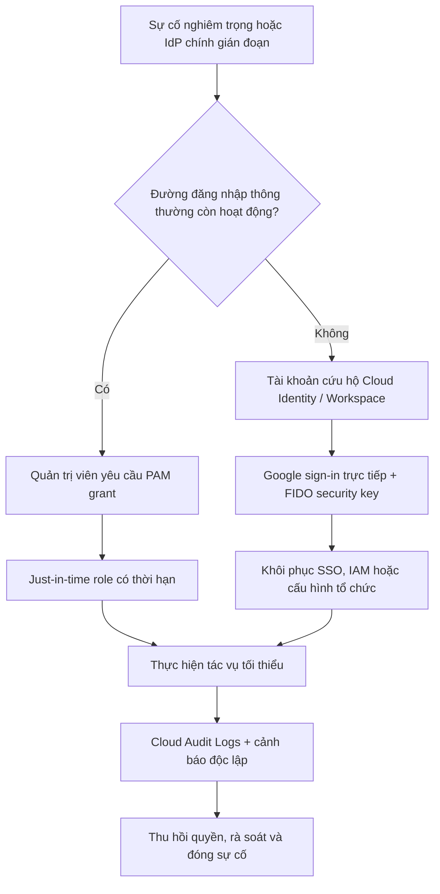

# Thiết kế quyền truy cập quản trị khẩn cấp trên GCP

Một tổ chức có thể mất khả năng quản trị Google Cloud đúng lúc cần xử lý sự cố nhất: nhà cung cấp danh tính (IdP) ngừng hoạt động, cấu hình SSO bị sai, tài khoản quản trị bị khóa, khóa bảo mật bị thất lạc hoặc chính sách IAM khiến nhóm quản trị không còn quyền sửa cấu hình. Nếu mọi con đường đăng nhập và mọi quyền khôi phục đều phụ thuộc vào cùng một hệ thống đang gặp sự cố, tổ chức có nguy cơ bị khóa khỏi chính môi trường của mình.

**Quyền truy cập quản trị khẩn cấp** (*emergency access* hoặc *break-glass access*) là một đường truy cập dự phòng được chuẩn bị và kiểm thử trước. Đường này chỉ được sử dụng khi quy trình quản trị thông thường không thể đáp ứng sự cố nghiêm trọng. Thiết kế tốt phải đồng thời bảo đảm khả năng đăng nhập, quyền khôi phục cần thiết, giám sát độc lập và khả năng thu hồi quyền sau khi xử lý xong.

Google Cloud khuyến nghị mọi tổ chức có Google Cloud organization thiết lập emergency access, kể cả khi chưa có yêu cầu liên tục kinh doanh đặc biệt. Bài học này kết hợp tài khoản cứu hộ trong Cloud Identity hoặc Google Workspace, IAM của Google Cloud, Privileged Access Manager (PAM), Cloud Audit Logs và quy trình vận hành để xây dựng một mô hình có thể diễn tập được.

## 1. Mục tiêu và phạm vi

Sau bài học, bạn có thể:

- Phân biệt tài khoản Super Admin của Cloud Identity/Google Workspace với vai trò Organization Administrator trong Google Cloud IAM.
- Thiết kế tài khoản cứu hộ có thể đăng nhập khi SSO hoặc IdP chính gặp sự cố.
- Chọn phạm vi IAM và quyền tối thiểu cần có để khôi phục tổ chức hoặc workload.
- Dùng PAM để cấp quyền quản trị tạm thời theo nhu cầu, có lý do, thời hạn và phê duyệt phù hợp.
- Thiết lập cảnh báo, lưu giữ audit log và quy trình kích hoạt, thu hồi, kiểm tra quyền khẩn cấp.
- Kiểm thử khả năng truy cập dự phòng mà không tạo thêm một tài khoản quản trị thường trực không được kiểm soát.

Bài viết tập trung vào quyền quản trị con người trên Google Cloud. Tài khoản dịch vụ (service account) và danh tính workload vẫn cần được bảo vệ riêng; không dùng khóa JSON của service account làm tài khoản cứu hộ cho quản trị viên.

## 2. Phân biệt các lớp quyền quản trị

Một thiết kế break-glass thường liên quan đến hai mặt phẳng quyền khác nhau: quản trị danh tính của tổ chức và quản trị tài nguyên Google Cloud.

| Thành phần | Phạm vi quyền | Vai trò trong khôi phục |
|---|---|---|
| Cloud Identity / Google Workspace Super Admin | Quản trị tài khoản, nhóm, xác thực, SSO và cấu hình tổ chức danh tính | Khôi phục tài khoản, cấu hình SSO hoặc các thiết lập danh tính làm người dùng mất khả năng đăng nhập |
| Google Cloud Organization Administrator (`roles/resourcemanager.organizationAdmin`) | Quản lý quyền IAM và chính sách allow/deny ở cấp organization | Khôi phục hoặc phân phối quyền truy cập cho các nhóm, folder và project |
| IAM role ở folder/project | Quản lý một phần tài nguyên theo phạm vi được cấp | Xử lý sự cố của workload hoặc môi trường cụ thể |
| Privileged Access Manager (PAM) | Cấp các role được cấu hình trong entitlement trong một khoảng thời gian | Nâng quyền đúng lúc, có thời hạn và có thể yêu cầu phê duyệt |
| Cloud Audit Logs và hệ thống cảnh báo | Ghi nhận hoạt động quản trị và truy cập | Phát hiện, điều tra và lưu bằng chứng sau khi kích hoạt quyền khẩn cấp |

**Super Admin không đồng nghĩa với Organization Administrator.** Super Admin là vai trò quản trị trong Cloud Identity hoặc Google Workspace. Organization Administrator là một IAM role trên tài nguyên organization của Google Cloud. Khi tạo organization resource, tài khoản Super Admin đầu tiên có thể được gán Organization Administrator tự động; tuy nhiên, Google khuyến nghị tách tài khoản Super Admin khỏi nhóm Organization Administrator để duy trì phân tách nhiệm vụ.

Organization Administrator có thể quản lý cấu trúc quyền allow/deny và cấp IAM role cho người khác. Vai trò này không tự động bao gồm mọi thao tác quản trị tài nguyên, chẳng hạn tạo folder hoặc project. Nếu runbook cần những thao tác đó, phải xác định và cấp thêm role phù hợp, ví dụ Folder Admin hoặc Project Creator.

Không nên cấp `roles/owner` làm quyền cứu hộ mặc định. Đây là legacy basic role có phạm vi rộng, khó áp dụng các điều kiện truy cập hiện đại; PAM cũng không hỗ trợ các legacy basic role Owner, Editor và Viewer. Hãy liệt kê trước những thao tác cần thực hiện trong sự cố rồi chọn predefined role hoặc custom role tương ứng.

## 3. Kiến trúc tham chiếu

Mô hình đề xuất có ba lớp:

1. **Đường đăng nhập cứu hộ:** một số tài khoản Cloud Identity/Google Workspace chuyên dụng, có thể đăng nhập trực tiếp bằng Google khi SSO hoặc IdP chính không hoạt động.
2. **Đường nâng quyền trong Google Cloud:** PAM cấp role tạm thời cho người ứng cứu trong các hoạt động thường lệ hoặc khẩn cấp; tài khoản Super Admin cứu hộ có thể khôi phục mặt phẳng danh tính và quyền tổ chức khi đường thông thường bị hỏng.
3. **Đường giám sát độc lập:** cảnh báo đăng nhập tài khoản cứu hộ, ghi nhận thay đổi IAM, thu thập audit log tập trung và bảo vệ quyền truy cập log khỏi người đang thực hiện thay đổi.



PAM là con đường ưu tiên để nâng quyền có kiểm soát trong các tình huống đã dự liệu. Tài khoản cứu hộ xử lý trường hợp không thể dùng quy trình xác thực hoặc quyền thông thường. Không nên chỉ dựa vào PAM nếu chính sự cố đang làm hỏng danh tính, cấu hình SSO hoặc quyền quản trị cần thiết để vận hành PAM.

## 4. Tạo và bảo vệ tài khoản cứu hộ

### 4.1. Số lượng và phạm vi

Tạo tài khoản emergency access trong Cloud Identity hoặc Google Workspace đang quản lý môi trường Google Cloud. Các tài khoản này có đặc điểm:

- Có đặc quyền Super Admin để xử lý sự cố danh tính hoặc cấu hình tổ chức.
- Không gắn với vòng đời của một nhân viên cụ thể; không bị thu hồi tự động theo quy trình Joiner, Mover, Leaver (JML) thông thường.
- Được cấu hình miễn SSO để có thể đăng nhập bằng thông tin xác thực Google khi IdP bên ngoài ngừng hoạt động.
- Chỉ dùng trong tình huống khẩn cấp và được giám sát chặt chẽ.

Google khuyến nghị từ **hai đến năm tài khoản emergency access cho mỗi tài khoản Cloud Identity hoặc Google Workspace**. Một tài khoản duy nhất tạo ra điểm lỗi đơn: mật khẩu thất lạc, khóa bảo mật hỏng hoặc tài khoản bị tạm ngưng có thể làm mất toàn bộ đường dự phòng. Không tạo quá nhiều tài khoản vì mỗi tài khoản đều có đặc quyền rất cao.

Bảo đảm từng môi trường cần khôi phục đều có đường truy cập phù hợp. Nếu production, staging và test dùng các tài khoản Cloud Identity/Workspace riêng, phải chuẩn bị và kiểm thử emergency access cho từng tài khoản đó. Nếu các môi trường cùng thuộc một tổ chức danh tính, hãy kiểm tra rằng các tài khoản cứu hộ có thể truy cập đúng Google Cloud organization và phạm vi tài nguyên cần thiết.

### 4.2. Tách OU và cấu hình đăng nhập

Tạo một Organizational Unit (OU) riêng, ví dụ `/Emergency-Access`, để áp dụng chính sách riêng cho tài khoản cứu hộ. Không đặt các tài khoản này chung với OU của người dùng thông thường vì chính sách SSO, vòng đời tài khoản và yêu cầu xác thực có thể khác nhau.

Đối với OU cứu hộ:

- Miễn SSO để không phụ thuộc IdP bên ngoài trong lúc khẩn cấp.
- Bật 2-Step Verification và chỉ cho phép phương thức security key theo chính sách phù hợp.
- Dùng khóa bảo mật FIDO; đăng ký ít nhất hai khóa cho mỗi tài khoản để dự phòng hỏng hoặc thất lạc.
- Ưu tiên bộ khóa riêng cho từng tài khoản để giảm rủi ro dùng chung.
- Dùng mật khẩu dài, mạnh và duy nhất.
- Không tự động hóa việc xoay vòng mật khẩu Super Admin bằng script hoặc tài khoản dịch vụ có quyền Super Admin. Google cảnh báo công cụ tự động như vậy cũng trở thành mục tiêu có đặc quyền rất cao.
- Nếu tổ chức không xoay vòng mật khẩu thủ công, tài liệu Google khuyến nghị tắt password expiration cho tài khoản emergency access. Nếu chọn xoay vòng thủ công, ghi rõ lịch, người chịu trách nhiệm và cách kiểm tra khả năng đăng nhập sau khi đổi.

### 4.3. Lưu giữ thông tin xác thực

Cần cân bằng giữa bảo mật và khả năng lấy thông tin trong thời gian ngắn. Có thể dùng két bảo mật vật lý hoặc quy trình bàn giao có kiểm soát:

- Lưu bản sao mật khẩu tại nhiều vị trí vật lý an toàn để tránh một địa điểm gặp sự cố làm mất khả năng truy cập.
- Lưu security key ở các vị trí được kiểm soát và có thể tiếp cận khi khẩn cấp.
- Lưu mật khẩu và security key ở các vị trí khác nhau để một sự cố tại một điểm không làm lộ cả hai yếu tố.
- Ghi rõ ai có quyền lấy, ai phê duyệt việc lấy và cách ghi nhận thời điểm bàn giao.
- Kiểm tra định kỳ tình trạng vật lý của khóa, phong bì niêm phong và khả năng truy cập két.

Không để thông tin cứu hộ trong tài liệu chia sẻ thông thường, ticket công khai hoặc mã nguồn. Tài khoản cứu hộ không dùng để đăng nhập hằng ngày, thử nghiệm tùy tiện hoặc chạy automation.

### 4.4. Xử lý Context-Aware Access

Context-Aware Access có thể chặn đăng nhập khi thiết bị, mạng hoặc vị trí không thỏa điều kiện. Trong một sự cố, chính sách bị cấu hình sai có thể chặn cả tài khoản cứu hộ.

Google khuyến nghị loại trừ **ít nhất một tài khoản emergency access** khỏi các access level trong access policies để duy trì một đường truy cập liên tục. Đây là ngoại lệ có chủ đích cho tài khoản cứu hộ; vẫn phải bảo vệ tài khoản bằng mật khẩu mạnh, FIDO security key, quy trình bàn giao và cảnh báo. Không mở rộng ngoại lệ này cho tài khoản quản trị thông thường.

### 4.5. Cảnh báo sự kiện tài khoản cứu hộ

Hoạt động của tài khoản cứu hộ ngoài một sự cố đã khai báo phải được xem là dấu hiệu cần điều tra. Trong Google Admin console, tạo reporting rule theo OU khẩn cấp và theo dõi ít nhất:

- Đăng nhập thành công.
- Đăng nhập thất bại.
- Thay đổi mật khẩu hoặc thay đổi yếu tố xác thực.
- Thay đổi cấu hình SSO hoặc chính sách bảo mật liên quan đến OU cứu hộ.

Gửi cảnh báo đến nhóm trực an ninh qua một kênh độc lập với hệ thống IdP chính. Nếu tài khoản cứu hộ đăng nhập mà không có incident ID hoặc người chịu trách nhiệm, mở điều tra ngay.

## 5. Thiết kế quyền IAM cho tình huống khẩn cấp

### 5.1. Phân rã tác vụ trước khi chọn role

Đừng bắt đầu bằng câu hỏi “cần role Owner nào?”. Hãy bắt đầu bằng danh sách việc có thể phải làm khi khẩn cấp:

| Tình huống | Quyền cần xem xét | Phạm vi khuyến nghị |
|---|---|---|
| Khôi phục quyền IAM ở organization | Organization Administrator hoặc tập quyền custom tương đương | Organization |
| Khôi phục quyền của một folder | Folder Admin hoặc role IAM phù hợp | Folder gặp sự cố |
| Khôi phục quyền của một project | Project IAM Admin (`roles/resourcemanager.projectIamAdmin`) | Project cụ thể |
| Xử lý sự cố Compute Engine | Các role Compute Engine phù hợp với thao tác cần làm | Project hoặc resource cụ thể |
| Xử lý sự cố GKE | Các role GKE/Kubernetes và IAM liên quan | Cluster hoặc project cần xử lý |
| Xử lý billing | Các role Cloud Billing tương ứng | Billing account hoặc project |

Role cần thiết phụ thuộc loại sự cố và dịch vụ. Một role cho phép quản lý IAM không nhất thiết cho phép khởi động VM, thay đổi firewall, sửa cấu hình GKE hoặc quản lý billing. Ghi rõ các quyền bổ sung trong runbook và thử chúng trong môi trường kiểm thử.

### 5.2. Tách tài khoản Super Admin và nhóm Organization Admin

Duy trì nhóm quản trị Google Cloud riêng, ví dụ `grp-gcp-org-admin@example.com`. Thành viên của nhóm là các quản trị viên chịu trách nhiệm vận hành organization; nhóm được cấp `roles/resourcemanager.organizationAdmin` hoặc tập quyền nhỏ hơn nếu phù hợp.

Tài khoản Super Admin cứu hộ nên được giữ riêng khỏi nhóm Organization Admin. Khi có sự cố IAM, Super Admin có thể khôi phục quyền quản trị organization cho một danh tính được chỉ định. Cách phân tách này giúp giảm việc sử dụng tài khoản có quyền danh tính cao nhất trong các hoạt động Google Cloud thường ngày.

Ví dụ cấp Organization Administrator cho một tài khoản quản trị được chỉ định trong quy trình khôi phục:

```bash
gcloud organizations add-iam-policy-binding ORGANIZATION_ID \
  --member="user:recovery-admin@example.com" \
  --role="roles/resourcemanager.organizationAdmin"
```

Thay `ORGANIZATION_ID` và email bằng giá trị thực tế đã được xác nhận trong runbook. Lệnh trên tạo binding ở cấp organization, vì vậy role có hiệu lực theo cây tài nguyên bên dưới. Chỉ thực hiện khi đúng sự cố yêu cầu quyền quản trị IAM cấp organization; sau khi khôi phục, chuyển quyền sang nhóm quản trị thường lệ hoặc thu hồi binding khẩn cấp theo quyết định của incident commander.

Có thể kiểm tra policy sau thao tác bằng lệnh:

```bash
gcloud organizations get-iam-policy ORGANIZATION_ID
```

Khi cần thu hồi binding trực tiếp đã tạo trong sự cố:

```bash
gcloud organizations remove-iam-policy-binding ORGANIZATION_ID \
  --member="user:recovery-admin@example.com" \
  --role="roles/resourcemanager.organizationAdmin"
```

Các lệnh minh họa không thay thế quy trình phê duyệt thay đổi. Trước khi chạy, xác minh đúng organization, principal, role và thời điểm thu hồi. Nếu tổ chức dùng PAM cho quyền tạm thời, ưu tiên entitlement PAM đã được thiết kế thay vì tạo binding dài hạn bằng tay.

### 5.3. Không tạo quyền thường trực quá rộng

- Dùng predefined role theo nhiệm vụ hoặc custom role nếu cần thu hẹp quyền.
- Cấp quyền ở project hoặc folder thay vì organization nếu sự cố không đòi hỏi phạm vi rộng.
- Tránh `roles/owner`, `roles/editor` và các quyền rộng không cần thiết.
- Không dùng một service account có quyền cao làm danh tính dùng chung cho quản trị viên.
- Tách quyền thay đổi IAM, quyền vận hành workload và quyền xem log khi có thể.
- Xác định ai có thể thay đổi chính sách deny, organization policy và quyền truy cập của chính hệ thống giám sát.

Lưu ý rằng IAM allow binding, IAM deny policy, organization policy và Context-Aware Access có cơ chế khác nhau. Tài khoản cứu hộ không nên được giả định là tự động vượt qua mọi ràng buộc. Phải lập danh sách chính sách có thể chặn thao tác khôi phục và diễn tập cách xử lý chúng.

## 6. Dùng Privileged Access Manager cho quyền tạm thời

Privileged Access Manager (PAM) cho phép cấp quyền nâng cao theo mô hình *just-in-time* (JIT). Quản trị viên tạo một **entitlement** mô tả ai được yêu cầu quyền gì, trên tài nguyên nào, trong bao lâu và theo điều kiện nào.

Một entitlement nên xác định:

- Danh sách principal được phép yêu cầu grant.
- Role cần cấp và phạm vi tài nguyên: organization, folder hoặc project.
- Có bắt buộc justification hay không.
- Thời lượng tối đa của grant.
- Có cần approver hay không và approver là ai.
- Nhóm stakeholder nhận thông báo khi có yêu cầu, phê duyệt hoặc kích hoạt.
- IAM condition nếu cần giới hạn thêm theo tài nguyên hoặc ngữ cảnh.

Khi grant được kích hoạt, PAM cấp các role đã cấu hình trong thời hạn của grant và tự thu hồi khi thời hạn kết thúc. Sự kiện tạo entitlement, yêu cầu grant, phê duyệt và các hoạt động liên quan được ghi vào Cloud Audit Logs.

### 6.1. Hai loại entitlement nên cân nhắc

| Loại entitlement | Cách kiểm soát | Tình huống |
|---|---|---|
| Quyền quản trị thông thường | Yêu cầu lý do và phê duyệt của người khác; thời hạn ngắn | Bảo trì, thay đổi IAM, triển khai production theo kế hoạch |
| Quyền ứng cứu khẩn cấp | Cho phép nhóm responder đã chọn yêu cầu nhanh; có thể không chờ phê duyệt khi sự cố đòi hỏi | Khôi phục dịch vụ, xử lý sự cố nghiêm trọng, ngăn tác động đang lan rộng |

Không phải mọi yêu cầu PAM đều cần bỏ qua phê duyệt. Chỉ entitlement dành cho responder được chỉ định và có quy tắc sử dụng rõ ràng mới nên có luồng emergency không chờ approval. Dù bỏ qua phê duyệt trước, vẫn yêu cầu justification, gửi thông báo ngay và thực hiện rà soát sau sự cố.

PAM hỗ trợ predefined role và custom role, nhưng không hỗ trợ legacy basic role Owner, Editor và Viewer. Hãy xác định role trước khi tạo entitlement. Nếu cần giới hạn một số resource trong project, folder hoặc organization, dùng IAM Conditions theo khả năng hỗ trợ của dịch vụ.

### 6.2. Thời hạn và thu hồi

Thời lượng grant phải đủ để hoàn tất tác vụ nhưng không dài hơn mức cần thiết. Ví dụ, quyền điều tra có thể cần 30–60 phút, còn khôi phục một cấu hình phức tạp có thể cần thời lượng dài hơn theo quy trình nội bộ. Đây là giá trị tham khảo; hãy dựa trên thời gian thực tế và chính sách tổ chức.

Người ứng cứu nên kết thúc grant ngay khi hoàn thành tác vụ nếu không còn cần quyền. Không chờ đến lúc grant tự hết hạn. Sau sự cố, kiểm tra danh sách grant đã active, expired, revoked hoặc ended để xác nhận không còn quyền ngoài dự kiến.

### 6.3. Dùng IAM Conditions cho quyền có thời hạn

Với một số trường hợp, có thể dùng conditional role binding để giới hạn quyền theo thời gian. Ví dụ biểu thức điều kiện:

```text
request.time < timestamp('2026-12-01T00:00:00Z')
```

Điều kiện này làm cho binding không còn hiệu lực sau thời điểm UTC được chỉ định. Cần lưu ý:

- Thời điểm phải được tạo và kiểm tra theo RFC 3339.
- Conditional binding không ghi đè một binding không có điều kiện cấp cùng role cho principal.
- Không dùng ngày hết hạn tĩnh làm cơ chế duy nhất cho tài khoản cứu hộ cần hoạt động vào một thời điểm chưa biết.
- PAM phù hợp hơn khi cần yêu cầu, phê duyệt, thời lượng và tự động thu hồi theo từng lần sử dụng.

## 7. Nhật ký, giám sát và cảnh báo độc lập

### 7.1. Các nguồn audit log cần bật

Cloud Audit Logs có bốn loại log chính:

| Loại log | Nội dung | Mặc định |
|---|---|---|
| Admin Activity | Thay đổi cấu hình hoặc metadata, ví dụ thay đổi IAM policy | Luôn được ghi |
| System Event | Sự kiện hệ thống do Google Cloud tạo | Luôn được ghi |
| Data Access | Đọc cấu hình/metadata hoặc truy cập dữ liệu người dùng | Tắt mặc định ở hầu hết dịch vụ, ngoại trừ BigQuery |
| Policy Denied | Yêu cầu bị từ chối bởi chính sách | Có thể cấu hình |

Admin Activity và System Event là nguồn quan trọng để điều tra thay đổi quyền. Data Access có thể tạo lượng log lớn và phát sinh chi phí; đánh giá các dịch vụ nhạy cảm để bật phù hợp, chẳng hạn dịch vụ lưu dữ liệu khách hàng hoặc dữ liệu quản trị quan trọng.

PAM cũng ghi nhận sự kiện entitlement và grant trong Cloud Audit Logs. Bảo đảm nhóm an ninh có thể tra cứu các sự kiện này ngay cả khi người thực hiện grant có quyền quản trị cao.

### 7.2. Tập trung và bảo vệ log

Tạo aggregated log sink ở cấp organization hoặc folder để chuyển audit log đến project bảo mật tập trung, Cloud Storage, BigQuery, Pub/Sub hoặc hệ thống SIEM. Chọn nơi lưu trữ và thời hạn giữ log theo yêu cầu tuân thủ.

Project nhận log cần có quyền IAM riêng. Tài khoản break-glass hoặc nhóm quản trị workload không nên có quyền tùy ý xóa, rút ngắn retention hoặc sửa sink của hệ thống giám sát. Tách người quản trị log khỏi người có quyền thay đổi IAM production nếu tổ chức có thể thực hiện.

Cloud Logging có các bucket `_Required` và `_Default`. `_Required` lưu Admin Activity và System Event; sink mặc định của bucket này không thể tùy chỉnh. Nếu chuyển log sang project khác và muốn lưu tại project đích, hãy cấu hình sink ở project đích theo yêu cầu lưu trữ. Kiểm tra log thực tế đã xuất hiện ở đích trước khi coi cấu hình tập trung là hoàn tất.

### 7.3. Tạo cảnh báo

Tối thiểu, cần cảnh báo cho:

- Bất kỳ lần đăng nhập thành công hoặc thất bại nào của tài khoản cứu hộ.
- Thay đổi mật khẩu, khóa bảo mật hoặc cấu hình SSO của tài khoản cứu hộ.
- Thay đổi IAM policy ở cấp organization, folder hoặc project.
- Tạo, sửa, thu hồi hoặc kích hoạt PAM entitlement/grant.
- Thay đổi log sink, log bucket, retention hoặc IAM của project bảo mật.
- Hoạt động của principal cứu hộ ngoài incident window đã khai báo.

Google khuyến nghị tạo alert cho các lệnh gọi `SetIamPolicy()` để phát hiện thay đổi allow policy. Có thể bắt đầu kiểm tra trong Logs Explorer bằng truy vấn:

```text
log_id("cloudaudit.googleapis.com/activity")
protoPayload.methodName="SetIamPolicy"
```

Để tìm hoạt động của một tài khoản cứu hộ cụ thể, có thể lọc theo principal:

```text
protoPayload.authenticationInfo.principalEmail="gcp-breakglass-01@example.com"
```

Thay email bằng principal đã đăng ký. Với danh tính liên kết hoặc loại principal khác, trường nhận dạng có thể là `principalSubject`; cần kiểm tra cấu trúc log thực tế của môi trường.

Không chỉ gửi alert vào email của chính tài khoản cứu hộ hoặc một kênh phụ thuộc cùng IdP đang gặp sự cố. Gửi đến nhóm trực an ninh hoặc SIEM có đường truy cập độc lập, phân quyền người nhận rõ ràng và quy trình xác nhận cảnh báo.

## 8. Quy trình kích hoạt quyền khẩn cấp

Runbook cần viết đủ cụ thể để một responder được ủy quyền có thể thực hiện khi người quản trị chính không sẵn sàng.

### Bước 1: Xác nhận điều kiện kích hoạt

Chỉ kích hoạt khi có một trong các điều kiện đã định nghĩa, ví dụ:

- IdP hoặc SSO chính không thể xác thực quản trị viên.
- Cấu hình IAM/SSO bị sai và nhóm quản trị không còn quyền khôi phục.
- Sự cố bảo mật nghiêm trọng cần hành động ngay để ngăn thiệt hại.
- Tài khoản quản trị thường lệ bị xâm nhập, khóa hoặc mất yếu tố xác thực.

Ghi nhận incident ID, thời điểm, người chỉ huy sự cố, lý do và phạm vi cần truy cập.

### Bước 2: Thông báo và áp dụng kiểm soát hai người

Thông báo cho incident commander và nhóm an ninh. Khi điều kiện cho phép, hai người cùng xác nhận việc lấy thông tin xác thực và theo dõi thao tác. Nếu sự cố đòi hỏi phản ứng ngay và không thể chờ người thứ hai, ghi rõ lý do và yêu cầu hậu kiểm bắt buộc.

### Bước 3: Lấy thông tin xác thực theo quy trình

Người được ủy quyền nhận mật khẩu và FIDO security key từ các vị trí lưu trữ đã quy định. Ghi nhận người bàn giao, người nhận, thời điểm, số niêm phong và incident ID. Không gửi mật khẩu hoặc mã xác thực qua chat hay ticket.

### Bước 4: Đăng nhập và xác minh đúng tổ chức

Dùng Google sign-in trực tiếp của tài khoản cứu hộ đã được miễn SSO. Xác minh đúng Cloud Identity/Workspace account, Google Cloud organization, project và môi trường. Tránh thực hiện thay đổi khi chưa chắc chắn đang ở production hay staging.

### Bước 5: Thực hiện thay đổi nhỏ nhất

Chọn tác vụ đúng với sự cố: khôi phục SSO, sửa IAM binding, cấp quyền PAM hoặc khôi phục cấu hình cần thiết. Dùng quyền có phạm vi nhỏ nhất, đặt thời hạn khi có thể và ghi lại lệnh hoặc thay đổi đã thực hiện. Không tận dụng phiên cứu hộ để thực hiện các thay đổi không liên quan.

### Bước 6: Xác minh và bàn giao

Kiểm tra dịch vụ, quyền truy cập và cảnh báo đã trở lại trạng thái mong muốn. Bàn giao quyền quản trị về nhóm vận hành thường lệ. Xác nhận người dùng cần thiết đăng nhập được qua con đường bình thường trước khi kết thúc incident.

### Bước 7: Thu hồi và hậu kiểm

- Kết thúc hoặc thu hồi PAM grant còn hoạt động.
- Xóa các IAM binding trực tiếp được tạo tạm thời nếu không còn cần.
- Khôi phục cấu hình SSO và access policy về trạng thái đã phê duyệt.
- Nếu thông tin xác thực có khả năng bị lộ, thay đổi mật khẩu thủ công và kiểm tra lại các FIDO key đã đăng ký.
- Đối chiếu Cloud Audit Logs, Google Admin audit events và incident timeline.
- Lưu justification, người phê duyệt, người thực hiện, thay đổi và thời điểm thu hồi.
- Niêm phong lại thông tin cứu hộ và cập nhật biên bản bàn giao.

Không vô hiệu hóa tài khoản cứu hộ sau mỗi lần dùng nếu điều đó phá hủy khả năng dự phòng. Hãy giữ tài khoản trong trạng thái sẵn sàng theo thiết kế, cập nhật bí mật khi có dấu hiệu lộ và xác minh lại khả năng đăng nhập sau khi đóng sự cố.

## 9. Duy trì khả năng truy cập khi IdP gặp sự cố

Emergency access chủ yếu cung cấp đường quản trị cuối cùng. Nó không bảo đảm toàn bộ nhân viên có thể tiếp tục làm việc khi IdP chính ngừng hoạt động. Với các nhân viên có vai trò quan trọng, có thể chuẩn bị authentication alternative:

1. Trong vận hành bình thường, người dùng đăng nhập qua SSO.
2. Tài khoản quan trọng được cấp sẵn Google sign-in credentials, chẳng hạn mật khẩu cùng security key hoặc passkey.
3. Đặt các tài khoản này trong OU riêng để có thể thay đổi SSO profile assignment có kiểm soát.
4. Khi IdP chính gặp sự cố, Super Admin được ủy quyền có thể tạm thời bỏ SSO cho OU hoặc nhóm quan trọng theo runbook.
5. Khi IdP hoạt động lại, khôi phục SSO profile assignment và xác minh đăng nhập.

Có thể bật post-SSO verification cho nhóm privileged users để yêu cầu 2-Step Verification sau lần đăng nhập SSO. Cấu hình này giảm rủi ro khi IdP chính bị xâm nhập hoặc phát hành assertion không an toàn.

Nếu tổ chức cần duy trì truy cập cho số lượng lớn người dùng trong một đợt gián đoạn IdP, có thể thiết lập backup IdP. Chuẩn bị trước SAML profile, đồng bộ user base và kiểm thử chứng thư ký. Backup IdP phải có mức bảo mật tương đương IdP chính; một IdP dự phòng yếu hơn có thể làm giảm bảo mật tổng thể.

Không nhầm lẫn ba mục tiêu:

| Mục tiêu | Giải pháp |
|---|---|
| Quản trị viên vẫn có thể khôi phục tổ chức khi SSO/IdP lỗi | Emergency access users |
| Một số nhân viên quan trọng tiếp tục đăng nhập khi IdP lỗi | Authentication alternative cho critical users |
| Nhiều người dùng tiếp tục đăng nhập khi IdP chính gián đoạn | Backup IdP đã chuẩn bị và kiểm thử |

## 10. Diễn tập và kiểm tra định kỳ

Tài khoản cứu hộ chỉ có giá trị khi tổ chức chứng minh được nó hoạt động. Lập lịch diễn tập định kỳ và diễn tập lại sau các thay đổi lớn đối với Cloud Identity, SSO, IAM, Context-Aware Access hoặc quy trình quản trị.

Checklist diễn tập:

- [ ] Có ít nhất hai tài khoản emergency access cho mỗi Cloud Identity/Workspace account theo mô hình đã chọn.
- [ ] Các tài khoản nằm trong OU riêng, được miễn SSO và có chính sách xác thực riêng.
- [ ] Mỗi tài khoản có ít nhất hai FIDO security key hoạt động.
- [ ] Mật khẩu và security key có thể lấy từ vị trí lưu trữ dự phòng theo đúng quy trình.
- [ ] Ít nhất một tài khoản vẫn truy cập được khi Context-Aware Access bị cấu hình sai.
- [ ] Có thể truy cập đúng Google Cloud organization và project cần khôi phục.
- [ ] Quy trình phục hồi IAM đã được kiểm tra, bao gồm quyền cấp và thu hồi role.
- [ ] PAM entitlement có đúng requester, role, scope, justification, duration và approval.
- [ ] Cảnh báo đăng nhập cứu hộ và thay đổi IAM đến được nhóm trực.
- [ ] Audit log được chuyển đến project bảo mật và có retention phù hợp.
- [ ] Người trực biết cách mở incident, lấy thông tin, thực hiện, thu hồi và hậu kiểm.
- [ ] Đã kiểm tra lại trạng thái SSO, OU, IAM binding và PAM sau diễn tập.

Ưu tiên kiểm thử bằng môi trường staging hoặc tài khoản thử nghiệm được cô lập. Không thực hiện thay đổi SSO hoặc IAM ở production chỉ để kiểm tra nếu chưa có kế hoạch thay đổi, người phê duyệt và đường khôi phục.

## 11. Ví dụ tình huống: IdP chính ngừng hoạt động

Một tổ chức dùng IdP bên ngoài cho SSO. Khi IdP bị gián đoạn, các quản trị viên thường lệ không đăng nhập được Google Cloud console.

Quy trình xử lý:

1. Incident commander xác nhận sự cố IdP và mở incident.
2. Responder lấy tài khoản emergency access cùng FIDO key từ két bảo mật.
3. Responder đăng nhập trực tiếp bằng Google sign-in vì tài khoản cứu hộ đã được miễn SSO.
4. Responder kiểm tra trạng thái SSO profile assignment và xác định nhóm quản trị quan trọng cần authentication alternative.
5. Super Admin thực hiện thay đổi đã được runbook phê duyệt để cho phép nhóm privileged users dùng Google sign-in credentials trong thời gian IdP lỗi.
6. Cloud Audit Logs và Google Admin reporting rule ghi nhận hoạt động; nhóm an ninh nhận cảnh báo.
7. Khi IdP phục hồi, responder khôi phục SSO profile assignment, kiểm thử đăng nhập bình thường và kết thúc incident.
8. Nhóm an ninh rà soát log, kiểm tra thông tin cứu hộ, ghi nhận bài học và niêm phong lại thiết bị.

Nếu nguyên nhân là IAM policy bị sửa sai thay vì IdP, tài khoản Super Admin cứu hộ có thể dùng đường khôi phục đã chuẩn bị để khôi phục quyền quản trị organization, sau đó nhóm IAM sửa các binding cần thiết. Chỉ cấp quyền bổ sung cho đúng principal, đúng phạm vi và thu hồi sau khi hoàn tất.

## 12. Những sai lầm cần tránh

| Sai lầm | Rủi ro | Cách thiết kế đúng |
|---|---|---|
| Chỉ có một tài khoản cứu hộ | Mất tài khoản hoặc khóa bảo mật làm mất đường dự phòng | Duy trì từ hai tài khoản trở lên, có khóa và thông tin dự phòng |
| Tài khoản cứu hộ vẫn phụ thuộc SSO chính | IdP lỗi thì tài khoản cứu hộ cũng không đăng nhập được | Miễn SSO cho emergency access users |
| Dùng tài khoản Super Admin hằng ngày | Tăng nguy cơ lộ tài khoản có quyền rất cao | Tách tài khoản cứu hộ khỏi tài khoản làm việc |
| Gộp Super Admin và nhóm Organization Admin | Mất phân tách nhiệm vụ giữa quản trị danh tính và quản trị GCP | Duy trì các vai trò và nhóm riêng |
| Cấp Owner cho mọi tình huống | Phạm vi quyền quá rộng và khó giới hạn | Chọn role theo tác vụ, dùng PAM/JIT |
| Chỉ dựa vào PAM | Cấu hình hoặc đường xác thực PAM có thể gặp cùng sự cố | Duy trì emergency identity độc lập để khôi phục |
| Bỏ qua cảnh báo đăng nhập | Không phát hiện sử dụng tài khoản cứu hộ trái phép | Alert mọi lần đăng nhập và thay đổi bảo mật |
| Để người quản trị production xóa audit log | Người gây sự cố có thể xóa bằng chứng | Tách project log, IAM và người quản trị log |
| Không diễn tập | Phát hiện lỗi khóa, SSO, quyền hoặc runbook khi sự cố thật xảy ra | Kiểm tra định kỳ và sau thay đổi lớn |
| Không thu hồi binding khẩn cấp | Quyền tạm thời trở thành quyền thường trực | Có bước hậu kiểm và danh sách quyền cần thu hồi |

## 13. Checklist thiết kế trước khi đưa vào production

- [ ] Xác định các sự cố có thể làm mất quyền truy cập và người chịu trách nhiệm kích hoạt.
- [ ] Chuẩn bị emergency access users trong Cloud Identity/Google Workspace cho từng môi trường cần khôi phục.
- [ ] Tách OU, miễn SSO, bật FIDO 2-Step Verification và đăng ký khóa dự phòng.
- [ ] Có quy trình lưu giữ vật lý cho mật khẩu và security key.
- [ ] Xác định vai trò Super Admin, Organization Administrator và nhóm vận hành thường lệ.
- [ ] Lập danh sách thao tác cứu hộ và role IAM tối thiểu theo phạm vi.
- [ ] Cấu hình PAM entitlement cho quyền nâng cao có thời hạn.
- [ ] Xác định ngoại lệ Context-Aware Access và các chính sách có thể chặn recovery.
- [ ] Bật audit log cần thiết, tập trung log và tách quyền quản trị log.
- [ ] Tạo alert cho emergency account, SetIamPolicy, PAM grant và thay đổi cấu hình giám sát.
- [ ] Viết runbook có bước kích hoạt, xác minh, thao tác, thu hồi và hậu kiểm.
- [ ] Diễn tập từ đăng nhập đến khôi phục, kiểm tra cảnh báo và đóng incident.

## Kết luận

Thiết kế quyền truy cập quản trị khẩn cấp trên GCP cần một đường đăng nhập độc lập với SSO chính, một mô hình IAM đủ để khôi phục tài nguyên và một hệ thống giám sát không phụ thuộc vào chính tài khoản đang ứng cứu. Cloud Identity/Google Workspace emergency access users giúp khôi phục mặt phẳng danh tính; Organization Administrator và các IAM role có phạm vi rõ ràng giúp khôi phục quyền Google Cloud; PAM cung cấp quyền JIT có thời hạn cho các tác vụ quản trị.

Giá trị của thiết kế được chứng minh qua diễn tập: người được ủy quyền có thể đăng nhập, thực hiện đúng tác vụ, tạo bằng chứng kiểm toán và thu hồi quyền khi sự cố kết thúc.

## Tài liệu tham khảo

- [Google Cloud: Ensure continuous access to Google Cloud](https://cloud.google.com/docs/security/best-practices-continuous-access-to-google-cloud)
- [Google Cloud Resource Manager: Super administrator account best practices](https://cloud.google.com/resource-manager/docs/super-admin-best-practices)
- [Google Cloud Resource Manager: Set up a Google Cloud organization resource](https://cloud.google.com/resource-manager/docs/creating-managing-organization)
- [Google Cloud IAM: Privileged Access Manager overview](https://cloud.google.com/iam/docs/pam-overview)
- [Google Cloud IAM: Configure temporary access](https://cloud.google.com/iam/docs/configuring-temporary-access)
- [Google Cloud Logging: Best practices for Cloud Audit Logs](https://cloud.google.com/logging/docs/audit/best-practices)
- [Google Cloud Logging: Cloud Audit Logs overview](https://cloud.google.com/logging/docs/audit)

