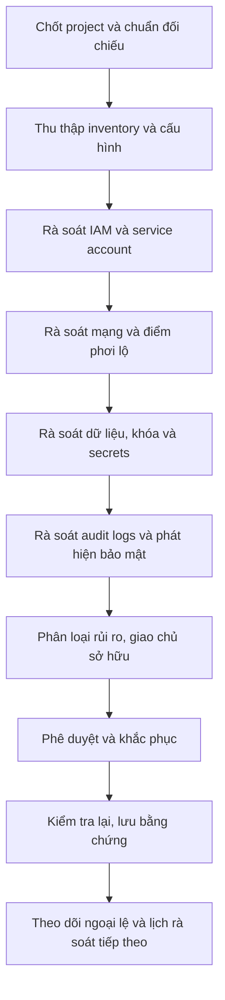

# Thực hành rà soát cấu hình bảo mật một project

Một project Google Cloud có thể chứa máy ảo, cluster GKE, dịch vụ Cloud Run, cơ sở dữ liệu, bucket lưu trữ, service account và nhiều API được bật. Mỗi tài nguyên có cấu hình và quyền truy cập riêng. Chỉ cần một binding IAM quá rộng, một firewall rule mở nhầm cổng hoặc một bucket cho phép truy cập công khai, dữ liệu và workload trong project có thể bị đặt vào rủi ro.

Rà soát bảo mật project là hoạt động thu thập bằng chứng, đối chiếu cấu hình với yêu cầu của tổ chức, đánh giá rủi ro và theo dõi việc khắc phục. Kết quả cần cho biết **tài nguyên nào có vấn đề, ai chịu trách nhiệm, mức độ ảnh hưởng, bằng chứng nào xác nhận vấn đề và khi nào cần xử lý**.

Trong module Cloud Providers GCP, bài thực hành này kết nối các kiến thức về project, IAM, VPC, Compute Engine, GKE, Cloud Run, lưu trữ, cơ sở dữ liệu và logging thành một quy trình kiểm tra có thể lặp lại. Các lệnh minh họa chủ yếu đọc cấu hình. Việc sửa cấu hình production cần có chủ sở hữu, đánh giá tác động và quy trình thay đổi phù hợp.

## 1. Mục tiêu và phạm vi rà soát

Sau bài học, người học có thể:

- Xác định đúng project, danh tính đang thực hiện rà soát và phạm vi tài nguyên cần kiểm tra.
- Thu thập danh sách tài nguyên, API được bật, IAM policy và Organization Policy có hiệu lực.
- Phát hiện các cấu hình có nguy cơ cao trong danh tính, mạng, dữ liệu, mã hóa và nhật ký.
- Phân loại phát hiện theo mức độ rủi ro, gắn người phụ trách và đề xuất biện pháp khắc phục.
- Kiểm tra lại sau khi khắc phục và lưu bằng chứng phục vụ kiểm toán.

Một lần rà soát project nên xác định rõ bốn yếu tố:

| Yếu tố | Câu hỏi cần trả lời |
| --- | --- |
| Phạm vi | Project ID nào, môi trường nào, tài nguyên và dịch vụ nào được bao gồm? |
| Thời điểm | Bằng chứng được thu thập lúc nào, trong khoảng thời gian nào? |
| Chủ sở hữu | Ai chịu trách nhiệm về project, workload, dữ liệu và từng phát hiện? |
| Chuẩn đối chiếu | Dùng chính sách nội bộ, baseline bảo mật, yêu cầu hợp đồng hay framework tuân thủ nào? |

Rà soát một project không tự chứng minh toàn bộ tổ chức đã tuân thủ. Một số quyền và ràng buộc được kế thừa từ organization hoặc folder; một số chính sách nằm trực tiếp trên tài nguyên như bucket, service account, VM hoặc database. Cần kiểm tra đúng cấp tài nguyên và chính sách có hiệu lực.

## 2. Quy trình tổng thể



Nên thu thập bằng chứng ở chế độ chỉ đọc trước. Việc thay đổi IAM, firewall, Organization Policy, khóa mã hóa hoặc cấu hình dịch vụ có thể làm gián đoạn workload. Không xóa một tài khoản, key, rule hay API chỉ vì nó có vẻ không được dùng; hãy xác nhận quan hệ phụ thuộc với chủ sở hữu trước.

## 3. Chuẩn bị phiên rà soát

### 3.1. Chọn project và xác minh danh tính

Ví dụ xuyên suốt bài học sử dụng `PROJECT_ID` làm biến thay thế. Thực hiện trong Cloud Shell hoặc terminal đã cài Google Cloud CLI và đăng nhập bằng tài khoản được cấp quyền rà soát.

```bash
export PROJECT_ID="your-project-id"

# Xác nhận tài khoản đang hoạt động.
gcloud auth list --filter=status:ACTIVE

# Xác nhận project mặc định của cấu hình gcloud.
gcloud config get-value project

# Đọc metadata của đúng project cần rà soát.
gcloud projects describe "$PROJECT_ID" \
  --format="yaml(projectId,projectNumber,name,lifecycleState,parent)"
```

Không dựa vào project mặc định của máy vì terminal có thể đang trỏ tới môi trường khác. Trong các lệnh tiếp theo, truyền `--project="$PROJECT_ID"` rõ ràng để giảm nguy cơ kiểm tra nhầm project.

Ghi nhận project ID, project number, trạng thái, parent resource, môi trường (development, staging hoặc production), thời điểm bắt đầu và người thực hiện. Nếu không đọc được metadata hoặc không xác nhận được parent resource, dừng phần đánh giá phụ thuộc vào thông tin đó và yêu cầu đúng quyền truy cập.

### 3.2. Xác định quyền cần thiết

Rà soát chỉ đọc cần quyền đọc các cấu hình tương ứng. Ví dụ, xem IAM policy project cần quyền đọc policy; tìm tài nguyên qua Cloud Asset Inventory cần quyền `cloudasset.assets.searchAllResources`; tìm IAM policy trên tài nguyên cần `cloudasset.assets.searchAllIamPolicies`; xem Data Access audit logs trong log bucket mặc định cần quyền đọc private logs. Security Command Center có các vai trò riêng để xem findings.

Tổ chức có thể cấp một vai trò Security Reviewer hoặc custom role phù hợp, kết hợp các quyền đọc bổ sung theo phạm vi. Không cấp Owner hoặc Editor chỉ để thuận tiện cho hoạt động kiểm tra. Nếu thiếu quyền, ghi rõ phần dữ liệu chưa thể kiểm tra; không xem kết quả rỗng là bằng chứng rằng không có rủi ro.

### 3.3. Lập thư mục bằng chứng an toàn

Bằng chứng có thể gồm đầu ra lệnh CLI, ảnh chụp trang cấu hình, truy vấn log, mã finding và biên bản xác nhận của chủ sở hữu. Lưu bằng chứng trong nơi có kiểm soát truy cập, thời hạn lưu và lịch sử thay đổi. Tránh đưa token, private key, secret payload, dữ liệu khách hàng hoặc nội dung log nhạy cảm vào báo cáo chia sẻ rộng.

## 4. Kiểm kê tài nguyên và dịch vụ đang bật

Kiểm kê là cơ sở để không bỏ sót tài nguyên. Có thể bắt đầu bằng danh sách API được bật:

```bash
gcloud services list --enabled \
  --project="$PROJECT_ID"
```

API đang bật không tự động là cấu hình sai. Đối chiếu từng API với workload, nhóm sở hữu và mục đích nghiệp vụ. API không còn sử dụng có thể được xem xét tắt sau khi xác nhận không còn tài nguyên phụ thuộc.

Cloud Asset Inventory giúp tìm tài nguyên trong phạm vi project:

```bash
gcloud asset search-all-resources \
  --scope="projects/$PROJECT_ID" \
  --format="table(assetType,name,location,state)"
```

Lệnh cần quyền `cloudasset.assets.searchAllResources` trên scope được truy vấn. Nếu Cloud Asset Inventory API chưa sẵn sàng hoặc tài khoản thiếu quyền, ghi nhận giới hạn đó và sử dụng các trang quản lý của dịch vụ tương ứng. Không bật API hoặc cấp thêm quyền trong lúc rà soát nếu chưa được phê duyệt.

Có thể lập inventory theo nhóm để thuận tiện đối chiếu:

| Nhóm | Tài nguyên cần kiểm tra |
| --- | --- |
| Compute | VM, disk, snapshot, image, địa chỉ IP ngoài, instance template và managed instance group. |
| Container | GKE cluster, node pool, workload, service account và cấu hình endpoint. |
| Serverless | Cloud Run service, revision, ingress, service identity và quyền invoke. |
| Network | VPC, subnet, firewall rule, route, peering, load balancer và Cloud NAT. |
| Data | Cloud Storage bucket, Cloud SQL, BigQuery dataset, database và bản sao lưu. |
| Identity | IAM policy, service account, key, quyền impersonation và nhóm được cấp quyền. |
| Security operations | Audit log, log sink, alert, Security Command Center finding và cấu hình mã hóa. |

Inventory nên được đối chiếu với CMDB hoặc danh sách dịch vụ đã được phê duyệt. Tài nguyên không có owner, nhãn môi trường hoặc mục đích rõ ràng cần được đưa vào danh sách cần xác minh.

## 5. Rà soát IAM và quyền truy cập

IAM là một trong những phần quan trọng nhất của cuộc rà soát. Cần xác định ai có quyền trên project, quyền nào được gán ở cấp tài nguyên và những quyền nào được kế thừa từ cấp cha.

### 5.1. Đọc IAM policy trực tiếp của project

```bash
gcloud projects get-iam-policy "$PROJECT_ID" \
  --format=yaml
```

Đây là policy gắn trực tiếp với project. Policy này không phải danh sách đầy đủ mọi quyền hiệu lực trên tất cả tài nguyên. Một người dùng có thể nhận quyền từ organization, folder, project hoặc policy gắn trực tiếp trên tài nguyên con.

Khi xem từng binding, kiểm tra:

- Principal là user, group, service account, domain hay principal set nào.
- Vai trò có phạm vi rộng đến đâu và có thật sự cần cho công việc không.
- Binding có điều kiện IAM Condition không; điều kiện có giới hạn tài nguyên, thời gian hoặc ngữ cảnh phù hợp không.
- Thành viên bên ngoài tổ chức có được cấp quyền không; quyền đó có được phê duyệt và có ngày hết hạn không.
- Có principal `allUsers` hoặc `allAuthenticatedUsers` hay không. Truy cập công khai có thể là yêu cầu của website hoặc API, nhưng cần xác nhận dữ liệu, phương thức xác thực và lớp bảo vệ đi kèm.

Đặc biệt rà soát các vai trò cơ bản `roles/owner`, `roles/editor` và `roles/viewer`. Owner và Editor thường có phạm vi quyền rộng. Với môi trường production, ưu tiên vai trò được xác định theo nhiệm vụ và quyền tối thiểu. Không tự động xóa một binding chỉ dựa vào tên role; cần xác định workload, quy trình vận hành hoặc nhóm đang phụ thuộc vào quyền đó.

### 5.2. Tìm binding trên tài nguyên trong project

IAM policy có thể được gắn trực tiếp vào bucket, service account, VM hoặc tài nguyên khác. Cloud Asset Inventory có thể tìm các policy trong scope:

```bash
gcloud asset search-all-iam-policies \
  --scope="projects/$PROJECT_ID" \
  --format=json
```

Lệnh cần quyền `cloudasset.assets.searchAllIamPolicies`. Có thể lọc theo principal hoặc role để điều tra một vấn đề cụ thể. Ví dụ:

```bash
# Tìm các binding nhắc đến principal công khai.
gcloud asset search-all-iam-policies \
  --scope="projects/$PROJECT_ID" \
  --query="policy:allUsers" \
  --format=json

# Tìm các binding có vai trò Owner.
gcloud asset search-all-iam-policies \
  --scope="projects/$PROJECT_ID" \
  --query="policy:roles/owner" \
  --format=json
```

Kết quả tìm kiếm là bằng chứng để điều tra policy được gắn trên tài nguyên. Để trả lời chính xác một principal có thể thực hiện một permission trên một tài nguyên hay không, dùng Policy Analyzer hoặc Policy Troubleshooter. Các công cụ này xét thêm policy liên quan và điều kiện truy cập; dữ liệu phân tích có thể có độ trễ ngắn sau khi policy vừa thay đổi.

### 5.3. Kiểm tra quyền hiệu lực và quyền kế thừa

Organization Policy và IAM policy có cách kế thừa khác nhau. IAM có thể cho phép một principal nhận quyền từ nhiều cấp; deny policy và điều kiện cũng ảnh hưởng kết quả. Organization Policy được kế thừa theo hierarchy và tạo ra effective policy tại project.

Trong Console, kiểm tra quyền hiệu lực bằng IAM Policy Analyzer/Policy Troubleshooter khi cần xác nhận một principal cụ thể. Với Organization Policy, dùng lệnh `describe --effective` ở phần tiếp theo. Ghi riêng nguồn cấp quyền (organization, folder, project hay tài nguyên) để chủ sở hữu biết nơi cần thay đổi.

### 5.4. Tiêu chí đánh giá IAM

| Dấu hiệu | Câu hỏi kiểm tra | Hướng xử lý |
| --- | --- | --- |
| Owner hoặc Editor gán cho cá nhân | Công việc có thực sự cần toàn quyền không? Có thể thay bằng role hẹp hơn không? | Xác nhận owner nghiệp vụ, lập phương án thay thế và giảm quyền theo change request. |
| Principal công khai | Tài nguyên có chủ đích public không? Có chứa dữ liệu nhạy cảm hoặc thao tác ghi không? | Xác nhận yêu cầu công khai, giới hạn dữ liệu và phương thức truy cập. |
| Tài khoản ngoài domain | Đối tác còn cần truy cập không? Có hợp đồng, sponsor và ngày hết hạn không? | Xác minh danh tính, phê duyệt lại và đặt thời hạn. |
| Binding không có owner | Nhóm nào sử dụng? Ai chịu trách nhiệm khi có sự cố? | Tìm owner trước khi thu hồi quyền. |
| Role gán ở cấp project nhưng chỉ cần một tài nguyên | Có thể chuyển binding xuống tài nguyên cụ thể không? | Thu hẹp scope sau khi kiểm tra tác động. |

## 6. Rà soát service account và khóa xác thực

Service account đại diện cho workload hoặc ứng dụng khi gọi Google Cloud APIs. Một service account có quyền quá rộng hoặc key dài hạn bị lộ có thể tạo ra đường truy cập trực tiếp vào dữ liệu và tài nguyên.

Liệt kê service account của project:

```bash
gcloud iam service-accounts list \
  --project="$PROJECT_ID"
```

Với từng service account, xác định workload đang sử dụng, owner, vai trò được gán và ai có quyền impersonate hoặc gắn service account vào tài nguyên. Đặc biệt chú ý service account mặc định và các tài khoản từng được cấp Editor tự động. Quyền mặc định cần được đánh giá theo chính sách hiện tại của tổ chức và yêu cầu của workload.

Liệt kê user-managed keys của một service account:

```bash
gcloud iam service-accounts keys list \
  --iam-account="SERVICE_ACCOUNT_EMAIL" \
  --managed-by=user \
  --project="$PROJECT_ID"
```

Đầu ra cho biết key ID và metadata như thời điểm tạo hoặc hết hạn; lệnh không trả private key material. Xác minh key có còn cần thiết không, được lưu ở đâu, ai quản lý, có ngày hết hạn và quy trình thu hồi hay không. Key không có owner hoặc tồn tại lâu mà không có lý do là dấu hiệu cần điều tra. Không xóa hoặc vô hiệu hóa key trước khi xác nhận ứng dụng đã chuyển sang cơ chế xác thực khác.

Ưu tiên danh tính workload được quản lý như service account gắn vào Compute Engine hoặc Cloud Run, Workload Identity Federation cho GKE và cơ chế impersonation có kiểm soát. Chỉ sử dụng key dài hạn khi không có phương án phù hợp; tránh đưa key vào source code, image, biến build, log hoặc kho lưu trữ không được bảo vệ.

Kiểm tra các Organization Policy liên quan đến việc tạo và tải key:

```bash
gcloud org-policies describe \
  iam.managed.disableServiceAccountKeyCreation \
  --project="$PROJECT_ID" \
  --effective

gcloud org-policies describe \
  iam.managed.disableServiceAccountKeyUpload \
  --project="$PROJECT_ID" \
  --effective
```

Effective policy cho biết quy tắc có hiệu lực sau khi xét kế thừa. Nếu tổ chức sử dụng constraint legacy hoặc một chính sách khác, cần kiểm tra tên constraint và trạng thái thực tế của môi trường. Việc chặn key creation thường là baseline tốt, nhưng ngoại lệ cho workload cũ phải có phạm vi hẹp, owner và thời hạn xem xét.

## 7. Rà soát mạng và điểm phơi lộ

Mục tiêu là hiểu tài nguyên nào có thể được truy cập từ Internet, nguồn nào được phép kết nối và liệu đường quản trị có bị mở rộng quá mức.

### 7.1. Kiểm tra VPC và firewall rules

```bash
gcloud compute networks list \
  --project="$PROJECT_ID"

gcloud compute firewall-rules list \
  --project="$PROJECT_ID" \
  --format=json

gcloud compute instances list \
  --project="$PROJECT_ID" \
  --format=json
```

Với mỗi firewall rule, đọc direction, action, priority, source ranges, destination ranges, protocol, port, target tags, target service accounts, trạng thái disabled và cấu hình logging. Kiểm tra cả ingress và egress. Rule có source `0.0.0.0/0` hoặc `::/0` cần được đánh giá kỹ, nhất là khi cho phép SSH (22), RDP (3389), database hoặc cổng quản trị.

Không phải mọi rule có nguồn Internet đều là lỗi. Dịch vụ web có thể cần nhận HTTP/HTTPS từ Internet. Điều cần xác nhận là rule chỉ mở đúng cổng, đúng target, có lớp bảo vệ phù hợp và không vô tình áp dụng cho nhiều VM hơn dự kiến. SSH/RDP thường nên đi qua IAP TCP forwarding, VPN, bastion có kiểm soát hoặc giải pháp quản trị được tổ chức phê duyệt.

Lệnh `gcloud compute firewall-rules list` liệt kê VPC firewall rules của project. Nếu tổ chức dùng hierarchical firewall policies hoặc network firewall policies, hãy rà soát thêm ở cấp organization/folder và policy tương ứng; chỉ nhìn danh sách rule của project có thể bỏ sót rule được áp dụng từ cấp cao hơn.

### 7.2. Kiểm tra địa chỉ IP và dịch vụ public

Đối chiếu danh sách VM, địa chỉ IP ngoài, load balancer, Cloud Run service, GKE cluster và database với sơ đồ kiến trúc đã được phê duyệt. Một public IP không tự động là lỗi, nhưng phải có mục đích, owner và biện pháp bảo vệ.

Với Cloud Run, kiểm tra ingress setting, authentication, quyền `roles/run.invoker` và principal được phép gọi service. Nếu `allUsers` có quyền invoke, xác nhận endpoint thực sự cần public, dữ liệu trả về không nhạy cảm và lớp bảo vệ như API Gateway, load balancer hoặc Cloud Armor đã được thiết kế phù hợp.

Với GKE, kiểm tra endpoint control plane, authorized networks, private nodes, Workload Identity Federation, network policy và cách workload truy cập secret. Với Cloud SQL, kiểm tra public IP, authorized networks, kết nối private, SSL/TLS, backup và tài khoản database. Các thuộc tính cụ thể khác nhau theo loại dịch vụ; cần mở cấu hình của đúng tài nguyên thay vì suy luận từ cấu hình project.

### 7.3. Logging cho mạng

VPC firewall rules logging có thể ghi connection record cho rule được chọn, cả rule allow và deny. Log giúp xác định rule đang tác động đến kết nối nào. Tính năng này cần bật riêng cho từng rule; log có thể phát sinh chi phí. Nó ghi nhận kết nối TCP/UDP khi kết nối được thiết lập, không phải mọi packet. Nếu cần quan sát lưu lượng mạng rộng hơn, xem xét VPC Flow Logs và chi phí lưu trữ tương ứng.

## 8. Rà soát dữ liệu, storage và mã hóa

Một project có thể có nhiều bản sao dữ liệu ở bucket, database, snapshot, backup hoặc log. Hãy lập bản đồ dữ liệu theo độ nhạy, chủ sở hữu, nơi lưu trữ, luồng truy cập và yêu cầu lưu giữ.

### 8.1. Cloud Storage

Liệt kê bucket trong project:

```bash
gcloud storage buckets list \
  --project="$PROJECT_ID"
```

Với từng bucket quan trọng, kiểm tra metadata và IAM:

```bash
gcloud storage buckets describe "gs://BUCKET_NAME" \
  --format="yaml(name,location,iamConfiguration,encryption,versioning,retentionPolicy,softDeletePolicy)"

gcloud storage buckets get-iam-policy "gs://BUCKET_NAME"
```

Chú ý hai thuộc tính:

- **Uniform bucket-level access**: nên bật để quản lý quyền qua IAM thống nhất ở cấp bucket, tránh phải phối hợp IAM với ACL trên từng object.
- **Public access prevention**: nên được enforce cho dữ liệu không có yêu cầu công khai. Có thể áp dụng ở bucket hoặc bằng Organization Policy tại project, folder hay organization.

Tìm binding `allUsers` và `allAuthenticatedUsers` trong policy của bucket. Nếu bucket chứa dữ liệu công khai theo thiết kế, ghi rõ loại dữ liệu, người phê duyệt và cách ngăn tải nhầm dữ liệu nội bộ. Đồng thời kiểm tra versioning, soft delete, retention policy, backup và quy trình khôi phục. Các tính năng này phục vụ những mục đích khác nhau; bật versioning không thay thế backup hoặc kiểm soát truy cập.

### 8.2. Database, snapshot và dữ liệu nhạy cảm

Với Cloud SQL, BigQuery, Spanner hoặc dịch vụ dữ liệu khác, kiểm tra danh tính truy cập, quyền ở cấp dataset/database, endpoint công khai, mã hóa, backup, retention và audit logs. Xác minh dữ liệu production có được sao chép sang môi trường development/test không và bản sao có giữ nguyên mức bảo vệ cần thiết không.

Snapshot, disk image và bản backup thường chứa dữ liệu tương tự hệ thống gốc. Vì vậy, chúng cần quyền đọc, chính sách chia sẻ, thời hạn lưu và mã hóa phù hợp. Không chỉ rà soát database đang chạy mà bỏ qua các bản sao lưu và bản xuất dữ liệu.

### 8.3. Cloud KMS và CMEK

Google Cloud mã hóa dữ liệu lưu trữ theo cơ chế mặc định. Với workload có yêu cầu quản trị khóa riêng, có thể dùng Customer-Managed Encryption Keys (CMEK) trong Cloud KMS. Khi rà soát CMEK, kiểm tra:

- Tài nguyên nào phải dùng CMEK theo chính sách dữ liệu hoặc hợp đồng.
- Key ring và key nằm ở location phù hợp với tài nguyên được bảo vệ.
- Ai có quyền quản trị key, ai có quyền sử dụng key và hai trách nhiệm này có được tách biệt không.
- Key có lịch rotation, trạng thái version, kế hoạch khôi phục và owner rõ ràng không.
- Việc vô hiệu hóa hoặc hủy key có thể ảnh hưởng đến dữ liệu nào.

Rotation của Cloud KMS tạo key version mới. Cách dịch vụ tích hợp CMEK sử dụng version mới và xử lý dữ liệu đã mã hóa có thể khác nhau; không giả định rằng đổi primary version tự động mã hóa lại mọi dữ liệu cũ. Trước khi thay đổi trạng thái key, phải hiểu hành vi của dịch vụ sử dụng key và quy trình khôi phục.

## 9. Rà soát Organization Policy và baseline

Organization Policy cung cấp cơ chế áp đặt ràng buộc tập trung. Policy được cấu hình ở organization có thể truyền xuống folder và project; policy tại project có thể kế thừa hoặc ghi đè theo quy tắc của constraint.

Liệt kê các policy được đặt trên project:

```bash
gcloud org-policies list \
  --project="$PROJECT_ID"
```

Đọc effective policy cho một constraint cụ thể:

```bash
gcloud org-policies describe \
  storage.publicAccessPrevention \
  --project="$PROJECT_ID" \
  --effective

gcloud org-policies describe \
  iam.managed.disableServiceAccountKeyCreation \
  --project="$PROJECT_ID" \
  --effective
```

Tùy baseline của tổ chức, có thể cần kiểm tra thêm ràng buộc về vị trí tài nguyên, chia sẻ ngoài domain, IP ngoài, API hoặc loại tài nguyên được phép tạo. Không áp dụng một danh sách constraint cứng cho mọi project: project phục vụ public website, data analytics và workload nội bộ có yêu cầu khác nhau.

Khi thấy policy không được enforce, xác định đó là ngoại lệ được phê duyệt, cấu hình chưa hoàn tất hay constraint không phù hợp với workload. Nếu một policy được kế thừa từ parent, thay đổi tại project có thể không đủ quyền hoặc không thay đổi được kết quả. Việc sửa policy cần được thực hiện ở đúng cấp quản trị và đánh giá ảnh hưởng đến tất cả workload liên quan.

## 10. Rà soát audit logs và khả năng phát hiện

Cloud Audit Logs cung cấp dấu vết về hoạt động trên tài nguyên. Cần phân biệt các loại log:

| Loại audit log | Nội dung | Trạng thái mặc định |
| --- | --- | --- |
| Admin Activity | Thay đổi metadata hoặc cấu hình tài nguyên. | Luôn được ghi và không thể tắt. |
| System Event | Thay đổi do hệ thống Google Cloud hoặc managed service agent thực hiện. | Luôn được ghi và không thể tắt. |
| Policy Denied | Yêu cầu bị từ chối do vi phạm chính sách bảo mật. | Được tạo mặc định; có thể bị loại khỏi bucket qua log exclusion. |
| Data Access | Đọc cấu hình/metadata hoặc đọc, ghi dữ liệu do người dùng cung cấp. | Thường tắt mặc định, ngoại trừ một số dịch vụ BigQuery. |

Data Access audit logs đặc biệt hữu ích cho dữ liệu nhạy cảm nhưng có thể tạo lượng log lớn và phát sinh chi phí. Chọn dịch vụ, loại permission (`ADMIN_READ`, `DATA_READ`, `DATA_WRITE`) và phạm vi cần ghi theo yêu cầu bảo mật. Đừng mặc định bật tất cả log mà chưa dự trù dung lượng, retention và chi phí; cũng đừng bỏ qua log truy cập dữ liệu chỉ vì Admin Activity đã bật.

Kiểm tra log sink của project:

```bash
gcloud logging sinks list \
  --project="$PROJECT_ID"
```

Với từng sink, xác minh filter có bao phủ đúng log cần thu thập, destination còn hoạt động, writer identity có quyền ghi vào đích và log được lưu đủ thời gian theo chính sách. Nếu tổ chức yêu cầu giám sát tập trung, xác nhận log quan trọng được route đến project hoặc hệ thống bảo mật trung tâm. Chỉ có sink chưa đủ; cần kiểm tra log thực sự đến đích và có thể truy vấn.

### 10.1. Security Command Center

Nếu Security Command Center được kích hoạt ở phạm vi phù hợp, kiểm tra Findings và lọc theo project, severity, category, asset type và finding state. Tập trung vào misconfiguration, vulnerability, external exposure và các phát hiện về danh tính hoặc dữ liệu.

Khả năng phát hiện phụ thuộc service tier, cấu hình, nguồn dữ liệu và detector được bật. Một số detector hoặc Security Health Analytics có điều kiện khả dụng theo tier và loại activation. Vì vậy, việc không thấy finding không chứng minh project không có vấn đề. Xác minh Security Command Center đang hoạt động, nguồn phát hiện cần thiết đã được cấu hình và không có lỗi làm gián đoạn việc quét.

Mỗi finding cần được đọc đến phần affected asset, evidence, severity và remediation guidance. Sau khi khắc phục, kiểm tra lại tài nguyên và trạng thái finding. Chỉ mute finding khi đã có lý do, owner và thời hạn xem xét; mute không sửa cấu hình gây ra vấn đề.

## 11. Phân loại rủi ro và lập báo cáo

Không nên đánh giá phát hiện chỉ bằng số lượng. Một rule public cho website và một rule public cho cổng database có mức rủi ro rất khác nhau. Kết hợp các yếu tố sau:

- **Mức độ ảnh hưởng:** dữ liệu hoặc dịch vụ nào bị tác động, có chứa thông tin nhạy cảm không?
- **Khả năng tiếp cận:** tài nguyên có thể bị truy cập từ Internet, từ nhiều project hay chỉ từ một workload nội bộ?
- **Quyền có thể đạt được:** principal có thể đọc dữ liệu, thay đổi cấu hình, tạo credential hay chiếm quyền quản trị không?
- **Khả năng khai thác:** có đường truy cập thực tế, lỗ hổng đã biết hoặc cấu hình sai có thể bị lạm dụng không?
- **Phạm vi ảnh hưởng:** một tài nguyên hay nhiều workload và project bị ảnh hưởng?
- **Biện pháp bù trừ:** có MFA, private networking, WAF, approval, monitoring hoặc kiểm soát khác giảm rủi ro không?

Ví dụ thang phân loại nội bộ:

| Mức độ | Ví dụ | Cách xử lý tham khảo |
| --- | --- | --- |
| Critical | Bucket chứa dữ liệu nhạy cảm bị public; credential quản trị bị lộ và còn hiệu lực; cổng quản trị production mở công khai kèm quyền truy cập yếu. | Thông báo ngay cho owner và nhóm ứng cứu; áp dụng biện pháp giảm phơi lộ theo quy trình khẩn cấp. |
| High | Principal không rõ nguồn có Owner/Editor; service account key không quản lý được; database production có đường truy cập public không cần thiết. | Ưu tiên xử lý trong SLA bảo mật; xác nhận tác động và kế hoạch rollback. |
| Medium | Data Access logs chưa bật cho một dịch vụ dữ liệu quan trọng; firewall rule quá rộng nhưng có kiểm soát bù trừ; bucket chưa có owner rõ ràng. | Lập kế hoạch khắc phục, gán owner và ngày hoàn thành. |
| Low | Nhãn tài nguyên thiếu, mô tả service account chưa rõ hoặc rule cũ chưa có bằng chứng sử dụng. | Bổ sung metadata, xác minh owner và đưa vào backlog cải thiện. |

Đây là ví dụ để thống nhất cách làm trong bài thực hành, không phải thang severity chính thức của Google Cloud. Tổ chức cần ánh xạ nó với SLA, framework và quy trình ứng cứu của mình.

Một bản ghi finding nên có tối thiểu:

| Trường | Nội dung cần ghi |
| --- | --- |
| Finding ID | Mã ticket hoặc mã phát hiện duy nhất. |
| Project / resource | Project ID, tên tài nguyên và loại tài nguyên. |
| Evidence | Lệnh, policy, log hoặc ảnh chụp cấu hình kèm thời điểm thu thập. |
| Risk | Mức độ, tác động, khả năng khai thác và phạm vi ảnh hưởng. |
| Owner | Nhóm hoặc cá nhân chịu trách nhiệm xác nhận và xử lý. |
| Remediation | Thay đổi cần thực hiện, phụ thuộc và cách kiểm tra sau thay đổi. |
| Due date / status | Hạn xử lý, trạng thái, ngoại lệ và ngày xem xét lại. |

## 12. Khắc phục có kiểm soát

Sau khi có báo cáo, sắp xếp thứ tự theo rủi ro và mức độ phơi lộ. Với một project production, thứ tự ưu tiên thường là:

1. Giảm nguy cơ lộ dữ liệu và credential đang có thể bị truy cập công khai.
2. Thu hẹp quyền quản trị quá rộng và xác minh các principal không rõ nguồn.
3. Xử lý service account key không cần thiết sau khi xác nhận workload đã chuyển đổi.
4. Thu hẹp firewall rule và endpoint quản trị theo kiến trúc được phê duyệt.
5. Bổ sung audit logs, log routing, alert và quy trình theo dõi finding.
6. Hoàn thiện mã hóa, backup, retention và kiểm soát dữ liệu theo phân loại.

Trước khi thay đổi, lưu trạng thái cấu hình hiện tại trong kho bằng chứng được bảo vệ. Xác định dịch vụ phụ thuộc, cửa sổ thay đổi, người phê duyệt, kế hoạch rollback và phép kiểm tra chức năng sau thay đổi. Thay đổi một nhóm nhỏ, xác minh kết quả, rồi mới mở rộng.

Ví dụ thu hẹp một binding `roles/editor` ở cấp project:

```bash
# Chỉ chạy sau khi xác nhận principal, quyền thay thế và change request.
gcloud projects remove-iam-policy-binding "$PROJECT_ID" \
  --member="user:USER_EMAIL" \
  --role="roles/editor"
```

Lệnh trên thay đổi quyền trực tiếp của project. Nếu binding được kế thừa từ organization/folder hoặc được gắn ở tài nguyên khác, lệnh này không xóa nguồn cấp quyền đó. Sau khi thu hẹp, kiểm tra lại quyền hiệu lực bằng Policy Analyzer/Policy Troubleshooter và xác nhận các tác vụ hợp lệ vẫn hoạt động.

Một số thay đổi có thể gây gián đoạn nếu thực hiện vội: vô hiệu hóa key đang được workload sử dụng, đổi firewall rule của hệ thống quản trị, enforce Organization Policy mới hoặc hủy KMS key version. Nếu chưa xác định được owner hoặc dependency, ghi finding ở trạng thái cần điều tra và yêu cầu xác minh trước khi thay đổi.

## 13. Tình huống thực hành

Giả sử nhóm vận hành nhận bàn giao project `retail-prod-01`. Project chạy một ứng dụng Cloud Run, một cụm GKE, một số VM xử lý nền và bucket chứa báo cáo bán hàng. Nhóm cần thực hiện rà soát trước kỳ đánh giá bảo mật.

Sau khi kiểm kê và đọc cấu hình, nhóm phát hiện:

| Phát hiện | Bằng chứng cần thu thập | Câu hỏi cần xác minh |
| --- | --- | --- |
| Một user có `roles/editor` ở cấp project | IAM binding, thời điểm cấp, ticket hoặc yêu cầu thay đổi liên quan. | User còn thuộc nhóm vận hành không? Có thể thay bằng role hẹp hơn không? |
| Một service account có user-managed key cũ | Key ID, ngày tạo, ngày hết hạn, owner và workload sử dụng. | Workload còn dùng key này không? Có thể chuyển sang workload identity hoặc impersonation không? |
| Firewall rule cho phép SSH từ `0.0.0.0/0` | Rule name, network, source range, port, target và firewall log. | VM nào nhận rule? Có thể dùng IAP/VPN hoặc nguồn quản trị cố định không? |
| Bucket báo cáo chưa enforce public access prevention | Bucket IAM policy, cấu hình UBLA/PAP và phân loại dữ liệu. | Bucket có yêu cầu public không? Có object hoặc principal nào đang truy cập công khai không? |
| Data Access audit logs chưa bật cho dịch vụ dữ liệu nhạy cảm | Audit Log configuration, service và permission types. | Yêu cầu giám sát nào cần đáp ứng? Chi phí và retention dự kiến ra sao? |

Nhóm không xóa ngay user, key hoặc firewall rule. Họ xác nhận owner và dependency, đánh giá rủi ro, mở ticket cho từng thay đổi và ưu tiên xử lý bucket cùng đường SSH công khai. Sau khi khắc phục, nhóm thu thập lại policy, kiểm tra kết nối hợp lệ, xác nhận log đến hệ thống giám sát và cập nhật finding.

### Bài tập

1. Chọn một project thử nghiệm mà bạn được phép kiểm tra. Ghi project ID, parent resource, môi trường và thời điểm rà soát.
2. Chạy các lệnh kiểm kê API, tài nguyên, IAM policy và Organization Policy trong bài học. Lưu đầu ra ở nơi có kiểm soát truy cập.
3. Tìm một binding IAM quá rộng hoặc principal cần xác minh. Dùng Policy Analyzer/Policy Troubleshooter để hiểu quyền hiệu lực.
4. Liệt kê service account và user-managed keys. Ghi owner và workload phụ thuộc cho từng key cần xem xét.
5. Kiểm tra firewall rule, IP public và một bucket quan trọng. Đánh giá theo dữ liệu và workload thực tế.
6. Kiểm tra cấu hình Data Access audit logs, log sink và Security Command Center nếu dịch vụ này được bật.
7. Lập ít nhất ba finding có evidence, risk, owner, remediation và due date. Đề xuất thứ tự khắc phục.
8. Với project lab, thực hiện một thay đổi đã được phê duyệt, sau đó kiểm tra lại cấu hình và chức năng. Ghi bằng chứng trước/sau.

Kết quả thực hành cần trả lời được: project có những tài nguyên nào, principal nào có quyền đáng kể, điểm nào có thể bị truy cập từ bên ngoài, dữ liệu được bảo vệ ra sao, sự kiện bảo mật được ghi nhận ở đâu và những rủi ro nào cần xử lý trước.

## 14. Checklist rà soát nhanh

- [ ] Đúng project ID, project number, parent resource và môi trường.
- [ ] Inventory tài nguyên và API được bật đã được đối chiếu với owner.
- [ ] IAM trực tiếp, IAM trên tài nguyên và quyền kế thừa đã được phân biệt.
- [ ] Principal công khai, bên ngoài tổ chức và role quá rộng đã được xác minh.
- [ ] Service account, quyền impersonation và user-managed keys đã được rà soát.
- [ ] Firewall rules, IP public, Cloud Run ingress, GKE endpoint và database exposure đã được kiểm tra.
- [ ] Bucket IAM, UBLA, public access prevention, backup và retention đã được kiểm tra.
- [ ] Mã hóa và quyền Cloud KMS phù hợp với phân loại dữ liệu.
- [ ] Audit logs, Data Access configuration, log sink và Security Command Center đã được xem xét.
- [ ] Mỗi finding có evidence, risk, owner, remediation, due date và trạng thái.
- [ ] Thay đổi đã được phê duyệt, kiểm tra sau thay đổi và lưu bằng chứng.
- [ ] Ngoại lệ có lý do, người phê duyệt và ngày hết hạn hoặc ngày xem xét lại.

## 15. Tài liệu tham khảo

- [Cloud Asset Inventory: Search resources](https://docs.cloud.google.com/asset-inventory/docs/search-resources)
- [Cloud Asset Inventory: Search IAM policies](https://docs.cloud.google.com/sdk/gcloud/reference/asset/search-all-iam-policies)
- [IAM: Manage access to projects, folders, and organizations](https://docs.cloud.google.com/iam/docs/granting-changing-revoking-access)
- [Policy Analyzer for allow policies](https://docs.cloud.google.com/policy-intelligence/docs/policy-analyzer-overview)
- [Best practices for using service accounts securely](https://docs.cloud.google.com/iam/docs/best-practices-service-accounts)
- [Organization Policy overview](https://docs.cloud.google.com/organization-policy/overview)
- [Cloud Audit Logs: Enable Data Access audit logs](https://docs.cloud.google.com/logging/docs/audit/configure-data-access)
- [Best practices for Cloud Audit Logs](https://docs.cloud.google.com/logging/docs/audit/best-practices)
- [VPC firewall rules logging overview](https://docs.cloud.google.com/firewall/docs/vpc-firewall-rules-logging-overview)
- [Cloud Storage: Public access prevention](https://docs.cloud.google.com/storage/docs/public-access-prevention)
- [Cloud Storage: Uniform bucket-level access](https://docs.cloud.google.com/storage/docs/uniform-bucket-level-access)
- [Security Command Center: Use Security Health Analytics](https://docs.cloud.google.com/security-command-center/docs/how-to-use-security-health-analytics)
