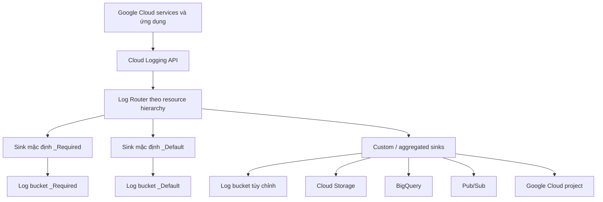
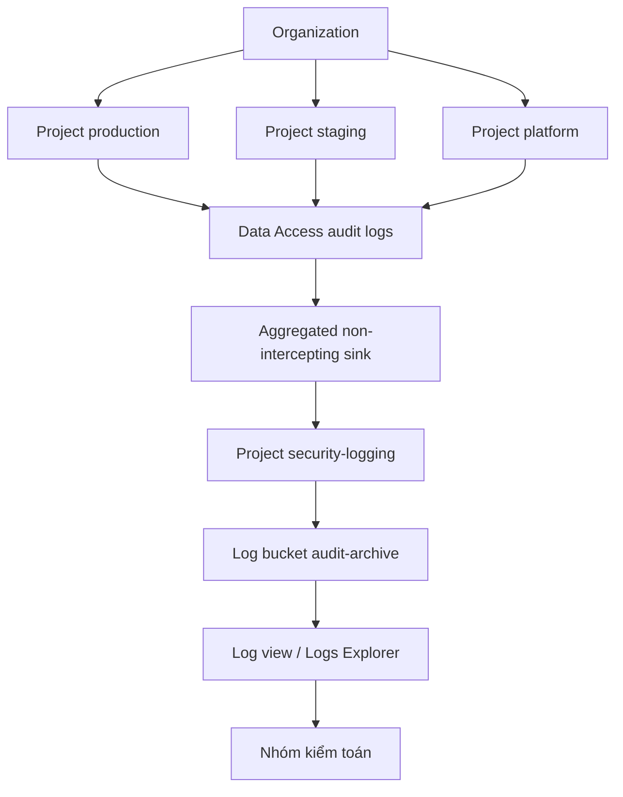

# Log Router, sinks, log buckets và retention

Một hệ thống Google Cloud thường tạo log từ nhiều nơi: thao tác quản trị project và IAM, thay đổi firewall hoặc VPC, ứng dụng chạy trên Compute Engine, workload GKE, dịch vụ Cloud Run, cơ sở dữ liệu và các dịch vụ lưu trữ. Khi số lượng project tăng lên, việc giữ log ở từng nơi khiến đội vận hành khó điều tra sự cố, kiểm toán thay đổi và đáp ứng yêu cầu lưu trữ.

Cloud Logging cung cấp **Log Router** để quyết định log entry sẽ đi đâu, **log sink** để định tuyến theo bộ lọc và **log bucket** để lưu trữ, truy vấn log. Cấu hình retention xác định thời gian log được giữ trong bucket. Các thành phần này giúp tổ chức thiết kế luồng log theo phạm vi project hoặc toàn organization, đồng thời kiểm soát nơi lưu dữ liệu, quyền truy cập và chi phí.

Trong module `CLOUD_PROVIDERS_GCP`, đây là lớp vận hành nối các tài nguyên cloud với hoạt động quan sát: log từ IAM và Audit Logs giúp truy vết thay đổi; log từ VPC và workload hỗ trợ điều tra kết nối; log ứng dụng và cơ sở dữ liệu hỗ trợ phân tích lỗi và độ tin cậy. Log Router chỉ xử lý các log entry đã được gửi đến Cloud Logging. Nó không tự bật Data Access audit logs, cài Ops Agent hay tạo log cho ứng dụng.

## 1. Luồng định tuyến log trong Cloud Logging

Một log entry được gửi đến Cloud Logging có thể đi qua Log Router của resource nơi log phát sinh. Mỗi project, folder, organization và billing account có Log Router cùng các sink thuộc phạm vi resource đó. Các sink đánh giá log entry theo filter và chuyển bản ghi phù hợp đến destination đã cấu hình.



Log Router có thể lưu tạm log entry trong quá trình định tuyến để hấp thụ gián đoạn ngắn ở destination. Bộ đệm tạm này không phải kho lưu trữ dài hạn và không thay thế log bucket. Nó cũng không bảo vệ bạn khỏi filter sai, thiếu quyền ghi hoặc cấu hình destination không hợp lệ.

Một sink chỉ xử lý log entry được nhận sau khi sink hoạt động. Nếu tạo sink hôm nay, sink không tự động lấy lại các log entry cũ đã được nhận trước đó. Nếu cần sao chép log lịch sử từ bucket, phải dùng quy trình sao chép hoặc định tuyến lại dữ liệu phù hợp.

## 2. Log sink hoạt động như thế nào?

Log sink là cấu hình định tuyến thuộc một project, folder, organization hoặc billing account. Mỗi sink có:

- **Tên và mô tả:** định danh và giải thích mục đích sử dụng.
- **Destination:** nơi nhận log entry, ví dụ log bucket, Cloud Storage, BigQuery, Pub/Sub hoặc một project khác.
- **Inclusion filter:** điều kiện chọn log entry cần định tuyến.
- **Exclusion filters:** các điều kiện loại log entry khỏi sink dù bản ghi đã khớp inclusion filter.
- **Writer identity:** danh tính dịch vụ được dùng để ghi vào destination khi destination yêu cầu cấp quyền riêng.

Một sink có một inclusion filter và có thể có nhiều exclusion filter. Nếu không khai báo inclusion filter, sink khớp mọi log entry. Một bản ghi được gửi đến destination khi nó khớp inclusion filter và không khớp bất kỳ exclusion filter đang bật nào.

Ví dụ, filter sau chọn log có mức độ nghiêm trọng từ `ERROR` trở lên của VM Compute Engine:

```text
resource.type="gce_instance" AND severity>=ERROR
```

Filter sau chọn Data Access audit logs:

```text
LOG_ID("cloudaudit.googleapis.com/data_access") OR
LOG_ID("externalaudit.googleapis.com/data_access")
```

Bạn có thể kết hợp điều kiện theo resource, project, log name, severity, trường trong payload hoặc nhãn. Filter dùng Logging query language, cùng ngôn ngữ được sử dụng trong Logs Explorer. Hãy kiểm tra filter trong Logs Explorer hoặc chức năng preview trước khi bật sink ở phạm vi rộng.

Mỗi sink đánh giá log entry độc lập. Vì vậy, một log entry có thể được định tuyến đến nhiều destination nếu khớp nhiều sink. Điều này hữu ích khi vừa cần kho lưu trữ tập trung, vừa cần gửi một nhóm log đến SIEM; tuy nhiên, định tuyến trùng làm tăng lượng dữ liệu lưu và chi phí ở các destination.

Exclusion filter được áp dụng sau khi log entry đã được Cloud Logging nhận. Vì vậy, exclusion giúp giảm lượng log được lưu hoặc chuyển tiếp qua sink, nhưng không làm giảm số lần gọi `entries.write` hay lượng log đã đi qua bước ingest. Không dùng exclusion như một biện pháp thay thế cho việc kiểm soát log ngay tại nguồn.

## 3. Sink theo project, folder và organization

### Sink cấp project

Project-level sink phù hợp khi một nhóm cần định tuyến log của một project đến destination riêng. Ví dụ, project `payments-prod` có thể gửi log lỗi ứng dụng sang BigQuery để phân tích, hoặc gửi audit log đến một bucket chuyên lưu trữ.

### Aggregated sink cấp folder hoặc organization

Khi cần tập trung log từ nhiều project, có thể tạo **aggregated sink** tại folder hoặc organization. Sink này dùng tùy chọn `--include-children` để nhận log từ resource được chọn và các folder/project con. Cách này giúp đội bảo mật hoặc nền tảng quản lý một chính sách định tuyến chung thay vì phải tạo sink giống nhau trong từng project.

Có hai cách hoạt động:

| Loại aggregated sink | Hành vi | Khi nên dùng |
|---|---|---|
| Non-intercepting | Định tuyến bản ghi khớp filter đến destination tập trung; các sink ở project con vẫn tiếp tục đánh giá bản ghi | Khi muốn tập trung thêm một bản sao log và vẫn để từng project tự quản lý luồng log của mình |
| Intercepting | Khi bản ghi khớp filter, định tuyến đến destination của sink cấp trên và ngăn các sink ở resource con xử lý bản ghi đó; `_Required` ở resource nguồn vẫn nhận các log thuộc phạm vi của nó | Khi tổ chức cần áp dụng chính sách định tuyến tập trung và kiểm soát sink ở cấp dưới |

Intercepting sink có thể thay đổi hành vi định tuyến của project con. Một filter thiếu điều kiện hoặc exclusion sai có thể làm log không đến destination mà nhóm ứng dụng đang sử dụng. Vì thế, nên thử nghiệm bằng non-intercepting sink trước, kiểm tra kết quả và trao đổi với chủ sở hữu project trước khi áp dụng intercepting sink.

### Ví dụ định tuyến log từ cả organization

Lệnh dưới đây tạo sink cấp organization để thu thập Data Access audit logs từ organization và các resource con, sau đó chuyển đến một log bucket trong project lưu trữ tập trung:

```bash
gcloud logging sinks create org-data-access-to-central \
  logging.googleapis.com/projects/SECURITY_PROJECT_ID/locations/global/buckets/audit-archive \
  --organization=ORGANIZATION_ID \
  --include-children \
  --log-filter='LOG_ID("cloudaudit.googleapis.com/data_access") OR LOG_ID("externalaudit.googleapis.com/data_access")'
```

Thay `SECURITY_PROJECT_ID` và `ORGANIZATION_ID` bằng định danh thật. Destination bucket phải tồn tại trước khi tạo sink. Với aggregated sink, người tạo cần quyền quản lý sink ở organization hoặc folder, chẳng hạn `roles/logging.configWriter` hoặc `roles/logging.admin` theo nhiệm vụ được giao.

Lưu ý: sink chỉ định tuyến các audit log đã được sinh ra. Nếu dịch vụ chưa bật Data Access audit logging hoặc không tạo loại log được lọc, sink sẽ không có dữ liệu tương ứng để chuyển.

## 4. Chọn destination cho sink

Destination quyết định cách đội ngũ lưu, phân tích hoặc chuyển log ra hệ thống khác.

| Destination | Mục đích thường gặp | Điểm cần lưu ý |
|---|---|---|
| Cloud Logging log bucket | Lưu log để truy vấn trong Logs Explorer hoặc Observability Analytics | Phù hợp khi cần tìm kiếm, phân tích và quản lý retention trong Cloud Logging |
| Cloud Storage bucket | Lưu trữ hoặc xuất log theo lô để lưu trữ dài hạn và trao đổi dữ liệu | Cần cấp quyền ghi cho writer identity; quản lý lifecycle và chi phí Cloud Storage riêng |
| BigQuery dataset | Phân tích log bằng SQL và kết hợp với dữ liệu nghiệp vụ | Cần dataset có quyền ghi; cân nhắc partitioning, truy vấn và chi phí BigQuery |
| Pub/Sub topic | Phát log gần thời gian thực đến SIEM, SOAR hoặc hệ thống xử lý sự kiện | Subscriber cần được vận hành và giám sát; xử lý thông điệp lặp an toàn |
| Google Cloud project | Chuyển log sang project trung tâm để các sink ở project nhận tiếp tục định tuyến | Có giới hạn một bước chuyển project; cần thiết kế sink ở project đích |

Nếu muốn dùng Logs Explorer, Error Reporting hoặc Observability Analytics của Cloud Logging, hãy lưu log trong log bucket. Chuyển log trực tiếp sang Cloud Storage, BigQuery hoặc Pub/Sub phục vụ mục tiêu khác và không tự tạo bản lưu trong log bucket của Cloud Logging.

Destination dạng project là trường hợp đặc biệt: log được chuyển đến project đích có thể được các sink ở project đó định tuyến tiếp, nhưng Cloud Logging áp dụng giới hạn một bước chuyển project. Nếu chuyển trực tiếp đến log bucket ở project khác, log entry được ghi vào bucket đích và không tự động chạy qua các sink của project chứa bucket đó.

## 5. Writer identity và quyền ghi destination

Tạo sink thành công chưa chắc đồng nghĩa log đã đến destination. Với destination ngoài project nguồn hoặc dịch vụ đích cần quyền riêng, writer identity của sink phải được cấp quyền ghi phù hợp. Khi sink định tuyến đến log bucket trong cùng project, thường không cần service account riêng cho thao tác ghi này.

Lấy writer identity bằng lệnh:

```bash
gcloud logging sinks describe org-data-access-to-central \
  --organization=ORGANIZATION_ID
```

Kết quả có thể chứa trường `writerIdentity`, ví dụ một principal dạng `serviceAccount:...@gcp-sa-logging.iam.gserviceaccount.com`. Cấp quyền trên project hoặc destination chứa dữ liệu, với vai trò phù hợp:

| Destination | Vai trò thường cần cho writer identity |
|---|---|
| Log bucket ở project khác | `roles/logging.bucketWriter` |
| Cloud Storage bucket | `roles/storage.objectCreator` |
| BigQuery dataset | `roles/bigquery.dataEditor` |
| Pub/Sub topic | `roles/pubsub.publisher` |

Với sink có writer identity, cấp thêm `roles/logging.logWriter` để principal có quyền route log entry. Bảng trên liệt kê role bổ sung theo destination. Riêng sink ghi vào log bucket trong cùng project thường không cần service account riêng.

Ví dụ cấp quyền ghi vào log bucket ở project trung tâm:

```bash
gcloud projects add-iam-policy-binding SECURITY_PROJECT_ID \
  --member="serviceAccount:WRITER_IDENTITY_EMAIL" \
  --role="roles/logging.logWriter"

gcloud projects add-iam-policy-binding SECURITY_PROJECT_ID \
  --member="serviceAccount:WRITER_IDENTITY_EMAIL" \
  --role="roles/logging.bucketWriter"
```

Thay `WRITER_IDENTITY_EMAIL` bằng địa chỉ email nằm sau tiền tố `serviceAccount:` trong trường `writerIdentity`; giữ tiền tố `serviceAccount:` ở giá trị `--member` như ví dụ. Với quyền ở cấp dataset, bucket hoặc topic, có thể cấp role trực tiếp trên tài nguyên đích nếu chính sách IAM của tổ chức cho phép. Chỉ cấp quyền ghi cần thiết cho writer identity, không cấp Owner hoặc Editor toàn project chỉ để khắc phục lỗi định tuyến.

Nếu destination nằm trong VPC Service Controls perimeter, cần kiểm tra ingress rule cho writer identity theo hướng dẫn của VPC Service Controls. Một số cấu hình Pub/Sub có hạn chế vùng truyền dữ liệu không được Cloud Logging hỗ trợ và có thể gây lỗi `topic_region_not_allowed`.

## 6. Log bucket và hai bucket mặc định

Log bucket là nơi Cloud Logging lưu log entry để hỗ trợ tìm kiếm, phân tích và quản lý vòng đời dữ liệu. Mỗi project, folder, organization và billing account có hai sink và bucket hệ thống là `_Required` và `_Default`.

| Bucket | Nội dung chính | Retention mặc định | Có thay đổi retention? |
|---|---|---:|---|
| `_Required` | Một số audit log bắt buộc như Admin Activity, System Event và Access Transparency | 400 ngày | Không |
| `_Default` ở project | Log không được lưu tự động vào `_Required`, thường gồm Data Access, Policy Denied, log ứng dụng và dịch vụ | 30 ngày | Có thể cấu hình từ 1 đến 3650 ngày |
| `_Default` ở folder/organization | Log theo cấu hình bucket hệ thống ở phạm vi đó | 30 ngày | Không thể gia hạn retention tại phạm vi này |
| Bucket do người dùng tạo trong project | Nhóm log được định tuyến theo nhu cầu nghiệp vụ hoặc tuân thủ | 30 ngày | Có thể cấu hình từ 1 đến 3650 ngày |

`_Required` bucket và sink được bảo vệ: không thể sửa filter, tắt sink hoặc xóa bucket theo cách thông thường; retention 400 ngày là cố định. `_Default` bucket không thể xóa, nhưng `_Default` sink có thể được chỉnh sửa hoặc tắt. Khi sửa sink mặc định, cần hiểu rõ loại log nào sẽ không còn được lưu ở bucket mặc định.

Bạn chỉ tạo bucket do người dùng định nghĩa ở cấp project, không tạo bucket tùy chỉnh trực tiếp trong folder hoặc organization. Mỗi project có thể có tối đa 100 log bucket; hãy phân chia bucket theo yêu cầu truy cập, vùng dữ liệu, thời hạn lưu và mô hình phân tích thay vì tạo một bucket cho mỗi ứng dụng nhỏ.

### Tổ chức bucket theo mục đích

Một thiết kế thường gặp là tách log theo yêu cầu:

- `audit-archive`: audit log cần lưu lâu hơn để kiểm toán và điều tra.
- `platform-ops`: log của hạ tầng, GKE, Cloud Run và các thành phần nền tảng.
- `application-prod`: log ứng dụng production cần truy vấn thường xuyên.
- `security-findings`: log phục vụ giám sát an ninh và tích hợp với công cụ phân tích.

Đây là ví dụ tên bucket, không phải tên bucket hệ thống. Khi quyết định tách bucket, hãy xác định ai được xem dữ liệu, ai được quản lý retention, bucket nằm ở region nào và log nào được định tuyến vào đó.

### Vị trí lưu trữ và mã hóa

Khi tạo bucket, cần chọn location phù hợp với yêu cầu residency, độ trễ, kiến trúc truy vấn và quy định nội bộ. Location của bucket không thể thay đổi sau khi tạo. Nếu cần chuyển sang region khác, tạo bucket mới, cập nhật sink để chuyển log mới và lập kế hoạch di chuyển dữ liệu cũ.

Cloud Logging mã hóa dữ liệu lưu trữ theo mặc định. Nếu cần customer-managed encryption key (CMEK), hãy kiểm tra key, region và quyền sử dụng Cloud KMS trước khi tạo bucket. Cách quản lý encryption key cũng không thể thay đổi sau khi bucket được tạo. Tài liệu tổ chức cần ghi rõ quyết định về location và encryption trước khi đưa bucket vào sử dụng.

## 7. Retention và vòng đời log

Retention là số ngày Cloud Logging giữ log entry trong bucket. Khi hết thời hạn, log entry sẽ hết khả năng truy vấn và được dọn theo cơ chế vòng đời của dịch vụ. Retention không đồng nghĩa với thời gian hệ thống có thể nhận log: Log Router còn có quy tắc loại bỏ log entry có timestamp quá cũ hoặc nằm quá xa trong tương lai.

Với bucket do người dùng tạo và `_Default` bucket ở project, có thể cấu hình retention từ 1 đến 3650 ngày. Ví dụ tăng retention của bucket `_Default` trong project lên một năm:

```bash
gcloud logging buckets update _Default \
  --location=global \
  --retention-days=365
```

Ví dụ tạo bucket chuyên lưu audit log với retention một năm:

```bash
gcloud logging buckets create audit-archive \
  --location=global \
  --description="Central audit log archive" \
  --retention-days=365
```

Các lệnh trên áp dụng cho bucket trong project. Không thể thay retention của `_Required`, và không thể gia hạn retention của bucket ở cấp folder hoặc organization. Nếu cần lưu log cấp organization lâu hơn thời hạn mặc định, hãy định tuyến log đến bucket thuộc một project trung tâm rồi đặt retention trên bucket đó.

Thời hạn retention cần được quyết định theo mục đích sử dụng:

| Nhóm log | Câu hỏi để chọn retention |
|---|---|
| Audit log | Chính sách kiểm toán, điều tra truy cập và yêu cầu pháp lý quy định phải giữ bao lâu? |
| Log bảo mật | Cần bao nhiêu dữ liệu lịch sử để điều tra sự cố và phát hiện hành vi kéo dài? |
| Log ứng dụng | Đội phát triển cần xem lại lỗi trong bao lâu sau một lần phát hành? |
| Log vận hành | Thời gian cần để phân tích xu hướng lỗi, hiệu năng và thay đổi cấu hình là bao lâu? |

Kéo dài retention chỉ có hiệu lực đối với dữ liệu còn được giữ; log đã hết hạn và bị xóa không thể khôi phục bằng cách tăng số ngày sau đó. Khi rút ngắn retention, Cloud Logging có giai đoạn ân hạn bảy ngày cho việc xóa: log hết hạn không còn truy vấn hoặc xem được trong thời gian này, nhưng có thể lấy lại quyền truy cập nếu khôi phục retention kịp thời. Dữ liệu trong giai đoạn ân hạn vẫn có thể phát sinh chi phí lưu trữ.

### Khóa bucket

Cloud Logging hỗ trợ khóa bucket để ngăn thay đổi thuộc tính, thay đổi retention và xóa bucket. Thao tác khóa là **không thể đảo ngược**. Bucket đã khóa không thể xóa theo quy trình thông thường, vì vậy chỉ thực hiện sau khi đã kiểm tra retention, location, CMEK, quyền truy cập, sink và quy trình tuân thủ. Với yêu cầu bảo vệ project chứa bucket đã khóa, tổ chức có thể cân nhắc project lien theo hướng dẫn của Google Cloud.

## 8. Ví dụ hoàn chỉnh: lưu audit log tập trung cho organization

Giả sử tổ chức có nhiều project cho production, staging và nền tảng. Nhóm bảo mật muốn thu thập Data Access audit logs vào project `security-logging`, giữ trong một năm và cấp quyền truy vấn cho nhóm kiểm toán.

Quy trình triển khai:

1. Tạo hoặc chọn project trung tâm `security-logging`, xác nhận billing, location và quyền IAM.
2. Tạo log bucket `audit-archive` ở location phù hợp với chính sách dữ liệu, đặt retention 365 ngày.
3. Tạo aggregated sink ở cấp organization, bật `--include-children` và lọc Data Access audit logs.
4. Dùng `gcloud logging sinks describe` để lấy writer identity.
5. Cấp `roles/logging.logWriter` và `roles/logging.bucketWriter` cho writer identity trên project đích theo yêu cầu quyền của sink cross-project.
6. Kiểm tra một số project con đã phát sinh Data Access audit logs và xác nhận bản ghi xuất hiện trong bucket trung tâm.
7. Tạo log view hoặc cấp quyền truy cập phù hợp để kiểm toán viên chỉ xem phần dữ liệu cần thiết.
8. Theo dõi lỗi sink, dung lượng lưu trữ, lượng log đến và chi phí theo thời gian.

Sơ đồ luồng dữ liệu:



Lệnh tạo sink ví dụ:

```bash
gcloud logging sinks create org-data-access-to-central \
  logging.googleapis.com/projects/security-logging/locations/global/buckets/audit-archive \
  --organization=ORGANIZATION_ID \
  --include-children \
  --log-filter='LOG_ID("cloudaudit.googleapis.com/data_access") OR LOG_ID("externalaudit.googleapis.com/data_access")'
```

Ví dụ này dùng non-intercepting sink vì không có `--intercept-children`. Các project con vẫn có thể tiếp tục định tuyến log theo sink riêng. Nếu mục tiêu là thay đổi luồng định tuyến của project con, cần đánh giá riêng việc dùng intercepting sink và kiểm thử trước khi triển khai.

## 9. Kiểm tra và xử lý lỗi định tuyến

Khi log không xuất hiện ở destination, hãy kiểm tra theo chuỗi từ nguồn đến nơi nhận:

1. **Nguồn có tạo log không?** Mở Logs Explorer ở project nguồn, dùng filter hẹp theo `resource.type`, `logName` và khoảng thời gian.
2. **Sink có đúng phạm vi không?** Xác minh sink thuộc project, folder hay organization mong muốn; aggregated sink phải có `--include-children` nếu cần log từ resource con.
3. **Filter có khớp không?** Kiểm tra inclusion filter, exclusion filter, tên log và điều kiện project. Filter rỗng sẽ khớp tất cả log entry.
4. **Destination có tồn tại không?** Kiểm tra đường dẫn bucket, dataset, topic hoặc project; location và định dạng destination phải chính xác.
5. **Writer identity có quyền ghi không?** Dùng `gcloud logging sinks describe SINK_NAME` và kiểm tra IAM trên tài nguyên đích.
6. **Có giới hạn mạng hoặc perimeter không?** Kiểm tra VPC Service Controls, ingress rule và hạn chế vùng của Pub/Sub nếu có.
7. **Có lỗi cấu hình không?** Kiểm tra log báo lỗi của sink và Essential Contacts của resource; thay đổi sink có thể cần vài phút để có hiệu lực.

Một số lệnh kiểm tra hữu ích:

```bash
# Liệt kê sink của project hiện tại
gcloud logging sinks list

# Liệt kê sink ở cấp organization
gcloud logging sinks list --organization=ORGANIZATION_ID

# Xem chi tiết một sink ở cấp organization
gcloud logging sinks describe org-data-access-to-central \
  --organization=ORGANIZATION_ID

# Liệt kê log bucket của project hiện tại
gcloud logging buckets list

# Xem cấu hình bucket cụ thể
gcloud logging buckets describe audit-archive --location=global
```

Sink sai filter có thể không chuyển log mà không làm gián đoạn việc ghi log ở nguồn. Khi sửa cấu hình, hãy kiểm tra lại log mới được sinh sau thời điểm sửa; sink không tự phát lại log cũ. Nếu cần khôi phục dữ liệu lịch sử, phải kiểm tra bucket nguồn và dùng quy trình sao chép log phù hợp.

## 10. Chi phí và nguyên tắc vận hành

Chi phí của kiến trúc log phụ thuộc vào lượng log được ingest, dữ liệu được lưu, retention, số destination và dịch vụ dùng để phân tích hoặc xuất dữ liệu. Retention dài hơn thời hạn mặc định của `_Default` và bucket do người dùng tạo có thể phát sinh phí lưu giữ bổ sung. Một log entry có thể được gửi đến nhiều sink; mỗi bản sao lưu ở destination khác nhau có thể phát sinh chi phí tương ứng.

Các nguyên tắc nên áp dụng:

- Chọn log cần lưu dựa trên mục tiêu vận hành, bảo mật và kiểm toán; không mặc định mọi log đều cần giữ cùng một thời hạn.
- Dùng filter đủ cụ thể để chuyển đúng log đến đúng destination; preview filter trước khi áp dụng cho organization.
- Phân biệt log cần truy vấn thường xuyên với log chỉ cần lưu trữ hoặc xuất sang hệ thống khác.
- Kiểm tra location và CMEK trước khi tạo bucket vì không thể thay đổi các thuộc tính này sau khi tạo.
- Theo dõi số lượng sink, dung lượng bucket, retention và chi phí BigQuery, Cloud Storage hoặc Pub/Sub.
- Chỉ dùng intercepting sink khi nhóm quản trị đã hiểu ảnh hưởng đến các sink ở project con.
- Lập danh sách chủ sở hữu, mục đích, filter và destination cho mỗi sink để hỗ trợ kiểm toán và xử lý sự cố.
- Rà soát ngoại lệ, bucket sắp hết thời hạn lưu và các sink không còn được sử dụng.

Không nên khóa bucket chỉ để tránh thay đổi nhầm. Vì thao tác này không thể đảo ngược, cần có quy trình phê duyệt và kiểm tra retention trước khi khóa.

## 11. Bài tập thực hành

Thực hiện trong project sandbox hoặc môi trường được tổ chức cho phép:

1. Mở Log Router và liệt kê hai sink mặc định `_Required` và `_Default`.
2. Mở Logs Explorer, chọn một nhóm log ứng dụng hoặc audit log và xác định filter phù hợp.
3. Tạo một log bucket thử nghiệm với location và retention đã chọn.
4. Tạo project-level sink chuyển một nhóm log có severity `ERROR` vào bucket thử nghiệm.
5. Dùng `gcloud logging sinks describe` để xác minh destination và writer identity.
6. Kiểm tra log entry mới xuất hiện trong bucket; nếu không có dữ liệu, kiểm tra nguồn, filter và IAM.
7. Thử thay đổi retention trong sandbox, quan sát cấu hình bucket và giải thích vì sao không thể đặt retention cho `_Required`.
8. Thiết kế filter cho một aggregated sink ở cấp organization và giải thích khi nào nên chọn non-intercepting hoặc intercepting.

Không khóa bucket dùng cho dữ liệu thật trong bài tập. Không thay đổi `_Required` hoặc tắt `_Default` ở production để thử nghiệm.

## 12. Kết luận

Log Router điều phối log entry qua các sink thuộc resource hierarchy; sink dùng filter để chọn dữ liệu và destination để lưu trữ hoặc chuyển tiếp; log bucket cung cấp nơi lưu trữ có retention và quyền truy cập được quản lý. Khi thiết kế đúng phạm vi project hoặc organization, cấp quyền writer identity chính xác và chọn retention theo mục đích, tổ chức có thể tập trung log từ IAM, VPC, Compute Engine, GKE, Cloud Run, storage và database để phục vụ điều tra, kiểm toán và vận hành đáng tin cậy.

## Tài liệu tham khảo

- [Route log entries — Cloud Logging](https://docs.cloud.google.com/logging/docs/routing/overview)
- [Configure log buckets — Cloud Logging](https://docs.cloud.google.com/logging/docs/buckets)
- [Store log entries — Cloud Logging](https://docs.cloud.google.com/logging/docs/store-log-entries)
- [Aggregated sinks — Cloud Logging](https://docs.cloud.google.com/logging/docs/export/aggregated_sinks)
- [gcloud logging sinks create — Google Cloud CLI](https://docs.cloud.google.com/sdk/gcloud/reference/logging/sinks/create)
- [Cloud Logging quotas and retention periods](https://docs.cloud.google.com/logging/quotas)
