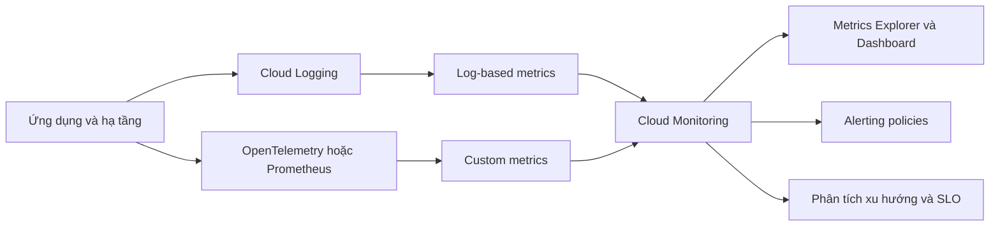

# Log-based metrics và custom metrics

Cloud Logging lưu các sự kiện xảy ra trong ứng dụng và hạ tầng; Cloud Monitoring biến các phép đo thành chuỗi thời gian để xây dựng biểu đồ, dashboard và cảnh báo. Khi cần đo số lỗi, trạng thái nghiệp vụ hoặc độ trễ của request, nhóm vận hành có thể trích xuất số liệu từ log bằng **log-based metrics**. Khi cần đo một đại lượng mà ứng dụng biết trực tiếp trong lúc chạy, chẳng hạn số giao dịch đang chờ, số tác vụ nền hoặc dung lượng hàng đợi, ứng dụng có thể gửi **custom metrics** đến Cloud Monitoring.

Hai cách này bổ sung cho nhau. Log-based metric tận dụng log đã được ghi nhận và phù hợp với sự kiện có cấu trúc. Custom metric ghi lại phép đo ngay tại nơi phát sinh, giúp theo dõi trạng thái hoặc hành vi nội bộ mà log không thể hiện đầy đủ. Cả hai đều có thể được dùng trong Metrics Explorer, dashboard và alerting policies.

Trong module `CLOUD_PROVIDERS_GCP`, bài học này kết nối Cloud Observability với các workload chạy trên Compute Engine, GKE, Cloud Run, dịch vụ lưu trữ và cơ sở dữ liệu. Module giúp người học tổ chức project, IAM và VPC, lựa chọn dịch vụ, bảo vệ tài nguyên, tự động hóa phát hành và theo dõi độ tin cậy cùng chi phí. Metric là một phần quan trọng của hoạt động đó: chúng giúp chuyển log và tín hiệu trong ứng dụng thành chỉ số có thể so sánh theo thời gian, đặt ngưỡng và sử dụng trong quy trình vận hành.

## Mục tiêu học tập

Sau bài học, người học có thể:

- Giải thích metric, metric descriptor, time series, monitored resource và label trong Cloud Monitoring.
- Phân biệt system-defined log-based metrics, user-defined log-based metrics và custom metrics do ứng dụng gửi.
- Tạo counter metric và distribution metric từ log bằng Logging query language và `gcloud`.
- Thiết kế custom metric bằng OpenTelemetry, Prometheus hoặc Cloud Monitoring API.
- Chọn metric kind, value type, resource type và labels phù hợp với phép đo.
- Xây dựng biểu đồ, cảnh báo và theo dõi độ trễ, cardinality, quota cùng chi phí.

## 1. Metric trong mô hình Cloud Observability

### Từ log đến metric

Log mô tả một sự kiện cụ thể: request nào được xử lý, lỗi nào xuất hiện, thao tác quản trị nào đã xảy ra hoặc một tác vụ đã hoàn thành ra sao. Metric biểu diễn một phép đo bằng số theo thời gian. Một log có thể cho biết request `POST /orders` trả về HTTP 503; một metric có thể đếm tổng số lỗi 5xx trong mỗi phút hoặc ghi nhận phân bố độ trễ của các request.



Cloud Logging có thể tạo metric từ nội dung `LogEntry`. Cloud Monitoring nhận dữ liệu đó và quản lý time series. Với custom metrics, ứng dụng hoặc collector gửi dữ liệu trực tiếp đến Cloud Monitoring theo một metric type và monitored resource đã xác định.

### Metric descriptor, time series và monitored resource

Một metric trong Cloud Monitoring có ba thành phần quan trọng:

| Thành phần | Ý nghĩa | Ví dụ |
|---|---|---|
| Metric type / descriptor | Định nghĩa đại lượng được đo, kiểu dữ liệu, đơn vị và các label. | `custom.googleapis.com/checkout/payment_success_count`. |
| Monitored resource | Xác định tài nguyên tạo ra dữ liệu. | Một VM `gce_instance`, container `k8s_container`, Cloud Run revision hoặc `global`. |
| Time series | Chuỗi điểm dữ liệu cho một cặp metric và monitored resource, cùng tổ hợp label cụ thể. | Số giao dịch thành công của service `checkout` trong môi trường `prod`. |

`MetricDescriptor` mô tả tên metric, `metricKind`, `valueType`, đơn vị, mô tả và các label. `MonitoredResource` mô tả nơi dữ liệu phát sinh, ví dụ project, zone, instance hoặc container. Một điểm dữ liệu (`Point`) có giá trị và khoảng thời gian tương ứng.

Một metric type có thể tạo nhiều time series. Mỗi tổ hợp khác nhau của metric labels và resource labels tạo ra một chuỗi riêng. Nếu metric có label `environment` với 3 giá trị và `status_class` với 5 giá trị, metric có thể tạo tối đa 15 tổ hợp trước khi tính thêm các resource labels.

### Metric kind và value type

`metricKind` mô tả cách diễn giải giá trị theo thời gian; `valueType` mô tả kiểu của giá trị.

| Thuộc tính | Ý nghĩa | Trường hợp thường gặp |
|---|---|---|
| `GAUGE` | Giá trị tại một thời điểm. | Số message hiện có trong queue, số worker đang hoạt động, nhiệt độ hoặc tỷ lệ sử dụng tại thời điểm lấy mẫu. |
| `DELTA` | Mức thay đổi trong một khoảng thời gian. | Số request phát sinh trong mỗi khoảng hoặc distribution độ trễ từ log. |
| `CUMULATIVE` | Giá trị tích lũy kể từ thời điểm bắt đầu của chuỗi. | Tổng số request hoặc tổng số byte kể từ khi tiến trình bắt đầu. |
| `INT64` | Số nguyên 64 bit. | Số lượng request, task hoặc lỗi. |
| `DOUBLE` | Số thực dấu phẩy động. | Tỷ lệ, nhiệt độ, dung lượng hoặc độ trễ dạng số. |
| `BOOL` | Giá trị đúng/sai. | Một số metric hệ thống biểu diễn trạng thái. |
| `DISTRIBUTION` | Phân bố của nhiều giá trị, thường được biểu diễn bằng histogram buckets. | Độ trễ request, kích thước payload hoặc thời gian xử lý. |

Không phải mọi tổ hợp `metricKind` và `valueType` đều hợp lệ cho mọi loại metric. Với custom metric `custom.googleapis.com`, cần tuân thủ bảng tổ hợp của Cloud Monitoring; ví dụ `DELTA` với `INT64` hoặc `DOUBLE` không được hỗ trợ cho custom metric type này. Các custom counter thường dùng `CUMULATIVE` hoặc `GAUGE`. Log-based distribution metric dùng `DELTA` kết hợp `DISTRIBUTION`. Metric `CUMULATIVE` cần được chuyển đổi/aggregate sang dạng phù hợp trước khi sử dụng trực tiếp trong biểu đồ hoặc cảnh báo.

## 2. Phân biệt log-based metrics và custom metrics

Thuật ngữ “custom metric” đôi khi được dùng theo nghĩa rộng. Trong Cloud Monitoring, user-defined log-based metrics cũng là một lớp custom metrics có tính phí. Tuy nhiên, cách tạo và nguồn dữ liệu của chúng khác với custom metric do ứng dụng instrument trực tiếp.

| Tiêu chí | User-defined log-based metric | Custom metric do ứng dụng gửi |
|---|---|---|
| Nguồn dữ liệu | Log entries đã được Cloud Logging nhận. | Phép đo do ứng dụng, collector hoặc Prometheus ghi nhận. |
| Nơi cấu hình | Cloud Logging, trang Log-based Metrics hoặc Logging API. | OpenTelemetry, Prometheus/Managed Service for Prometheus hoặc Cloud Monitoring API. |
| Cách tạo giá trị | Filter chọn log; counter đếm sự kiện hoặc distribution trích xuất số. | Instrument trong code hoặc collector gửi data point. |
| Dữ liệu lịch sử | Chỉ tính log nhận được sau khi metric được tạo; không backfill log cũ. | Chỉ có điểm dữ liệu từ lúc ứng dụng bắt đầu ghi metric. |
| Phù hợp với | Đếm lỗi, audit event, sự kiện nghiệp vụ đã có trong log, latency được ghi trong log. | Queue depth, số worker, cache hit/miss, số tác vụ đang chạy hoặc phép đo nội bộ. |
| Metric type thường thấy | `logging.googleapis.com/user/METRIC_NAME`. | `custom.googleapis.com/...`, `workload.googleapis.com/...` hoặc namespace tương ứng của nguồn. |

Cloud Monitoring API không tạo log-based metric. Với log-based metric, Cloud Logging tạo cấu trúc metric và chuyển dữ liệu sang Cloud Monitoring. Với custom metric, ứng dụng/collector gửi dữ liệu hoặc tạo metric descriptor thông qua Cloud Monitoring API.

Nếu cần cảnh báo khi một thông điệp cụ thể vừa xuất hiện, có thể dùng log-based alerting policy để theo dõi log trực tiếp. Nếu cần xem xu hướng số lượng hoặc độ trễ theo phút/giờ, hãy dùng log-based metric. Nếu phép đo chỉ tồn tại trong bộ nhớ ứng dụng và không được ghi log, hãy instrument thành custom metric.

## 3. Log-based metrics trong Cloud Logging

### System-defined và user-defined metrics

Cloud Logging cung cấp hai nhóm log-based metrics:

- **System-defined metrics**: được Google Cloud định nghĩa để theo dõi hoạt động Logging, ví dụ số log entries hoặc dung lượng log được xuất. Chúng chủ yếu là counter, một số metric hệ thống có kiểu boolean. System-defined metrics có phạm vi project.
- **User-defined metrics**: do người dùng tạo để theo dõi sự kiện cụ thể trong ứng dụng hoặc môi trường. User-defined log-based metrics hỗ trợ counter và distribution.

Tên metric type của user-defined log-based metric có dạng:

```text
logging.googleapis.com/user/METRIC_NAME
```

### Project-scoped và bucket-scoped metrics

User-defined log-based metric có thể áp dụng cho project hoặc cho một log bucket:

| Phạm vi | Log được tính | Khi nên dùng |
|---|---|---|
| Project-scoped | Log nhận bởi Logging API của project chứa metric, bất kể inclusion/exclusion filters của project. | Theo dõi log ở phạm vi một project. |
| Bucket-scoped | Log được định tuyến và lưu trong bucket đích, bất kể log ban đầu đến từ project nào. | Dùng aggregated sink hoặc tập trung log từ nhiều project vào một bucket. |

Log-based metric không được tạo trực tiếp ở cấp folder, organization hoặc billing account. Nếu cần quan sát nhiều project, có thể dùng bucket-scoped metric cho bucket tập trung hoặc cấu hình metrics scope nhiều project để project giám sát nhìn thấy dữ liệu metric.

Một điểm cần nhớ: project-scoped user-defined metric tính cả log bị loại khỏi lưu trữ bởi inclusion/exclusion filters; vì vậy số liệu của nó có thể khác với số log đang nhìn thấy trong log bucket. Bucket-scoped metric chỉ tính log được định tuyến vào bucket đã chọn. System-defined metrics chỉ tính các log được lưu trong bucket theo quy tắc của hệ thống.

### Cấu trúc log phù hợp để tạo metric

Ứng dụng nên ghi log có cấu trúc để metric filter và extractor có thể tham chiếu trường ổn định. Ví dụ một log entry của dịch vụ checkout:

```json
{
  "severity": "ERROR",
  "resource": {
    "type": "cloud_run_revision",
    "labels": {
      "service_name": "checkout",
      "revision_name": "checkout-00042-abc",
      "location": "asia-southeast1"
    }
  },
  "jsonPayload": {
    "event": "payment_failed",
    "http_status": 503,
    "route_template": "/orders/{orderId}",
    "latency_ms": 245,
    "environment": "prod"
  }
}
```

Trong `LogEntry`, `resource` là monitored resource của log; `jsonPayload` chứa các trường do ứng dụng phát ra. Trường `route_template` là mẫu route có số lượng giá trị giới hạn, giúp phân tích theo loại endpoint. Không dùng URL đầy đủ có ID người dùng hoặc mã giao dịch làm label.

Ví dụ filter để tìm lỗi thanh toán của dịch vụ checkout:

```text
resource.type="cloud_run_revision"
resource.labels.service_name="checkout"
jsonPayload.event="payment_failed"
severity>=ERROR
```

Filter có thể dùng các trường của `LogEntry`, toán tử so sánh và hàm của Logging query language. Nên thêm `resource.type` để giới hạn metric vào một loại resource; việc này giúp Cloud Monitoring hiểu nguồn của time series và làm cho metric dễ tìm hơn khi tạo chart hoặc alert.

### Counter metric: đếm số lỗi

Counter metric đếm số log entries khớp filter trong từng khoảng thời gian. Dùng counter để theo dõi:

- Số request lỗi 5xx.
- Số lần thanh toán thất bại.
- Số lần một thao tác quản trị nhạy cảm được thực hiện.
- Số lần retry hoặc timeout của một dịch vụ.

Ví dụ tạo counter metric ở cấp project:

```bash
gcloud config set project PROJECT_ID

gcloud services enable logging.googleapis.com monitoring.googleapis.com

gcloud logging metrics create checkout_payment_failures \
  --description="Số lần thanh toán thất bại của checkout" \
  --log-filter='resource.type="cloud_run_revision" AND resource.labels.service_name="checkout" AND jsonPayload.event="payment_failed" AND severity>=ERROR'
```

Lệnh trên tạo metric đếm các log entry khớp filter. Sau khi tạo, có thể liệt kê và xem định nghĩa metric:

```bash
gcloud logging metrics list

gcloud logging metrics describe checkout_payment_failures
```

Để tạo metric cho một bucket cụ thể, truyền đường dẫn bucket vào `--bucket-name`:

```bash
gcloud logging metrics create centralized_checkout_failures \
  --description="Lỗi checkout trong bucket tập trung" \
  --log-filter='resource.type="cloud_run_revision" AND severity>=ERROR' \
  --bucket-name="projects/PROJECT_ID/locations/global/buckets/central-logs"
```

Đảm bảo bucket path là bucket thực tế và log sink đang định tuyến các log cần đo vào bucket đó.

### Distribution metric: đo độ trễ request

Distribution metric trích xuất một giá trị số từ mỗi log entry khớp filter và gom các giá trị vào histogram buckets. Metric lưu count, mean, tổng bình phương độ lệch và số lượng giá trị trong từng bucket; nó không lưu lại từng sample riêng lẻ.

Distribution phù hợp để theo dõi latency, payload size hoặc thời gian xử lý. Ví dụ `latency_ms` trong log có thể được dùng để xem phân bố độ trễ và ước lượng percentile như p50, p95 hoặc p99 trong Cloud Monitoring.

Đối với distribution metric, cần khai báo `valueExtractor` và `bucketOptions`. Ví dụ file YAML cấu hình `LogMetric`:

```yaml
name: checkout_request_latency
description: Phân bố độ trễ request checkout theo mili giây
filter: |
  resource.type="cloud_run_revision"
  resource.labels.service_name="checkout"
  jsonPayload.event="http_request_completed"
valueExtractor: EXTRACT(jsonPayload.latency_ms)
labelExtractors:
  environment: EXTRACT(jsonPayload.environment)
  status_class: REGEXP_EXTRACT(jsonPayload.http_status, "^([0-9])")
bucketOptions:
  exponentialBuckets:
    numFiniteBuckets: 12
    growthFactor: 2
    scale: 1
metricDescriptor:
  metricKind: DELTA
  valueType: DISTRIBUTION
  unit: ms
  labels:
    - key: environment
      valueType: STRING
      description: Môi trường triển khai
    - key: status_class
      valueType: STRING
      description: Chữ số đầu của HTTP status code
```

Lưu cấu hình vào một file cục bộ, ví dụ `checkout-latency.yaml`, rồi tạo metric:

```bash
gcloud logging metrics create checkout_request_latency \
  --config-from-file=checkout-latency.yaml
```

Giá trị `scale`, `growthFactor` và số bucket phải phù hợp với dải độ trễ thực tế. Với metric độ trễ tính bằng mili giây, hãy kiểm tra log có trường số hợp lệ trước khi tạo metric. Nếu trường có hậu tố như `245ms`, dùng regular expression trong extractor để lấy phần số.

### Labels và cách trích xuất

Labels phân chia metric thành nhiều time series. Với log-based metric, label extractor có thể lấy toàn bộ nội dung của một trường hoặc lấy một phần bằng regular expression. Ví dụ có thể trích `environment`, `http_status` hoặc tên route template từ `jsonPayload`.

Một số quy tắc quan trọng:

- Chỉ tạo label khi cần lọc hoặc phân nhóm time series.
- Dùng các giá trị có miền hữu hạn, ví dụ `prod`, `staging`, `2xx`, `4xx`, `5xx`.
- Không đưa email, user ID, IP, request ID, trace ID, URL đầy đủ hoặc timestamp vào label.
- Không đưa dữ liệu nhạy cảm vào filter hoặc extractor; filter và label được xử lý như service data.
- Mỗi user-defined log-based metric có tối đa 10 label tự định nghĩa; label đã tạo không thể xóa, tên và kiểu giá trị không thể đổi.

Nếu một metric có 100 VM và một label có 20 giá trị, có thể tạo đến 2.000 time series. Một label chứa giá trị duy nhất cho mỗi request có thể tạo hàng triệu series, làm metric bị throttling và tăng chi phí.

### Thời điểm ghi nhận và các giới hạn của log-based metrics

- Metric chỉ tính log entries nhận được sau khi metric được tạo; không backfill dữ liệu log cũ.
- Dữ liệu thường xuất hiện nhanh trong Cloud Monitoring, nhưng có thể chậm đến khoảng 10 phút.
- Log có timestamp quá xa trong quá khứ hoặc tương lai có thể không được tính.
- Time series có thể có khoảng trống; không phải mọi interval đều có sample bằng 0.
- Metric có thể được cập nhật khi log đến muộn nhưng vẫn nằm trong giới hạn xử lý.
- Filter không được dài hơn 20.000 ký tự.
- Một user-defined log-based metric có giới hạn khoảng 30.000 active time series và tối đa 200 histogram buckets.

Khi tạo alert từ log-based metric, cần cấu hình cách xử lý missing data. Ví dụ, một heartbeat metric có thể không ghi sample trong một interval; nếu policy xem missing sample là zero, hệ thống có thể gửi cảnh báo giả. Nên dùng nhiều sự kiện trong cửa sổ đánh giá, chọn alignment period phù hợp và kiểm thử hành vi khi không có log.

## 4. Custom metrics do ứng dụng tạo

### Khi nào cần custom metric?

Custom metric phù hợp khi ứng dụng có một trạng thái hoặc phép đo không được log đầy đủ. Ví dụ:

- Số message hiện có trong hàng đợi nội bộ.
- Số worker đang xử lý hoặc đang chờ.
- Số cache hit và cache miss.
- Số tác vụ nền được tạo, hoàn thành hoặc thất bại.
- Số giao dịch thành công theo phương thức thanh toán.
- Thời gian một bước xử lý nội bộ mà ứng dụng không ghi log.

Cloud Monitoring hỗ trợ custom metrics thông qua OpenTelemetry, Prometheus và Cloud Monitoring API. Google khuyến nghị dùng OpenTelemetry vì đây là framework mở, trung lập nhà cung cấp và hỗ trợ instrument nhiều ngôn ngữ.

### Đặt tên metric type

Metric type của custom metric phải dùng prefix hợp lệ, ví dụ:

```text
custom.googleapis.com/checkout/payment_success_count
custom.googleapis.com/checkout/queue_depth
custom.googleapis.com/checkout/request_latency
```

Nên tổ chức tên theo cấu trúc phân cấp `domain/component/measurement`, tránh tên chung chung như `count` hoặc `value`. Tên metric type phải duy nhất trong project. Metric type được định danh trong resource name:

```text
projects/PROJECT_ID/metricDescriptors/custom.googleapis.com/checkout/queue_depth
```

### Thiết kế metric descriptor

Trước khi ghi dữ liệu, xác định:

1. **Metric type**: tên mô tả phép đo và theo namespace custom.
2. **Metric kind**: giá trị là gauge hay cumulative.
3. **Value type**: `INT64`, `DOUBLE`, `BOOL` hoặc `DISTRIBUTION` theo tổ hợp được hỗ trợ.
4. **Unit**: đơn vị như `1`, `ms`, `By`, `{request}` hoặc đơn vị UCUM phù hợp.
5. **Labels**: chiều phân tích có tập giá trị giới hạn, ví dụ `environment`, `region`, `status_class`.
6. **Monitored resource**: tài nguyên thực tế tạo ra phép đo, ví dụ `gce_instance`, `k8s_container`, `cloud_run_revision` hoặc `global`.

Monitored resource và metric labels cùng tạo thành định danh time series. Nếu resource type đã có label `zone`, không cần thêm một metric label khác chỉ để lặp lại cùng thông tin. Chọn resource type đúng giúp Monitoring gắn dữ liệu với đúng VM, container, service hoặc project.

### Ghi custom metric bằng Cloud Monitoring API

Cloud Monitoring API dùng `timeSeries.create` để ghi dữ liệu. Một request chứa tối đa 200 time series khác nhau; mỗi time series trong request chứa một point. Mỗi time series được xác định bởi metric type, metric labels và monitored resource.

Ví dụ request body ghi một giá trị gauge vào metric `queue_depth`:

```json
{
  "timeSeries": [
    {
      "metric": {
        "type": "custom.googleapis.com/checkout/queue_depth",
        "labels": {
          "environment": "prod"
        }
      },
      "resource": {
        "type": "global",
        "labels": {
          "project_id": "PROJECT_ID"
        }
      },
      "points": [
        {
          "interval": {
            "endTime": "2026-11-19T07:00:00Z"
          },
          "value": {
            "int64Value": "42"
          }
        }
      ]
    }
  ]
}
```

Đây là ví dụ cấu trúc payload; `endTime` phải là thời điểm thực tế của phép đo và `PROJECT_ID` phải là project ghi metric. Với ứng dụng chạy trên VM, GKE hoặc Cloud Run, hãy chọn monitored resource type tương ứng và cung cấp đủ resource labels thay vì dùng `global` nếu cần phân biệt từng instance/revision/container.

Cloud Monitoring có thể tự tạo metric descriptor khi nhận metric type mới, nhưng descriptor tự tạo dùng một số giá trị mặc định. Với hệ thống production, nên thiết kế descriptor rõ ràng trước khi phát dữ liệu để kiểm soát kiểu, đơn vị và labels. Nếu cần, dùng `projects.metricDescriptors.create` trước rồi gửi time series bằng `projects.timeSeries.create`.

### Gửi metric qua OpenTelemetry

OpenTelemetry tách việc instrument ứng dụng khỏi cách gửi dữ liệu đến backend. Ứng dụng ghi measurement vào metric instrument; SDK và collector/exporter xử lý việc tổng hợp, chuyển đổi và gửi telemetry.

Ví dụ Java minh họa counter và histogram bằng OpenTelemetry API:

```java
import io.opentelemetry.api.common.AttributeKey;
import io.opentelemetry.api.common.Attributes;
import io.opentelemetry.api.metrics.LongCounter;
import io.opentelemetry.api.metrics.DoubleHistogram;
import io.opentelemetry.api.metrics.Meter;

public final class CheckoutMetrics {
    private final LongCounter paymentSuccess;
    private final DoubleHistogram requestLatency;

    public CheckoutMetrics(Meter meter) {
        paymentSuccess = meter.counterBuilder("checkout.payment.success")
                .setDescription("Số giao dịch thanh toán thành công")
                .setUnit("{payment}")
                .build();

        requestLatency = meter.histogramBuilder("checkout.request.latency")
                .setDescription("Độ trễ xử lý request checkout")
                .setUnit("ms")
                .build();
    }

    public void recordPaymentSuccess(String environment, String method) {
        paymentSuccess.add(1, Attributes.of(
                AttributeKey.stringKey("environment"), environment,
                AttributeKey.stringKey("payment_method"), method));
    }

    public void recordRequestLatency(double latencyMs, String route) {
        requestLatency.record(latencyMs, Attributes.of(
                AttributeKey.stringKey("route"), route));
    }
}
```

Đoạn code chỉ minh họa cách instrument. Để dữ liệu xuất hiện trong Cloud Monitoring, ứng dụng cần cấu hình OpenTelemetry SDK và exporter/collector phù hợp với môi trường. Trên Compute Engine có thể dùng Ops Agent với OTLP receiver hoặc Google-built OpenTelemetry Collector. Với GKE, có thể dùng Google Cloud Managed Service for Prometheus hoặc OpenTelemetry Collector. Với Cloud Run, có thể dùng OpenTelemetry Collector sidecar theo hướng dẫn của nền tảng.

Khi triển khai, cấp quyền ghi metric cho service account/collector bằng vai trò `roles/monitoring.metricWriter`, bật Cloud Monitoring API và xác minh dữ liệu trong Metrics Explorer. Ứng dụng chạy ngoài Google Cloud cần thiết lập Application Default Credentials phù hợp; không nhúng service account key vào source code hoặc container image.

### Gửi metric từ Prometheus

Nếu ứng dụng đã xuất Prometheus metrics, Google Cloud Managed Service for Prometheus có thể thu thập và lưu dữ liệu vào Cloud Monitoring. Cách này thường phù hợp với GKE/Kubernetes và các workload đã sử dụng Prometheus exposition format.

Trước khi ingest, cần kiểm soát labels Prometheus. Labels như `pod`, `namespace` hoặc `cluster` có thể hữu ích, nhưng labels có giá trị không giới hạn như `user_id`, request ID hoặc URL đầy đủ có thể làm cardinality tăng mạnh. Dùng relabeling để bỏ hoặc chuẩn hóa các label không cần thiết.

## 5. Labels, cardinality và chi phí

### Cardinality là gì?

Cardinality là số lượng time series được tạo ra từ các tổ hợp metric labels và resource labels. Nếu metric có 3 label với số giá trị lần lượt là 4, 5 và 10, metric có thể tạo đến 200 tổ hợp. Khi tính thêm số VM, container hoặc revision, số time series thực tế có thể tăng nhanh.

Ví dụ một custom metric có:

- `environment`: `prod`, `staging` (2 giá trị).
- `status_class`: `2xx`, `4xx`, `5xx` (3 giá trị).
- `region`: 3 vùng (3 giá trị).
- 50 monitored resources.

Số time series tối đa ước tính là:

```text
2 × 3 × 3 × 50 = 900 time series
```

Thiết kế này có thể quản lý được. Nếu thêm `request_id` có hàng triệu giá trị khác nhau, số time series có thể tăng vượt giới hạn và làm dữ liệu bị throttling.

### Nguyên tắc thiết kế labels

- Ưu tiên chiều phân loại có tập giá trị nhỏ và ổn định.
- Dùng route template thay cho URL cụ thể.
- Dùng status class hoặc nhóm lỗi thay vì thông điệp lỗi tự do.
- Không dùng user ID, email, IP, trace ID, request ID, timestamp hoặc mã giao dịch làm label.
- Tránh lặp thông tin đã có trong monitored resource labels.
- Chỉ thêm label khi dashboard, truy vấn hoặc alert thực sự cần phân tách theo chiều đó.

### Quota tham khảo

Các giới hạn hiện hành được tài liệu Google Cloud công bố có thể thay đổi theo thời gian; cần kiểm tra trang quotas trước khi triển khai quy mô lớn.

| Loại metric | Giới hạn đáng chú ý |
|---|---|
| User-defined log-based metrics | Tối đa 500 metric descriptors trong phạm vi giới hạn được tài liệu nêu; 10 labels/metric; 30.000 active time series/metric; 200 histogram buckets. |
| Custom metrics | Tối đa 10.000 custom metric descriptors/project; 30 labels/descriptor; 200 time series trong một request ghi; tối đa một điểm cho mỗi time series trong một request. |
| Tần suất ghi custom metric | Không ghi vào cùng một time series nhanh hơn một point mỗi 5 giây theo Cloud Monitoring API. |
| Active time series của custom metrics | Giới hạn hệ thống theo monitored resource; tài liệu hiện hành nêu 200.000 active time series cho custom metrics trên mỗi monitored resource. |

Time series được xem là active nếu có dữ liệu trong 24 giờ gần nhất. Hãy kiểm tra quota chính xác cho metric domain đang dùng và loại monitored resource tương ứng.

### Theo dõi chi phí metric

User-defined log-based metrics và custom metrics là các loại metric có tính phí. Chi phí phụ thuộc dữ liệu được ingest và mô hình tính phí áp dụng. Cardinality cao có thể làm tăng số time series, số sample và lượng dữ liệu phải truy vấn; việc tạo nhiều metric không được sử dụng cũng làm tăng chi phí và độ phức tạp.

Cloud Monitoring có trang **Metrics Management** để xem ingestion volume, sample/byte billing, cardinality, số lần query, metric-write errors và việc metric có được dùng trong dashboard hoặc alert hay không. Có thể dùng trang này để tìm metric tốn kém nhưng ít giá trị và tạo metric exclusion rules nếu không còn cần ingest.

Lưu ý: Metrics Management không hiển thị user-defined log-based metrics có prefix `logging.googleapis.com/user`. Với các metric này, cần kiểm tra quota, cấu hình và chi phí theo tài liệu Cloud Logging/Cloud Monitoring tương ứng.

## 6. IAM và chuẩn bị project

### API cần bật

Project dùng Cloud Logging và Cloud Monitoring cần có billing account đang hoạt động để sử dụng các tính năng metric theo hướng dẫn dịch vụ. Xác nhận billing và quota trước khi triển khai ở môi trường production. Tùy cách thu thập dữ liệu, project có thể cần các API sau:

```bash
gcloud services enable logging.googleapis.com monitoring.googleapis.com
```

Nếu dùng OpenTelemetry, Prometheus hoặc dịch vụ tích hợp khác, kiểm tra thêm các API và thành phần cần thiết cho collector/exporter.

### Vai trò IAM phổ biến

| Nhu cầu | Vai trò thường dùng |
|---|---|
| Tạo, cập nhật, xóa log-based metrics | Logs Configuration Writer (`roles/logging.configWriter`). |
| Xem định nghĩa log-based metrics | Logs Viewer (`roles/logging.viewer`) với quyền `logging.logMetrics.get` và `logging.logMetrics.list`. |
| Đọc time series trong Cloud Monitoring | Monitoring Viewer (`roles/monitoring.viewer`). |
| Ghi custom metrics từ ứng dụng hoặc collector | Monitoring Metric Writer (`roles/monitoring.metricWriter`). |
| Tạo/sửa dashboard, alerting policy hoặc cấu hình Monitoring | Cấp vai trò Monitoring phù hợp với tác vụ, theo nguyên tắc quyền tối thiểu. |

Không cấp `roles/editor` chỉ để tạo metric nếu có thể dùng vai trò hẹp hơn. Đặc biệt với log-based metric, label extractor có thể làm lộ dữ liệu nhạy cảm từ log; chỉ cấp quyền cấu hình metric cho nhóm đáng tin cậy và rà soát filter/label trước khi tạo.

## 7. Xem metric, tạo chart và cảnh báo

### Xem log-based metrics

Trong Google Cloud Console:

1. Chọn đúng project.
2. Mở **Logging → Log-based Metrics**.
3. Xem hai nhóm System metrics và User-defined metrics.
4. Chọn metric cần kiểm tra, dùng **View in Metrics Explorer** để xem time series.

Có thể liệt kê metric bằng CLI:

```bash
gcloud logging metrics list
gcloud logging metrics describe checkout_payment_failures
```

CLI hiển thị định nghĩa metric; để đọc dữ liệu time series, dùng Cloud Monitoring Metrics Explorer hoặc Monitoring API.

### Metric filter trong Metrics Explorer

User-defined log-based metrics có metric type dạng:

```text
logging.googleapis.com/user/checkout_payment_failures
```

Khi tạo chart hoặc alert, chọn metric type tương ứng, sau đó lọc theo resource labels hoặc metric labels. Nếu metric không xuất hiện khi chọn một resource type, kiểm tra filter có khai báo `resource.type` phù hợp hay không.

### Tạo cảnh báo từ metric

Ví dụ, nhóm vận hành muốn nhận thông báo khi số lỗi thanh toán trong 5 phút vượt ngưỡng. Tạo alerting policy với các thành phần:

1. Metric: `logging.googleapis.com/user/checkout_payment_failures`.
2. Resource filter: chỉ chọn Cloud Run service `checkout`.
3. Aggregation: sum trong cửa sổ 5 phút.
4. Condition: giá trị lớn hơn ngưỡng đã xác định từ baseline thực tế.
5. Evaluation behavior: cấu hình xử lý missing data và duration phù hợp.
6. Notification channel: email, Pub/Sub, PagerDuty hoặc kênh tích hợp mà tổ chức đang dùng.

Với distribution metric, có thể tạo chart hoặc alert theo thống kê phân vị để phát hiện p95/p99 tăng cao. Với custom metric gauge như queue depth, đặt ngưỡng theo mức mà hệ thống có thể xử lý an toàn. Cảnh báo cần gắn với runbook và người chịu trách nhiệm, tránh tạo cảnh báo không có hành động tương ứng.

### Metrics scope cho nhiều project

Mỗi project mặc định có metrics scope chứa chính project đó. Có thể cấu hình một scoping project để xem metric của nhiều project trong cùng một metrics scope. Điều này hữu ích khi tổ chức tách project theo môi trường hoặc dịch vụ nhưng muốn có dashboard tập trung.

Metrics scope chỉ quyết định project nào nhìn thấy metric trong Cloud Monitoring. Nó không tự chuyển định nghĩa metric, IAM policy hoặc dữ liệu log giữa các project. Quyền xem dữ liệu vẫn phải được cấp phù hợp ở từng project nguồn.

## 8. Quy trình triển khai mẫu cho dịch vụ checkout

Giả sử một hệ thống có Cloud Run service `checkout`, xử lý đơn hàng và thanh toán. Nhóm muốn theo dõi lỗi thanh toán, độ trễ request và số giao dịch thành công.

### Bước 1: Xác định câu hỏi vận hành

- Có bao nhiêu thanh toán thất bại trong mỗi 5 phút?
- Độ trễ p95 của request checkout có vượt ngưỡng không?
- Số thanh toán thành công theo phương thức có thay đổi bất thường không?
- Hàng đợi nội bộ có tăng liên tục không?

### Bước 2: Chọn nguồn metric

| Câu hỏi | Nguồn phù hợp | Metric |
|---|---|---|
| Số log lỗi thanh toán | Log-based counter | `checkout_payment_failures`. |
| Phân bố độ trễ đã ghi vào log | Log-based distribution | `checkout_request_latency`. |
| Số giao dịch thành công theo phương thức | Custom metric / OpenTelemetry counter | `checkout.payment.success`. |
| Số message đang chờ trong queue | Custom gauge | `checkout.queue_depth`. |

### Bước 3: Chuẩn hóa log và instrument ứng dụng

Log cần có `event`, `http_status`, `latency_ms`, `environment` và `route_template` ổn định. Ứng dụng instrument counter cho thanh toán thành công và histogram cho độ trễ nếu muốn đo trực tiếp từ code. Tránh ghi cùng một phép đo vào cả log-based metric và custom metric nếu không có nhu cầu đối chiếu, vì sẽ làm tăng chi phí và gây nhầm lẫn khi phân tích.

### Bước 4: Tạo metric và kiểm tra dữ liệu

Tạo counter và distribution theo ví dụ ở phần trên. Cấu hình exporter/collector cho OpenTelemetry, cấp quyền Monitoring Metric Writer và kiểm tra metric type cùng resource labels trong Metrics Explorer. Xác nhận log filter bắt đúng sự kiện và extractor trả về số hợp lệ.

### Bước 5: Xây dashboard và alert

Dashboard nên có:

- Số lỗi thanh toán theo thời gian.
- Tỷ lệ lỗi trên tổng request (dùng số liệu thành công/thất bại phù hợp).
- p50, p95 và p99 latency.
- Queue depth và số worker đang hoạt động.

Alert nên tập trung vào tín hiệu có hành động: lỗi tăng nhanh, p95 vượt ngưỡng trong một khoảng thời gian, queue depth tăng kéo dài hoặc metric heartbeat mất dữ liệu. Cần kiểm thử tình huống log đến muộn, không có sample và service scale về zero.

### Bước 6: Rà soát định kỳ

Định kỳ kiểm tra metric nào còn được dùng, label có phát sinh giá trị mới không, cardinality có tăng bất thường không, write errors có xuất hiện không và chi phí có thay đổi không. Khi bỏ một metric, cập nhật dashboard, alert và runbook liên quan trước khi xóa descriptor hoặc dừng exporter.

## 9. Khắc phục sự cố thường gặp

| Triệu chứng | Nguyên nhân có thể | Cách kiểm tra |
|---|---|---|
| Log metric không có dữ liệu | Filter sai, log đến trước khi metric được tạo, project/bucket scope sai. | Preview logs, kiểm tra `resource.type`, `jsonPayload` field, scope và thời điểm tạo metric. |
| Distribution không có điểm | `valueExtractor` không trả số, regex sai hoặc field bị thiếu. | Mở log mẫu, kiểm tra extractor, đơn vị và kiểu dữ liệu. |
| Metric xuất hiện nhưng có gap | Không có log khớp, dữ liệu đến muộn hoặc metric processing có khoảng trống. | Kiểm tra log timestamps, metric error count và cách alert xử lý missing data. |
| Resource type hiển thị `undefined` | Logging resource type không ánh xạ trực tiếp sang Monitoring resource type. | Kiểm tra mapping của Logging-only resources và chọn resource type tương ứng. |
| Metric bị throttling | Cardinality cao hoặc vượt giới hạn active time series. | Kiểm tra label values, số monitored resources và quota. |
| Custom metric không được ghi | API chưa bật, service account thiếu quyền, timestamp sai hoặc metric descriptor không tương thích. | Kiểm tra Monitoring API, `roles/monitoring.metricWriter`, API error và time interval. |
| Metric không xuất hiện ở project giám sát | Project nguồn chưa nằm trong metrics scope hoặc thiếu quyền xem. | Kiểm tra metrics scope và IAM của project chứa metric. |
| Chi phí metric tăng | Thêm label có nhiều giá trị, tăng số resource hoặc ingest quá nhiều metric không dùng. | Xem Metrics Management, cardinality và metric ingestion volume. |

Log-based metrics có thể cập nhật trễ đến khoảng 10 phút. Khi điều tra, đừng chỉ nhìn vào biểu đồ thời gian thực; hãy kiểm tra log gốc, filter, extractor, thời điểm nhận log và trạng thái xử lý metric.

## 10. Checklist thiết kế metric tốt

- [ ] Câu hỏi vận hành và hành động khi vượt ngưỡng đã được xác định.
- [ ] Đã chọn log-based metric khi phép đo có thể trích từ log; chọn custom metric khi ứng dụng cần instrument trực tiếp.
- [ ] Log có cấu trúc và trường filter/extractor ổn định.
- [ ] Filter có `resource.type` phù hợp và đã preview kết quả.
- [ ] Distribution extractor trả về số hợp lệ, đơn vị và histogram buckets phù hợp.
- [ ] Metric kind, value type và monitored resource được chọn đúng.
- [ ] Labels có số giá trị giới hạn, không chứa PII hoặc ID duy nhất.
- [ ] Đã kiểm tra quota, cardinality, write rate và chi phí dự kiến.
- [ ] Service account có quyền tối thiểu cần thiết.
- [ ] Dashboard và alert xử lý missing data, độ trễ và scale-to-zero.
- [ ] Metric có owner, mô tả, runbook và quy trình loại bỏ khi không còn sử dụng.

## 11. Kết luận

Log-based metrics giúp biến sự kiện đã ghi trong Cloud Logging thành dữ liệu số để theo dõi số lượng và phân bố theo thời gian. Counter phù hợp để đếm sự kiện; distribution phù hợp để đo latency và các giá trị có phân bố. Custom metrics giúp ứng dụng gửi những phép đo riêng mà log hoặc metric có sẵn không thể hiện, với OpenTelemetry là hướng instrument được Google Cloud khuyến nghị.

Thiết kế metric tốt bắt đầu từ câu hỏi vận hành, chọn đúng nguồn dữ liệu, resource type và labels có cardinality thấp. Sau đó, nhóm cần xây dashboard và alert có hành động rõ ràng, kiểm tra missing data, quota, quyền IAM và chi phí. Khi được duy trì đúng cách, log-based metrics và custom metrics giúp các workload trên Compute Engine, GKE, Cloud Run, storage và database có thể quan sát, chẩn đoán và vận hành tin cậy hơn.

## Tài liệu tham khảo

- [Log-based metrics overview](https://docs.cloud.google.com/logging/docs/logs-based-metrics)
- [Configure counter metrics](https://docs.cloud.google.com/logging/docs/logs-based-metrics/counter-metrics)
- [Configure distribution metrics](https://docs.cloud.google.com/logging/docs/logs-based-metrics/distribution-metrics)
- [Configure labels on log-based metrics](https://docs.cloud.google.com/logging/docs/logs-based-metrics/labels)
- [Log-based metrics quotas and limits](https://docs.cloud.google.com/logging/quotas)
- [Troubleshoot log-based metrics](https://docs.cloud.google.com/logging/docs/logs-based-metrics/troubleshooting)
- [User-defined metrics overview](https://docs.cloud.google.com/monitoring/custom-metrics)
- [Create user-defined metrics with the API](https://docs.cloud.google.com/monitoring/custom-metrics/creating-metrics)
- [Add custom traces and metrics to your app with OpenTelemetry](https://docs.cloud.google.com/monitoring/custom-metrics/open-telemetry)
- [Components of the metric model](https://docs.cloud.google.com/monitoring/api/v3/metric-model)
- [Value types and metric kinds](https://docs.cloud.google.com/monitoring/api/v3/kinds-and-types)
- [Cloud Monitoring quotas and limits](https://docs.cloud.google.com/monitoring/quotas)
- [View and manage metric usage](https://docs.cloud.google.com/monitoring/docs/metrics-management)
- [Metric naming conventions](https://docs.cloud.google.com/monitoring/api/v3/naming-conventions)
- [Permissions for log-based metrics](https://docs.cloud.google.com/logging/docs/access-control)
