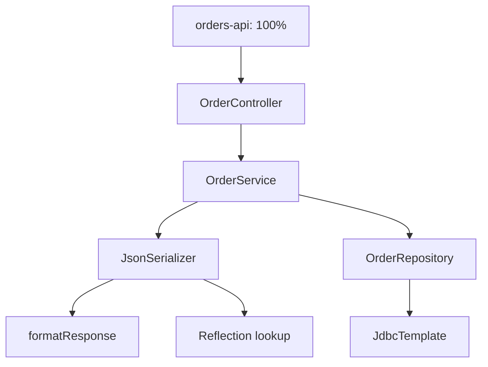

# Cloud Profiler và phân tích ứng dụng Java

Một dịch vụ Java có thể hoạt động ổn định trong môi trường thử nghiệm nhưng chậm khi chạy production. Lý do thường nằm trong workload thực tế: một hàm xử lý JSON tiêu tốn CPU, một đường gọi tạo quá nhiều object, hoặc request dành phần lớn thời gian chờ I/O và đồng bộ luồng. Metrics cho biết độ trễ và mức sử dụng tài nguyên đang tăng; trace cho biết request đi qua những service nào; nhưng để biết chính xác hàm Java nào đang tiêu thụ CPU hoặc tạo nhiều object, đội phát triển cần profiling.

**Cloud Profiler** là dịch vụ continuous profiling của Google Cloud. Agent chạy cùng tiến trình ứng dụng, thu thập mẫu hiệu năng theo chu kỳ và gửi profile về project. Trên giao diện Profiler, người phát triển phân tích flame graph, xác định call stack tiêu tốn tài nguyên và so sánh các phiên bản dịch vụ. Cách làm này giúp tìm điểm nóng trong ứng dụng khi nó chịu tải production, thay vì chỉ dựa vào benchmark có thể không giống lưu lượng thật.

Trong phạm vi `CLOUD_PROVIDERS_GCP`, Cloud Profiler bổ sung cho Cloud Monitoring và Cloud Logging: Monitoring cho biết triệu chứng ở cấp dịch vụ, Logging cung cấp sự kiện và ngữ cảnh, còn Profiler giúp lần từ mức tiêu thụ tài nguyên về các hàm trong mã Java. Profiler không thay thế metrics, distributed tracing, heap dump hoặc Java Flight Recorder; mỗi công cụ trả lời một nhóm câu hỏi khác nhau.

## 1. Continuous profiling là gì?

Profiling là phân tích động khi chương trình đang chạy. Profiler quan sát các mẫu thực thi hoặc trạng thái bộ nhớ, sau đó tổng hợp dữ liệu theo hàm và call stack. Với continuous profiling, agent thu thập mẫu định kỳ trên các instance đang chạy trong môi trường thật. Nhờ đó, đội ngũ có thể thấy đường thực thi nào thường xuyên tiêu tốn tài nguyên dưới tải thực tế.

Cloud Profiler sử dụng phương pháp lấy mẫu thống kê. Agent không ghi lại mọi lệnh CPU hoặc mọi lần cấp phát object. Backend chọn agent để thu thập một profile theo chu kỳ; với CPU time và Wall time, một mẫu thường đại diện cho khoảng 10 giây dữ liệu. Heap profile của Java được thu tại một thời điểm. Một số ngôn ngữ khác còn có thread profile, nhưng Java không hỗ trợ loại profile này trong Cloud Profiler. Tần suất thu thập được phân tán giữa các replica và có tính ngẫu nhiên, vì vậy một profile đơn lẻ không phải bản ghi đầy đủ của mọi request.

Theo tài liệu Google Cloud, Profiler thường thu thập khoảng một profile mỗi phút cho mỗi tổ hợp service, version và zone đối với từng profile type. Nếu một service có nhiều replica, backend luân phiên chọn instance để lấy mẫu. Overhead của CPU và heap allocation profiling tại thời điểm thu thập thường dưới 5%; khi phân bổ trên thời gian chạy và nhiều replica, mức trung bình thường dưới 0,5%. Đây là số liệu tham khảo, không phải cam kết hiệu năng cho mọi workload hoặc cấu hình JVM.

### Profiler trả lời câu hỏi nào?

- Hàm nào chiếm nhiều CPU nhất trong khoảng thời gian quan sát?
- Hàm nào có tổng thời gian thực thi cao do gọi nhiều hàm con?
- Ứng dụng dành nhiều thời gian chạy CPU hay chờ lock, thread hoặc I/O?
- Những call stack nào liên quan đến lượng heap được ghi nhận trong profile?
- Sau khi phát hành phiên bản mới, mức tiêu thụ CPU hoặc heap thay đổi ở đâu?

Profiler không tự giải thích nguyên nhân nghiệp vụ của một hàm chậm. Người phân tích vẫn cần hiểu kiến trúc ứng dụng, dữ liệu đầu vào, luồng request và thời điểm thu thập profile.

## 2. Các loại profile hỗ trợ cho Java

Cloud Profiler hỗ trợ ba profile type cho Java. Khả năng cụ thể phụ thuộc vào Java runtime và môi trường triển khai.

| Profile type | Dữ liệu quan sát | Câu hỏi chẩn đoán |
|---|---|---|
| CPU time | Thời gian CPU thực sự thực thi mã trong các call stack được lấy mẫu | Hàm nào đang tiêu thụ nhiều chu kỳ CPU? |
| Wall time | Thời gian trôi qua từ khi bắt đầu đến khi kết thúc một đoạn thực thi, gồm cả thời gian chờ | Đoạn mã mất thời gian vì tính toán hay vì chờ tài nguyên? |
| Heap | Thông tin về heap tại thời điểm profile được thu thập | Những allocation/call stack nào đóng góp vào trạng thái heap được quan sát? |

**CPU time và Wall time khác nhau.** CPU time chỉ tính thời gian CPU thực thi mã. Wall time bao gồm cả thời gian chờ lock, đồng bộ thread, I/O và các lần chờ khác. Nếu Wall time cao hơn CPU time đáng kể, hàm có thể đang chờ tài nguyên hoặc phụ thuộc bên ngoài. Nếu hai giá trị gần nhau, đoạn mã có xu hướng bị giới hạn bởi tính toán CPU.

**Heap là ảnh chụp tại một thời điểm.** Profile Heap của Cloud Profiler không giống profile `Allocated heap` của Go và không phải heap dump đầy đủ của JVM. Heap dump thường cung cấp đồ thị object và quan hệ tham chiếu để phân tích dominator hoặc đường giữ object; Cloud Profiler cung cấp profile lấy mẫu để nhanh chóng định vị call stack có liên quan đến heap. Hãy dùng công cụ phân tích heap chuyên sâu khi cần xác định chính xác object nào đang giữ tham chiếu.

Các lưu ý cho Java:

- CPU time được hỗ trợ trên HotSpot-based JVM.
- Heap profiling cần Java 11 trở lên (hoặc môi trường App Engine standard có hỗ trợ theo runtime) và bị tắt mặc định.
- Wall time được hỗ trợ; ngoại lệ là Java 8 App Engine standard environment.
- Java không có các profile type Allocated heap, Contention hoặc Threads trong bảng hỗ trợ hiện tại của Cloud Profiler. Khi cần phân tích deadlock, thread leak hoặc lock contention chi tiết, hãy dùng thread dump, Java Flight Recorder hoặc công cụ phù hợp khác.

## 3. Môi trường và điều kiện hỗ trợ

Tài liệu Java của Google Cloud liệt kê các môi trường hỗ trợ gồm Compute Engine, Google Kubernetes Engine (GKE), App Engine flexible, App Engine standard, Managed Service for Apache Spark và ứng dụng chạy ngoài Google Cloud khi đã cấu hình xác thực phù hợp. Java agent hỗ trợ HotSpot-based JVM, gồm Oracle JDK và một số bản OpenJDK, với Java 8, Java 11 hoặc phiên bản mới hơn.

Agent Java chạy trên Linux. Các hệ thống dùng `glibc` được hỗ trợ; agent cho Linux Alpine dùng `musl` hiện ở giai đoạn Alpha và tài liệu chỉ nêu hỗ trợ cho cấu hình GKE. Trước khi triển khai, hãy kiểm tra runtime, kiến trúc image và phiên bản agent đang sử dụng. Không giả định mọi nền tảng chạy container đều tự động được hỗ trợ chỉ vì có thể khởi chạy Java.

Cloud Profiler không được bật bằng cách thêm dependency Maven hoặc Gradle thông thường vào ứng dụng Spring Boot. Java agent là thư viện native được nạp vào JVM qua tham số `-agentpath`. Vì vậy, agent phải tương thích với hệ điều hành, thư viện C và JVM trong image triển khai.

## 4. Chuẩn bị project và quyền IAM

Trước khi khởi chạy agent, hãy bật Cloud Profiler API trong project nhận dữ liệu:

```bash
gcloud services enable cloudprofiler.googleapis.com \
  --project=GCP_PROJECT_ID
```

Tài khoản bật API cần quyền `serviceusage.services.enable`, thường được cấp qua role `roles/serviceusage.serviceUsageAdmin` hoặc role có quyền tương ứng.

Agent cần quyền gửi profile lên project. Nếu ứng dụng dùng service account mặc định trên Google Cloud và quyền mặc định chưa bị thay đổi, thường không cần cấp thêm role. Nếu dùng service account tự tạo, đã thay đổi role của default service account, hoặc dùng Workload Identity trong GKE, hãy cấp role **Cloud Profiler Agent** (`roles/cloudprofiler.agent`) cho danh tính mà agent sử dụng.

Ví dụ cấp role cho service account của ứng dụng:

```bash
gcloud projects add-iam-policy-binding GCP_PROJECT_ID \
  --member="serviceAccount:APP_RUNTIME_SA@GCP_PROJECT_ID.iam.gserviceaccount.com" \
  --role="roles/cloudprofiler.agent"
```

Người cần xem profile nên được cấp role theo nhiệm vụ. `roles/cloudprofiler.viewer` cho phép liệt kê và xem profile; `roles/cloudprofiler.user` hỗ trợ truy vấn và xem dữ liệu Profiler. `roles/cloudprofiler.admin` dành cho người quản trị cần quyền quản lý rộng hơn. Tách quyền gửi profile của runtime service account khỏi quyền xem hoặc quản trị của kỹ sư.

Nếu chạy ngoài Google Cloud, ngoài việc cấp quyền cho danh tính xác thực, cần cấu hình credentials và project đích cho agent. Tài liệu IAM của Cloud Profiler nêu rõ dịch vụ không hỗ trợ môi trường chỉ dựa trên Workload Identity Federation. Với GKE, hãy làm theo hướng dẫn Java riêng về Workload Identity và cấp role cho Kubernetes service account hoặc Google service account được workload sử dụng; kiểm tra đúng mô hình danh tính của cluster trước khi triển khai.

## 5. Cài đặt Java agent và khởi chạy ứng dụng

Agent Java được phân phối dưới dạng archive chứa thư viện native `profiler_java_agent.so`. Cài agent trong cùng môi trường runtime với ứng dụng. Ví dụ dưới đây minh họa cài đặt trên Linux dùng `glibc`:

```bash
sudo mkdir -p /opt/cprof
wget -q -O- \
  https://storage.googleapis.com/cloud-profiler/java/cloud-profiler-java-agent_20261026_RC00.tar.gz \
  | sudo tar xzv -C /opt/cprof
```

Sau khi giải nén, kiểm tra file `/opt/cprof/profiler_java_agent.so` tồn tại. Trong môi trường production, nên pin phiên bản agent đã được kiểm thử trong quy trình build để các replica không tải những phiên bản khác nhau ngoài dự kiến.

### Cập nhật bảo mật agent năm 2026

Google Cloud thông báo ngày 29-10-2026 rằng Java agent cần bundle chứng chỉ CA mới để đáp ứng security bulletin GCP-2026-071. Ứng dụng dùng Cloud Profiler Java agent cần nâng cấp lên `cloud-profiler-java-agent_20261026_RC00` (GitHub release v0.5.0) hoặc mới hơn, sau đó build lại và triển khai lại ứng dụng. Với Linux Alpine dùng `musl`, dùng archive `_alpine` tương ứng. Nếu chưa thể nâng cấp ngay, tài liệu Google hướng dẫn cập nhật CA certificate store của host/container và đặt `GRPC_DEFAULT_SSL_ROOTS_FILE_PATH` đến PEM bundle mới. Không nên tiếp tục triển khai một archive cũ đã thiếu CA bundle mới.

### Cấu hình tham số JVM

Khi chạy ứng dụng, thêm `-agentpath` trước `-jar`. Ví dụ một ứng dụng Spring Boot có service name `orders-api`:

```bash
java \
  -agentpath:/opt/cprof/profiler_java_agent.so=-cprof_service=orders-api,-cprof_service_version=2026.11.0,-logtostderr \
  -jar /app/orders-api.jar
```

Các tham số quan trọng:

| Tham số | Mục đích |
|---|---|
| `-agentpath` | Nạp thư viện native của Cloud Profiler vào JVM |
| `-cprof_service` | Đặt tên service để nhóm profile từ các replica cùng dịch vụ |
| `-cprof_service_version` | Gắn profile với phiên bản triển khai để lọc và so sánh |
| `-cprof_project_id` | Chỉ định project khi ứng dụng chạy ngoài Google Cloud |
| `-cprof_zone_name` | Chỉ định zone nếu agent không lấy được thông tin từ metadata server |
| `-logtostderr` | Gửi log của agent ra standard error để chẩn đoán |

Tên service phải ổn định giữa các replica và tuân theo mẫu `^[a-z0-9]([-a-z0-9_.]{0,253}[a-z0-9])?$`. Không dùng PID, hostname ngẫu nhiên hoặc tên pod chứa mã định danh thay đổi làm service name, vì mỗi giá trị khác nhau có thể tạo một deployment riêng và làm phân mảnh dữ liệu profile. Service version là tùy chọn nhưng nên đặt theo release, ví dụ `2026.11.0`, Git SHA rút gọn hoặc số phiên bản ứng dụng.

### Ví dụ Dockerfile cho GKE

Với container Linux dùng `glibc`, có thể cài agent trong image và thêm tham số vào `ENTRYPOINT`:

```dockerfile
FROM eclipse-temurin:21-jre

RUN apt-get update \
    && apt-get install -y --no-install-recommends ca-certificates wget \
    && rm -rf /var/lib/apt/lists/*

RUN mkdir -p /opt/cprof \
    && wget -q -O- https://storage.googleapis.com/cloud-profiler/java/cloud-profiler-java-agent_20261026_RC00.tar.gz \
       | tar xzv -C /opt/cprof

WORKDIR /app
COPY target/orders-api.jar /app/orders-api.jar

ENTRYPOINT ["java", \
  "-agentpath:/opt/cprof/profiler_java_agent.so=-cprof_service=orders-api,-cprof_service_version=2026.11.0,-logtostderr", \
  "-jar", "/app/orders-api.jar"]
```

Trong GKE, gắn Kubernetes ServiceAccount với Google service account theo mô hình Workload Identity đang dùng và cấp `roles/cloudprofiler.agent` cho danh tính Google mà workload sử dụng. Không cấp role này cho mọi pod hoặc node nếu chỉ một ứng dụng cần profiling. Nếu dùng Alpine, cần dùng archive Alpine ở giai đoạn Alpha và cài `ca-certificates`; hãy cân nhắc dùng image `glibc` cho workload production nếu không có yêu cầu bắt buộc dùng Alpine.

### Bật Heap profiling cho Java 11+

Heap profiling bị tắt mặc định. Để bật, thêm `-cprof_enable_heap_sampling=true` vào chuỗi tham số agent:

```bash
java \
  -agentpath:/opt/cprof/profiler_java_agent.so=-cprof_service=orders-api,-cprof_service_version=2026.11.1,-cprof_enable_heap_sampling=true \
  -jar /app/orders-api.jar
```

Sampling interval mặc định là 512 KiB. Có thể chọn khoảng 256 KiB đến 1024 KiB:

```text
-cprof_heap_sampling_interval=262144
```

Khoảng lấy mẫu nhỏ hơn làm tăng số mẫu và độ chi tiết, đồng thời có thể tăng overhead. Khoảng 1024 KiB giảm tần suất lấy mẫu. Bắt đầu với mặc định, đo ảnh hưởng trên staging và production canary trước khi thay đổi. JVM chỉ hỗ trợ một heap profiler tại một thời điểm; bật đồng thời nhiều heap profiler có thể làm toàn bộ heap profiling của Java ngừng hoạt động. Khi bật một profile type mới, hãy triển khai với service version mới để Profiler nhận diện cấu hình mới.

## 6. Các tùy chọn agent và ảnh hưởng đến overhead

Một số tùy chọn có thể điều chỉnh độ chi tiết và chi phí thu thập:

| Tùy chọn | Mặc định / tác động | Khi cân nhắc |
|---|---|---|
| `-cprof_cpu_use_per_thread_timers=true` | Đo CPU time chính xác hơn nhưng tăng overhead theo thread | Khi cần độ chính xác cao và đã đo overhead thực tế |
| `-cprof_force_debug_non_safepoints=false` | Tắt tạo debug information cho mã JIT ngoài safepoint, giảm overhead nhưng có thể giảm độ chính xác vị trí hàm/dòng | Khi chi phí agent đáng kể và chấp nhận ít chi tiết hơn |
| `-cprof_wall_num_threads_cutoff` | Mặc định không thu wall profile nếu tổng thread vượt 4096 | Chỉ tăng giới hạn khi service thực sự cần và chấp nhận overhead khi duyệt stack |
| `-cprof_heap_sampling_interval` | Mặc định 512 KiB; phạm vi hỗ trợ 256–1024 KiB | Điều chỉnh độ chi tiết của heap profile |

Không nên bật tất cả tùy chọn tăng độ chi tiết cùng lúc mà không đo. Bắt đầu bằng cấu hình mặc định, quan sát CPU, memory, latency và log của agent; sau đó chỉ thay đổi một tham số mỗi lần để xác định tác động.

## 7. Đọc flame graph và tìm điểm nóng trong Java

Sau khi agent gửi profile, mở Google Cloud Console, chọn project và vào **Profiler**. Chọn service, profile type, khoảng thời gian, zone và version. Dữ liệu profile thường được giữ trong 30 ngày. Nếu cần lưu trữ dài hạn, có thể tải profile từ giao diện Profiler.

Flame graph biểu diễn call stack bằng các frame:

- Chiều rộng frame biểu thị tỷ lệ tiêu thụ metric đang chọn.
- Frame phía dưới là caller; các frame phía trên thể hiện hàm được gọi tiếp theo.
- `Total` gồm metric của hàm và các hàm con; `Self` chỉ phần metric trực tiếp của hàm đó.
- Một frame rộng cho thấy call path đóng góp nhiều vào tổng tiêu thụ, nhưng chưa chắc chính hàm đó là nguyên nhân gốc.



Sơ đồ minh họa một call tree giả định. Khi đọc flame graph thật, hãy lần từ frame rộng ở dưới lên các frame con, sau đó xem `Self` và `Total` trong tooltip. Nếu `OrderService` có Total cao nhưng Self thấp, phần lớn thời gian tiêu thụ nằm ở hàm con. Nếu `formatResponse` có Self cao, chính đoạn xử lý trong hàm đó có thể là điểm cần tối ưu.

Flame graph tổng hợp các profile khớp bộ lọc và dùng tối đa 250 profile được chọn ngẫu nhiên để dựng biểu đồ. Vì vậy, cần chọn time range đủ đại diện và xem lại nhiều giai đoạn khi workload biến động. Tránh kết luận chỉ từ một profile ngắn hoặc một replica có lưu lượng khác biệt.

### CPU time: tìm đoạn mã tính toán nặng

Giả sử CPU profile của service `orders-api` cho thấy `JsonSerializer.serialize()` và `OrderMapper.map()` chiếm phần lớn CPU. Các bước điều tra:

1. Chọn frame để xem call stack từ controller đến serializer hoặc mapper.
2. Kiểm tra `Self` và `Total` để biết chi phí nằm trong hàm hay hàm con.
3. Đối chiếu với request rate và latency trong Cloud Monitoring để xác định thời điểm profile có tải cao.
4. Kiểm tra vòng lặp, regex, reflection, chuyển đổi dữ liệu hoặc thao tác lặp lại trong mỗi request.
5. Tạo thay đổi nhỏ, triển khai canary và so sánh CPU profile của phiên bản mới với baseline.

Ví dụ, nếu code tạo `Pattern` trong mỗi lần xử lý request, có thể cân nhắc biên dịch regex một lần và tái sử dụng. Tuy nhiên, chỉ tối ưu khi profile cho thấy đường code đó thực sự đáng kể.

### Wall time: phân biệt CPU với thời gian chờ

Nếu Wall time của một hàm cao nhưng CPU time thấp, hàm có thể đang chờ database, HTTP service, lock hoặc executor. Ví dụ, `OrderRepository.findOrders()` có Wall time lớn nhưng CPU time nhỏ. Khi đó, tối ưu vòng lặp Java có thể không giải quyết được độ trễ. Hãy đối chiếu trace, database metrics, connection pool, network latency và thread dump để tìm nguồn chờ.

Nếu CPU time và Wall time gần bằng nhau, ứng dụng có xu hướng tiêu tốn thời gian trong tính toán. Hãy ưu tiên xem các frame CPU rộng, kiểm tra thuật toán, cấu trúc dữ liệu, số lần serialize/deserialize và chi phí cấp phát object.

### Heap: tìm đường cấp phát đáng chú ý

Heap profile giúp xác định các call stack liên quan đến heap tại thời điểm thu thập. Ví dụ, nếu profile cho thấy nhiều allocation liên quan đến `OrderMapper.toDto()` hoặc tạo buffer trong `JsonSerializer`, nhóm phát triển có thể kiểm tra việc tạo object tạm, sao chép collection, cache hoặc xử lý payload lớn.

Không nên kết luận có memory leak chỉ vì một frame có tỷ lệ heap cao. Leak cần được xác minh bằng xu hướng heap qua nhiều thời điểm, GC behavior và công cụ phân tích heap dump. Nếu cần biết object nào đang giữ tham chiếu đến object khác, hãy dùng heap dump và phân tích dominator/reference chain.

## 8. So sánh profile giữa các phiên bản Java service

Service version giúp nhóm vận hành so sánh profile trước và sau khi phát hành. Đặt version rõ ràng trong tham số `-cprof_service_version`, ví dụ `2026.11.0` cho baseline và `2026.11.1` cho bản mới. Trong Profiler, chọn cùng service và profile type, sau đó dùng **Compare to → Version** để so sánh hai phiên bản.

So sánh cần giữ các điều kiện gần tương đương:

- Cùng service name và profile type.
- Khoảng thời gian có traffic tương đương.
- Cùng zone hoặc cùng phạm vi zone.
- Cùng loại tải và mức tiêu thụ tương đối nếu dùng bộ lọc Weight.
- Hai version được triển khai trong điều kiện hạ tầng gần giống nhau.

Trong comparison flame graph, màu sắc biểu thị chênh lệch metric giữa profile gốc và profile so sánh: xám là ít khác biệt, đỏ là giá trị tăng, xanh là giá trị giảm theo quy ước biểu đồ. Kiểm tra tooltip và bảng Focus để đọc chênh lệch tuyệt đối lẫn tương đối. Một hàm tăng CPU không nhất thiết là regression nếu lưu lượng hoặc khối lượng công việc cũng tăng; hãy chuẩn hóa theo request hoặc đối chiếu với metrics.

Quy trình so sánh sau release:

1. Lưu service version của bản đang chạy ổn định làm baseline.
2. Triển khai phiên bản mới với service version khác.
3. Chờ agent thu đủ profile trong khoảng tải đại diện.
4. So sánh CPU time và Heap (nếu được bật) giữa hai version.
5. Kiểm tra những frame tăng mạnh, xác định thay đổi code liên quan và đối chiếu với latency/error rate.
6. Nếu regression có ảnh hưởng rõ ràng, rollback hoặc sửa bản phát hành; sau đó tiếp tục đo bằng profile mới.

## 9. Tình huống thực tế: Spring Boot tăng CPU sau phát hành

Một ứng dụng Spring Boot xử lý đơn hàng chạy trên GKE. Sau khi phát hành version `2026.11.1`, CPU utilization tăng từ mức nền trong khi request rate gần như không đổi. Cloud Monitoring cảnh báo CPU cao; Cloud Logging không cho thấy lỗi tăng đột biến. Nhóm phát triển mở Cloud Profiler và so sánh CPU profile giữa `2026.11.0` và `2026.11.1`.

Kết quả giả định cho thấy frame `OrderMapper.toDto()` tăng đáng kể ở bản mới. Nhóm phát hiện code mới gọi một hàm chuẩn hóa dữ liệu trong vòng lặp lồng nhau, khiến cùng một lookup được tính lại cho từng item. Nhóm sửa bằng cách tính trước lookup và tái sử dụng kết quả, triển khai canary, rồi so sánh lại profile. CPU time của call stack giảm trong khi request rate và latency vẫn được giữ ở mức tương đương.

Tình huống này minh họa cách kết hợp tín hiệu:

- Monitoring phát hiện CPU tăng.
- Profiler xác định call stack tiêu tốn CPU.
- Logging và tracing cung cấp ngữ cảnh request và lỗi liên quan.
- Service version giúp so sánh trước/sau release.
- Canary giúp kiểm tra thay đổi dưới traffic thực tế với phạm vi ảnh hưởng giới hạn.

## 10. Bảo mật, quyền truy cập và dữ liệu profile

Profiler agent gửi dữ liệu profile đến project được cấu hình. Hãy dùng service account chuyên biệt cho workload và chỉ cấp `roles/cloudprofiler.agent`. Người xem profile chỉ cần quyền đọc phù hợp; không cần quyền quản trị project. Nếu tổ chức dùng VPC Service Controls, Cloud Profiler là dịch vụ được hỗ trợ trong perimeter; hãy cấu hình perimeter theo kiến trúc bảo mật của tổ chức.

Tên service và version nên là metadata triển khai, không chứa token, email người dùng, mã khách hàng hoặc dữ liệu nhạy cảm. Chỉ chia sẻ quyền xem profile cho người cần điều tra hiệu năng. Dữ liệu profile được giữ 30 ngày trên dịch vụ; nếu tải profile để lưu dài hạn, hãy áp dụng chính sách truy cập và retention của nơi lưu trữ đó.

## 11. Khắc phục lỗi thường gặp

| Hiện tượng | Nguyên nhân có thể | Cách kiểm tra |
|---|---|---|
| Không có profile xuất hiện | Profiler API chưa bật hoặc service account thiếu `roles/cloudprofiler.agent` | Kiểm tra API, project đích và IAM của runtime identity |
| Agent không nạp được | Sai đường dẫn `.so`, image thiếu thư viện hoặc agent không tương thích JVM/OS | Kiểm tra log khởi động, file agent và runtime Linux |
| Profile xuất hiện dưới service khác | `-cprof_service` khác nhau giữa replica hoặc chứa giá trị động | Dùng service name ổn định, không gắn PID/pod ID |
| Không lọc được theo version | Thiếu `-cprof_service_version` hoặc các replica dùng version không thống nhất | Kiểm tra tham số khởi chạy và triển khai version mới |
| Heap profile không có dữ liệu | Heap sampling chưa bật, Java runtime không hỗ trợ hoặc có nhiều heap profiler cùng hoạt động | Kiểm tra Java 11+, `-cprof_enable_heap_sampling=true` và chỉ dùng một heap profiler |
| Wall profile không xuất hiện | Java 8 App Engine standard hoặc số thread vượt ngưỡng mặc định | Kiểm tra runtime; mặc định wall profile không thu khi tổng thread vượt 4096 |
| Agent báo lỗi xác thực TLS | Image thiếu CA certificates hoặc dùng Java agent cũ chưa có CA bundle mới | Cài `ca-certificates`; nâng agent lên `cloud-profiler-java-agent_20261026_RC00` hoặc mới hơn |
| Agent không lấy được zone/project metadata | Workload không truy cập được metadata server | Kiểm tra quyền và đường truy cập metadata; dùng `-cprof_zone_name` khi cần |

Để bật log agent ra standard error, thêm `-logtostderr`. Có thể giảm mức log bằng `-minloglevel=2` để chỉ ghi error và fatal. Trong giai đoạn tích hợp, giữ log đủ chi tiết để phát hiện lỗi tải agent và xác thực; sau khi ổn định, điều chỉnh mức log theo nhu cầu vận hành.

## 12. Checklist triển khai cho ứng dụng Java

Trước khi đưa Cloud Profiler vào production, hãy xác nhận:

- [ ] Ứng dụng chạy trên HotSpot-based JVM và môi trường được hỗ trợ.
- [ ] `cloudprofiler.googleapis.com` đã được bật trong project nhận profile.
- [ ] Runtime service account có `roles/cloudprofiler.agent` khi cần.
- [ ] Java agent tương thích với Linux image và đã cập nhật lên bản có CA bundle mới.
- [ ] `-agentpath` trỏ đúng file `profiler_java_agent.so`.
- [ ] `-cprof_service` là tên ổn định và giống nhau trên các replica.
- [ ] `-cprof_service_version` phản ánh release đang chạy.
- [ ] Heap sampling chỉ bật trên Java runtime phù hợp và không có heap profiler thứ hai.
- [ ] Metrics và tracing vẫn được duy trì để giải thích bối cảnh profile.
- [ ] CPU, memory, latency và error rate được theo dõi khi triển khai canary.
- [ ] Quyền xem profile được cấp đúng nhóm; service account không có quyền rộng không cần thiết.

## 13. Bài tập thực hành

Trong project sandbox hoặc GKE namespace được phép:

1. Bật Cloud Profiler API và tạo service account cho ứng dụng thử nghiệm.
2. Cấp `roles/cloudprofiler.agent` cho service account.
3. Cài Java agent phiên bản hiện hành vào image Spring Boot dùng Linux `glibc`.
4. Khởi chạy ứng dụng với service name `orders-api` và service version `1.0.0`.
5. Tạo tải thử nghiệm ổn định và chờ Profiler nhận profile CPU.
6. Mở flame graph, xác định một frame có Self hoặc Total cao và giải thích call stack của nó.
7. Bật Heap sampling trên Java 11 trở lên, triển khai version mới `1.0.1` và quan sát profile Heap.
8. So sánh CPU profile giữa hai version và viết nhận xét về thay đổi tiêu thụ tài nguyên.
9. Tắt agent trong một lần triển khai thử để nhận biết sự khác nhau giữa profile không có dữ liệu và profile có dữ liệu.

Không bật nhiều heap profiler cùng lúc. Dùng workload mô phỏng hoặc traffic đã được phê duyệt; không đưa dữ liệu khách hàng hoặc bí mật vào tên service/version.

## 14. Kết luận

Cloud Profiler giúp đội Java quan sát nơi ứng dụng tiêu thụ CPU, wall time và heap trong môi trường đang chạy. Khi cài Java agent đúng phiên bản, cấp IAM tối thiểu, đặt service name/version ổn định và đọc flame graph cùng metrics/traces, nhóm phát triển có thể tìm điểm nóng, đánh giá thay đổi sau release và tối ưu dựa trên dữ liệu thực tế. Continuous profiling phát huy hiệu quả nhất khi trở thành một phần của quy trình vận hành và phát hành, với baseline, canary và so sánh profile được thực hiện đều đặn.

## Tài liệu tham khảo

- [Profiling Java applications — Cloud Profiler](https://docs.cloud.google.com/profiler/docs/profiling-java)
- [Cloud Profiler overview](https://docs.cloud.google.com/profiler/docs/about-profiler)
- [Profiling concepts](https://docs.cloud.google.com/profiler/docs/concepts-profiling)
- [Control access with IAM](https://docs.cloud.google.com/profiler/docs/iam)
- [Cloud Profiler roles and permissions](https://docs.cloud.google.com/iam/docs/roles-permissions/cloudprofiler)
- [Interact with the flame graph](https://docs.cloud.google.com/profiler/docs/interacting-flame-graph)
- [Compare profiles](https://docs.cloud.google.com/profiler/docs/comparing-profiles)
- [Cloud Profiler release notes](https://docs.cloud.google.com/profiler/docs/release-notes)
