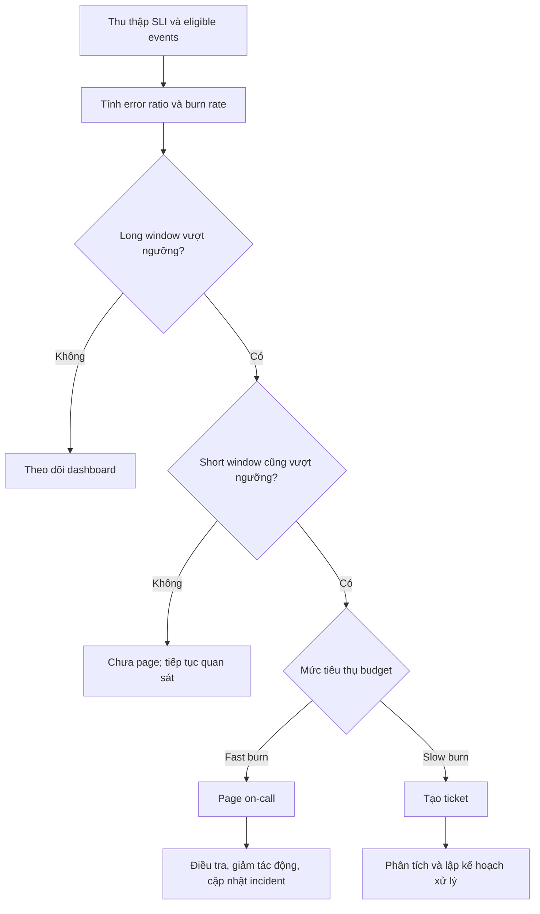

# Burn-rate alerting và giảm cảnh báo nhiễu

Một hệ thống có thể phát sinh nhiều lỗi ngắn nhưng vẫn đáp ứng SLO trong cả kỳ đánh giá. Ngược lại, một đợt lỗi kéo dài với tỷ lệ không quá cao có thể âm thầm tiêu thụ hết error budget trước khi đội vận hành nhận ra. Nếu chỉ cảnh báo khi tỷ lệ lỗi vượt một ngưỡng cố định trong vài phút, đội trực dễ nhận nhiều thông báo ít ý nghĩa hoặc phát hiện sự cố quá muộn.

**Burn-rate alerting** đo tốc độ tiêu thụ error budget so với tốc độ cho phép của SLO. Kết hợp nhiều ngưỡng và nhiều cửa sổ thời gian giúp phân biệt sự cố nghiêm trọng cần gọi người trực ngay với xu hướng suy giảm cần tạo ticket. Trên Google Cloud, bạn có thể dùng SLO-based alerting trong Cloud Monitoring hoặc dùng PromQL với Google Cloud Managed Service for Prometheus khi cần logic nhiều cửa sổ linh hoạt hơn.

Bài học thuộc chương **SRE và độ tin cậy** của module **CLOUD_PROVIDERS_GCP**. Nội dung kết nối SLO, error budget, Cloud Monitoring, telemetry, quy trình trực vận hành và kiểm soát độ tin cậy cho workload như Cloud Run, GKE và các dịch vụ chạy trên Google Cloud.

## 1. Mục tiêu học tập

Sau bài học, bạn có thể:

- Giải thích SLI, SLO, error budget và burn rate trong cùng một mô hình.
- Tính burn rate từ tỷ lệ sự kiện lỗi và mục tiêu SLO.
- Thiết kế cảnh báo nhiều cửa sổ, nhiều mức burn rate (multi-window, multi-burn-rate).
- Tạo cảnh báo theo SLO bằng Cloud Monitoring và hiểu giới hạn của bộ chọn dữ liệu SLO.
- Dùng PromQL để triển khai quy tắc nhiều cửa sổ khi cần cửa sổ dài hơn.
- Giảm cảnh báo nhiễu mà vẫn phát hiện sự cố ảnh hưởng người dùng.
- Đánh giá chất lượng cảnh báo bằng độ chính xác, khả năng phát hiện, thời gian phát hiện và thời gian reset.

## 2. Từ SLI đến error budget

### 2.1. SLI và SLO

**Service Level Indicator (SLI)** là chỉ số đo trải nghiệm hoặc kết quả mà người dùng nhận được. Với dịch vụ HTTP, SLI về tính sẵn sàng có thể là tỷ lệ request thành công trên tổng request đủ điều kiện:

```text
SLI = good_events / eligible_events
error_ratio = bad_events / eligible_events
```

Trong ví dụ đơn giản, request thành công là request trả về kết quả đúng trong giới hạn độ trễ đã cam kết. Request thất bại hoặc vượt ngưỡng latency là bad event. Định nghĩa good và bad event phải phản ánh trải nghiệm thực tế; không nên mặc định mọi HTTP 4xx đều là lỗi dịch vụ hoặc chỉ đo HTTP 5xx nếu lỗi nghiệp vụ có thể xảy ra mà không trả mã 5xx.

**Service Level Objective (SLO)** là mục tiêu cho SLI trong một compliance period, chẳng hạn 99,9% request thành công trong 30 ngày. SLO là mục tiêu độ tin cậy có thể đo được, không phải lời hứa rằng từng request đều thành công.

Nếu mục tiêu SLO là 99,9%:

- Tỷ lệ sự kiện tốt tối thiểu: 99,9%.
- Tỷ lệ sự kiện lỗi tối đa: 0,1% hay 0,001.
- Với 1.000.000 request đủ điều kiện trong kỳ, ngân sách tối đa là 1.000 request lỗi.

**Error budget** là lượng lỗi cho phép trước khi SLO bị vi phạm. Với SLO dạng tỷ lệ sự kiện tốt:

```text
error_budget_ratio = 1 - SLO_goal
error_budget_events = eligible_events * (1 - SLO_goal)
```

Với SLO 99,9%, error budget ratio bằng 0,001. Nếu hệ thống dùng SLO theo cửa sổ trượt 30 ngày, budget được tính trên các sự kiện đủ điều kiện trong cửa sổ đó. Nếu dùng calendar period, ngày bắt đầu và kết thúc kỳ đánh giá phải được xác định rõ.

### 2.2. Burn rate là gì?

Burn rate cho biết error budget đang bị tiêu thụ nhanh gấp bao nhiêu lần tốc độ tương ứng với SLO:

```text
burn_rate = observed_error_ratio / (1 - SLO_goal)
```

Trong đó:

- `observed_error_ratio` là tỷ lệ bad event trên tổng eligible event trong cửa sổ đang xét.
- `SLO_goal` là mục tiêu SLO dưới dạng số thập phân, ví dụ 0,999.
- `1 - SLO_goal` là tỷ lệ lỗi được phép.

| Burn rate | Ý nghĩa |
|---:|---|
| 0 | Không tiêu thụ error budget trong cửa sổ đo. |
| 1 | Nếu tốc độ này kéo dài suốt compliance period, budget sẽ vừa hết vào cuối kỳ. |
| 2 | Tiêu thụ budget nhanh gấp 2 lần tốc độ cho phép. |
| 10 | Tốc độ tiêu thụ nhanh gấp 10 lần tốc độ cho phép. |
| 14,4 | Với kỳ 30 ngày, nếu kéo dài liên tục thì budget bị tiêu thụ hết trong khoảng 50 giờ. |

Burn rate lớn hơn 1 không tự động có nghĩa SLO đã vi phạm. Nó cho biết tốc độ lỗi hiện tại, nếu duy trì, sẽ khiến SLO không đạt trong kỳ đánh giá.

### 2.3. Ví dụ tính burn rate

Một API có SLO 99,9% trong 30 ngày. Trong một giờ gần nhất, 1,44% request đủ điều kiện bị lỗi:

```text
SLO_goal = 0.999
allowed_error_ratio = 1 - 0.999 = 0.001
observed_error_ratio = 0.0144

burn_rate = 0.0144 / 0.001
          = 14.4
```

Dịch vụ đang tiêu thụ budget nhanh gấp 14,4 lần tốc độ cho phép. Trong một giờ, lượng budget bị tiêu thụ xấp xỉ:

```text
budget_spent = burn_rate * window / compliance_period
             = 14.4 * 1 hour / 720 hours
             = 0.02
             = 2%
```

Vì vậy, cảnh báo 14,4x trong một giờ tương ứng khoảng 2% error budget của kỳ 30 ngày. Nếu lỗi chỉ xuất hiện trong vài phút rồi biến mất, cửa sổ một giờ vẫn phản ánh tác động nhưng sẽ giảm dần theo thời gian. Cửa sổ ngắn hơn giúp xác nhận lỗi còn tiếp diễn hay không.

## 3. Vì sao cảnh báo theo tỷ lệ lỗi đơn giản thường gây nhiễu?

Một rule như “tỷ lệ lỗi trong 5 phút lớn hơn 0,1% thì page” dễ triển khai, nhưng có hai vấn đề.

**Cảnh báo quá nhạy.** Với SLO 99,9%, tỷ lệ lỗi 0,1% trong 5 phút đã chạm ngưỡng SLO, nhưng lượng budget tiêu thụ trong một kỳ 30 ngày có thể rất nhỏ. Một vài lỗi tạm thời hoặc một đợt traffic thấp có thể tạo page dù không cần người trực can thiệp ngay.

**Cảnh báo không phản ánh tốc độ tiêu thụ budget.** Cùng một tỷ lệ lỗi có ý nghĩa khác nhau tùy thời gian kéo dài. Một tỷ lệ lỗi cao trong một phút và tỷ lệ lỗi vừa phải trong nhiều giờ không nên luôn nhận cùng mức độ ưu tiên.

Tăng thời gian duy trì điều kiện bằng trường `for` cũng không giải quyết đầy đủ vấn đề. Nếu yêu cầu lỗi phải liên tục vượt ngưỡng một giờ, outage nghiêm trọng có thể bị phát hiện muộn. Ngược lại, lỗi chập chờn khiến bộ đếm thời gian liên tục reset và không bao giờ kích hoạt cảnh báo.

Google SRE đánh giá chiến lược cảnh báo theo bốn thuộc tính:

| Thuộc tính | Câu hỏi cần trả lời |
|---|---|
| Precision (độ chính xác) | Bao nhiêu cảnh báo thực sự tương ứng với sự cố đáng xử lý? |
| Recall (khả năng phát hiện) | Bao nhiêu sự cố quan trọng được phát hiện? |
| Detection time | Từ lúc lỗi bắt đầu đến lúc người chịu trách nhiệm nhận cảnh báo là bao lâu? |
| Reset time | Sau khi sự cố kết thúc, cảnh báo mất bao lâu mới chuyển về trạng thái bình thường? |

Mục tiêu là cảnh báo có thể hành động, gắn với tác động đến người dùng và mức tiêu thụ error budget. Một metric thay đổi bất thường nhưng không cần người can thiệp có thể chỉ cần hiển thị trên dashboard hoặc tạo ticket.

## 4. Thiết kế multi-window, multi-burn-rate

### 4.1. Kết hợp cửa sổ dài và cửa sổ ngắn

Một cặp cửa sổ gồm:

- **Cửa sổ dài (long window):** đo tác động tích lũy đủ lớn để xác nhận sự cố có ý nghĩa với error budget.
- **Cửa sổ ngắn (short window):** kiểm tra lỗi vẫn đang xảy ra gần thời điểm đánh giá, giúp cảnh báo reset nhanh khi sự cố đã kết thúc.

Trong một cặp điều kiện, chỉ phát cảnh báo khi cả hai cửa sổ đều vượt cùng ngưỡng burn rate:

```text
long_window_burn_rate > threshold
AND
short_window_burn_rate > threshold
```

Cửa sổ ngắn thường bằng khoảng 1/12 cửa sổ dài theo hướng dẫn trong Google SRE Workbook. Ví dụ 1 giờ đi với 5 phút, 6 giờ đi với 30 phút. Đây là điểm bắt đầu để thử nghiệm; tải, độ trễ thu thập metric và đặc điểm SLI có thể khiến bạn cần điều chỉnh.

Khi sự cố kết thúc, tỷ lệ lỗi trong cửa sổ ngắn giảm trước. Điều kiện AND không còn đúng nên cảnh báo có thể tự reset sớm, dù cửa sổ dài vẫn còn lưu dấu vết của sự cố. Cửa sổ dài tiếp tục giúp đánh giá tổng tác động và phân tích sau sự cố.

### 4.2. Các mức cảnh báo khởi đầu

Với SLO 99,9% và compliance period 30 ngày, Google SRE Workbook đưa ra các giá trị khởi đầu sau:

| Mức xử lý | Cửa sổ dài | Cửa sổ ngắn | Burn rate | Budget tiêu thụ xấp xỉ | Hành động |
|---|---:|---:|---:|---:|---|
| Nghiêm trọng | 1 giờ | 5 phút | 14,4x | 2% | Page người trực |
| Cao | 6 giờ | 30 phút | 6x | 5% | Page người trực |
| Theo dõi | 3 ngày | 6 giờ | 1x | 10% | Tạo ticket, xử lý theo giờ làm việc |

Công thức kiểm tra phần budget đã tiêu thụ:

```text
budget_spent_fraction = burn_rate * window_duration / compliance_period
```

Ví dụ với compliance period 30 ngày = 720 giờ:

- 14,4x trong 1 giờ: 14,4 / 720 = 2%.
- 6x trong 6 giờ: 36 / 720 = 5%.
- 1x trong 3 ngày (72 giờ): 72 / 720 = 10%.

Các giá trị trên là baseline cho dịch vụ có traffic đủ lớn và SLO 99,9%. Không áp dụng nguyên xi cho mọi SLO, kỳ đánh giá, request class hoặc dịch vụ có lưu lượng thấp. Khi thay SLO hoặc compliance period, hãy tính lại ngưỡng từ tỷ lệ budget muốn tiêu thụ và thời gian cửa sổ.

### 4.3. Phân loại page, ticket và dashboard

Không phải mọi tín hiệu tiêu thụ error budget đều cần đánh thức người trực.

- **Page:** sự cố đang diễn ra, có khả năng làm mất một phần đáng kể error budget trong thời gian ngắn và cần con người can thiệp ngay.
- **Ticket:** xu hướng tiêu thụ budget kéo dài, cần điều tra hoặc lên kế hoạch xử lý nhưng có thể chờ đến giờ làm việc.
- **Dashboard:** dữ liệu để quan sát, phân tích xu hướng hoặc hỗ trợ chẩn đoán; chưa có bằng chứng cần tạo công việc.
- **Log/trace:** bằng chứng chi tiết phục vụ tìm nguyên nhân, không nên tự động biến mọi log lỗi thành một page riêng.

Tách mức độ theo tác động và thời gian còn lại trước khi budget cạn. Nếu cùng một sự cố làm kích hoạt cả fast-burn và slow-burn, cần thiết kế phân luồng hoặc ức chế cảnh báo mức thấp khi page mức cao đang mở để người trực không nhận nhiều thông báo trùng lặp.

### 4.4. Sơ đồ luồng quyết định



## 5. Chuẩn bị SLO và telemetry trên Google Cloud

Trước khi tạo alert, hãy xác định dịch vụ, SLI, SLO và kỳ đánh giá. Alert tốt không thể bù cho SLI sai hoặc telemetry thiếu.

### 5.1. Chọn service và SLI

Trong Cloud Monitoring, Service Monitoring cho phép khai báo service và SLO để theo dõi hiệu năng. Bạn có thể dùng tích hợp được hỗ trợ hoặc khai báo custom service và SLI phù hợp với workload.

Ví dụ với một dịch vụ checkout chạy trên Cloud Run hoặc GKE:

- Eligible event: request đến endpoint checkout đã được xác định trong SLO.
- Good event: request hoàn tất đúng nghiệp vụ và trong giới hạn latency.
- Bad event: request thất bại hoặc vượt ngưỡng latency đã định.
- SLO: 99,9% good events trong 30 ngày.

Nếu dịch vụ dùng nhiều loại request có mức quan trọng khác nhau, hãy tách SLO hoặc nhóm request theo yêu cầu độ tin cậy. Không để health check, polling nền hoặc endpoint ít quan trọng làm sai lệch tín hiệu của luồng người dùng chính.

### 5.2. Kiểm tra chất lượng dữ liệu

Trước khi dùng SLI để page, xác minh:

- Bộ đếm request và lỗi cùng dùng một định nghĩa eligible event.
- Các label dùng để ghép request với error có cùng tập giá trị.
- Counter reset, process restart và scrape gap được xử lý đúng.
- Không tính request bị loại trừ theo chính sách SLO vào mẫu số.
- Có đủ traffic để tỷ lệ lỗi có ý nghĩa thống kê.
- Có cảnh báo riêng khi telemetry mất hoặc không được cập nhật.

Không diễn giải “không có time series” thành “không có lỗi”. Thiếu dữ liệu có thể là sự cố của đường telemetry, exporter hoặc pipeline thu thập. Cần phân biệt trạng thái no data với trạng thái SLI bằng 0 lỗi.

### 5.3. Xác định compliance period

Compliance period của SLO là kỳ dùng để tính mức đạt mục tiêu và error budget. Cửa sổ dùng cho burn rate cần được hiểu cùng kỳ đó.

Ví dụ SLO 99,9% trong 30 ngày:

- Error ratio cho phép trong cả kỳ: 0,1%.
- Một cửa sổ 1 giờ chỉ lấy một phần dữ liệu để phát hiện tốc độ tiêu thụ hiện tại.
- Burn rate được chuẩn hóa theo tỷ lệ lỗi cho phép của SLO.
- Phần budget tiêu thụ phụ thuộc cả burn rate, độ dài cửa sổ và compliance period.

Cần ghi rõ SLO dùng rolling window hay calendar period trong tài liệu dịch vụ. Nếu thay kỳ đánh giá, hãy đánh giá lại threshold, dashboard và chính sách error budget.

## 6. Tạo SLO-based alert trong Cloud Monitoring

### 6.1. Tạo cảnh báo từ giao diện

Một quy trình tổng quát:

1. Mở Google Cloud Console và chọn đúng project.
2. Vào Cloud Monitoring, mở phần Services hoặc SLO monitoring.
3. Chọn service và SLO cần bảo vệ.
4. Từ trạng thái SLO, tạo SLO alert.
5. Chọn burn-rate threshold và lookback period phù hợp.
6. Chọn notification channel cho nhóm trực hoặc nhóm xử lý ticket.
7. Viết phần documentation để người nhận biết SLO nào bị ảnh hưởng, ngưỡng nào đã vượt và cần mở dashboard/runbook nào.
8. Lưu policy, sau đó kiểm tra trạng thái policy và luồng thông báo.

Tài liệu Google Cloud đưa ra các điểm khởi đầu cho hai policy:

| Loại policy | Threshold gợi ý | Lookback gợi ý | Mục đích |
|---|---:|---:|---|
| Fast burn | 10x | 1–2 giờ | Phát hiện thay đổi lớn, cần phản ứng nhanh. |
| Slow burn | 2x | 24 giờ | Phát hiện xu hướng tiêu thụ budget kéo dài. |

Các ngưỡng này là hướng dẫn khởi đầu của Cloud Monitoring. Hãy thử trên lịch sử metric, cân nhắc traffic theo giờ trong ngày và điều chỉnh theo khả năng phản ứng của đội vận hành.

### 6.2. Giới hạn lookback của bộ chọn SLO burn rate

Khi tạo alert policy bằng Cloud Monitoring API, bộ chọn dữ liệu `select_slo_burn_rate` nhận hai tham số: tên SLO và lookback period.

Ví dụ filter cho cửa sổ một giờ:

```text
select_slo_burn_rate(
  "projects/PROJECT_ID/services/SERVICE_ID/serviceLevelObjectives/SLO_ID",
  "60m"
)
```

Lookback period đồng thời là compliance period được dùng để tính hiệu năng SLO và error budget cho lần truy vấn đó. Theo tài liệu Cloud Monitoring hiện hành, SLO burn-rate alert dùng selector này không hỗ trợ compliance period lớn hơn 24 giờ.

Điều này có nghĩa là cấu hình SLO alert native với cửa sổ 1 giờ, 6 giờ hoặc 24 giờ có thể phù hợp; cửa sổ 3 ngày trong baseline Google SRE Workbook cần cách triển khai khác, chẳng hạn PromQL alerting với Google Cloud Managed Service for Prometheus hoặc metric đã tổng hợp riêng. Không giả định selector `select_slo_burn_rate` có thể nhận `3d`.

### 6.3. Cấu trúc condition qua API

Một condition SLO-based dùng kiểu metric-threshold nhưng `filter` chứa selector SLO. Các trường quan trọng gồm:

- `filter`: selector như `select_slo_burn_rate`.
- `comparison`: phép so sánh, thường là `COMPARISON_GT`.
- `thresholdValue`: ngưỡng burn rate.
- `duration`: thời gian điều kiện phải duy trì. Với multi-window, short/long windows đã cung cấp hai góc nhìn; không dùng duration dài để thay thế cửa sổ.
- `combiner`: cách kết hợp các condition trong cùng policy.

Ví dụ cấu trúc minh họa cho fast-burn policy: cả cửa sổ 1 giờ và 5 phút đều phải vượt 14,4x. Thay placeholder bằng project, service, SLO ID và notification channel thực tế:

```json
{
  "displayName": "Checkout SLO fast burn",
  "combiner": "AND",
  "conditions": [
    {
      "displayName": "Burn rate 1h above 14.4x",
      "conditionThreshold": {
        "filter": "select_slo_burn_rate(\"projects/PROJECT_ID/services/SERVICE_ID/serviceLevelObjectives/SLO_ID\", \"60m\")",
        "comparison": "COMPARISON_GT",
        "thresholdValue": 14.4,
        "duration": {
          "seconds": "0"
        }
      }
    },
    {
      "displayName": "Burn rate 5m above 14.4x",
      "conditionThreshold": {
        "filter": "select_slo_burn_rate(\"projects/PROJECT_ID/services/SERVICE_ID/serviceLevelObjectives/SLO_ID\", \"5m\")",
        "comparison": "COMPARISON_GT",
        "thresholdValue": 14.4,
        "duration": {
          "seconds": "0"
        }
      }
    }
  ],
  "notificationChannels": [
    "projects/PROJECT_ID/notificationChannels/CHANNEL_ID"
  ],
  "documentation": {
    "content": "Checkout đang tiêu thụ error budget ở mức fast burn. Kiểm tra SLO dashboard và runbook của checkout.",
    "mimeType": "text/markdown"
  }
}
```

Đây là ví dụ cấu trúc condition để minh họa cách kết hợp hai cửa sổ; hãy kiểm tra schema API và các trường bắt buộc của môi trường trước khi gửi request tạo policy. `combiner: AND` yêu cầu cả hai condition cùng đúng. Với slow burn, tạo policy riêng có threshold và cửa sổ phù hợp để có thể gửi thông báo đến kênh ticket.

### 6.4. Phân biệt Cloud Monitoring SLO alert và PromQL alert

Cloud Monitoring SLO alert thuận tiện khi service đã có SLO trong Service Monitoring và bạn muốn tạo policy trực tiếp từ SLO. Selector chuẩn hóa burn rate theo định nghĩa SLO và lookback.

PromQL phù hợp khi bạn cần:

- Cửa sổ dài hơn 24 giờ.
- Logic nhiều cửa sổ hoặc nhiều điều kiện tùy chỉnh.
- Nhóm request, region hoặc service theo label riêng.
- Kết hợp burn rate với điều kiện về số lượng request tối thiểu hoặc tín hiệu synthetic.
- Tái sử dụng recording rules cho nhiều policy.

Nếu dùng Google Cloud Managed Service for Prometheus, hãy cấu hình collection, rule evaluation và alert routing theo kiến trúc giám sát của nhóm. Đảm bảo retention và khả năng truy vấn đủ dài cho mọi range vector; một rule 3 ngày không thể hoạt động nếu dữ liệu cần thiết không còn trong hệ thống.

## 7. Ví dụ PromQL cho multi-window, multi-burn-rate

Giả sử nhóm checkout đã tạo recording rules:

```text
service:sli_error_ratio:rate5m
service:sli_error_ratio:rate30m
service:sli_error_ratio:rate1h
service:sli_error_ratio:rate6h
service:sli_error_ratio:rate3d
```

Mỗi time series biểu diễn tỷ lệ bad event trên eligible event trong cửa sổ tương ứng, được nhóm theo label `service`. Tên metric ở đây là quy ước minh họa; bạn cần tạo recording rules dựa trên metric thực tế của ứng dụng.

Ví dụ recording rule cho tỷ lệ HTTP 5xx có thể có dạng:

```yaml
groups:
- name: checkout-sli-recording
  interval: 30s
  rules:
  - record: service:sli_error_ratio:rate5m
    expr: |
      sum by (service) (
        rate(http_requests_total{service="checkout", code=~"5.."}[5m])
      )
      /
      sum by (service) (
        rate(http_requests_total{service="checkout"}[5m])
      )
```

Đây chỉ là cách tính cho SLI mà bad event được định nghĩa là HTTP 5xx. Với SLI latency, hãy thay tử số bằng số request vượt ngưỡng latency. Với SLI nghiệp vụ, hãy dùng metric phản ánh kết quả nghiệp vụ. Có thể tạo recording rule tương tự cho cửa sổ 30m, 1h, 6h và 3d.

### 7.1. Page khi fast burn còn đang tiếp diễn

Với SLO 99,9%, tỷ lệ lỗi cho phép là 0,001. Rule fast burn yêu cầu cả cửa sổ 1 giờ và 5 phút vượt 14,4x:

```yaml
groups:
- name: checkout-slo-alerts
  rules:
  - alert: CheckoutFastBurn
    expr: |
      (
        service:sli_error_ratio:rate1h{service="checkout"} > 14.4 * 0.001
      )
      and on (service)
      (
        service:sli_error_ratio:rate5m{service="checkout"} > 14.4 * 0.001
      )
    labels:
      severity: page
      team: checkout
    annotations:
      summary: "Checkout đang tiêu thụ error budget ở mức fast burn"
      description: "Burn rate vượt 14.4x trong cả 1h và 5m. Kiểm tra SLO dashboard, phiên bản triển khai gần nhất và runbook."
      runbook_url: "https://RUNBOOK_URL"
```

Biểu thức trên giả định mỗi metric có cùng label `service`. Nếu hệ thống chia time series theo region hoặc cluster, hãy quyết định rõ có cần gộp các dimension đó trước khi so sánh hay không. Dùng `and on (service)` khi muốn ghép hai cửa sổ theo cùng service; tránh vô tình ghép các series khác dịch vụ.

### 7.2. Page khi lỗi vừa phải nhưng kéo dài

Một sự cố không quá nghiêm trọng trong vài phút vẫn có thể tiêu thụ đáng kể budget nếu kéo dài. Cặp 6 giờ và 30 phút với burn rate 6x phát hiện tình huống này:

```promql
(
  service:sli_error_ratio:rate6h{service="checkout"} > 6 * 0.001
)
and on (service)
(
  service:sli_error_ratio:rate30m{service="checkout"} > 6 * 0.001
)
```

Có thể đặt biểu thức này trong một alert rule riêng với `severity: page`, cùng team và runbook. Hai policy page có thể cùng kích hoạt trong một incident; cần kiểm tra cơ chế deduplicate và suppression của hệ thống nhận alert để tránh gửi hai page độc lập cho cùng một sự cố.

### 7.3. Tạo ticket cho slow burn

Với cửa sổ 3 ngày và 6 giờ, burn rate 1x tương ứng khoảng 10% error budget trong kỳ 30 ngày:

```promql
(
  service:sli_error_ratio:rate3d{service="checkout"} > 1 * 0.001
)
and on (service)
(
  service:sli_error_ratio:rate6h{service="checkout"} > 1 * 0.001
)
```

Mức này thường phù hợp với ticket để điều tra trong giờ làm việc hơn là page ngay lập tức. Nếu chỉ dùng native `select_slo_burn_rate`, hãy thay cặp 3 ngày bằng policy có lookback tối đa 24 giờ, chẳng hạn 24h và 2h với threshold được tính lại, hoặc triển khai cửa sổ 3 ngày bằng PromQL khi dữ liệu và rule evaluation đáp ứng yêu cầu.

Không sao chép các biểu thức trên vào production khi chưa kiểm tra recording rule, label, metric type, đơn vị và SLO goal. Một mẫu PromQL sai có thể làm cảnh báo luôn tắt hoặc luôn bật.

## 8. Giảm cảnh báo nhiễu trong vận hành

### 8.1. Page chỉ khi cần con người can thiệp

Một page nên trả lời được câu hỏi: “Nếu người trực không hành động trong thời gian ngắn, tác động đến người dùng hoặc error budget có tiếp tục tăng đáng kể không?”

Nếu câu trả lời là không, hãy cân nhắc ticket hoặc dashboard. Ví dụ:

- CPU tăng trong vài phút nhưng request SLI vẫn bình thường: đưa vào dashboard hoặc cảnh báo chẩn đoán.
- Tỷ lệ lỗi tăng nhanh ở endpoint thanh toán, cả cửa sổ dài và ngắn đều vượt ngưỡng: page.
- Burn rate 1x trong nhiều ngày, chưa cần can thiệp ngoài giờ: ticket.
- Một instance restart nhưng service vẫn đáp ứng SLO: theo dõi, không nhất thiết page.

Metric hạ tầng vẫn quan trọng để tìm nguyên nhân, nhưng page nên ưu tiên triệu chứng ảnh hưởng đến người dùng hoặc tín hiệu có thể gây sự cố nghiêm trọng ngay cả khi SLI chưa phản ánh kịp.

### 8.2. Dùng short window để giảm reset time

Nếu chỉ dùng cửa sổ dài, alert có thể tiếp tục firing lâu sau khi lỗi đã hết vì các lỗi cũ vẫn nằm trong cửa sổ đo. Thêm cửa sổ ngắn bằng logic AND giúp xác nhận hệ thống vẫn đang tiêu thụ budget ở thời điểm gần hiện tại.

Không dùng một `for` dài để thay thế short window. Duration chỉ yêu cầu một biểu thức giữ trạng thái trong một khoảng thời gian; nó không cho biết lượng budget đã tiêu thụ và có thể bỏ lỡ các lỗi chập chờn.

### 8.3. Deduplicate và suppress cảnh báo trùng

Một outage lớn thường đồng thời thỏa điều kiện fast-burn, slow-burn, latency, HTTP 5xx và một số alert hạ tầng. Nếu mỗi policy gửi một page riêng, người trực sẽ nhận nhiều thông báo nhưng chỉ có một incident cần xử lý.

Các biện pháp:

- Dùng nhãn ổn định như `service`, `team`, `environment`, `severity` để nhóm cảnh báo.
- Dùng một incident key theo dịch vụ và nguyên nhân ở hệ thống nhận cảnh báo nếu công cụ hỗ trợ.
- Với Alertmanager, cấu hình grouping, deduplication và inhibition để page mức cao ức chế thông báo ticket hoặc warning trùng cùng service.
- Giữ các cảnh báo độc lập nếu chúng đại diện cho failure domain hoặc hành động xử lý khác nhau.
- Không nhóm tất cả service vào một alert duy nhất nếu điều đó che mất service đang lỗi.

Trong Cloud Monitoring, thiết kế notification channel theo đội và mức độ, viết documentation rõ ràng, tránh tạo nhiều policy có cùng điều kiện chỉ để gửi nhiều kênh. Nếu cần suppression phức tạp giữa nhiều rule, cân nhắc xử lý ở lớp alert routing tương thích với kiến trúc Prometheus/Alertmanager.

### 8.4. Giảm cardinality và cảnh báo theo từng instance

Không tạo một page riêng cho mỗi pod, instance, request ID hoặc user ID khi vấn đề thực chất ảnh hưởng toàn service. Label có cardinality cao vừa làm tăng số time series, vừa khiến một incident tạo ra hàng trăm thông báo.

Thông thường, hãy tổng hợp SLI theo service hoặc request class. Chỉ thêm region, cluster hoặc zone khi chúng giúp xác định failure domain và có người chịu trách nhiệm xử lý riêng.

Nếu cần chẩn đoán từng pod, dùng dashboard, log và trace để drill down từ alert cấp service. Không đưa mọi dimension chẩn đoán vào notification key.

### 8.5. Tách alert theo nhóm request có cùng mức quan trọng

Một dịch vụ có thể có luồng đăng nhập, thanh toán, xuất báo cáo và polling nền. Những luồng này có mức độ ảnh hưởng khác nhau. Nếu gộp tất cả vào một SLO, traffic nền có thể che lỗi thanh toán hoặc một endpoint ít quan trọng có thể tạo page không cần thiết.

| Lớp | Ví dụ | Cách xử lý cảnh báo |
|---|---|---|
| Critical | Đăng nhập, thanh toán, ghi nhận giao dịch | Ngưỡng chặt, page khi burn nhanh. |
| High | Tương tác chính nhưng có thể retry hoặc chậm một chút | Page khi burn đáng kể, ticket cho slow burn. |
| Low | Polling nền, tác vụ không trực tiếp hiển thị cho người dùng | Dashboard hoặc ticket theo xu hướng. |
| No SLO | Dark launch hoặc chức năng thử nghiệm chưa cam kết | Không đưa vào SLO người dùng chính. |

Các lớp phải dựa trên tác động sản phẩm và được thống nhất với chủ sở hữu dịch vụ. Không hạ SLO chỉ để giảm số page nếu điều đó làm sai lệch cam kết với người dùng.

### 8.6. Xử lý dịch vụ có traffic thấp

Burn rate dựa trên tỷ lệ có thể rất nhạy khi mẫu số nhỏ. Nếu một dịch vụ chỉ nhận 10 request mỗi giờ, một request lỗi làm tỷ lệ lỗi thành 10%. Với SLO 99,9%, con số này tương ứng burn rate 1.000x dù có thể chỉ là lỗi thoáng qua của một request.

Tùy tác động thực tế, có thể kết hợp:

- Synthetic monitoring để tạo tín hiệu kiểm tra liên tục khi không có người dùng thật.
- Gộp endpoint hoặc service liên quan có cùng failure domain để tăng số lượng mẫu, đồng thời giữ alert riêng cho failure quan trọng.
- Tăng cửa sổ quan sát hoặc thêm điều kiện số lượng eligible events tối thiểu.
- Dùng retry có exponential backoff và jitter khi retry an toàn về nghiệp vụ.
- Thiết kế fallback hoặc hàng đợi để một lỗi tạm thời không biến thành thất bại cuối cùng đối với người dùng.
- Đánh giá lại SLO cùng chủ sở hữu sản phẩm nếu tác động của một lỗi đơn lẻ không tương xứng với page.

Điều kiện số lượng mẫu tối thiểu cần được dùng thận trọng: nó có thể giảm nhiễu nhưng cũng có thể che một outage thực sự trên dịch vụ ít traffic. Nếu một request thất bại có giá trị cao và không thể retry, có thể cần alert trực tiếp cho sự kiện đó bên cạnh burn-rate alert tổng thể.

Synthetic traffic cũng có giới hạn. Một probe chỉ kiểm tra được các luồng và trạng thái mà nó mô phỏng; nếu probe thành công trong khi một nhóm người dùng thật gặp lỗi, nó có thể làm giảm độ nhạy của tín hiệu. Hãy kết hợp synthetic với telemetry từ request thực.

### 8.7. Phân biệt lỗi dịch vụ và lỗi telemetry

Một alert im lặng vì metric biến mất có thể nguy hiểm hơn một alert nhiễu. Hãy có kiểm tra riêng cho:

- Scrape hoặc exporter không hoạt động.
- Cloud Monitoring không nhận metric mới.
- Rule evaluation hoặc pipeline Prometheus bị lỗi.
- Counter request không tăng dù dịch vụ vẫn có traffic.
- Label hoặc metric name thay đổi sau deploy khiến recording rule không còn khớp.

Đối với từng SLO, xác định trạng thái khi thiếu dữ liệu. Không mặc định no data là zero error. Có thể dùng alert riêng cho freshness hoặc availability của pipeline telemetry, với owner và runbook phù hợp.

## 9. Documentation và quy trình phản ứng

Một notification có ích phải giúp người nhận bắt đầu điều tra ngay. Nội dung policy nên có:

- Tên service, SLO và request class bị ảnh hưởng.
- Burn rate, long window, short window và threshold đã vượt.
- Compliance period và ước lượng phần error budget đã tiêu thụ.
- Dashboard link có bộ lọc đúng service, environment và region.
- Runbook chỉ dẫn kiểm tra deploy gần nhất, dependency, quota và thay đổi cấu hình.
- Team chịu trách nhiệm và kênh incident tương ứng.
- Hướng dẫn xác định lỗi còn tiếp diễn hay đã phục hồi.

Quy trình phản ứng tham khảo:

1. Xác nhận alert đang mở và SLO nào bị ảnh hưởng.
2. Kiểm tra long window và short window để xác nhận burn còn tiếp diễn.
3. Kiểm tra traffic, tỷ lệ bad event, latency và phân bố theo region hoặc request class.
4. So sánh thời điểm bắt đầu lỗi với deploy, thay đổi cấu hình, quota hoặc sự cố dependency.
5. Giảm tác động trước: rollback, disable feature, giảm tải hoặc chuyển sang fallback khi phù hợp.
6. Theo dõi short window và xác nhận alert reset.
7. Ghi lại thời gian, lượng budget đã tiêu thụ, nguyên nhân và hành động cần theo dõi trong postmortem.

Không đóng incident chỉ vì alert tự reset. Cần xác nhận người dùng đã phục hồi và các request đang xử lý dở đã được giải quyết hoặc đưa vào luồng retry phù hợp.

## 10. Kiểm thử và hiệu chỉnh alert

Trước khi bật page cho toàn bộ traffic, hãy kiểm thử điều kiện trên dữ liệu lịch sử và môi trường staging.

### 10.1. Kiểm tra bằng lịch sử

Với từng rule, kiểm tra:

- Một outage toàn phần có kích hoạt trong thời gian chấp nhận được không?
- Một đợt spike ngắn có tạo page không cần thiết không?
- Lỗi chập chờn có bị bỏ qua do logic duration không?
- Khi lỗi kết thúc, alert reset trong bao lâu?
- Cùng một incident có tạo nhiều page trùng không?
- Một service ít traffic có tạo burn rate cực lớn từ một request lỗi không?
- Khi telemetry ngừng cập nhật, hệ thống có cảnh báo mất tín hiệu không?

### 10.2. Kiểm thử có kiểm soát

Trong môi trường không ảnh hưởng người dùng, có thể tạo các tình huống:

- Tăng tỷ lệ lỗi liên tục để kiểm tra fast-burn.
- Tăng lỗi ở mức thấp trong thời gian dài để kiểm tra slow-burn.
- Tạo spike ngắn rồi phục hồi để đo reset time.
- Tạo lỗi ở một region hoặc request class để xác minh grouping.
- Dừng exporter hoặc rule evaluation để kiểm tra alert telemetry.

Ghi nhận thời gian từ lúc lỗi bắt đầu đến lúc alert firing, số notification, thời gian reset và phần budget đã tiêu thụ. Không cố tình gây lỗi trên production nếu chưa có quy trình thử nghiệm và kiểm soát tác động được phê duyệt.

### 10.3. Chỉ số đánh giá chất lượng cảnh báo

| Chỉ số | Cách sử dụng |
|---|---|
| Actionable page ratio | Tỷ lệ page thực sự cần người trực hành động. |
| Pages per incident | Số page trùng lặp trung bình cho một incident. |
| Detection time | Thời gian phát hiện sự cố có ảnh hưởng SLO. |
| Reset time | Thời gian từ khi khắc phục đến khi alert ngừng firing. |
| Missed significant events | Sự cố quan trọng không tạo alert tương ứng. |
| Ticket aging | Thời gian ticket slow-burn chưa được xử lý. |
| Error budget consumed before detection | Lượng budget đã mất trước khi người trực nhận được cảnh báo. |

Nếu page không có hành động cụ thể hoặc liên tục bị bỏ qua, hãy xem lại SLI, threshold, cửa sổ, owner và runbook. Không chỉ tăng threshold để giảm số thông báo; điều đó có thể làm mất khả năng phát hiện sự cố thật.

## 11. Quy tắc vận hành và quản lý thay đổi

### Chuẩn hóa policy theo service class

Khi có nhiều microservice, không nên để mỗi service tự chọn một bộ cửa sổ và threshold hoàn toàn khác nhau. Hãy tạo baseline theo nhóm mức độ quan trọng, sau đó cho phép ngoại lệ khi có lý do đo lường được.

Mỗi policy cần có owner, SLO liên quan, severity, notification channel và runbook. Khi service đổi owner, đổi metric hoặc đổi SLO, cần cập nhật alert cùng lúc.

### Thay đổi threshold có kiểm soát

Khi điều chỉnh policy:

1. Ghi lại lý do và số liệu chứng minh alert hiện tại gây nhiễu hoặc phát hiện chậm.
2. Đánh giá lại lịch sử metric bằng threshold mới.
3. Kiểm tra tác động đến precision, recall, detection time và reset time.
4. Triển khai thay đổi theo từng service class hoặc môi trường.
5. Theo dõi page và ticket sau thay đổi.
6. Ghi nhận quyết định và thời điểm cần xem xét lại.

Trong incident đang diễn ra, có thể cần tạm thời thay đổi routing hoặc suppression để giảm thông báo trùng. Ghi rõ thời điểm hết hiệu lực và khôi phục cấu hình chuẩn sau incident; không để chế độ mute tạm thời trở thành trạng thái mặc định.

### Phân quyền

Chỉ nhóm chịu trách nhiệm vận hành mới nên có quyền thay đổi alert policy production hoặc notification channel. Áp dụng IAM theo vai trò và project, rà soát quyền sửa policy, quyền quản lý notification channel và quyền thay đổi SLO. Theo dõi thay đổi qua audit log phù hợp để có thể truy vết khi cảnh báo bị vô hiệu hóa hoặc ngưỡng bị thay đổi.

## 12. Checklist trước khi bật page production

- [ ] SLI đo đúng trải nghiệm người dùng và định nghĩa rõ eligible, good, bad event.
- [ ] SLO goal và compliance period đã được thống nhất với chủ sở hữu dịch vụ.
- [ ] Error budget và burn rate được tính bằng cùng đơn vị, cùng tập sự kiện.
- [ ] Đã chọn cửa sổ dài/ngắn và threshold theo lượng budget muốn tiêu thụ.
- [ ] Đã tách page, ticket và dashboard theo mức độ khẩn cấp.
- [ ] Với Cloud Monitoring, đã kiểm tra giới hạn lookback 24 giờ của `select_slo_burn_rate`.
- [ ] Nếu dùng cửa sổ dài hơn 24 giờ, đã chọn PromQL hoặc cách tính metric phù hợp và kiểm tra retention.
- [ ] Đã kiểm thử lỗi nhanh, lỗi kéo dài, lỗi chập chờn và low traffic.
- [ ] Đã có xử lý deduplication, grouping và suppression cho cảnh báo trùng.
- [ ] Có alert riêng cho pipeline telemetry hoặc trạng thái no data.
- [ ] Notification có owner, dashboard, runbook và hành động cụ thể.
- [ ] Đã thử quy trình page, ticket, incident response và xác nhận phục hồi.
- [ ] Có lịch xem xét alert noise và điều chỉnh policy sau các incident.

## Kết luận

Burn-rate alerting biến SLO và error budget thành tín hiệu vận hành có thể hành động. Thay vì page chỉ vì tỷ lệ lỗi vượt một ngưỡng ngắn hạn, nhóm SRE đánh giá tốc độ tiêu thụ budget qua nhiều cửa sổ và phân loại mức độ phản ứng theo tác động dự kiến.

Multi-window, multi-burn-rate giúp cân bằng phát hiện nhanh, độ chính xác và thời gian reset. Trên Google Cloud, Cloud Monitoring cung cấp SLO-based alerting với `select_slo_burn_rate`; khi cần cửa sổ dài hơn 24 giờ hoặc logic PromQL tùy chỉnh, có thể dùng Google Cloud Managed Service for Prometheus. Chất lượng cảnh báo cuối cùng phụ thuộc vào SLI đúng, telemetry đáng tin cậy, ngưỡng phù hợp với traffic và quy trình trực có owner cùng runbook rõ ràng.

## Tài liệu tham khảo

- [Google Cloud Observability: Alerting on your burn rate](https://docs.cloud.google.com/stackdriver/docs/solutions/slo-monitoring/alerting-on-budget-burn-rate)
- [Google Cloud Observability: Creating an SLO-based alerting policy by API](https://docs.cloud.google.com/stackdriver/docs/solutions/slo-monitoring/api/create-policy-api)
- [Google Cloud Monitoring: Alerting overview](https://docs.cloud.google.com/monitoring/alerts)
- [Google Cloud: SLO monitoring](https://docs.cloud.google.com/monitoring/slo-monitoring)
- [Google SRE Workbook: Alerting on SLOs](https://sre.google/workbook/alerting-on-slos/)

