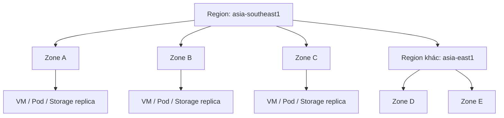
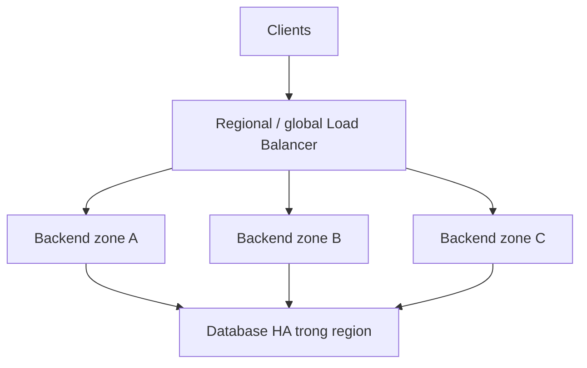
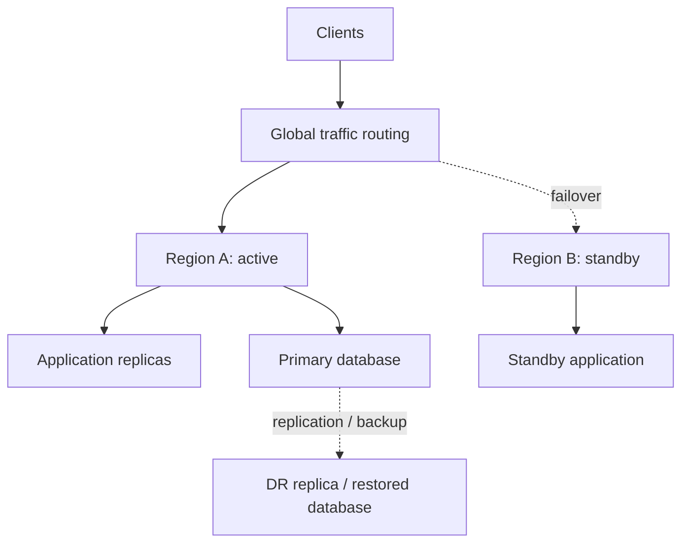
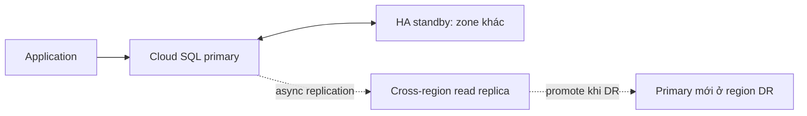
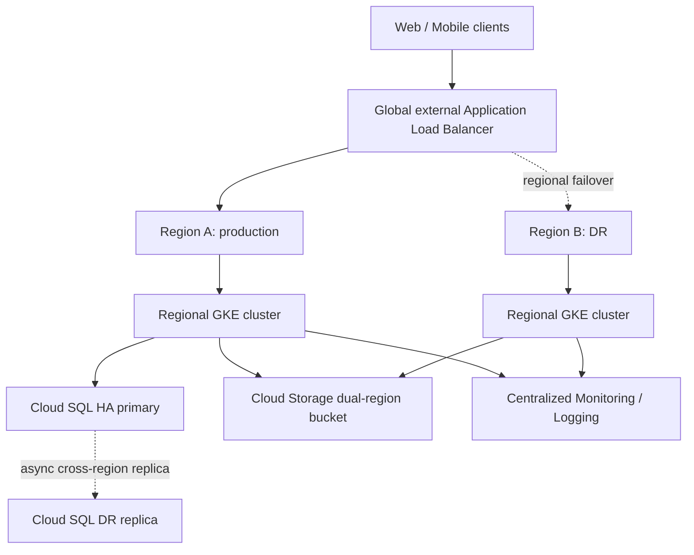

# Thiết kế chịu lỗi theo zone và region

Một ứng dụng có thể chạy trên nhiều VM hoặc nhiều pod nhưng vẫn ngừng hoạt động khi một zone gặp sự cố. Nguyên nhân thường là toàn bộ replica đặt trong cùng zone, database chỉ có một bản chính, ổ đĩa gắn với một zone hoặc load balancer chỉ có một backend. Tương tự, một hệ thống đã chịu được sự cố zone vẫn có thể ngừng hoàn toàn khi cả region không khả dụng.

Thiết kế chịu lỗi cần xác định rõ phạm vi sự cố mà hệ thống phải tiếp tục phục vụ, cách phát hiện sự cố, nơi chuyển traffic và cách bảo toàn dữ liệu. Trên Google Cloud, **zone** là failure domain nhỏ hơn nằm trong một **region**; triển khai đa zone giúp ứng dụng tiếp tục hoạt động khi một zone gặp sự cố. Muốn chịu được sự cố toàn region, phải có kiến trúc đa region với compute, dữ liệu, mạng và quy trình failover phù hợp.

Trong module `CLOUD_PROVIDERS_GCP`, chủ đề này kết nối Compute Engine, GKE, Cloud Run, Cloud SQL, Spanner, Cloud Storage, Cloud Load Balancing, Cloud DNS và Cloud Monitoring thành một thiết kế SRE có mục tiêu rõ ràng. Nhiều bản sao tài nguyên chỉ tạo ra khả năng chịu lỗi khi các bản sao nằm trong failure domain độc lập, đủ năng lực phục vụ tải và có cơ chế chuyển đổi đã được kiểm thử.

## 1. Hiểu failure domain: zone và region

Google Cloud tổ chức hạ tầng theo nhiều cấp địa lý. Một region chứa nhiều zone độc lập. Mỗi zone có hạ tầng tính toán, lưu trữ và mạng riêng trong phạm vi region. Các zone trong cùng region kết nối với nhau bằng mạng độ trễ thấp, hỗ trợ triển khai dịch vụ có sao chép đồng bộ. Một sự cố ảnh hưởng đến một zone không nhất thiết làm các zone khác trong region ngừng hoạt động.



Các thuật ngữ cần phân biệt:

- **Zonal resource:** tài nguyên gắn với một zone, ví dụ VM hoặc zonal Persistent Disk. Khi zone đó không khả dụng, tài nguyên có thể không truy cập được.
- **Regional resource:** tài nguyên được quản lý ở cấp region hoặc sao chép giữa các zone trong cùng region, ví dụ regional Managed Instance Group, regional GKE cluster và regional Persistent Disk.
- **Multi-region resource:** dịch vụ hoặc kiến trúc phân bố dữ liệu hay workload qua nhiều region, ví dụ Spanner multi-region configuration, Cloud Storage dual-region/multi-region bucket hoặc ứng dụng được triển khai ở nhiều region.
- **Global resource:** tài nguyên có phạm vi toàn cầu như một số loại load balancer và địa chỉ anycast. Global frontend không tự làm backend hoặc dữ liệu trở nên đa region.

Không phải mọi dịch vụ có tên “regional” đều tự động chịu được mọi sự cố trong region. Phạm vi bảo vệ phụ thuộc vào cách dịch vụ sao chép dữ liệu, vị trí replica, control plane và loại lỗi được hỗ trợ. Hãy kiểm tra tài liệu availability của từng dịch vụ và SLA tương ứng trước khi đưa ra cam kết cho ứng dụng.

### Sự cố nào cần được tính đến?

| Failure domain | Ví dụ | Câu hỏi thiết kế |
|---|---|---|
| Instance/process | VM bị lỗi, JVM crash, pod bị kill | Replica khác có nhận traffic và thay thế được không? |
| Zone | Mất điện, mạng hoặc hạ tầng của một zone | Workload còn đủ replica và capacity ở zone khác không? |
| Region | Region mất kết nối hoặc nhiều dịch vụ trong region không khả dụng | Có compute, dữ liệu, endpoint và người vận hành ở region khác không? |
| Control plane/configuration | Sai cấu hình IAM, DNS, rollout hoặc policy lan rộng | Có thể rollback, khôi phục quyền và giới hạn blast radius không? |
| Dependency bên ngoài | API thanh toán, DNS, identity provider hoặc kết nối on-premises lỗi | Ứng dụng có timeout, retry, fallback và circuit breaker phù hợp không? |

Thiết kế đa zone không bảo vệ khỏi lỗi cấu hình được phát hành đồng thời đến mọi zone. Thiết kế đa region cũng không bảo vệ khỏi một lỗi ứng dụng hoặc thao tác xóa dữ liệu được đồng bộ sang tất cả region. Cần kết hợp redundancy với backup, kiểm soát thay đổi, phân quyền và quy trình khôi phục.

## 2. Bắt đầu từ SLO, RTO và RPO

Trước khi chọn số zone hoặc region, hãy xác định tác động kinh doanh của thời gian gián đoạn và mất dữ liệu.

- **SLO (Service Level Objective):** mục tiêu chất lượng dịch vụ trong một cửa sổ đo, ví dụ tỷ lệ request thành công hoặc độ trễ p99.
- **RTO (Recovery Time Objective):** thời gian tối đa chấp nhận được để khôi phục dịch vụ sau sự cố.
- **RPO (Recovery Point Objective):** lượng dữ liệu tối đa có thể chấp nhận mất, thường được biểu diễn bằng khoảng thời gian dữ liệu chưa được sao chép hoặc backup.
- **MTTD:** thời gian trung bình để phát hiện sự cố.
- **MTTR:** thời gian trung bình để khôi phục dịch vụ.

Ví dụ, một hệ thống có RTO 30 phút và RPO 5 phút phải có khả năng đưa ứng dụng trở lại trong vòng 30 phút và khôi phục dữ liệu với độ trễ không quá 5 phút. Một backup chạy mỗi ngày không đáp ứng RPO 5 phút, dù backup được lưu ở region khác.

Hãy lập mục tiêu theo từng nhóm workload thay vì áp dụng một kiến trúc đắt tiền cho mọi dịch vụ:

| Cấp độ | Ví dụ yêu cầu | Hướng kiến trúc thường gặp |
|---|---|---|
| Cơ bản | Có thể chấp nhận downtime hàng giờ; dữ liệu có thể dựng lại | Một zone, backup định kỳ và runbook khôi phục |
| Production quan trọng | Chịu được sự cố một zone; downtime ngắn | Multi-zone trong một region, health check và failover tự động |
| Nghiệp vụ trọng yếu | Cần tiếp tục hoạt động khi một region gặp sự cố | Multi-region, sao chép dữ liệu, định tuyến traffic và diễn tập DR |
| Toàn cầu | Người dùng ở nhiều khu vực, yêu cầu latency thấp và chịu lỗi địa lý | Active-active hoặc kiến trúc global với dữ liệu được thiết kế cho truy cập đa region |

Google Cloud Well-Architected Framework đưa ra các mục tiêu availability ở cấp hạ tầng tham khảo cho deployment archetype: zonal, regional/multi-zone và multi-region. Đây không phải SLA của ứng dụng. Availability thực tế còn phụ thuộc vào dịch vụ cụ thể, cấu hình, dependency, lỗi phần mềm và quy trình vận hành. Hãy dùng SLA của từng dịch vụ cùng SLO end-to-end để tính ngân sách lỗi.

## 3. Ba mẫu kiến trúc chịu lỗi

### Một region, nhiều zone

Đây là lựa chọn phổ biến cho production khi yêu cầu chính là chịu được sự cố một zone. Compute được phân bố qua nhiều zone, load balancer chỉ gửi traffic đến backend khỏe mạnh, và dữ liệu dùng dịch vụ có sao chép liên zone hoặc cơ chế HA regional.



Khi zone A gặp sự cố, load balancer ngừng gửi request đến backend A. Các backend ở B và C tiếp tục phục vụ. Để kiến trúc này hoạt động, hai zone còn lại phải có đủ capacity để nhận tải tăng thêm; dữ liệu và dependency không được phụ thuộc duy nhất vào zone A.

### Một region chính và một region DR

Mẫu active-passive có một region phục vụ chính và một region dự phòng. Region DR có thể chạy ở chế độ cold standby (chỉ tạo khi có sự cố), warm standby (đã triển khai nhưng chạy ít replica) hoặc hot standby (đủ năng lực để nhận tải nhanh). Dữ liệu được sao chép hoặc backup sang region DR. Khi region chính gặp sự cố, đội vận hành hoặc automation kích hoạt compute, promote database replica và chuyển traffic.



Ưu điểm là chi phí thường thấp hơn active-active. Nhược điểm là failover có thể cần thao tác, dữ liệu sao chép bất đồng bộ có thể bị trễ, và region DR có thể thiếu capacity nếu chỉ được cấp phát một phần.

### Nhiều region cùng phục vụ traffic

Mẫu active-active triển khai ứng dụng ở ít nhất hai region và phân phối traffic đến các region khỏe mạnh. Dữ liệu cần hỗ trợ mô hình ghi đồng thời hoặc phải có quy tắc phân vùng quyền ghi rõ ràng. Đây là mẫu có thể giảm thời gian chuyển đổi traffic, nhưng tăng độ phức tạp về đồng bộ, consistency, conflict, latency và chi phí.

Không phải database nào cũng phù hợp để nhiều region cùng ghi. Với Cloud SQL primary và cross-region read replica, chỉ một primary nhận ghi; replica liên vùng là bất đồng bộ và cần promote khi failover. Nếu cần ghi đa region với cơ chế đồng thuận được quản lý, hãy đánh giá dịch vụ như Spanner multi-region và trade-off latency/chi phí của cấu hình đó.

## 4. Chịu lỗi ở tầng compute

### Compute Engine: Regional Managed Instance Group

Managed Instance Group (MIG) quản lý một nhóm VM giống nhau và hỗ trợ autohealing, autoscaling, cập nhật tự động. **Regional MIG** phân bố VM qua nhiều zone trong cùng một region; khi một zone ngừng hoạt động, các instance ở zone còn lại vẫn có thể phục vụ traffic.

Các nguyên tắc triển khai:

1. Dùng instance template bất biến, có version và được kiểm thử trước khi rollout.
2. Chọn regional MIG cho workload stateless cần chịu lỗi zone.
3. Đặt số instance tối thiểu để mỗi zone còn lại có thể xử lý tải khi một zone mất.
4. Kết hợp load balancer health check với autohealing health check. Health check của load balancer quyết định backend có nhận traffic hay không; autohealing quyết định instance có cần được thay thế. Hai loại check nên có mục đích và ngưỡng phù hợp.
5. Kiểm tra quota, IP, subnet, capacity và reservation ở các zone còn lại.

Regional MIG vẫn là tài nguyên trong một region. Nó không tự mở rộng sang region thứ hai. Để chịu lỗi region, tạo MIG riêng ở region DR và kết nối chúng bằng global hoặc DNS-based traffic routing phù hợp.

### GKE: Regional cluster và multi-cluster

Regional GKE cluster có các bản sao control plane ở nhiều zone trong cùng region. Theo cấu hình mặc định, node pool của regional Standard cluster thường được phân bố qua nhiều zone; cấu hình node locations có thể thay đổi. Khi một zone gặp sự cố, control plane ở các zone còn lại tiếp tục quản lý cluster và workload có thể chạy trên node khỏe mạnh.

Regional cluster giải quyết failure domain zone. Nếu cần chịu lỗi region, hãy triển khai **các cluster độc lập ở nhiều region**, sau đó quản lý chúng bằng fleet, Gateway hoặc cơ chế global traffic routing phù hợp. Một regional cluster không tự trở thành multi-region cluster.

Các điểm cần thiết kế:

- Replica của Deployment phải có topology spread constraints hoặc pod anti-affinity để tránh dồn vào một zone.
- PodDisruptionBudget giúp giới hạn số pod bị gián đoạn trong các hoạt động bảo trì; nó không thay thế replica hoặc capacity dự phòng.
- Cluster Autoscaler và Horizontal Pod Autoscaler cần giới hạn, quota và capacity đủ để scale trong tình huống một zone mất.
- StatefulSet và PersistentVolume cần kiểm tra topology của storage. Một zonal Persistent Disk có thể ràng buộc pod vào zone chứa disk; không giả định PVC nào cũng có thể attach ở zone khác.
- Mỗi region cần cấu hình network, DNS, secrets, Workload Identity, policy, image pull và observability tương đương.

Ví dụ tạo hai regional cluster cho hai region khác nhau:

```bash
gcloud container clusters create orders-prod-a \
  --region=asia-southeast1 \
  --num-nodes=1 \
  --enable-ip-alias

gcloud container clusters create orders-prod-b \
  --region=asia-east1 \
  --num-nodes=1 \
  --enable-ip-alias
```

Đây là lệnh minh họa. `--num-nodes` trong Standard cluster được áp dụng theo mỗi zone của node pool mặc định; hãy cấu hình node locations, machine type, release channel, network và autoscaling theo tải thực tế. Với production, không nên giữ cấu hình một node mỗi zone nếu nó không đáp ứng capacity và SLO.

### Cloud Run: triển khai service ở nhiều region

Cloud Run service là tài nguyên regional. Để chịu lỗi region, triển khai cùng ứng dụng ở nhiều region và sử dụng global external Application Load Balancer với serverless NEG cho từng Cloud Run service. Mỗi NEG phải ở cùng region với Cloud Run service tương ứng.

Lưu ý quan trọng: chỉ đặt nhiều Cloud Run backend phía sau một global load balancer chưa đảm bảo failover tự động khi một service trong region không phản hồi hoặc trả lỗi ứng dụng. Tài liệu Cloud Run nêu rõ kiến trúc multi-region cơ bản không tự chuyển request sang region khác trong mọi trường hợp backend lỗi. Cần thiết kế Cloud Run service health, outlier detection hoặc cơ chế failover tương ứng, rồi kiểm thử bằng lỗi thật trong môi trường thử nghiệm.

Ví dụ triển khai cùng image ở hai region:

```bash
gcloud run deploy orders-api \
  --image=REGION_A-docker.pkg.dev/PROJECT_ID/apps/orders-api:2026-11 \
  --region=asia-southeast1

gcloud run deploy orders-api \
  --image=REGION_B-docker.pkg.dev/PROJECT_ID/apps/orders-api:2026-11 \
  --region=asia-east1
```

Sau khi deploy, cấu hình serverless NEG và global external Application Load Balancer theo hướng dẫn multi-region của Cloud Run. Cùng image giúp giảm khác biệt release; tuy nhiên, config, secrets, IAM và kết nối database cũng phải đồng nhất hoặc được quản lý có chủ đích.

## 5. Thiết kế traffic routing và health check

Load balancer là một phần của failover path. Nó cần nhận biết backend khỏe, dừng gửi traffic đến backend lỗi và phân phối lại tải đến backend còn đủ năng lực.

Các lựa chọn thường gặp:

| Cơ chế | Phạm vi | Vai trò |
|---|---|---|
| Regional load balancer | Một region | Phân phối traffic giữa backend trong region |
| Global external Application Load Balancer | Global frontend, backend có thể ở nhiều region tùy loại backend | Một địa chỉ anycast, định tuyến đến backend phù hợp và hỗ trợ kiến trúc đa region |
| Cloud DNS routing policy | DNS record | Chọn endpoint theo weighted, geolocation hoặc failover policy và health check |
| GKE Gateway / multi-cluster routing | Nhiều cluster theo cấu hình Gateway | Định tuyến traffic đến workload ở nhiều cluster |

Health check nên kiểm tra khả năng phục vụ nghiệp vụ, nhưng phải tránh tạo ra failover dây chuyền. Ví dụ, nếu readiness endpoint trả lỗi khi database tạm thời chậm, mọi backend có thể cùng bị đánh dấu unhealthy. Khi đó load balancer không còn backend khỏe để gửi traffic. Hãy tách liveness, readiness và dependency health; thiết kế timeout, retry và circuit breaker để lỗi một dependency không làm toàn bộ tầng frontend bị loại khỏi traffic.

Cloud DNS có thể dùng health-checked failover policy để chuyển câu trả lời DNS sang endpoint dự phòng. Tuy nhiên, resolver và client có thể cache DNS theo TTL hoặc chính sách riêng, nên DNS failover không luôn có tốc độ và tính nhất quán như chuyển traffic ở load balancer. Không dùng DNS như cơ chế duy nhất cho yêu cầu RTO rất thấp nếu chưa đo hành vi cache thực tế.

Với Cloud Run multi-region, phải kiểm tra thêm service health và outlier detection vì load balancer cơ bản không tự phát hiện mọi lỗi ở tầng ứng dụng. Với global external Application Load Balancer, hãy kiểm tra cách phân phối traffic, health check và capacity spillover của loại backend đang dùng.

## 6. Dữ liệu quyết định giới hạn chịu lỗi

Ứng dụng stateless có thể tạo lại replica khá dễ dàng. Database, file và trạng thái phiên thường khó hơn. Nếu compute đã đa region nhưng database vẫn chỉ có một primary ở region chính, ứng dụng vẫn không thể xử lý ghi khi region đó mất.

### So sánh các lựa chọn dữ liệu trên Google Cloud

| Dịch vụ | Chịu lỗi zone | Chịu lỗi region | Điều cần lưu ý |
|---|---|---|---|
| Cloud SQL HA (regional availability) | Có. Primary và standby ở hai zone; Cloud SQL tự failover khi có sự cố đủ điều kiện | Không tự bảo vệ khỏi mất toàn region | Giữ IP kết nối, không mất dữ liệu trong zonal failover theo mô hình HA; cần cross-region read replica hoặc backup DR cho regional outage |
| Cloud SQL cross-region read replica | Bản thân replica nằm ở region khác | Hỗ trợ DR sau khi promote | Replication bất đồng bộ; có thể lag và RPO khác 0; promotion thường là thao tác chủ động |
| Spanner regional | Có. Regional configuration duy trì các read-write replica ở ba zone trong region | Regional configuration không chịu lỗi toàn region | Sao chép liên zone, hỗ trợ HA trong region |
| Spanner dual-region / multi-region | Có | Có cơ chế đa region và automatic leader failover theo cấu hình | Availability cao hơn; write latency và chi phí có thể tăng; cần chọn cấu hình, edition và vị trí dữ liệu phù hợp |
| Regional Persistent Disk / Hyperdisk Balanced High Availability | Sao chép đồng bộ giữa hai zone trong cùng region | Không | Cần compute standby và control plane failover ở cấp ứng dụng; không phải giải pháp DR liên vùng |
| Cloud Storage regional bucket | Dữ liệu được lưu dư thừa qua ít nhất hai zone trong region | Không bảo vệ khỏi region outage | Phù hợp cho dữ liệu cần chịu lỗi zone với một bucket regional |
| Cloud Storage dual-region / multi-region | Có | Có đối với dữ liệu đã được sao chép sang region khác | Replication liên vùng mặc định là bất đồng bộ; dữ liệu mới chưa sao chép có thể tạm thời không truy cập được khi region mất |

### Cloud SQL: phân biệt HA và DR

Cloud SQL regional HA đặt primary và standby ở hai zone trong cùng region, đồng bộ dữ liệu bằng regional persistent disk. Khi instance gặp lỗi hoặc zone gặp sự cố, Cloud SQL có thể tự khởi động instance ở zone còn lại với cùng IP và không mất dữ liệu trong mô hình HA.

Để chịu lỗi toàn region, cần tạo cross-region read replica hoặc chuẩn bị phương án backup/restore ở region thứ hai. Cross-region replica sử dụng replication bất đồng bộ, do đó có thể chưa nhận hết giao dịch mới nhất khi region chính mất. Quy trình DR cần xác minh lag, quyết định thời điểm promote, cập nhật endpoint ghi và kiểm tra ứng dụng sau chuyển đổi.

Ví dụ mô hình:



Không gọi cross-region read replica là HA tự động. Đây là một thành phần DR; promotion và chuyển client cần nằm trong runbook hoặc automation được kiểm thử. Sau khi failover, phải thiết kế lại topology để database mới có HA trong region và có replica DR ở region khác.

### Spanner: lựa chọn khi cần database đa region

Spanner regional configuration đặt ba read-write replica ở ba zone trong một region. Cấu hình này chịu lỗi một zone mà vẫn duy trì database. Dual-region và multi-region configuration phân bố replica ở nhiều region; một số cấu hình hỗ trợ automatic leader failover khi region gặp gián đoạn.

Đổi lại, các replica read-write cần phối hợp quorum qua mạng liên vùng. Điều này có thể tăng write latency so với regional configuration. Khi thiết kế, đặt compute gần leader region cho workload ghi nhiều, đo latency từ các khu vực người dùng và kiểm tra yêu cầu data residency. Dual-region/multi-region configuration có thể phụ thuộc edition và danh sách location được hỗ trợ.

### Cloud Storage và replication bất đồng bộ

Regional bucket lưu dữ liệu dư thừa trong nhiều zone của region. Dual-region và multi-region bucket lưu dữ liệu ở nhiều vùng địa lý, cho phép tiếp tục truy cập dữ liệu đã được sao chép khi một region gặp sự cố. Tuy nhiên, replication liên vùng mặc định là bất đồng bộ. Google Cloud công bố mục tiêu replication mặc định cho object mới: 99,9% trong vòng một giờ và 100% trong vòng 12 giờ. Turbo replication cho dual-region bucket được thiết kế để sao chép 100% object mới trong RPO 15 phút.

Điều này có nghĩa multi-region bucket không đồng nghĩa mọi byte vừa ghi đã có bản sao ở region thứ hai ngay lập tức. Với dữ liệu quan trọng, theo dõi chỉ số replication/RPO, cân nhắc turbo replication nếu phù hợp và vẫn duy trì backup/retention để chống xóa nhầm hoặc hỏng dữ liệu do logic ứng dụng.

### Regional Persistent Disk không phải multi-region storage

Regional Persistent Disk và Hyperdisk Balanced High Availability sao chép đồng bộ giữa hai zone trong cùng region. Chúng giúp VM có thể chuyển sang zone khác khi một zone mất, nhưng không tạo bản sao ở region thứ hai. Việc chuyển disk sang VM standby cần orchestration cấp ứng dụng hoặc quy trình failover tương ứng. Hãy bổ sung snapshot và bản sao backup ở region khác nếu cần DR.

## 7. Xử lý trạng thái, consistency và split brain

Sao chép dữ liệu chỉ là một phần của bài toán. Khi failover, hệ thống cần xác định replica nào được phép ghi để tránh hai primary cùng hoạt động.

Các nguyên tắc quan trọng:

- **Single writer khi dịch vụ không hỗ trợ multi-writer:** chỉ một primary được nhận ghi; standby chỉ được promote sau khi xác nhận primary cũ đã bị fence hoặc không còn quyền ghi.
- **Idempotency:** client có thể retry khi connection bị ngắt giữa lúc commit và nhận response. Dùng idempotency key hoặc transaction identifier để tránh ghi trùng.
- **Replication lag:** theo dõi độ trễ sao chép và đặt cảnh báo khi lag vượt RPO.
- **Consistency:** xác định chấp nhận eventual consistency, stale read hay cần strong consistency cho từng loại dữ liệu.
- **Session state:** không giữ session quan trọng chỉ trong memory của một pod/VM. Dùng shared store hoặc token stateless; cân nhắc session affinity chỉ như tối ưu, không phải cơ chế HA.
- **Cache:** cache có thể được tạo lại, nhưng cần đánh giá tải đột biến lên database khi cache region mới lạnh.
- **Outbox và event processing:** đảm bảo message chưa xử lý được phát lại an toàn sau failover; consumer cần idempotent và có cơ chế deduplication.

Trong active-active, cần giải quyết xung đột ghi, thứ tự sự kiện và quyền sở hữu dữ liệu. Nếu nghiệp vụ không thể xử lý conflict, hãy chia vùng dữ liệu theo tenant hoặc khu vực, hoặc dùng database có consistency model đáp ứng yêu cầu. Không bật ghi đồng thời ở hai database độc lập rồi kỳ vọng load balancer giải quyết xung đột.

## 8. Quy trình failover khi zone hoặc region gặp sự cố

Failover phải có điều kiện kích hoạt, người chịu trách nhiệm, thao tác cụ thể và tiêu chí xác nhận thành công.

### Zonal failover

1. Monitoring và health check phát hiện backend hoặc zone mất khả năng phục vụ.
2. Load balancer ngừng gửi traffic đến backend unhealthy.
3. Regional MIG hoặc GKE scheduler duy trì/tạo replica ở các zone còn lại.
4. Database HA hoặc storage regional thực hiện failover theo cơ chế dịch vụ.
5. Autoscaler bổ sung capacity nếu quota và tài nguyên còn đủ.
6. SRE kiểm tra error rate, latency, backlog và trạng thái replica trước khi kết thúc incident.

Với dịch vụ managed, một số bước có thể được tự động hóa bởi Google Cloud. Tuy vậy, ứng dụng vẫn cần retry, timeout, connection pool recovery và kiểm tra tính nhất quán sau khi database failover.

### Regional failover

1. **Phát hiện và đánh giá:** xác minh đây là sự cố region chứ không phải lỗi ứng dụng, DNS, IAM hoặc dependency riêng lẻ.
2. **Tuyên bố DR:** incident commander xác nhận tiêu chí kích hoạt, phạm vi dịch vụ và quyền quyết định failover.
3. **Ngăn split brain:** fence hoặc vô hiệu hóa đường ghi của primary cũ nếu có thể; không để hai primary cùng nhận giao dịch.
4. **Khôi phục dữ liệu:** kiểm tra replication lag, chọn replica/backup phù hợp và promote hoặc restore theo runbook.
5. **Khôi phục compute:** scale region DR đến capacity cần thiết, kiểm tra secrets, config, service account, network và quota.
6. **Chuyển traffic:** cập nhật backend health, load balancer, Cloud DNS hoặc endpoint của ứng dụng theo thiết kế.
7. **Xác minh:** chạy smoke test và kiểm tra transaction, data consistency, error rate, latency, queue backlog và dependency.
8. **Thông báo và theo dõi:** cập nhật trạng thái incident, tiếp tục giám sát và giữ region DR làm primary cho đến khi có kế hoạch failback an toàn.

Failback về region ban đầu là một hoạt động riêng. Cần đồng bộ dữ liệu theo chiều ngược lại, xác minh consistency, lên lịch chuyển traffic, chuyển quyền ghi và có phương án quay lại nếu failback thất bại. Không tự động chuyển traffic về region cũ ngay khi region đó vừa phục hồi.

## 9. Ví dụ thiết kế: API đặt hàng chịu lỗi zone và region

Giả sử một hệ thống đặt hàng Java/Spring Boot có frontend, order API, database và object storage. SLO yêu cầu dịch vụ chịu được một zone outage; với regional outage, nhóm cần khôi phục trong thời gian DR đã thống nhất.

Một thiết kế active-passive tham khảo:



Thiết kế này có các quyết định chính:

- Mỗi region có một regional GKE cluster để control plane và node được phân bố qua nhiều zone.
- GKE workload có nhiều replica và topology spread để chịu lỗi zone.
- Global load balancer nhận traffic và phân phối đến backend theo health/capacity. Cần kiểm thử behavior khi cả region không khỏe và xác minh failover path thực sự chuyển request.
- Cloud SQL HA bảo vệ primary khỏi sự cố zone trong region A. Cross-region read replica ở region B hỗ trợ DR, nhưng cần promote và có thể có mất dữ liệu trong giới hạn replication lag.
- Cloud Storage dual-region phục vụ object đã được sao chép qua hai region; dữ liệu mới cần theo dõi replication RPO.
- Config, secrets, image, IAM và monitoring được chuẩn bị cho cả hai region.
- Region B phải có quota và capacity đủ để chạy tải DR; nếu chỉ warm standby, runbook phải ghi rõ thời gian scale up.

Nếu nghiệp vụ yêu cầu ghi liên tục ở cả hai region và không chấp nhận thao tác promote Cloud SQL, hãy đánh giá Spanner multi-region hoặc thiết kế dữ liệu phân vùng theo khu vực. Đừng chọn database chỉ dựa trên tính năng replication; hãy so sánh consistency, latency, migration effort, chi phí và yêu cầu ứng dụng.

## 10. Theo dõi sức khỏe và khả năng phục hồi

SRE cần quan sát không chỉ CPU hoặc trạng thái VM mà cả độ sẵn sàng của failure domain và dữ liệu sao chép.

Các chỉ số nên theo dõi:

- Availability, request success rate, latency p50/p95/p99 và error budget theo SLO.
- Số backend healthy/unhealthy theo region và zone; số replica thực tế so với desired replicas.
- Capacity còn lại ở các zone/region khi một failure domain bị loại khỏi traffic.
- Autoscaler backlog, pod pending, MIG target size, quota và thời gian scale up.
- Cloud SQL replication lag, trạng thái HA, thời gian failover và kết nối của client.
- Spanner CPU utilization, transaction latency và trạng thái replica theo cấu hình.
- Cloud Storage replication time/RPO và object còn chưa sao chép theo mục tiêu.
- DNS health check, load balancer backend health, traffic share theo region.
- Queue depth, retry rate, circuit breaker, connection pool saturation và lỗi dependency.

Tạo dashboard tách theo region và zone để nhận ra lỗi tập trung ở một failure domain. Cảnh báo nên phản ánh tác động người dùng hoặc nguy cơ vượt RTO/RPO, ví dụ tất cả backend của một region unhealthy, capacity DR dưới ngưỡng, replication lag vượt RPO hoặc không còn đủ replica sau khi một zone mất.

## 11. Kiểm thử chịu lỗi và diễn tập DR

Một kiến trúc chỉ được xem là có khả năng phục hồi khi đội ngũ chứng minh được nó hoạt động trong điều kiện sự cố. Hãy bắt đầu bằng staging hoặc sandbox tương đương production, sau đó tăng dần phạm vi thử nghiệm theo quy trình change management.

Các kịch bản cần diễn tập:

1. Tắt một VM hoặc xóa một pod để kiểm tra autohealing và khả năng tiếp nhận traffic.
2. Mô phỏng mất một zone trong regional MIG hoặc GKE regional cluster; kiểm tra số replica và latency ở các zone còn lại.
3. Làm một backend unhealthy để xác minh load balancer không gửi traffic đến nó.
4. Kiểm tra autoscaling khi tải dồn sang các zone còn lại.
5. Thực hiện database failover trong môi trường thử nghiệm; đo thời gian reconnect và xác minh dữ liệu.
6. Mô phỏng region chính không khả dụng; chạy đầy đủ runbook promote replica, scale DR và chuyển traffic.
7. Khôi phục từ backup ở region khác để xác nhận backup có thể dùng được và đo RTO/RPO thực tế.
8. Thử failback theo quy trình riêng, gồm đồng bộ dữ liệu và chuyển quyền ghi.

Trong mỗi lần diễn tập, ghi lại:

- Thời điểm phát hiện, thời điểm tuyên bố incident và thời điểm dịch vụ phục hồi.
- RTO và RPO đo được so với mục tiêu.
- Số request lỗi, độ trễ, dữ liệu bị thiếu hoặc giao dịch trùng.
- Những bước runbook phải can thiệp thủ công và quyền IAM cần thiết.
- Capacity, quota, DNS cache, replication lag và dependency gây chậm failover.
- Hành động khắc phục, chủ sở hữu và thời hạn hoàn thành.

Không mô phỏng outage ở production nếu chưa có phạm vi, người phê duyệt, backup, rollback và biện pháp giảm thiểu tác động. Sau mỗi game day hoặc sự cố thật, cập nhật runbook và tự động hóa các thao tác lặp lại.

## 12. Lỗi thiết kế thường gặp

| Lỗi | Hậu quả | Cách khắc phục |
|---|---|---|
| Tất cả replica nằm trong cùng zone | Một zonal outage làm toàn bộ service ngừng | Phân bố workload qua nhiều zone và xác minh topology thực tế |
| Regional GKE cluster được hiểu nhầm là multi-region | Region outage vẫn có thể làm cluster và workload không khả dụng | Tạo cluster riêng ở region DR và cấu hình multi-cluster routing |
| Global load balancer nhưng chỉ có backend ở một region | Frontend global vẫn không có nơi phục vụ khi region backend mất | Triển khai backend ở region thứ hai, kiểm thử health và failover |
| Cloud SQL HA bị coi là DR liên vùng | Mất region có thể làm database không khả dụng | Kết hợp cross-region replica hoặc backup/restore và runbook promote |
| Cross-region replica bất đồng bộ nhưng cam kết RPO bằng 0 | Có thể mất các giao dịch chưa sao chép khi failover | Đo replication lag, đặt RPO thực tế hoặc chọn database có replication semantics phù hợp |
| Region DR chỉ có một phần capacity | Failover thành công nhưng ứng dụng quá tải | Duy trì warm/hot capacity, quota và load test trong chế độ degraded |
| Chỉ sao chép database, quên secrets và config | Compute DR không khởi động hoặc không kết nối dependency | Đồng bộ cấu hình, IAM, secrets, network, DNS và artifact |
| Retry vô hạn hoặc không có idempotency | Tạo request storm, giao dịch trùng và cascading failure | Dùng exponential backoff, jitter, timeout, circuit breaker và idempotency key |
| Không có failback plan | Region cũ phục hồi nhưng hệ thống ở trạng thái hai primary hoặc dữ liệu lệch | Quy định đồng bộ ngược, chuyển quyền ghi và kiểm tra trước failback |
| Không diễn tập | Runbook, quyền và endpoint có thể lỗi khi cần thật | Tổ chức game day và đo RTO/RPO định kỳ |

## 13. Checklist thiết kế chịu lỗi

Trước khi đưa hệ thống production vào vận hành, hãy xác nhận:

- [ ] SLO, RTO và RPO được xác định theo tác động nghiệp vụ.
- [ ] Failure domain của từng thành phần đã được lập bản đồ.
- [ ] Compute stateless được phân bố qua nhiều zone trong region.
- [ ] Có phương án region DR nếu SLO yêu cầu chịu lỗi toàn region.
- [ ] Load balancer health check và traffic routing đã được kiểm thử.
- [ ] Database có mô hình HA/DR phù hợp với consistency và RPO.
- [ ] Backup được lưu ở vị trí độc lập và đã thử restore.
- [ ] Object replication và replication lag được theo dõi.
- [ ] Session, cache, queue và event processing có thể phục hồi an toàn.
- [ ] IAM, secrets, KMS, DNS, network, artifact và config có mặt ở region DR.
- [ ] Quota, IP, subnet, capacity và reservation đủ khi mất một zone/region.
- [ ] Có runbook failover, fencing, failback và người có quyền thực hiện.
- [ ] Có dashboard và cảnh báo theo region, zone, SLO, RTO và RPO.
- [ ] Đã diễn tập sự cố zone, region và khôi phục dữ liệu.

## 14. Bài tập thực hành

Giả sử bạn vận hành một REST API đặt hàng trên GKE, database Cloud SQL và object lưu hóa đơn trên Cloud Storage. Hãy thiết kế khả năng chịu lỗi theo hai mục tiêu: tiếp tục phục vụ khi một zone gặp sự cố và khôi phục khi region chính không khả dụng.

1. Vẽ sơ đồ failure domain cho frontend, API, database, object storage, DNS, IAM và monitoring.
2. Chọn regional GKE cluster hoặc regional MIG cho compute; xác định số replica tối thiểu sau khi mất một zone.
3. Chọn global load balancer hoặc Cloud DNS routing policy và mô tả cách health check chuyển traffic.
4. Đặt RTO/RPO cho API, database và hóa đơn; giải thích vì sao chúng có thể khác nhau.
5. Chọn Cloud SQL HA kèm cross-region read replica hoặc một database multi-region phù hợp; mô tả quy trình promote/failover.
6. Chọn Cloud Storage regional, dual-region hoặc multi-region bucket; giải thích replication lag có thể ảnh hưởng RPO ra sao.
7. Viết runbook regional failover gồm fencing, khôi phục dữ liệu, scale compute, chuyển traffic và xác minh.
8. Lập kế hoạch game day để đo RTO/RPO thực tế và kiểm tra failback.

Đánh giá thiết kế bằng cách giả định region DR phải nhận 100% tải trong khi một dependency bên ngoài vẫn bị lỗi. Nếu ứng dụng không thể hoạt động, hãy xác định dependency đó và bổ sung fallback hoặc giới hạn chức năng có kiểm soát.

## 15. Kết luận

Thiết kế chịu lỗi theo zone giúp workload tiếp tục hoạt động khi một phần hạ tầng trong region gặp sự cố; thiết kế đa region giúp hệ thống phục hồi hoặc tiếp tục phục vụ khi toàn bộ region không khả dụng. Để đạt được điều đó, cần phân bố compute, chọn database và storage có replication phù hợp, cấu hình traffic routing, dự phòng capacity, bảo vệ trạng thái và kiểm thử failover/failback. Mục tiêu cuối cùng không phải là có thật nhiều bản sao, mà là chứng minh hệ thống duy trì SLO và khôi phục dữ liệu trong giới hạn RTO/RPO đã cam kết.

## Tài liệu tham khảo

- [Google Cloud infrastructure reliability guide](https://docs.cloud.google.com/architecture/infra-reliability-guide)
- [Well-Architected Framework: Reliability pillar](https://docs.cloud.google.com/architecture/framework/reliability)
- [Design reliable infrastructure for your workloads](https://docs.cloud.google.com/architecture/infra-reliability-guide/design)
- [Regional managed instance groups](https://docs.cloud.google.com/compute/docs/instance-groups/regional-migs)
- [GKE regional clusters](https://docs.cloud.google.com/kubernetes-engine/docs/concepts/regional-clusters)
- [Serve traffic from multiple regions with Cloud Run](https://docs.cloud.google.com/run/docs/multiple-regions)
- [Availability in Cloud SQL](https://docs.cloud.google.com/sql/docs/availability)
- [Cloud SQL disaster recovery](https://docs.cloud.google.com/sql/docs/postgres/intro-to-cloud-sql-disaster-recovery)
- [Spanner regional, dual-region, and multi-region configurations](https://docs.cloud.google.com/spanner/docs/instance-configurations)
- [Cloud Storage data availability and durability](https://docs.cloud.google.com/storage/docs/availability-durability)
- [Synchronous disk replication with Regional Persistent Disk](https://docs.cloud.google.com/compute/docs/disks/about-regional-persistent-disk)
- [Cloud DNS routing policies and health checks](https://docs.cloud.google.com/dns/docs/routing-policies-overview)
- [Perform testing for recovery from failures](https://docs.cloud.google.com/architecture/framework/reliability/perform-testing-for-recovery-from-failures)
- [Perform testing for recovery from data loss](https://docs.cloud.google.com/architecture/framework/reliability/perform-testing-for-recovery-from-data-loss)
