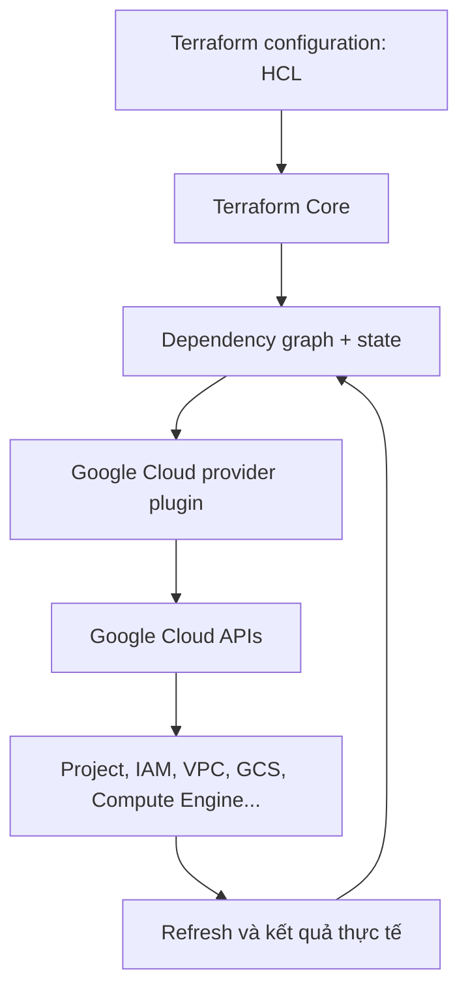

# Terraform và Google Cloud provider

Khi quản lý nhiều project, VPC, service account, bucket và workload trên Google Cloud, việc cấu hình thủ công qua Console hoặc lệnh CLI rất dễ tạo ra khác biệt giữa các môi trường. Infrastructure as Code (IaC) giải quyết vấn đề này bằng cách mô tả hạ tầng trong các tệp có thể kiểm soát phiên bản, xem xét thay đổi trước khi áp dụng và tái sử dụng cho development, staging và production.

Terraform là công cụ IaC khai báo. Người vận hành mô tả trạng thái mong muốn bằng HCL; Terraform so sánh cấu hình với state và tài nguyên thực tế, sau đó tạo kế hoạch thay đổi. Google Cloud provider (`hashicorp/google`) là plugin giúp Terraform giao tiếp với các API của Google Cloud để đọc, tạo, cập nhật và xóa tài nguyên.

## 1. Terraform hoạt động như thế nào?

Terraform Core đọc cấu hình, xây dựng dependency graph và điều phối quá trình thực thi. Provider plugin hiểu schema của một nền tảng cụ thể. Với Google Cloud, provider ánh xạ các block HCL như `google_storage_bucket` hoặc `google_compute_network` sang API tương ứng.



Các thành phần chính:

| Thành phần | Vai trò |
| --- | --- |
| Configuration | Các tệp `.tf` mô tả tài nguyên, biến, output, provider và backend. |
| Terraform Core | Đọc HCL, tính dependency, tạo plan và điều phối thao tác. |
| Provider | Plugin cung cấp tài nguyên và data source cho một nền tảng. |
| Resource | Đối tượng Terraform quản lý vòng đời, ví dụ bucket hoặc VPC. |
| Data source | Đọc thông tin của tài nguyên đã tồn tại mà cấu hình hiện tại không quản lý vòng đời. |
| State | Ánh xạ địa chỉ resource trong cấu hình với đối tượng thật và lưu metadata cần thiết để lập kế hoạch. |
| Backend | Nơi lưu state, có thể là máy cục bộ hoặc dịch vụ lưu trữ từ xa. |

Terraform sử dụng mô hình khai báo: bạn mô tả kết quả mong muốn, không cần viết tuần tự từng lệnh tạo tài nguyên. Ví dụ, khi một resource phụ thuộc vào API đã bật, Terraform sẽ dựa vào dependency graph để thực hiện thao tác theo đúng thứ tự.

## 2. Chuẩn bị môi trường Google Cloud

Trước khi khởi tạo Terraform, cần xác định project đích, billing, danh tính triển khai và các API cần dùng.

### 2.1. Công cụ và quyền truy cập

Cài Terraform CLI và Google Cloud CLI (`gcloud`) theo hướng dẫn chính thức. Xác nhận công cụ sẵn sàng:

```bash
terraform version
gcloud version
gcloud auth list
gcloud projects describe PROJECT_ID
```

Project phải tồn tại, có billing phù hợp và người triển khai có quyền thực hiện các thao tác cần thiết. Nếu Terraform bật API bằng `google_project_service`, danh tính triển khai cần quyền bật dịch vụ trong project, thường thông qua `serviceusage.services.enable`. Quyền tạo resource còn phụ thuộc loại tài nguyên, chẳng hạn quyền tạo bucket trong Cloud Storage.

Không nên dùng một danh tính có quyền Owner trên mọi project chỉ để chạy Terraform. Hãy tách danh tính triển khai theo môi trường và phạm vi tài nguyên; cấp các quyền cần thiết ở project hoặc resource tương ứng. Danh tính mà ứng dụng runtime sử dụng cũng nên tách khỏi danh tính chạy Terraform.

### 2.2. Xác thực bằng Application Default Credentials

Google Cloud provider có thể sử dụng Application Default Credentials (ADC). Trên máy phát triển, tạo ADC bằng:

```bash
gcloud auth application-default login
```

Đây là thông tin xác thực dành cho ứng dụng và SDK. Lệnh `gcloud auth login` đăng nhập cho CLI không tự động thay thế bước tạo ADC. Provider thường tự tìm ADC nên cấu hình không cần chứa access token hay mật khẩu.

Đối với tổ chức yêu cầu dùng service account chuyên dụng, có thể impersonate service account. Người vận hành đăng nhập ADC bằng tài khoản được phép impersonate:

```bash
gcloud auth application-default login \
  --impersonate-service-account=terraform-deployer@PROJECT_ID.iam.gserviceaccount.com
```

Hoặc cấu hình provider impersonation như ví dụ ở phần sau. Danh tính ban đầu cần được cấp quyền tạo token cho service account đích, thường là `roles/iam.serviceAccountTokenCreator` trên service account đó. Service account đích nhận các quyền quản lý hạ tầng cần thiết.

Trong CI/CD, ưu tiên Workload Identity Federation để workload của pipeline nhận danh tính Google Cloud thông qua nhà cung cấp danh tính tin cậy. Cách này tránh lưu khóa service account dài hạn trong repository hoặc secret của pipeline. Nếu môi trường bắt buộc dùng tệp credentials, bảo vệ tệp như một bí mật, giới hạn quyền đọc và không commit vào Git.

## 3. Khai báo Google Cloud provider

Một cấu hình Terraform tối thiểu thường có `terraform` block để khai báo phiên bản CLI và provider cần dùng, cùng `provider` block để thiết lập project và region mặc định.

### 3.1. Khóa phiên bản Terraform và provider

Tạo `versions.tf`:

```hcl
terraform {
  required_version = ">= 1.6.0, < 2.0.0"

  required_providers {
    google = {
      source  = "hashicorp/google"
      version = "~> 8.0"
    }
  }
}
```

`source` xác định địa chỉ provider trên Terraform Registry. `version` là ràng buộc phiên bản được phép sử dụng. Ví dụ `~> 8.0` chấp nhận các bản phát hành trong nhánh 8.x và không tự chuyển sang major 9. Đây là một ví dụ chọn nhánh provider hiện hành tại thời điểm viết; dự án thực tế cần kiểm tra phiên bản đang được hỗ trợ và chính sách nâng cấp của mình. Khi tổ chức nâng major version, cần đọc changelog, kiểm tra thay đổi hành vi và chạy plan ở môi trường thử nghiệm.

Sau lần `terraform init` đầu tiên, Terraform tạo `.terraform.lock.hcl` để ghi nhận phiên bản provider cụ thể cùng checksum. Hãy commit file lock này vào Git để các thành viên và pipeline dùng cùng bộ provider đã được chọn. Ràng buộc phiên bản trong `required_providers` và phiên bản đã khóa trong lock file có hai mục đích khác nhau: một bên giới hạn phạm vi, bên kia ghi nhận lựa chọn thực tế.

Không xóa lock file chỉ để xử lý lỗi khởi tạo. Chỉ cập nhật lựa chọn provider khi có chủ đích, thường qua `terraform init -upgrade`, sau đó xem xét thay đổi lock file trong pull request.

### 3.2. Cấu hình provider mặc định

Tạo `provider.tf`:

```hcl
provider "google" {
  project = var.project_id
  region  = var.region
}
```

Provider block cấu hình cách provider làm việc và các giá trị mặc định cho tài nguyên. `project` chỉ định project mặc định; `region` là region mặc định cho những resource hỗ trợ thuộc tính này. Một số resource cần `zone`, hoặc cho phép chỉ định project/region ngay trong resource để ghi đè mặc định.

Định nghĩa biến trong `variables.tf`:

```hcl
variable "project_id" {
  description = "Google Cloud project dùng để triển khai hạ tầng"
  type        = string
}

variable "region" {
  description = "Region mặc định cho tài nguyên theo vùng"
  type        = string
  default     = "asia-southeast1"
}
```

Truyền giá trị qua `terraform.tfvars` hoặc biến môi trường `TF_VAR_project_id`:

```hcl
project_id = "my-gcp-project"
region     = "asia-southeast1"
```

Không ghi project production cố định trong nhiều resource. Đặt project và region thành biến giúp cùng một module được tái sử dụng cho nhiều môi trường, đồng thời làm rõ đích triển khai khi review plan.

### 3.3. Xác thực bằng service account impersonation trong provider

Khi dùng ADC của người triển khai và muốn provider impersonate một service account, có thể cấu hình:

```hcl
provider "google" {
  project                     = var.project_id
  region                      = var.region
  impersonate_service_account = "terraform-deployer@${var.project_id}.iam.gserviceaccount.com"
}
```

Trong ví dụ, ADC là danh tính gốc; provider yêu cầu Google Cloud cấp token ngắn hạn cho service account triển khai. Không đặt access token tĩnh hoặc nội dung khóa JSON trực tiếp trong HCL. Cấu hình impersonation không tự cấp quyền cho service account; quyền IAM phải được chuẩn bị trước.

### 3.4. Quản lý nhiều project hoặc cấu hình provider

Nếu một cấu hình quản lý tài nguyên ở nhiều project, khai báo provider alias:

```hcl
provider "google" {
  project = var.application_project_id
  region  = var.region
}

provider "google" {
  alias   = "network"
  project = var.network_project_id
  region  = var.region
}

resource "google_compute_network" "shared" {
  provider                = google.network
  name                    = "shared-vpc"
  auto_create_subnetworks = false
}
```

Resource `google_compute_network.shared` sử dụng provider có alias `network`, nên được tạo trong project mạng. Những resource không chỉ định `provider` sẽ dùng cấu hình mặc định. Với module con, khai báo và truyền provider phù hợp qua `providers` argument của module block; không giả định module tự biết alias của module cha.

## 4. Resource, data source và dependency

Google Cloud provider cung cấp resource và data source theo tên có tiền tố `google_`.

- `resource` mô tả đối tượng mà Terraform sở hữu vòng đời. Terraform tạo, cập nhật hoặc xóa đối tượng đó để khớp cấu hình.
- `data` đọc một đối tượng hoặc thông tin hiện có. Data source không có nghĩa Terraform sẽ quản lý việc tạo hay xóa đối tượng đó.

Ví dụ đọc thông tin project đã tồn tại:

```hcl
data "google_project" "current" {
  project_id = var.project_id
}

output "project_number" {
  description = "Project number của project triển khai"
  value       = data.google_project.current.number
}
```

Tham chiếu output hoặc thuộc tính resource khác tạo dependency ngầm. Khi cần thể hiện một dependency không được biểu đạt bằng tham chiếu thuộc tính, có thể dùng `depends_on`. Hãy ưu tiên dependency ngầm vì nó cho Terraform biết quan hệ chính xác hơn.

Ví dụ `google_storage_bucket` cần Storage API được bật trước. Resource `google_project_service` quản lý trạng thái API; bucket phụ thuộc vào resource này. Một số API nền tảng, chẳng hạn Service Usage API, có thể cần được bật sẵn bởi quy trình bootstrap để Terraform quản lý các API khác.

## 5. Ví dụ thực hành: tạo Cloud Storage bucket

Ví dụ tạo một bucket trong project đã có. Bucket dùng uniform bucket-level access, public access prevention và object versioning. Tên bucket phải duy nhất toàn cục trên Cloud Storage; hãy thay các giá trị mẫu trước khi chạy.

### 5.1. Khai báo biến

Thêm vào `variables.tf`:

```hcl
variable "bucket_name" {
  description = "Tên Cloud Storage bucket duy nhất toàn cục"
  type        = string

  validation {
    condition     = length(var.bucket_name) >= 3 && length(var.bucket_name) <= 63
    error_message = "Tên bucket phải dài từ 3 đến 63 ký tự."
  }
}
```

`terraform.tfvars`:

```hcl
project_id = "my-gcp-project"
region     = "asia-southeast1"
bucket_name = "my-gcp-project-artifacts-unique"
```

Không dùng lại tên bucket mẫu nếu tên đó đã được một project khác đăng ký. Kiểm tra quy tắc đặt tên Cloud Storage để bảo đảm tên hợp lệ ngoài điều kiện độ dài trong ví dụ.

### 5.2. Khai báo tài nguyên

Tạo `main.tf`:

```hcl
resource "google_project_service" "storage" {
  project = var.project_id
  service = "storage.googleapis.com"

  # Không tự tắt API khi resource này bị loại khỏi state/config.
  disable_on_destroy = false
}

resource "google_storage_bucket" "artifacts" {
  name     = var.bucket_name
  project  = var.project_id
  location = upper(var.region)

  uniform_bucket_level_access = true
  public_access_prevention   = "enforced"
  force_destroy              = false

  versioning {
    enabled = true
  }

  depends_on = [google_project_service.storage]
}
```

Các thiết lập có ý nghĩa vận hành:

- `uniform_bucket_level_access = true` dùng IAM ở cấp bucket thay cho ACL theo từng object.
- `location = upper(var.region)` dùng mã region dạng chữ hoa theo cách Cloud Storage hiển thị (ví dụ `ASIA-SOUTHEAST1`); việc chọn vị trí bucket ảnh hưởng độ trễ, giá và yêu cầu lưu trú dữ liệu.
- `public_access_prevention = "enforced"` ngăn cấp quyền công khai qua cơ chế được hỗ trợ của Cloud Storage.
- `versioning.enabled = true` giữ các generation trước của object khi object bị thay thế hoặc xóa, hỗ trợ khôi phục dữ liệu trong phạm vi chính sách lưu trữ.
- `force_destroy = false` ngăn Terraform xóa bucket khi bucket còn object. Đây là lựa chọn an toàn hơn cho ví dụ có dữ liệu.
- `disable_on_destroy = false` tránh việc xóa resource quản lý API vô tình tắt API dùng chung của project.

Nếu bucket chứa dữ liệu quan trọng, có thể cân nhắc `lifecycle { prevent_destroy = true }` để Terraform từ chối kế hoạch xóa resource. Khi cần thay đổi hoặc loại bỏ bucket, phải xem xét riêng quy trình bảo vệ và di chuyển dữ liệu.

### 5.3. Xuất thông tin cần thiết

Tạo `outputs.tf`:

```hcl
output "bucket_name" {
  description = "Tên bucket được tạo"
  value       = google_storage_bucket.artifacts.name
}

output "bucket_url" {
  description = "URI của bucket"
  value       = google_storage_bucket.artifacts.url
}
```

Output giúp người dùng hoặc module khác lấy lại thuộc tính đã được provider trả về. Không xuất access token, mật khẩu hoặc dữ liệu nhạy cảm. Nếu output chứa thông tin nhạy cảm, cần đánh dấu `sensitive = true`; cờ này ẩn một phần hiển thị nhưng không thay thế việc bảo vệ state.

## 6. Quy trình làm việc với Terraform

Một chu trình cơ bản gồm khởi tạo, định dạng, kiểm tra, lập kế hoạch, review và áp dụng.

### 6.1. Khởi tạo working directory

```bash
terraform init
```

Lệnh này tải provider và module cần thiết, cấu hình backend, tạo thư mục `.terraform` và tạo hoặc cập nhật `.terraform.lock.hcl`. Chạy lại `terraform init` khi thay đổi provider, module hoặc backend. Nếu đổi backend và cần chuyển state hiện có, xem xét dùng `terraform init -migrate-state` sau khi đã sao lưu và xác minh đích lưu trữ.

### 6.2. Định dạng và xác thực cấu hình

```bash
terraform fmt -recursive
terraform validate
```

`fmt` chuẩn hóa định dạng HCL. `validate` kiểm tra cú pháp và tính nhất quán của cấu hình sau khi đã khởi tạo provider; nó không xác nhận quyền IAM, quota, billing hay khả năng tạo tài nguyên trong project thật.

### 6.3. Tạo và review plan

```bash
terraform plan -out=tfplan
terraform show tfplan
```

Plan mô tả những resource sẽ được tạo, cập nhật, thay thế hoặc xóa. Ký hiệu phổ biến trong plan:

| Ký hiệu | Ý nghĩa |
| --- | --- |
| `+` | Tạo resource. |
| `~` | Cập nhật tại chỗ. |
| `-/+` | Xóa rồi tạo lại resource. |
| `-` | Xóa resource. |
| `<=` | Đọc data source. |

Trước khi apply, kiểm tra project, region, IAM, network, dữ liệu, thay đổi có thể gây downtime và mọi thao tác xóa hoặc thay thế. Plan file có thể chứa dữ liệu nhạy cảm; lưu trữ có kiểm soát và không commit vào Git.

### 6.4. Áp dụng đúng plan đã review

```bash
terraform apply tfplan
terraform output
```

Khi truyền plan file đã lưu, Terraform áp dụng kế hoạch đó. Nếu cấu hình hoặc state thay đổi khiến plan không còn hợp lệ, cần tạo plan mới và review lại. Không bỏ qua bước review bằng cách chạy apply tự động cho thay đổi production mà chưa có cơ chế phê duyệt phù hợp.

Terraform có thể phát hiện drift khi refresh trạng thái thực tế và so sánh với state/configuration. Nếu ai đó thay đổi tài nguyên trực tiếp trên Console, plan tiếp theo có thể đề xuất đưa tài nguyên trở về cấu hình khai báo. Trước khi áp dụng, xác định thay đổi thủ công có chủ đích hay là drift cần sửa.

## 7. Quản lý state và làm việc nhóm

State là thành phần quan trọng của Terraform. Nó giữ ánh xạ giữa địa chỉ như `google_storage_bucket.artifacts` và đối tượng thật trên Google Cloud, đồng thời có thể chứa thuộc tính nhạy cảm được provider đọc về. Vì vậy, state cần được bảo vệ tương tự dữ liệu bí mật.

### 7.1. State cục bộ và state từ xa

Mặc định, Terraform có thể lưu state trong file `terraform.tfstate` ở thư mục làm việc. Cách này chỉ phù hợp với thử nghiệm cá nhân. Khi nhiều người hoặc CI/CD cùng quản lý một môi trường, dùng remote backend để có một state dùng chung và cơ chế khóa khi thao tác.

Google Cloud Storage backend là lựa chọn phổ biến cho state của hạ tầng Google Cloud. Ví dụ cấu hình:

```hcl
terraform {
  backend "gcs" {
    bucket = "company-terraform-state"
    prefix = "gcp/storage/production"
  }
}
```

Bucket state phải được tạo trước bằng quy trình bootstrap hoặc một state riêng. Backend được khởi tạo trước khi provider thực thi resource nên không thể dùng resource trong cùng cấu hình để tạo chính bucket đang lưu state cho lần init đầu tiên. Backend GCS xác thực độc lập với block `provider "google"`: đặt `impersonate_service_account` trong provider không tự động cấp danh tính đó cho backend. Danh tính truy cập backend cũng cần quyền đọc/ghi các object state trong bucket, hoặc phải được cấu hình impersonation riêng theo tài liệu backend.

Với bucket state, bật object versioning, uniform bucket-level access, public access prevention và IAM tối thiểu. Chỉ pipeline và người vận hành có trách nhiệm mới được đọc/ghi state. GCS backend hỗ trợ state locking để hạn chế hai tiến trình Terraform ghi đồng thời. Khi nhiều người làm việc, luôn giữ khóa và state trong cùng backend đã thống nhất; không sao chép state cục bộ qua lại giữa các máy.

### 7.2. Bảo vệ state và plan

- Không commit `terraform.tfstate`, các bản backup state, plan file hoặc `.tfvars` chứa bí mật.
- Thêm các file sinh tự động vào `.gitignore`, nhưng vẫn commit `.terraform.lock.hcl`.
- Giới hạn quyền truy cập bucket state; audit các thao tác đọc và ghi theo chính sách tổ chức.
- Dùng backend có mã hóa và cân nhắc CMEK nếu yêu cầu quản trị khóa đòi hỏi.
- Không coi `sensitive = true` là mã hóa dữ liệu: thuộc tính nhạy cảm vẫn có thể nằm trong state.
- Sao lưu và kiểm tra khả năng phục hồi state trước những thay đổi lớn.

Ví dụ `.gitignore`:

```gitignore
.terraform/
*.tfstate
*.tfstate.*
tfplan
*.tfplan
crash.log
terraform.tfvars
*.auto.tfvars
*.tfvars.json
```

Nếu repository cần commit một file `.tfvars` chứa giá trị không nhạy cảm và đã được duyệt, hãy điều chỉnh quy tắc ignore một cách có chủ đích. Không đưa khóa, mật khẩu hoặc token vào file đó.

### 7.3. Import tài nguyên đã tồn tại

Nếu một bucket hoặc VPC đã được tạo bên ngoài Terraform, không nên khai báo resource rồi để Terraform tạo một đối tượng trùng lặp. Hãy viết cấu hình mô tả tài nguyên hiện có, sau đó import nó vào state. Ví dụ:

```bash
terraform import google_storage_bucket.artifacts EXISTING_BUCKET_NAME
terraform plan
```

Sau import, đọc plan và điều chỉnh cấu hình để phản ánh trạng thái mong muốn. Import chỉ thiết lập ánh xạ trong state; nó không tự sinh đầy đủ cấu hình HCL và cũng không bảo đảm cấu hình hiện tại khớp mọi thuộc tính của tài nguyên.

## 8. Cấu trúc dự án và thực hành theo môi trường

Với một cấu hình nhỏ, có thể tổ chức tệp theo trách nhiệm:

```text
terraform-gcp-storage/
├── versions.tf       # Terraform và provider requirements
├── provider.tf       # Google provider và project/region
├── backend.tf        # Remote state backend
├── variables.tf      # Input variables
├── main.tf           # Resources và data sources
├── outputs.tf        # Outputs
├── terraform.tfvars  # Giá trị không nhạy cảm của môi trường
└── .terraform.lock.hcl
```

Terraform đọc tất cả tệp `.tf` trong cùng một thư mục như một cấu hình thống nhất; tên tệp chỉ giúp con người tổ chức nội dung. Khi hệ thống lớn hơn, tách module theo ranh giới trách nhiệm như network, IAM, storage và workload. Module nên có input/output rõ ràng, tránh tạo module chỉ để bọc một resource mà không mang lại tái sử dụng hay ranh giới quản lý hữu ích.

Có thể dùng cùng module cho nhiều môi trường bằng cách truyền project, region, tên tài nguyên và biến khác nhau. Mỗi môi trường cần state riêng và quyền IAM riêng để tránh thao tác nhầm. Không dùng chung state cho development và production chỉ vì cấu hình HCL giống nhau.

## 9. Sự cố thường gặp và cách xử lý

| Triệu chứng | Nguyên nhân có thể | Hướng xử lý |
| --- | --- | --- |
| `Error: Failed to obtain application default credentials` | Chưa tạo ADC hoặc pipeline chưa cấu hình danh tính. | Chạy `gcloud auth application-default login` ở máy phát triển hoặc cấu hình Workload Identity Federation/ADC trong CI. |
| `403 Permission denied` | Danh tính provider thiếu quyền IAM, chưa có quyền impersonate hoặc API chưa được bật. | Xác minh principal thực tế, quyền token creator, quyền resource và Service Usage API. |
| `Service Usage API has not been used` | Project chưa bật `serviceusage.googleapis.com` hoặc chưa hoàn tất bootstrap. | Bật API bằng quy trình quản trị project trước khi quản lý các API khác. |
| Provider version constraint không thỏa | Lock file hoặc ràng buộc phiên bản không cho phép phiên bản cần thiết. | Kiểm tra `required_providers`, sau đó chủ động chạy `terraform init -upgrade` và review lock file. |
| Bucket name already exists | Tên bucket Cloud Storage phải duy nhất toàn cục. | Chọn tên khác đáp ứng quy tắc đặt tên; kiểm tra biến đầu vào trước khi apply. |
| Resource đã tồn tại nhưng Terraform muốn tạo mới | Đối tượng chưa được import vào state hoặc đang dùng state/backend khác. | Xác minh workspace/backend rồi import đúng địa chỉ resource; không apply plan tạo trùng. |
| `Error acquiring the state lock` | Một tiến trình khác đang giữ khóa hoặc lần chạy trước kết thúc bất thường. | Xác minh tiến trình và state backend; chỉ force-unlock khi chắc chắn khóa đã bị bỏ lại và không còn tiến trình đang chạy. |
| Plan đề xuất xóa hoặc thay thế resource | Thay đổi thuộc tính bất biến, cấu hình sai hoặc drift. | Đọc chi tiết plan, xác định tác động dữ liệu và điều chỉnh cấu hình trước khi apply. |

Không dùng `terraform state rm` hoặc `terraform force-unlock` như cách sửa lỗi mặc định. Các lệnh này thay đổi cách Terraform theo dõi resource hoặc trạng thái khóa; chỉ dùng sau khi xác minh nguyên nhân và có phương án khôi phục.

## 10. Bài tập thực hành

Một nhóm phát triển cần tạo một bucket lưu artifact trong project Google Cloud. Nhóm muốn dùng cùng cấu hình cho development và production, có review trước khi thay đổi, và không lưu khóa service account trong Git.

Hãy thực hiện các yêu cầu sau:

1. Cài Terraform CLI và Google Cloud CLI; tạo ADC cho tài khoản triển khai thử nghiệm.
2. Khai báo `required_providers` cho `hashicorp/google`, đặt ràng buộc phiên bản và tạo `.terraform.lock.hcl`.
3. Cấu hình provider nhận `project_id` và `region` qua biến; xác minh project thực tế trước khi plan.
4. Dùng `google_project_service` để bật Cloud Storage API và `google_storage_bucket` để tạo bucket với uniform bucket-level access, public access prevention và versioning.
5. Chạy `terraform fmt`, `init`, `validate`, tạo plan và review mọi thao tác trước khi apply.
6. Thiết lập GCS backend riêng cho state sau khi bucket state đã được bootstrap; bật versioning và giới hạn IAM.
7. Tạo một môi trường thứ hai với project và state riêng; so sánh plan để xác nhận biến môi trường không làm thay đổi cấu hình ngoài dự kiến.
8. Thử import một tài nguyên đã tồn tại trong môi trường lab và giải thích sự khác nhau giữa resource trong cấu hình và đối tượng được theo dõi trong state.

Khi hoàn thành, hãy giải thích provider khác backend như thế nào, vì sao ADC khác với đăng nhập `gcloud` thông thường, lock file có tác dụng gì, và tại sao state/plan phải được bảo vệ như dữ liệu nhạy cảm.

## Tài liệu tham khảo

- [Terraform: Google Cloud Platform provider](https://registry.terraform.io/providers/hashicorp/google/latest/docs)
- [Terraform: Cloud Storage bucket resource](https://registry.terraform.io/providers/hashicorp/google/latest/docs/resources/storage_bucket)
- [Terraform: Google Cloud provider authentication](https://registry.terraform.io/providers/hashicorp/google/latest/docs/guides/provider_reference#authentication)
- [Terraform: Provider requirements](https://developer.hashicorp.com/terraform/language/providers/requirements)
- [Terraform: State](https://developer.hashicorp.com/terraform/language/state)
- [Terraform: Google Cloud Storage backend](https://developer.hashicorp.com/terraform/language/backend/gcs)
- [Google Cloud: Application Default Credentials](https://cloud.google.com/docs/authentication/application-default-credentials)
- [Google Cloud: Terraform authentication](https://cloud.google.com/docs/terraform/authentication)
- [Google Cloud: Cloud Storage locations](https://cloud.google.com/storage/docs/locations)
- [Google Cloud: Service account impersonation](https://cloud.google.com/iam/docs/service-account-impersonation)
- [Google Cloud: Workload Identity Federation](https://cloud.google.com/iam/docs/workload-identity-federation)
