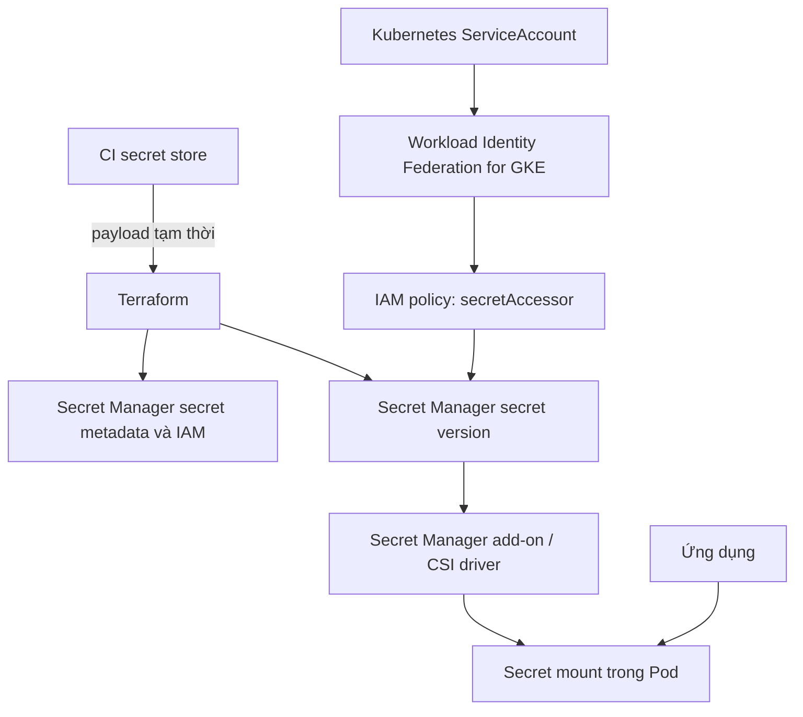

# Quản lý GKE và dữ liệu nhạy cảm trong state

Terraform giúp nhóm nền tảng mô tả GKE bằng mã, tạo cluster và node pool nhất quán, quản lý IAM, mạng, Workload Identity và các tích hợp của Google Cloud. Nhưng mỗi lần `terraform plan` hoặc `terraform apply`, Terraform còn duy trì một bản ghi trạng thái để biết tài nguyên nào đang tồn tại và thuộc quyền quản lý của cấu hình nào. Bản ghi này gọi là **state**.

State không chỉ chứa tên cluster. Nó có thể chứa thuộc tính tài nguyên, giá trị được provider đọc từ API, output, metadata và dữ liệu nhạy cảm đã dùng trong quá trình tạo hạ tầng. Vì vậy, thiết kế Terraform cho GKE phải giải quyết đồng thời hai việc: quản lý vòng đời cluster có thể dự đoán được và bảo vệ state như một kho dữ liệu quan trọng.

Trong module `CLOUD_PROVIDERS_GCP`, bài học này nối Terraform với Google Kubernetes Engine, IAM, Secret Manager và quy trình triển khai. Bạn sẽ tạo cluster và node pool riêng biệt, cấp danh tính cho node và workload, lưu state trong Google Cloud Storage có locking/versioning, và tránh đưa mật khẩu hoặc token vào state khi provider hỗ trợ cơ chế write-only.

## 1. Terraform quản lý GKE bằng những resource nào?

Google provider cung cấp các resource chính sau:

| Resource | Trách nhiệm | Khi sử dụng |
|---|---|---|
| `google_container_cluster` | Tạo và quản lý control plane, mạng, release channel, Workload Identity, bảo mật và add-on của GKE | Khai báo cluster Standard hoặc Autopilot |
| `google_container_node_pool` | Quản lý nhóm node độc lập, machine type, autoscaling, auto-repair, auto-upgrade và cấu hình node | Tách vòng đời node pool khỏi vòng đời cluster |
| `google_service_account` | Tạo IAM service account cho node hoặc dịch vụ chạy trong Google Cloud | Cấp danh tính có quyền tối thiểu |
| `google_project_iam_member` | Gán một IAM role cho một principal ở cấp project | Cấp quyền nền tảng cho node service account hoặc Terraform runner |
| `google_secret_manager_secret` | Quản lý metadata và cấu hình của Secret Manager secret | Tạo secret container, replication và policy |
| `google_secret_manager_secret_version` | Tạo phiên bản secret | Dùng write-only argument nếu cần Terraform gửi payload mà không lưu payload vào state |

Tài liệu Google Cloud khuyến nghị quản lý node pool bằng `google_container_node_pool` riêng. Nếu khai báo node pool lồng trong `google_container_cluster`, việc loại bỏ node pool có thể buộc phải tạo lại cluster. Tách resource giúp thêm, xóa hoặc nâng cấp node pool độc lập hơn.

### Cấu hình provider và GKE cluster

Ví dụ dưới đây minh họa một regional Standard cluster với private nodes, Workload Identity Federation for GKE, Secret Manager add-on và node pool được quản lý riêng. Hãy thay các giá trị mạng bằng VPC và subnet thực tế.

```hcl
terraform {
  required_version = ">= 1.11.0"

  required_providers {
    google = {
      source  = "hashicorp/google"
      version = "~> 7.24"
    }
  }

  backend "gcs" {
    bucket = "org-terraform-state"
    prefix = "gke/prod"
  }
}

provider "google" {
  project = var.project_id
  region  = var.region
}

variable "project_id" {
  type = string
}

variable "region" {
  type    = string
  default = "asia-southeast1"
}

variable "network" {
  type = string
}

variable "subnetwork" {
  type = string
}

resource "google_service_account" "gke_nodes" {
  project      = var.project_id
  account_id   = "gke-prod-nodes"
  display_name = "GKE production node service account"
}

resource "google_project_iam_member" "gke_node_role" {
  project = var.project_id
  role    = "roles/container.defaultNodeServiceAccount"
  member  = "serviceAccount:${google_service_account.gke_nodes.email}"
}

resource "google_container_cluster" "primary" {
  name     = "orders-prod"
  location = var.region
  project  = var.project_id

  network    = var.network
  subnetwork = var.subnetwork

  deletion_protection = true
  release_channel {
    channel = "REGULAR"
  }

  workload_identity_config {
    workload_pool = "${var.project_id}.svc.id.goog"
  }

  ip_allocation_policy {}

  private_cluster_config {
    enable_private_nodes    = true
    enable_private_endpoint = true
    master_ipv4_cidr_block  = "172.16.0.0/28"
  }

  secret_manager_config {
    enabled = true
    rotation_config {
      enabled          = true
      rotation_interval = "120s"
    }
  }

  # GKE 1.36.4-gke.1469000+ can create a cluster without a default node pool.
  # For older supported versions, add:
  # remove_default_node_pool = true
  # initial_node_count       = 1
}

resource "google_container_node_pool" "general" {
  name     = "general"
  project  = var.project_id
  location = google_container_cluster.primary.location
  cluster  = google_container_cluster.primary.name

  autoscaling {
    total_min_node_count = 1
    total_max_node_count = 6
  }

  management {
    auto_repair  = true
    auto_upgrade = true
  }

  node_config {
    machine_type    = "e2-standard-4"
    service_account = google_service_account.gke_nodes.email
    oauth_scopes    = ["https://www.googleapis.com/auth/cloud-platform"]

    workload_metadata_config {
      mode = "GKE_METADATA"
    }
  }

  upgrade_settings {
    max_surge       = 1
    max_unavailable = 0
  }

  depends_on = [google_project_iam_member.gke_node_role]
}
```

Đây là cấu hình minh họa cho regional Standard cluster. Với GKE version từ `1.36.4-gke.1469000`, cluster có thể được tạo mà không cần default node pool; với phiên bản cũ hơn, cần `remove_default_node_pool = true` và `initial_node_count` ít nhất bằng 1 khi quản lý node pool riêng. `initial_node_count` trong trường hợp tương thích cũ là số node tạm thời của default pool, không phải cấu hình autoscaling của node pool chính.

`deletion_protection = true` giúp Terraform từ chối xóa cluster. Khi có kế hoạch hủy cluster, phải đổi giá trị thành `false`, chạy `terraform apply` để cập nhật state rồi mới thực hiện thao tác xóa. Hãy quản lý việc này qua review và change approval, không bỏ bảo vệ chỉ để làm cho một lần `destroy` chạy qua.

`private_endpoint = true` nghĩa là control plane chỉ có private endpoint. Terraform runner và người vận hành phải có đường mạng đến endpoint này khi cần truy cập Kubernetes API. Nếu runner nằm ngoài VPC, cần VPN, Interconnect hoặc một môi trường chạy trong mạng được phép; không bật private endpoint mà chưa chuẩn bị đường truy cập quản trị.

### Tách danh tính node và danh tính workload

Node service account ở ví dụ chỉ nhận `roles/container.defaultNodeServiceAccount`, role tối thiểu cần thiết cho tác vụ hệ thống của GKE như logging và monitoring. Không dùng node service account để cấp quyền đọc database, bucket hay secret cho mọi pod.

Workload trong pod nên có Kubernetes ServiceAccount riêng và dùng **Workload Identity Federation for GKE** để nhận quyền IAM trực tiếp. Cách này tạo danh tính riêng theo namespace và service account, không cần lưu service account key JSON trong image, Kubernetes Secret hoặc Terraform variable.

Workload Identity Federation for GKE được bật mặc định trong Autopilot. Với Standard cluster, cần bật ở cluster và node pool; `workload_identity_config` trong Terraform khai báo workload pool ở cấp cluster, còn `workload_metadata_config { mode = "GKE_METADATA" }` giúp node pool dùng GKE metadata server.

## 2. State chứa gì và vì sao phải bảo vệ?

Terraform state là bản ghi JSON về tài nguyên Terraform quản lý. State thường có:

- Địa chỉ resource, ID và thông tin liên kết giữa tài nguyên.
- Thuộc tính cấu hình và các giá trị provider trả về sau khi đọc tài nguyên từ Google Cloud API.
- Output của root module và metadata cần cho lần plan tiếp theo.
- Giá trị biến hoặc thuộc tính nhạy cảm mà Terraform cần lưu để theo dõi thay đổi.
- Thông tin kết nối hoặc chứng chỉ được provider trả về nếu resource có các thuộc tính đó.

Đối với `google_container_cluster`, tài liệu Google provider cảnh báo tất cả argument và attribute, bao gồm certificate output, được lưu trong raw state dưới dạng plaintext. Điều đó có nghĩa một cluster có thể không chứa password ứng dụng nhưng state của nó vẫn là dữ liệu cần bảo vệ. Không xuất endpoint, CA certificate hoặc metadata truy cập cluster ra output công khai, CI log hay artifact không kiểm soát.

Các nguồn dữ liệu nhạy cảm thường vô tình đi vào state:

| Nguồn | Ví dụ | Rủi ro |
|---|---|---|
| Input variable | Password, API token, private key | Có thể được ghi vào state và plan |
| Resource argument | `secret_data` của Secret Manager version | Provider có thể lưu payload trong raw state |
| Data source | Đọc nội dung secret version | Giá trị đọc được có thể được lưu trong state |
| Output | Kết nối database hoặc token | Output được lưu trong state dù CLI che giá trị |
| Kubernetes resource | `kubernetes_secret` hoặc manifest chứa credential | State có thể chứa nội dung Secret đã mã hóa Base64 |
| GKE resource | Cluster attributes và certificate output | State chứa thông tin cấu hình và kết nối cluster |

Base64 không phải mã hóa. Việc một giá trị được lưu trong trường Kubernetes Secret hoặc được che trong `terraform plan` không làm cho bản sao trong state tự động an toàn.

State nên được phân loại và bảo vệ gần như credential production. Người có quyền đọc state có thể đọc các giá trị nhạy cảm đã được Terraform lưu, kể cả khi giao diện Terraform hiển thị `<sensitive>`.

## 3. `sensitive`, `ephemeral` và write-only khác nhau thế nào?

Đây là ba cơ chế khác nhau. Chọn sai cơ chế có thể khiến secret vẫn nằm trong state dù plan không hiển thị.

| Cơ chế | Tác dụng | Có lưu giá trị vào state/plan? | Phiên bản Terraform tối thiểu |
|---|---|---|---|
| `sensitive = true` | Che giá trị trong CLI và giao diện hỗ trợ | Có | 0.15 |
| `ephemeral = true` | Chỉ giữ giá trị trong thời gian thực thi ở những ngữ cảnh được cho phép | Không | 1.10 |
| Write-only argument | Gửi giá trị cho provider trong operation nhưng không ghi vào state/plan | Không | 1.11 và provider/resource có hỗ trợ |

### `sensitive` chỉ che hiển thị

Ví dụ khai báo biến password:

```hcl
variable "database_password" {
  description = "Mật khẩu kết nối database"
  type        = string
  sensitive   = true
}
```

Terraform sẽ che giá trị trong output của `plan` và `apply`. Tuy nhiên, Terraform vẫn lưu giá trị này trong state và plan file để theo dõi tài nguyên. Các lệnh như `terraform output -raw`, `terraform output -json` hoặc thao tác đọc state có thể hiển thị giá trị thực. Vì vậy, `sensitive = true` không phải cơ chế xóa secret khỏi state.

### `ephemeral` loại giá trị khỏi state và plan

Từ Terraform 1.10, biến có thể được khai báo là ephemeral:

```hcl
variable "runtime_token" {
  description = "Token tạm thời do CI cấp trong lúc chạy Terraform"
  type        = string
  sensitive   = true
  ephemeral   = true
}
```

Giá trị ephemeral chỉ được dùng trong những ngữ cảnh Terraform cho phép, chẳng hạn provider configuration, local, một biến ephemeral khác, ephemeral resource, child module output ephemeral hoặc write-only argument. Không thể đưa giá trị này vào một thuộc tính resource thông thường rồi kỳ vọng Terraform tự bỏ nó khỏi state.

Root module không thể khai báo output ephemeral. Child module có thể khai báo output ephemeral để chuyển giá trị tạm thời lên module cha mà không ghi vào state.

### Write-only argument

Từ Terraform 1.11, resource provider có thể định nghĩa write-only argument. Provider nhận giá trị để thực hiện thao tác API nhưng Terraform không lưu giá trị đó vào plan hoặc state. Cơ chế này chỉ dùng được khi provider và resource cụ thể đã hỗ trợ.

Google provider 7.24.0 cung cấp `secret_data_wo` cho `google_secret_manager_secret_version`. Trường `secret_data` truyền thống vẫn được đánh dấu sensitive để che trong plan, nhưng raw state vẫn chứa dữ liệu. Khi dùng write-only argument, phải tăng `secret_data_wo_version` khi muốn cập nhật payload vì Terraform không lưu giá trị cũ để tự so sánh.

## 4. Tạo Secret Manager secret mà không đưa payload vào state

Một mẫu tốt là để Terraform quản lý metadata, IAM và vòng đời secret; pipeline bảo mật cung cấp payload qua ephemeral variable; Google provider ghi payload bằng write-only argument.

```hcl
variable "secret_payload" {
  description = "Payload được CI cấp tạm thời khi tạo hoặc xoay vòng secret"
  type        = string
  sensitive   = true
  ephemeral   = true
}

variable "secret_rotation_version" {
  description = "Tăng số này mỗi lần phát hành một payload mới"
  type        = number
  default     = 1
}

resource "google_secret_manager_secret" "orders_db_password" {
  project   = var.project_id
  secret_id = "orders-db-password"

  replication {
    auto {}
  }
}

resource "google_secret_manager_secret_version" "orders_db_password" {
  secret = google_secret_manager_secret.orders_db_password.id

  secret_data_wo         = var.secret_payload
  secret_data_wo_version = var.secret_rotation_version
}
```

Trong CI, cấp `TF_VAR_secret_payload` từ secret store của hệ thống CI hoặc một kênh truyền tạm đã được bảo vệ. Không ghi payload vào `.tfvars`, file HCL, command line argument, shell history hoặc log. Mỗi lần xoay vòng, cập nhật secret payload và tăng `secret_rotation_version`; nếu không tăng version, Terraform không có giá trị cũ để nhận biết rằng write-only input đã đổi.

Ví dụ trên yêu cầu Terraform 1.11 trở lên và Google provider có hỗ trợ `secret_data_wo`. Với provider cũ, `secret_data` sẽ được lưu trong raw state. Hãy kiểm tra phiên bản provider đã được khóa trong `.terraform.lock.hcl` trước khi dùng cấu hình này.

Nếu Terraform chỉ cần tạo secret container và IAM, không cần tạo secret version bằng Terraform. Có thể để hệ thống phát hành ứng dụng hoặc secret rotation job ghi phiên bản mới trực tiếp vào Secret Manager. Cách này giảm số lần secret payload đi qua Terraform.

### Tránh đọc secret vào Terraform khi chỉ cần metadata

Data source `google_secret_manager_secret_version` mặc định lấy `secret_data`. Nếu chỉ cần metadata hoặc tên resource, hãy đặt `fetch_secret_data = false` hoặc dùng resource/data source chỉ đọc metadata. Khi Terraform đọc nội dung secret, giá trị đó có thể đi vào state.

Không dùng `terraform_remote_state` như một secret manager. Người đọc remote state có quyền truy cập snapshot state, không chỉ một output riêng lẻ. Chỉ xuất những giá trị không nhạy cảm giữa các module hoặc pipeline.

## 5. Để pod lấy secret trực tiếp từ Secret Manager

Sau khi secret đã nằm trong Secret Manager, workload trong GKE nên lấy secret lúc chạy thông qua Workload Identity Federation for GKE. Không cần đặt password vào Terraform output, Kubernetes manifest hoặc Terraform-managed Kubernetes Secret.

Luồng truy cập:



GKE Secret Manager add-on dùng Secrets Store CSI Driver để mount secret thành file trong pod. Standard cluster cần bật Workload Identity Federation for GKE; Autopilot đã bật sẵn. Secret Manager add-on hỗ trợ GKE Standard và Autopilot trên Linux node image. Automatic rotation cần GKE version `1.32.2-gke.1059000` trở lên; bản add-on cơ bản yêu cầu GKE `1.27.14-gke.1042001` trở lên.

### Cấp quyền cho Kubernetes ServiceAccount

Tạo một Kubernetes ServiceAccount riêng cho ứng dụng, ví dụ namespace `orders`, service account `orders-api`. Sau đó cấp `roles/secretmanager.secretAccessor` trên đúng secret cho principal tương ứng:

```text
principal://iam.googleapis.com/projects/PROJECT_NUMBER/locations/global/workloadIdentityPools/PROJECT_ID.svc.id.goog/subject/ns/orders/sa/orders-api
```

Nên cấp quyền trên từng secret thay vì toàn project khi ứng dụng chỉ cần một số ít secret. Không dùng node service account chung để đọc mọi secret của cluster.

### Khai báo SecretProviderClass

Manifest dưới đây chỉ chứa resource name và tên file mount; không chứa payload:

```yaml
apiVersion: secrets-store.csi.x-k8s.io/v1
kind: SecretProviderClass
metadata:
  name: orders-db
  namespace: orders
spec:
  provider: gke
  parameters:
    secrets: |
      - resourceName: "projects/PROJECT_ID/secrets/orders-db-password/versions/latest"
        path: "db-password"
```

Pod sử dụng Kubernetes ServiceAccount `orders-api` và mount volume CSI:

```yaml
apiVersion: apps/v1
kind: Deployment
metadata:
  name: orders-api
  namespace: orders
spec:
  replicas: 2
  selector:
    matchLabels:
      app: orders-api
  template:
    metadata:
      labels:
        app: orders-api
    spec:
      serviceAccountName: orders-api
      containers:
        - name: app
          image: REGION-docker.pkg.dev/PROJECT_ID/apps/orders-api:VERSION
          volumeMounts:
            - name: db-secret
              mountPath: /var/secrets
              readOnly: true
      volumes:
        - name: db-secret
          csi:
            driver: secrets-store-gke.csi.k8s.io
            readOnly: true
            volumeAttributes:
              secretProviderClass: orders-db
```

Ứng dụng đọc `/var/secrets/db-password` khi khởi tạo kết nối. Không ghi nội dung file ra log. Nếu bật automatic rotation, add-on cập nhật file mount theo chu kỳ cấu hình; ứng dụng cần có khả năng nạp lại credential hoặc khởi tạo lại connection pool khi secret thay đổi.

GKE Secret Manager add-on không đồng bộ secret sang Kubernetes Secret theo cơ chế CSI thông thường. Điều này giúp tránh tạo thêm một bản sao secret trong Kubernetes API. Nếu chủ động dùng tính năng SecretSync để tạo Kubernetes Secret, cần hiểu rằng secret sẽ tồn tại thêm trong Kubernetes API và phải bảo vệ quyền truy cập, encryption at rest và backup tương ứng.

## 6. Lưu Terraform state trong Google Cloud Storage

Mặc định, Terraform lưu state ở file `terraform.tfstate` tại máy chạy lệnh. File này thường là JSON plaintext. Khi nhiều kỹ sư hoặc pipeline cùng quản lý GKE, local state dễ bị mất, lệch phiên bản hoặc lộ qua Git, artifact và bản sao lưu.

GCS backend lưu state dưới dạng object trong bucket đã tồn tại. Backend hỗ trợ state locking để ngăn nhiều tiến trình ghi state cùng lúc. HashiCorp khuyến nghị bật Object Versioning trên bucket để có thể khôi phục state khi xóa nhầm hoặc ghi đè sai.

Ví dụ cấu hình backend:

```hcl
terraform {
  backend "gcs" {
    bucket = "org-terraform-state"
    prefix = "gke/prod"
  }
}
```

Bucket phải được tạo trước khi chạy `terraform init`. Backend được khởi tạo trước khi Terraform xây dựng resource graph, vì vậy không thể tham chiếu `google_storage_bucket` hoặc biến Terraform trực tiếp trong block backend. Hãy tạo bucket state bằng một bootstrap stack riêng hoặc quy trình nền tảng do tổ chức quản lý.

### Cấu hình bucket state

Ví dụ tạo bucket riêng cho state:

```hcl
resource "google_storage_bucket" "terraform_state" {
  name                        = var.state_bucket_name
  location                    = var.state_bucket_location
  uniform_bucket_level_access = true
  public_access_prevention    = "enforced"
  force_destroy               = false

  versioning {
    enabled = true
  }
}
```

Nếu tổ chức yêu cầu CMEK, cấu hình default encryption key cho bucket hoặc dùng `kms_encryption_key` trong GCS backend. Key Cloud KMS phải có location phù hợp với bucket và service account chạy Terraform phải có quyền sử dụng key. Không xóa key đang bảo vệ state; mất key có thể khiến state không thể giải mã.

Ví dụ backend dùng CMEK:

```hcl
terraform {
  backend "gcs" {
    bucket           = "org-terraform-state"
    prefix           = "gke/prod"
    kms_encryption_key = "projects/SECURITY_PROJECT/locations/asia-southeast1/keyRings/tf-state/cryptoKeys/state-key"
  }
}
```

Object Versioning giúp khôi phục phiên bản cũ, nhưng cũng giữ lại các generation trước đó. Nếu state từng chứa secret, việc xóa hoặc xoay vòng secret ở bản hiện tại không tự xóa secret trong generation cũ. Hãy quản lý lifecycle, retention và quyền đọc các object version; không bật versioning rồi bỏ quên kho lưu trữ lịch sử.

### IAM cho state bucket

Chỉ Terraform runner và nhóm vận hành được chỉ định mới nên đọc/ghi state. Có thể cấp `roles/storage.objectAdmin` ở phạm vi bucket chuyên dụng cho service account chạy Terraform vì backend cần đọc, tạo, cập nhật và xóa object state/lock. Không cấp role này ở cấp project nếu runner chỉ cần một bucket.

```hcl
resource "google_storage_bucket_iam_member" "terraform_runner" {
  bucket = google_storage_bucket.terraform_state.name
  role   = "roles/storage.objectAdmin"
  member = "serviceAccount:${var.terraform_runner_service_account}"
}
```

Nếu dùng CMEK, cấp thêm `roles/cloudkms.cryptoKeyEncrypterDecrypter` trên đúng key cho danh tính backend. Quyền tạo bucket, thay đổi IAM hoặc xóa key nên thuộc nhóm quản trị nền tảng riêng, không nhất thiết cấp cho mọi pipeline triển khai ứng dụng.

### Tách state theo môi trường và phạm vi quyền

Không dùng chung một state cho mọi cluster hoặc mọi môi trường. Tách state theo ownership và blast radius, ví dụ:

| State prefix | Phạm vi | Nhóm truy cập |
|---|---|---|
| `gke/dev` | Cluster phát triển | Nhóm development |
| `gke/staging` | Cluster staging | Nhóm release và QA |
| `gke/prod` | Cluster production | Nhóm platform/SRE có quyền production |
| `security/iam` | IAM và policy nền tảng | Nhóm security/platform |

Workspaces của Terraform giúp quản lý nhiều state cùng một cấu hình, nhưng không tự tạo ranh giới bảo mật. Nếu dev không được đọc state production, hãy dùng bucket hoặc project và IAM riêng, hoặc ít nhất một danh tính backend có phạm vi được giới hạn rõ ràng.

## 7. Xác thực backend và provider mà không lưu key dài hạn

Terraform có hai đường truy cập Google Cloud: GCS backend để đọc/ghi state và Google provider để tạo tài nguyên. Cả hai cần xác thực, nhưng cấu hình backend được khởi tạo trước provider. Hãy bảo đảm cả hai dùng danh tính được quản lý và có quyền riêng theo nhiệm vụ.

Trên workstation, có thể dùng Application Default Credentials. Trong CI chạy trên Google Cloud, ưu tiên service account gắn với runner. Với CI bên ngoài Google Cloud, dùng Workload Identity Federation để trao đổi danh tính CI lấy token ngắn hạn. Có thể cấu hình impersonation cho service account chuyên dùng cho Terraform; danh tính nguồn cần `roles/iam.serviceAccountTokenCreator` trên service account được impersonate.

Không lưu file service account key JSON trong repository, Docker image, Terraform variable, tfvars hoặc GCS backend block. Tránh truyền credential trực tiếp bằng command-line argument vì có thể xuất hiện trong process list hoặc log. Dùng ADC, federation hoặc token ngắn hạn từ CI.

## 8. Bảo vệ plan, output và quy trình CI/CD

Remote backend không làm cho mọi artifact của Terraform tự động an toàn. Plan file, log và file debug có thể chứa dữ liệu nhạy cảm.

| Artifact | Rủi ro | Quy tắc xử lý |
|---|---|---|
| `terraform.tfstate` | Có thể chứa secret và thuộc tính provider | Không commit; chỉ truy cập qua backend được kiểm soát |
| `terraform.tfstate.backup` | Có thể giữ secret cũ | Bảo vệ như state hiện tại; xóa an toàn theo chính sách |
| Binary plan (`tfplan`) | Chứa dữ liệu kế hoạch và giá trị nhạy cảm | Lưu trong artifact store private, giới hạn người tải và thời hạn |
| `terraform show -json` | Có thể giải mã giá trị sensitive thành plaintext | Chỉ dùng trong pipeline tin cậy, không công khai log |
| `terraform output -raw` / `-json` | Có thể in giá trị output sensitive | Không chạy trên log công khai hoặc CI job không cần secret |
| `TF_LOG=TRACE` và shell tracing | Có thể ghi request, biến hoặc dữ liệu debug | Chỉ bật có kiểm soát; tắt `set -x` khi xử lý secret |
| `.terraform/` và crash log | Có metadata backend/provider và dữ liệu chẩn đoán | Không commit; hạn chế artifact và dọn theo chính sách |

Một pipeline production nên có các bước:

1. Lấy danh tính CI ngắn hạn và xác minh project/environment đích.
2. `terraform init` với GCS backend đã được cấu hình.
3. `terraform fmt -check` và `terraform validate`.
4. Chạy `terraform plan -out=tfplan` trong runner tin cậy.
5. Lưu plan artifact ở kho riêng tư, gắn với commit và môi trường cụ thể.
6. Review thay đổi IAM, GKE, node pool, network, secret và state trước khi apply.
7. Chỉ pipeline được phê duyệt mới chạy `terraform apply tfplan`.
8. Kiểm tra rollout GKE, Workload Identity, secret mount và health của workload.
9. Xóa artifact nhạy cảm theo retention đã định, giữ audit trail cần thiết.

Không đưa output secret vào log để tiện debug. Nếu cần truyền một giá trị giữa các job, hãy dùng secret store của CI hoặc Secret Manager với quyền đọc tối thiểu, không dùng output Terraform như một kênh phân phối credential.

## 9. Khởi tạo backend và di chuyển state an toàn

Khi chuyển từ local state sang GCS backend, hãy làm theo thứ tự:

1. Tạo bucket và cấu hình versioning, public access prevention, IAM và CMEK nếu cần.
2. Kiểm tra danh tính Terraform runner có quyền đọc/ghi object và sử dụng KMS key.
3. Thêm cấu hình backend `gcs` với bucket và prefix đúng môi trường.
4. Chạy `terraform init -migrate-state` để Terraform di chuyển state hiện tại sang backend mới.
5. Xác minh `terraform plan` không đề xuất tạo lại hoặc xóa hàng loạt tài nguyên ngoài dự kiến.
6. Bảo vệ và dọn bản local state theo quy trình lưu trữ dữ liệu nhạy cảm của tổ chức.

Không xóa file local trước khi xác minh state remote đã tồn tại và plan tiếp theo không có thay đổi bất thường. Không copy state bằng thao tác thủ công khi backend có thể thực hiện migration. Không sửa trực tiếp JSON state; dùng các lệnh `terraform state` hoặc quy trình import/move có kiểm soát.

GCS backend hỗ trợ state locking. Terraform tự khóa state khi thực hiện operation có thể ghi. Nếu không lấy được lock, operation sẽ dừng. Không dùng `-lock=false` để vượt qua lock. Chỉ dùng `terraform force-unlock` khi đã xác minh lock thuộc operation của chính mình và operation đó không còn chạy.

## 10. Xử lý khi state đã lộ secret

Nếu secret đã đi vào state, chỉ đổi `sensitive = true` hoặc chuyển sang `secret_data_wo` không xóa các bản sao cũ. Hãy coi secret là đã lộ và thực hiện quy trình ứng phó:

1. Xác định secret nào xuất hiện, resource/data source nào tạo ra nó và các state/plan artifact có liên quan.
2. Xoay vòng hoặc thu hồi secret ở hệ thống nguồn; cập nhật workload sang secret version mới.
3. Kiểm tra IAM và audit log để xác định ai đã đọc state bucket, plan artifact hoặc CI log.
4. Giới hạn quyền truy cập state và artifact; vô hiệu hóa đường truy cập không còn cần thiết.
5. Loại bỏ secret khỏi cấu hình/output hiện tại và dùng ephemeral/write-only hoặc runtime secret access.
6. Dùng quy trình state surgery hoặc thay thế state có review khi cần; không tự sửa JSON state bằng text editor.
7. Kiểm tra object generations, backup, artifact retention, cache và local state. Xóa hoặc hết hạn bản sao theo chính sách tổ chức.
8. Lập biên bản sự cố và xác nhận secret cũ không còn được workload sử dụng.

Xóa một object generation hiện tại không có nghĩa mọi bản sao đã biến mất. GCS Object Versioning, soft delete, backup CI và bản local có thể giữ state cũ. Secret cũ nên được vô hiệu hóa trước khi dọn bản sao để giảm rủi ro nếu vẫn còn bản lưu.

## 11. Những sai lầm thường gặp

| Sai lầm | Vì sao nguy hiểm | Cách làm phù hợp |
|---|---|---|
| Nghĩ `sensitive = true` loại secret khỏi state | Cơ chế này chỉ che hiển thị; raw state vẫn chứa giá trị | Dùng ephemeral và write-only khi provider hỗ trợ; bảo vệ state |
| Đặt service account key JSON trong Terraform | Credential dài hạn có thể xuất hiện trong config, plan và state | Dùng ADC, Workload Identity Federation hoặc impersonation |
| Đọc secret version bằng data source mặc định | `secret_data` có thể được lưu trong state | Không đọc payload nếu không cần; dùng `fetch_secret_data = false` cho metadata |
| Dùng `secret_data` thay vì `secret_data_wo` | Giá trị nhạy cảm vẫn nằm trong raw state | Dùng provider hỗ trợ write-only và Terraform 1.11+ |
| Tạo Kubernetes Secret bằng Terraform để pod sử dụng | Secret trở thành bản sao trong state và Kubernetes API | Mount Secret Manager secret bằng GKE Secret Manager add-on/CSI |
| Dùng một state bucket cho mọi team | Người có quyền đọc một state có thể thấy dữ liệu của nhiều môi trường | Tách bucket/prefix và IAM theo môi trường, team, ownership |
| Commit plan file hoặc state backup | Artifact có thể chứa secret | Chặn bằng `.gitignore`, secret scanning và policy CI |
| Tắt state locking khi bị kẹt | Hai writer có thể ghi đè hoặc làm hỏng state | Xác minh owner của lock rồi force-unlock đúng lock ID khi cần |
| Xóa state generation cũ mà quên versioning | Secret cũ vẫn nằm trong object generation trước | Rà soát lifecycle và retention của các phiên bản state |
| Quản lý node pool inline trong cluster | Khó thay đổi vòng đời pool độc lập | Dùng `google_container_node_pool` riêng |
| Dùng Workload Identity nhưng cấp IAM cho node SA | Pod vẫn dùng danh tính node rộng hơn cần thiết | Cấp IAM cho Kubernetes ServiceAccount principal cụ thể |

## 12. Bài tập thực hành

Thực hiện trong project sandbox và một GKE cluster thử nghiệm:

1. Tạo `google_container_cluster` và một `google_container_node_pool` riêng; bật Workload Identity Federation for GKE.
2. Tạo custom node service account và cấp `roles/container.defaultNodeServiceAccount`.
3. Tạo GCS bucket state với uniform bucket-level access, public access prevention và Object Versioning.
4. Cấu hình GCS backend, chạy `terraform init` và xác minh state được lưu trong đúng prefix.
5. Tạo một Secret Manager secret và version bằng `secret_data_wo`, biến ephemeral và version counter.
6. Tạo Kubernetes ServiceAccount cho workload và cấp quyền đọc đúng secret qua Workload Identity Federation.
7. Tạo `SecretProviderClass`, mount secret vào pod qua GKE Secret Manager add-on và xác minh ứng dụng đọc được file.
8. Chạy `terraform plan`, kiểm tra output và state; xác nhận payload không xuất hiện trong raw state.
9. Tăng `secret_rotation_version`, cấp payload mới và kiểm tra workload nhận secret version mới.
10. Thử tạo một secret với `secret_data` trong sandbox để so sánh hành vi state; xóa/rotate dữ liệu thử nghiệm sau khi hoàn tất.

Không dùng credential production hoặc dữ liệu khách hàng trong bài tập. Không đưa raw state, plan file hoặc secret payload lên Git hoặc artifact công khai.

## 13. Checklist trước khi triển khai GKE bằng Terraform

- [ ] Terraform và Google provider được pin version; `.terraform.lock.hcl` được commit.
- [ ] Cluster và node pool được quản lý bằng resource riêng.
- [ ] `deletion_protection` được bật cho cluster quan trọng.
- [ ] Node service account riêng chỉ có role nền tảng cần thiết.
- [ ] Workload Identity Federation for GKE được bật và workload dùng Kubernetes ServiceAccount riêng.
- [ ] Pod truy cập secret qua Secret Manager và quyền IAM được giới hạn theo secret.
- [ ] Không đưa payload vào `secret_data`, Kubernetes Secret resource hoặc Terraform output nếu không cần.
- [ ] GCS backend dùng bucket riêng, Object Versioning, locking và public access prevention.
- [ ] IAM của state bucket chỉ cấp cho Terraform runner và người vận hành cần thiết.
- [ ] CMEK key có quy trình bảo vệ và quản lý vòng đời; key version cần giải mã state không bị xóa và quyền sử dụng được cấp đúng danh tính.
- [ ] State, plan, backup, CI log và `.terraform/` được bảo vệ khỏi Git và artifact công khai.
- [ ] State theo môi trường có ranh giới truy cập; workspace không bị coi là ranh giới bảo mật.
- [ ] Quy trình migration, force-unlock, restore state và ứng phó lộ secret đã được ghi lại.
- [ ] `terraform plan` được review trước khi apply vào production.

## 14. Kết luận

Terraform giúp quản lý GKE nhất quán khi cluster, node pool, IAM và add-on được mô tả bằng resource phù hợp. Nhưng state và plan là bản sao dữ liệu có thể chứa thông tin nhạy cảm, kể cả certificate output của GKE hoặc secret mà provider đánh dấu sensitive. Hãy lưu state trong GCS backend có locking, versioning, encryption và IAM giới hạn; dùng ephemeral value và write-only argument để tránh ghi payload vào state; đồng thời để workload GKE lấy secret trực tiếp từ Secret Manager bằng Workload Identity Federation. Khi kết hợp các biện pháp này với quy trình CI/CD và rotation có kiểm soát, đội nền tảng vừa tự động hóa được hạ tầng vừa giảm đáng kể nguy cơ lộ credential.

## Tài liệu tham khảo

- [Provision GKE resources with Terraform — Google Cloud](https://docs.cloud.google.com/kubernetes-engine/docs/terraform)
- [google_container_cluster — Google provider](https://registry.terraform.io/providers/hashicorp/google/latest/docs/resources/container_cluster)
- [google_container_node_pool — Google provider](https://registry.terraform.io/providers/hashicorp/google/latest/docs/resources/container_node_pool)
- [google_secret_manager_secret_version — Google provider](https://registry.terraform.io/providers/hashicorp/google/latest/docs/resources/secret_manager_secret_version)
- [Write-only arguments in the Google Cloud provider](https://registry.terraform.io/providers/hashicorp/google/latest/docs/guides/using_write_only_arguments)
- [Manage sensitive data in your configuration — Terraform](https://developer.hashicorp.com/terraform/language/manage-sensitive-data)
- [Ephemeral values in resources — Terraform](https://developer.hashicorp.com/terraform/language/manage-sensitive-data/ephemeral)
- [Use temporary write-only arguments — Terraform](https://developer.hashicorp.com/terraform/language/manage-sensitive-data/write-only)
- [GCS backend — Terraform](https://developer.hashicorp.com/terraform/language/backend/gcs)
- [State locking — Terraform](https://developer.hashicorp.com/terraform/language/state/locking)
- [Authenticate to Google Cloud APIs from GKE workloads](https://docs.cloud.google.com/kubernetes-engine/docs/how-to/workload-identity)
- [Use Secret Manager add-on with GKE](https://docs.cloud.google.com/secret-manager/docs/secret-manager-managed-csi-component)
- [Best practices for hardening GKE cluster security](https://docs.cloud.google.com/kubernetes-engine/docs/how-to/hardening-your-cluster)
