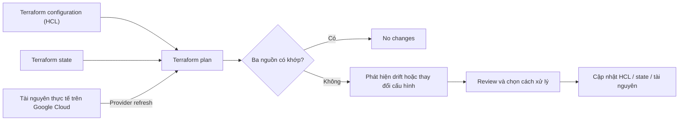
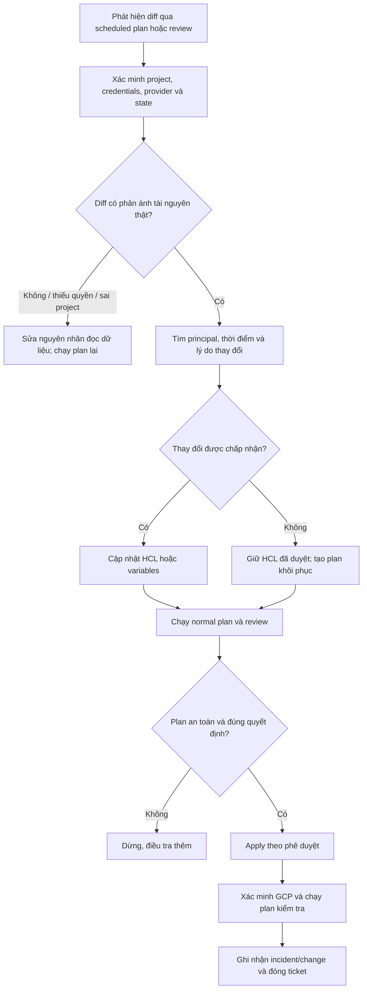

# Phát hiện drift và xử lý thay đổi ngoài Terraform

Terraform quản lý hạ tầng bằng cách so sánh ba nguồn thông tin: cấu hình khai báo trong mã, state lưu ánh xạ giữa mã và tài nguyên thật, và trạng thái tài nguyên đang chạy trên Google Cloud. Khi một người sửa VM trong Console, thay đổi IAM bằng lệnh `gcloud` hoặc một dịch vụ tự cập nhật thuộc tính được Terraform quản lý, ba nguồn thông tin có thể không còn khớp nhau. Sai lệch này được gọi là **configuration drift** hoặc **resource drift**.

Drift không chỉ làm kế hoạch triển khai khó dự đoán. Một thay đổi ngoài quy trình có thể mở firewall ngoài ý muốn, cấp quyền quá rộng, thay đổi cấu hình máy chủ, làm tăng chi phí hoặc khiến lần `terraform apply` tiếp theo hoàn tác một hotfix đang bảo vệ production. Vì vậy, nhóm vận hành cần phát hiện drift, xác minh nguyên nhân và quyết định rõ thay đổi nào cần giữ, thay đổi nào cần khôi phục.

Bài học thuộc chương **Hạ tầng bằng mã với Terraform** của module **CLOUD_PROVIDERS_GCP**. Nội dung tập trung vào quy trình phát hiện và xử lý drift trong Google Cloud, gồm Compute Engine, VPC, IAM, Cloud Storage và các workload được quản lý bằng Terraform.

## 1. Mục tiêu học tập

Sau bài học, bạn có thể:

- Phân biệt cấu hình Terraform, state và trạng thái thực tế của tài nguyên.
- Giải thích các loại drift và nguyên nhân thường gặp trên Google Cloud.
- Dùng `terraform plan` và `terraform plan -refresh-only` để phát hiện thay đổi ngoài Terraform.
- Chọn cách xử lý khi cần chấp nhận thay đổi, khôi phục cấu hình hoặc chuyển quyền quản lý tài nguyên.
- Cập nhật HCL, variables và state đúng quy trình.
- Phòng tránh rủi ro khi xử lý IAM, tài nguyên bị xóa, state backend và các lần apply đồng thời.
- Tự động hóa drift detection trong CI/CD hoặc HCP Terraform.

## 2. Ba nguồn thông tin Terraform cần đồng bộ

Terraform làm việc với ba thành phần:

| Thành phần | Nội dung | Ví dụ |
|---|---|---|
| Configuration | HCL mô tả trạng thái mong muốn. | VM phải dùng `e2-standard-4`, gắn tag `managed-by=terraform`. |
| State | Bản ghi Terraform về tài nguyên đã quản lý, gồm địa chỉ resource, ID từ provider và các thuộc tính đã đọc. | `google_compute_instance.app.id` trỏ tới instance ID trên GCP. |
| Real infrastructure | Trạng thái thực tế mà API Google Cloud trả về. | VM đang dùng `e2-standard-8` vì người vận hành đã đổi bằng Console. |

Có thể hình dung quy trình như sau:



State không phải bản sao đầy đủ của mọi thuộc tính trong Google Cloud. Provider đọc những thuộc tính được schema hỗ trợ và có thể chuẩn hóa hoặc bỏ qua một số trường. Vì vậy, kết quả plan phụ thuộc phiên bản provider, quyền đọc API, cấu hình provider và loại resource.

### 2.1. Drift khác với thay đổi cấu hình có chủ đích

Không phải mọi thay đổi trong plan đều là drift.

- **Configuration change:** nhóm sửa HCL hoặc variable; Terraform thấy cấu hình mong muốn khác state.
- **Resource drift:** tài nguyên thật thay đổi bên ngoài Terraform trong khi HCL và state chưa được cập nhật tương ứng.
- **State change:** state bị thay đổi hoặc mất ánh xạ, ví dụ state bị khôi phục từ bản cũ, resource address bị đổi hoặc thao tác state không đúng.
- **Provider/schema change:** phiên bản provider mới đọc hoặc biểu diễn thuộc tính khác phiên bản trước; có thể tạo diff dù người dùng không thay đổi tài nguyên.

Trong một lần plan, Terraform có thể phát hiện đồng thời nhiều loại thay đổi. Hãy đọc phần `Note: Objects have changed outside of Terraform` và phần proposed actions để xác định thay đổi đến từ đâu.

### 2.2. Ví dụ drift trên GCP

Một VM do Terraform quản lý có cấu hình:

```hcl
resource "google_compute_instance" "app" {
  name         = "checkout-app"
  machine_type = "e2-standard-4"
  zone         = "asia-southeast1-b"

  tags = ["app", "managed-by-terraform"]

  boot_disk {
    initialize_params {
      image = "debian-cloud/debian-12"
    }
  }

  network_interface {
    network = google_compute_network.app.id
  }
}
```

Một kỹ sư thay machine type sang `e2-standard-8` trong Google Cloud Console để xử lý tải tăng đột biến. Terraform configuration vẫn khai báo `e2-standard-4`, state còn ghi giá trị trước đó, trong khi VM thực tế đang dùng `e2-standard-8`.

Khi chạy plan bình thường, Terraform refresh trạng thái từ provider rồi so sánh với HCL. Nếu thuộc tính đó được provider quản lý và có thể cập nhật tại chỗ, plan có thể đề xuất đổi VM về `e2-standard-4`. Với thuộc tính buộc thay thế resource, plan có thể đề xuất destroy/create. Luôn kiểm tra ký hiệu `~`, `-/+` hoặc `-` trong plan trước khi apply.

## 3. Nguyên nhân drift trong môi trường Google Cloud

Drift thường xuất hiện từ một trong các nhóm sau.

### 3.1. Thay đổi thủ công

Người vận hành có thể sửa tài nguyên qua Google Cloud Console hoặc CLI:

- Đổi machine type, disk, metadata, network tag hoặc trạng thái VM.
- Thêm hoặc xóa firewall rule, route, subnet hoặc network attachment.
- Thay đổi IAM policy của project, folder, service account hoặc resource.
- Chỉnh cấu hình Cloud Run, GKE, Cloud SQL hoặc bucket.
- Xóa resource trong lúc xử lý incident hoặc dọn dẹp môi trường.

Thay đổi thủ công đôi khi cần thiết để giảm tác động incident. Sau đó phải ghi nhận quyết định, người thực hiện, thời điểm, lý do và kế hoạch đồng bộ lại Terraform.

### 3.2. Thay đổi từ hệ thống tự động hoặc dịch vụ khác

Một số thay đổi có thể đến từ pipeline khác, controller, sản phẩm Google Cloud hoặc công cụ quản trị:

- Pipeline triển khai khác cùng sửa một resource.
- GKE controller hoặc autoscaler thay đổi số lượng node hoặc replica theo cấu hình vận hành.
- Dịch vụ Google Cloud cập nhật trường do hệ thống quản lý.
- Một module Terraform khác quản lý cùng một IAM role hoặc tài nguyên.
- Cấu hình policy của tổ chức hoặc security automation điều chỉnh quyền.

Cần phân biệt trường nào là trạng thái động được dịch vụ điều khiển với trường nào là cấu hình mong muốn của Terraform. Không cố buộc Terraform quản lý cùng một thuộc tính đang được một controller khác liên tục điều chỉnh.

### 3.3. Sai lệch do provider, API hoặc quyền truy cập

Plan có thể báo resource biến mất hoặc thay đổi bất thường khi:

- Provider dùng sai project, zone, region hoặc impersonated service account.
- API trả về dữ liệu không đầy đủ vì danh tính thiếu quyền đọc.
- Provider được nâng cấp và schema hoặc logic chuẩn hóa thay đổi.
- Resource đã được chuyển project hoặc đổi tên nhưng state vẫn giữ ID cũ.
- API bị tắt hoặc dịch vụ tạm thời không phản hồi.

Đặc biệt, nếu hàng loạt resource đột ngột được báo đã xóa, hãy kiểm tra credentials, project, provider aliases, region và API trước khi áp dụng bất kỳ kế hoạch nào cập nhật state hoặc tạo lại tài nguyên.

## 4. Phát hiện drift bằng Terraform CLI

### 4.1. Chuẩn bị workspace và xác nhận đúng project

Trước khi đọc hoặc tạo plan:

1. Chuyển đến đúng thư mục root module.
2. Xác nhận workspace và backend.
3. Kiểm tra phiên bản Terraform và Google provider đang được pin.
4. Xác thực bằng danh tính đúng môi trường.
5. Xác nhận project, region, zone và provider alias.

Ví dụ:

```bash
terraform version
terraform workspace show
terraform providers
gcloud config get-value project
gcloud auth list
```

Nếu pipeline dùng service account impersonation hoặc Workload Identity Federation, hãy xác minh principal mà Terraform thực sự sử dụng. Đừng dựa vào project mặc định của máy cá nhân nếu root module có cấu hình project riêng.

### 4.2. Chạy plan bình thường

```bash
terraform plan
```

Ở normal planning mode, Terraform mặc định refresh các resource đã quản lý để đọc trạng thái hiện tại từ provider trước khi quyết định thay đổi cần thực hiện. Refresh trong quá trình tạo plan là cập nhật trong bộ nhớ; state trên backend chỉ được ghi khi một thao tác apply hoàn tất.

Nếu có drift, output có thể nêu:

```text
Note: Objects have changed outside of Terraform

Terraform detected the following changes made outside of Terraform since the last "terraform apply":
  # google_compute_instance.app has changed
  ~ resource "google_compute_instance" "app" {
      ~ machine_type = "e2-standard-4" -> "e2-standard-8"
    }
```

Đây là ví dụ minh họa. Output thực tế tùy resource schema và provider version.

Normal plan có thể vừa thông báo thay đổi ngoài Terraform vừa đề xuất hành động để đưa tài nguyên về cấu hình HCL. Nếu thay đổi ngoài Terraform không được chấp nhận, đó có thể là hành động cần thiết để khôi phục trạng thái mong muốn. Nếu thay đổi là hotfix được chấp nhận, đừng apply plan đó trước khi cập nhật cấu hình theo quyết định của nhóm.

### 4.3. Dùng refresh-only để xem riêng thay đổi của state

`-refresh-only` tạo một plan với mục tiêu cập nhật state và root module outputs theo trạng thái thực tế mà provider đọc được. Nó không đề xuất thay đổi tài nguyên thật để khớp với HCL.

```bash
terraform plan -refresh-only
```

Output cho biết những thuộc tính nào Terraform phát hiện đã thay đổi ngoài quy trình. Đây là cách hữu ích để review drift trước khi quyết định có ghi nhận trạng thái mới vào state hay không.

Nếu đã xác minh thay đổi là đúng và muốn state phản ánh trạng thái hiện tại:

```bash
terraform apply -refresh-only
```

Terraform hiển thị plan và yêu cầu xác nhận. Khi chấp thuận, thao tác này cập nhật state và outputs; nó không thay đổi tài nguyên thật trên Google Cloud.

**Lưu ý:** refresh-only chỉ đồng bộ state với thực tế. Nó không tự cập nhật HCL. Nếu HCL vẫn khai báo giá trị cũ, một normal plan tiếp theo có thể đề xuất đưa tài nguyên thật trở lại giá trị cũ. Khi chấp nhận một hotfix, cần cập nhật cấu hình và variable tương ứng trước khi coi công việc hoàn tất.

### 4.4. Lưu plan để review và apply đúng nội dung đã duyệt

Trong CI/CD hoặc thay đổi production, nên tạo plan file:

```bash
terraform plan -out=tfplan
terraform show -no-color tfplan
```

Sau khi reviewer phê duyệt, apply đúng plan đã lưu:

```bash
terraform apply tfplan
```

Không tạo một plan mới sau review rồi áp dụng nội dung khác mà chưa được kiểm tra. Plan file có thể chứa dữ liệu nhạy cảm từ state hoặc provider; hãy giới hạn quyền truy cập, thời gian lưu và nơi lưu artifact.

### 4.5. Đọc exit code trong automation

Với `-detailed-exitcode`, Terraform trả mã thoát:

| Exit code | Ý nghĩa |
|---:|---|
| 0 | Plan thành công và không có thay đổi. |
| 1 | Lỗi khi tạo plan. |
| 2 | Plan thành công và có thay đổi cần review. |

Ví dụ:

```bash
terraform plan -detailed-exitcode
plan_status=$?

if [ "$plan_status" -eq 0 ]; then
  echo "No changes"
elif [ "$plan_status" -eq 2 ]; then
  echo "Changes detected: review plan"
else
  echo "Terraform plan failed"
  exit "$plan_status"
fi
```

Pipeline cần phân biệt exit code 2 với lỗi. Nếu chỉ xem mọi mã khác 0 là lỗi, hệ thống sẽ không phân biệt được drift với lỗi provider. Ngược lại, không được tự động apply chỉ vì plan trả về 2.

## 5. Xác minh drift bằng công cụ Google Cloud

Terraform plan là nguồn phát hiện quan trọng, nhưng khi diff có rủi ro cao, hãy kiểm tra trực tiếp tài nguyên bằng lệnh chỉ đọc hoặc Cloud Console.

Ví dụ kiểm tra VM:

```bash
gcloud compute instances describe checkout-app \
  --zone=asia-southeast1-b \
  --project=PROJECT_ID
```

Kiểm tra firewall rule:

```bash
gcloud compute firewall-rules describe allow-checkout \
  --project=PROJECT_ID
```

Kiểm tra IAM policy của project:

```bash
gcloud projects get-iam-policy PROJECT_ID \
  --format=json
```

Kiểm tra cấu hình Cloud Run:

```bash
gcloud run services describe checkout-api \
  --region=asia-southeast1 \
  --project=PROJECT_ID
```

Thay placeholder bằng project, resource name và location thật. Các lệnh trên chỉ đọc thông tin. Hãy đối chiếu thuộc tính có diff với tài nguyên thật, thời điểm thay đổi và danh tính thực hiện.

Cloud Audit Logs có thể giúp tìm ai đã thay đổi resource và API nào được gọi. Tùy loại dịch vụ, cần bật và có quyền xem Data Access logs khi muốn truy vết thao tác đọc dữ liệu hoặc API thuộc nhóm Data Access. Admin Activity logs ghi nhận hoạt động quản trị tương ứng. Không phải mọi thay đổi đều có cùng loại log; xác định service, method và loại audit log trước khi điều tra.

Một quy trình điều tra nên ghi nhận:

- Resource address trong Terraform và resource ID trên GCP.
- Thuộc tính trước và sau thay đổi.
- Thời điểm phát hiện và thời điểm thay đổi ước tính.
- Principal hoặc pipeline đã thực hiện thay đổi.
- Lý do thay đổi: incident, thao tác thủ công, automation hay provider behavior.
- Mức ảnh hưởng đến bảo mật, độ tin cậy, chi phí và phụ thuộc.

## 6. Chọn cách xử lý: giữ, hoàn tác hay chuyển quyền quản lý

Sau khi xác minh drift, chọn một trong các hướng sau. Quyết định cần có chủ sở hữu tài nguyên và reviewer phù hợp, đặc biệt với IAM, network, dữ liệu và production.

### 6.1. Giữ thay đổi ngoài Terraform

Dùng khi thay đổi được chấp thuận, ví dụ hotfix đã được kiểm chứng hoặc nhóm sản phẩm quyết định tăng năng lực VM.

Quy trình:

1. Xác minh thay đổi thật và lý do.
2. Cập nhật HCL hoặc input variable để biểu diễn trạng thái mong muốn mới.
3. Kiểm tra module dùng chung, environment overlays và tài liệu liên quan trong cùng repository.
4. Chạy normal plan để xác nhận Terraform không đề xuất hoàn tác thay đổi.
5. Review các thay đổi còn lại và apply theo quy trình thông thường.

Ví dụ sửa machine type:

```hcl
resource "google_compute_instance" "app" {
  name         = "checkout-app"
  machine_type = "e2-standard-8"
  zone         = "asia-southeast1-b"

  # Các thuộc tính khác giữ theo cấu hình đã review.
}
```

Nếu giá trị được lấy từ variable, hãy cập nhật nguồn variable phù hợp thay vì hard-code vào resource:

```hcl
variable "checkout_machine_type" {
  type        = string
  description = "Machine type for the checkout workload."
  default     = "e2-standard-8"
}

resource "google_compute_instance" "app" {
  name         = "checkout-app"
  machine_type = var.checkout_machine_type
  zone         = "asia-southeast1-b"
}
```

Khi cấu hình đã khớp trạng thái thật, normal plan cần được kiểm tra để xác nhận không còn diff ngoài dự kiến. Một số thuộc tính có thể cần thao tác thay thế hoặc dừng VM khi thay đổi; xem plan và tài liệu resource provider trước khi apply.

### 6.2. Hoàn tác thay đổi ngoài ý muốn

Dùng khi thay đổi là trái phép, không được phê duyệt hoặc làm giảm mức bảo mật/độ tin cậy.

Ví dụ một firewall rule được mở rộng từ dải mạng nội bộ sang `0.0.0.0/0`:

- Kiểm tra tác động và xác nhận rule thuộc Terraform state.
- Đảm bảo HCL vẫn mô tả ingress được phê duyệt.
- Tạo normal plan và kiểm tra chính xác rule nào sẽ bị sửa hoặc thay thế.
- Xác minh không có resource khác bị xóa hoặc mở rộng quyền ngoài phạm vi.
- Apply plan đã được phê duyệt.
- Kiểm tra lại firewall rule thực tế và lưu bằng chứng xử lý.

Không tự động chạy apply ngay khi phát hiện drift. Nếu thay đổi ngoài Terraform là một biện pháp khẩn cấp đang giảm tác động incident, hoàn tác quá sớm có thể làm sự cố nghiêm trọng hơn.

### 6.3. Chuyển quyền quản lý cho hệ thống khác

Một số resource hoặc thuộc tính có thể cần chuyển sang controller, module hoặc nhóm sở hữu khác. Trước khi bỏ quản lý Terraform:

- Xác định hệ thống mới chịu trách nhiệm và nguồn cấu hình chính thức.
- Đảm bảo hệ thống mới đã quan sát và quản lý đúng resource.
- Xác định ai chịu trách nhiệm cập nhật, bảo mật, backup và lifecycle.
- Dùng thao tác state phù hợp để bỏ mapping nếu resource vẫn cần tồn tại.
- Xóa hoặc điều chỉnh cấu hình Terraform tương ứng trong cùng thay đổi đã review.

`terraform state rm` bỏ resource khỏi state nhưng không xóa tài nguyên thật. Tuy nhiên, nếu resource block vẫn còn trong HCL, lần plan sau có thể đề xuất tạo resource mới vì Terraform không còn mapping. Chỉ dùng khi thực sự chuyển quyền quản lý hoặc cần tách resource theo kế hoạch.

## 7. Đồng bộ state và HCL đúng cách

### 7.1. Trường hợp thay đổi được chấp nhận

Giả sử kỹ sư đã thêm label `incident_approved=true` vào VM để phục vụ incident và chủ sở hữu muốn giữ label đó lâu dài.

Nếu tag thuộc thuộc tính `labels` do Terraform quản lý, hãy cập nhật HCL:

```hcl
resource "google_compute_instance" "app" {
  name         = "checkout-app"
  machine_type = "e2-standard-4"
  zone         = "asia-southeast1-b"

  labels = {
    environment = "production"
    managed_by  = "terraform"
    incident_approved = "true"
  }

  # Các block còn lại.
}
```

Sau đó:

```bash
terraform plan
```

Nếu plan vẫn đề xuất xóa tag, kiểm tra variable, locals, module input, provider normalization và resource address. Không apply cho đến khi hiểu vì sao HCL chưa tạo ra kết quả mong muốn.

### 7.2. Trường hợp cần ghi nhận drift vào state trước

Trong một số tình huống, nhóm muốn cập nhật state để lưu lại các giá trị provider đọc được trước khi sửa HCL. Dùng:

```bash
terraform plan -refresh-only
terraform apply -refresh-only
```

Sau đó cập nhật HCL/variables để thể hiện trạng thái được chấp nhận và chạy normal plan. Nếu refresh-only báo nhiều resource bị xóa hoặc giá trị biến mất bất thường, dừng lại để kiểm tra quyền, project và provider configuration. Không chấp nhận state plan chỉ vì muốn làm sạch output.

### 7.3. Resource được tạo ngoài Terraform

Nếu phát hiện một resource hợp lệ nhưng chưa được quản lý bởi Terraform, hãy quyết định có đưa nó vào IaC hay để hệ thống khác quản lý.

Với Terraform phiên bản hỗ trợ import block (v1.5 trở lên), có thể khai báo:

```hcl
import {
  to = google_compute_instance.legacy
  id = "projects/PROJECT_ID/zones/asia-southeast1-b/instances/legacy-vm"
}

resource "google_compute_instance" "legacy" {
  name         = "legacy-vm"
  zone         = "asia-southeast1-b"
  machine_type = "e2-standard-4"

  # Khai báo đầy đủ cấu hình cần quản lý.
}
```

Tạo plan và review nội dung import. Không giả định import tự sinh ra HCL hoàn chỉnh hoặc mọi thuộc tính sẽ được quản lý đúng ngay lập tức. Sau import, tiếp tục điều chỉnh cấu hình để normal plan không đề xuất thay đổi ngoài ý muốn.

Lệnh `terraform import` truyền thống cũng có thể dùng tùy phiên bản và workflow:

```bash
terraform import \
  google_compute_instance.legacy \
  projects/PROJECT_ID/zones/asia-southeast1-b/instances/legacy-vm
```

Import thêm mapping vào state; nó không tạo resource và cũng không tự đồng bộ HCL. Hãy đảm bảo resource address chỉ được import vào một state/workspace, tránh để hai root module cùng quản lý một tài nguyên.

### 7.4. Resource bị xóa ngoài Terraform

Nếu provider xác nhận resource đã bị xóa thật, normal plan có thể đề xuất tạo lại resource để đáp ứng HCL. Trước khi apply, xác minh:

- Resource có bị xóa có chủ đích hay không.
- Có dữ liệu bền vững, disk, IP, DNS, IAM hoặc dependency cần phục hồi không.
- Tên resource có thể được tái sử dụng hay không.
- Tạo lại có gây mất dữ liệu hoặc gián đoạn không.
- Có cần khôi phục từ backup hoặc chuyển sang resource mới theo quy trình migration không.

Nếu resource biến mất do provider dùng nhầm project hoặc thiếu quyền, không apply. Hãy sửa cấu hình xác thực rồi chạy plan lại. Refresh-only apply trong trường hợp này có thể loại mapping khỏi state và làm thay đổi các kế hoạch sau đó.

## 8. Xử lý các tình huống đặc thù trên Google Cloud

### 8.1. IAM drift và tài nguyên authoritative

Google Cloud provider có các resource IAM với ngữ nghĩa quản lý khác nhau:

| Resource pattern | Phạm vi quản lý | Ảnh hưởng khi thay đổi ngoài Terraform |
|---|---|---|
| `google_project_iam_policy` | Toàn bộ IAM policy của project, authoritative. | Policy apply có thể thay thế toàn bộ policy bằng cấu hình HCL. |
| `google_project_iam_binding` | Toàn bộ member của một role cụ thể, authoritative cho role đó. | Member thêm ngoài Terraform có thể bị loại khỏi role khi apply. |
| `google_project_iam_member` | Một member/role association, additive. | Terraform quản lý membership được khai báo mà không coi toàn bộ role là danh sách độc quyền. |

Ví dụ `google_project_iam_binding`:

```hcl
resource "google_project_iam_binding" "viewer" {
  project = var.project_id
  role    = "roles/viewer"

  members = [
    "user:platform-admin@example.com",
    "serviceAccount:reporting@PROJECT_ID.iam.gserviceaccount.com",
  ]
}
```

Binding là authoritative cho member của role `roles/viewer`. Nếu một nhóm khác thêm member ngoài Terraform, lần apply có thể xóa membership đó. Điều này có thể làm gián đoạn một workload hoặc quyền truy cập vận hành.

Nếu muốn quản lý từng membership theo cách additive, có thể dùng `google_project_iam_member`:

```hcl
resource "google_project_iam_member" "reporting_viewer" {
  project = var.project_id
  role    = "roles/viewer"
  member  = "serviceAccount:reporting@PROJECT_ID.iam.gserviceaccount.com"
}
```

Không quản lý cùng một role bằng các resource binding và member chồng lấn vì chúng có thể xung đột hoặc liên tục sửa policy của nhau. Chọn một mô hình quản lý rõ ràng cho từng role. Với quyền project rộng, hãy review kỹ mọi member bị thêm hoặc xóa và xác nhận principal trước khi apply.

### 8.2. Firewall, routes và VPC

Drift ở network có thể tạo rủi ro lớn vì một thay đổi nhỏ ảnh hưởng nhiều workload:

- Thêm ingress rule mở rộng source range.
- Xóa rule đang cho phép health check hoặc traffic giữa service.
- Thay route hoặc next hop.
- Gắn network tag mới cho VM khiến firewall rule khác bắt đầu áp dụng.
- Thay subnet secondary range hoặc cấu hình private access.

Hãy review cả resource thay đổi và các workload phụ thuộc. Với firewall, kiểm tra direction, priority, target tags/service accounts, source ranges, protocol và port. Không chỉ so sánh tên rule.

### 8.3. Compute Engine và disk

Thay đổi machine type, boot disk, attached disk, network interface hoặc metadata có thể có tác động khác nhau. Một số thuộc tính có thể cập nhật tại chỗ; một số yêu cầu stop VM hoặc tạo lại resource. Disk chứa dữ liệu cần được kiểm tra backup và deletion protection trước khi apply.

Ví dụ, nếu plan hiển thị `-/+` cho `google_compute_instance`, hiểu rằng Terraform có thể thay thế instance. Kiểm tra `boot_disk`, `attached_disk`, auto-delete, IP và startup metadata để tránh mất dữ liệu hoặc thay đổi endpoint ngoài dự kiến.

### 8.4. Cloud Storage và state bucket

Nếu bucket ứng dụng được quản lý bằng Terraform, drift có thể xuất hiện ở versioning, lifecycle, uniform bucket-level access, retention policy, encryption hoặc IAM. Những thuộc tính liên quan dữ liệu và compliance cần được review với data owner.

State backend trên Cloud Storage là hạ tầng đặc biệt quan trọng. Bảo vệ bucket, giới hạn quyền truy cập và bật object versioning để có thể khôi phục phiên bản state trước đó khi cần. Google Cloud khuyến nghị dùng Cloud Storage backend cho nhóm, vì backend hỗ trợ locking và tách state khỏi source control.

Không dùng cùng bucket/prefix state cho các workspace không liên quan nếu thiết kế backend không tách biệt. Chỉ build system và nhóm quản trị có thẩm quyền phù hợp mới nên có quyền quản lý bucket state.

## 9. Các lệnh state và cách dùng an toàn

Terraform có các lệnh để kiểm tra hoặc thay đổi mapping trong state:

| Lệnh | Mục đích | Lưu ý |
|---|---|---|
| `terraform state list` | Liệt kê resource address trong state. | Chỉ đọc. |
| `terraform state show ADDRESS` | Xem thuộc tính state của một resource. | Có thể hiển thị dữ liệu nhạy cảm. |
| `terraform state pull` | Lấy state hiện tại từ backend ra stdout. | State có thể chứa secret; bảo vệ output và file backup. |
| `terraform state mv` | Di chuyển resource address trong state. | Dùng khi refactor địa chỉ, không phải để sửa drift của thuộc tính. |
| `terraform state rm` | Bỏ mapping khỏi state, giữ resource thật. | Resource có thể được tạo lại nếu HCL vẫn khai báo. |
| `terraform import` | Gắn resource thật vào state address. | Cần HCL tương ứng và plan review. |

Google Cloud khuyến nghị không sửa trực tiếp file state bằng tay. Khi cần thay đổi state, dùng lệnh `terraform state` phù hợp và có backup, lock cùng quy trình review.

Không dùng `state rm` để “xóa drift” hoặc làm cho plan trông sạch. Cũng không dùng `state mv` để che đi một thay đổi ngoài Terraform. Các lệnh này thay đổi cách Terraform ánh xạ tài nguyên, không thay thế quy trình xác minh trạng thái thật.

## 10. Những tùy chọn dễ gây hiểu nhầm

### 10.1. Tránh dùng -refresh=false để kiểm tra drift

```bash
terraform plan -refresh=false
```

Tùy chọn này bỏ qua bước refresh mặc định. Terraform có thể không nhìn thấy thay đổi ngoài Terraform và tạo một plan thiếu hoặc sai. Nó có thể hữu ích trong một số trường hợp đặc biệt để giảm API calls, nhưng không phù hợp cho kiểm tra drift hoặc trước khi áp dụng thay đổi production.

### 10.2. Không dùng terraform refresh như quy trình mặc định

Lệnh `terraform refresh` đã deprecated. Lệnh này tương đương một thao tác refresh-only apply tự động chấp nhận, nên có rủi ro cập nhật state mà không review các thay đổi trước. Dùng `terraform plan -refresh-only` để xem trước và `terraform apply -refresh-only` sau khi đã xác nhận.

### 10.3. Không lạm dụng -target

`-target` giới hạn phần graph Terraform xử lý. Nó có thể hữu ích trong tình huống phục hồi đặc biệt, nhưng không phải cách mặc định để xử lý drift. Target một resource có thể bỏ qua thay đổi liên quan hoặc dependency mà bạn cần nhìn thấy trong plan đầy đủ.

### 10.4. Cẩn trọng với ignore_changes

`lifecycle.ignore_changes` yêu cầu Terraform bỏ qua thay đổi của một hoặc nhiều thuộc tính trong các lần plan tiếp theo. Đây là công cụ để xác định ranh giới ownership khi một hệ thống khác được phép quản lý thuộc tính đó, không phải nút tắt cảnh báo drift.

Ví dụ:

```hcl
resource "google_compute_instance" "app" {
  name         = "checkout-app"
  machine_type = "e2-standard-4"
  zone         = "asia-southeast1-b"

  lifecycle {
    ignore_changes = [
      labels["autoscaler-managed"],
    ]
  }
}
```

Chỉ dùng khi provider/resource hỗ trợ biểu thức thuộc tính tương ứng và nhóm đã thống nhất ai là owner. Không ignore toàn bộ block hoặc thuộc tính quan trọng như IAM, firewall, disk encryption chỉ để giảm diff. Mỗi ignore rule cần có lý do, owner và kế hoạch xem xét lại.

## 11. Tự động hóa phát hiện drift

### 11.1. Lập lịch plan không apply

Một pipeline định kỳ có thể chạy:

1. Checkout commit được phê duyệt.
2. Cài đúng phiên bản Terraform và provider lock file.
3. Xác thực danh tính runtime.
4. Khởi tạo backend và tải state.
5. Chạy plan với refresh mặc định.
6. Lưu output và báo cáo diff.
7. Tạo ticket hoặc thông báo cho owner khi phát hiện thay đổi.
8. Không apply nếu chưa có review và phê duyệt.

Ví dụ lệnh trong job:

```bash
terraform init -input=false
terraform plan -input=false -no-color -detailed-exitcode
```

Trong Cloud Build hoặc CI system khác, cấu hình service account chuyên dụng với quyền đọc các resource cần refresh và quyền backend cần thiết. Job chỉ phát hiện drift không nên có quyền rộng hơn mức cần thiết để đọc state và resource. Nếu job cần tạo plan artifact, kiểm soát nơi lưu artifact vì plan có thể chứa thông tin nhạy cảm.

### 11.2. Lịch chạy và xử lý cảnh báo

Chọn tần suất theo mức độ quan trọng và tốc độ thay đổi của môi trường:

- Production network, IAM và security policy: kiểm tra thường xuyên hơn.
- Workload ứng dụng ít thay đổi: kiểm tra theo lịch triển khai hoặc hàng ngày.
- Môi trường thử nghiệm ngắn hạn: kiểm tra trước mỗi lần apply hoặc khi kết thúc vòng đời.

Tần suất không thay thế review. Nếu có drift, ticket cần ghi resource address, thuộc tính thay đổi, project, owner, thời điểm phát hiện và plan artifact an toàn. Tránh gửi toàn bộ state hoặc secret vào kênh chat.

### 11.3. HCP Terraform health assessments

Nếu tổ chức dùng HCP Terraform với tính năng health assessments/drift detection phù hợp edition và workspace, có thể bật kiểm tra định kỳ. HCP Terraform thực hiện các refresh-only plan không có hành động apply để so sánh cấu hình, state và resource thật. Tính năng này giúp phát hiện thay đổi ngoài workflow và hiển thị trạng thái drift trong workspace.

Đánh giá drift tự động không tự giải quyết thay đổi. Owner vẫn phải review, cập nhật HCL hoặc khôi phục resource theo quy trình. Kiểm tra khả năng cung cấp, edition và chính sách workspace hiện hành của tổ chức trước khi thiết kế phụ thuộc vào tính năng này.

## 12. Quy trình xử lý drift từ đầu đến cuối

Một quy trình nhất quán giúp tránh apply nhầm:



Chi tiết từng bước:

1. **Phát hiện:** dùng normal plan hoặc refresh-only plan để thấy diff.
2. **Xác minh khả năng đọc:** kiểm tra project, region, credentials, provider version, quyền API và backend.
3. **Đối chiếu tài nguyên thật:** dùng Console, `gcloud` hoặc API chỉ đọc để xác nhận.
4. **Điều tra:** tìm người hoặc pipeline thay đổi, thời điểm, lý do và phạm vi tác động.
5. **Quyết định:** giữ thay đổi, hoàn tác hoặc chuyển ownership.
6. **Sửa nguồn sự thật:** cập nhật HCL/variables hoặc chuẩn bị state operation đã được review.
7. **Review plan:** xem resource add/change/destroy, ForceNew, IAM membership, firewall và dữ liệu.
8. **Apply:** dùng đúng plan đã phê duyệt và lock backend.
9. **Xác minh:** đọc lại tài nguyên thật, chạy plan mới và xác nhận không còn diff ngoài dự kiến.
10. **Ghi nhận:** cập nhật ticket/change record, owner, nguyên nhân và hành động phòng ngừa.

## 13. Bảo vệ state và ngăn drift tái diễn

### 13.1. Dùng remote state và locking

Đối với nhóm quản lý GCP, Cloud Storage backend là lựa chọn phổ biến. Backend hỗ trợ state locking để hạn chế hai tiến trình cùng ghi state, đồng thời tách state khỏi repository.

Ví dụ backend:

```hcl
terraform {
  backend "gcs" {
    bucket = "company-terraform-state"
    prefix = "gcp/production/network"
  }
}
```

Bucket phải được tạo và bảo vệ theo chính sách tổ chức. Bật object versioning để có thể phục hồi phiên bản state trước đó; giới hạn quyền đọc, ghi và quản trị bucket. Không commit `terraform.tfstate` hoặc plan artifact có thể chứa secret vào Git.

State locking không ngăn người dùng sửa tài nguyên trực tiếp trên Google Cloud. Nó chỉ bảo vệ các thao tác state đồng thời trong backend. Cần kết hợp IAM, audit log, change process và scheduled plan để giảm thay đổi ngoài workflow.

### 13.2. Hạn chế quyền thay đổi thủ công

- Dùng service account hoặc workload identity riêng cho pipeline Terraform.
- Giới hạn quyền sửa production cho nhóm thực sự cần.
- Tách quyền đọc, quyền thay đổi resource và quyền quản lý state bucket.
- Hạn chế thao tác qua tài khoản cá nhân có quyền rộng.
- Dùng quy trình break-glass cho incident và yêu cầu ghi lại thay đổi.
- Rà soát quyền của automation, controller và các module Terraform khác.

Không thể loại bỏ mọi thay đổi ngoài Terraform trong thực tế. Mục tiêu là đảm bảo thay đổi khẩn cấp có thể truy vết, được review và đồng bộ lại.

### 13.3. Thiết lập ranh giới ownership

Một resource hoặc thuộc tính nên có một nguồn quản lý chính thức. Nếu GKE autoscaler quản lý số node, Terraform nên quản lý cấu hình autoscaling và node pool policy phù hợp thay vì liên tục ép số lượng node về một giá trị tĩnh. Nếu một nhóm khác sở hữu IAM membership của role, đừng khai báo một authoritative binding ở module khác.

Viết rõ ownership trong module documentation và code review. Khi bàn giao resource, cần có quy trình import hoặc state handoff để tránh hai workspace cùng quản lý một resource.

## 14. Các lỗi thường gặp và cách tránh

| Lỗi | Hậu quả | Cách xử lý |
|---|---|---|
| Apply ngay khi thấy drift | Hoàn tác hotfix hoặc gây thay thế resource. | Xác minh thay đổi và review plan trước. |
| Refresh-only apply khi provider sai project | State có thể ghi nhận nhầm resource đã bị xóa. | Xác minh credentials, project, region và quyền đọc. |
| Chỉ sửa state mà không sửa HCL | Normal plan tiếp tục đề xuất hoàn tác thay đổi được chấp nhận. | Đồng bộ HCL/variables sau khi chấp nhận drift. |
| Dùng `-refresh=false` để làm plan sạch | Bỏ qua thay đổi ngoài Terraform. | Dùng normal refresh hoặc refresh-only để phát hiện drift. |
| Dùng `terraform state rm` để che diff | Resource vẫn tồn tại nhưng bị bỏ quản lý; plan có thể tạo resource mới. | Chỉ bỏ mapping khi chuyển ownership có kế hoạch. |
| Dùng IAM binding chồng lấn với IAM member | Các cấu hình có thể xung đột và ghi đè membership. | Chọn một mô hình quản lý cho mỗi role. |
| Bật `ignore_changes` rộng | Drift quan trọng bị che khuất. | Ignore đúng thuộc tính do hệ thống khác sở hữu, có owner. |
| Sửa state bằng tay | State có thể hỏng hoặc mất mapping. | Dùng lệnh `terraform state` và backup. |
| Hai pipeline cùng apply | Race condition, lock contention hoặc kế hoạch dựa trên state cũ. | Dùng backend locking và serialize apply theo workspace. |
| Không kiểm tra ForceNew | VM, disk hoặc resource có thể bị thay thế và gây gián đoạn/mất dữ liệu. | Đọc action plan, backup và dependency trước apply. |

## 15. Checklist vận hành drift trên GCP

- [ ] Đúng root module, workspace, backend và commit đang được kiểm tra.
- [ ] Terraform/provider version và lock file đã được xác nhận.
- [ ] Credentials, impersonation, project, region và zone đúng môi trường.
- [ ] Normal plan chạy với refresh mặc định.
- [ ] Drift được xác minh bằng API/Console hoặc lệnh `gcloud` chỉ đọc.
- [ ] Đã xác định ai thay đổi, thời điểm và lý do.
- [ ] Đã phân loại thay đổi cần giữ, hoàn tác hoặc chuyển ownership.
- [ ] HCL/variables phản ánh quyết định đã được duyệt.
- [ ] Refresh-only chỉ được apply sau khi review tác động đến state.
- [ ] IAM authoritative binding và member không quản lý chồng lấn.
- [ ] Đã kiểm tra firewall, network, disk, deletion protection và ForceNew.
- [ ] State backend có locking, versioning và IAM giới hạn.
- [ ] Plan artifact, state backup và log được bảo vệ như dữ liệu nhạy cảm.
- [ ] Đã apply đúng plan được phê duyệt và xác minh lại tài nguyên thật.
- [ ] Có scheduled drift detection và owner xử lý ticket.

## Kết luận

Drift là dấu hiệu cho thấy cấu hình khai báo, Terraform state và hạ tầng Google Cloud đã lệch nhau. Việc phát hiện đúng cần refresh từ provider với đúng credentials, project và phiên bản provider. Việc xử lý đúng cần xác định thay đổi có được chấp nhận hay không, sau đó đồng bộ HCL, state hoặc ownership theo một quy trình có review.

`terraform plan` là bước kiểm tra thường ngày; `terraform plan -refresh-only` giúp xem riêng những thay đổi mà Terraform đọc được từ hạ tầng và `terraform apply -refresh-only` chỉ cập nhật state sau khi được xác nhận. Với Google Cloud, hãy đặc biệt chú ý IAM authoritative resources, firewall, disk, project identity và Cloud Storage state backend. Kết hợp plan định kỳ, IAM tối thiểu, audit trail, state locking và ownership rõ ràng sẽ giúp Terraform tiếp tục là nguồn sự thật đáng tin cậy cho hạ tầng.

## Tài liệu tham khảo

- [HashiCorp Terraform: Manage resource drift](https://developer.hashicorp.com/terraform/tutorials/state/resource-drift)
- [HashiCorp Terraform: Refresh-only mode](https://developer.hashicorp.com/terraform/cli/commands/plan)
- [HashiCorp Terraform: terraform refresh command (deprecated)](https://developer.hashicorp.com/terraform/cli/commands/refresh)
- [HashiCorp Terraform: terraform plan command](https://developer.hashicorp.com/terraform/cli/commands/plan)
- [Google Cloud: Best practices when working with Google Cloud resources](https://docs.cloud.google.com/docs/terraform/best-practices/working-with-resources)
- [Google Cloud: Best practices for Terraform operations](https://docs.cloud.google.com/docs/terraform/best-practices/operations)
- [Google Cloud: Best practices for Terraform security](https://docs.cloud.google.com/docs/terraform/best-practices/security)
- [Google Cloud: Store Terraform state in a Cloud Storage bucket](https://docs.cloud.google.com/docs/terraform/resource-management/store-state)
- [Terraform Google provider: google_compute_instance](https://registry.terraform.io/providers/hashicorp/google/latest/docs/resources/compute_instance)

