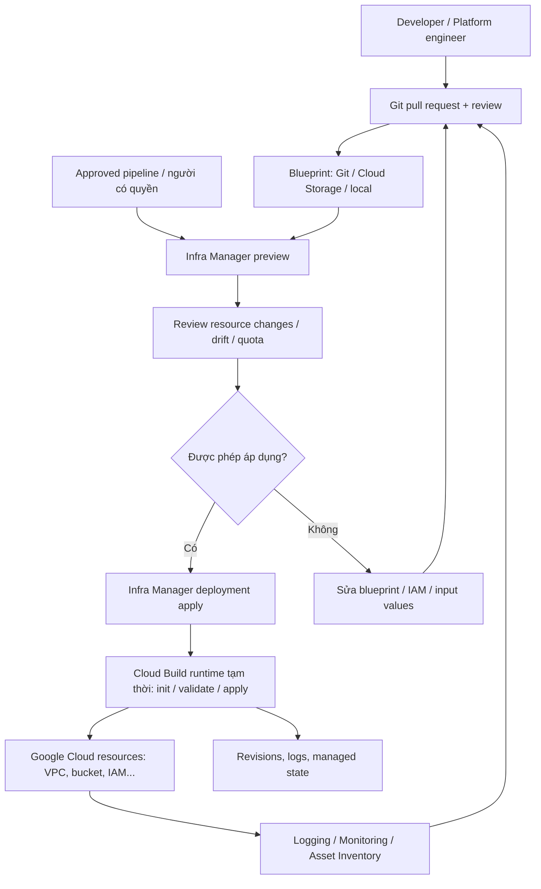
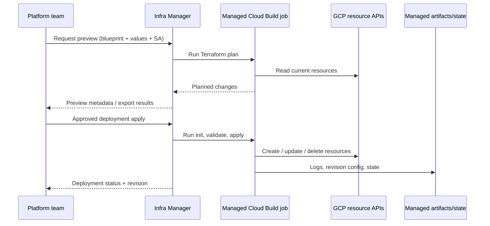
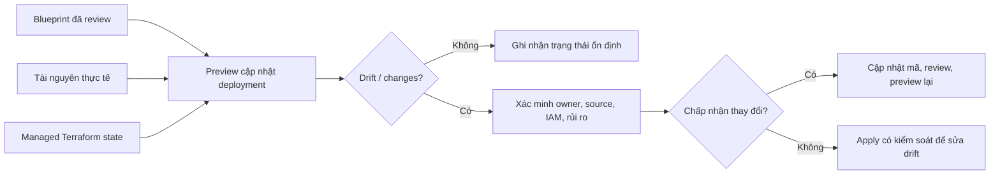
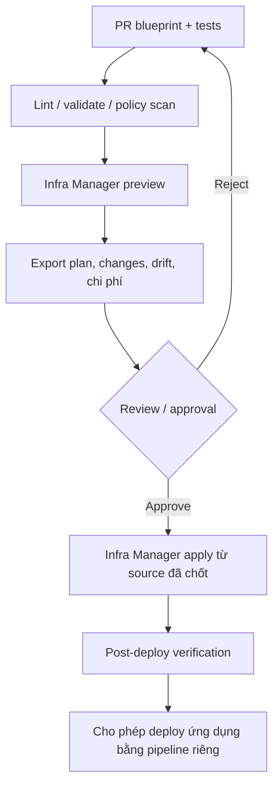

# Infrastructure Manager và thực thi Terraform được quản lý

> **Chương:** Hạ tầng bằng mã với Terraform  
> **Mô-đun:** `CLOUD_PROVIDERS_GCP` — học Google Cloud từ tổ chức project, IAM và VPC đến Compute Engine, GKE, Cloud Run, lưu trữ và cơ sở dữ liệu; thông qua tình huống triển khai để lựa chọn dịch vụ, bảo vệ tài nguyên, tự động hóa phát hành, giám sát độ tin cậy và chi phí.  
> **Phạm vi bài học:** Google Cloud **Infrastructure Manager (Infra Manager)**, thực thi cấu hình Terraform trên môi trường được quản lý, IAM, preview, triển khai, revision, state, drift, chi phí và vận hành. Các câu lệnh bên dưới chỉ là ví dụ; thay giá trị minh họa và có phê duyệt trước khi thực thi trên project thật.

## 1. Mục tiêu học tập

Sau bài học, người học có thể:

1. Giải thích Infra Manager làm gì, khác gì với Terraform CLI chạy trên máy cá nhân, Cloud Build và sản phẩm triển khai ứng dụng.
2. Mô tả luồng **Terraform blueprint → preview → deployment → revision → state → update/delete** trên Google Cloud.
3. Chuẩn bị project, API, service account và IAM theo nguyên tắc quyền tối thiểu.
4. Viết một Terraform root module đơn giản, đưa vào Infra Manager bằng local source, Cloud Storage hoặc Git.
5. Đọc kết quả preview và triển khai có kiểm soát bằng `gcloud infra-manager`.
6. Phân tích tình huống drift, thay đổi ngoài IaC, triển khai lỗi, state chứa dữ liệu nhạy cảm và quyền xóa tài nguyên.
7. Chọn workflow phù hợp cho dev/staging/prod, có code review, phê duyệt và theo dõi chi phí.

**Bài toán:** Một đội nền tảng quản lý VPC, buckets, Pub/Sub và các service identity cho hàng chục project. Chạy `terraform apply` trên laptop dễ dẫn đến credential khó kiểm soát, thao tác trùng nhau, state phân tán, phiên bản khác nhau và thiếu dấu vết phê duyệt. Infra Manager giúp chuyển việc thực thi Terraform thành một quy trình dịch vụ quản lý, nhưng không thay thế tư duy IaC và quản trị IAM.

## 2. Infrastructure Manager là gì?

**Google Cloud Infrastructure Manager** là dịch vụ được quản lý để triển khai và quản trị tài nguyên hạ tầng Google Cloud được mô tả bằng **Terraform configuration**, còn gọi là *blueprint*. Dịch vụ nhận nguồn cấu hình, khởi chạy quy trình Terraform, lưu metadata, state và thông tin revision, đồng thời cung cấp giao diện preview và deployment.

Về mặt thực thi, Infra Manager sử dụng **môi trường Cloud Build tạm thời** do dịch vụ tổ chức. Môi trường này tải mã nguồn, khởi tạo Terraform, xác thực cấu hình và chạy thao tác áp dụng/xóa phù hợp. Môi trường chạy được thu hồi sau công việc; metadata, log, artifacts và Terraform state vẫn được Infra Manager quản lý theo lifecycle của deployment.

Không nên hiểu dịch vụ này là một Terraform binary luôn chạy, một máy chủ Terraform tự dựng hay một **GitOps controller** tự động phát hiện mọi commit. Muốn tự động hóa từ sự kiện Git cần thiết lập trigger/pipeline tương ứng.

### 2.1. So sánh các lựa chọn

| Công cụ/cách làm | Vai trò chính | Ai điều phối Terraform/state? | Khi nào phù hợp |
|---|---|---|---|
| Terraform CLI trên máy dev | Viết, thử nghiệm và điều khiển Terraform trực tiếp | Nhóm tự thiết kế backend/locking và credential | Lab nhỏ, kiểm tra cục bộ |
| Terraform CLI chạy trong CI | Tự động thực thi theo pipeline tự xây | Nhóm tự vận hành state, secrets, runner, concurrency | Cần kiểm soát workflow đa cloud theo công cụ hiện có |
| **Google Cloud Infra Manager** | Dịch vụ GCP thực thi/giám sát blueprint, deployment/revision | Dịch vụ quản lý luồng thực thi và artifact/state của deployment | Hạ tầng GCP muốn giảm gánh nặng runner và state thủ công |
| Cloud Build | Nền tảng build/automation chung | Không tự biến Terraform thành managed deployment | Tạo pipeline, chạy test và kích hoạt Infra Manager |
| Cloud Deploy | Điều phối phát hành ứng dụng tới runtime được hỗ trợ | Không thay thế quản lý VPC/bucket bằng Terraform | Triển khai version ứng dụng sau khi hạ tầng có sẵn |

Infra Manager **không** triển khai nội dung ứng dụng vào Cloud Run hoặc GKE theo nghĩa release container image. Terraform có thể tạo hạ tầng phục vụ ứng dụng; pipeline ứng dụng vẫn cần chiến lược build, test, rollout và rollback riêng.

### 2.2. Thành phần và từ vựng

| Thành phần | Ý nghĩa |
|---|---|
| **Blueprint** | Bộ file Terraform root module và module phụ mô tả trạng thái hạ tầng mong muốn |
| **Source** | Đường dẫn local, Cloud Storage hoặc Git chứa blueprint |
| **Deployment** | Đối tượng Infra Manager đại diện một tập tài nguyên do Terraform quản lý |
| **Revision** | Lần cập nhật có dấu vết cấu hình, log, state và tài nguyên của deployment |
| **Preview** | Kết quả chạy logic Terraform plan để xem thay đổi dự kiến mà chưa áp dụng |
| **Input values** | Giá trị Terraform variables cấp khi preview/apply |
| **Execution service account** | Danh tính Google Cloud được Infra Manager dùng để chạy thao tác hạ tầng |
| **State** | Thông tin Terraform theo dõi quan hệ giữa địa chỉ resource trong mã và resource thật |
| **Drift** | Chênh lệch tài nguyên thực với trạng thái/cấu hình được quản lý |
| **Artifacts** | Logs, source/revision metadata, state và kết quả quản lý trong Cloud Storage theo thiết kế dịch vụ |

Một deployment có thể quản lý tài nguyên **nhiều project và nhiều location**, nếu service account có quyền phù hợp. **Location của deployment** là nơi Infra Manager đặt metadata/state và chạy quản lý; **location của tài nguyên** do nội dung Terraform quyết định. Hai loại location không bắt buộc trùng nhau.

## 3. Kiến trúc thực thi được quản lý



**Các ranh giới kiểm soát quan trọng:**

1. **Quyền sửa mã**: người được mở PR không đương nhiên được triển khai production.
2. **Quyền gọi Infra Manager**: caller/pipeline có quyền tạo preview hoặc apply.
3. **Quyền dùng execution service account**: caller cần được phép sử dụng đúng service account.
4. **Quyền resource API**: execution service account có quyền tạo/sửa/xóa đúng tài nguyên.
5. **Quyền đọc state/log**: người được phép quản lý deployment chưa chắc nên được đọc mọi dữ liệu nhạy cảm trong state.

Không đặt private key vào Terraform variable hoặc output chỉ vì việc thực thi đã được quản lý.

## 4. Lifecycle: preview, deployment, revision và state

### 4.1. Đường đi của một deployment



**Preview** giúp xem tài nguyên dự kiến tạo, sửa, xóa hoặc thay thế, nhưng không có nghĩa kết quả đã được thực thi. Một khoảng trễ giữa preview và apply vẫn có thể xuất hiện thay đổi ngoài ý muốn: tài nguyên bị chỉnh sửa trực tiếp, quota thay đổi, giá trị input hoặc Git ref khác đi. Vì vậy cần giữ **cùng nguồn mã đã review và bộ biến đồng nhất**, kiểm tra lại sát thời điểm triển khai khi hệ thống nhạy cảm.

**Deployment** là đối tượng quản lý lâu dài. Mỗi lần tạo/cập nhật tạo lịch sử revision và dữ liệu phục vụ quan sát, khôi phục quy trình. Một revision không phải “snapshot tự động có thể rollback mọi tài nguyên”; đảo thay đổi Terraform vẫn có thể xóa, thay thế dữ liệu hoặc thất bại do tình trạng thực tế đã đổi.

### 4.2. Infrastructure Manager quản lý state như thế nào?

- Khi tự chạy Terraform CLI, nhóm thường cấu hình backend `gcs`, locking, quyền bucket, mã hóa và đồng bộ state.
- Với Infra Manager, state được quản lý trong vòng đời deployment; dịch vụ tạo/lưu metadata và artifacts trong Cloud Storage thay vì dựa vào file `terraform.tfstate` của laptop.
- State có thể chứa attribute nhạy cảm, kể cả khi một Terraform output hiển thị là `sensitive = true`. Quyền đọc/export state là quyền bảo mật cao; chỉ xuất khi có lý do được phê duyệt.
- **Không** đồng thời quản lý cùng resource bằng một state khác và Infra Manager. Hai Terraform state độc lập có thể xung đột và thay phiên nhau ghi đè cấu hình.
- Việc import/export state phải có kế hoạch migration, thời điểm đóng băng thay đổi, backup và kiểm thử. Không chỉnh tay state làm cách sửa lỗi đầu tiên.

**Nguyên tắc:** nguồn cấu hình và state cùng ánh xạ tới một chủ thể quản lý duy nhất; tránh vừa dùng `terraform apply` ở local vừa dùng Infra Manager apply cho cùng deployment.

## 5. Yêu cầu tiên quyết: project, API, IAM và service account

Bài thực hành giả sử hai project:

- `platform-iac-sandbox`: project chạy Infra Manager, chứa metadata/log/state được quản lý.
- `app-sandbox-001`: project tài nguyên nơi blueprint tạo Cloud Storage bucket.

Đây chỉ là **tên minh họa**; có thể dùng một project cho lab nhỏ. Khi dùng cross-project, cần rà soát thêm IAM và organization policy.

### 5.1. Bật API

Infra Manager dùng API `config.googleapis.com`. Để kiểm tra quota tùy chọn, có thể bật `cloudquotas.googleapis.com`. Cần Cloud Billing được cấu hình, CLI mới và principal có quyền enable service.

```bash
export IAC_PROJECT_ID="platform-iac-sandbox"
export TARGET_PROJECT_ID="app-sandbox-001"
export LOCATION="us-central1"        # Chọn location Infra Manager có hỗ trợ
export DEPLOYMENT_ID="storage-foundation-dev"
export PREVIEW_ID="storage-foundation-dev-check01"

gcloud services enable config.googleapis.com \
  --project="$IAC_PROJECT_ID"

# Nếu dùng tính năng quota validation:
gcloud services enable cloudquotas.googleapis.com \
  --project="$IAC_PROJECT_ID"
```

**Quan trọng:** lệnh ví dụ không kích hoạt trực tiếp ở đây. Không bật API trên project thật khi chưa có phân quyền và phê duyệt thay đổi. Bản thân blueprint có thể cần API riêng như `storage.googleapis.com`, `compute.googleapis.com` hoặc `run.googleapis.com` ở project đích tùy resource.

### 5.2. Tạo execution service account

Infra Manager chạy Terraform bằng **user-managed service account** do người triển khai lựa chọn. Ví dụ đặt SA trong project quản lý:

```bash
export SA_NAME="infra-deployer-dev"
export SA_EMAIL="$SA_NAME@$IAC_PROJECT_ID.iam.gserviceaccount.com"
export SA_RESOURCE="projects/$IAC_PROJECT_ID/serviceAccounts/$SA_EMAIL"

gcloud iam service-accounts create "$SA_NAME" \
  --project="$IAC_PROJECT_ID" \
  --display-name="Infra Manager executor for dev"
```

Các lớp IAM:

| Đối tượng | Quyền cần xem xét | Phạm vi |
|---|---|---|
| Người/pipeline tạo deployment/preview | `roles/config.admin` (hoặc custom role hẹp hơn) | Project quản lý Infra Manager |
| Người/pipeline sử dụng execution SA | `roles/iam.serviceAccountUser` | Trên **execution SA** |
| Execution SA | `roles/config.agent` | Project chạy Infra Manager |
| Execution SA | Role đáp ứng resource mà blueprint tạo/sửa/xóa | Project/tài nguyên đích |
| Execution SA | Quyền đọc nguồn Terraform GCS khi dùng cross-project | Bucket/source tương ứng |

Ví dụ gắn quyền Infra Manager cho execution SA:

```bash
gcloud projects add-iam-policy-binding "$IAC_PROJECT_ID" \
  --member="serviceAccount:$SA_EMAIL" \
  --role="roles/config.agent"
```

Với bucket thực hành, vai trò tối thiểu để *tạo mới bucket* phải bao gồm quyền tạo bucket ở project đích; role chỉ có `storage.objectViewer` không đủ. Trường hợp học tập thường dùng vai trò Storage Admin **trong project sandbox được tách riêng**, sau đó tinh chỉnh xuống custom role/role phù hợp với vòng đời cần quản lý. Trên production, tránh `roles/editor` hoặc `roles/owner` cho execution SA.

Ví dụ minh họa cho **sandbox cô lập**, không sao chép y nguyên sang production:

```bash
gcloud projects add-iam-policy-binding "$TARGET_PROJECT_ID" \
  --member="serviceAccount:$SA_EMAIL" \
  --role="roles/storage.admin"
```

Người gọi cần thêm `roles/config.admin` tại project quản lý và `roles/iam.serviceAccountUser` trên SA; nhóm quản trị IAM phải cấp theo quy trình phê duyệt, không để pipeline tự cấp quyền nâng đặc quyền cho chính nó.

Nếu SA nằm ở project khác với project Infra Manager, còn có **yêu cầu cross-project service account usage**, service agents và organization policy; không chỉ cấp role ở project đích rồi giả định đã đủ.

### 5.3. Quyền và service agent dễ bị nhầm

- **Execution SA**: do nhóm tự quản và chỉ dùng quyền cần thiết cho Terraform resource API.
- **Infra Manager service agent**: danh tính do Google-managed service tạo để vận hành dịch vụ.
- **Cloud Build service agent**: hỗ trợ xây dựng môi trường thực thi.
- **Deployer**: người/CI phát lệnh, có quyền Infra Manager và quyền `actAs` tương ứng.

Không gán nhầm vai trò của **service agent** cho SA ứng dụng, và không nhầm quyền `roles/iam.serviceAccountUser` với quyền `roles/iam.serviceAccountTokenCreator`. Đối với cross-project, cần đọc quy trình chính thức và xác thực tổ chức cho phép trước khi thay constraint bảo mật.

## 6. Viết blueprint Terraform tối thiểu

Cấu trúc thư mục dùng cho demo, **không phải các file đang được tạo bởi bài học này**:

```text
infra/
  main.tf
  variables.tf
  outputs.tf
  README.md                  # Tùy chọn, hướng dẫn người vận hành
```

### 6.1. main.tf — một bucket an toàn theo mặc định

```hcl
terraform {
  required_version = ">= 1.3, < 2.0"

  required_providers {
    google = {
      source  = "hashicorp/google"
      version = "~> 6.0"
    }
  }
}

provider "google" {
  project = var.project_id
}

resource "google_storage_bucket" "reports" {
  project                     = var.project_id
  name                        = var.bucket_name
  location                    = var.bucket_location
  storage_class               = "STANDARD"
  uniform_bucket_level_access = true
  public_access_prevention    = "enforced"
  force_destroy               = false

  labels = {
    managed_by  = "infra-manager"
    environment = var.environment
  }
}
```

**Giải thích:**

- Tên bucket phải **duy nhất toàn cục** và tuân thủ quy tắc Cloud Storage; không lấy tên ví dụ dùng chung.
- `uniform_bucket_level_access = true` dùng IAM bucket thay vì ACL object rời rạc.
- `public_access_prevention = "enforced"` giảm khả năng cấp quyền public ngoài ý muốn.
- `force_destroy = false` tránh Terraform xóa bucket còn object do cấu hình resource; vẫn cần review quyền xóa và kế hoạch giữ dữ liệu.
- Label giúp inventory và phân bổ chi phí, không thay thế IAM.
- `required_version` và constraint provider cần đồng bộ **phiên bản Terraform thực sự được Infra Manager hỗ trợ**. Version provider `~> 6.0` chỉ là ví dụ tương thích phổ biến; kiểm tra module/provider thực tế trước khi dùng.
- Ví dụ **không khai báo backend Terraform tùy ý**: Infra Manager sẽ điều phối state của deployment.

### 6.2. variables.tf — biến rõ ràng

```hcl
variable "project_id" {
  description = "Google Cloud project nhận tài nguyên"
  type        = string
}

variable "bucket_name" {
  description = "Tên bucket duy nhất toàn cục"
  type        = string
}

variable "bucket_location" {
  description = "Vùng bucket, ví dụ ASIA-SOUTHEAST1"
  type        = string
  default     = "ASIA-SOUTHEAST1"
}

variable "environment" {
  type    = string
  default = "dev"

  validation {
    condition     = contains(["dev", "staging", "prod"], var.environment)
    error_message = "environment phải là dev, staging hoặc prod."
  }
}
```

### 6.3. outputs.tf — chỉ xuất dữ liệu cần thiết

```hcl
output "bucket_name" {
  description = "Tên bucket được tạo"
  value       = google_storage_bucket.reports.name
}

output "bucket_url" {
  description = "URI Cloud Storage"
  value       = google_storage_bucket.reports.url
}
```

**Bảo mật input/output:** không truyền mật khẩu, khóa JSON hay token dưới dạng `--input-values`; CLI history, request metadata, plan và state có thể lưu dấu. Với secret, dùng Secret Manager và cơ chế tham chiếu an toàn theo dịch vụ/resource thay vì ghi trực tiếp giá trị vào Terraform state.

## 7. Chọn nguồn cấu hình: local, Cloud Storage hay Git

| Nguồn | Ưu điểm | Rủi ro và điều kiện |
|---|---|---|
| `--local-source=./infra` | Lab nhanh, không cần đẩy repo | Khó đảm bảo provenance và lặp lại bản mã chính xác; source được tải từ thư mục local khi gọi |
| `--gcs-source=gs://...` | Có thể quản lý immutable object/version, ACL riêng | Cần quyền đọc source, chọn đúng đường dẫn cấu hình, tránh ghi đè mutable object |
| `--git-source-repo` + directory/ref | Phù hợp review và Git-based workflow | Nếu dùng branch mutable, code ở preview và apply có thể khác; repo private cần cấu hình kết nối Cloud Build/Developer Connect |

**Gợi ý production:** dùng Git commit SHA/tag được quản trị và ghi lại version của module/providers, input variable, approver và deployment ID. Với GCS, dùng versioned/immutable source artifact. Không dùng source file có thể tự đổi mà không qua review.

### 7.1. Ví dụ Git

```bash
gcloud infra-manager deployments apply \
  "projects/$IAC_PROJECT_ID/locations/$LOCATION/deployments/$DEPLOYMENT_ID" \
  --service-account="$SA_RESOURCE" \
  --git-source-repo="https://github.com/ORG/infra-blueprints.git" \
  --git-source-directory="environments/dev/storage" \
  --git-source-ref="REVIEWED_COMMIT_OR_TAG" \
  --input-values="project_id=$TARGET_PROJECT_ID,bucket_name=UNIQUE_BUCKET_NAME,environment=dev"
```

Đây là cú pháp minh họa, **không chạy khi chưa tạo repository/commit thật**. Nếu repo private, cần kết nối đúng Git host/repository bằng Cloud Build hoặc Developer Connect theo sản phẩm được hỗ trợ; IAM truy cập repo và quyền resource vẫn là hai lớp khác nhau.

## 8. Preview: kiểm tra Terraform plan trước khi tạo resource

**Preview** lập kế hoạch các thay đổi mà chưa áp dụng hạ tầng, là bước kiểm soát quan trọng trong pipeline.

### 8.1. Tạo preview từ local source

Đứng tại thư mục cha chứa `infra/` và thay bucket name duy nhất:

```bash
export UNIQUE_BUCKET_NAME="my-company-dev-report-unique-id"

gcloud infra-manager previews create \
  "projects/$IAC_PROJECT_ID/locations/$LOCATION/previews/$PREVIEW_ID" \
  --service-account="$SA_RESOURCE" \
  --local-source="./infra" \
  --input-values="project_id=$TARGET_PROJECT_ID,bucket_name=$UNIQUE_BUCKET_NAME,bucket_location=ASIA-SOUTHEAST1,environment=dev" \
  --tf-version-constraint="=1.5.7"
```

**Chú ý:** `1.5.7` là ví dụ phiên bản Free tier đang được Infra Manager hỗ trợ theo tài liệu ngày 19/11/2026; hãy kiểm tra danh sách hỗ trợ khi triển khai trong tương lai. Terraform binary local trên máy không nhất thiết có cùng version với runtime được quản lý.

### 8.2. Đọc preview và các thay đổi

```bash
export PREVIEW_RESOURCE="projects/$IAC_PROJECT_ID/locations/$LOCATION/previews/$PREVIEW_ID"

gcloud infra-manager previews describe "$PREVIEW_RESOURCE"

# Xuất kế hoạch để review; lưu kết quả vào nơi có quyền truy cập hạn chế.
gcloud infra-manager previews export "$PREVIEW_RESOURCE"

# Danh sách thay đổi tài nguyên của preview.
gcloud infra-manager resource-changes list \
  --preview="$PREVIEW_RESOURCE"
```

Khi review, không chỉ đếm `add/update/delete`. Cần xem:

1. Có resource **delete** hoặc **replace** ngoài ý muốn không? Tại sao?
2. Tên project, region, location và resource ID có đúng không?
3. IAM binding có mở rộng quyền không? VPC/firewall có mở ingress public không?
4. Có đổi `force_destroy`, policy retention, storage class, mã hóa hoặc network không?
5. Input value có chứa bí mật/PII không? Bản plan xuất ra có được bảo vệ không?
6. Provider lock, module version và Terraform version có đúng bản được review không?
7. Đã kiểm tra quota, API enabled, budget và giới hạn organization policy chưa?

**Không coi preview là giấy phép triển khai vĩnh viễn.** Source và hiện trạng có thể thay đổi giữa các thời điểm; việc apply tạo một lần thực thi mới. Với production nhạy cảm, duy trì workflow phê duyệt sát thời gian apply và đối chiếu dấu vết source.

### 8.3. Drift và preview

Khi có deployment hiện hữu, preview cập nhật còn có thể thể hiện **drift**:

```bash
gcloud infra-manager resource-drifts list \
  --preview="$PREVIEW_RESOURCE"
```

Không phải mọi drift đều là lỗi cần “sửa bằng apply” ngay. Một thay đổi do hệ thống khác thực hiện có thể là thay đổi khẩn cấp hợp lệ. Cần xác định chủ sở hữu, đưa thay đổi vào code hoặc khôi phục theo quy trình được phê duyệt.

## 9. Triển khai lần đầu bằng Infra Manager

Sau khi review preview, dùng cùng mã nguồn và giá trị biến:

```bash
export DEPLOYMENT_RESOURCE="projects/$IAC_PROJECT_ID/locations/$LOCATION/deployments/$DEPLOYMENT_ID"

gcloud infra-manager deployments apply "$DEPLOYMENT_RESOURCE" \
  --service-account="$SA_RESOURCE" \
  --local-source="./infra" \
  --input-values="project_id=$TARGET_PROJECT_ID,bucket_name=$UNIQUE_BUCKET_NAME,bucket_location=ASIA-SOUTHEAST1,environment=dev" \
  --tf-version-constraint="=1.5.7"
```

Lệnh `deployments apply` **tạo deployment nếu chưa có** và **cập nhật deployment nếu đã tồn tại**. Không dùng chung deployment ID cho các môi trường không liên quan. Giữ ID ổn định với từng nhóm tài nguyên cần quản lý; thay ID mà giữ resource name có thể dẫn tới hai deployment tranh quyền hoặc lỗi đã tồn tại.

Theo dõi:

```bash
gcloud infra-manager deployments describe "$DEPLOYMENT_RESOURCE"

gcloud infra-manager deployments list \
  --project="$IAC_PROJECT_ID" \
  --location="$LOCATION"
```

**Kiểm chứng sau deploy:**

- Trạng thái deployment thành công theo API.
- Bucket thực tồn tại trong đúng project/vùng, UBLA và public access prevention được bật.
- Không xuất hiện tài nguyên ngoài preview và không có resource bị delete ngoài dự kiến.
- Revision/source/inputs và log đủ để truy nguyên.
- Monitoring/Cloud Audit Logs và budget được cập nhật.
- Nếu operation thất bại, không kết luận “không có gì được tạo”: kiểm tra resources, revision/state và hậu quả đã áp dụng từng phần.

### 9.1. Bên trong quá trình được quản lý

Infra Manager dùng môi trường Cloud Build do dịch vụ vận hành, lần lượt tải source, `terraform init`, `terraform validate` và `terraform apply` hoặc `terraform destroy` khi xóa. Tùy lỗi tạm thời, dịch vụ có thể retry một số thao tác. Môi trường chạy là ephemeral, nhưng log/artifacts/state không nhất thiết biến mất sau khi job kết thúc.

Điều đó **không** bảo đảm giao dịch atomic trên mọi resource: Terraform có thể tạo một số tài nguyên rồi thất bại ở tài nguyên tiếp theo. Operator cần thực hiện chẩn đoán/truy hồi state và quyết định retry/rollback có kiểm soát.

## 10. Cập nhật một deployment và quản lý revisions

Giả sử cần thêm label `cost_center` hoặc đổi storage policy:

1. Tạo PR thay đổi code.
2. Kiểm tra static checks và reviewer có chuyên môn IAM/data.
3. Tạo preview dựa vào **deployment hiện hữu** để thấy tác động cập nhật.
4. Xác nhận không xóa/thay thế dữ liệu ngoài dự kiến.
5. Áp dụng code revision đã phê duyệt vào cùng deployment ID.
6. Kiểm tra revision và thực tế tài nguyên.

Ví dụ preview cập nhật:

```bash
export UPDATE_PREVIEW_ID="storage-foundation-dev-check02"

gcloud infra-manager previews create \
  "projects/$IAC_PROJECT_ID/locations/$LOCATION/previews/$UPDATE_PREVIEW_ID" \
  --deployment="$DEPLOYMENT_RESOURCE" \
  --service-account="$SA_RESOURCE" \
  --local-source="./infra" \
  --input-values="project_id=$TARGET_PROJECT_ID,bucket_name=$UNIQUE_BUCKET_NAME,bucket_location=ASIA-SOUTHEAST1,environment=dev" \
  --tf-version-constraint="=1.5.7"
```

**Cần hiểu rõ:** Terraform root module mô tả trạng thái mong muốn toàn bộ resource trong deployment. Xóa một resource block khỏi mã có thể khiến Terraform lên kế hoạch **destroy** resource đó. Đổi tên Terraform resource address có thể tạo plan destroy/create nếu không dùng cơ chế `moved` hoặc import có thiết kế.

### 10.1. Rollback có nghĩa gì?

Một rollback “trở về commit cũ” là **thực hiện một kế hoạch Terraform mới** dựa trên commit cũ, không tự phục hồi toàn bộ dữ liệu đã mất:

- Thay IAM/firewall thường có thể đảo cấu hình.
- Xóa bucket chứa dữ liệu, database, disk hoặc network có thể không đảo ngược được theo cách đơn giản.
- Thay vùng hoặc thuộc tính immutable có thể bắt buộc tạo tài nguyên mới.
- Nếu pipeline/SA mất quyền, rollback cũng có thể thất bại.

Với tài nguyên stateful, thiết lập backup, retention, migration runbook, kiểm tra recovery và kế hoạch cutover riêng.

## 11. State, locking và xuất dữ liệu vận hành

Infra Manager có các lệnh quản lý deployment/state/lock, nhưng không nên sử dụng chúng như công cụ thao tác thường nhật mà không hiểu ảnh hưởng:

```bash
# Xem lệnh hỗ trợ và tham số ở phiên bản gcloud đang dùng:
gcloud infra-manager deployments --help

# Chỉ sử dụng sau khi xác nhận quyền, bảo mật đường dẫn xuất và runbook:
gcloud infra-manager deployments export-statefile --help
gcloud infra-manager deployments import-statefile --help
gcloud infra-manager deployments lock --help
gcloud infra-manager deployments unlock --help
```

**State có thể chứa giá trị nhạy cảm:** resource attribute, metadata, credential tạm hoặc output bí mật nếu mã Terraform đưa chúng vào state. Mặc dù CLI không hiện một output nhạy cảm trên màn hình, vẫn phải giới hạn quyền truy xuất artifacts, bật audit thích hợp và định nghĩa chính sách lưu giữ.

**Locking:** mục đích là tránh nhiều tác vụ thay đổi cùng deployment cùng lúc. Không giải lock chỉ vì một lệnh khác bị chặn; cần xác minh job hiện tại, người sở hữu và tính nhất quán của state trước khi can thiệp.

### 11.1. Quy tắc chuyển state từ hệ thống cũ

Khi migrate Terraform đang chạy qua CI tự dựng sang Infra Manager:

1. Chụp inventory resource/state backend hiện tại, các workspace/module và owner.
2. Freeze pipeline cũ và tắt cron apply; ghi nhận commit, lockfile và Terraform/provider versions.
3. Backup state an toàn, kiểm tra có dữ liệu nhạy cảm.
4. Tìm hướng dẫn import/migrate **đúng phiên bản Infra Manager**; dùng quy trình chính thức thay vì chép state thủ công vào bucket metadata.
5. Preview và so khớp toàn bộ tài nguyên; **không** áp dụng plan có destroy/create bất ngờ.
6. Chỉ khi xác minh Infra Manager sở hữu đúng state/resource mới dỡ backend/runner cũ.
7. Giữ khả năng khôi phục theo kế hoạch, nhưng không cho hai hệ thống apply song song.

Terraform state không phải database backup hay bản sao dữ liệu nghiệp vụ.

## 12. Drift: phân biệt thay đổi hợp lệ và thay đổi không được phép

Drift xuất hiện khi cấu hình thực tế lệch với trạng thái mà Terraform kỳ vọng, ví dụ:

- Một admin thêm firewall rule khẩn cấp qua console.
- Bucket bị thay đổi IAM hoặc retention ngoài code.
- Một team xóa resource bằng script khác.
- Nhà cung cấp API tự sinh/điều chỉnh thuộc tính mà provider chưa biết cách xử lý.



Không xóa thông báo drift bằng cách sửa state tùy tiện. Nếu drift do một hệ thống khác quản lý có chủ ý, trước tiên cần tách ownership hoặc xác định một nguồn sự thật duy nhất.

**Kiểm tra định kỳ:** có thể lên lịch một preview/đánh giá có phê duyệt trong automation, nhưng Infra Manager không mặc nhiên là daemon kiểm tra drift liên tục cho mọi deployment. Nguồn lịch, tài khoản chạy, ngưỡng cảnh báo và chi phí cần được thiết kế riêng.

## 13. Xóa deployment: DELETE khác ABANDON

Có hai hành vi phải phân biệt rất rõ:

| Chính sách xóa | Hành vi | Khi nào cân nhắc |
|---|---|---|
| `delete` | Infra Manager yêu cầu Terraform **xóa tài nguyên được quản lý** rồi xóa deployment theo quy trình | Sandbox hết hạn, teardown môi trường theo runbook |
| `abandon` | Xóa metadata quản lý nhưng **giữ lại các tài nguyên** | Bàn giao ownership sang công cụ khác sau khi lên kế hoạch quản trị tiếp |

Ví dụ **cú pháp**, **không được chạy vô điều kiện**:

```bash
# CẢNH BÁO: sẽ xóa hạ tầng được quản lý khi thành công.
gcloud infra-manager deployments delete "$DEPLOYMENT_RESOURCE" \
  --delete-policy=delete

# Giữ tài nguyên nhưng bỏ quản lý Infra Manager.
gcloud infra-manager deployments delete "$DEPLOYMENT_RESOURCE" \
  --delete-policy=abandon
```

**ABANDON không phải rollback:** sau đó Infra Manager không còn quản lý các resource bị bỏ lại. Nếu tạo deployment mới trỏ cùng resource mà không có quy trình import/state, dễ gặp lỗi conflict hoặc tạo resource trùng. Với `DELETE`, cần xác nhận backup, phụ thuộc hệ thống, quyền xóa, `prevent_destroy`/`force_destroy` và thứ tự giải phóng resource. Trên production, mặc định yêu cầu phê duyệt độc lập và quy trình change management.

## 14. IAM, bảo vệ dữ liệu và ranh giới quản trị

### 14.1. Phân tách bốn vai trò

- **Contributor**: chỉ sửa blueprint qua PR, không có quyền apply production.
- **Reviewer**: xem diff, preview, policy changes và tác động chi phí.
- **Deployer**: được phép gọi Infra Manager và `actAs` đúng execution SA.
- **Security/IAM administrator**: quản lý role grant, org policy và exception, không bắt buộc triển khai mọi tài nguyên.

Execution SA không nên trở thành tài khoản “siêu admin dùng chung cho mọi project”. Có thể tổ chức mỗi môi trường/project một SA và ràng buộc bằng folder/project/resource, thay vì cấp một SA xuyên tổ chức với `roles/owner`.

### 14.2. Các kiểm soát quan trọng

| Mối đe dọa | Hậu quả | Kiểm soát |
|---|---|---|
| PR độc hại sửa IAM Terraform | Tự cấp quyền hoặc tạo backdoor | Protected branches, review từ IAM owner, policy-as-code |
| Pipeline có `config.admin` quá rộng | Tạo/xóa deployment production | Tách project, custom role nếu khả thi, approvals |
| Execution SA có Owner/Editor | Terraform tạo/xóa mọi loại tài nguyên | Chia SA theo workload/môi trường và resource role hẹp |
| State chứa secret | Đọc state thành công tiết lộ bí mật | Secret Manager, hạn chế export/read, audit, mã hóa, retention |
| Mutable source ref | Apply không trùng preview | Pin commit/immutable GCS object; lưu source digest |
| Tạo GCS bucket công khai | Rò dữ liệu | UBLA, public access prevention, org policies, test plan |
| Xóa nhầm stateful resource | Mất dữ liệu | Backup, `prevent_destroy`, gates, change window, runbook |
| Hai runner quản cùng state | State lệch và thay đổi chồng | Quy định một owner, locking, tắt runner cũ |
| API/quota không đủ | Terraform apply thất bại từng phần | Quota validation, preflight IAM/API, retry có kiểm soát |

Cần kiểm tra cả **quyền tại project Infra Manager** và **quyền tại project resource**. Nếu một SA quản lý cả GKE, VPC, database và secrets, kế hoạch tách deployment theo trust boundary thường mang lại lợi ích lớn hơn việc gom mọi thứ vào một state.

## 15. Tích hợp CI/CD và quy trình promotion

Một workflow production điển hình:



**Lưu ý sự khác biệt:** chạy `terraform validate` trong CI không thể thay thế hoàn toàn preview: validate chủ yếu kiểm tra cấu trúc/config, còn preview sử dụng provider/state/remote APIs để xây kế hoạch thay đổi.

### 15.1. Chuỗi môi trường dev → staging → prod

| Giai đoạn | Gate | Tác vụ chính |
|---|---|---|
| Dev | Review kỹ thuật tối thiểu | Preview/apply vào project cô lập, tạo resource tạm |
| Staging | Kiểm tra tích hợp và chính sách | Preview, quota, data residency, IAM tests |
| Production | Approval độc lập và freeze nguồn | Preview từ commit chốt, đánh giá delete/replace, apply có giám sát |
| Sau triển khai | Operational sign-off | Kiểm tra dịch vụ, drift, error budget, billing, audit logs |

Một deployment chỉ nên có **một dòng thực thi thay đổi tại một thời điểm**. Với nhiều nhóm, dùng queue, concurrency control và cảnh báo thao tác song song. Không tự retry vô hạn một job failed: lỗi do permissions/quota/config sẽ không tự chữa được bằng chạy lại nhiều lần.

### 15.2. Dùng Cloud Build để kích hoạt Infra Manager

Cloud Build có thể là pipeline gọi lệnh `gcloud infra-manager previews create`/`deployments apply`; Infra Manager sau đó tự vận hành phiên Terraform bên trong. Đây là **hai vai trò khác nhau**: Cloud Build bên ngoài lo trigger/approval, môi trường Cloud Build nội bộ dịch vụ lo execution.

Nguồn Git private có thể cần kết nối host/repository. Không nên đặt service account JSON private key vào Cloud Build trigger; dùng service account/federation được quản lý và cấp quyền cần thiết.

## 16. Terraform version, provider và chi phí năm 2026

### 16.1. Chọn phiên bản Terraform phù hợp

Theo tài liệu chính thức được kiểm tra ngày **19/11/2026**, Infra Manager có các phiên bản Terraform được hỗ trợ sau:

| Phiên bản | Trạng thái/tầng phí được công bố | Ghi chú |
|---|---|---|
| `1.3.10` | Free tier | Cần review lifecycle tương lai |
| `1.4.7` | Free tier | Cần review lifecycle tương lai |
| `1.5.7` | Free tier | Default cho deployment/preview mới khi không chọn bản trả phí |
| `1.16.5` | Paid tier | Hỗ trợ từ 02/11/2026; phải chỉ định constraint để sử dụng |
| `1.2.3` | Đã hết hỗ trợ từ 08/02/2026 | Không dùng cho deployment mới |

Danh sách có thể thay đổi khi Google cập nhật Infra Manager. **Không** lấy bảng trên làm hợp đồng cố định cho những năm sau. Phiên bản provider Google (`hashicorp/google` hoặc provider được Infra Manager duy trì khi tính năng phù hợp) là lựa chọn khác với **phiên bản Terraform engine**.

### 16.2. Ý nghĩa chi phí

**Tài nguyên Google Cloud được tạo luôn có giá riêng** theo từng dịch vụ, dù chọn engine Terraform Free tier hay Paid tier.

Tính đến ngày trên, Terraform `1.5.7` và các phiên bản Free tier tương ứng không có **phí quản lý Infra Manager**; tuy vậy Cloud Storage, Compute Engine, GKE, Cloud Logging, Cloud Build/các dịch vụ liên quan có thể phát sinh phí theo cấu hình, và resource đã tạo chắc chắn cần được dự toán.

Đối với Terraform `1.16.5` Paid tier, Google công bố **500 managed resources mỗi tháng miễn phí theo billing account**, sau ngưỡng tính phí quản lý theo resource và thời gian, mức niêm yết **1 USD / resource-year** (quy đổi đo đếm theo giờ). Preview không bị tính phí quản lý theo mô hình này. Giá và chính sách có thể thay đổi; kiểm tra trang pricing hiện hành trước khi phê duyệt budget.

**Ước lượng đúng cách:** tính số resource do mỗi deployment quản lý, thời gian tồn tại, phí dịch vụ resource và phí giám sát/logging; không lấy số lượng file `.tf` hay số lượng deployment làm thước đo duy nhất.

### 16.3. Quota và location

- Chọn **location Infra Manager được hỗ trợ**; location metadata/state có hệ quả về data residency.
- Một deployment có thể tạo resource ở location khác, nhưng resource phải được dịch vụ đích hỗ trợ tại vùng đó.
- Kiểm tra quota của Infra Manager, API đích và Cloud Build/network trước khi scale.
- Dùng quota validation khi phù hợp nhưng vẫn cần xem xét constraints, budget và rủi ro thực thi.
- Dùng nhãn môi trường, đội sở hữu, cost center để truy vết chi phí; không đặt PII vào labels.

## 17. Quan sát và xử lý sự cố

### 17.1. Các tín hiệu cần thu thập

- Trạng thái deployment/preview, operation ID và revision ID.
- Cloud Build runtime logs của công việc Infra Manager.
- Terraform diagnostic: resource address, provider API request, error code.
- Cloud Audit Logs của thao tác Infra Manager, IAM và resource API tương ứng.
- Monitoring/billing: quota exhausted, API latency, chi phí tăng đột biến, resource drift.
- Bằng chứng thay đổi: Git commit, approver, input vars không nhạy cảm, phiên bản Terraform/provider.

**Không copy toàn bộ log/state lên ticket công khai.** Log có thể chứa tên resource nội bộ hoặc dữ liệu đầu vào; state có thể chứa bí mật.

### 17.2. Bảng chẩn đoán theo tầng

| Lỗi điển hình | Tầng nghi vấn | Hành động |
|---|---|---|
| `API has not been used` | Project/API | Kiểm tra `config.googleapis.com` và API resource ở đúng project |
| `PERMISSION_DENIED` khi apply | IAM execution SA | Xác định quyền `config.agent`, resource IAM và `actAs` tương ứng |
| Không đọc được Git/GCS source | Source access | Kiểm tra repo connection, token/repository permissions và quyền bucket |
| Terraform init thất bại | Engine/provider/module | Kiểm tra version constraint, registry/network, provider dependency |
| `403` khi tạo bucket | Resource API/IAM | Kiểm tra role của execution SA ở **project tài nguyên** |
| `409 already exists` | Resource ID/state | Xác định resource đã được quản lý bởi state khác hay tạo bằng tay |
| Thay resource ngoài dự kiến | Terraform plan | Kiểm tra thay đổi immutable property, resource rename, input values |
| Thao tác đang bị khóa | Concurrency/state | Kiểm tra operation còn chạy, tránh tự unlock khi chưa xác minh |
| Preview khác apply | Drift/source | Kiểm tra commit/ref, input version, resource thay đổi ngoài IaC |
| Xóa không hết tài nguyên | Dependency/retention | Kiểm tra `force_destroy`, policy retention, API errors và resource dependencies |
| Chi phí tăng sau apply | Resource/billing | Đối chiếu resource inventory, pricing tier, Monitoring và Billing |

### 17.3. Quy trình xử lý deploy thất bại

1. Ghi lại deployment ID, location, thời gian, revision/operation, Git commit và input values không nhạy cảm.
2. Đọc trạng thái Infra Manager rồi xem Cloud Build/operation logs.
3. Tách lỗi **quyền**, **quota**, **Terraform syntax/provider**, **API**, **drift/state** và **network**.
4. Kiểm tra thực tế resource: một số resource có thể đã tạo trước khi apply fail.
5. Xác minh state/lock của deployment và xung đột với job khác.
6. Sửa blueprint/IAM/quota trong PR và preview lại; đừng chạy retry mù.
7. Áp dụng lại có giám sát, sau đó kiểm tra drift, application health và chi phí.
8. Nếu cần khôi phục, lập kế hoạch thay đổi ngược và bảo vệ dữ liệu stateful.

## 18. Bài tập thực hành có kiểm soát

### Đề bài

Một nhóm cần chuẩn hóa bucket xuất báo cáo cho hai môi trường dev và staging; cả hai dựa trên một blueprint Terraform nhưng resource khác project/tên. Nhóm chỉ muốn **preview** trước khi cấp quyền apply, tránh dùng khóa JSON, và muốn chứng minh nhân viên dev không thể tạo bucket trong production.

### Các bước

1. Chuẩn bị hai project sandbox có billing/budget và quyền admin cần thiết; bật Infra Manager API tại project quản lý.
2. Viết blueprint `google_storage_bucket` với UBLA, public access prevention và biến project/bucket_name/environment.
3. Tạo execution SA cho dev, cấp `roles/config.agent` trong project Infra Manager và resource role tại project dev **không phải production**.
4. Cấp caller `roles/config.admin` (hoặc custom role phù hợp) và `roles/iam.serviceAccountUser` trên SA được phép.
5. Tạo preview cho dev, xuất plan và kiểm tra `create 1`, không có delete/replace bất ngờ.
6. Thử đưa `project_id` thành project production: preview/apply **phải bị từ chối** nếu không có quyền resource. Không cấp quyền production chỉ để bài tập “chạy xanh”.
7. Sau phê duyệt, apply dev, đọc deployment/revision và kiểm tra bucket thực tế.
8. Sửa một label, tạo preview cập nhật và phân biệt metadata update với replace.
9. Sửa bucket qua console để mô phỏng drift, xem preview; chọn đưa thay đổi vào code hoặc khôi phục theo quy trình.
10. Thử xóa deployment **chỉ trong sandbox** sau khi xác nhận bucket không chứa dữ liệu, so sánh hậu quả `delete` và `abandon` trên hai deployment thử nghiệm độc lập.
11. Tổng kết evidence: commit, preview, approver, IAM policy, deployment status, log, billing, lessons learned.

### Tiêu chí nghiệm thu

| Tiêu chí | PASS khi |
|---|---|
| Reproducibility | Cùng source và input cho kết quả preview hợp lý, không phụ thuộc laptop riêng |
| IAM tối thiểu | Execution SA dev không thể sửa project prod |
| Plan review | Mọi delete/replace đều được xác nhận trước apply |
| State ownership | Không có local backend/runner khác cùng apply resource |
| Auditability | Có thể truy nguyên ai phê duyệt, ai gọi deploy, revision nào tạo resource |
| Security | Không có private key, token hay password trong Git/plan/outputs |
| Reliability | Có runbook cho failed apply, retry và drift |
| Cost control | Có budget, đúng version tier, cleanup sandbox thành công |

## 19. Checklist production và kết luận

**Trước triển khai**

- [ ] Đã xác định resource owner và deployment boundary theo project/môi trường/trust zone.
- [ ] Blueprint root module, provider constraint, Terraform version và input values đã được khóa/quản lý.
- [ ] Source Git/GCS có provenance; branch/commit đúng bản được review.
- [ ] Execution SA có `roles/config.agent` và quyền tài nguyên **đúng phạm vi**.
- [ ] Caller được cấp quyền Infra Manager và `actAs` phù hợp, không dùng JSON key.
- [ ] Đã tạo preview, xem resource changes/drift, review các thao tác delete/replace.
- [ ] Đã xét quota, org policy, region/data residency, giới hạn license và pricing tier.
- [ ] Có approval tách biệt cho production và kế hoạch rollback/backup.

**Sau triển khai**

- [ ] Đã kiểm tra deployment/revision và tài nguyên thực tế.
- [ ] Logs, artifact/state và thông tin nhạy cảm được bảo vệ/giám sát.
- [ ] Đã cập nhật inventory, owner, budget và cảnh báo.
- [ ] Không có Terraform runner khác sửa cùng resource/state.
- [ ] Có quy trình duy trì, kiểm tra drift, xử lý failed operations và xóa deployment.
- [ ] Mọi thay đổi về stateful resources đều có plan phục hồi dữ liệu.

**Kết luận:** Infra Manager chuyển thực thi Terraform trên Google Cloud thành workflow được quản lý với **preview, deployment, revision, log và state**. Giá trị chính không nằm ở việc “khỏi gõ `terraform apply`”, mà ở khả năng chuẩn hóa **quyền, dấu vết, quản trị state và kiểm soát thay đổi** trong một hệ thống nhiều project. Dịch vụ không xóa rủi ro IAM quá rộng, plan chưa được review, state chứa secret hoặc resource bị xóa nhầm. Muốn vận hành an toàn, luôn kết hợp Infra Manager với **source versioning, principle of least privilege, phê duyệt trước apply, quan sát drift, kiểm soát chi phí và runbook sự cố**.

## 20. Tài liệu tham khảo chính thức

Các đường dẫn dưới đây dành cho việc kiểm tra giới hạn và lệnh cập nhật theo thời điểm triển khai:

1. [Infrastructure Manager overview](https://docs.cloud.google.com/infrastructure-manager/docs/overview) — kiến trúc, lifecycle và runtime Cloud Build.
2. [Terraform and Infrastructure Manager](https://docs.cloud.google.com/infrastructure-manager/docs/infra-manager-terraform) — blueprint, phiên bản Terraform được hỗ trợ, Free/Paid tier.
3. [Enable the service](https://docs.cloud.google.com/infrastructure-manager/docs/enable-service) — API `config.googleapis.com` và các bước kích hoạt.
4. [Configure service account](https://docs.cloud.google.com/infrastructure-manager/docs/configure-service-account) — IAM `roles/config.agent`, `actAs`, quyền tài nguyên/cross-project.
5. [Deploy infrastructure](https://docs.cloud.google.com/infrastructure-manager/docs/deploy-resources) — local, Git, Cloud Storage, deployment.
6. [Preview a deployment](https://docs.cloud.google.com/infrastructure-manager/docs/preview-deployment) — tạo preview.
7. [Export and view preview results](https://docs.cloud.google.com/infrastructure-manager/docs/export-view-preview-results) — xem resource changes/drift.
8. [Deployments, revisions and previews](https://docs.cloud.google.com/infrastructure-manager/docs/deployments-revisions) — state/artifact lifecycle.
9. [Delete a deployment](https://docs.cloud.google.com/infrastructure-manager/docs/delete-deployments) — `delete` và `abandon`.
10. [Infrastructure Manager release notes](https://docs.cloud.google.com/infrastructure-manager/docs/release-notes) — thay đổi phiên bản và pricing theo thời gian.
11. [gcloud infra-manager deployments apply](https://docs.cloud.google.com/sdk/gcloud/reference/infra-manager/deployments/apply) — tham số CLI.
12. [gcloud infra-manager previews create](https://docs.cloud.google.com/sdk/gcloud/reference/infra-manager/previews/create) — tham số preview CLI.
