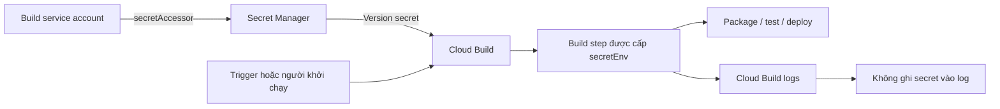

# Secret Manager trong pipeline Cloud Build

Pipeline CI/CD thường cần token để tải package riêng tư, credential để triển khai dịch vụ hoặc khóa ký artifact. Đưa các giá trị này vào repository, file `cloudbuild.yaml`, biến substitution hay image build sẽ làm tăng nguy cơ lộ bí mật. **Secret Manager** cung cấp nơi lưu secret và quản lý phiên bản; **Cloud Build** có thể lấy secret từ Secret Manager và đưa vào biến môi trường của đúng build step cần sử dụng.

Trong module `CLOUD_PROVIDERS_GCP`, người học khám phá Google Cloud từ tổ chức project, IAM và VPC đến Compute Engine, GKE, Cloud Run, dịch vụ lưu trữ và cơ sở dữ liệu. Qua các tình huống triển khai, người học biết lựa chọn dịch vụ, bảo vệ tài nguyên, tự động hóa phát hành và theo dõi độ tin cậy cùng chi phí. Bài học đặt Secret Manager vào chuỗi cung ứng phần mềm: danh tính nào chạy build, mã nguồn nào được phép sử dụng secret, secret được xoay vòng ra sao và log nào chứng minh một lần truy cập đã xảy ra đều cần được thiết kế rõ ràng.

Secret Manager không tự bảo vệ một pipeline có quyền quá rộng hoặc mã nguồn không đáng tin cậy. Nếu một build step được phép đọc secret, mã lệnh chạy trong step đó có thể sử dụng hoặc gửi secret ra ngoài. Vì vậy, phải kết hợp Secret Manager với IAM tối thiểu, build service account riêng, kiểm soát trigger và quy trình review mã nguồn.

## Mục tiêu học tập

Sau bài học, người học có thể:

- Giải thích vai trò của Secret Manager và cách Cloud Build lấy secret trong lúc chạy pipeline.
- Tạo secret, thêm version và cấp quyền Secret Accessor cho build service account.
- Cấu hình `availableSecrets.secretManager` và `secretEnv` trong `cloudbuild.yaml`.
- Phân biệt Cloud Build service agent với service account thực thi build.
- Dùng service account riêng, IAM cấp ở secret và xác thực ngắn hạn theo nguyên tắc least privilege.
- Xoay vòng, vô hiệu hóa, khôi phục version và theo dõi truy cập secret bằng audit log.
- Bảo vệ pipeline trước nguy cơ lộ secret từ log, plan, image, pull request và mã nguồn không đáng tin cậy.

## 1. Secret trong quy trình CI/CD

### Những loại secret thường xuất hiện trong pipeline

Một pipeline Cloud Build có thể cần:

- Token để tải dependency hoặc package từ registry riêng tư.
- API key để gọi hệ thống kiểm thử hoặc dịch vụ bên ngoài.
- Credential để truy cập database hoặc môi trường staging/production.
- Khóa ký để ký artifact, container image hoặc gói phát hành.
- Token để triển khai hoặc gọi API của hệ thống phát hành.

Những giá trị này là dữ liệu xác thực. Nếu đưa vào Git, chúng có thể tồn tại trong lịch sử commit ngay cả khi file đã được xóa. Nếu đưa vào Cloud Build substitutions, build log hoặc Docker build arguments, giá trị có thể bị lưu lại trong metadata, log, artifact hoặc image layer.

### Secret Manager và Cloud Build phối hợp thế nào?

Secret Manager lưu secret theo resource và version. Cloud Build dùng danh tính thực thi build để gọi Secret Manager, lấy version được chỉ định và đưa giá trị vào biến môi trường của build step khai báo `secretEnv`.



Luồng xử lý cơ bản:

1. Quản trị viên tạo secret trong Secret Manager và thêm một version.
2. Build service account được cấp `roles/secretmanager.secretAccessor` trên secret cần dùng.
3. File build config khai báo secret version trong `availableSecrets.secretManager`.
4. Build step cần secret khai báo tên biến trong `secretEnv`.
5. Cloud Build truy xuất version bằng build service account và cung cấp biến môi trường cho step.
6. Step sử dụng secret để thực hiện tác vụ, sau đó kết thúc mà không in hoặc lưu secret vào artifact.

Secret không được nhúng vào source code hoặc Docker image. Mỗi step chỉ nhận biến môi trường nếu được khai báo trong `secretEnv` của step đó.

## 2. Secret Manager: resource, version và replication

### Cấu trúc tài nguyên

Secret Manager tổ chức dữ liệu theo cấu trúc:

```text
Project quản lý secret
└── Secret: deploy-token
    ├── Version 1
    ├── Version 2
    └── Version 3 (đang dùng)
```

- **Secret** là tài nguyên logic có tên, policy IAM, cấu hình replication và metadata.
- **Secret version** chứa payload bí mật đã được lưu. Mỗi lần thay giá trị, thêm một version mới thay vì ghi đè version cũ.
- **Version alias** như `latest` giúp tham chiếu version mới nhất theo quy tắc của Secret Manager.
- **Replication policy** xác định cách dữ liệu secret được sao chép trong Google Cloud.

Resource name đầy đủ có dạng:

```text
projects/SECRET_PROJECT_ID/secrets/SECRET_ID/versions/VERSION_ID
```

Build project và secret project có thể khác nhau. Khi đó `versionName` cần chỉ rõ project chứa secret và IAM phải được cấp cho build service account trên secret ở project đó.

### Tạo secret và thêm version

Ví dụ tạo secret dùng cho bước deploy:

```bash
gcloud config set project SECRET_PROJECT_ID

gcloud services enable secretmanager.googleapis.com

gcloud secrets create deploy-token \
  --replication-policy=automatic

# Đọc payload từ file được bảo vệ, không đặt secret literal trong lệnh.
gcloud secrets versions add deploy-token \
  --data-file=/secure/path/deploy-token.txt
```

File `/secure/path/deploy-token.txt` cần được tạo và bảo vệ theo quy trình quản lý credential của tổ chức. Không commit file, không đưa nội dung vào shell history hoặc log của terminal. Sau khi thêm version, giới hạn quyền đọc file nguồn và xóa bản tạm theo chính sách lưu giữ.

Với secret cần kiểm soát vị trí lưu trữ, có thể dùng user-managed replication và chỉ định các location được tổ chức cho phép. Cấu hình replication được chọn khi tạo secret; hãy kiểm tra yêu cầu data residency trước khi tạo resource.

### Version là bất biến

Secret Manager không ghi đè payload của một version đã tạo. Khi credential thay đổi, tạo version mới. Các version có trạng thái như `ENABLED`, `DISABLED` hoặc `DESTROYED`:

- `ENABLED`: có thể được truy xuất nếu caller có quyền.
- `DISABLED`: không thể truy xuất cho đến khi được bật lại.
- `DESTROYED`: payload đã bị phá hủy và không thể khôi phục.

Việc tạo version mới không tự động thu hồi credential cũ ở hệ thống bên ngoài. Khi xoay vòng token, cần cập nhật credential ở hệ thống phát hành, thêm version mới vào Secret Manager, chuyển pipeline sang version mới, xác minh build thành công rồi mới thu hồi credential cũ.

## 3. Chọn đúng service account của Cloud Build

### Build service account và service agent là hai danh tính khác nhau

Cloud Build sử dụng nhiều danh tính phục vụ các mục đích khác nhau:

- **Build service account** là danh tính mà các build step dùng khi gọi Google Cloud API. Đây là principal cần quyền đọc secret trong Secret Manager.
- **Cloud Build service agent** là service account do Google quản lý để Cloud Build thực hiện các hoạt động dịch vụ. Service agent thường có dạng `service-PROJECT_NUMBER@gcp-sa-cloudbuild.iam.gserviceaccount.com` và cần các quyền dịch vụ như `roles/cloudbuild.serviceAgent`.

Không cấp `roles/secretmanager.secretAccessor` cho Cloud Build service agent chỉ vì tên của nó có chữ Cloud Build. Hãy cấp quyền cho build service account thực tế được gắn với build hoặc trigger.

### Không giả định một default service account cố định

Danh tính mặc định mà Cloud Build chọn có thể phụ thuộc thời điểm tạo project, cấu hình organization, lịch sử project và lựa chọn của trigger/build. Có môi trường sử dụng legacy Cloud Build service account; môi trường khác có thể sử dụng Compute Engine default service account hoặc danh tính được chỉ định rõ.

Trước khi cấp IAM, xác minh trường `serviceAccount` của build hoặc trigger trong Console/API. Với workload production, nên chỉ định một user-managed build service account có tên rõ ràng để tránh phụ thuộc vào default thay đổi theo cấu hình project.

### Tạo build service account riêng

Ví dụ tạo service account trong build project:

```bash
gcloud config set project BUILD_PROJECT_ID

gcloud iam service-accounts create cloud-build-deployer \
  --display-name="Cloud Build deployment identity"
```

Email của service account:

```text
cloud-build-deployer@BUILD_PROJECT_ID.iam.gserviceaccount.com
```

Danh tính tạo build hoặc cấu hình trigger cần quyền `iam.serviceAccounts.actAs` trên build service account; vai trò thường dùng để cấp quyền này là Service Account User (`roles/iam.serviceAccountUser`). Build service account cần thêm các quyền thực hiện công việc cụ thể như deploy Cloud Run hoặc cập nhật GKE. Những quyền này độc lập với quyền truy cập Secret Manager. Chỉ cấp quyền deploy cần thiết cho project hoặc resource đích.

### Cấp quyền truy cập secret ở cấp secret

Ví dụ build service account đọc secret `deploy-token` nằm trong `SECRET_PROJECT_ID`:

```bash
gcloud secrets add-iam-policy-binding deploy-token \
  --project=SECRET_PROJECT_ID \
  --member="serviceAccount:cloud-build-deployer@BUILD_PROJECT_ID.iam.gserviceaccount.com" \
  --role="roles/secretmanager.secretAccessor"
```

Vai trò `roles/secretmanager.secretAccessor` cung cấp quyền `secretmanager.versions.access`. Cấp quyền trực tiếp trên secret giúp giới hạn blast radius: service account chỉ đọc được những secret đã được cấp, thay vì mọi secret trong project.

Tránh cấp `roles/secretmanager.admin` hoặc `roles/owner` cho build service account. Build chỉ cần truy xuất version, không cần tạo secret, thay đổi IAM hay xóa version.

## 4. Cấu hình `availableSecrets` và `secretEnv`

### Cấu trúc cơ bản trong cloudbuild.yaml

Cloud Build hỗ trợ khai báo secret từ Secret Manager trong phần `availableSecrets`. Mỗi mục chỉ định `versionName` và tên biến môi trường. Build step cần secret khai báo biến đó trong `secretEnv`.

Ví dụ:

```yaml
steps:
  - id: deploy-application
    name: gcr.io/cloud-builders/gcloud
    entrypoint: bash
    args:
      - -c
      - |
        set +x
        ./scripts/deploy.sh
    secretEnv:
      - DEPLOY_TOKEN

availableSecrets:
  secretManager:
    - versionName: projects/SECRET_PROJECT_ID/secrets/deploy-token/versions/7
      env: DEPLOY_TOKEN

serviceAccount: projects/BUILD_PROJECT_ID/serviceAccounts/cloud-build-deployer@BUILD_PROJECT_ID.iam.gserviceaccount.com
```

Trong ví dụ:

- `versionName` là resource name của secret version trong Secret Manager.
- `env` là tên biến môi trường Cloud Build sẽ cung cấp cho step.
- `secretEnv` xác định step nào được nhận biến đó.
- `serviceAccount` chỉ định danh tính thực thi build.
- `./scripts/deploy.sh` đọc biến `DEPLOY_TOKEN` trong môi trường của tiến trình.

Đường dẫn `SECRET_PROJECT_ID`, `BUILD_PROJECT_ID`, secret ID và version phải được thay bằng giá trị thực. Đảm bảo file script không in biến môi trường, không bật shell tracing và không đưa token vào artifact.

### Truy cập secret trong lệnh inline

Nếu tham chiếu biến môi trường trực tiếp trong `args` của Cloud Build, cần dùng `$$` để tránh Cloud Build coi tên biến là substitution của chính build:

```yaml
steps:
  - name: ubuntu
    entrypoint: bash
    args:
      - -c
      - |
        set +x
        printf '%s' "$$DEPLOY_TOKEN" | ./scripts/deploy-from-stdin.sh
    secretEnv:
      - DEPLOY_TOKEN

availableSecrets:
  secretManager:
    - versionName: projects/SECRET_PROJECT_ID/secrets/deploy-token/versions/7
      env: DEPLOY_TOKEN
```

Cloud Build xử lý `$$` thành ký tự `$` để shell nhận biến `DEPLOY_TOKEN`. Nếu lệnh chạy trong một script file được gọi từ step, nội dung file script không phải build config substitution; script có thể đọc `$DEPLOY_TOKEN` bình thường.

Không dùng `echo $DEPLOY_TOKEN` để kiểm tra secret. `echo`, `printf` ra terminal, `env`, `printenv`, `set -x` hoặc lệnh debug có thể ghi giá trị vào Cloud Build logs. Ví dụ trên chỉ minh họa cách chuyển secret qua standard input đến script có thiết kế phù hợp; script không được ghi stdin hoặc biến môi trường vào log.

### Một secret cho nhiều step

Nếu nhiều step cần cùng secret, khai báo `secretEnv` ở từng step cần sử dụng. Không thêm secret vào mọi step theo mặc định. Việc giới hạn step giúp giảm số đoạn mã có thể đọc credential.

```yaml
steps:
  - id: test-private-dependency
    name: gcr.io/cloud-builders/npm
    args: ["ci"]
    secretEnv: [NPM_TOKEN]

  - id: build-image
    name: gcr.io/cloud-builders/docker
    args: ["build", "-t", "IMAGE_URI", "."]

availableSecrets:
  secretManager:
    - versionName: projects/SECRET_PROJECT_ID/secrets/npm-token/versions/4
      env: NPM_TOKEN
```

Ví dụ này chỉ cấp `NPM_TOKEN` cho step cài dependency. Nếu step build image không cần token, không cấp biến cho step đó. Cấu hình thực tế của package manager cần được thiết kế để token không bị ghi vào file cấu hình, cache hoặc layer của image.

Ví dụ `.npmrc` có thể lưu trong repository dưới dạng tham chiếu biến môi trường, không chứa token thật:

```text
//registry.npmjs.org/:_authToken=${NPM_TOKEN}
```

NPM đọc giá trị từ môi trường của step. Kiểm tra cấu hình cache và output của package manager để chắc chắn token không bị ghi vào log hoặc artifact.

### Dùng `latest` hay version cố định?

Có thể tham chiếu version cụ thể:

```yaml
versionName: projects/SECRET_PROJECT_ID/secrets/deploy-token/versions/7
```

Hoặc dùng alias:

```yaml
versionName: projects/SECRET_PROJECT_ID/secrets/deploy-token/versions/latest
```

| Cách tham chiếu | Ưu điểm | Đánh đổi |
|---|---|---|
| Version số cụ thể | Build tái lập được, biết chính xác credential nào được dùng. | Cần cập nhật build config khi xoay vòng. |
| `latest` | Build mới có thể dùng version mới mà không cần sửa YAML. | Kết quả build thay đổi theo version đang là latest tại thời điểm truy xuất. |

Với release production cần khả năng tái lập và rollback, ưu tiên version số cụ thể. Dùng `latest` khi tổ chức đã có quy trình xoay vòng và chấp nhận rằng build kế tiếp tự chuyển sang version mới. Secret Manager không thay đổi biến môi trường của một build đã chạy khi có version mới được thêm.

## 5. Trigger, pull request và ranh giới tin cậy

### Build trigger chạy mã nguồn với quyền của build service account

Khi trigger khởi chạy build, các bước trong `cloudbuild.yaml` chạy dưới build service account được gắn với trigger/build. Nếu service account có `secretAccessor`, bất kỳ mã lệnh nào chạy trong step được cấp secret đều có thể đọc giá trị đó.

Điều này có nghĩa là quyền sửa `cloudbuild.yaml`, script deploy hoặc Dockerfile có thể trở thành quyền sử dụng secret gián tiếp. Người có thể sửa mã nguồn và kích hoạt trigger có thể thay đổi pipeline để gửi secret đến một endpoint khác nếu không có kiểm soát review.

### Không cấp production secret cho mã nguồn không đáng tin cậy

Đặc biệt cẩn trọng với pull request từ fork, nhánh thử nghiệm hoặc contributor bên ngoài. Không cho build chạy từ mã nguồn chưa review truy cập token production, signing key hoặc credential deploy.

Một mô hình tách biệt có thể gồm:

| Pipeline | Quyền secret | Mục tiêu |
|---|---|---|
| Pull request validation | Không có production secret; chỉ dùng dữ liệu giả hoặc secret test riêng. | Chạy lint, unit test và kiểm tra cấu hình. |
| Merge vào nhánh được bảo vệ | Chỉ secret cần cho build/test tin cậy. | Tạo artifact sau khi code review thành công. |
| Release/deploy production | Service account và secret production riêng, trigger giới hạn nhánh/tag. | Triển khai artifact đã được phê duyệt. |

### Kiểm soát trigger và người có quyền khởi chạy

- Bảo vệ nhánh production bằng review bắt buộc và chính sách merge.
- Giới hạn ai có thể tạo, cập nhật hoặc chạy trigger production.
- Dùng service account riêng cho từng môi trường hoặc từng nhóm workload.
- Không cho phép người dùng không tin cậy sửa build config của trigger có quyền production.
- Dùng approval hoặc quy trình release gate trước khi deploy production.
- Xem xét build logs, trigger source và commit SHA khi điều tra lần truy cập secret.
- Tách secret test và production, kể cả khi tên secret tương tự nhau.

Cloud Build approval và trigger configuration có thể được dùng để kiểm soát thời điểm build được phép tiếp tục; tuy nhiên, approval không thay thế việc bảo vệ mã nguồn và IAM. Một build được phê duyệt nhưng chạy mã độc vẫn có thể làm lộ secret.

## 6. Tạo pipeline mẫu sử dụng Secret Manager

### Chuẩn bị project và API

Trong ví dụ, build project chứa Cloud Build, còn secret project chứa credential. Hai project có thể trùng nhau nếu tổ chức đơn giản, nhưng cần tách quyền rõ ràng.

```bash
gcloud services enable cloudbuild.googleapis.com \
  --project=BUILD_PROJECT_ID

gcloud services enable secretmanager.googleapis.com \
  --project=SECRET_PROJECT_ID
```

### Tạo secret và cấp quyền

```bash
gcloud secrets create deploy-token \
  --project=SECRET_PROJECT_ID \
  --replication-policy=automatic

gcloud secrets versions add deploy-token \
  --project=SECRET_PROJECT_ID \
  --data-file=/secure/path/deploy-token.txt

gcloud secrets add-iam-policy-binding deploy-token \
  --project=SECRET_PROJECT_ID \
  --member="serviceAccount:cloud-build-deployer@BUILD_PROJECT_ID.iam.gserviceaccount.com" \
  --role="roles/secretmanager.secretAccessor"
```

Trong thực tế, tạo service account trước và cấp quyền deploy riêng theo project/resource đích. Nếu service account chưa tồn tại, lệnh cấp IAM sẽ không thể gắn binding đúng principal.

### Tạo cloudbuild.yaml

```yaml
steps:
  - id: deploy-to-cloud-run
    name: gcr.io/cloud-builders/gcloud
    entrypoint: bash
    args:
      - -c
      - |
        set +x
        ./scripts/deploy-cloud-run.sh
    secretEnv:
      - DEPLOY_TOKEN

availableSecrets:
  secretManager:
    - versionName: projects/SECRET_PROJECT_ID/secrets/deploy-token/versions/1
      env: DEPLOY_TOKEN

serviceAccount: projects/BUILD_PROJECT_ID/serviceAccounts/cloud-build-deployer@BUILD_PROJECT_ID.iam.gserviceaccount.com
```

Script `deploy-cloud-run.sh` có thể đọc token từ biến môi trường khi gọi API deploy hoặc hệ thống phát hành. Không đặt token trong đối số dòng lệnh, URL, log, file output hoặc Dockerfile. Nếu công cụ deploy hỗ trợ đọc credential từ stdin hoặc file tạm có quyền hạn chế, hãy dùng cách đó và xóa file sau khi dùng.

### Chạy build

Có thể submit build từ source directory:

```bash
gcloud builds submit \
  --project=BUILD_PROJECT_ID \
  --config=cloudbuild.yaml \
  .
```

Build sẽ chạy bằng service account đã chỉ định trong cấu hình. Với trigger, cấu hình service account trong trigger để đảm bảo cùng một danh tính runtime được dùng khi trigger khởi chạy. Sau khi chạy, kiểm tra build status, log, resource IAM và việc secret có được truy cập thành công hay không mà không in payload.

### Kiểm tra danh tính và quyền

Nếu build trả lỗi `PERMISSION_DENIED`, kiểm tra theo thứ tự:

1. Build có thực sự chạy bằng service account dự kiến không?
2. Service account đó có `roles/secretmanager.secretAccessor` trên đúng secret không?
3. Secret có nằm ở project khác với project build không?
4. `versionName` có đúng project, secret ID và version không?
5. Version có đang ở trạng thái `ENABLED` không?
6. Secret Manager API đã được bật trong project chứa secret chưa?
7. Có organization policy, VPC Service Controls hoặc policy khác chặn truy cập không?

Đừng giải quyết lỗi bằng cách cấp `roles/owner` hoặc `roles/secretmanager.admin` cho build service account. Tìm đúng principal và quyền còn thiếu.

## 7. Xoay vòng và thu hồi secret

### Quy trình rotation an toàn

Một lần xoay vòng token có thể thực hiện theo các bước:

1. Tạo credential mới tại hệ thống đích, giữ credential cũ hoạt động trong thời gian chuyển đổi nếu hệ thống cho phép.
2. Thêm payload mới thành Secret Manager version mới.
3. Kiểm tra version mới ở trạng thái `ENABLED`.
4. Nếu pipeline dùng version số, cập nhật `versionName` trong build config hoặc cấu hình trigger.
5. Nếu pipeline dùng `latest`, chạy build test để xác minh version mới được đọc và hệ thống đích chấp nhận.
6. Triển khai và kiểm tra hoạt động thực tế.
7. Thu hồi credential cũ ở hệ thống phát hành.
8. Disable hoặc destroy Secret Manager version cũ theo chính sách lưu giữ và rollback.

Không disable version cũ ngay khi tạo version mới nếu build đang chạy hoặc rollback còn cần credential đó. Lập thời gian chuyển đổi và xác định ai chịu trách nhiệm ở cả Secret Manager lẫn hệ thống cấp credential.

### Rotation schedule và Pub/Sub notification

Secret Manager hỗ trợ cấu hình lịch rotation và gửi notification đến Pub/Sub topic. Notification là tín hiệu để hệ thống hoặc người vận hành bắt đầu quy trình tạo/đổi credential; nó không có nghĩa mọi hệ thống đích tự động thay đổi password/token và Secret Manager tự ghi version mới.

Một rotation workflow thường cần subscriber hoặc automation thực hiện các bước: tạo credential mới ở hệ thống đích, thêm version vào Secret Manager, kiểm tra pipeline và sau đó thu hồi credential cũ. Hãy thiết kế workflow có retry, idempotency, audit và rollback.

### Disable, destroy và rollback

- Dùng `DISABLED` khi cần tạm dừng sử dụng version nhưng muốn có thể bật lại sau khi điều tra.
- Chỉ `DESTROY` sau khi đã xác nhận không còn workload cần version và đã hết thời gian rollback theo chính sách.
- Giữ lại metadata version và audit log để phục vụ điều tra; không lưu payload secret vào ticket hoặc log.
- Nếu version mới gây lỗi, chuyển pipeline về version số trước đó còn `ENABLED`, xác minh rồi điều tra nguyên nhân.

## 8. Bảo vệ secret khỏi log, artifact và image

### Không in secret ra Cloud Build logs

Cloud Build logs có thể được lưu trong Cloud Logging hoặc Cloud Storage tùy cấu hình logging. Bất kỳ secret nào được in ra stdout/stderr có thể trở thành dữ liệu được lưu giữ và chia sẻ theo quyền đọc log.

Không dùng các lệnh sau trong step có secret:

```bash
echo "$DEPLOY_TOKEN"
printenv
env
set -x
```

Không dựa vào cơ chế che giá trị tự động của giao diện log. Hãy bảo đảm lệnh và script không tạo output chứa token, kể cả trong thông báo lỗi hoặc trace.

### Không lưu secret vào image

Tránh các mẫu sau trong Dockerfile:

```dockerfile
ARG PRIVATE_TOKEN
ENV PRIVATE_TOKEN=$PRIVATE_TOKEN
```

Build arguments và environment variables có thể bị lưu trong image metadata, layer hoặc cache. Nếu bước build cần package token, hãy dùng cơ chế secret mount của build tool phù hợp hoặc thực hiện tải dependency trong step được cấp secret, sau đó bảo đảm token không còn trong file cấu hình, cache hoặc image layer.

Không ghi token vào file trong `/workspace` nếu file đó có thể được dùng ở step sau, đưa vào artifact hoặc đóng gói vào image. Nếu bắt buộc phải tạo file tạm, dùng thư mục hạn chế quyền, không upload file và xóa ngay sau khi sử dụng.

### Không đưa secret vào substitutions

Cloud Build substitutions dành cho tham số build như môi trường, tag hoặc tên artifact. Giá trị substitutions có thể xuất hiện trong cấu hình build, metadata hoặc log. Không truyền secret qua `_API_TOKEN`, `_PASSWORD`, `--substitutions` hoặc biến môi trường của trigger. Dùng Secret Manager integration để lấy payload theo IAM.

### Bảo vệ plan, artifact và cache

Nếu pipeline chạy Terraform, Helm hoặc công cụ đóng gói có thể lưu secret vào plan/state/artifact, cần bảo vệ các file đó như dữ liệu nhạy cảm. Không upload state, plan chứa secret hoặc file `.env` vào artifact công khai. Giới hạn quyền đọc Cloud Build artifacts và thời hạn lưu giữ.

## 9. Audit và giám sát truy cập secret

### Cloud Audit Logs

Secret Manager tích hợp Cloud Audit Logs. Admin Activity logs ghi nhận thay đổi quản trị như tạo secret, cập nhật policy hoặc thay đổi version. Data Access logs ghi nhận hoạt động đọc payload, chẳng hạn thao tác `AccessSecretVersion`; Data Access logs cần được bật theo cấu hình logging của organization/project cho dịch vụ tương ứng.

Có thể tìm log trong Logs Explorer bằng filter:

```text
protoPayload.serviceName="secretmanager.googleapis.com"
```

Sau đó lọc theo principal, method name, secret resource hoặc timestamp. Audit log cho biết ai truy cập và thao tác nào đã xảy ra; không nên kỳ vọng log chứa payload secret.

### Những tín hiệu nên theo dõi

- Principal mới được cấp `roles/secretmanager.secretAccessor`.
- Secret IAM policy thay đổi ngoài change window.
- Secret version mới được tạo, disable hoặc destroy.
- Build service account truy cập secret ngoài lịch release.
- Lỗi `PERMISSION_DENIED` hoặc số lần access tăng bất thường.
- Build từ trigger/branch không nằm trong danh sách tin cậy nhưng có quyền production.
- Cloud Build logs chứa chuỗi có dấu hiệu là token hoặc credential.

Có thể xuất audit logs vào log sink, SIEM hoặc hệ thống phát hiện bất thường. Cần giới hạn quyền đọc log vì metadata truy cập có thể tiết lộ tên secret, danh tính, thời gian và cấu trúc hệ thống.

### Kiểm tra lịch sử truy cập và IAM

Khi điều tra sự cố:

1. Xác định secret ID và version bị truy cập.
2. Tìm `principalEmail`, `methodName` và thời điểm trong audit log.
3. Đối chiếu build ID, trigger, commit SHA và service account của build.
4. Kiểm tra IAM policy hiện tại và lịch sử thay đổi binding.
5. Xác định secret có xuất hiện trong log, artifact, image hoặc cache không.
6. Thu hồi credential ở hệ thống đích, tạo version mới và chạy lại pipeline sau khi khắc phục nguyên nhân.

## 10. Tình huống triển khai

### Tình huống A: Token để tải package riêng tư

Một ứng dụng Java sử dụng package từ registry riêng tư. Cloud Build cần token để tải dependency trong bước test/build.

Nhóm tạo secret `maven-registry-token`, cấp `roles/secretmanager.secretAccessor` cho build service account và chỉ cấp `secretEnv` ở step cần tải dependency. Step cấu hình Maven để đọc token từ environment hoặc file tạm có quyền hạn chế, không ghi token vào `settings.xml` được commit hoặc cache artifact. Pull request từ fork chạy bằng pipeline không có secret production.

### Tình huống B: Token triển khai Cloud Run

Một release pipeline cần token gọi API của hệ thống quản trị phát hành. Nhóm dùng service account `cloud-build-deployer` riêng, chỉ có quyền deploy dịch vụ đích và đọc secret `release-api-token`. Trigger được giới hạn vào nhánh release được bảo vệ. Build config pin version số của token để release có thể tái lập; khi rotation, nhóm cập nhật version, chạy build kiểm chứng và thu hồi token cũ sau khi xác nhận.

### Tình huống C: Khóa ký artifact

Pipeline cần ký artifact bằng private key. Nhóm phải đánh giá liệu private key có thể được thay bằng Cloud KMS asymmetric signing để không phải đưa key material vào build container hay không. Nếu công cụ bắt buộc dùng secret payload, chỉ cấp secret cho step ký, giới hạn quyền chạy trigger và không lưu key vào image, workspace hoặc log. Với yêu cầu kiểm soát khóa cao, Cloud KMS có thể giảm nguy cơ lộ private key so với truyền key material qua environment variable.

## 11. Lỗi thường gặp và cách xử lý

| Triệu chứng | Nguyên nhân có thể | Cách kiểm tra |
|---|---|---|
| Build báo `PERMISSION_DENIED` | Cấp quyền nhầm Cloud Build service agent hoặc default service account khác với build SA thực tế. | Kiểm tra `serviceAccount` của build/trigger và IAM policy trên secret. |
| `NOT_FOUND` khi truy xuất version | Sai project ID, secret ID hoặc version number. | Kiểm tra resource name đầy đủ và version tồn tại. |
| Secret version không truy cập được | Version bị `DISABLED` hoặc `DESTROYED`. | Kiểm tra version state; chọn version `ENABLED` đã được phê duyệt. |
| Build không nhận biến môi trường | Thiếu `secretEnv` ở step hoặc tên env không trùng `availableSecrets`. | So sánh `availableSecrets.secretManager[].env` và `steps[].secretEnv`. |
| Giá trị biến bị thay thế sai | Dùng `$VAR` trong inline args khiến Cloud Build hiểu là substitution. | Dùng `$$VAR` trong build config hoặc đọc biến trong script file. |
| Secret xuất hiện trong log | Script in biến, bật `set -x`, chạy `env` hoặc công cụ debug. | Dừng pipeline, hạn chế quyền log, thu hồi credential và xoay vòng secret. |
| Pipeline fork PR đọc được secret | Trigger dùng build SA có quyền production và chạy mã nguồn không đáng tin cậy. | Tách trigger không secret, bảo vệ branch và giới hạn quyền chạy trigger. |
| Secret mới chưa được sử dụng | Build config pin version cũ hoặc build đang chạy trước khi rotation. | Kiểm tra `versionName`, build start time và trạng thái version. |
| Deploy thất bại sau rotation | Credential mới chưa được cấp quyền ở hệ thống đích hoặc version cũ đã bị disable quá sớm. | Kiểm tra hệ thống phát hành, chuyển về version cũ còn enabled và hoàn tất rotation theo từng bước. |

Không giải quyết sự cố lộ secret bằng cách chỉ xóa log hoặc xóa version trong Secret Manager. Credential đã bị lộ cần được thu hồi tại hệ thống đích, tạo mới và điều tra các bản sao có thể còn tồn tại trong artifact, image hoặc cache.

## 12. Checklist bảo mật Secret Manager trong Cloud Build

- [ ] Secret được lưu trong Secret Manager, không nằm trong Git, build config, substitutions hoặc Dockerfile.
- [ ] Secret project và build project được chọn theo ranh giới quản trị rõ ràng.
- [ ] Build service account được chỉ định rõ ràng và đã xác minh trên build/trigger.
- [ ] Cloud Build service agent được giữ quyền dịch vụ cần thiết; không cấp nhầm secretAccessor cho service agent.
- [ ] `roles/secretmanager.secretAccessor` chỉ được cấp trên secret cần dùng.
- [ ] `availableSecrets.secretManager` tham chiếu đúng project, secret và version.
- [ ] Chỉ step thực sự cần secret mới khai báo `secretEnv`.
- [ ] Inline build args dùng `$$VAR` khi cần escape Cloud Build substitution.
- [ ] Script không in secret, không bật `set -x`, không chạy `env`/`printenv` và không ghi secret vào log.
- [ ] Secret không được truyền qua command-line argument, URL, Docker ARG/ENV, artifact hoặc cache.
- [ ] Pull request từ fork và branch không tin cậy không có quyền đọc production secret.
- [ ] Trigger production được bảo vệ bằng branch policy, review, quyền chạy và approval phù hợp.
- [ ] Rotation có bước tạo version, kiểm tra, chuyển build, thu hồi credential cũ và rollback.
- [ ] Data Access audit logs và cảnh báo truy cập bất thường được cấu hình theo yêu cầu.
- [ ] Pipeline có runbook xử lý `PERMISSION_DENIED`, version disabled và sự cố lộ secret.

## 13. Kết luận

Secret Manager cung cấp nơi lưu secret có version và IAM; Cloud Build tích hợp với Secret Manager để đưa secret vào đúng build step qua `availableSecrets` và `secretEnv`. Cách triển khai an toàn cần xác định chính xác build service account, cấp `roles/secretmanager.secretAccessor` trên từng secret và dùng version số hoặc alias `latest` theo chiến lược release/rotation.

Secret chỉ an toàn khi toàn bộ pipeline được kiểm soát. Mã nguồn không tin cậy có thể sử dụng quyền của build service account; log, artifact, image và cache có thể lưu lại credential nếu script hoặc công cụ build xử lý sai. Kết hợp IAM tối thiểu, trigger được bảo vệ, rotation có kiểm thử, audit log và quy trình ứng cứu sẽ giúp Cloud Build sử dụng secret phục vụ CI/CD mà không biến pipeline thành điểm rò rỉ thông tin xác thực.

## Tài liệu tham khảo

- [Use secrets from Secret Manager in Cloud Build](https://docs.cloud.google.com/build/docs/securing-builds/use-secrets)
- [Cloud Build service account](https://docs.cloud.google.com/build/docs/cloud-build-service-account)
- [Configure user-specified service accounts](https://docs.cloud.google.com/build/docs/securing-builds/configure-user-specified-service-accounts)
- [Cloud Build substitutions](https://docs.cloud.google.com/build/docs/configuring-builds/substitute-variable-values)
- [Cloud Build triggers](https://docs.cloud.google.com/build/docs/triggers)
- [Secret Manager overview](https://docs.cloud.google.com/secret-manager/docs/overview)
- [Create and manage secrets](https://docs.cloud.google.com/secret-manager/docs/creating-and-accessing-secrets)
- [Access control with IAM](https://docs.cloud.google.com/secret-manager/docs/access-control)
- [Secret Manager audit logging](https://docs.cloud.google.com/secret-manager/docs/audit-logging)
- [Rotate secrets](https://docs.cloud.google.com/secret-manager/docs/rotation-recommendations)
- [Secret Manager best practices](https://docs.cloud.google.com/secret-manager/docs/best-practices)
