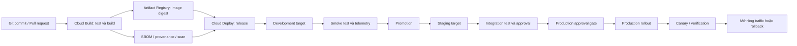

# Promotions, approvals và rollout qua nhiều môi trường

Một pipeline CI/CD đáng tin cậy phải trả lời được ba câu hỏi: phiên bản nào đã được build, ai cho phép phiên bản đó đi tiếp và làm thế nào để triển khai an toàn ở từng môi trường. Nếu mỗi môi trường tự build lại image từ cùng một nhánh mã nguồn, kết quả vẫn có thể khác nhau do dependency, base image hoặc build environment thay đổi. Nếu Production nhận thay đổi mà không có approval và kiểm chứng sau triển khai, một lỗi đã xuất hiện ở Staging vẫn có thể đến với người dùng.

**Promotion** là quá trình đưa cùng một bản phát hành đã được kiểm chứng từ môi trường này sang môi trường tiếp theo. **Approval** là quyết định có kiểm soát cho phép rollout đi tiếp. **Progressive rollout** triển khai theo từng giai đoạn hoặc một phần traffic để đo tác động trước khi mở rộng.

Trong Google Cloud, Cloud Build có thể thực hiện CI và tạo artifact, Artifact Registry lưu artifact, còn Cloud Deploy điều phối release, target, rollout và approval. Các thành phần này kết hợp với IAM, Cloud Logging, Cloud Monitoring, Binary Authorization và quy trình quản lý thay đổi để tạo một chuỗi phát hành có thể truy vết.

Bài học thuộc chương **CI/CD và chuỗi cung ứng** của module **CLOUD_PROVIDERS_GCP**. Ví dụ tập trung vào ứng dụng chạy trên GKE hoặc Cloud Run, với các môi trường Development, Staging và Production.

## 1. Mục tiêu học tập

Sau bài học, bạn có thể:

- Phân biệt build, release, promotion, approval và rollout.
- Thiết kế quy trình build một lần rồi promote cùng artifact qua nhiều môi trường.
- Tổ chức môi trường GCP, project, IAM, secrets và cấu hình triển khai.
- Dùng Cloud Deploy delivery pipeline, target, release và rollout.
- Thiết lập approval gate cho Production và tách quyền người phát hành với người phê duyệt.
- Triển khai canary hoặc rollout theo từng giai đoạn và kiểm chứng sau triển khai.
- Thiết kế rollback dựa trên artifact bất biến và dữ liệu tương thích.
- Bảo vệ chuỗi cung ứng phần mềm bằng provenance, SBOM, vulnerability scanning và Binary Authorization.
- Theo dõi lịch sử phát hành, điều tra lỗi và cải thiện quy trình.

## 2. Phân biệt build, release, promotion và rollout

Các thuật ngữ này có liên quan nhưng biểu diễn những bước khác nhau.

| Khái niệm | Ý nghĩa | Ví dụ |
|---|---|---|
| Build | Biên dịch hoặc đóng gói source code thành artifact. | Cloud Build tạo container image cho checkout API. |
| Artifact | Đầu ra bất biến của build, được định danh bằng digest hoặc version. | Image được tham chiếu bằng URI có hậu tố sha256. |
| Release | Bản phát hành gắn artifact với cấu hình và metadata để triển khai. | Cloud Deploy tạo release từ image digest và manifest. |
| Promotion | Đưa release đã kiểm tra sang target tiếp theo. | Từ Development sang Staging rồi Production. |
| Approval | Quyết định của người có quyền cho phép rollout tiếp tục. | Nhóm vận hành duyệt rollout Production. |
| Rollout | Một lần triển khai release đến một target. | Cloud Deploy triển khai release vào GKE Production. |
| Verification | Kiểm tra sau hoặc trong rollout để xác nhận sức khỏe và hành vi. | Smoke test, SLI, health check, integration test. |

Một pipeline có thể tạo một build, một release và nhiều rollout đến các target. Không nên xem mỗi lần promotion là một lần build mới.

### 2.1. Nguyên tắc build once, promote many

Giả sử commit `a1b2c3d` được build thành image:

```text
asia-southeast1-docker.pkg.dev/acme-prod/apps/checkout@sha256:9a7f...e31c
```

Cùng digest đó được triển khai lần lượt lên Development, Staging và Production. Mỗi môi trường có thể dùng cấu hình riêng như hostname, replica count, autoscaling, secret reference và resource limits; nội dung image vẫn giữ nguyên.

Lợi ích:

- Artifact ở Production chính là artifact đã được kiểm thử ở Staging.
- Có thể truy ngược từ image digest về commit, build, SBOM và provenance.
- Giảm rủi ro do dependency hoặc base image thay đổi giữa hai lần build.
- Rollback dễ xác định vì phiên bản trước được lưu bằng digest.
- Approval chỉ cần tham chiếu một release cụ thể và bằng chứng của release đó.

Nếu build lại cho từng môi trường, cùng một commit không còn bảo đảm tạo cùng binary. Cách làm đó làm yếu khả năng tái lập và kiểm toán của chuỗi cung ứng.

### 2.2. Cấu hình môi trường được phép khác nhau

Build once không có nghĩa mọi môi trường phải có cùng cấu hình runtime. Những giá trị thường khác nhau:

- Project, cluster, namespace hoặc Cloud Run service.
- Domain, endpoint và cấu hình kết nối dependency.
- Số replica, CPU, memory, autoscaling và quota.
- Tên Secret Manager secret hoặc secret version được tham chiếu.
- Feature flag và giới hạn traffic.
- Policy về logging, monitoring và network.

Hãy lưu cấu hình này trong manifest, Kustomize overlay, Helm values hoặc Skaffold profile được review. Không nhúng credential, private key hay secret dạng rõ vào container image hoặc file cấu hình được commit.

## 3. Kiến trúc promotion trên Google Cloud

Một kiến trúc tham khảo:



Các thành phần chính:

- **Source repository:** lưu mã nguồn, pipeline definition, manifest và cấu hình.
- **Cloud Build:** chạy test, build image, tạo metadata và push artifact.
- **Artifact Registry:** lưu container image theo repository, tag và digest.
- **Cloud Deploy:** quản lý delivery pipeline, target, release, rollout, approval và lịch sử triển khai.
- **Google Kubernetes Engine (GKE) hoặc Cloud Run:** runtime nhận release.
- **Cloud Monitoring và Cloud Logging:** theo dõi SLI, metric, log và trạng thái rollout.
- **Secret Manager:** cung cấp secret cho workload theo danh tính runtime.
- **Binary Authorization:** có thể áp dụng policy để chỉ cho phép image đáp ứng yêu cầu xác minh hoặc attestation chạy trên nền tảng được hỗ trợ.

Cloud Build và Cloud Deploy có trách nhiệm khác nhau. Cloud Build thường xác nhận source và tạo artifact; Cloud Deploy điều phối việc đưa release đến các target theo delivery pipeline.

## 4. Thiết kế môi trường và ranh giới bảo mật

### 4.1. Tách môi trường theo project

Với hệ thống quan trọng, một lựa chọn phổ biến là dùng project riêng cho Development, Staging và Production:

| Môi trường | Mục đích | Quyền và dữ liệu |
|---|---|---|
| Development | Tích hợp sớm, thử nghiệm thay đổi. | Quyền rộng hơn có kiểm soát; dùng dữ liệu giả lập hoặc đã ẩn danh. |
| Staging | Kiểm thử gần với Production. | Cấu hình, network và dependency tương đồng; dữ liệu kiểm thử được kiểm soát. |
| Production | Phục vụ người dùng thật. | IAM tối thiểu, dữ liệu thật, approval bắt buộc và audit đầy đủ. |

Project riêng giúp tách IAM, quota, billing, network, secrets và blast radius. Nếu tổ chức không thể tách project, ít nhất phải tách namespace, service account, secret, network policy và quyền deploy. Tuy nhiên, namespace không thay thế hoàn toàn ranh giới project.

Cloud Deploy pipeline có thể điều phối target trỏ tới tài nguyên runtime phù hợp. Khi target nằm ở project khác project của pipeline, cần cấu hình quyền truy cập cross-project rõ ràng cho danh tính thực thi. Không cấp quyền Owner ở tổ chức chỉ để pipeline deploy được.

### 4.2. Dùng danh tính riêng cho từng vai trò

Tách ít nhất các vai trò:

- **Build identity:** đọc source cần thiết, build và ghi artifact vào đúng Artifact Registry repository.
- **Release identity:** tạo release hoặc gọi Cloud Deploy từ pipeline.
- **Deployment execution identity:** triển khai vào cluster hoặc runtime của target.
- **Approver identity:** phê duyệt rollout ở môi trường được bảo vệ.
- **Runtime identity:** danh tính mà ứng dụng sử dụng khi truy cập Google Cloud API.

Một service account dùng cho build không nên tự động có quyền phê duyệt Production. Tương tự, ứng dụng đang chạy không cần quyền tạo release hoặc thay đổi delivery pipeline.

### 4.3. Secrets và cấu hình

Dùng Secret Manager để lưu database password, API token và credential cần thiết. Manifest chỉ nên tham chiếu tên secret hoặc cơ chế mount/inject secret; không chứa giá trị secret dạng rõ.

Mỗi môi trường nên có secret và quyền truy cập riêng. Service account của Staging không được đọc secret Production. Khi thay đổi secret, quản lý version và quy trình rollout để ứng dụng có thể nhận cấu hình mới an toàn.

### 4.4. Tách quyền promotion và approval

Người có thể tạo release hoặc promote đến Development không nhất thiết được phê duyệt Production. Tách quyền giúp giảm rủi ro một tài khoản bị chiếm quyền có thể tự build, tự duyệt và tự triển khai thay đổi nguy hiểm.

Dùng Google Groups hoặc danh tính tổ chức để quản lý approver theo đội. Rà soát thành viên định kỳ và thu hồi quyền khi thay đổi trách nhiệm.

## 5. Artifact bất biến trong Artifact Registry

### 5.1. Dùng digest thay vì chỉ dựa vào tag

Tag như `latest`, `staging` hoặc `prod` có thể được di chuyển để trỏ tới image khác. Digest định danh nội dung image và phù hợp để chứng minh các môi trường chạy cùng một artifact.

Ví dụ:

```text
# Tag thuận tiện để tra cứu
asia-southeast1-docker.pkg.dev/acme-prod/apps/checkout:1.8.4

# Digest dùng để cố định nội dung
asia-southeast1-docker.pkg.dev/acme-prod/apps/checkout@sha256:9a7f...e31c
```

Có thể giữ tag chứa commit SHA hoặc release version để con người dễ tra cứu, nhưng rollout production nên tham chiếu digest đã được kiểm chứng. Không ghi đè tag release đã phát hành nếu chính sách repository cho phép immutable tags; ưu tiên tạo tag mới cho mỗi build.

### 5.2. Build và push image

Ví dụ lệnh minh họa:

```bash
gcloud builds submit \
  --tag asia-southeast1-docker.pkg.dev/PROJECT_ID/apps/checkout:COMMIT_SHA \
  --project=PROJECT_ID
```

Lệnh này gửi source đến Cloud Build để build và push image theo tag. Trong pipeline thực tế, cần pin base image và dependency, chạy test, kiểm tra kết quả build, rồi lấy digest do Artifact Registry lưu.

Tra cứu digest:

```bash
gcloud artifacts docker images describe \
  asia-southeast1-docker.pkg.dev/PROJECT_ID/apps/checkout:COMMIT_SHA \
  --format="value(image_summary.digest)" \
  --project=PROJECT_ID
```

Sau khi có digest, lưu nó cùng build ID, commit SHA, builder identity và metadata kiểm thử. Không suy ra digest bằng cách tự tính hash của file source; digest image phải lấy từ artifact đã push.

### 5.3. Lưu metadata của release

Một release record nên có:

- Git commit SHA và repository URL.
- Cloud Build build ID và thời điểm build.
- Image URI và digest.
- Phiên bản base image, dependency lockfile và toolchain.
- Kết quả unit, integration và security tests.
- SBOM, provenance và vulnerability scan result.
- Release name, delivery pipeline và target history.
- Người tạo release, người promote và approver.

Thông tin này giúp người trực xác định Production đang chạy nội dung gì và vì sao nội dung đó được phép triển khai.

## 6. Cấu hình Cloud Deploy delivery pipeline

Cloud Deploy sử dụng các khái niệm:

- **Delivery pipeline:** mô tả chuỗi target và thứ tự triển khai.
- **Target:** đại diện môi trường đích như GKE cluster hoặc Cloud Run service.
- **Release:** bản phát hành được tạo từ source, manifest và image.
- **Rollout:** lần triển khai release đến một target.
- **Approval:** điều kiện phê duyệt rollout khi target yêu cầu.

Ví dụ cấu hình pipeline ba môi trường với GKE:

```yaml
apiVersion: deploy.cloud.google.com/v1
kind: DeliveryPipeline
metadata:
  name: checkout-pipeline
description: Promotion from development to staging and production
serialPipeline:
  stages:
    - targetId: checkout-dev
    - targetId: checkout-staging
    - targetId: checkout-prod
---
apiVersion: deploy.cloud.google.com/v1
kind: Target
metadata:
  name: checkout-dev
description: Development GKE cluster
gke:
  cluster: projects/PROJECT_ID/locations/asia-southeast1/clusters/dev-cluster
---
apiVersion: deploy.cloud.google.com/v1
kind: Target
metadata:
  name: checkout-staging
description: Staging GKE cluster
gke:
  cluster: projects/PROJECT_ID/locations/asia-southeast1/clusters/staging-cluster
---
apiVersion: deploy.cloud.google.com/v1
kind: Target
metadata:
  name: checkout-prod
description: Production GKE cluster
requireApproval: true
gke:
  cluster: projects/PROJECT_ID/locations/asia-southeast1/clusters/prod-cluster
```

Đây là ví dụ cấu trúc cơ bản. Thay `PROJECT_ID`, cluster name và location bằng giá trị thực. Tài nguyên target cần tồn tại và danh tính thực thi phải có quyền triển khai đến cluster. Nếu các môi trường nằm ở project khác nhau, cấu hình IAM cross-project cho đúng service account.

Áp dụng cấu hình:

```bash
gcloud deploy apply \
  --file=clouddeploy.yaml \
  --region=asia-southeast1 \
  --project=PROJECT_ID
```

Sau khi apply, kiểm tra delivery pipeline và target trong Cloud Deploy Console hoặc bằng lệnh `gcloud deploy delivery-pipelines describe` và `gcloud deploy targets describe`. Cấu hình pipeline là hạ tầng cần được review như các tài nguyên production khác.

### 6.1. Gắn cấu hình theo môi trường

Có thể dùng Skaffold profiles để render manifest khác nhau cho từng stage. Ví dụ khung cấu hình:

```yaml
apiVersion: skaffold/v4beta11
kind: Config
metadata:
  name: checkout
manifests:
  raw:
    - k8s/base/*.yaml
deploy:
  kubectl: {}
profiles:
  - name: dev
    manifests:
      raw:
        - k8s/overlays/dev/*.yaml
  - name: staging
    manifests:
      raw:
        - k8s/overlays/staging/*.yaml
  - name: prod
    manifests:
      raw:
        - k8s/overlays/prod/*.yaml
```

Pipeline stage có thể chọn profile tương ứng cho target. Với cấu hình Kustomize hoặc Helm, tổ chức overlay/values theo môi trường và giữ image digest được truyền vào release. Tránh tạo ba image khác nhau chỉ để thay hostname hoặc replica count.

Kiểm tra phiên bản Skaffold được Cloud Deploy hỗ trợ trong môi trường hiện tại trước khi chọn `apiVersion`. Mẫu trên minh họa cấu trúc profile; manifest, artifact mapping và cách render cần khớp với ứng dụng thực tế.

### 6.2. Tạo release từ artifact đã build

Sau khi image được push và digest đã được xác nhận, tạo release:

```bash
gcloud deploy releases create checkout-1-8-4 \
  --delivery-pipeline=checkout-pipeline \
  --region=asia-southeast1 \
  --source=. \
  --images=checkout=asia-southeast1-docker.pkg.dev/PROJECT_ID/apps/checkout@sha256:DIGEST \
  --project=PROJECT_ID
```

Tên bên trái của `--images` phải khớp tên image trong cấu hình Skaffold hoặc manifest mà Cloud Deploy render. `DIGEST` là digest thực tế lấy từ Artifact Registry, không phải placeholder để giữ nguyên khi chạy.

Cloud Deploy tạo release và bắt đầu rollout đến target đầu tiên theo pipeline. Kiểm tra rendered manifest trước khi rollout đến môi trường quan trọng; thay đổi render theo profile phải được xem như một phần của nội dung release.

## 7. Promotion giữa các môi trường

### 7.1. Promotion là chuyển cùng release đến target kế tiếp

Sau khi rollout Development hoàn tất và các kiểm tra đạt yêu cầu, promote release đến Staging:

```bash
gcloud deploy releases promote \
  --release=checkout-1-8-4 \
  --delivery-pipeline=checkout-pipeline \
  --region=asia-southeast1 \
  --to-target=checkout-staging \
  --project=PROJECT_ID
```

Sau khi Staging đã chạy test tích hợp và xác nhận, tiếp tục promote cùng release đến Production:

```bash
gcloud deploy releases promote \
  --release=checkout-1-8-4 \
  --delivery-pipeline=checkout-pipeline \
  --region=asia-southeast1 \
  --to-target=checkout-prod \
  --project=PROJECT_ID
```

Tên release giữ nguyên qua các lần promote. Cloud Deploy tạo rollout tương ứng cho target mới. Nếu target Production yêu cầu approval, rollout sẽ chờ phê duyệt trước khi thực hiện các bước triển khai cần được bảo vệ.

Không tạo release mới chỉ để chuyển từ Staging sang Production nếu không có thay đổi nội dung cần build. Release mới có thể làm mất tính liên tục của bằng chứng kiểm thử và provenance.

### 7.2. Điều kiện để promotion được phép

Trước khi promote, pipeline hoặc người phát hành cần xác minh:

- Rollout trước đó đã hoàn tất.
- Smoke test và integration test đạt yêu cầu.
- Image digest đúng với release đã kiểm tra.
- Vulnerability scan không có phát hiện bị policy chặn.
- SBOM và build provenance có thể truy xuất.
- Cấu hình môi trường đã được render và review.
- Không có incident đang mở khiến việc triển khai tiếp theo làm tăng rủi ro.
- Người sở hữu dịch vụ và approver đã nhận đủ thông tin.

Các điều kiện có thể được tự động hóa qua CI checks, policy engine hoặc verification job. Một lệnh promote thành công chỉ chứng minh Cloud Deploy chấp nhận yêu cầu promotion; nó không thay thế bằng chứng ứng dụng hoạt động tốt.

### 7.3. Quản lý nhiều nhánh phát hành

Với nhiều đội hoặc nhiều release song song:

- Đặt tên release theo version hoặc commit SHA, không tái sử dụng tên.
- Theo dõi release đang ở target nào.
- Tránh promote hai release đồng thời vào cùng một target nếu chúng có thể ghi đè cấu hình của nhau.
- Có quy tắc xử lý release cũ bị chặn hoặc bị thay thế.
- Xác định ai có quyền hủy rollout hoặc tiếp tục promotion.
- Giữ artifact và manifest đủ lâu để hỗ trợ rollback trong thời gian lưu giữ.

## 8. Approval gate cho Staging và Production

### 8.1. Khi nào cần approval?

Không phải mọi môi trường đều cần cùng một mức phê duyệt.

| Môi trường | Cơ chế đề xuất | Lý do |
|---|---|---|
| Development | Tự động sau CI | Phản hồi nhanh cho lập trình viên. |
| Staging | Tự động hoặc approval theo rủi ro | Kiểm tra tích hợp và dữ liệu gần Production. |
| Production | Approval rõ ràng từ người có thẩm quyền | Bảo vệ người dùng, dữ liệu và tính liên tục dịch vụ. |

Approval nên được yêu cầu khi thay đổi ảnh hưởng đến Production, schema dữ liệu, IAM, network, billing, hoặc một release có mức rủi ro cao. Với thay đổi thông thường, quy trình tự động vẫn có thể an toàn nếu policy, test và rollback đã được xác lập.

### 8.2. Yêu cầu approval trong Cloud Deploy

Trong Target của Production, đặt:

```yaml
apiVersion: deploy.cloud.google.com/v1
kind: Target
metadata:
  name: checkout-prod
description: Production GKE target
requireApproval: true
gke:
  cluster: projects/PROJECT_ID/locations/asia-southeast1/clusters/prod-cluster
```

Khi rollout đến target này, Cloud Deploy yêu cầu approval. Người có quyền approver có thể xem release, rollout và thông tin liên quan rồi quyết định phê duyệt hoặc từ chối theo quy trình tổ chức.

Dùng IAM role phù hợp, ví dụ `roles/clouddeploy.approver`, để cấp quyền phê duyệt. Cấp quyền ở phạm vi nhỏ nhất có thể và dùng Google Group cho nhóm approver thay vì gán quyền rộng cho nhiều tài khoản cá nhân. Kiểm tra IAM role và quyền thực tế trong project vì tổ chức có thể áp dụng custom role hoặc policy bổ sung.

### 8.3. Phê duyệt rollout bằng CLI

Sau khi kiểm tra rollout đang chờ approval, người được ủy quyền có thể phê duyệt:

```bash
gcloud deploy rollouts approve ROLLOUT_ID \
  --delivery-pipeline=checkout-pipeline \
  --release=checkout-1-8-4 \
  --region=asia-southeast1 \
  --approve \
  --project=PROJECT_ID
```

Thay `ROLLOUT_ID` bằng rollout đang chờ duyệt. Không tự động phê duyệt chỉ vì rollout đã chờ quá lâu; nếu approver không phản hồi, cần escalations hoặc hủy theo chính sách thay đổi.

### 8.4. Nội dung approval phải đủ bằng chứng

Một yêu cầu phê duyệt tốt nên cung cấp:

- Release name, commit SHA, image digest và build ID.
- Link đến source change, pull request và người review.
- Kết quả unit, integration, smoke và security tests.
- SBOM, provenance và kết quả vulnerability scan.
- SLO dashboard và tình trạng error budget hiện tại.
- Danh sách môi trường đã nhận release.
- Thay đổi cấu hình và migration dữ liệu.
- Rollout strategy, thời lượng quan sát và điều kiện dừng.
- Kế hoạch rollback và người chịu trách nhiệm.

Approval không nên chỉ là nút bấm “Approve” không có ngữ cảnh. Người phê duyệt cần biết artifact nào sẽ chạy, tác động dự kiến, bằng chứng kiểm thử và phương án phục hồi.

### 8.5. Tách nhiệm vụ và tránh self-approval

Áp dụng separation of duties:

- Người tạo release không nên tự phê duyệt Production nếu chính sách yêu cầu kiểm soát độc lập.
- Người review code không mặc nhiên có quyền sửa IAM hoặc policy deploy.
- Approver không cần quyền thay đổi manifest hoặc build artifact.
- Tài khoản service account của pipeline không được giả danh approver.
- Mọi ngoại lệ break-glass phải có thời hạn, lý do và audit record.

Không tạo approval gate hình thức mà cùng một danh tính có thể tự tạo, tự duyệt và tự triển khai toàn bộ chuỗi.

## 9. Progressive rollout và canary deployment

Triển khai toàn bộ traffic cùng lúc có thể khiến một lỗi mới ảnh hưởng toàn bộ người dùng trước khi được phát hiện. Progressive rollout giảm blast radius bằng cách tăng dần phạm vi triển khai và quan sát kết quả ở từng bước.

### 9.1. Các chiến lược rollout

| Chiến lược | Cách hoạt động | Khi phù hợp |
|---|---|---|
| Rolling update | Thay instance hoặc pod theo từng nhóm. | Dịch vụ stateless, có health check và capacity dư. |
| Canary | Triển khai phiên bản mới cho một phần nhỏ workload hoặc traffic trước. | Muốn đo hành vi release mới với rủi ro giới hạn. |
| Blue/green | Chuẩn bị môi trường mới song song rồi chuyển traffic. | Cần chuyển đổi nhanh và có khả năng quay lại môi trường cũ. |
| Traffic splitting | Phân chia request giữa revision hoặc backend. | Cloud Run hoặc load balancer hỗ trợ phân phối traffic theo tỷ lệ. |
| All-at-once | Triển khai đồng thời toàn bộ target. | Môi trường thử nghiệm hoặc thay đổi rủi ro thấp đã được kiểm chứng. |

Rolling update là cơ chế thay workload theo từng nhóm; canary là chiến lược xác minh phiên bản mới trước khi mở rộng; blue/green duy trì hai môi trường để chuyển traffic. Không có chiến lược nào thay thế health check, capacity planning và rollback.

### 9.2. Ví dụ canary theo phần trăm traffic

Với dịch vụ checkout, nhóm có thể triển khai theo các giai đoạn:

| Giai đoạn | Traffic phiên bản mới | Điều kiện tiếp tục |
|---|---:|---|
| Canary 1 | 5% | Không có lỗi nghiêm trọng; latency và error ratio trong ngưỡng. |
| Canary 2 | 25% | SLI ổn định qua khoảng quan sát đã chọn. |
| Canary 3 | 50% | Không có regression so với baseline. |
| Hoàn tất | 100% | Verification đạt và không có cảnh báo SLO quan trọng. |

Tỷ lệ và thời gian quan sát phải dựa trên traffic, mức rủi ro và độ nhạy của SLI. Một dịch vụ ít traffic có thể cần thời gian dài hơn để có đủ mẫu. Một thay đổi có ảnh hưởng dữ liệu hoặc IAM cần kiểm tra riêng ngoài traffic metrics.

### 9.3. Canary trên GKE

Cloud Deploy hỗ trợ deployment strategy cho các runtime được hỗ trợ, bao gồm các mô hình canary cho GKE. Có thể chia rollout thành các phase và dùng verification để quyết định tiếp tục hay dừng.

Với GKE, cần xác định:

- Deployment hoặc workload được canary.
- Service và cách định tuyến traffic tới phiên bản mới.
- Tỷ lệ hoặc số lượng pod của từng phase.
- Health check, readiness probe và startup probe.
- Capacity của phiên bản cũ trong lúc rollout.
- Metric để so sánh canary với baseline.
- Điều kiện dừng và phục hồi.

Nếu dùng Kubernetes Deployment thông thường mà không có traffic splitting, tăng số replica mới không nhất thiết đồng nghĩa chỉ 5% traffic đi tới phiên bản mới. Cần một cơ chế routing thực sự như service mesh, gateway hoặc cấu hình traffic management phù hợp.

### 9.4. Canary trên Cloud Run

Cloud Run hỗ trợ nhiều revision và phân chia traffic giữa các revision. Có thể triển khai revision mới với tỷ lệ nhỏ, quan sát metric, rồi tăng dần traffic. Cloud Deploy có thể điều phối rollout Cloud Run theo chiến lược được hỗ trợ.

Theo dõi:

- Request count và tỷ lệ 5xx theo revision.
- Latency p50, p95 và p99.
- Container startup failure và instance error.
- CPU/memory và concurrency.
- Kết quả synthetic test và luồng nghiệp vụ chính.

Nếu revision mới có lỗi cao hơn baseline, dừng tăng traffic và chuyển traffic về revision ổn định theo quy trình rollback.

## 10. Verification sau triển khai

Rollout thành công về mặt API chưa chắc ứng dụng đã hoạt động đúng. Cần kiểm tra ở nhiều lớp.

### 10.1. Kiểm tra kỹ thuật

- Workload hoặc revision mới đã sẵn sàng.
- Readiness và health check đạt.
- Pod không restart liên tục, container không crash loop.
- Load balancer và routing trỏ đúng target.
- Dependency kết nối thành công.
- Log không xuất hiện lỗi mới có tần suất bất thường.

### 10.2. Kiểm tra nghiệp vụ

Chạy smoke test hoặc synthetic transaction trên luồng người dùng quan trọng:

- Đăng nhập.
- Tạo đơn hàng hoặc giao dịch thử nghiệm.
- Đọc và ghi dữ liệu theo luồng chính.
- Kiểm tra quyền truy cập và response contract.
- Xác nhận event hoặc message được phát đúng.

Smoke test cần an toàn, có dữ liệu thử nghiệm và có thể chạy lặp lại mà không tạo giao dịch thật không mong muốn.

### 10.3. So sánh SLI trước và sau rollout

Theo dõi metric theo revision, version, target hoặc deployment label:

- Availability / error ratio.
- Latency distribution.
- Request volume và saturation.
- Retry rate và dependency errors.
- SLO burn rate và error budget.

Không chỉ so sánh giá trị trung bình. p95/p99 latency và phân bố lỗi theo region hoặc request class có thể cho thấy regression mà average che giấu.

### 10.4. Quy tắc tiếp tục hoặc dừng

Đặt điều kiện trước khi bắt đầu rollout:

- Tiếp tục khi health check, smoke test và SLI đều đạt.
- Dừng mở rộng khi error ratio, latency hoặc crash rate vượt ngưỡng.
- Rollback khi regression ảnh hưởng người dùng hoặc không thể phục hồi trong thời gian cho phép.
- Tạo incident nếu có tác động thực tế hoặc nghi ngờ ảnh hưởng dữ liệu.
- Không tiếp tục chỉ vì hết thời gian quan sát nếu metric chưa đủ mẫu hoặc telemetry bị gián đoạn.

## 11. Rollback và phục hồi

Rollback phải được chuẩn bị trước khi triển khai. Nó có thể gồm chuyển traffic về revision cũ, triển khai lại image digest đã biết tốt hoặc khôi phục manifest/configuration trước đó.

### 11.1. Giữ lại release ổn định

Lưu release name và digest của phiên bản Production trước đó. Khi release mới gặp lỗi:

1. Dừng promotion hoặc phase tiếp theo.
2. Xác định phạm vi ảnh hưởng và phiên bản đang phục vụ.
3. Chọn release hoặc artifact đã được xác nhận tốt.
4. Tạo rollout phục hồi theo cơ chế Cloud Deploy hoặc runtime.
5. Xác minh SLI, health check và luồng nghiệp vụ.
6. Ghi nhận incident và giữ bằng chứng của release lỗi.

Không dùng tag mutable như `latest` để rollback vì tag có thể đã trỏ tới image khác.

### 11.2. Rollback Cloud Run

Cloud Run duy trì revision. Nếu revision mới làm tăng lỗi, có thể điều chỉnh traffic về revision trước đó qua Cloud Console, gcloud hoặc quy trình Cloud Deploy phù hợp.

Ví dụ minh họa xem revision:

```bash
gcloud run revisions list \
  --service=checkout \
  --region=asia-southeast1 \
  --project=PROJECT_ID
```

Sau đó dùng thao tác cập nhật traffic để đưa tỷ lệ về revision đã kiểm chứng. Hãy xác nhận revision cũ vẫn tồn tại và cấu hình runtime của nó còn hợp lệ trước khi chuyển traffic.

### 11.3. Rollback GKE

Với GKE, lựa chọn phục hồi phụ thuộc cách triển khai:

- Dùng Cloud Deploy rollout hoặc release đã biết tốt để triển khai lại manifest và image cũ.
- Dùng cơ chế rollback của Kubernetes Deployment khi rollout được quản lý trực tiếp bằng Deployment revision và cấu hình còn được lưu.
- Nếu traffic được điều phối bằng Gateway, service mesh hoặc load balancer, khôi phục routing theo version ổn định.
- Kiểm tra migration dữ liệu và API contract trước khi chạy lại phiên bản cũ.

Không giả định rollback workload có thể đảo ngược database schema hoặc dữ liệu đã thay đổi. Nếu migration phá vỡ tương thích ngược, cần kế hoạch phục hồi riêng.

### 11.4. Thiết kế database migration tương thích

Một rollout nhiều môi trường cần lưu ý migration:

- Dùng mô hình expand-and-contract: thêm schema tương thích trước, triển khai code mới, rồi mới loại bỏ schema cũ sau khi tất cả phiên bản đã chuyển đổi.
- Tránh rename hoặc drop column ngay trong release đầu tiên nếu phiên bản cũ còn cần đọc.
- Tạo backup hoặc point-in-time recovery theo yêu cầu dữ liệu.
- Kiểm tra migration trên Staging với dữ liệu đại diện.
- Đảm bảo code mới có thể hoạt động khi migration mới đã chạy nhưng rollback code về phiên bản trước.
- Với thay đổi không thể rollback, chuẩn bị forward fix hoặc restore plan và yêu cầu approval riêng.

Rollback application và rollback data là hai công việc khác nhau. Đừng hứa rollback tức thì nếu schema hoặc dữ liệu không thể quay lại trạng thái trước.

## 12. Bảo vệ software supply chain và policy phát hành

### 12.1. Provenance và SBOM

Provenance ghi lại nguồn gốc và cách artifact được tạo: source, builder, build process và kết quả. SBOM liệt kê thành phần phần mềm và dependency trong artifact.

Trước khi promotion Production, kiểm tra:

- Provenance gắn đúng image digest.
- Builder là identity được tổ chức tin cậy.
- Source commit đã được review và thuộc nhánh hoặc release được phép.
- SBOM được tạo và lưu theo chính sách.
- Dependency scan không có lỗ hổng vượt ngưỡng policy.
- Artifact chưa bị thay đổi sau build.

### 12.2. Vulnerability scanning và Binary Authorization

Artifact Registry có thể tích hợp Artifact Analysis để quét lỗ hổng container image. Dùng kết quả scan cùng policy severity, exception, deadline xử lý và owner.

Với GKE, Binary Authorization có thể kiểm soát image được phép triển khai dựa trên policy và attestation. Chỉ image đáp ứng yêu cầu provenance hoặc attestation mới được phép chạy. Cần thiết kế attestor, signer, key protection và quy trình tạo attestation sau các kiểm tra cần thiết.

Approval của Cloud Deploy và Binary Authorization giải quyết hai câu hỏi khác nhau:

- Approval xác nhận người có thẩm quyền cho phép rollout.
- Binary Authorization kiểm tra artifact có đáp ứng policy triển khai hay không.

Một người phê duyệt không nên có khả năng bỏ qua policy bảo vệ artifact chỉ bằng cách bấm approve. Nếu policy yêu cầu attestation, release phải có attestation hợp lệ trước khi runtime chấp nhận image.

### 12.3. Quản lý dependency và base image

- Pin dependency bằng lockfile và phiên bản cụ thể.
- Dùng base image được tổ chức chấp thuận.
- Theo dõi cập nhật bảo mật của base image.
- Hạn chế package không cần thiết trong container.
- Không tải dependency từ nguồn không xác thực trong lúc build.
- Lưu cache build an toàn và tránh dùng chung cache không tin cậy giữa workload có mức bảo mật khác nhau.

### 12.4. Policy as code

Có thể áp dụng policy trước promotion để kiểm tra:

- Image phải dùng digest, không dùng mutable tag.
- Release phải có provenance và SBOM.
- Vulnerability không vượt ngưỡng.
- Manifest Production không chứa secret dạng rõ.
- Resource request/limit, namespace, service account và security context đạt baseline.
- Approval được yêu cầu với Production hoặc thay đổi rủi ro cao.

Policy nên được version control, test và review như mã nguồn. Có quy trình exception rõ ràng, thời hạn hết hiệu lực và owner chịu trách nhiệm.

## 13. Cloud Build và Cloud Deploy trong CI/CD

Một pipeline tham khảo có hai phần: Cloud Build tạo artifact, Cloud Deploy tạo release và điều phối rollout.

### 13.1. Cloud Build tạo image

Ví dụ Cloud Build config rút gọn:

```yaml
steps:
  - name: gcr.io/cloud-builders/docker
    args:
      - build
      - -t
      - asia-southeast1-docker.pkg.dev/PROJECT_ID/apps/checkout:$SHORT_SHA
      - .

  - name: gcr.io/cloud-builders/docker
    args:
      - push
      - asia-southeast1-docker.pkg.dev/PROJECT_ID/apps/checkout:$SHORT_SHA

  - name: gcr.io/google.com/cloudsdktool/google-cloud-cli:stable
    entrypoint: bash
    args:
      - -ceu
      - |
        IMAGE="asia-southeast1-docker.pkg.dev/PROJECT_ID/apps/checkout:$SHORT_SHA"
        DIGEST="$(gcloud artifacts docker images describe "$IMAGE" \
          --format='value(image_summary.digest)')"
        test -n "$DIGEST"
        echo "$DIGEST" > /workspace/image-digest.txt

options:
  logging: CLOUD_LOGGING_ONLY
```

Đây là ví dụ tối giản để minh họa build, push và lấy digest. Trong pipeline thực tế, thêm unit test, dependency scan, SBOM, provenance, artifact retention và xử lý lỗi. `PROJECT_ID` và repository phải trỏ đúng nơi lưu artifact; không dùng cùng một tag cho nhiều build.

### 13.2. Tạo Cloud Deploy release

Sau khi digest đã được xác định, một bước Cloud SDK có thể tạo release:

```bash
DIGEST="$(cat /workspace/image-digest.txt)"

gcloud deploy releases create "checkout-$SHORT_SHA" \
  --delivery-pipeline=checkout-pipeline \
  --region=asia-southeast1 \
  --source=. \
  --images="checkout=asia-southeast1-docker.pkg.dev/PROJECT_ID/apps/checkout@$DIGEST" \
  --project=PROJECT_ID
```

Bước này cần quyền tạo release và đọc cấu hình nguồn. Tên image `checkout` phải khớp cấu hình Skaffold. Để promotion Production có approval, Target tương ứng phải được cấu hình `requireApproval: true`.

Không đặt quyền phê duyệt cho service account build. Nếu pipeline tự động promote đến Staging, hãy dùng danh tính release/promote có quyền phù hợp; Production vẫn chờ approver độc lập.

### 13.3. Tách pipeline CI và CD

Có thể tách:

- CI pipeline chạy khi pull request hoặc merge: test, build, scan, tạo artifact và provenance.
- CD pipeline tạo release từ digest đã được chấp nhận, deploy Development và chờ kiểm thử.
- Promotion workflow đưa cùng release đến Staging và Production sau các điều kiện tương ứng.

Tách CI/CD giúp không phải build lại khi promote và cho phép nhóm vận hành kiểm soát quyền deploy độc lập với quyền thay đổi source code.

## 14. IAM và audit cho quá trình phát hành

### 14.1. Quyền Cloud Build

Service account của Cloud Build chỉ nên có:

- Quyền đọc source hoặc truy cập trigger cần thiết.
- Quyền ghi vào đúng Artifact Registry repository.
- Quyền tạo release nếu bước build/CD cần gọi Cloud Deploy.
- Quyền đọc secret hoặc cấu hình chỉ khi build thực sự cần.

Không cấp Owner hoặc Editor để xử lý lỗi permission. Xác định API và permission cụ thể đang thiếu rồi cấp role phù hợp ở phạm vi nhỏ nhất.

### 14.2. Quyền Cloud Deploy

Tách quyền theo nhiệm vụ:

- Người xem pipeline/rollout chỉ cần quyền xem.
- Người tạo release hoặc promote cần quyền tương ứng.
- Approver cần quyền phê duyệt rollout.
- Execution service account cần quyền triển khai lên GKE hoặc Cloud Run target.
- Người quản trị pipeline mới cần quyền sửa delivery pipeline và target.

Với target GKE, execution identity cần quyền truy cập cluster và quyền Kubernetes RBAC để apply resource. Với Cloud Run, danh tính triển khai cần quyền cập nhật service và sử dụng service account runtime được cấu hình. Không dùng quyền runtime của ứng dụng làm quyền deploy.

### 14.3. Audit trail

Theo dõi:

- Ai tạo build và release.
- Source commit và digest nào được build.
- Ai promote release và đến target nào.
- Ai approve hoặc từ chối rollout.
- Rollout bắt đầu, hoàn tất, bị dừng hoặc rollback khi nào.
- Policy hoặc IAM nào đã thay đổi.
- Kết quả verification và incident liên quan.

Dùng Cloud Audit Logs, Cloud Build history, Cloud Deploy release/rollout history và hệ thống incident/change management. Giữ log đủ lâu theo yêu cầu kiểm toán và bảo mật của tổ chức.

## 15. Các lỗi thường gặp

| Lỗi | Hậu quả | Cách xử lý |
|---|---|---|
| Build lại image ở mỗi môi trường | Artifact khác nhau dù cùng commit. | Build một lần, promote digest đã kiểm chứng. |
| Dùng tag mutable như `latest` | Không xác định chắc Production đang chạy nội dung nào. | Dùng image digest và tag bất biến theo release. |
| Production không có approval gate | Thay đổi có thể triển khai mà không được review. | Bật `requireApproval` và tách approver role. |
| Người build tự duyệt Production | Mất separation of duties. | Dùng nhóm approver độc lập và audit. |
| Chỉ kiểm tra deploy API trả thành công | Ứng dụng có thể lỗi sau khi rollout. | Thêm smoke test, verification và SLI checks. |
| Canary không có traffic splitting | Tỷ lệ canary không phản ánh traffic thực. | Cấu hình routing hoặc service mesh phù hợp runtime. |
| Chỉ rollback code, bỏ qua database | Phiên bản cũ có thể không đọc được schema mới. | Dùng migration tương thích ngược và kế hoạch phục hồi dữ liệu. |
| Approval thiếu bằng chứng | Người duyệt không đánh giá được rủi ro. | Cung cấp digest, test, SBOM, provenance, SLO và rollback plan. |
| Service account có quyền quá rộng | Tăng blast radius nếu credential bị lộ. | Tách identity và IAM tối thiểu. |
| Không lưu lịch sử release | Khó điều tra và phục hồi. | Lưu release metadata, digest, rollout và audit log. |
| Promotion đồng thời nhiều release | Release mới có thể ghi đè hoặc làm rối trạng thái môi trường. | Serialize promotion theo target và theo dõi release state. |
| Không có điều kiện dừng rollout | Regression lan rộng trước khi được phát hiện. | Định nghĩa ngưỡng dừng, verification và người quyết định. |

## 16. Checklist trước khi promote Production

- [ ] Release trỏ tới image digest bất biến.
- [ ] Digest đã được triển khai và kiểm thử trên Development và Staging.
- [ ] Build ID, commit SHA, provenance và SBOM có thể truy xuất.
- [ ] Vulnerability scan đáp ứng policy.
- [ ] Cấu hình Production đã được render và review.
- [ ] Project, target, cluster/service và namespace đúng môi trường.
- [ ] Secrets được tham chiếu qua Secret Manager, không nằm trong image hoặc manifest dạng rõ.
- [ ] Execution service account có quyền tối thiểu cần thiết.
- [ ] Target Production bật approval gate.
- [ ] Approver độc lập đã xem đủ bằng chứng và rollback plan.
- [ ] Canary/rollout strategy và điều kiện dừng được xác định.
- [ ] Smoke test, health check, SLI và dashboard đã sẵn sàng.
- [ ] Database migration tương thích với phiên bản trước hoặc có kế hoạch phục hồi.
- [ ] Artifact và release cũ còn khả dụng trong thời gian rollback.
- [ ] Cloud Build, Cloud Deploy và IAM audit trail được lưu.
- [ ] Có owner trực trong thời gian rollout và sau khi mở rộng traffic.

## Kết luận

Promotion, approval và rollout là ba lớp kiểm soát bổ sung cho nhau trong CI/CD. Build once, promote many giúp đảm bảo cùng một artifact đã được kiểm thử được đưa qua từng môi trường. Cloud Deploy điều phối release và rollout; target approval gate tạo điểm kiểm soát độc lập trước Production; canary và verification giúp giới hạn tác động khi phát hành.

Một quy trình phát hành an toàn cần artifact bất biến, cấu hình môi trường được quản lý, IAM tách biệt, bằng chứng supply chain, approval có ngữ cảnh và rollback đã được thử nghiệm. Khi kết hợp Cloud Build, Artifact Registry, Cloud Deploy, Cloud Monitoring và audit trail, đội ngũ có thể truy vết đầy đủ từ commit đến phiên bản đang chạy trên Production.

## Tài liệu tham khảo

- [Google Cloud Deploy: Overview](https://cloud.google.com/deploy/docs/overview)
- [Google Cloud Deploy: Delivery pipelines and targets](https://cloud.google.com/deploy/docs/deployment-pipelines)
- [Google Cloud Deploy: Approve a rollout](https://cloud.google.com/deploy/docs/approve-rollout)
- [Google Cloud Deploy: Promote a release](https://cloud.google.com/deploy/docs/promote-release)
- [Google Cloud Deploy: Deployment strategies](https://cloud.google.com/deploy/docs/deployment-strategies)
- [Google Cloud Deploy: Verify a deployment](https://cloud.google.com/deploy/docs/verify-deployment)
- [Cloud Build: Build and push Docker images](https://cloud.google.com/build/docs/building/build-containers)
- [Artifact Registry: Container image digests](https://cloud.google.com/artifact-registry/docs/docker/names)
- [Binary Authorization: Overview](https://cloud.google.com/binary-authorization/docs/overview)
- [Google Cloud: Secure CI/CD pipeline](https://cloud.google.com/architecture/secure-cicd-pipeline)

