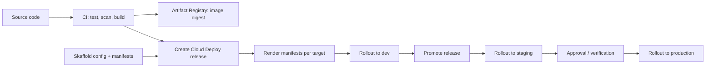

# Skaffold và cấu hình triển khai cho Cloud Deploy

Một nhóm phát triển có thể build được container image nhưng vẫn gặp khó khăn khi đưa cùng một phiên bản ứng dụng qua dev, staging và production. Mỗi môi trường có cluster, cấu hình mạng, số replica, secret và yêu cầu phê duyệt khác nhau. Nếu CI tạo manifest theo cách riêng cho từng môi trường, kết quả triển khai dễ lệch nhau và khó truy vết phiên bản nào đã chạy ở đâu.

**Skaffold** chuẩn hóa cách mô tả build, render và deploy ứng dụng Kubernetes. **Cloud Deploy** quản lý luồng phát hành qua các môi trường, tạo release và rollout, theo dõi trạng thái, yêu cầu phê duyệt và hỗ trợ chiến lược canary. Khi kết hợp, Skaffold xác định manifest được tạo ra như thế nào; Cloud Deploy quyết định manifest đó được phát hành đến target nào và theo thứ tự nào.

Trong module `CLOUD_PROVIDERS_GCP`, bài học này đặt Skaffold và Cloud Deploy vào quy trình phát hành workload trên Google Kubernetes Engine (GKE), đồng thời kết nối với Artifact Registry, Cloud Build, IAM và kiểm soát chuỗi cung ứng phần mềm. CI chịu trách nhiệm tạo image có thể kiểm chứng; Cloud Deploy nhận image bất biến cùng mã cấu hình, render manifest cho từng target và điều phối quá trình triển khai.

## 1. Phân biệt CI, Skaffold và Cloud Deploy

| Thành phần | Trách nhiệm chính | Kết quả |
|---|---|---|
| Continuous Integration (CI) | Kiểm thử mã, build container, quét lỗ hổng, ký hoặc tạo provenance, đẩy image lên Artifact Registry | Image đã build và định danh bằng digest hoặc tag bất biến |
| Skaffold | Mô tả artifact, manifest, renderer và cách deploy; hỗ trợ profile theo môi trường | Manifest đã render và cách áp dụng lên Kubernetes |
| Cloud Deploy | Quản lý delivery pipeline, target, release, rollout, promotion, approval và rollback | Trạng thái phát hành có thể theo dõi qua từng môi trường |



Cloud Deploy không bắt buộc CI phải dùng Cloud Build. Bạn có thể dùng Cloud Build, GitHub Actions, Jenkins hoặc hệ thống CI khác, miễn là hệ thống tạo image và cung cấp source cấu hình cùng image reference cho Cloud Deploy. Khi tạo release, Cloud Deploy dùng Cloud Build để thực hiện các thao tác render; lúc triển khai, Cloud Deploy chạy Skaffold để áp dụng manifest vào target.

## 2. Skaffold làm gì trong quy trình Kubernetes?

Skaffold là công cụ hỗ trợ quy trình phát triển liên tục cho ứng dụng Kubernetes. Một file `skaffold.yaml` có thể mô tả:

- **Build:** image được build từ Dockerfile, Buildpacks hoặc builder khác.
- **Artifacts:** tên image logic và thư mục/ngữ cảnh build.
- **Manifests:** manifest Kubernetes được lấy trực tiếp hoặc tạo qua Helm, Kustomize, kpt.
- **Deploy:** cách áp dụng manifest, ví dụ `kubectl`.
- **Profiles:** biến đổi cấu hình theo dev, staging hoặc production.
- **Test và verify:** kiểm tra trước/sau khi deploy theo khả năng được hỗ trợ.

Skaffold có thể chạy vòng lặp local bằng `skaffold dev`, build image bằng `skaffold build`, render manifest bằng `skaffold render` và áp dụng bằng `skaffold apply`. Trong Cloud Deploy, bạn không cần dùng Skaffold để build image nếu CI đã build và push image. Cloud Deploy cần cấu hình Skaffold để biết cách render và deploy manifest.

Cloud Deploy tách phần mô tả progression của delivery pipeline khỏi cách tạo manifest. Delivery pipeline khai báo dev → staging → production. Skaffold xác định mỗi target sử dụng manifest nào và renderer nào. Khi release được tạo, Cloud Deploy gọi Cloud Build, chạy `skaffold diagnose` và `skaffold render`; khi rollout chạy, Cloud Deploy gọi `skaffold apply` để triển khai manifest đã render. Skaffold thực hiện health check triển khai và Cloud Deploy dùng kết quả để cập nhật trạng thái rollout.

Cloud Deploy hỗ trợ `kubectl` làm deployer cho GKE. Helm và Kustomize có thể được dùng để render manifest, nhưng Cloud Deploy không dùng Helm hoặc Kustomize làm công cụ deploy trực tiếp. Nếu cần một deployer khác, phải thiết kế custom target.

## 3. Cấu trúc tối thiểu của `skaffold.yaml`

Với GKE, file Skaffold tối thiểu cần có `apiVersion`, `kind`, danh sách manifest và `deploy.kubectl`. Ví dụ đơn giản dùng manifest YAML thuần:

```yaml
apiVersion: skaffold/v4beta7
kind: Config
metadata:
  name: orders-api
manifests:
  rawYaml:
    - kubernetes/namespace.yaml
    - kubernetes/deployment.yaml
    - kubernetes/service.yaml
deploy:
  kubectl: {}
```

`apiVersion` phải là phiên bản schema Skaffold mà Cloud Deploy hỗ trợ. Tài liệu Cloud Deploy hiện minh họa `skaffold/v4beta7`; hãy kiểm tra schema và tool version đang được Cloud Deploy cung cấp khi nâng cấp cấu hình.

Trong manifest, image thường dùng một tên logic để Skaffold thay bằng image cụ thể khi render:

```yaml
apiVersion: apps/v1
kind: Deployment
metadata:
  name: orders-api
  namespace: orders
spec:
  replicas: 2
  selector:
    matchLabels:
      app: orders-api
  template:
    metadata:
      labels:
        app: orders-api
    spec:
      containers:
        - name: orders-api
          image: orders-api
          ports:
            - name: http
              containerPort: 8080
          readinessProbe:
            httpGet:
              path: /actuator/health/readiness
              port: http
            initialDelaySeconds: 5
            periodSeconds: 10
          livenessProbe:
            httpGet:
              path: /actuator/health/liveness
              port: http
            initialDelaySeconds: 15
            periodSeconds: 20
```

Trong lệnh tạo release, CI ánh xạ tên logic `orders-api` đến image đã push, ví dụ `asia-southeast1-docker.pkg.dev/PROJECT_ID/apps/orders-api@sha256:IMAGE_DIGEST`. Cloud Deploy/Skaffold thay image trong manifest bằng reference đầy đủ này. Dùng digest giúp mọi môi trường triển khai đúng cùng một nội dung image, ngay cả khi tag có thể bị ghi đè.

## 4. Dùng Kustomize và Skaffold profiles cho từng môi trường

Khi dev, staging và production cần cấu hình khác nhau, không nên duy trì ba bản manifest gần giống nhau rồi sửa tay. Có thể đặt phần chung trong `base`, tạo overlay riêng cho từng môi trường và dùng Skaffold profile để chọn overlay.

```text
orders-api/
├── skaffold.yaml
├── clouddeploy.yaml
└── kubernetes/
    ├── base/
    │   ├── deployment.yaml
    │   ├── service.yaml
    │   └── kustomization.yaml
    └── overlays/
        ├── dev/
        ├── staging/
        └── prod/
```

Ví dụ `skaffold.yaml`:

```yaml
apiVersion: skaffold/v4beta7
kind: Config
metadata:
  name: orders-api
deploy:
  kubectl: {}
profiles:
  - name: dev
    manifests:
      kustomize:
        paths:
          - kubernetes/overlays/dev
  - name: staging
    manifests:
      kustomize:
        paths:
          - kubernetes/overlays/staging
  - name: prod
    manifests:
      kustomize:
        paths:
          - kubernetes/overlays/prod
```

Ví dụ `kubernetes/base/kustomization.yaml`:

```yaml
apiVersion: kustomize.config.k8s.io/v1beta1
kind: Kustomization
resources:
  - deployment.yaml
  - service.yaml
```

Ví dụ overlay production:

```yaml
apiVersion: kustomize.config.k8s.io/v1beta1
kind: Kustomization
resources:
  - ../../base
patches:
  - path: replicas-patch.yaml
```

`replicas-patch.yaml` có thể đặt `spec.replicas: 6`, trong khi dev và staging dùng số replica thấp hơn. Cấu hình dùng chung như label, probe, Service và container image vẫn nằm trong base. Không lưu password hoặc token trực tiếp trong overlay; dùng Secret Manager, Workload Identity và cơ chế cung cấp secret lúc chạy.

Trong delivery pipeline, stage `dev` gắn profile `dev`, stage `staging` gắn profile `staging` và stage `prod` gắn profile `prod`. Cloud Deploy dùng profile được khai báo ở stage trong bước render release cho target tương ứng.

## 5. Helm, Kustomize và raw manifests

| Cách quản lý | Phù hợp khi | Cấu hình trong Skaffold |
|---|---|---|
| Raw YAML | Ứng dụng nhỏ, ít môi trường và manifest đơn giản | `manifests.rawYaml` |
| Kustomize | Có base chung và overlay theo môi trường | `manifests.kustomize.paths` |
| Helm | Ứng dụng có chart, values và nhiều tham số cấu hình | `manifests.helm.releases` |
| kpt | Muốn quản lý package Kubernetes và cấu hình theo package | `manifests.kpt` theo schema Skaffold hỗ trợ |

Ví dụ cấu hình Helm renderer:

```yaml
apiVersion: skaffold/v4beta7
kind: Config
metadata:
  name: orders-api
manifests:
  helm:
    releases:
      - name: orders-api
        chartPath: charts/orders-api
        valuesFiles:
          - charts/orders-api/values.yaml
deploy:
  kubectl: {}
```

Cloud Deploy dùng Helm để render chart thành manifest Kubernetes. Việc áp dụng manifest vẫn do `kubectl` thông qua Skaffold thực hiện. Khi cần thay đổi values theo target, dùng Skaffold profiles hoặc deploy parameters của Cloud Deploy.

Không phải mọi tính năng Skaffold đều dùng được trong Cloud Deploy. Ví dụ, dynamic Skaffold modules và lifecycle hooks của Skaffold không được hỗ trợ theo cách triển khai Cloud Deploy; static modules được hỗ trợ. Kiểm tra danh sách tính năng được hỗ trợ trước khi đưa cấu hình Skaffold local phức tạp vào pipeline production.

## 6. Khai báo Cloud Deploy delivery pipeline và targets

Cloud Deploy dùng hai resource chính:

- **DeliveryPipeline:** mô tả thứ tự target và chiến lược triển khai giữa các stage.
- **Target:** xác định môi trường triển khai, ví dụ một GKE cluster, cùng các thuộc tính kết nối, phê duyệt và execution environment.

Bạn có thể đặt pipeline và target trong cùng file `clouddeploy.yaml` hoặc tách thành nhiều file. Cách đặt chung giúp bài toán nhỏ dễ theo dõi; tổ chức lớn có thể tách target production cho nhóm platform/security quản lý riêng.

Ví dụ `clouddeploy.yaml` có ba target dev, staging và production:

```yaml
apiVersion: deploy.cloud.google.com/v1
kind: DeliveryPipeline
metadata:
  name: orders-pipeline
description: Deliver orders-api through dev, staging and production
serialPipeline:
  stages:
    - targetId: orders-dev
      profiles: [dev]
    - targetId: orders-staging
      profiles: [staging]
    - targetId: orders-prod
      profiles: [prod]
---
apiVersion: deploy.cloud.google.com/v1
kind: Target
metadata:
  name: orders-dev
  labels:
    env: dev
description: Development GKE cluster
gke:
  cluster: projects/PROJECT_ID/locations/asia-southeast1/clusters/orders-dev
---
apiVersion: deploy.cloud.google.com/v1
kind: Target
metadata:
  name: orders-staging
  labels:
    env: staging
description: Staging GKE cluster
gke:
  cluster: projects/PROJECT_ID/locations/asia-southeast1/clusters/orders-staging
---
apiVersion: deploy.cloud.google.com/v1
kind: Target
metadata:
  name: orders-prod
  labels:
    env: prod
description: Production GKE cluster
requireApproval: true
gke:
  cluster: projects/PROJECT_ID/locations/asia-southeast1/clusters/orders-prod
```

Thay `PROJECT_ID` và tên cluster bằng giá trị thực tế. `targetId` trong stage phải khớp `metadata.name` của Target. Các target và delivery pipeline được đăng ký trong cùng project và region Cloud Deploy; cluster GKE mà target trỏ tới có thể ở project hoặc region khác, miễn execution service account có quyền và đường kết nối phù hợp.

Một delivery pipeline chỉ dùng một loại runtime cho các target trong pipeline đó, ví dụ tất cả là GKE hoặc tất cả là Cloud Run. Nếu có target GKE và Cloud Run, hãy thiết kế các pipeline phù hợp với runtime thay vì trộn hai loại target trong cùng progression.

### Đăng ký pipeline và target

```bash
gcloud deploy apply \
  --file=clouddeploy.yaml \
  --project=DEPLOY_PROJECT_ID \
  --region=asia-southeast1
```

Lệnh này đăng ký DeliveryPipeline và các Target được khai báo trong file. Khi thay đổi cấu hình pipeline hoặc target, chạy lại `gcloud deploy apply` để cập nhật resource Cloud Deploy. Việc cập nhật pipeline không tự động tạo release mới; mỗi release giữ lại cấu hình pipeline tại thời điểm tạo release.

## 7. Release, rollout và promotion

| Khái niệm | Ý nghĩa |
|---|---|
| Delivery pipeline | Định nghĩa progression và thứ tự target |
| Target | Môi trường triển khai, ví dụ GKE dev hoặc production |
| Release | Một lần phát hành, gắn với source, image và rendered manifest của từng target |
| Rollout | Tiến trình đưa một release vào một target cụ thể |
| Job | Một công việc trong rollout, ví dụ render, deploy, verify hoặc postdeploy |
| Promotion | Đưa release đã triển khai ở target hiện tại sang target tiếp theo |

Khi tạo release, Cloud Deploy tự tạo rollout đầu tiên đến target đầu tiên trong pipeline (trừ khi chủ động tắt initial rollout). Khi promotion sang target tiếp theo, Cloud Deploy tạo rollout mới cho target đó. Vì vậy, cùng một release có thể có nhiều rollout xuyên suốt dev, staging và production.

### Tạo release với image đã build

CI cần build và push image trước khi gọi Cloud Deploy. Ví dụ dùng image đã được gắn digest:

```bash
gcloud deploy releases create orders-20261119-01 \
  --delivery-pipeline=orders-pipeline \
  --project=DEPLOY_PROJECT_ID \
  --region=asia-southeast1 \
  --source=. \
  --images=orders-api=asia-southeast1-docker.pkg.dev/PROJECT_ID/apps/orders-api@sha256:IMAGE_DIGEST
```

`--source` chỉ thư mục chứa `skaffold.yaml`, manifest, chart và các file cần render. Nếu bỏ `--source`, Cloud Deploy dùng thư mục hiện tại và đóng gói nội dung thư mục cùng các thư mục con để upload. Không chạy lệnh từ thư mục home hoặc root repository quá rộng nếu không cần; dùng `.gcloudignore` để loại file không cần gửi.

`--images` nhận một hoặc nhiều cặp `tên-image=đường-dẫn-image-đầy-đủ`. Tên bên trái phải khớp tên image logic trong manifest/Skaffold. Có thể truyền nhiều image, phân tách bằng dấu phẩy.

Nếu CI đã chạy `skaffold build` và tạo file build artifacts output, có thể truyền `--build-artifacts=PATH` thay cho `--images`. Hai tùy chọn này loại trừ lẫn nhau. Trong pipeline dùng builder khác, `--images` thường là cách rõ ràng để truyền image đã build.

### Promotion sang staging và production

```bash
gcloud deploy releases promote \
  --release=orders-20261119-01 \
  --delivery-pipeline=orders-pipeline \
  --project=DEPLOY_PROJECT_ID \
  --region=asia-southeast1
```

Nếu không chỉ định `--to-target`, release được promote đến target tiếp theo trong pipeline. Có thể dùng `--to-target=orders-prod` nếu cần chọn một target cụ thể được phép trong progression.

Khi target yêu cầu approval, rollout sẽ chờ phê duyệt trước khi tiếp tục. Người có quyền approver có thể phê duyệt bằng lệnh:

```bash
gcloud deploy rollouts approve ROLLOUT_NAME \
  --delivery-pipeline=orders-pipeline \
  --release=orders-20261119-01 \
  --project=DEPLOY_PROJECT_ID \
  --region=asia-southeast1
```

Hoặc từ chối bằng `gcloud deploy rollouts reject`. Người phê duyệt nên xem manifest diff, image digest, kết quả test, rollout trước đó và trạng thái SLO trước khi chấp thuận production.

## 8. Canary deployment cho GKE

Canary đưa phiên bản mới đến một phần workload hoặc traffic trước, quan sát kết quả rồi mới mở rộng. Với GKE, Cloud Deploy triển khai phiên bản mới đến một phần pod và điều chỉnh traffic giữa phiên bản cũ và mới. Canary yêu cầu cấu hình traffic management tương ứng, chẳng hạn Service Networking hoặc Gateway API.

Ví dụ thêm canary strategy vào stage production của delivery pipeline:

```yaml
serialPipeline:
  stages:
    - targetId: orders-dev
      profiles: [dev]
    - targetId: orders-staging
      profiles: [staging]
    - targetId: orders-prod
      profiles: [prod]
      strategy:
        canary:
          runtimeConfig:
            kubernetes:
              serviceNetworking:
                service: orders-api
                deployment: orders-api
          canaryDeployment:
            percentages: [10, 50]
```

Đoạn trên thay thế phần `serialPipeline` tương ứng trong file pipeline. Service và Deployment phải tồn tại trong manifest và tên phải khớp cấu hình canary. Cloud Deploy tạo các phase `canary-10`, `canary-50` và phase cuối `stable` ở 100%. Sau mỗi phase, nhóm có thể xem rollout và quyết định tiếp tục hoặc dừng.

Đối với Gateway API, cấu hình `runtimeConfig.kubernetes.gatewayServiceMesh` và HTTPRoute tương ứng. Cần khai báo route destination và thời gian chờ propagation khi môi trường có độ trễ cập nhật route. Không dùng cấu hình Service Networking nếu workload đang chia traffic bằng Gateway API.

Canary không thay thế kiểm thử tự động. Hãy kết hợp verify job, Cloud Monitoring metrics, error rate, latency và log. Chỉ tăng phần trăm traffic khi phiên bản mới đáp ứng ngưỡng chất lượng đã định.

## 9. Verification, hooks và tự động hóa

Cloud Deploy có thể chạy các bước kiểm tra trước hoặc sau deploy:

- **Predeploy:** kiểm tra điều kiện trước khi áp dụng manifest, ví dụ database migration check hoặc xác minh dependency.
- **Verify:** kiểm tra ứng dụng sau khi triển khai, ví dụ smoke test, HTTP health check hoặc integration test.
- **Analysis:** đánh giá metrics/alert để quyết định có nên tiếp tục canary hay promotion.
- **Postdeploy:** thực hiện công việc sau khi rollout thành công, ví dụ cập nhật thông tin release hoặc gửi thông báo.

Verification có thể được bật bằng `verify: true` nếu Skaffold config có phần verify phù hợp, hoặc khai báo Cloud Deploy tasks. Ví dụ stage chuẩn có verify task:

```yaml
serialPipeline:
  stages:
    - targetId: orders-staging
      profiles: [staging]
      strategy:
        standard:
          verify:
            tasks:
              - smoke-test
```

Task `smoke-test` cần được định nghĩa theo cấu hình tasks của Cloud Deploy. Nếu task không tồn tại hoặc execution service account thiếu quyền, rollout có thể dừng ở bước verify. Hãy kiểm tra tên task, runtime và quyền trước khi đăng ký pipeline.

Cloud Deploy còn hỗ trợ automation để tự động promote release hoặc advance rollout khi điều kiện thỏa mãn. Ví dụ, sau khi staging rollout thành công, automation có thể promote sang production; hoặc sau khi canary-10 đạt ngưỡng metrics, automation advance sang canary-50. Tự động hóa cần giới hạn theo target, phase, cửa sổ phát hành và điều kiện rollback.

## 10. IAM và execution environment

Cloud Deploy dùng nhiều danh tính cho các công việc khác nhau. Không nên cấp quyền deploy GKE cho mọi người dùng hoặc dùng một service account mặc định có quyền quá rộng.

| Danh tính | Công việc | Quyền thường cần |
|---|---|---|
| Người/CI tạo release | Tạo release và khởi chạy pipeline | `roles/clouddeploy.releaser` và quyền `iam.serviceAccounts.actAs` trên execution service account khi cần |
| Người promote release | Tạo rollout ở target tiếp theo | Quyền promotion và `iam.serviceAccounts.actAs` trên danh tính deploy theo cấu hình |
| Approver | Phê duyệt/từ chối rollout | `roles/clouddeploy.approver` |
| Cloud Deploy service agent | Gọi các dịch vụ Cloud Build, Pub/Sub, Audit Logs và tài nguyên quản lý | `roles/clouddeploy.serviceAgent` do Google quản lý |
| Execution service account | Render và deploy manifest trong Cloud Build | `roles/clouddeploy.jobRunner`, quyền GKE như `roles/container.developer`, `roles/iam.serviceAccountUser` và quyền truy cập artifact bucket phù hợp |

Cloud Deploy service agent có dạng `service-PROJECT_NUMBER@gcp-sa-clouddeploy.iam.gserviceaccount.com`. Không cấp role service agent cho người dùng hoặc service account ứng dụng. Đây là role dành riêng cho service agent.

Mặc định, Cloud Deploy có thể dùng Compute Engine default service account làm execution identity. Vì service account này có thể được nhiều dịch vụ sử dụng và có quyền rộng, best practice là tạo service account riêng cho render/deploy và cấu hình trong target `executionConfigs`. Cấp quyền runtime trên project GKE đích; nếu cluster nằm ở project khác, cấp quyền đúng ở project đó.

Ví dụ cấu hình execution service account cho target:

```yaml
apiVersion: deploy.cloud.google.com/v1
kind: Target
metadata:
  name: orders-prod
gke:
  cluster: projects/GKE_PROJECT_ID/locations/asia-southeast1/clusters/orders-prod
executionConfigs:
  - usages:
      - RENDER
      - DEPLOY
    serviceAccount: cloud-deploy-executor@DEPLOY_PROJECT_ID.iam.gserviceaccount.com
```

Service account này cần `roles/clouddeploy.jobRunner` trong project Cloud Deploy và quyền truy cập cluster đích. Khi dùng service account khác project, cần cấu hình thêm quyền impersonation/token creation theo hướng dẫn Cloud Deploy service accounts. Caller tạo release cũng cần quyền `actAs` trên service account được dùng cho render.

## 11. Triển khai đến private GKE cluster

Cloud Deploy cần kết nối đến Kubernetes API server của cluster. Với private GKE cluster, chọn cách truy cập phù hợp:

1. **DNS-based endpoint:** bật DNS endpoint trên GKE và đặt `dnsEndpoint: true` trong target. Đây thường là cách đơn giản nhất nếu cluster hỗ trợ.
2. **Private IP:** đặt `internalIp: true` và cấu hình Cloud Build private worker pool có network access đến VPC của cluster.
3. **GKE attached cluster và Connect Gateway:** dùng khi mô hình quản trị phù hợp với attached clusters và Connect Gateway.

Ví dụ target dùng DNS endpoint:

```yaml
apiVersion: deploy.cloud.google.com/v1
kind: Target
metadata:
  name: orders-prod
gke:
  cluster: projects/GKE_PROJECT_ID/locations/asia-southeast1/clusters/orders-prod
  dnsEndpoint: true
```

Không cấu hình đồng thời `dnsEndpoint` và `internalIp`. Nếu dùng private worker pool, cần cấp quyền cho Cloud Deploy service agent sử dụng worker pool và execution service account truy cập cluster cùng Cloud Storage artifact bucket. Kiểm tra firewall, route, DNS và IAM trước khi kết luận lỗi do Skaffold.

## 12. Quản lý version của Skaffold và các công cụ render

Cloud Deploy chạy render/deploy trong execution image do Google quản lý. Image chứa các phiên bản công cụ như Skaffold, kubectl, Helm và Kustomize. Phiên bản mặc định có thể được cập nhật thường xuyên; Cloud Deploy cho phép chọn phiên bản cụ thể khi tạo release.

Từ ngày 10-07-2026, Cloud Deploy image dùng một nhánh Skaffold do Google duy trì riêng. Khi xem release bằng `gcloud deploy releases describe`, trường Skaffold có thể hiển thị `cd-skaffold` thay vì số phiên bản upstream. Release notes cũng thông báo Skaffold sẽ được gỡ khỏi các bản phát hành gcloud CLI sau ngày 15-01-2027 và repository GitHub của Skaffold được lưu trữ ngày 29-01-2027. Thay đổi này liên quan đến công cụ Skaffold standalone và repository upstream; Cloud Deploy vẫn đóng gói nhánh công cụ riêng để thực hiện render/deploy.

Vì vậy:

- Cloud Deploy không yêu cầu bạn cài Skaffold local để thực hiện render/deploy trên dịch vụ.
- Nếu dùng Skaffold local cho `dev`, build hoặc test, cài đặt độc lập theo hướng dẫn Skaffold thay vì phụ thuộc vào gcloud CLI sau mốc thay đổi.
- Kiểm tra phiên bản công cụ Cloud Deploy đang dùng trước khi nâng cấp cấu hình.
- Ghim version tool cho release production nếu cần tái lập kết quả render; Cloud Deploy lưu tool version gắn với release và dùng lại trong vòng đời release đó.
- Tránh dùng từ khóa `latest` trong pipeline cần khả năng tái lập nghiêm ngặt, vì công cụ có thể thay đổi giữa các lần tạo release.

Xem tool version mặc định của Cloud Deploy:

```bash
gcloud deploy get-config \
  --project=DEPLOY_PROJECT_ID \
  --region=asia-southeast1 \
  --format='yaml(defaultToolVersions)'
```

Xem tool version đã gắn với release:

```bash
gcloud deploy releases describe orders-20261119-01 \
  --delivery-pipeline=orders-pipeline \
  --project=DEPLOY_PROJECT_ID \
  --region=asia-southeast1 \
  --format='yaml(toolVersions)'
```

Nếu cần pin phiên bản khi tạo release, có thể truyền flag như `--skaffold-version`, `--kubectl-version` hoặc `--helm-version` theo danh sách version được Cloud Deploy hỗ trợ. Cloud Deploy chịu trách nhiệm tương thích của các tool version có sẵn trong image; nếu thay thế phiên bản, người vận hành cần kiểm tra tương thích giữa các công cụ.

## 13. Bảo vệ chuỗi cung ứng phần mềm

Cloud Deploy điều phối phát hành; chất lượng và độ tin cậy của image vẫn phụ thuộc vào quy trình CI. Một release production nên tham chiếu image đã được build và kiểm tra, không build lại từ source khác nhau cho từng môi trường.

Các thực hành nên áp dụng:

- Build image một lần trong CI và promote cùng digest qua dev, staging, production.
- Dùng Artifact Registry private, bật quét lỗ hổng và giới hạn quyền push/pull theo service account.
- Gắn commit SHA, build ID và release metadata vào image labels hoặc provenance.
- Ký image và kiểm tra chữ ký/attestation theo chính sách của tổ chức trước khi phát hành production.
- Không dùng tag có thể thay đổi như `latest` làm định danh duy nhất của release.
- Tách quyền push image khỏi quyền deploy production.
- Giữ source archive và rendered manifest gắn với release để có thể truy vết nội dung đã triển khai.
- Review manifest diff và thay đổi IAM, service account, network policy, RBAC trước khi promote.
- Không lưu secret trực tiếp trong manifest, Skaffold profile hoặc source archive; dùng Secret Manager và danh tính workload.

Cloud Deploy lưu thông tin release và rendered manifests, hỗ trợ audit các thao tác render, deploy và promotion. Hãy kết hợp thông tin đó với build provenance từ CI để trả lời được: commit nào tạo image, image digest nào đã được kiểm thử, ai tạo release, ai phê duyệt và digest nào đang chạy ở production.

## 14. Theo dõi rollout, rollback và xử lý lỗi

Trong Cloud Deploy, mỗi release có thể có nhiều rollout. Khi rollout thất bại, kiểm tra job nào thất bại trước khi chạy lại hoặc rollback.

| Hiện tượng | Nguyên nhân có thể | Cách kiểm tra |
|---|---|---|
| Render thất bại | Skaffold schema sai, manifest thiếu, profile không tồn tại hoặc Kustomize/Helm lỗi | Kiểm tra source archive, `skaffold.yaml`, profile được stage tham chiếu và render logs |
| Image không được thay thế | Tên logic trong `--images` không khớp image trong manifest | Đối chiếu image name trong Deployment với cặp `name=full-path` |
| Target không tìm thấy cluster | Sai project/location/cluster name hoặc thiếu quyền | Kiểm tra resource path `projects/.../locations/.../clusters/...` và execution service account |
| Deploy bị từ chối | Execution service account thiếu GKE IAM hoặc quyền Kubernetes RBAC | Kiểm tra `roles/container.developer`, `roles/iam.serviceAccountUser` và quyền trong cluster |
| Private cluster timeout | Cloud Build worker pool không có đường mạng đến endpoint | Kiểm tra DNS endpoint, private pool, VPC, route và firewall |
| Rollout chờ approval | Target đặt `requireApproval: true` | Kiểm tra rollout và quyền `roles/clouddeploy.approver` |
| Canary không chia traffic | Thiếu service/deployment hoặc cấu hình Service Networking/Gateway API không khớp | Đối chiếu runtimeConfig với Service, Deployment và HTTPRoute thực tế |
| Workload unhealthy sau deploy | Probe sai, image lỗi, thiếu secret/config hoặc dependency không sẵn sàng | Kiểm tra pod events, logs, readiness/liveness, image digest và secret mount |
| Promote báo pipeline mismatch | Pipeline hoặc target đã thay đổi sau khi release được tạo | Xem phiên bản pipeline gắn với release và đọc manifest diff trước khi xác nhận |

Các lệnh kiểm tra thường dùng:

```bash
gcloud deploy delivery-pipelines list \
  --project=DEPLOY_PROJECT_ID \
  --region=asia-southeast1

gcloud deploy releases describe orders-20261119-01 \
  --delivery-pipeline=orders-pipeline \
  --project=DEPLOY_PROJECT_ID \
  --region=asia-southeast1

gcloud deploy rollouts list \
  --delivery-pipeline=orders-pipeline \
  --release=orders-20261119-01 \
  --project=DEPLOY_PROJECT_ID \
  --region=asia-southeast1
```

Cloud Deploy hỗ trợ rollback target về release triển khai thành công trước đó. Rollback tạo rollout mới dùng lại thông tin tham số của release trước; nó không xóa lịch sử release hoặc làm thay đổi source code. Trước rollback, kiểm tra schema/database compatibility và các thay đổi stateful vì việc quay lại image cũ không tự đảo ngược migration dữ liệu.

## 15. Ví dụ quy trình hoàn chỉnh cho `orders-api`

Giả sử nhóm phát triển có ứng dụng Spring Boot `orders-api`, chạy trên ba GKE cluster dev, staging và production. CI kiểm thử, build image, quét lỗ hổng và đẩy image lên Artifact Registry. Skaffold chọn Kustomize overlay theo target. Cloud Deploy quản lý progression và yêu cầu approval trước production.

1. Developer tạo pull request; CI chạy unit test, integration test và kiểm tra manifest.
2. Khi merge, CI build image một lần, push lên Artifact Registry và ghi lại digest cùng commit SHA.
3. CI gọi `gcloud deploy releases create`, truyền source và mapping `orders-api=IMAGE_DIGEST`.
4. Cloud Deploy render manifest cho `orders-dev`, dùng profile dev, rồi tạo rollout đầu tiên.
5. Sau khi dev rollout thành công, pipeline chạy smoke test và promotion sang staging.
6. Staging dùng profile staging, kiểm tra API contract, latency, error rate và tích hợp database.
7. Release được promote đến production. Cloud Deploy chờ approval theo cấu hình target.
8. Approver xem image digest, manifest diff, kết quả kiểm thử và trạng thái SLO rồi phê duyệt.
9. Production rollout chạy canary 10%, sau đó 50%, rồi stable 100% nếu các bước verify và phân tích metrics đạt yêu cầu.
10. Nếu canary có error rate hoặc latency vượt ngưỡng, dừng advance và rollback theo runbook.
11. Ghi lại release, rollout, người phê duyệt và digest cuối cùng đang chạy.

Luồng này đảm bảo cùng một image digest đi qua mọi môi trường. Các khác biệt về replicas, resource requests, policy và cấu hình được xử lý bằng profile/overlay, còn thứ tự promotion và phê duyệt được Cloud Deploy quản lý.

## 16. Bài tập thực hành

Thực hiện trong project sandbox có ba GKE cluster hoặc ba namespace/target phù hợp:

1. Tạo một `skaffold.yaml` tối thiểu dùng `manifests.rawYaml` và `deploy.kubectl`.
2. Thay raw YAML bằng Kustomize base và ba overlay dev/staging/prod.
3. Khai báo ba profile Skaffold tương ứng và kiểm tra mỗi profile render ra manifest mong muốn.
4. Tạo `clouddeploy.yaml` gồm một DeliveryPipeline và ba Target GKE.
5. Đăng ký pipeline bằng `gcloud deploy apply`.
6. Build image thử nghiệm, push lên Artifact Registry và ghi lại digest.
7. Tạo release bằng `--images`, xác minh rollout đầu tiên vào dev.
8. Promote release sang staging và xác nhận manifest đúng overlay.
9. Bật `requireApproval` cho production, thử promote và thực hiện approve/reject bằng tài khoản có quyền phù hợp.
10. Cấu hình canary 10% và 50% cho GKE Service Networking; quan sát phase và rollout.
11. Mô phỏng lỗi readiness hoặc verify để kiểm tra rollout dừng và cách nhóm xử lý.
12. Thử rollback về release trước đó và xác minh image digest đang chạy.

Không dùng cluster production hoặc credential thật cho bài tập. Xóa tài nguyên sandbox theo quy trình sau khi hoàn thành.

## 17. Checklist trước khi đưa Cloud Deploy vào production

- [ ] CI kiểm thử và build image một lần; image được định danh bằng digest.
- [ ] Artifact Registry private, IAM push/pull và vulnerability scanning đã cấu hình.
- [ ] `skaffold.yaml` có schema được Cloud Deploy hỗ trợ và liệt kê manifest đầy đủ.
- [ ] Profile được stage tham chiếu đã tồn tại và render đúng môi trường.
- [ ] Helm/Kustomize chỉ được dùng làm renderer; deploy GKE dùng `kubectl` qua Skaffold.
- [ ] `clouddeploy.yaml` có đúng progression, target ID và GKE resource path.
- [ ] Pipeline và target được đăng ký trong đúng project/region Cloud Deploy.
- [ ] Execution service account có `roles/clouddeploy.jobRunner` và quyền GKE tối thiểu cần thiết.
- [ ] Caller, approver và execution identity được phân quyền riêng.
- [ ] Private cluster có DNS endpoint hoặc private worker pool và network route phù hợp.
- [ ] Production target yêu cầu approval nếu quy trình phát hành cần kiểm soát thủ công.
- [ ] Canary có Service Networking hoặc Gateway API config khớp manifest.
- [ ] Verify/analysis kiểm tra metrics, error rate và latency trước khi advance.
- [ ] Tool version và release metadata có thể truy vết; tránh cập nhật tool bất ngờ trong release đang chạy.
- [ ] Rollback và database compatibility đã được diễn tập.
- [ ] Source archive, rendered manifest, image digest và approval audit được lưu theo chính sách.

## 18. Kết luận

Skaffold chuẩn hóa cách build, render và áp dụng manifest Kubernetes; Cloud Deploy quản lý release, rollout, promotion và approval qua các target. Khi CI tạo image bất biến một lần, Skaffold profiles chọn cấu hình đúng cho từng môi trường và Cloud Deploy điều phối progression, nhóm phát triển có thể phát hành nhất quán từ dev đến production. Thành công của mô hình phụ thuộc vào manifest có thể tái lập, IAM đúng cho từng danh tính, image provenance rõ ràng, kiểm tra sau deploy và quy trình rollback đã được kiểm thử.

## Tài liệu tham khảo

- [Use Skaffold with Cloud Deploy](https://docs.cloud.google.com/deploy/docs/using-skaffold)
- [Get started with Skaffold in Cloud Deploy](https://docs.cloud.google.com/deploy/docs/using-skaffold/getting-started-skaffold)
- [Manage manifests in Cloud Deploy](https://docs.cloud.google.com/deploy/docs/using-skaffold/managing-manifests)
- [Deploy to a Google Kubernetes Engine cluster](https://docs.cloud.google.com/deploy/docs/gke-targets)
- [Create your delivery pipeline and targets](https://docs.cloud.google.com/deploy/docs/create-pipeline-targets)
- [Cloud Deploy configuration schema reference](https://docs.cloud.google.com/deploy/docs/config-files)
- [Deploy your application](https://docs.cloud.google.com/deploy/docs/deploying-application)
- [Overview of Cloud Deploy](https://docs.cloud.google.com/deploy/docs/overview)
- [Cloud Deploy service accounts](https://docs.cloud.google.com/deploy/docs/cloud-deploy-service-account)
- [Cloud Deploy IAM roles and permissions](https://docs.cloud.google.com/deploy/docs/iam-roles-permissions)
- [Use a canary deployment strategy](https://docs.cloud.google.com/deploy/docs/deployment-strategies/canary)
- [Promote your release and manage approvals](https://docs.cloud.google.com/deploy/docs/promote-release)
- [Manage Cloud Deploy tool versions](https://docs.cloud.google.com/deploy/docs/select-tool-version)
- [Cloud Deploy release notes](https://docs.cloud.google.com/deploy/docs/release-notes)
