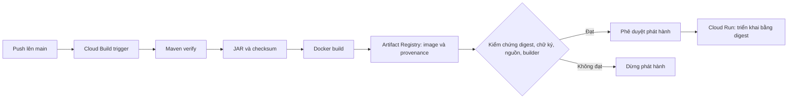

# Thực hành CI/CD ứng dụng Spring Boot với kiểm chứng artifact

## 1. Bài toán và kết quả cần đạt

Một nhóm phát triển dịch vụ Spring Boot muốn tự động kiểm thử mỗi lần cập nhật nhánh `main`, đóng gói ứng dụng thành container, lưu image tại **Artifact Registry** và phát hành lên **Cloud Run**. Yêu cầu quan trọng là có thể trả lời: *Phiên bản đang chạy được tạo từ nguồn nào, bởi hệ thống build nào, và chính xác những byte nào đã được triển khai?*

Trong phạm vi **CI/CD và chuỗi cung ứng phần mềm trên Google Cloud**, bài thực hành dùng **Cloud Build** để kiểm thử và đóng gói Java, **Artifact Registry** để lưu trữ image cùng build provenance, và **Cloud Run** để triển khai bản phát hành đã kiểm chứng. Đây là một tình huống cụ thể giúp thực hành tự động hóa phát hành, bảo vệ tài nguyên và xác định bằng chứng nguồn gốc của phần mềm trong hạ tầng GCP.

Sau bài học, người học có thể:

- Cấu hình luồng CI chạy `mvn verify`, tạo JAR và Docker image của Spring Boot.
- Kiểm tra SHA-256 của JAR, tra cứu **digest bất biến** của image và phân biệt hai giá trị đó.
- Yêu cầu Cloud Build sinh **build provenance**, kiểm tra nguồn và builder trước khi cho phép phát hành.
- Triển khai Cloud Run bằng `image@sha256:...`, kiểm tra revision, nhận biết lỗi và thực hiện rollback.
- Phân tách danh tính CI với danh tính phát hành, giữ quyền truy cập ở mức cần thiết.

### Các lớp kiểm chứng khác nhau

| Bằng chứng | Kiểm tra điều gì? | Giới hạn |
|---|---|---|
| `mvn verify` | Các kiểm thử và bước xác minh trong Maven lifecycle đều đạt | Không chứng minh artifact có nguồn gốc đáng tin |
| `sha256sum` của JAR | Nội dung JAR không đổi giữa lúc tạo checksum và lúc đóng gói | Checksum do cùng tác nhân tạo có thể bị thay cùng artifact |
| OCI image digest (`sha256:...`) | Định danh nội dung image được đẩy lên registry | Digest một mình không cho biết ai đã build image |
| Build provenance có chữ ký | Liên hệ artifact với builder, nguồn và quá trình build được ghi nhận | Phải xác minh chữ ký **và** so khớp nguồn/builder với chính sách tin cậy |
| Cloud Run revision | Phiên bản triển khai có cấu hình cụ thể, bất biến theo revision | Cần đối chiếu image của revision với digest đã duyệt |

> **Nguyên tắc:** Chỉ cho phép phát hành sau khi kiểm thử đạt, image đã có digest cố định và provenance được xác minh theo nguồn/builder kỳ vọng. Không xem việc đọc được JSON provenance là đã xác minh chữ ký.

## 2. Kiến trúc của bài thực hành



Luồng gồm **CI** (kiểm thử, tạo và lưu artifact) và **CD** (xác minh, duyệt rồi triển khai đúng image đã tạo). Trong ví dụ, bước duyệt và phát hành chạy từ một phiên làm việc/runner được cấp quyền riêng; ở môi trường thực tế có thể chuyển nguyên tắc này thành release job được bảo vệ hoặc tích hợp Cloud Deploy. Việc tách hai pha bảo đảm provenance đã được Cloud Build hoàn tất **trước** khi CD kiểm tra nó.

## 3. Chuẩn bị môi trường và phân quyền

Giả định đã có Google Cloud project bật billing, `gcloud` đã đăng nhập, Git repository có ứng dụng Spring Boot sử dụng **Maven, Java 21**, và người thực hiện có quyền ban đầu để bật API, tạo repository/service account và gán IAM. Các lệnh dưới đây dùng Bash (Cloud Shell hoặc terminal Linux/macOS). Thay `my-gcp-project` bằng project thật.

```bash
export PROJECT_ID="my-gcp-project"
export REGION="us-central1"
export REPO="spring-images"
export SERVICE="spring-demo"
export CI_SA="cb-spring-ci@${PROJECT_ID}.iam.gserviceaccount.com"
export CD_SA="cb-spring-cd@${PROJECT_ID}.iam.gserviceaccount.com"
export RUNTIME_SA="run-spring@${PROJECT_ID}.iam.gserviceaccount.com"

gcloud config set project "$PROJECT_ID"
gcloud services enable \
  cloudbuild.googleapis.com artifactregistry.googleapis.com \
  containeranalysis.googleapis.com run.googleapis.com \
  logging.googleapis.com iam.googleapis.com

gcloud artifacts repositories create "$REPO" \
  --repository-format=docker --location="$REGION" \
  --description="Container images for Spring Boot CI/CD"

gcloud iam service-accounts create cb-spring-ci \
  --display-name="Spring Boot CI build identity"
gcloud iam service-accounts create cb-spring-cd \
  --display-name="Spring Boot release identity"
gcloud iam service-accounts create run-spring \
  --display-name="Spring Boot Cloud Run runtime"
```

Ví dụ dành cho project mới; nếu repository hoặc service account đã tồn tại, kiểm tra và tái sử dụng thay vì tạo lại. Với nhiều môi trường, nên dùng project/repository và danh tính tách biệt cho staging, production.

Gán quyền để CI **ghi image**, ghi log, nhưng **không được triển khai**:

```bash
gcloud artifacts repositories add-iam-policy-binding "$REPO" \
  --location="$REGION" \
  --member="serviceAccount:${CI_SA}" \
  --role="roles/artifactregistry.writer"

gcloud projects add-iam-policy-binding "$PROJECT_ID" \
  --member="serviceAccount:${CI_SA}" \
  --role="roles/logging.logWriter"
```

Quyền cho danh tính phát hành (cần gán bởi quản trị viên trước khi chạy CD):

```bash
gcloud artifacts repositories add-iam-policy-binding "$REPO" \
  --location="$REGION" \
  --member="serviceAccount:${CD_SA}" \
  --role="roles/artifactregistry.reader"

gcloud projects add-iam-policy-binding "$PROJECT_ID" \
  --member="serviceAccount:${CD_SA}" \
  --role="roles/run.developer"

gcloud iam service-accounts add-iam-policy-binding "$RUNTIME_SA" \
  --member="serviceAccount:${CD_SA}" \
  --role="roles/iam.serviceAccountUser"
```

Danh tính phát hành còn cần **quyền đọc metadata provenance/Container Analysis** tương ứng với cách xác minh của tổ chức; cấp các quyền đọc cần thiết khi kiểm tra lệnh `gcloud artifacts docker images describe --show-provenance` trong môi trường thật. Danh tính **runtime** chỉ cần các quyền truy cập tài nguyên mà ứng dụng sử dụng, không cần quyền Cloud Run Admin hay Artifact Registry Writer. Người khởi chạy build với `--service-account` phải được phép sử dụng CI service account; quyền tạo build và quản lý trigger thuộc người/quy trình thiết lập, không mặc nhiên nằm ở CI identity. Riêng lệnh `gcloud builds submit .` tải source lên Cloud Storage để Cloud Build đọc: nếu gặp lỗi đọc source, cấp CI SA quyền `storage.objects.get` (chẳng hạn `roles/storage.objectViewer`) **trên đúng bucket staging**, cùng quyền cần thiết cho danh tính tải source, thay vì cấp Storage Admin toàn project.

## 4. Chuẩn bị ứng dụng Spring Boot có thể đóng gói

Tại gốc repository, giả sử có `pom.xml`, `src/main/java`, `src/test/java` và cấu hình Spring Boot Maven plugin. Để các lệnh dùng một tên JAR xác định, đặt `finalName` là `app` trong phần `<build>` của `pom.xml` (gộp vào phần `<build>` hiện có, không tạo hai phần `<build>`):

```xml
<build>
  <finalName>app</finalName>
  <plugins>
    <plugin>
      <groupId>org.springframework.boot</groupId>
      <artifactId>spring-boot-maven-plugin</artifactId>
    </plugin>
  </plugins>
</build>
```

Ví dụ dùng ứng dụng có dependency `spring-boot-starter-web`, `spring-boot-starter-actuator` và `spring-boot-starter-test`. Một test tối thiểu kiểm tra ứng dụng khởi động được; ở dự án thực tế cần thêm unit test, integration test và kiểm thử logic nghiệp vụ:

```java
import org.junit.jupiter.api.Test;
import org.springframework.boot.test.context.SpringBootTest;

@SpringBootTest
class ApplicationContextTest {
    @Test
    void contextLoads() { }
}
```

Trong `src/main/resources/application.properties`, cho phép ứng dụng dùng cổng Cloud Run cung cấp:

```properties
server.port=${PORT:8080}
management.endpoints.web.exposure.include=health,info
```

Chạy tại máy phát triển:

```bash
./mvnw -B -ntp clean verify
test -s target/app.jar
java -jar target/app.jar
```

Nếu repository không có Maven Wrapper, dùng `mvn`. Lệnh `java -jar` được chạy riêng và dừng bằng `Ctrl+C` sau khi kiểm tra `http://localhost:8080/actuator/health`. Nếu test không qua hoặc không có `target/app.jar`, sửa ứng dụng/POM trước khi cấu hình CI. Hãy khóa phiên bản Spring Boot, plugin và dependencies trong POM/lock hoặc cơ chế quản trị dependency phù hợp.

Tạo `Dockerfile` tại thư mục gốc của repository:

```dockerfile
FROM eclipse-temurin:21-jre
WORKDIR /app

COPY app.jar ./app.jar
COPY artifact.sha256 ./artifact.sha256
RUN sha256sum -c artifact.sha256 && rm artifact.sha256

USER 10001:10001
EXPOSE 8080
ENTRYPOINT ["java", "-jar", "/app/app.jar"]
```

File `artifact.sha256` do CI tạo từ chính `app.jar`. Lệnh `RUN sha256sum -c` xác nhận JAR được đưa vào Docker build có checksum giống bản vừa build. Nếu dự án dùng `.dockerignore`, cần cho phép hai file `app.jar` và `artifact.sha256` có mặt trong Docker build context. Cần dùng **base image theo digest đã rà soát** trong production, thay vì phụ thuộc vào một tag có thể đổi như `21-jre`; ví dụ giữ tag trong bài để dễ thực hành.

## 5. Cấu hình CI: kiểm thử, tạo JAR, build image và provenance

Đặt file `cloudbuild.yaml` sau vào repository:

```yaml
steps:
  - id: test-and-package
    name: 'maven:3.9-eclipse-temurin-21'
    entrypoint: bash
    args:
      - -ceu
      - |
        mvn -B -ntp clean verify
        test -s target/app.jar
        cp target/app.jar app.jar
        sha256sum app.jar > artifact.sha256
        sha256sum -c artifact.sha256

  - id: build-container
    name: 'gcr.io/cloud-builders/docker'
    args:
      - build
      - --pull
      - -t
      - '${_REGION}-docker.pkg.dev/$PROJECT_ID/${_REPO}/${_SERVICE}:$BUILD_ID'
      - .

images:
  - '${_REGION}-docker.pkg.dev/$PROJECT_ID/${_REPO}/${_SERVICE}:$BUILD_ID'

substitutions:
  _REGION: us-central1
  _REPO: spring-images
  _SERVICE: spring-demo

options:
  requestedVerifyOption: VERIFIED
  logging: CLOUD_LOGGING_ONLY
```

Giải thích những chi tiết dễ bỏ qua:

1. `mvn clean verify` thực hiện test và đóng gói, **thất bại là dừng toàn bộ build**. Dự án mẫu đã cấu hình Spring Boot plugin để `target/app.jar` là executable JAR.
2. `/workspace` được chia sẻ giữa các step Cloud Build: file `app.jar` và `artifact.sha256` tạo ở step Maven sẽ là đầu vào của Docker build. Không đưa JAR tự tạo ở máy lập trình vào CI.
3. `$BUILD_ID` là định danh duy nhất của mỗi lần build, an toàn hơn một tag di động như `latest`. Cloud Build tự thay các biến `$PROJECT_ID`, `$BUILD_ID` và `${_...}` khi chạy.
4. Trường **`images`** bảo Cloud Build đẩy image lên Artifact Registry **sau khi hoàn tất các step**; kết hợp `requestedVerifyOption: VERIFIED`, build chỉ được đánh dấu thành công nếu đã sinh các metadata xác thực được yêu cầu.
5. **Không thêm `docker push` tường minh** vào cấu hình này: theo tài liệu Cloud Build, cách push đó không tạo build provenance theo luồng ở trên.
6. `CLOUD_LOGGING_ONLY` dành cho user-managed build service account có quyền `roles/logging.logWriter`. Nếu dùng bucket lưu log, thay bằng cấu hình GCS và cấp quyền riêng.

Lệnh chạy thử CI từ local (bản này dùng source snapshot được upload; phù hợp để kiểm thử cấu hình):

```bash
gcloud builds submit . \
  --region="$REGION" \
  --config=cloudbuild.yaml \
  --service-account="projects/${PROJECT_ID}/serviceAccounts/${CI_SA}" \
  --substitutions="_REGION=${REGION},_REPO=${REPO},_SERVICE=${SERVICE}"
```

Khi hoàn tất, ghi lại `BUILD_ID` từ kết quả hoặc trang Cloud Build History. Bản build thủ công này có thể ghi nguồn như một Cloud Storage source snapshot; **không dùng nó để minh họa chính sách buộc provenance phải trỏ về một GitHub repository cụ thể**.

Để chạy CI đúng theo luồng Git, kết nối GitHub repository với Cloud Build, tạo **trigger khi push nhánh `^main$`**, chọn `cloudbuild.yaml`, vùng tương ứng và **CI service account**. Sau đó commit/push một thay đổi hợp lệ; xem Build History để lấy `BUILD_ID` thành công. Bảo vệ nhánh `main` bằng review và status checks, vì ai sửa được `cloudbuild.yaml` qua Git đều có thể thay đổi logic chạy dưới quyền build identity.

## 6. Kiểm chứng artifact trước khi phát hành

Giả sử đã có build thành công **từ Git trigger**, đặt `BUILD_ID` được ghi ở bước 5 và URI nguồn thực tế:

```bash
export BUILD_ID="paste-successful-build-id-here"
export SOURCE_URI="github.com/example-org/spring-demo"
export IMAGE_BASE="${REGION}-docker.pkg.dev/${PROJECT_ID}/${REPO}/${SERVICE}"

export DIGEST="$(gcloud artifacts docker images describe \
  "${IMAGE_BASE}:${BUILD_ID}" \
  --format='value(image_summary.digest)')"

[[ "$DIGEST" =~ ^sha256:[a-f0-9]{64}$ ]] || {
  echo "Không tìm được digest hợp lệ" >&2
  exit 1
}
export VERIFIED_IMAGE="${IMAGE_BASE}@${DIGEST}"
printf 'Artifact đã chọn: %s\n' "$VERIFIED_IMAGE"
```

`IMAGE_BASE:BUILD_ID` chỉ dùng để **tìm artifact ban đầu**. Sau đó mọi bước xác minh và triển khai phải sử dụng `VERIFIED_IMAGE` dưới dạng `image@sha256:...`, vì tag có thể bị gán lại còn digest đại diện cho nội dung cụ thể.

Xem metadata provenance được Cloud Build tạo:

```bash
gcloud artifacts docker images describe "$VERIFIED_IMAGE" \
  --show-provenance --format=json > provenance.json

test -s provenance.json
```

Tải được `provenance.json` là kiểm tra **sự hiện diện** của metadata, chưa chứng minh chữ ký hợp lệ. Dùng công cụ xác minh có hỗ trợ Cloud Build provenance; ví dụ `slsa-verifier` phiên bản `v2.7.1` như trong hướng dẫn chính thức (cần có Go và cập nhật công cụ sau khi tổ chức rà soát):

```bash
go install github.com/slsa-framework/slsa-verifier/v2/cli/slsa-verifier@v2.7.1
export PATH="$(go env GOPATH)/bin:$PATH"
gcloud auth configure-docker "${REGION}-docker.pkg.dev" --quiet

slsa-verifier verify-image "$VERIFIED_IMAGE" \
  --provenance-path provenance.json \
  --source-uri "$SOURCE_URI" \
  --builder-id 'https://cloudbuild.googleapis.com/GoogleHostedWorker'
```

**Kỳ vọng:** lệnh trả mã thoát `0` và thông báo dạng `PASSED: Verified SLSA provenance`. Nếu nguồn repo hoặc builder sai, chữ ký không hợp lệ, metadata thiếu hoặc image digest không khớp, **dừng phát hành** và điều tra; không bỏ qua kết quả bằng `|| true`. Đặt `SOURCE_URI` đúng URI repository thực sự ghi trong provenance; placeholder `example-org` không tự tạo ra một nguồn tin cậy. Khi sử dụng Cloud Build source upload thủ công, provenance thường không mang cùng định danh repository như Git trigger và chính sách `--source-uri` trên có thể thất bại đúng dự kiến.

### Ba câu hỏi bắt buộc trong bước duyệt

| Câu hỏi | Bằng chứng cần có |
|---|---|
| Image nào được duyệt? | Tên đầy đủ `.../spring-demo@sha256:<64-ký-tự-hex>` và `BUILD_ID` |
| Ai và nguồn nào đã tạo image? | Provenance được xác minh; builder là Cloud Build đáng tin, nguồn Git đúng dự án; đối chiếu commit với PR đã review |
| Điều gì khiến build được phép phát hành? | `mvn verify` pass, image được xuất qua `images`, `requestedVerifyOption: VERIFIED`, kiểm tra signature/source pass |

SHA-256 của `app.jar` là **checksum của file JAR**, khác với SHA-256 digest của container image; không so sánh trực tiếp chúng để kết luận có giống nhau hay không. Muốn lưu vết JAR sau build, có thể cấu hình Cloud Build xuất JAR cùng file checksum sang bucket CI artifacts có kiểm soát quyền và retention, hoặc xuất bản JAR qua Maven repository trong Artifact Registry.

## 7. Phát hành CD bằng image digest đã xác minh

Thực hiện từ một môi trường phát hành được kiểm soát (ví dụ release runner mang danh tính `CD_SA`, hoặc tài khoản người vận hành có **các quyền tương đương**). Chỉ chạy đoạn dưới **sau** khi bước 6 trả kết quả PASS. Biến `VERIFIED_IMAGE` phải được lấy từ chính artifact đã duyệt; lưu nó vào biên bản phê duyệt hoặc cấu hình release để tránh chọn nhầm build mới.

```bash
gcloud run deploy "$SERVICE" \
  --project="$PROJECT_ID" \
  --region="$REGION" \
  --image="$VERIFIED_IMAGE" \
  --service-account="$RUNTIME_SA" \
  --no-allow-unauthenticated \
  --quiet
```

Trong release job tự động, dùng cơ chế phê duyệt/điều kiện cho phép phát hành và đưa bước **xác minh provenance bằng lệnh trả exit code** vào ngay trước `gcloud run deploy`. Phải chạy cả hai bước trong cùng quy trình có bảo vệ, chuyển giao **digest cố định**, không dùng tag `latest` hay tự rebuild từ source. Nếu chính sách production cần ràng buộc tại thời điểm deploy, có thể bổ sung Binary Authorization cho Cloud Run và chính sách kiểm chứng attestations thích hợp.

Kiểm tra phiên bản được Cloud Run ghi nhận:

```bash
REVISION="$(gcloud run services describe "$SERVICE" \
  --project="$PROJECT_ID" --region="$REGION" \
  --format='value(status.latestReadyRevisionName)')"

gcloud run revisions describe "$REVISION" \
  --project="$PROJECT_ID" --region="$REGION" \
  --format='value(spec.containers[0].image)'

gcloud run services describe "$SERVICE" \
  --project="$PROJECT_ID" --region="$REGION" \
  --format='value(status.url)'
```

Đối chiếu image/digest của revision với `VERIFIED_IMAGE` và xác nhận revision đã sẵn sàng. Service đặt ở chế độ không cho truy cập ẩn danh; nếu muốn thử endpoint `/actuator/health`, danh tính gọi phải có `roles/run.invoker` và cung cấp ID token phù hợp:

```bash
SERVICE_URL="$(gcloud run services describe "$SERVICE" \
  --project="$PROJECT_ID" --region="$REGION" \
  --format='value(status.url)')"

curl -fsS \
  -H "Authorization: Bearer $(gcloud auth print-identity-token)" \
  "${SERVICE_URL}/actuator/health"
```

Nếu endpoint trả `401/403`, kiểm tra danh tính và quyền invoke; không tự mở service ra internet chỉ để vượt qua lỗi xác thực. Khi rollback, chọn **digest đã phát hành và đã kiểm chứng trước đó** rồi chạy lại lệnh deploy với `--image` trỏ vào digest cũ, hoặc chuyển traffic về revision cũ theo quy trình vận hành của nhóm.

## 8. Thử nghiệm thất bại có chủ đích

1. **Test fail:** sửa test để assertion thất bại trên nhánh lab, rồi chạy `gcloud builds submit` từ nhánh đó (hoặc tạo trigger riêng cho nhánh lab). CI dừng ở `test-and-package`; không có image mới được đăng ký từ build thất bại. Trigger `^main$` của ví dụ không chạy khi chỉ push nhánh lab.
2. **JAR bị sửa sau khi lấy checksum:** thử sửa `app.jar` sau khi tạo `artifact.sha256` và trước Docker build trong môi trường bài lab. `RUN sha256sum -c` phải thất bại. Điều này kiểm tra tính nhất quán giữa hai bước, không thay thế chữ ký provenance.
3. **Sai nguồn Git:** truyền `--source-uri` là repository khác vào `slsa-verifier`. Dù digest tồn tại, bước kiểm chứng phải từ chối phát hành.
4. **Tag bị thay:** so sánh digest của tag trước và sau khi gán lại tag trong môi trường thử nghiệm. Quá trình deploy bằng `@sha256:...` vẫn chọn nội dung đã duyệt; quá trình deploy bằng `:tag` có thể chọn nội dung khác.
5. **Thiếu IAM:** thu hồi tạm quyền `roles/artifactregistry.writer` của CI SA tại repository lab, chạy build và quan sát bước publish image thất bại. Khôi phục quyền sau bài thực hành.

Chỉ thử nghiệm trên tài nguyên lab/staging; không cố ý phá pipeline production.

## 9. Lỗi thường gặp và cách xác định nguyên nhân

| Triệu chứng | Nguyên nhân thường gặp | Hướng xử lý |
|---|---|---|
| `target/app.jar` không tồn tại | `finalName` khác hoặc Spring Boot Maven plugin chưa repackage | Kiểm tra `pom.xml`, Maven log và tên JAR thực tế |
| Build Cloud Build thành công phần Docker nhưng thiếu provenance | Dùng `docker push` thủ công; không khai báo `images` hoặc thiếu `requestedVerifyOption` | Dùng `images` và `requestedVerifyOption: VERIFIED`, chạy lại build |
| `PERMISSION_DENIED` khi push image | CI SA thiếu quyền ghi Artifact Registry, repository/vùng sai | Kiểm tra `roles/artifactregistry.writer` đúng repository |
| Lệnh `--show-provenance` không đọc được metadata | Thiếu quyền xem metadata/Container Analysis hoặc image không có provenance | Kiểm tra IAM, API, digest và Build History |
| `slsa-verifier` báo sai source | Dùng local `builds submit` thay cho Git trigger, hoặc nguồn Git không khớp | Chạy CI từ Git trigger, đối chiếu source URI theo provenance |
| Cloud Run từ chối deployment | CD thiếu `run.developer`, `iam.serviceAccountUser` hoặc quyền đọc image | Kiểm tra quyền của **CD identity** với service/repository/runtime SA |
| Revision không sẵn sàng | Container sai cổng, JAR lỗi, thiếu cấu hình/secrets | Xem logs Cloud Run, dùng `${PORT:8080}`, sửa và build artifact mới |

## 10. Tiêu chí hoàn thành và mở rộng production

Bài lab hoàn thành khi người học có thể cung cấp **một bộ bằng chứng liên tục** gồm: Git commit/PR đã review, `BUILD_ID` thành công, kết quả `mvn verify`, `image@sha256` trong Artifact Registry, provenance xác minh PASS với nguồn và builder kỳ vọng, tên Cloud Run revision cùng image đã triển khai, và kết quả kiểm tra ứng dụng.

Để áp dụng cho dịch vụ lớn hơn, nên bổ sung các kiểm soát theo mức rủi ro: quét lỗ hổng dependency/image và chính sách ngăn phát hành theo mức nghiêm trọng; SBOM; quản lý secrets bằng Secret Manager; pin digest cho build images/base images; runner riêng có IAM tối thiểu; policy approval/attestation ở giai đoạn CD; release qua staging rồi canary/traffic splitting, metrics và cảnh báo Cloud Monitoring. Giữ build logs, provenance, release manifest và lịch sử phê duyệt theo chính sách retention của tổ chức, đồng thời có cơ chế dọn images không còn được sử dụng.

### Tài liệu chính thức để đối chiếu

- [Cloud Build – Build and test Java applications](https://cloud.google.com/build/docs/building/build-java)
- [Cloud Build – Generate and validate build provenance](https://cloud.google.com/build/docs/securing-builds/generate-validate-build-provenance)
- [Cloud Build – Build configuration file schema](https://cloud.google.com/build/docs/build-config-file-schema)
- [Cloud Build – Run builds with a user-managed service account](https://cloud.google.com/build/docs/securing-builds/configure-user-specified-service-accounts)
- [Artifact Registry – Manage Docker images](https://cloud.google.com/artifact-registry/docs/docker/manage-images)
- [Cloud Run – Deploy container images](https://cloud.google.com/run/docs/deploying)
- [Cloud Run – Deployment permissions](https://cloud.google.com/run/docs/reference/iam/roles)

