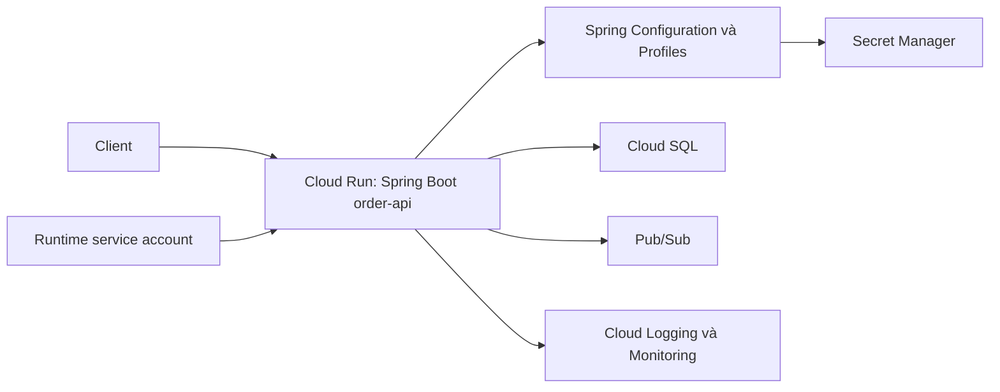

# Spring Framework on Google Cloud và cấu hình ứng dụng

**Spring Framework on Google Cloud** là bộ thư viện tích hợp Spring với các dịch vụ Google Cloud, thường được gọi là **Spring Cloud GCP**. Bộ thư viện cung cấp auto-configuration, starter dependencies và các abstraction quen thuộc của Spring để ứng dụng Java làm việc với Pub/Sub, Cloud Storage, Cloud SQL, Secret Manager và nhiều dịch vụ khác. Ứng dụng Spring Boot vẫn chạy trên môi trường tính toán như Cloud Run, Google Kubernetes Engine (GKE), Compute Engine hoặc App Engine; Spring Framework on Google Cloud không phải một dịch vụ hosting độc lập.

Trong module `CLOUD_PROVIDERS_GCP`, người học khám phá Google Cloud từ tổ chức project, IAM và VPC đến Compute Engine, GKE, Cloud Run, dịch vụ lưu trữ và cơ sở dữ liệu. Qua những tình huống triển khai, người học biết lựa chọn dịch vụ, bảo vệ tài nguyên, tự động hóa phát hành, theo dõi độ tin cậy và chi phí. Với ứng dụng Spring, những mục tiêu đó bắt đầu từ cấu hình đúng môi trường, dùng danh tính phù hợp, tách secret khỏi mã nguồn và lựa chọn integration theo nhu cầu thực tế.

Bài học đi từ một ứng dụng Spring Boot tối thiểu đến cấu hình profile, Application Default Credentials (ADC), Secret Manager, Cloud SQL, Pub/Sub, Cloud Run và vận hành production. Các ví dụ dùng placeholder như `PROJECT_ID`, `REGION`, `SERVICE_ACCOUNT_EMAIL`; cần thay bằng tài nguyên đã được cấp quyền trong project thử nghiệm.

## Mục tiêu học tập

Sau bài học, người học có thể:

- Phân biệt Spring Framework, Spring Boot, Spring Framework on Google Cloud và nền tảng chạy ứng dụng Google Cloud.
- Chọn phiên bản Spring Boot/Spring Cloud GCP tương thích và sử dụng BOM, starter dependencies.
- Thiết kế `application.yaml`, profile, environment variables và `@ConfigurationProperties` theo từng môi trường.
- Dùng ADC, service account và IAM tối thiểu để ứng dụng truy cập Google Cloud APIs.
- Tải cấu hình nhạy cảm từ Secret Manager bằng Spring Cloud GCP hoặc cơ chế secret của Cloud Run.
- Cấu hình Cloud SQL, Pub/Sub và Cloud Storage bằng các integration Spring phù hợp.
- Đóng gói, triển khai ứng dụng Spring Boot lên Cloud Run; phân tích khác biệt khi chạy trên GKE hoặc Compute Engine.
- Kiểm thử cấu hình, giám sát ứng dụng và xử lý lỗi thường gặp trong môi trường production.

## 1. Bức tranh tổng thể: Spring và Google Cloud

### Phân biệt bốn lớp

| Thành phần | Vai trò | Ví dụ |
|---|---|---|
| **Spring Framework** | Nền tảng Java cung cấp dependency injection, web MVC, transaction và các abstraction ứng dụng. | `@Component`, `@Service`, `@RestController`, `ApplicationContext`. |
| **Spring Boot** | Cấu hình tự động, starter dependencies, embedded server và cơ chế externalized configuration. | `@SpringBootApplication`, `application.yaml`, Actuator. |
| **Spring Framework on Google Cloud (Spring Cloud GCP)** | Tích hợp Spring với Google Cloud thông qua starter, template, repository và auto-configuration. | Secret Manager config data, `PubSubTemplate`, Cloud SQL starter. |
| **Nền tảng thực thi trên GCP** | Chạy workload, cấp danh tính, kết nối mạng, mở rộng và thu thập log/metric. | Cloud Run, GKE, Compute Engine, App Engine. |

Ứng dụng Spring Boot có thể dùng Google Cloud Java Client Libraries trực tiếp mà không cần Spring Cloud GCP. Starter tiện khi muốn Spring tự tạo bean và ánh xạ properties. Khi cần API chưa có integration hoặc muốn kiểm soát chi tiết, vẫn có thể tạo Google Cloud client bean theo cách thông thường của Spring.

### Luồng ứng dụng mẫu

Giả sử dịch vụ `order-api` nhận HTTP request, lưu đơn hàng trong Cloud SQL, phát sự kiện lên Pub/Sub và lấy API key từ Secret Manager.



Spring phụ trách cấu trúc mã nguồn và binding cấu hình; Google Cloud phụ trách chạy container, cấp danh tính, IAM, networking, logging và dịch vụ dữ liệu. Kiến trúc sư phải kiểm tra cả hai lớp: dependency đúng nhưng thiếu IAM vẫn gây lỗi; IAM đủ nhưng cấu hình sai project, region hoặc connection name vẫn khiến ứng dụng không hoạt động.

## 2. Phiên bản và dependency management

### Đọc bảng tương thích trước khi thêm starter

Spring Framework on Google Cloud phụ thuộc vào những phiên bản cụ thể của Spring Boot, Spring Cloud và Spring Framework. Không nên chỉ chọn phiên bản mới nhất của từng thành phần độc lập. Tài liệu dự án ở thời điểm biên soạn liệt kê các nhánh tương thích tiêu biểu:

| Spring Framework on Google Cloud | Spring Cloud | Spring Boot | Spring Framework |
|---|---|---|---|
| 7.x | 2025.0.x | 3.5.x | 6.2.8 trở lên trong nhánh 6.2 |
| 6.x | 2024.0.x | 3.4.x | 6.2.x |
| 5.x | 2023.0.x | 3.2.x hoặc 3.3.x | 6.1.x |

Ví dụ trong bài dựa trên nhánh **Spring Boot 3.5.x với Spring Framework on Google Cloud 7.x**. Tài liệu dự án đang công bố BOM `7.5.2`; trước khi triển khai production hãy xác nhận lại compatibility matrix và các bản vá được hỗ trợ. Tránh dùng ví dụ Spring Cloud GCP 2.x hoặc package `org.springframework.cloud.gcp.*` trong dự án mới, vì các class hiện đại sử dụng namespace `com.google.cloud.spring.*`.

### Maven BOM và starter

BOM (*Bill of Materials*) quản lý phiên bản phụ thuộc của Spring Framework on Google Cloud. Với một dự án Spring Boot đã dùng parent/BOM tương thích, thêm vào `pom.xml`:

```xml
<dependencyManagement>
    <dependencies>
        <dependency>
            <groupId>com.google.cloud</groupId>
            <artifactId>spring-cloud-gcp-dependencies</artifactId>
            <version>7.5.2</version>
            <type>pom</type>
            <scope>import</scope>
        </dependency>
    </dependencies>
</dependencyManagement>

<dependencies>
    <dependency>
        <groupId>org.springframework.boot</groupId>
        <artifactId>spring-boot-starter-web</artifactId>
    </dependency>
    <dependency>
        <groupId>org.springframework.boot</groupId>
        <artifactId>spring-boot-starter-actuator</artifactId>
    </dependency>
    <dependency>
        <groupId>com.google.cloud</groupId>
        <artifactId>spring-cloud-gcp-starter-pubsub</artifactId>
    </dependency>
    <dependency>
        <groupId>com.google.cloud</groupId>
        <artifactId>spring-cloud-gcp-starter-secretmanager</artifactId>
    </dependency>
</dependencies>
```

Đây là đoạn Maven để bổ sung vào project có sẵn `spring-boot-starter-parent` hoặc BOM Spring Boot; không phải một file `pom.xml` hoàn chỉnh. Chỉ thêm các starter thực sự dùng. Với ứng dụng không cần Pub/Sub hoặc Secret Manager, không nên giữ starter chỉ để “dự phòng”: auto-configuration có thể khởi tạo client, cần credential hoặc ảnh hưởng thời gian startup.

Ví dụ Gradle:

```kotlin
dependencies {
    implementation(platform("com.google.cloud:spring-cloud-gcp-dependencies:7.5.2"))
    implementation("org.springframework.boot:spring-boot-starter-web")
    implementation("org.springframework.boot:spring-boot-starter-actuator")
    implementation("com.google.cloud:spring-cloud-gcp-starter-pubsub")
    implementation("com.google.cloud:spring-cloud-gcp-starter-secretmanager")
}
```

Gradle cũng cần được cấu hình phiên bản Spring Boot plugin tương thích. Chọn Maven hay Gradle theo tiêu chuẩn dự án; cả hai đều có thể dùng các starter.

### Những starter đáng biết

| Nhu cầu | Artifact tham khảo |
|---|---|
| Core project/credentials integration | `spring-cloud-gcp-starter` |
| Pub/Sub | `spring-cloud-gcp-starter-pubsub` |
| Cloud Storage Resource integration | `spring-cloud-gcp-starter-storage` |
| Cloud SQL PostgreSQL | `spring-cloud-gcp-starter-sql-postgresql` |
| Cloud SQL MySQL | `spring-cloud-gcp-starter-sql-mysql` |
| Secret Manager | `spring-cloud-gcp-starter-secretmanager` |
| Spring Data Spanner | `spring-cloud-gcp-starter-data-spanner` |
| Spring Data Datastore | `spring-cloud-gcp-starter-data-datastore` |

Tài liệu chính thức còn mô tả nhiều module khác. Không phải mọi starter đều cần trong cùng một ứng dụng.

## 3. Cấu hình Spring Boot theo môi trường

### Externalized configuration

Spring Boot đọc cấu hình từ `application.properties` hoặc `application.yaml`, các file theo profile, environment variables, Java system properties và command-line arguments. Nhiều nguồn có thể ghi đè nhau theo thứ tự ưu tiên của Spring Boot. Một số điểm thực hành:

- Dùng file cấu hình để lưu **giá trị mặc định không nhạy cảm** như timeout, retry, tên topic hoặc cấu hình health check.
- Dùng environment variables hoặc file cấu hình theo môi trường để truyền thông tin khác nhau giữa local, staging và production.
- Dùng Secret Manager cho password, API token, private credential và các giá trị phải được xoay vòng.
- Không phụ thuộc vào `application-prod.yaml` nếu pipeline không thiết lập `SPRING_PROFILES_ACTIVE=prod` hoặc một cơ chế kích hoạt profile tương đương.
- Đặt cấu hình quan trọng dưới các property name cụ thể, tránh biến môi trường có tên quá chung dễ va chạm.

### `application.yaml` dùng chung

Ví dụ file `src/main/resources/application.yaml`:

```yaml
spring:
  application:
    name: order-api

server:
  address: 0.0.0.0
  port: ${PORT:8080}

app:
  greeting: ${APP_GREETING:Hello}
  request-timeout: ${APP_REQUEST_TIMEOUT:3s}
  region: ${APP_REGION:asia-southeast1}

management:
  endpoints:
    web:
      exposure:
        include: health,info
  endpoint:
    health:
      probes:
        enabled: true
```

`${PORT:8080}` nghĩa là dùng biến môi trường `PORT` nếu có, mặc định 8080 nếu không. Cloud Run tự cung cấp biến `PORT` cho container. Ứng dụng cần lắng nghe trên `0.0.0.0` và port được cấp, không cố định `localhost` hoặc port khác.

Tên `APP_GREETING`, `APP_REQUEST_TIMEOUT` và `APP_REGION` là biến ứng dụng tự định nghĩa, không phải biến bắt buộc của Google Cloud. Chúng được Spring đọc qua placeholder.

### Profile cho dev và production

File `application-dev.yaml` có thể dùng giá trị tiện cho local:

```yaml
app:
  greeting: Hello from local
  request-timeout: 10s

logging:
  level:
    com.example.order: DEBUG
```

File `application-prod.yaml` có thể đặt chính sách chặt hơn:

```yaml
app:
  request-timeout: 2s

logging:
  level:
    root: INFO
    com.example.order: INFO
```

Chạy local với profile:

```bash
SPRING_PROFILES_ACTIVE=dev ./mvnw spring-boot:run
```

Trong Cloud Run, truyền `SPRING_PROFILES_ACTIVE=prod` tại lúc deploy hoặc cấu hình revision. Profile phân tách cấu hình logic, nhưng **không** thay thế ranh giới IAM hay project. Một ứng dụng có profile `dev` nhưng dùng service account production vẫn có thể truy cập dữ liệu production nếu IAM cho phép.

### Thứ tự ưu tiên và binding cấu hình

Giả sử `application.yaml` đặt `app.greeting: Hello`, `application-prod.yaml` đặt `Hello production` và Cloud Run đặt `APP_GREETING=Hello API`. Giá trị environment variable có thể ghi đè file thông qua property binding hoặc placeholder. Command-line arguments như `--app.greeting=...` cũng có thể ghi đè những giá trị từ file. Cần kiểm soát ai được thay đổi revision environment và startup command.

Với nhóm thuộc tính liên quan, ưu tiên `@ConfigurationProperties` thay vì lặp nhiều `@Value` rời rạc:

```java
package com.example.order;

import java.time.Duration;
import org.springframework.boot.context.properties.ConfigurationProperties;

@ConfigurationProperties(prefix = "app")
public record AppSettings(String greeting, String region, Duration requestTimeout) { }
```

Kích hoạt scan trong ứng dụng:

```java
package com.example.order;

import org.springframework.boot.SpringApplication;
import org.springframework.boot.autoconfigure.SpringBootApplication;
import org.springframework.boot.context.properties.ConfigurationPropertiesScan;

@SpringBootApplication
@ConfigurationPropertiesScan
public class OrderApplication {
    public static void main(String[] args) {
        SpringApplication.run(OrderApplication.class, args);
    }
}
```

Và dùng cấu hình qua constructor injection:

```java
package com.example.order;

import java.util.Map;
import org.springframework.web.bind.annotation.GetMapping;
import org.springframework.web.bind.annotation.RestController;

@RestController
public class HelloController {
    private final AppSettings settings;

    public HelloController(AppSettings settings) {
        this.settings = settings;
    }

    @GetMapping("/api/hello")
    public Map<String, String> hello() {
        return Map.of("message", settings.greeting(), "region", settings.region());
    }
}
```

Trong ứng dụng lớn, dùng `@Validated` kết hợp các constraint như `@NotBlank`, `@Positive` hoặc kiểm tra custom để fail fast khi thiếu URL, timeout hoặc region. Không trả về password, token hoặc toàn bộ cấu hình từ REST endpoint.

### Những biến môi trường cần phân biệt

| Biến | Nguồn / mục đích |
|---|---|
| `PORT` | Cloud Run tự cấp cho container ingress; Spring dùng `${PORT:8080}`. |
| `SPRING_PROFILES_ACTIVE` | Chọn Spring profile; do người triển khai cấu hình. |
| `APP_REGION` | Cấu hình nghiệp vụ của ứng dụng trong ví dụ, không phải thuộc tính Google Cloud tự cấp. |
| `K_SERVICE`, `K_REVISION`, `K_CONFIGURATION` | Metadata môi trường Cloud Run giúp nhận diện service/revision. |
| `GOOGLE_APPLICATION_CREDENTIALS` | Đường dẫn credential file mà ADC có thể sử dụng; tránh thiết lập trên Cloud Run vì service identity là lựa chọn khuyến nghị. |

Cloud Run có thể tạo revision mới khi thay đổi environment variables. Với cập nhật đơn lẻ trên service đang chạy, dùng `--update-env-vars` thay vì `--set-env-vars` nếu không muốn thay thế toàn bộ cấu hình biến môi trường đã có.

## 4. Project ID, Application Default Credentials và IAM

### Spring Cloud GCP lấy project và credential ở đâu?

Spring Framework on Google Cloud core cung cấp `GcpProjectIdProvider` và `CredentialsProvider`. Các integration có thể suy ra project ID và credential từ môi trường Google Cloud hoặc ADC. Khi cần gọi sang project khác, có thể chỉ định project cho module cụ thể, ví dụ `spring.cloud.gcp.secretmanager.project-id` hoặc `spring.cloud.gcp.pubsub.project-id`, thay vì để mọi service tự dùng một giá trị mặc định thiếu kiểm soát.

**Application Default Credentials (ADC)** là chuỗi tìm credential chuẩn của Google Cloud client libraries. Nó có thể tìm credential configuration được chỉ định, local ADC đã đăng nhập, hoặc danh tính gắn với môi trường chạy qua metadata server.

### Local development

Lệnh `gcloud auth login` đăng nhập cho Google Cloud CLI; lệnh dưới đây thiết lập ADC cho các thư viện ứng dụng:

```bash
gcloud auth application-default login
gcloud config set project PROJECT_ID
```

`gcloud config set project` đổi project mặc định của CLI, không đồng nghĩa mọi integration Spring sẽ tự dùng project đó trong mọi ngữ cảnh. Nếu dùng quota project, nhiều project hoặc credential khác nhau, hãy cấu hình dựa trên tài liệu của module và kiểm tra project ID mà ứng dụng thực sự nhận diện.

Trên workstation, không lưu service account key JSON trong repository, file `application.yaml` hoặc image. Dùng ADC của người phát triển và giới hạn quyền môi trường thử nghiệm. Với CI bên ngoài Google Cloud, dùng Workload Identity Federation thay vì key dài hạn khi có thể.

### Cloud Run service identity

Trên Cloud Run, ứng dụng gọi Google Cloud APIs bằng service identity gắn với service/revision. Khi dùng ADC, Cloud Client Libraries lấy token từ metadata server. Nên tạo một user-managed service account cho mỗi ứng dụng hoặc nhóm workload có cùng quyền:

```bash
gcloud iam service-accounts create order-api-runtime \
  --project=PROJECT_ID \
  --display-name="Order API runtime"
```

Ví dụ IAM phù hợp với service mẫu:

| Nhu cầu | Vai trò có thể cấp | Phạm vi nên cấp |
|---|---|---|
| Gửi message lên topic Pub/Sub | `roles/pubsub.publisher` | Topic cụ thể. |
| Đọc API key trong Secret Manager | `roles/secretmanager.secretAccessor` | Secret cụ thể. |
| Kết nối Cloud SQL | `roles/cloudsql.client` | Project/instance phù hợp; vẫn cần quyền ở database. |
| Đọc object trong Cloud Storage | `roles/storage.objectViewer` | Bucket phù hợp. |
| Ghi object trong Cloud Storage | `roles/storage.objectCreator` hoặc quyền phù hợp | Bucket đích, theo nhu cầu ghi và ghi đè. |

Ví dụ cấp quyền Pub/Sub ở cấp topic và Secret Manager ở cấp secret:

```bash
gcloud pubsub topics add-iam-policy-binding orders-created \
  --project=PROJECT_ID \
  --member="serviceAccount:order-api-runtime@PROJECT_ID.iam.gserviceaccount.com" \
  --role="roles/pubsub.publisher"

gcloud secrets add-iam-policy-binding partner-api-key \
  --project=PROJECT_ID \
  --member="serviceAccount:order-api-runtime@PROJECT_ID.iam.gserviceaccount.com" \
  --role="roles/secretmanager.secretAccessor"
```

Người triển khai còn cần quyền deploy Cloud Run và `roles/iam.serviceAccountUser` (hoặc quyền `iam.serviceAccounts.actAs` tương đương) để gắn service account vào revision. Không dùng vai trò Owner/Editor cho runtime chỉ để tránh lỗi `PERMISSION_DENIED`.

### Phân biệt bốn danh tính

- **Developer identity**: tài khoản chạy local và gọi `gcloud`; chỉ có quyền ở môi trường phát triển.
- **Build identity**: service account dùng trong Cloud Build hoặc CI để dựng artifact, cần quyền tải dependency và ghi Artifact Registry.
- **Deployer identity**: người hoặc pipeline thực hiện `gcloud run deploy`, cần quyền deploy và quyền gắn service account.
- **Runtime identity**: service account mà ứng dụng Spring dùng sau khi được triển khai; cần quyền đọc Secret Manager, gửi Pub/Sub hoặc gọi dịch vụ khác.

Chúng có thể là các danh tính khác nhau. Cấp quyền runtime cho build identity hoặc quyền deploy cho ứng dụng có thể tạo đường leo thang đặc quyền ngoài dự kiến.

## 5. Secret Manager cho cấu hình nhạy cảm

### Vì sao không đặt secret trong YAML?

Password, token, API key và private credential không nên được commit vào `application.yaml`, Dockerfile, Cloud Build substitutions hay mã nguồn. Secret Manager hỗ trợ tạo secret, thêm immutable versions và cấp IAM để ứng dụng đọc payload khi cần.

Ví dụ tạo secret và thêm version trong project thử nghiệm:

```bash
gcloud services enable secretmanager.googleapis.com --project=PROJECT_ID

gcloud secrets create partner-api-key \
  --project=PROJECT_ID \
  --replication-policy=automatic

gcloud secrets versions add partner-api-key \
  --project=PROJECT_ID \
  --data-file=/secure/path/partner-api-key.txt
```

Không truyền secret literal trực tiếp qua đối số shell để tránh lưu trong lịch sử lệnh. File đầu vào cần được bảo vệ, không nằm trong Git, và xóa theo chính sách sau khi dùng.

### Spring Cloud GCP Secret Manager starter

Thêm dependency `spring-cloud-gcp-starter-secretmanager`. Với Spring Framework on Google Cloud **6.x/7.x**, cú pháp khuyến nghị dùng tiền tố `sm@`. Cú pháp cũ `sm://` còn gặp trong tài liệu trước đây nhưng từ 6.0 sẽ có cảnh báo khuyến nghị chuyển đổi.

Ví dụ `application-prod.yaml`:

```yaml
spring:
  config:
    import: "sm@"
  cloud:
    gcp:
      secretmanager:
        project-id: PROJECT_ID

app:
  partner-api-key: "${sm@partner-api-key}"
```

`spring.config.import=sm@` bật Spring Boot Config Data integration của Secret Manager. Spring đọc giá trị từ Secret Manager khi resolve property được tham chiếu. Nếu cần version xác định, có thể dùng `${sm@partner-api-key/3}`; với resource ở project khác dùng dạng `${sm@projects/OTHER_PROJECT_ID/secrets/partner-api-key/versions/3}`. Đối với regional secret, có cú pháp bao gồm `locations/REGION`, theo tài liệu thư viện đang sử dụng.

Ví dụ binding cấu hình nhạy cảm vào bean (không trả giá trị qua endpoint):

```java
package com.example.order;

import org.springframework.boot.context.properties.ConfigurationProperties;

@ConfigurationProperties(prefix = "app")
public record PartnerSettings(String partnerApiKey) { }
```

Chỉ inject bean này vào integration client cần gọi đối tác. Không ghi `partnerApiKey` trong log, `toString()`, HTTP response hay health indicator. Với record, phương thức `toString()` mặc định sẽ bao gồm field, vì vậy đặc biệt tránh log trực tiếp đối tượng chứa secret.

### Hai cách cung cấp secret trên Cloud Run

| Cách | Cơ chế | Khi nên chọn |
|---|---|---|
| Spring Cloud GCP `sm@` | Ứng dụng lấy secret qua Secret Manager API và Spring Config Data. | Muốn dùng secret như Spring property, có sẵn starter và kiểm soát quá trình khởi tạo trong ứng dụng. |
| Cloud Run secret integration | Cloud Run tham chiếu Secret Manager version và đưa secret vào environment variable hoặc volume mount theo cấu hình revision. | Muốn dùng biến môi trường hoặc file mà không bắt buộc có Spring Cloud GCP starter. |

Ví dụ Cloud Run có thể gắn một secret version vào environment variable `PARTNER_API_KEY` qua cơ chế quản lý secrets của service. Khi đó Spring dùng:

```yaml
app:
  partner-api-key: ${PARTNER_API_KEY}
```

Đây là một phương án khác với `sm@` trong Spring. Cần chọn một cách rõ ràng cho mỗi secret để tránh hai nguồn cấu hình không nhất quán. Secret mount dạng file có hành vi cập nhật khác với secret được nạp vào environment khi khởi động; kiểm tra tài liệu Cloud Run và chiến lược rotation trước khi chọn.

### Xoay vòng secret

1. Tạo credential mới ở hệ thống đích.
2. Thêm một secret version mới trong Secret Manager.
3. Kiểm tra quyền runtime service account và trạng thái version mới.
4. Thử deploy với version mới hoặc cấu hình `latest` theo chính sách.
5. Xác minh tích hợp hoạt động rồi thu hồi credential cũ ở hệ thống đích.
6. Disable/destroy version cũ khi không còn cần cho rollback.

Đừng giả định một property đã được load lúc startup sẽ tự đổi ngay khi thêm secret version. Thường cần khởi động lại/redeploy hoặc cơ chế refresh có kiểm soát; không mở công khai Actuator `/refresh` để giải quyết nhu cầu này. Production cần có runbook, audit log và phương án rollback.

## 6. Spring và các dịch vụ dữ liệu trên GCP

### Cloud Pub/Sub với `PubSubTemplate`

Pub/Sub dùng topic để nhận message và subscription để tiêu thụ message. Starter `spring-cloud-gcp-starter-pubsub` có thể tạo bean `PubSubTemplate`, hỗ trợ publish và subscribe thông qua abstraction Spring.

Ví dụ publisher tối giản:

```java
package com.example.order;

import com.google.cloud.spring.pubsub.core.PubSubTemplate;
import org.springframework.stereotype.Service;

@Service
public class OrderEventPublisher {
    private final PubSubTemplate pubSubTemplate;

    public OrderEventPublisher(PubSubTemplate pubSubTemplate) {
        this.pubSubTemplate = pubSubTemplate;
    }

    public void publishCreated(String orderId) {
        String payload = "{\"event\":\"order.created\",\"orderId\":\"" + orderId + "\"}";
        pubSubTemplate.publish("orders-created", payload);
    }
}
```

Đây là ví dụ về API publisher, chưa xử lý kết quả bất đồng bộ, escaping JSON hay lỗi delivery. Trong production nên serialize bằng Jackson, xử lý future/callback, retry có giới hạn, message ordering nếu cần và idempotency ở consumer. Không đồng nhất “publish được gọi” với “message đã được ghi thành công”; cần quan sát kết quả publish và cách ứng dụng xử lý lỗi.

Trước khi chạy, tạo topic và cấp `roles/pubsub.publisher` ở cấp topic cho runtime service account. Nếu subscriber, cần subscription và quyền `roles/pubsub.subscriber` tương ứng. Cấu hình `spring.cloud.gcp.pubsub.project-id` khi dùng Pub/Sub thuộc project khác project chạy ứng dụng.

### Cloud Storage

Starter `spring-cloud-gcp-starter-storage` cung cấp integration với Spring Resource, cho phép một số API Spring xử lý resource dạng `gs://BUCKET_NAME/path/to/object`. Nó phù hợp khi ứng dụng thường xuyên đọc/ghi file hoặc tích hợp với Spring Integration.

Ứng dụng cũng có thể dùng Google Cloud Storage Java client trực tiếp để upload/download, áp dụng generation preconditions, signed URL hoặc cấu hình metadata chi tiết. Chọn công cụ theo mức kiểm soát cần thiết; không thêm starter nếu chỉ có một thao tác đơn giản mà Java client đã đáp ứng.

Bucket name và object path là cấu hình không nhạy cảm nhưng có thể tiết lộ cấu trúc nội bộ; cân nhắc naming convention và data residency. Runtime service account cần quyền bucket tối thiểu; đọc object không nhất thiết cần quyền ghi hoặc xóa.

### Cloud SQL PostgreSQL hoặc MySQL

Spring Framework on Google Cloud cung cấp starter cho Cloud SQL PostgreSQL và MySQL. Starter tự cấu hình `DataSource` dựa trên Spring properties và Google Cloud SQL connection name. Ví dụ nếu dùng PostgreSQL, thêm dependency:

```xml
<dependency>
    <groupId>com.google.cloud</groupId>
    <artifactId>spring-cloud-gcp-starter-sql-postgresql</artifactId>
</dependency>
```

Đặt cấu hình production:

```yaml
spring:
  cloud:
    gcp:
      sql:
        instance-connection-name: "PROJECT_ID:asia-southeast1:orders-db"
        database-name: orders
  datasource:
    username: ${DB_USER}
    password: "${sm@orders-db-password}"
    hikari:
      maximum-pool-size: 5
```

Ví dụ trên giả định Secret Manager config data đã được kích hoạt bằng `spring.config.import=sm@` và runtime có quyền đọc secret `orders-db-password`. `spring.cloud.gcp.sql.instance-connection-name` có dạng `project:region:instance`; nó khác tên database bên trong instance.

Ngoài quyền `roles/cloudsql.client`, ứng dụng còn cần tài khoản/quyền của database, API Cloud SQL được bật và đường kết nối phù hợp. Nếu dùng private IP, phải thiết kế VPC, egress và định tuyến thích hợp (ví dụ qua Direct VPC egress hoặc VPC connector trên Cloud Run). Nếu chọn IAM database authentication, cơ chế này có cấu hình và yêu cầu riêng; không giả định bật Cloud SQL Client là đủ để chạy câu SQL.

Cloud Run có thể tăng số instance khi tải tăng. Nếu mỗi instance có Hikari pool 10 hoặc 20 kết nối, tổng số connection tới Cloud SQL có thể vượt giới hạn. Hãy chọn pool size theo số instance tối đa, quota database, yêu cầu latency và khả năng retry.

### Khi nào dùng Spanner, Datastore hoặc Firestore?

Spring Framework on Google Cloud còn có integration cho Cloud Spanner, Datastore và Firestore. Chọn theo mô hình dữ liệu và yêu cầu nghiệp vụ:

| Dịch vụ | Dạng bài toán thường gặp | Điểm cần xem xét |
|---|---|---|
| Cloud SQL | Ứng dụng quan hệ cần PostgreSQL/MySQL và transaction theo mô hình SQL quen thuộc. | Kết nối, pool, HA, backup, migration schema. |
| Cloud Spanner | Dữ liệu quan hệ cần khả năng mở rộng và phân phối lớn. | Thiết kế schema, index, latency, chi phí và transaction. |
| Firestore | Dữ liệu document/event-driven phù hợp với SDK và truy vấn NoSQL. | Mô hình document, index, truy vấn, security rules/IAM. |
| Datastore mode | Ứng dụng NoSQL với mô hình entity, key và query. | Index, transaction, consistency và mô hình truy cập. |

Việc có starter Spring không quyết định dịch vụ phù hợp. Hãy chọn dịch vụ dữ liệu dựa trên SLA, mô hình truy cập, transaction, location và chi phí trước, rồi mới chọn integration.

## 7. Triển khai ứng dụng Spring Boot lên Cloud Run

### Điều kiện ứng dụng web

Cloud Run chạy container nhận HTTP traffic qua port được nền tảng cung cấp. Với Spring Boot:

- Đặt `server.port=${PORT:8080}` trong `application.properties` hoặc YAML tương đương.
- Lắng nghe trên `0.0.0.0`, tránh cố định loopback.
- Không dựa vào filesystem cục bộ để lưu dữ liệu bền vững; dùng Cloud Storage hoặc database.
- Không giả định một instance sống mãi; Cloud Run có thể scale-to-zero hoặc thay revision.
- Giới hạn thread pool và database connection pool theo concurrency/instance.
- Chuẩn bị đường dẫn health check và startup phù hợp với thời gian JVM warm-up.

### Build từ source và deploy

Với một dự án Spring Boot dùng Maven đã chạy được ở local, Cloud Run hỗ trợ build từ source bằng buildpacks:

```bash
gcloud config set project PROJECT_ID

gcloud services enable run.googleapis.com cloudbuild.googleapis.com artifactregistry.googleapis.com

gcloud run deploy order-api \
  --source . \
  --project=PROJECT_ID \
  --region=asia-southeast1 \
  --service-account=order-api-runtime@PROJECT_ID.iam.gserviceaccount.com \
  --set-env-vars=SPRING_PROFILES_ACTIVE=prod,APP_REGION=asia-southeast1
```

Lệnh phải chạy từ thư mục chứa mã nguồn dự án. Cần billing, quyền Cloud Run/Cloud Build/Artifact Registry thích hợp, quyền gắn service account và các API đã bật. Cloud Run sẽ dùng quy trình build từ source và tạo revision mới. Với pipeline production, nên build artifact có kiểm soát, ghi digest, quét dependency/image rồi deploy cùng digest để có thể truy vết phiên bản.

Nếu service đã có biến môi trường, `--set-env-vars` thay thế danh sách được cấu hình theo thao tác deploy; dùng `--update-env-vars` để cập nhật vài biến mà vẫn giữ các biến còn lại. Đặt secret qua Secret Manager integration hoặc Spring Config Data như phần trên, không truyền API key bằng `--set-env-vars`.

### Xác minh sau deploy

Kiểm tra service, revision và URL:

```bash
gcloud run services describe order-api \
  --project=PROJECT_ID \
  --region=asia-southeast1
```

Sau đó thực hiện smoke test endpoint `/api/hello` theo chính sách ingress/IAM của service. Không mở public service chỉ để kiểm thử nếu hệ thống yêu cầu xác thực. Dùng identity token hoặc test runner có quyền gọi Cloud Run phù hợp.

Kiểm tra log startup để chắc chắn profile `prod`, port và project/region được chọn đúng. Không log toàn bộ Spring Environment vì nó có thể chứa secret.

### Cấu hình mở rộng và hiệu năng

Một số đặc điểm của Spring Boot trên Cloud Run:

- **Cold start**: JVM và application context cần khởi tạo; hạn chế dependency không dùng, eager initialization tốn thời gian và API call ở startup.
- **Concurrency**: nhiều request có thể chia sẻ một instance; đo latency và CPU để chọn concurrency, số instance và memory.
- **Cloud SQL connections**: tổng số kết nối tăng theo instance, nên hạn chế connection pool và giới hạn số instance phù hợp.
- **Shutdown**: xử lý SIGTERM/graceful shutdown, hoàn tất hoặc dừng an toàn các request đang xử lý.
- **Request timeout**: điều chỉnh timeout HTTP/DB/client và retry nhất quán với giới hạn của Cloud Run.

Thử nghiệm tải thực tế trước khi tăng concurrency hoặc số instance. Cấu hình “nhiều tài nguyên hơn” chưa chắc giảm chi phí hoặc tăng độ tin cậy khi bottleneck nằm ở database hay downstream API.

## 8. Khi nào nên chọn GKE hoặc Compute Engine?

Cloud Run phù hợp với API stateless, job và dịch vụ HTTP/event-driven có nhu cầu mở rộng tự động mà nhóm muốn giảm vận hành cụm. Tuy nhiên, có những workload Spring cần mô hình thực thi khác:

| Nền tảng | Nên cân nhắc khi | Cấu hình cần chú ý |
|---|---|---|
| Cloud Run | API/worker stateless, triển khai theo revision, ưu tiên vận hành đơn giản. | `PORT`, startup, concurrency, instance limits, service identity, secret reference. |
| GKE | Cần Kubernetes primitives, sidecar, tùy chỉnh mạng/runtime sâu, nhiều service trong cluster. | Deployment, Service, probes, resource requests/limits, Workload Identity Federation for GKE. |
| Compute Engine | Cần quản trị OS/VM, process dài hạn hoặc hạ tầng đặc thù. | Systemd/container runtime, patching, instance service account, firewall, load balancing. |
| App Engine | Ứng dụng phù hợp runtime và mô hình App Engine, muốn nền tảng managed. | Runtime, service/version routing, app config và IAM. |

### Spring trên GKE

Trên GKE, `application.yaml` có thể được đóng gói trong image; các giá trị môi trường chuyển vào `ConfigMap` hoặc Deployment env vars, còn secret lấy qua Secret Manager CSI integration hoặc SDK/Workload Identity theo thiết kế. Tránh lưu credential Google Cloud service account key trong Kubernetes Secret chỉ để gọi APIs.

Ví dụ phần cấu hình container của Deployment:

```yaml
containers:
  - name: order-api
    image: asia-southeast1-docker.pkg.dev/PROJECT_ID/apps/order-api:RELEASE_TAG
    ports:
      - containerPort: 8080
    env:
      - name: SPRING_PROFILES_ACTIVE
        value: prod
      - name: APP_REGION
        value: asia-southeast1
    readinessProbe:
      httpGet:
        path: /actuator/health/readiness
        port: 8080
    livenessProbe:
      httpGet:
        path: /actuator/health/liveness
        port: 8080
    resources:
      requests:
        cpu: 250m
        memory: 512Mi
```

Đoạn YAML là phần của Pod template, không phải Deployment manifest đầy đủ. `management.endpoint.health.probes.enabled=true` trong Spring Boot bật các health group readiness/liveness tương ứng khi tích hợp Actuator. Cấu hình startup probe, liveness timeout và resource limits cần được điều chỉnh theo JVM, thời gian tải và đặc điểm workload.

Workload Identity Federation for GKE cho phép workload dùng danh tính Kubernetes và cơ chế liên kết IAM phù hợp để truy cập Google Cloud APIs mà không cần file JSON key dài hạn. Cấu hình cụ thể phụ thuộc vào cluster mode và mô hình service account được chọn.

## 9. Logging, metrics, health và tracing

### Structured logging

Spring Boot thường ghi log qua SLF4J/Logback. Trên Cloud Run, stdout/stderr được nền tảng thu thập vào Cloud Logging. Nên dùng structured JSON logging hoặc format có trường ổn định, tương quan request và trace ID để tìm kiếm dễ hơn.

Đừng ghi password, bearer token, cookie xác thực, service account credential, dữ liệu cá nhân hoặc toàn bộ đối tượng chứa secret vào log. Trong production, log level `DEBUG`/`TRACE` có thể làm phát sinh dữ liệu nhạy cảm và tăng chi phí log ingestion.

### Actuator health endpoints

Spring Boot Actuator cung cấp health, metrics và thông tin vận hành. Với `spring-boot-starter-actuator`, có thể bật health probes:

```yaml
management:
  endpoints:
    web:
      exposure:
        include: health,info
  endpoint:
    health:
      probes:
        enabled: true
```

Endpoint `/actuator/health` giúp theo dõi trạng thái cơ bản; `/actuator/health/liveness` và `/actuator/health/readiness` giúp kết nối với probes. Không mở công khai các endpoint nhạy cảm như `/actuator/env`, `/actuator/beans`, `/actuator/configprops` hoặc `/actuator/heapdump` nếu không có biện pháp xác thực và hạn chế truy cập phù hợp.

### Metrics và tracing

Micrometer cung cấp abstraction metrics cho Spring Boot. Có thể dùng OpenTelemetry hoặc các integration được hỗ trợ để xuất metric, trace sang Google Cloud Observability. Những tín hiệu nên theo dõi:

- Request rate, error rate, HTTP latency p50/p95/p99.
- JVM memory, GC pause, thread pool và thời gian startup.
- Cloud SQL connection pool, timeout, query latency và lỗi database.
- Pub/Sub publish errors, subscriber backlog, ack latency và retry.
- Instance count, concurrency, CPU/memory của Cloud Run.

Cloud Monitoring dashboards và alerting policies nên thể hiện SLI/SLO của ứng dụng thay vì chỉ số lượng instance. Cần gắn cảnh báo với runbook và người chịu trách nhiệm xử lý.

## 10. Kiểm thử và quản lý cấu hình trong CI/CD

### Ba lớp kiểm thử

1. **Unit tests**: kiểm tra business logic, binding cấu hình và validation, có thể mock Google Cloud clients.
2. **Integration tests**: kiểm tra tương tác với database, messaging, HTTP hoặc SDK qua emulator/test container khi phù hợp.
3. **Environment tests**: chạy staging với service account, IAM, VPC và các tài nguyên Google Cloud tương đương để phát hiện lỗi credential, network hoặc project.

Không coi unit test xanh là bằng chứng ứng dụng có thể kết nối Cloud SQL hoặc đọc Secret Manager trong production. Những lỗi này phụ thuộc cloud resource và IAM thực tế.

### Tránh gọi Google Cloud ngoài ý muốn trong test

Auto-configuration có thể khởi tạo client hoặc kiểm tra cấu hình khi Spring context được tạo. Với unit tests không cần Google Cloud, loại bỏ starter không dùng, mock bean phù hợp hoặc vô hiệu hóa auto-configuration theo tài liệu module trong test profile.

Ví dụ cấu hình test không dùng Cloud SQL:

```yaml
spring:
  cloud:
    gcp:
      sql:
        enabled: false
```

Nếu production dùng starter Cloud SQL mà test dùng H2/Testcontainers PostgreSQL, cấu hình `DataSource` riêng và kiểm tra không có `spring.cloud.gcp.sql.instance-connection-name` ở test profile.

### CI/CD và configuration drift

Trong pipeline Cloud Build hoặc hệ thống CI khác, nên kiểm tra:

- Phiên bản JDK, Spring Boot và BOM đã được khóa/ghi nhận.
- Dependencies không có lỗ hổng đã biết nghiêm trọng; chạy scan theo tiêu chuẩn tổ chức.
- Test, package và container build không cần secret production.
- Build và deploy dùng danh tính khác runtime khi phù hợp.
- Revision được gắn commit SHA hoặc image digest để rollback.
- Environment variables, IAM và Secret Manager references được quản lý qua Terraform hoặc cấu hình phát hành được review.

Không lưu `application-prod.yaml` chứa credential trong repository. Nếu cần thêm cấu hình ngoài image, sử dụng cơ chế external config được kiểm soát, và phân biệt config thường với secret.

## 11. Tình huống triển khai mẫu: Order API

### Yêu cầu

Nhóm phát triển có một Spring Boot REST service `order-api` chạy Cloud Run. Dịch vụ cần:

- API `GET /api/hello` có thể trả về greeting và region.
- Lấy API key đối tác từ Secret Manager.
- Gửi sự kiện tạo đơn lên Pub/Sub.
- Kết nối Cloud SQL PostgreSQL trong cùng khu vực.
- Chạy local bằng profile `dev`, staging/production bằng profile riêng.

### Thiết kế cấu hình

| Thành phần | Cấu hình | Phạm vi quyền |
|---|---|---|
| Spring API | `application.yaml`, `application-prod.yaml` và `@ConfigurationProperties`. | Không chứa secret, có validation. |
| Secret Manager | `spring.config.import=sm@`, `app.partner-api-key=${sm@partner-api-key}`. | Secret Accessor trên secret tương ứng. |
| Pub/Sub | Topic `orders-created`; starter Pub/Sub. | Pub/Sub Publisher trên topic. |
| Cloud SQL | `instance-connection-name`, database, username, password từ Secret Manager. | Cloud SQL Client và database privileges. |
| Cloud Run | `PORT`, runtime service account, profile prod, timeout, concurrency. | Deployer identity riêng; runtime IAM tối thiểu. |

### Quy trình triển khai

1. Chọn project, region và bật những API thực sự cần dùng: Cloud Run, Cloud Build, Artifact Registry, Secret Manager, Pub/Sub và Cloud SQL Admin API.
2. Tạo topic Pub/Sub, Cloud SQL instance/database và secret versions.
3. Tạo runtime service account, cấp IAM ở topic/secret và Cloud SQL theo nguyên tắc tối thiểu.
4. Cấu hình Spring Boot Maven/BOM đúng nhánh, `application.yaml`, profile và binding properties.
5. Chạy unit/integration tests bằng cấu hình dev/test; không dùng secret production.
6. Deploy staging qua Cloud Run và xác minh startup, `/actuator/health`, request đơn hàng, Pub/Sub message, kết nối database.
7. Kiểm tra logs, traces, pool connections, SLO, chi phí và cấu hình IAM.
8. Đưa image đã được kiểm tra lên production bằng revision/digest được phê duyệt và giữ khả năng rollback.

### Kiểm tra khi một tích hợp bị lỗi

Nếu `GET /api/hello` hoạt động nhưng publish Pub/Sub thất bại, HTTP server có thể đang khỏe trong khi IAM publisher hoặc topic ID sai. Nếu ứng dụng không startup vì `${sm@partner-api-key}` không resolve, kiểm tra Secret Manager IAM và version. Nếu lỗi kết nối database tăng sau khi scale Cloud Run, kiểm tra tổng pool connections, network path và giới hạn Cloud SQL.

## 12. Troubleshooting

| Triệu chứng | Nguyên nhân có thể | Hướng kiểm tra |
|---|---|---|
| Spring context không khởi tạo | Starter không tương thích Spring Boot, thiếu config property hoặc bean. | Kiểm tra BOM/compatibility matrix, stack trace và profile. |
| `Could not resolve placeholder` | Thiếu environment variable hoặc key từ Secret Manager. | Kiểm tra property name, profile, Secret Manager import và secret ID. |
| `PERMISSION_DENIED` khi gọi API | Runtime service account thiếu IAM hoặc app dùng nhầm credential. | Kiểm tra service identity, principal trong audit log, project tài nguyên và role phạm vi hẹp. |
| Không tìm thấy project ID | ADC không xác định project hoặc gọi cross-project. | Cấu hình `spring.cloud.gcp.project-id`/module project ID hoặc project context phù hợp. |
| Secret không load | Chưa bật Config Data integration `sm@`, sai version, secret bị disabled. | Kiểm tra `spring.config.import`, syntax `sm@`, quyền Secret Accessor, trạng thái version. |
| Cloud Run container không ready | Spring nghe sai port, bind `127.0.0.1`, startup chậm hoặc process crash. | Kiểm tra `${PORT:8080}`, `0.0.0.0`, startup logs, memory, health checks. |
| Cloud SQL timeout | Sai instance connection name, thiếu Cloud SQL Client, VPC route lỗi hoặc DB quá tải. | Kiểm tra network, IAM, DB credentials, pool size, connection capacity. |
| Pub/Sub không publish | Topic không tồn tại, thiếu publisher permission, không xử lý async future. | Kiểm tra topic, project, IAM và callback/result của publish. |
| Cấu hình production dùng giá trị dev | Profile chưa bật hoặc environment variable ghi đè file. | Kiểm tra `SPRING_PROFILES_ACTIVE`, property source và revision config (không log secret). |
| Log có dữ liệu nhạy cảm | Debug level, ghi đối tượng config hoặc Actuator endpoint quá rộng. | Giảm log level, bảo vệ endpoint, xoay vòng credential và rà soát log sink. |
| Scale-out khiến DB lỗi | Mỗi instance mở pool quá lớn. | Đối chiếu max instances, concurrency, Hikari pool và giới hạn kết nối DB. |

Khi điều tra, bắt đầu từ log startup và revision thực tế, rồi kiểm tra IAM của đúng runtime identity, network path, API enablement, resource names và profile. Đừng sửa lỗi thiếu quyền bằng cách cấp Owner/Editor cho service account.

## 13. Checklist trước khi đưa ứng dụng Spring vào production

- [ ] Phiên bản Spring Boot, Spring Cloud và Spring Framework on Google Cloud tương thích theo tài liệu hiện hành.
- [ ] Maven/Gradle dùng BOM và chỉ khai báo những starter thực sự cần.
- [ ] `application.yaml` chứa default không nhạy cảm; profile được kích hoạt rõ ràng.
- [ ] Spring binding (`@ConfigurationProperties`) và validation kiểm tra các thuộc tính bắt buộc.
- [ ] Port Cloud Run dùng `${PORT:8080}` và server bind đúng interface.
- [ ] Ứng dụng dùng ADC và user-managed runtime service account, không nhúng JSON key vào image.
- [ ] IAM cho Pub/Sub, Secret Manager, Cloud SQL, Cloud Storage được cấp đúng resource.
- [ ] Secret được lấy qua `sm@` hoặc cơ chế Secret Manager của runtime; có kế hoạch rotation/rollback.
- [ ] Cross-project APIs có project ID, billing và permissions được kiểm tra.
- [ ] Cloud SQL connector/network, database privileges và connection pool đã được thử tải.
- [ ] API không trả secret, logs không chứa token và Actuator endpoints được giới hạn.
- [ ] Tests dev/staging không đòi credential production; tích hợp cloud đã được kiểm chứng.
- [ ] Artifact có commit SHA/image digest, có quy trình promote và rollback.
- [ ] Cloud Logging, Monitoring, health probes, metrics và alert được cấu hình theo SLO.
- [ ] Tài nguyên theo region, quota, concurrency và chi phí đã được đánh giá.

## 14. Kết luận

Spring Framework on Google Cloud mang các dịch vụ Google Cloud vào mô hình phát triển quen thuộc của Spring thông qua starter dependencies, bean auto-configuration và Spring properties. Việc triển khai hiệu quả đòi hỏi chọn đúng phiên bản, tách cấu hình theo môi trường, dùng `@ConfigurationProperties` và tránh phụ thuộc vào credential dài hạn.

Với Cloud Run, ứng dụng Spring Boot phải lắng nghe `PORT` được cấp và sử dụng service identity qua ADC. Với GKE hoặc Compute Engine, nguyên tắc tương tự được áp dụng nhưng cách cấp danh tính, kết nối mạng, probes và vòng đời workload khác nhau. Secret Manager, Cloud SQL, Pub/Sub và Cloud Storage đều cần IAM, resource name và networking phù hợp với kiến trúc đã chọn.

Một ứng dụng Spring vận hành tốt là ứng dụng có cấu hình kiểm soát được, quyền truy cập tối thiểu, log/metric phục vụ chẩn đoán, khả năng triển khai lặp lại và phương án khôi phục rõ ràng. Đó là nền tảng để phát triển dịch vụ Java trên Google Cloud an toàn, đáng tin cậy và có thể mở rộng.

## Tài liệu tham khảo

- [Spring Framework on Google Cloud — Reference Documentation](https://googlecloudplatform.github.io/spring-cloud-gcp/reference/html/index.html)
- [Spring Framework on Google Cloud — Getting Started](https://googlecloudplatform.github.io/spring-cloud-gcp/reference/html/getting-started.html)
- [Spring Boot — Externalized Configuration](https://docs.spring.io/spring-boot/3.5/reference/features/external-config.html)
- [Spring Boot — Profiles](https://docs.spring.io/spring-boot/3.5/reference/features/profiles.html)
- [Spring Boot — Actuator Endpoints](https://docs.spring.io/spring-boot/3.5/reference/actuator/endpoints.html)
- [Cloud Run — Deploy a Java Spring Boot service](https://docs.cloud.google.com/run/docs/quickstarts/build-and-deploy/deploy-java-service)
- [Cloud Run — Configure environment variables](https://docs.cloud.google.com/run/docs/configuring/services/environment-variables)
- [Cloud Run — Service Identity](https://docs.cloud.google.com/run/docs/securing/service-identity)
- [Application Default Credentials](https://docs.cloud.google.com/docs/authentication/application-default-credentials)
- [Secret Manager — Overview](https://docs.cloud.google.com/secret-manager/docs/overview)
- [Cloud SQL — Connect from Cloud Run](https://docs.cloud.google.com/sql/docs/postgres/connect-run)
- [Pub/Sub — Overview](https://docs.cloud.google.com/pubsub/docs/overview)
- [Workload Identity Federation for GKE](https://docs.cloud.google.com/kubernetes-engine/docs/concepts/workload-identity)
- [Cloud Logging — Structured logging](https://docs.cloud.google.com/logging/docs/structured-logging)
