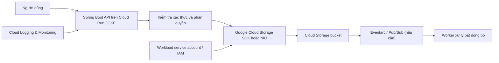

# Truy cập Cloud Storage bằng Java NIO và SDK

Một ứng dụng Java có thể cần lưu ảnh người dùng, tạo báo cáo CSV, tải tệp cấu hình hoặc đọc dữ liệu xuất từ hệ thống khác. Trên Google Cloud, **Cloud Storage** cung cấp kho lưu trữ đối tượng có khả năng mở rộng và được truy cập qua API. Với Java, hai cách phổ biến là sử dụng **Google Cloud Storage Java Client Library (SDK)** hoặc **Google Cloud Storage NIO FileSystem Provider** để thao tác qua `Path` và `Files`.

Hai cách tiếp cận phục vụ những nhu cầu khác nhau. NIO giúp tích hợp thư viện Java vốn nhận `Path` hoặc `InputStream`, trong khi SDK thể hiện rõ khái niệm bucket/object, metadata, generation, preconditions và các thao tác quản trị. Biết chọn đúng API và hiểu đặc tính object storage sẽ giúp ứng dụng tránh ghi đè dữ liệu, sử dụng bộ nhớ quá mức hoặc xử lý sai các thao tác tưởng giống file hệ thống.

Bài học nằm trong chương **Java và Spring trên GCP**, thuộc module **CLOUD_PROVIDERS_GCP**. Chủ đề kết nối Java/Spring với dịch vụ lưu trữ của Google Cloud, phân quyền IAM, triển khai workload trên Cloud Run/GKE và thực hành độ tin cậy, bảo mật, chi phí.

## 1. Mục tiêu học tập

Sau bài học, bạn có thể:

- Giải thích bucket, object, object name, generation và khác biệt giữa object storage với POSIX filesystem.
- Cấu hình Google Cloud Java SDK và NIO provider bằng Maven BOM.
- Xác thực bằng Application Default Credentials (ADC) trong máy phát triển và môi trường GCP.
- Đọc/ghi object qua `Files` và `CloudStorageFileSystem`.
- Upload, download, list, xóa, đọc metadata bằng `Storage` và `Blob`.
- Dùng stream/channel với object lớn để hạn chế cấp phát bộ nhớ.
- Dùng generation preconditions để tránh ghi đè hoặc xóa phiên bản mới ngoài ý muốn.
- Tổ chức code Spring Boot, xử lý lỗi, IAM, telemetry và kiểm thử tích hợp.

## 2. Hiểu mô hình Cloud Storage

### 2.1. Bucket, object và URI

Cloud Storage lưu dữ liệu theo các đối tượng (**object**) trong **bucket**. Mỗi object có tên và nội dung dạng byte, cùng metadata như content type, size, CRC32C, thời gian cập nhật và generation.

Ví dụ:

```text
Bucket:  acme-checkout-reports
Object: 2026/11/invoices/invoice-1042.pdf
URI:    gs://acme-checkout-reports/2026/11/invoices/invoice-1042.pdf
```

Trong Java SDK:

- `BlobId` xác định object theo bucket, name và generation tùy chọn.
- `BlobInfo` mô tả metadata dùng khi tạo hoặc cập nhật object.
- `Blob` đại diện object đã tồn tại và chứa metadata.
- `Storage` là giao diện để gọi API Cloud Storage.

`BlobInfo` và `Blob` không tự chứa toàn bộ dữ liệu bytes của object; nội dung được đọc qua các phương thức phù hợp như `readAllBytes`, `reader` hoặc `downloadTo`.

### 2.2. Object name khác đường dẫn hệ điều hành

Tên object có thể chứa dấu `/`, ví dụ `exports/2026/data.csv`. Trong bucket có flat namespace, chuỗi trước dấu `/` chỉ là phần tên, không phải thư mục POSIX thật. NIO provider mô phỏng thư mục để code Java có thể làm việc bằng `Path`.

Một số bucket có thể bật tính năng hierarchical namespace; khi đó semantics về folder khác bucket flat namespace. Ứng dụng cần biết cấu hình bucket thực tế và khả năng của thư viện đang sử dụng. Dù ở chế độ nào, không mặc định có đầy đủ POSIX permission, file lock, append hay atomic rename như đĩa cục bộ.

### 2.3. Generation và metageneration

Khi nội dung object được ghi mới hoặc ghi đè, Cloud Storage gán một **generation** mới. Metadata của object có **metageneration**, thay đổi khi metadata được cập nhật. Các số này là công cụ kiểm soát đồng thời:

- Generation precondition phù hợp khi thay thế hoặc xóa nội dung.
- Metageneration precondition phù hợp khi cập nhật metadata.
- Khi điều kiện không khớp, API có thể trả HTTP 412 (Precondition Failed).

Đây là thành phần quan trọng để triển khai upload an toàn và retry có kiểm soát.

## 3. Chọn Java NIO hay Cloud Storage SDK?

| Tiêu chí | Java NIO provider | Cloud Storage SDK |
|---|---|---|
| Mô hình | `Path`, `Files`, `InputStream`, `OutputStream` | `Storage`, `BlobId`, `BlobInfo`, `Blob` |
| Mục tiêu | Tái sử dụng code thao tác file quen thuộc | Tương tác API object storage rõ ràng |
| Đọc/ghi nhỏ | `Files.readAllBytes`, `Files.write` | `readAllBytes`, `create` |
| Dữ liệu lớn | `Files.newInputStream` và channel tùy hỗ trợ | `reader`, `writer`, `createFrom`, `downloadTo` |
| Metadata | Qua các attribute view hoặc extension được hỗ trợ | API metadata chi tiết |
| Kiểm soát race | Phụ thuộc các tùy chọn được provider hỗ trợ | Generation/metageneration preconditions |
| Khả năng quản trị | Không phải mục tiêu chính | List, copy, delete, IAM-related metadata, signed URL |
| Semantics | Dễ nhầm với file cục bộ nếu thiếu chú ý | Thể hiện trực tiếp các thao tác object |

**Chọn NIO** khi ứng dụng có thư viện chỉ nhận `Path` hoặc muốn đọc tệp như một stream. **Chọn SDK** khi cần quyền kiểm soát rõ ràng về upload, generation, metadata, consistency, retry hoặc thao tác đồng thời. Một ứng dụng có thể dùng cả hai, nhưng nên thống nhất abstraction tại từng lớp để tránh ghi đè lẫn nhau.

## 4. Chuẩn bị project, bucket và IAM

### 4.1. Điều kiện cần

Để chạy ví dụ, bạn cần:

1. Một Google Cloud project có billing và Cloud Storage API phù hợp.
2. Một bucket đã tồn tại, ví dụ `acme-checkout-reports`.
3. JDK và công cụ build Maven hoặc Gradle.
4. Danh tính có IAM phù hợp với thao tác thực hiện.
5. Thư viện Cloud Storage Java SDK hoặc NIO provider.

Các ví dụ sử dụng placeholder `PROJECT_ID` và `BUCKET_NAME`. Trước khi chạy, thay bằng tài nguyên bạn được phép sử dụng và tránh ghi dữ liệu thử vào bucket production.

### 4.2. IAM tối thiểu theo nhu cầu

Một số role thông dụng:

| Nhu cầu | Role thường dùng | Phạm vi khuyến nghị |
|---|---|---|
| Đọc và liệt kê object | `roles/storage.objectViewer` | Bucket cần truy cập |
| Chỉ tạo object mới | `roles/storage.objectCreator` | Bucket dành cho upload |
| Đọc, tạo, sửa, xóa object | `roles/storage.objectUser` | Bucket thực sự cần quản lý |

Role cần được kiểm tra theo permission và chính sách tổ chức. Không cấp `roles/storage.admin` chỉ để ứng dụng upload một file. Nếu cần thao tác xóa, đừng giả định role tạo object đã bao gồm quyền xóa.

Với Cloud Run hoặc GKE, dùng service account của workload, cấp quyền ở cấp bucket nếu phù hợp. Không nhúng JSON key của service account vào repository, container image hoặc cấu hình Spring.

### 4.3. Application Default Credentials

Các thư viện Google Cloud mặc định có thể dùng **Application Default Credentials (ADC)**:

- Trên máy phát triển, chạy `gcloud auth application-default login` sau khi đã được cấp quyền phù hợp.
- Trên Cloud Run, danh tính runtime được lấy qua môi trường thực thi.
- Trên GKE, dùng Workload Identity Federation for GKE hoặc cơ chế danh tính được tổ chức cấu hình.
- Với workload bên ngoài Google Cloud, ưu tiên Workload Identity Federation thay vì key dài hạn.

Lệnh dành cho phát triển cục bộ:

```bash
gcloud auth application-default login
gcloud auth application-default set-quota-project PROJECT_ID
```

Lệnh `gcloud auth login` và `gcloud auth application-default login` phục vụ các luồng xác thực khác nhau. CLI có thể đăng nhập được nhưng Java SDK vẫn không có ADC hợp lệ, và ngược lại. Nếu gặp HTTP 403, kiểm tra danh tính mà ứng dụng thực sự sử dụng, phạm vi IAM, project, bucket và chính sách tổ chức.

## 5. Cấu hình dependency với Maven và Gradle

### 5.1. Maven BOM

Google Cloud duy trì `com.google.cloud:libraries-bom` để chọn các phiên bản client library tương thích. Ví dụ:

```xml
<dependencyManagement>
  <dependencies>
    <dependency>
      <groupId>com.google.cloud</groupId>
      <artifactId>libraries-bom</artifactId>
      <version>26.90.0</version>
      <type>pom</type>
      <scope>import</scope>
    </dependency>
  </dependencies>
</dependencyManagement>

<dependencies>
  <dependency>
    <groupId>com.google.cloud</groupId>
    <artifactId>google-cloud-storage</artifactId>
  </dependency>
  <dependency>
    <groupId>com.google.cloud</groupId>
    <artifactId>google-cloud-nio</artifactId>
  </dependency>
</dependencies>
```

Version `26.90.0` là ví dụ đã được liệt kê trong tài liệu Java NIO của Google Cloud; khi triển khai thật, chọn BOM còn được hỗ trợ và tương thích với dependency của ứng dụng. Với Spring Boot, cũng cần giải quyết BOM của Spring và Google Cloud theo chính sách dependency management, tránh ép các phiên bản không tương thích.

### 5.2. Gradle

```groovy
dependencies {
    implementation platform("com.google.cloud:libraries-bom:26.90.0")
    implementation "com.google.cloud:google-cloud-storage"
    implementation "com.google.cloud:google-cloud-nio"
}
```

Thư viện `google-cloud-storage` cung cấp SDK. Thư viện `google-cloud-nio` đăng ký FileSystem Provider để thao tác đường dẫn Cloud Storage qua Java NIO.

## 6. Truy cập object qua Java NIO

### 6.1. Khởi tạo filesystem cho một bucket

Cách rõ ràng, ít phụ thuộc vào Java Service Provider Interface (SPI) là dùng `CloudStorageFileSystem.forBucket`.

```java
import com.google.cloud.storage.contrib.nio.CloudStorageFileSystem;
import java.nio.file.Path;

String bucketName = "BUCKET_NAME";
CloudStorageFileSystem fs = CloudStorageFileSystem.forBucket(bucketName);

Path report = fs.getPath("/reports/2026/summary.txt");
System.out.println(report.toUri());
```

NIO provider ánh xạ `Path` đến object trong bucket. Việc gọi `forBucket` không đồng nghĩa tải hết object về máy. Với một số cách đóng gói ứng dụng (đặc biệt shaded/fat JAR), cơ chế SPI có thể không được đăng ký đúng; gọi trực tiếp `forBucket` giúp tránh phụ thuộc vào service registration.

Một lựa chọn khác khi SPI hoạt động:

```java
import java.net.URI;
import java.nio.file.Path;
import java.nio.file.Paths;

Path report = Paths.get(
    URI.create("gs://BUCKET_NAME/reports/2026/summary.txt")
);
```

Nếu URI báo `FileSystemNotFoundException` hoặc `ProviderNotFoundException`, hãy kiểm tra dependency runtime và metadata `META-INF/services` trong JAR đóng gói.

### 6.2. Ghi và đọc văn bản nhỏ

```java
import com.google.cloud.storage.contrib.nio.CloudStorageFileSystem;
import java.nio.charset.StandardCharsets;
import java.nio.file.Files;
import java.nio.file.Path;

CloudStorageFileSystem fs =
    CloudStorageFileSystem.forBucket("BUCKET_NAME");

Path object = fs.getPath("/demo/hello.txt");
byte[] data = "Xin chào từ Java NIO".getBytes(StandardCharsets.UTF_8);

Files.write(object, data);

byte[] downloaded = Files.readAllBytes(object);
System.out.println(new String(downloaded, StandardCharsets.UTF_8));
```

Ở ví dụ này, `Files.write` là một yêu cầu ghi object lên Cloud Storage, còn `Files.readAllBytes` đọc toàn bộ object vào bộ nhớ. Chỉ dùng `readAllBytes` với tệp nhỏ đã biết giới hạn kích thước. Với object lớn, sử dụng stream.

Đừng mặc định `Files.write` có cùng đặc tính với việc ghi vào file POSIX: sửa vài byte giữa file, append tại chỗ hoặc file locking có thể không được hỗ trợ như filesystem cục bộ.

### 6.3. Đọc theo stream

```java
import java.io.InputStream;
import java.io.OutputStream;
import java.nio.file.Files;
import java.nio.file.Path;
import java.nio.file.Paths;

Path remote = fs.getPath("/exports/large-report.csv");
Path local = Paths.get("downloads/large-report.csv");
Files.createDirectories(local.getParent());

try (InputStream in = Files.newInputStream(remote);
     OutputStream out = Files.newOutputStream(local)) {
    in.transferTo(out);
}
```

`InputStream.transferTo` chuyển dữ liệu theo luồng, phù hợp khi không muốn cấp một mảng byte có kích thước bằng toàn bộ object. Nếu ứng dụng xử lý trực tiếp thay vì download về ổ đĩa, hãy đọc các block vào buffer và xử lý từng phần.

### 6.4. Dùng NIO với thư viện Java

Nhiều thư viện nhận `Path` hoặc `InputStream`:

```java
Path csv = fs.getPath("/exports/daily.csv");

try (var reader = Files.newBufferedReader(csv, StandardCharsets.UTF_8)) {
    String line;
    while ((line = reader.readLine()) != null) {
        // Parse hoặc xử lý một dòng.
    }
}
```

Cách này đặc biệt hữu ích khi API xử lý CSV, JSON hoặc cấu hình đã có sẵn logic đọc từ `InputStream`. Tuy nhiên, nếu thư viện cần random write, memory-mapped file, atomic rename hoặc POSIX attributes, nên kiểm tra kỹ khả năng NIO provider hoặc tải object về scratch space trước khi xử lý.

### 6.5. Thư mục giả và các thao tác không tương đương POSIX

Trong bucket flat namespace, `reports/2026/` thường là prefix của object name. Gọi `Files.createDirectories` không nên được hiểu như việc tạo inode thư mục trên Linux. Với NIO provider, pseudo-directory có thể được giả lập và một số thao tác thư mục không phát sinh I/O thực tế.

Các tình huống cần thận trọng:

- `Files.move` có thể phải sao chép object rồi xóa object nguồn; không mặc định atomic.
- Đổi tên hàng loạt file không phải một transaction.
- Cập nhật một phần nội dung có thể đòi hỏi ghi object mới.
- Thao tác directory traversal có thể phát sinh nhiều API request.
- Hành vi theo dõi file bằng WatchService và file locks không nhất thiết được hỗ trợ.
- Các option như `ATOMIC_MOVE`, `APPEND` hoặc permission POSIX có thể không hoạt động như trên filesystem cục bộ.

Với các yêu cầu concurrency, versioning và metadata rõ ràng, chọn SDK.

## 7. Sử dụng Cloud Storage Java SDK

### 7.1. Khởi tạo Storage client

```java
import com.google.cloud.storage.Storage;
import com.google.cloud.storage.StorageOptions;

Storage storage = StorageOptions.getDefaultInstance().getService();
```

Client dùng ADC của môi trường. Trong ứng dụng server, tạo client và tái sử dụng qua nhiều request; không tạo client mới cho mỗi lần đọc một object. Quản lý timeout, retry và observability theo yêu cầu hệ thống.

Nếu ứng dụng chạy ở project khác với bucket, IAM trên bucket vẫn quyết định quyền truy cập object. Project dùng để thanh toán/quota và danh tính runtime có thể khác project chứa dữ liệu.

### 7.2. Tạo object nhỏ với content type và precondition

```java
import com.google.cloud.storage.Blob;
import com.google.cloud.storage.BlobId;
import com.google.cloud.storage.BlobInfo;
import com.google.cloud.storage.Storage;
import java.nio.charset.StandardCharsets;

String bucketName = "BUCKET_NAME";
String objectName = "reports/summary.txt";

BlobInfo info = BlobInfo.newBuilder(BlobId.of(bucketName, objectName))
    .setContentType("text/plain; charset=utf-8")
    .build();

byte[] contents = "Báo cáo tháng".getBytes(StandardCharsets.UTF_8);

Blob created = storage.create(
    info,
    contents,
    Storage.BlobTargetOption.doesNotExist()
);

System.out.println("Generation: " + created.getGeneration());
```

`doesNotExist()` yêu cầu object đích chưa tồn tại. Nếu một request khác tạo object trước, Cloud Storage trả lỗi điều kiện (thường là HTTP 412); ứng dụng phải quyết định giữ object hiện có hay tạo tên mới. Đừng retry một cách mù quáng bằng cách bỏ precondition, vì có thể ghi đè dữ liệu của yêu cầu khác.

### 7.3. Đọc metadata và nội dung

```java
import com.google.cloud.storage.Blob;
import com.google.cloud.storage.BlobId;
import java.nio.charset.StandardCharsets;

BlobId id = BlobId.of("BUCKET_NAME", "reports/summary.txt");
Blob blob = storage.get(id);

if (blob == null) {
    throw new IllegalStateException("Object không tồn tại");
}

System.out.println("Size: " + blob.getSize());
System.out.println("Content type: " + blob.getContentType());
System.out.println("Generation: " + blob.getGeneration());

byte[] bytes = storage.readAllBytes(id);
String contents = new String(bytes, StandardCharsets.UTF_8);
```

`storage.get` trả metadata hoặc `null` khi không tìm thấy object. Khi thiếu quyền hoặc API lỗi, thư viện có thể ném `StorageException`; không gộp mọi lỗi 403 và 404 thành “không tồn tại”.

Nếu yêu cầu đọc một phiên bản cụ thể, tạo `BlobId` có generation và dùng precondition phù hợp. Nếu không, đọc object name thường lấy phiên bản mới nhất.

### 7.4. Liệt kê theo prefix

```java
import com.google.api.gax.paging.Page;
import com.google.cloud.storage.Blob;
import com.google.cloud.storage.Storage;

Page<Blob> page = storage.list(
    "BUCKET_NAME",
    Storage.BlobListOption.prefix("reports/2026/"),
    Storage.BlobListOption.pageSize(100)
);

for (Blob item : page.iterateAll()) {
    System.out.println(item.getName() + " : " + item.getSize());
}
```

`prefix` lọc object name, không phải phép tìm toàn văn. `iterateAll` có thể tự động lấy nhiều trang, phát sinh thêm API calls. Với bucket rất lớn, dùng paging có giới hạn, checkpoint và cơ chế dừng thay vì duyệt toàn bộ object ở mỗi request HTTP.

Một prefix ngắn không bảo đảm số object ít. Thiết kế object name và phân vùng dữ liệu để truy vấn theo phạm vi cần thiết.

### 7.5. Download object xuống local path

```java
import com.google.cloud.storage.BlobId;
import java.nio.file.Files;
import java.nio.file.Path;
import java.nio.file.Paths;

BlobId id = BlobId.of("BUCKET_NAME", "exports/data.csv");
Path destination = Paths.get("downloads/data.csv");
Files.createDirectories(destination.getParent());

storage.downloadTo(id, destination);
```

`downloadTo` thuận tiện để tải xuống đường dẫn cục bộ, trong khi `readAllBytes` phù hợp với nội dung nhỏ. Trước khi ghi file local, xác thực object name và destination để ngăn ghi ra ngoài thư mục dự kiến. Nếu chạy trong container không có persistent disk, hãy xử lý dữ liệu ngay hoặc lưu ở nơi bền vững.

## 8. Truyền dữ liệu lớn bằng stream và channel

### 8.1. Upload từ Path bằng createFrom

```java
import com.google.cloud.storage.BlobId;
import com.google.cloud.storage.BlobInfo;
import com.google.cloud.storage.Storage;
import java.nio.file.Path;
import java.nio.file.Paths;

Path source = Paths.get("reports/big-report.pdf");

BlobInfo info = BlobInfo.newBuilder(
    BlobId.of("BUCKET_NAME", "reports/big-report.pdf")
).setContentType("application/pdf").build();

storage.createFrom(
    info,
    source,
    Storage.BlobWriteOption.doesNotExist()
);
```

`createFrom` hỗ trợ upload qua luồng và phù hợp với file lớn hơn việc đưa toàn bộ nội dung vào `byte[]`. Với dữ liệu từ `InputStream`, có overload `createFrom(BlobInfo, InputStream, ...)`. Nên dùng API mới thay vì overload `Storage.create(BlobInfo, InputStream)` đã bị deprecated vì không thể retry an toàn khi input stream chỉ tiêu thụ được một lần.

### 8.2. Đọc bằng ReadChannel

```java
import com.google.cloud.ReadChannel;
import com.google.cloud.storage.BlobId;
import java.nio.ByteBuffer;
import java.nio.channels.WritableByteChannel;
import java.nio.file.Files;
import java.nio.file.Path;

BlobId id = BlobId.of("BUCKET_NAME", "exports/large.csv");
Path output = Path.of("downloads/large.csv");
Files.createDirectories(output.getParent());

try (ReadChannel reader = storage.reader(id);
     WritableByteChannel writer = Files.newByteChannel(
         output,
         java.nio.file.StandardOpenOption.CREATE,
         java.nio.file.StandardOpenOption.TRUNCATE_EXISTING,
         java.nio.file.StandardOpenOption.WRITE
     )) {
    ByteBuffer buffer = ByteBuffer.allocate(64 * 1024);
    while (reader.read(buffer) != -1) {
        buffer.flip();
        while (buffer.hasRemaining()) {
            writer.write(buffer);
        }
        buffer.clear();
    }
}
```

Ví dụ dùng buffer 64 KiB, tránh nạp toàn bộ object vào heap. Trong triển khai thực tế, nên xử lý trường hợp `read` tạm thời trả 0 theo hợp đồng channel và tránh vòng lặp bận. Có thể dùng API `downloadTo` nếu chỉ cần tải object xuống file; dùng `ReadChannel` khi cần phân tích, xử lý từng khối hoặc tích hợp thư viện streaming.

### 8.3. Không giữ dữ liệu lớn trong bộ nhớ

Tránh:

```java
// Không phù hợp với object lớn hoặc input không tin cậy:
byte[] hugeFile = storage.readAllBytes(
    BlobId.of("BUCKET_NAME", "archive/large-export.zip")
);
```

Với file lớn, dùng stream/channel, giới hạn kích thước object dự kiến và xử lý theo block. Theo dõi heap, GC, request timeout, network throughput và chi phí vận hành.

## 9. Tránh race condition bằng generation preconditions

### 9.1. Chỉ tạo khi chưa có object

Trong API SDK:

```java
storage.create(
    BlobInfo.newBuilder(BlobId.of(bucketName, objectName)).build(),
    payload,
    Storage.BlobTargetOption.doesNotExist()
);
```

Đây là thao tác phù hợp với idempotent upload khi object name được sinh ổn định theo request ID. Nếu precondition fail vì object đã tồn tại, ứng dụng cần xác nhận object hiện có thuộc đúng request/phiên bản trước khi coi là thành công.

### 9.2. Ghi đè có điều kiện

Khi nhiều tiến trình có thể thay cùng object, trước tiên đọc generation rồi yêu cầu generation match:

```java
Blob current = storage.get(BlobId.of(bucketName, objectName));
if (current == null) {
    throw new IllegalStateException("Object không tồn tại");
}

long expectedGeneration = current.getGeneration();

Blob updated = storage.create(
    BlobInfo.newBuilder(BlobId.of(bucketName, objectName)).build(),
    newBytes,
    Storage.BlobTargetOption.generationMatch(expectedGeneration)
);
```

Nếu object bị thay đổi sau bước đọc, thao tác ghi sẽ thất bại với precondition. Ứng dụng có thể đọc lại dữ liệu và hợp nhất thay đổi theo quy tắc nghiệp vụ; không tự ghi đè bằng cách loại bỏ precondition.

### 9.3. Xóa đúng generation

```java
Blob current = storage.get(BlobId.of(bucketName, objectName));
if (current != null) {
    boolean deleted = storage.delete(
        BlobId.of(bucketName, objectName),
        Storage.BlobSourceOption.generationMatch(current.getGeneration())
    );
    System.out.println("Deleted: " + deleted);
}
```

Cơ chế này hạn chế trường hợp một tiến trình xóa nhầm object mới được tạo sau khi nó đã đọc bản cũ. Nếu bucket có retention policy, object hold hoặc chính sách bảo vệ dữ liệu, xóa vẫn có thể bị từ chối dù IAM cho phép.

### 9.4. Generation và retry

HTTP 412 là tín hiệu điều kiện không còn đúng, không phải lỗi network tạm thời để retry vô hạn. HTTP 429, 500, 503 có thể là lỗi tạm thời; cần retry với exponential backoff và jitter theo hướng dẫn client library. Retry thao tác ghi không có precondition có thể gây overwrite ngoài ý muốn khi request đã được server xử lý nhưng client không nhận response.

## 10. Tổ chức code Spring Boot

### 10.1. Khai báo Storage bean

Trong Spring Boot, nên cung cấp `Storage` như một bean dùng chung:

```java
import com.google.cloud.storage.Storage;
import com.google.cloud.storage.StorageOptions;
import org.springframework.context.annotation.Bean;
import org.springframework.context.annotation.Configuration;

@Configuration
public class StorageClientConfig {
    @Bean
    Storage storage() {
        return StorageOptions.getDefaultInstance().getService();
    }
}
```

Cách này giúp service khác dùng constructor injection, tránh tạo client lặp lại và dễ thay bằng fake/stub khi viết unit test.

### 10.2. Service lưu và đọc object

```java
import com.google.cloud.storage.BlobId;
import com.google.cloud.storage.BlobInfo;
import com.google.cloud.storage.Storage;
import org.springframework.beans.factory.annotation.Value;
import org.springframework.stereotype.Service;

import java.nio.charset.StandardCharsets;

@Service
public class ReportStore {
    private final Storage storage;
    private final String bucket;

    public ReportStore(Storage storage,
                       @Value("${app.storage.bucket}") String bucket) {
        this.storage = storage;
        this.bucket = bucket;
    }

    public void saveNewReport(String reportId, String text) {
        String objectName = "reports/" + reportId + ".txt";
        BlobInfo info = BlobInfo.newBuilder(
            BlobId.of(bucket, objectName)
        ).setContentType("text/plain; charset=utf-8").build();

        storage.create(
            info,
            text.getBytes(StandardCharsets.UTF_8),
            Storage.BlobTargetOption.doesNotExist()
        );
    }

    public String loadSmallReport(String reportId) {
        String objectName = "reports/" + reportId + ".txt";
        byte[] content = storage.readAllBytes(BlobId.of(bucket, objectName));
        return new String(content, StandardCharsets.UTF_8);
    }
}
```

Đây là ví dụ rút gọn cho nội dung nhỏ. Trong ứng dụng thật, xác thực `reportId` theo whitelist ký tự và độ dài, giới hạn dữ liệu đầu vào, kiểm tra phân quyền người dùng và ánh xạ lỗi StorageException sang response thích hợp. Không nhận nguyên một object name tùy ý từ URL mà không kiểm tra vì người gọi có thể truy cập dữ liệu ngoài phạm vi được phép.

Trong `application.yaml`:

```yaml
app:
  storage:
    bucket: acme-checkout-reports
```

Spring sẽ lấy tên bucket từ cấu hình `app.storage.bucket` rồi inject vào constructor qua `@Value`. Với nhiều môi trường, có thể thay giá trị bằng biến môi trường hoặc cấu hình triển khai mà không cần sửa mã nguồn.

### 10.3. Xử lý upload MultipartFile

Trong Spring Web, `MultipartFile#getBytes()` có thể cấp phát một mảng lớn. Với upload dung lượng lớn, nên dùng stream và API `createFrom`. Đồng thời:

- Giới hạn kích thước request tại Spring và reverse proxy.
- Xác thực MIME type theo nội dung khi phù hợp; không tin tuyệt đối `getContentType()`.
- Sinh object name ở server thay vì dùng trực tiếp original filename.
- Kiểm tra quyền người dùng và áp dụng rate limiting.
- Đặt metadata phù hợp, ví dụ `Content-Type`.
- Quét nội dung theo chính sách bảo mật trước khi cho phép tải công khai hoặc xử lý.

## 11. Cloud Storage trong kiến trúc Cloud Run và GKE

Một kiến trúc ứng dụng tham khảo:



Ứng dụng nên lưu metadata nghiệp vụ (owner, trạng thái xử lý, quyền truy cập, object name, generation) trong database khi cần truy vấn và phân quyền phức tạp. Cloud Storage giữ binary/object content. Không dùng tên object làm cơ chế phân quyền duy nhất.

Nếu upload cần nhiều bước (virus scanning, PDF conversion, image resizing), có thể lưu object ở bucket private rồi phát sự kiện đến worker xử lý. Khi worker hoàn tất, metadata ứng dụng được cập nhật. Sự kiện có thể đến lặp lại; hãy dùng object generation và idempotency key để không xử lý một phiên bản nhiều lần ngoài ý muốn.

## 12. Signed URL và tải dữ liệu trực tiếp

Khi người dùng cuối upload hoặc download tệp lớn, chuyển toàn bộ nội dung qua Spring Boot có thể làm tăng tải CPU/network và chi phí trung gian. Có thể cân nhắc **signed URL** có thời hạn ngắn để client trao đổi trực tiếp với Cloud Storage.

Luồng thông thường:

1. Client xác thực với ứng dụng.
2. Ứng dụng kiểm tra quyền trên object hoặc nghiệp vụ.
3. Ứng dụng tạo signed URL có thời hạn và phương thức HTTP phù hợp.
4. Client upload/download trực tiếp bằng URL.
5. Ứng dụng xác nhận object generation, kích thước, content type và trạng thái xử lý sau thao tác.

Signed URL là một bearer capability: ai có URL có thể dùng nó trong phạm vi điều kiện và thời hạn đã ký. Không ghi URL vào log công khai hoặc gửi nhầm cho người khác. Signing cần danh tính hoặc signer có năng lực ký phù hợp; không giả định mọi ADC đều có khả năng ký trực tiếp mà không cấu hình thêm.

Khi cần kiểm soát chặt upload, có thể yêu cầu precondition, kích thước/loại nội dung và dùng quy trình xác nhận sau upload. Signed URL không thay thế phân quyền nghiệp vụ tại ứng dụng.

## 13. Bảo mật và kiểm soát truy cập

### 13.1. Uniform bucket-level access và public access prevention

Ưu tiên dùng IAM để quản lý quyền ở bucket. Với bucket cần kiểm soát tập trung, bật **uniform bucket-level access** và xem xét **public access prevention** theo chính sách tổ chức. Không dùng ACL đối tượng riêng lẻ để tạo cơ chế chia sẻ phức tạp khi đã có cơ chế IAM và signed URL phù hợp.

### 13.2. Mã hóa

Cloud Storage mã hóa dữ liệu khi lưu trữ. Nếu tổ chức cần quyền quản lý khóa, có thể dùng **Customer-Managed Encryption Keys (CMEK)** từ Cloud KMS theo cấu hình bucket/object được dịch vụ hỗ trợ. Cần cấp quyền dùng khóa cho service agent phù hợp và có kế hoạch luân chuyển/hủy khóa; nếu khóa bị vô hiệu hóa hoặc mất quyền truy cập, object có thể không đọc được.

### 13.3. Kiểm soát metadata và dữ liệu nhạy cảm

Object name, metadata, signed URL, exception và log có thể làm lộ thông tin nhạy cảm. Tránh đưa số định danh cá nhân, token hoặc secret vào object name. Dùng ID trung tính và lưu mapping ở database có kiểm soát.

### 13.4. Dữ liệu không tin cậy

Khi nhận file upload:

- Kiểm tra quyền và hạn mức của người gửi.
- Kiểm tra loại và kích thước file.
- Không thực thi trực tiếp file từ bucket.
- Giải nén có giới hạn để tránh zip bomb.
- Kiểm soát việc phục vụ inline content nếu loại file có thể chứa script.
- Đặt cache-control và content-disposition phù hợp.
- Xác nhận object generation khi xử lý sự kiện và tránh TOCTOU.

## 14. Độ tin cậy, hiệu năng và chi phí

### 14.1. Retry đúng loại lỗi

SDK xử lý một số retry theo cấu hình mặc định, nhưng ứng dụng vẫn cần hiểu:

| Trạng thái | Ý nghĩa thường gặp | Hướng xử lý |
|---|---|---|
| 400 | Yêu cầu sai, metadata hoặc tham số không hợp lệ. | Sửa request. |
| 401 | Xác thực không hợp lệ. | Kiểm tra ADC/token. |
| 403 | Thiếu quyền hoặc bị policy chặn. | Kiểm tra IAM, service account, điều kiện truy cập. |
| 404 | Không tìm thấy bucket/object hoặc resource liên quan. | Kiểm tra tên và quyền, trả kết quả phù hợp. |
| 412 | Generation/metageneration precondition không khớp. | Đọc lại và giải quyết xung đột. |
| 429 | Bị giới hạn tốc độ. | Backoff có giới hạn và tối ưu lưu lượng. |
| 5xx | Lỗi phía dịch vụ hoặc hạ tầng tạm thời. | Retry idempotent theo chính sách, có timeout. |

Khi xử lý 404, không vô tình tiết lộ sự tồn tại hoặc không tồn tại của object thuộc người dùng khác. Đường API nên kiểm tra phân quyền nghiệp vụ trước khi trả metadata.

### 14.2. Truyền tải và bộ nhớ

Dùng `readAllBytes` cho nội dung nhỏ; stream/channel cho tệp lớn. Tránh ghi object rất thường xuyên dưới cùng tên nếu có thể dùng object name theo version. Thay đổi object name có thể giúp CDN và cache hoạt động ổn định hơn, nhưng cần quản lý lifecycle để không tích lũy dữ liệu vô hạn.

### 14.3. Chi phí

Cloud Storage tính chi phí theo dung lượng, storage class, số thao tác, retrieval và network egress tùy cấu hình. Những thao tác tưởng như `Files.exists`, đọc metadata hoặc list prefix vẫn có thể tương ứng với API request. Cần tránh loop quét toàn bucket, download lặp lại và các thao tác copy/move hàng loạt không cần thiết.

### 14.4. Observability

Ghi metric hoặc tracing theo operation:

- Bucket hoặc logical data class (không đưa secret vào label).
- Loại thao tác: upload, download, list, delete.
- Kích thước byte, duration và số retry.
- Mã lỗi đã chuẩn hóa.
- Tỷ lệ lỗi theo service và environment.

Không ghi payload, secret, signed URL hoặc file content vào log. Với yêu cầu kiểm toán, bật Cloud Audit Logs phù hợp và thiết lập retention theo chính sách.

## 15. Kiểm thử ứng dụng

### 15.1. Unit test

Truyền `Storage` qua constructor để có thể stub/fake ở unit test. Kiểm tra:

- Object name được chuẩn hóa và không cho phép truy cập chéo tenant.
- Content type được đặt đúng.
- Upload dùng `doesNotExist()` khi yêu cầu tạo mới.
- Lỗi 403, 404, 412 được ánh xạ phù hợp.
- Dữ liệu lớn không bị tải toàn bộ vào heap ở đường xử lý streaming.

### 15.2. Integration test

Tạo bucket thử nghiệm riêng hoặc dùng emulator phù hợp. Một số emulator bên thứ ba có thể không mô phỏng đầy đủ IAM, checksum, generation, retention, signed URL và semantics của Cloud Storage. Những kiểm tra phụ thuộc đặc tính thật nên chạy trên project thử nghiệm được kiểm soát.

Các kịch bản quan trọng:

1. Tạo object thành công và đọc lại nguyên vẹn.
2. Tạo trùng tên với `doesNotExist()` phải thất bại đúng loại xung đột.
3. Ghi với generation cũ phải thất bại.
4. List prefix có phân trang và không bao gồm object ngoài prefix.
5. Tải file lớn bằng stream và kiểm tra checksum/size.
6. Danh tính chỉ đọc không được tạo hoặc xóa object.
7. Đọc object không tồn tại phải trả trạng thái nghiệp vụ rõ ràng.
8. Kiểm tra tên chứa Unicode, dấu cách và ký tự đặc biệt theo quy tắc object naming.

Sau test, dọn dữ liệu theo prefix riêng và giới hạn quyền IAM để không xóa nhầm bucket khác.

## 16. Những lỗi thiết kế thường gặp

| Lỗi | Hậu quả | Cách khắc phục |
|---|---|---|
| Xem `gs://` như POSIX filesystem đầy đủ | Sai giả định về thư mục, append, rename, lock. | Hiểu object model và giới hạn NIO provider. |
| Dùng `Files.readAllBytes` cho file lớn | Heap tăng, GC và OOM. | Dùng stream/channel hoặc SDK downloadTo. |
| Tạo Storage client mỗi request | Tốn kết nối và làm tăng độ trễ. | Tái sử dụng bean/singleton. |
| Ghi đè không có precondition | Race condition, mất dữ liệu của request khác. | Dùng `doesNotExist`/`generationMatch`. |
| Nhầm HTTP 403 là object không tồn tại | Che lỗi IAM hoặc tạo thông báo sai. | Phân biệt quyền truy cập và resource not found. |
| Dùng original filename trực tiếp | Trùng object, tên không hợp lệ, rò rỉ thông tin. | Sinh object ID ở server và lưu mapping. |
| Dùng key JSON dài hạn trong image | Lộ credential và khó luân chuyển. | Dùng ADC và workload identity. |
| List toàn bộ bucket trong API request | Độ trễ và chi phí tăng theo số object. | Prefix, phân trang và cache kết quả phù hợp. |
| Dùng signed URL quá dài hoặc ghi vào log | URL bị lộ có thể bị lạm dụng. | Thời hạn ngắn, scope tối thiểu và không log. |
| Tin rằng emulator mô phỏng mọi chính sách | Test xanh nhưng lỗi trên Cloud Storage thật. | Integration test trên môi trường Google Cloud riêng. |

## 17. Bài thực hành có hướng dẫn

Bạn cần một bucket thử nghiệm và danh tính có quyền tạo/đọc/xóa trong bucket đó.

**Bước 1 — Chuẩn bị:** Bật Cloud Storage API, chọn bucket, thiết lập ADC và thêm hai dependency Java theo Maven BOM.

**Bước 2 — NIO:** Dùng `CloudStorageFileSystem.forBucket` để ghi object `labs/nio-hello.txt`. Đọc lại bằng `Files.newBufferedReader` và xác nhận nội dung UTF-8.

**Bước 3 — SDK:** Dùng `Storage.create` với `BlobTargetOption.doesNotExist()` để tạo `labs/sdk-hello.txt`. Đọc metadata và ghi lại object generation.

**Bước 4 — Race condition:** Thử tạo lại object cùng tên bằng `doesNotExist()`. Xác nhận thao tác thất bại với precondition thay vì ghi đè. Sau đó thử `generationMatch` với generation được đọc từ object.

**Bước 5 — Streaming:** Upload một file có kích thước đủ lớn bằng `createFrom`, download bằng `downloadTo` hoặc `ReadChannel`, so sánh byte count và checksum.

**Bước 6 — IAM:** Chạy lại thao tác tạo bằng danh tính chỉ có `roles/storage.objectViewer` để quan sát lỗi quyền. Không cấp thêm quyền rộng chỉ để test chạy được.

**Bước 7 — Dọn dẹp:** Xóa chỉ các object dưới prefix `labs/` đã tạo, dùng generation precondition nếu phù hợp. Không xóa bucket hay dữ liệu của người khác.

Khi hoàn tất, bạn nên có thể giải thích vì sao NIO phù hợp với code thao tác file và vì sao SDK thích hợp khi cần kiểm soát generation/metadata.

## 18. Checklist trước khi đưa lên Production

- [ ] Bucket và project được lấy từ cấu hình môi trường, không hard-code credential.
- [ ] Ứng dụng dùng ADC và service account riêng cho runtime.
- [ ] IAM chỉ cấp quyền cần thiết ở phạm vi bucket.
- [ ] Đã chọn NIO hay SDK theo semantics thực tế của thao tác.
- [ ] Không giả định có POSIX file lock, append hoặc atomic rename.
- [ ] Dữ liệu lớn dùng stream/channel và giới hạn kích thước.
- [ ] Upload tạo mới dùng `doesNotExist()` khi phù hợp.
- [ ] Ghi đè, xóa object dùng generation precondition cho dữ liệu quan trọng.
- [ ] Có xử lý lỗi 403, 404, 412, 429 và 5xx.
- [ ] Object name và quyền người dùng được xác thực phía server.
- [ ] Content type, metadata, retention và encryption được xác định rõ.
- [ ] Không log payload, credential hoặc signed URL.
- [ ] Có integration test trên bucket thử nghiệm với IAM thực tế.
- [ ] Có metric/log/tracing và cảnh báo theo SLO.
- [ ] Đã đánh giá chi phí request, egress và lifecycle dữ liệu.

## Kết luận

Java NIO và Cloud Storage SDK đều giúp ứng dụng JVM sử dụng Google Cloud Storage, nhưng ở hai cấp độ trừu tượng. NIO cung cấp trải nghiệm quen thuộc với `Path`, `Files` và stream; SDK cung cấp API object storage với khả năng kiểm soát metadata, generation, preconditions và thao tác quy mô lớn.

Với ứng dụng Spring chạy trên Cloud Run hoặc GKE, hãy dùng ADC qua danh tính workload, cấp IAM tối thiểu, tái sử dụng Storage client và lưu dữ liệu lớn qua streaming. Khi có nhiều tiến trình ghi hoặc xóa object, sử dụng generation preconditions là nền tảng để tránh race condition. Đặc tính của Cloud Storage khác file cục bộ; hiểu sự khác biệt đó quan trọng không kém việc gọi đúng API.

## Tài liệu tham khảo

- [Google Cloud Storage: Java client API — Storage](https://docs.cloud.google.com/java/docs/reference/google-cloud-storage/latest/com.google.cloud.storage.Storage)
- [Google Cloud Storage: Java client API — BlobId](https://docs.cloud.google.com/java/docs/reference/google-cloud-storage/latest/com.google.cloud.storage.BlobId)
- [Google Cloud Storage: Java client API — BlobInfo](https://docs.cloud.google.com/java/docs/reference/google-cloud-storage/latest/com.google.cloud.storage.BlobInfo)
- [Google Cloud NIO: Overview](https://docs.cloud.google.com/java/docs/reference/google-cloud-nio/latest/overview.html)
- [Google Cloud NIO: CloudStorageFileSystem](https://docs.cloud.google.com/java/docs/reference/google-cloud-nio/latest/com.google.cloud.storage.contrib.nio.CloudStorageFileSystem)
- [Google Cloud Storage: Upload objects](https://docs.cloud.google.com/storage/docs/uploading-objects)
- [Google Cloud Storage: Request preconditions](https://cloud.google.com/storage/docs/request-preconditions)
- [Google Cloud: Application Default Credentials](https://cloud.google.com/docs/authentication/application-default-credentials)
- [Google Cloud Storage: IAM roles](https://cloud.google.com/storage/docs/access-control/iam-roles)
- [Google Cloud Storage: Signed URLs](https://cloud.google.com/storage/docs/access-control/signed-urls)

