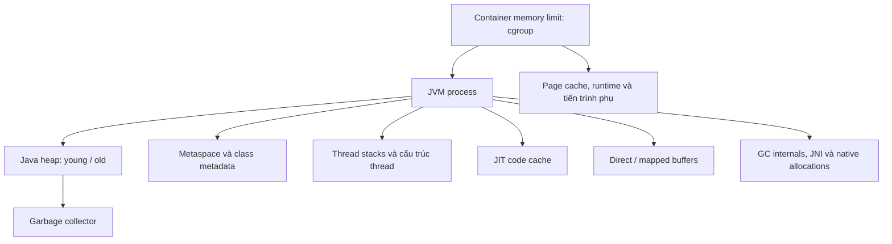
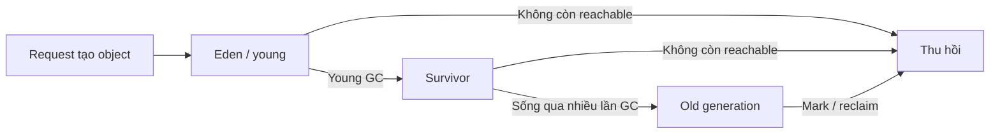

# JVM memory, garbage collection và giới hạn container

Một ứng dụng Spring Boot có thể hoạt động bình thường trên máy phát triển nhưng liên tục khởi động lại khi chạy trong GKE. Dashboard cho thấy Java heap chỉ sử dụng khoảng 600 MiB trong khi container giới hạn 1 GiB, song Pod vẫn bị `OOMKilled`. Nguyên nhân là bộ nhớ của JVM rộng hơn heap: ngoài object Java còn có Metaspace, stack của các thread, JIT code cache, direct buffer, bộ nhớ native của thư viện và chi phí từ container. Nếu chỉ nhìn `-Xmx`, đội vận hành dễ cấp thiếu tài nguyên và chẩn đoán sai.

Trong phần **Java và Spring trên GCP** của module `CLOUD_PROVIDERS_GCP`, bài học này giải thích cách HotSpot JVM dùng bộ nhớ, cách garbage collection (GC) thu hồi object và cách kernel Linux áp dụng memory limit cho container. Các nguyên tắc được minh họa qua Java 21/Spring Boot chạy trên Google Kubernetes Engine (GKE); tư duy tương tự áp dụng cho Cloud Run, Compute Engine và dịch vụ Java được đóng gói trong container. Mục tiêu là chọn giới hạn hợp lý, quan sát được triệu chứng và xử lý sự cố dựa trên số liệu thực tế.

## 1. Những vùng bộ nhớ của một tiến trình Java

JVM có nhiều vùng bộ nhớ với cơ chế cấp phát và quản lý khác nhau. Garbage collector chủ yếu quản lý **Java heap**, trong khi phần lớn bộ nhớ native bên ngoài heap không được thu hồi trực tiếp bởi GC.



| Thành phần | Chứa gì? | Công cụ quan sát / giới hạn |
|---|---|---|
| Java heap | Object, array và dữ liệu của ứng dụng | `-Xms`, `-Xmx`, `-XX:MaxRAMPercentage`, `jvm.memory.*`, `jcmd GC.heap_info` |
| Metaspace | Metadata của class được nạp, class loader | `jvm.memory.used` với `area=nonheap`; `-XX:MaxMetaspaceSize` nếu cần giới hạn |
| Thread stack | Stack frame và cấu trúc native cho từng platform thread | Số lượng thread, `-Xss`, Native Memory Tracking (NMT) |
| Code cache | Mã máy do JIT compiler sinh ra | NMT; `jcmd Compiler.codecache` nếu JVM hỗ trợ |
| Direct buffers | Bộ nhớ ngoài heap do `ByteBuffer.allocateDirect`, NIO/Netty sử dụng | Buffer metrics, NMT một phần, `-XX:MaxDirectMemorySize` khi phù hợp |
| GC/JVM native | Cấu trúc GC, JIT compiler, VM internals, JNI | NMT, hệ điều hành và quan sát RSS |
| Page cache và tiến trình phụ | Cache trang của Linux, sidecar và tiến trình khác | Cgroup/Kubernetes metrics; mỗi container có limit riêng nếu được đặt |

**Reserved, committed và used** là ba khái niệm khác nhau. JVM có thể *reserve* không gian địa chỉ ảo lớn, *commit* một phần để sẵn sàng sử dụng, rồi mới thực sự ghi dữ liệu vào trang bộ nhớ. Kích thước virtual memory (`VIRT`/`VSZ`) lớn không đồng nghĩa container đang tiêu thụ từng ấy RAM. Trong khi đó, RSS thể hiện các trang vật lý của một tiến trình và không đồng nhất hoàn toàn với số byte mà memory cgroup tính cho container. Vì vậy, cần đối chiếu heap, non-heap và số liệu memory của container trước khi kết luận có leak.

### Heap không phải tổng bộ nhớ của JVM

Ví dụ tiến trình có `-Xmx640m` và đang dùng 540 MiB heap vẫn có thể sử dụng thêm hàng trăm MiB native memory. Nếu JVM tạo hàng trăm platform thread, dùng Netty direct buffers hoặc load nhiều class, phần ngoài heap tăng đáng kể. Ngược lại, đặt container memory limit thành 640 MiB cho JVM có `-Xmx640m` gần như không để lại khoảng trống cho những thành phần này.

Heap dump tập trung vào đồ thị object trong Java heap; nó không tự phản ánh đầy đủ direct memory, thread stacks hoặc toàn bộ bộ nhớ do thư viện native cấp phát. Khi thấy container memory tăng nhưng heap sau GC vẫn ổn định, hãy chuyển hướng điều tra sang non-heap, native memory, page cache và các tiến trình khác trong container.

## 2. Garbage collection hoạt động như thế nào?

Garbage collection tự động thu hồi bộ nhớ của các object không còn *reachable* từ GC roots (chẳng hạn local variable đang còn hiệu lực, static field, thread và tham chiếu do JVM quản lý). GC không thể thu hồi object vẫn còn đường tham chiếu đến, kể cả khi ứng dụng không cần object đó nữa. Đây là cơ sở của nhiều memory leak trong Java: cache, collection, listener, thread-local hoặc class loader vẫn giữ tham chiếu.

Phần lớn collector hiện đại tận dụng giả định rằng nhiều object có vòng đời ngắn. Heap thường được chia theo thế hệ:

- **Young generation:** nơi nhiều object mới được tạo. Một GC young thường dọn object ngắn hạn và chuyển object sống sót đến survivor hoặc old generation theo thuật toán của collector.
- **Old generation:** các object sống lâu hơn. Áp lực ở đây có thể tạo chu kỳ concurrent marking, mixed collection hoặc full GC tùy collector.
- **Stop-the-world (STW) pause:** giai đoạn các thread ứng dụng phải tạm dừng để GC thực hiện một số công việc. GC hiện đại có thể làm nhiều việc đồng thời với application, nhưng không bảo đảm mọi hoạt động đều không có pause.



Không phải object nào cũng lần lượt đi qua mọi vùng trong sơ đồ. Ví dụ G1 có thể cấp phát object rất lớn trực tiếp vào humongous regions thuộc old generation. JVM cũng có thể loại bỏ một số allocation nhờ escape analysis, nên không phải mọi object trong source code đều trở thành object heap thật.

### Các collector phổ biến của HotSpot

| Collector | Đặc tính | Khi cân nhắc |
|---|---|---|
| G1 GC | Chủ yếu concurrent; chia heap thành nhiều region, cân bằng throughput và độ trễ pause | Điểm bắt đầu hợp lý cho phần lớn Spring Boot service trên HotSpot server-class |
| Parallel GC | Dùng nhiều thread GC, ưu tiên throughput; pause có thể dài hơn | Batch job hoặc workload chấp nhận latency cao |
| ZGC | Tập trung vào pause thấp, làm nhiều việc đồng thời với ứng dụng | Dịch vụ nhạy cảm với tail latency, có đủ CPU/RAM cho collector |
| Serial GC | Thu gom bằng ít thread, overhead đơn giản | Workload nhỏ hoặc môi trường ít CPU, cần benchmark thực tế |

Trên đa số cấu hình HotSpot server-class hiện đại, **G1 thường là collector mặc định**, nhưng lựa chọn còn phụ thuộc JDK, số CPU, bộ nhớ và runtime. Kiểm tra collector thực tế bằng JVM flags và GC log, không dựa vào giả định từ tên image. Các tùy chọn ví dụ:

```bash
# Sử dụng G1 rõ ràng khi cần cấu hình ổn định
java -XX:+UseG1GC -jar app.jar

# Chỉ thử ZGC sau khi kiểm tra JDK và đo latency/throughput
java -XX:+UseZGC -jar app.jar
```

Với G1, `-XX:MaxGCPauseMillis=200` là mục tiêu mềm (tính bằng mili giây), **không phải cam kết mọi pause dưới 200 ms**. Đặt mục tiêu quá thấp có thể tăng CPU dành cho GC và làm giảm throughput. Việc chọn collector phải dựa trên p95/p99 latency, GC pause, allocation rate, CPU và lượng live heap sau GC.

### Dấu hiệu GC đang gặp vấn đề

- Young GC tăng tần suất khi request rate hoặc allocation rate cao: có thể là hành vi bình thường nếu pause ngắn và ứng dụng vẫn đạt SLO.
- Old heap sau GC tăng dần qua nhiều chu kỳ: có thể có cache lớn, áp lực live set hoặc memory leak.
- Full GC lặp lại, pause dài và heap gần chạm `Xmx`: có thể thiếu heap, giữ object quá lâu hoặc allocation vượt khả năng thu hồi.
- CPU sử dụng cao trong GC trong khi request throughput giảm: có thể là GC overhead hoặc CPU throttling trong container.
- GC log cho thấy heap sau collection vẫn thấp, nhưng container memory vẫn tăng: ưu tiên điều tra native memory, direct buffers và thread count.

Không tăng `-Xmx` chỉ vì thấy GC chạy thường xuyên. Hãy so sánh lượng object sống thực, nguyên nhân cấp phát và SLO trước khi thay đổi heap.

## 3. Memory limit của Kubernetes khác `-Xmx`

Kubernetes quản lý tài nguyên ở **container level**. `resources.requests.memory` giúp scheduler chọn node đủ tài nguyên; `resources.limits.memory` đặt giới hạn được kernel thực thi thông qua Linux cgroups. Container có thể được kernel kết thúc khi mức sử dụng bộ nhớ vượt limit. Bộ nhớ không thể tăng thêm chỉ bằng việc đặt `-Xmx` lớn hơn.

| Cấu hình | Ý nghĩa | Hệ quả nếu đặt sai |
|---|---|---|
| `requests.memory` | Mức memory được dùng khi lập lịch Pod và xác định một phần QoS | Request quá thấp khiến node bị overcommit và dễ gặp pressure/eviction |
| `limits.memory` | Trần memory của container do cgroup áp dụng | Quá thấp gây OOM kill dù heap chưa đầy |
| `-Xmx` | Trần Java heap | Quá thấp gây `OutOfMemoryError: Java heap space`; quá cao chiếm chỗ của native memory |
| `-XX:MaxRAMPercentage` | Tỷ lệ RAM mà JVM dùng để tính heap tối đa khi không đặt `-Xmx` | Nếu đặt quá cao, container thiếu headroom cho phần ngoài heap |
| `-Xss` | Stack size cho mỗi platform thread | Stack quá lớn làm native memory tăng; giảm quá mức có thể gây `StackOverflowError` |

Khi container vượt memory limit, kernel có thể gửi `SIGKILL` cho tiến trình, Kubernetes thường ghi `reason: OOMKilled` và exit code 137. Vì JVM không có cơ hội xử lý một `SIGKILL`, bạn có thể **không thấy `java.lang.OutOfMemoryError` hoặc heap dump**. Exit code 137 thường tương ứng với signal 9 nhưng không đủ để chứng minh OOM nếu thiếu reason hoặc node logs; phải kiểm tra trạng thái termination và events.

Trong GKE, còn cần phân biệt sự cố memory ở **node level** với container vượt limit. Node `MemoryPressure` có thể dẫn đến eviction của Pod; system-level OOM có thể kill process để bảo vệ node. Vì thế `Evicted`, `OOMKilled` và `CrashLoopBackOff` không phải cùng một nguyên nhân. `CrashLoopBackOff` chỉ mô tả trạng thái chờ tăng dần giữa các lần khởi động lại, cần đọc termination reason và log để tìm nguyên nhân gốc.

### Container awareness của HotSpot

Trên Linux với các bản HotSpot hiện đại như Java 21/25, `-XX:+UseContainerSupport` được bật mặc định. JVM có thể đọc giới hạn CPU/RAM từ cgroups và chọn heap, thread GC cùng các thiết lập ergonomics dựa trên môi trường container. Cần kiểm tra đúng phiên bản JDK và kiểu cgroup (`v1`/`v2`), đặc biệt khi dùng image cũ hoặc kernel đặc thù.

Oracle JDK 21 ghi nhận mặc định `-XX:MaxRAMPercentage=25` và `-XX:InitialRAMPercentage=1.5625` đối với heap sizing theo RAM khả dụng, với heuristic điều chỉnh cho heap nhỏ. Con số 25% là **giá trị mặc định của tham số**, không phải quy tắc rằng mọi JVM đều có heap bằng đúng 25% container limit. Ví dụ `-Xmx` explicit có thể thay thế cách tính bằng phần trăm; runtime và cấu hình khác cũng ảnh hưởng kết quả.

Các lệnh chẩn đoán container awareness:

```bash
# Chạy trong container có JDK, quan sát giá trị mà JVM phát hiện
java -XshowSettings:system -version
java -XX:+PrintFlagsFinal -version 2>&1 | grep -E 'UseContainerSupport|MaxRAMPercentage|MaxHeapSize|ActiveProcessorCount'

# Xem thông tin cgroup và container do JVM đọc
java -Xlog:os+container=info -version
```

Với Linux cgroup v2, có thể đọc `memory.max` (giá trị `max` nghĩa là không đặt giới hạn cgroup ở cấp đó) và `memory.current` để xem usage theo cgroup; cgroup v1 thường dùng `memory.limit_in_bytes`. File thực tế có thể nằm ở đường dẫn cgroup của tiến trình, không nhất thiết đúng `/sys/fs/cgroup/` gốc. Các file này phục vụ chẩn đoán; không chỉnh trực tiếp cgroup của Pod đang được Kubernetes quản lý.

## 4. Tính ngân sách bộ nhớ cho Spring Boot container

Một nguyên tắc hữu ích là:

```text
container memory limit
  >= Java heap thực sự sử dụng / trần Xmx
   + non-heap và native memory ở tải cao
   + memory được cgroup tính ngoài các vùng trên
   + headroom cho biến động, startup và burst
```

Không có một tỷ lệ heap/container chính xác cho mọi ứng dụng. Spring MVC với ít thread, Spring WebFlux/Netty với direct buffers, ứng dụng dùng gRPC, JNI hoặc nhiều class loader có mức native memory khác nhau. Hãy bắt đầu bằng một cấu hình có headroom, rồi đo với workload production-like để điều chỉnh.

### Ví dụ: Pod có giới hạn 1 GiB

Giả sử một container Java 21/Spring Boot có limit `1Gi` (1024 MiB). Chọn tạm `-Xmx640m` (xấp xỉ 640 MiB, tức 62,5% limit), để lại khoảng 384 MiB cho Metaspace, stack, code cache, direct buffers, GC, page cache và biến động. Đây là ví dụ sizing ban đầu, không phải lời đảm bảo 384 MiB luôn đủ.

| Khoản mục minh họa | Ngân sách tham khảo |
|---|---:|
| Container memory limit | 1024 MiB |
| Java heap tối đa `-Xmx640m` | 640 MiB |
| Phần ngoài heap + dự phòng còn lại | 384 MiB |

Nếu workload có 400 thread platform với stack lớn hoặc Netty direct buffers đạt hàng trăm MiB, ngân sách native có thể vượt 384 MiB. Khi đó cần giảm số thread, giới hạn buffer, tối ưu workload hoặc tăng container limit. Hãy quan sát **peak** và phân vị cao trong thời gian tải thật, không chỉ trung bình 5 phút.

Có hai cách cấu hình heap, nên chọn một cách chính để tránh hiểu nhầm:

```bash
# A. Giới hạn heap bằng kích thước tuyệt đối
java -Xms256m -Xmx640m -jar app.jar

# B. Giới hạn heap theo tỷ lệ memory mà JVM phát hiện
java -XX:InitialRAMPercentage=20.0 -XX:MaxRAMPercentage=60.0 -jar app.jar
```

Ở cách B, nếu JVM nhận đúng limit 1 GiB và không bị heuristic đặc biệt, trần heap xấp xỉ 614 MiB. Số này chỉ để hình dung tỷ lệ; kiểm tra heap thực tế bằng `jcmd VM.flags`, `jcmd GC.heap_info` hoặc JVM metrics. Không đặt đồng thời `-Xmx640m` và `-XX:MaxRAMPercentage=60` rồi kỳ vọng Java cộng hai cách cấu hình.

`-Xms` có thể nhỏ hơn `-Xmx` để heap tăng dần theo tải. Đặt `-Xms` bằng `-Xmx` có thể giảm một số lần mở rộng heap nhưng tăng mức memory được commit sớm và cần được thử nghiệm theo đặc tính runtime. Đừng mặc định `-Xms=-Xmx` là tối ưu cho mọi microservice.

## 5. Cấu hình Deployment GKE cho ứng dụng Spring Boot

Ví dụ sau sử dụng Java 21, container limit 1 GiB và heap tối đa 640 MiB. `requests.memory` thể hiện mức tài nguyên dự kiến để scheduler xếp Pod; `limits.memory` là trần cgroup. `JAVA_TOOL_OPTIONS` được JVM đọc khi khởi động, giúp áp dụng tham số mà không cần sửa Dockerfile của ứng dụng.

```yaml
apiVersion: apps/v1
kind: Deployment
metadata:
  name: orders-api
  namespace: orders
spec:
  replicas: 3
  selector:
    matchLabels:
      app: orders-api
  template:
    metadata:
      labels:
        app: orders-api
    spec:
      containers:
        - name: app
          image: asia-southeast1-docker.pkg.dev/PROJECT_ID/apps/orders-api:VERSION
          ports:
            - name: http
              containerPort: 8080
          resources:
            requests:
              cpu: 500m
              memory: 768Mi
            limits:
              cpu: "2"
              memory: 1Gi
          env:
            - name: JAVA_TOOL_OPTIONS
              value: >-
                -Xms256m -Xmx640m
                -XX:+UseG1GC
                -Xlog:gc*,safepoint:stdout:time,uptime,level,tags
                -XX:+ExitOnOutOfMemoryError
          startupProbe:
            httpGet:
              path: /actuator/health/liveness
              port: http
            periodSeconds: 5
            failureThreshold: 30
          readinessProbe:
            httpGet:
              path: /actuator/health/readiness
              port: http
            periodSeconds: 10
          livenessProbe:
            httpGet:
              path: /actuator/health/liveness
              port: http
            periodSeconds: 20
```

Đây là mẫu phục vụ bài học. Namespace, endpoint Actuator, image, quyền đọc Artifact Registry và các dependency phải được chuẩn bị trước. Khi dùng `JAVA_TOOL_OPTIONS`, hãy kiểm tra image/runtime có chấp nhận các cờ HotSpot tương ứng. Nếu một image chứa nhiều tiến trình Java, biến này có thể tác động lên các tiến trình đó.

`-XX:+ExitOnOutOfMemoryError` giúp JVM thoát khi phát sinh `OutOfMemoryError` để orchestrator có thể khởi động lại tiến trình lỗi. Nó không ngăn kernel `OOMKilled`, không tự tạo heap dump, và không khắc phục leak. Không đặt probe quá nhạy khiến Java đang warm-up/JIT hoặc pause GC tạm thời bị restart liên tiếp. Startup probe cho phép giai đoạn khởi động kéo dài hơn trước khi liveness probe được áp dụng; readiness chỉ quyết định Pod có nhận request hay không.

Ở ví dụ này, request memory 768 MiB nhỏ hơn limit 1 GiB, nên Pod không có QoS `Guaranteed` chỉ nhờ hai trường này. Kubernetes phân loại QoS dựa vào requests/limits CPU và memory của **tất cả containers trong Pod**; lựa chọn QoS cần theo capacity, workload và rủi ro node pressure thay vì đặt request bằng limit theo thói quen.

### Cấu hình tương đương bằng phần trăm

Nếu nhóm dùng chung image trên nhiều size container, có thể thay `-Xmx640m` bằng `-XX:MaxRAMPercentage=60.0` và xác nhận JVM phát hiện đúng memory limit. Điều này hữu ích khi GKE workload có nhiều cấu hình môi trường, nhưng tỷ lệ phải được xác thực dưới tải vì native memory không nhất thiết tăng cùng tỷ lệ với heap.

Trên Cloud Run, mỗi revision cũng có memory limit và concurrency; một request đồng thời có thể tăng số object, stack, buffer và memory peak. Đặt JVM heap thấp hơn revision memory limit, quan sát khi concurrency cao và điều chỉnh memory/concurrency cùng nhau. Cloud Run autoscaling theo instance không làm giảm memory của request đang được xử lý trong một instance.

## 6. Phân biệt `OutOfMemoryError`, `OOMKilled` và eviction

Ba nhóm lỗi sau có triệu chứng tương tự đối với người dùng (HTTP 5xx hoặc Pod restart), nhưng cơ chế và cách khắc phục khác nhau.

| Triệu chứng | Ai phát hiện? | Dữ liệu điển hình | Hướng điều tra |
|---|---|---|---|
| `java.lang.OutOfMemoryError: Java heap space` | JVM không cấp phát thêm object trong Java heap | Stack trace; có thể có HPROF nếu bật dump | Object graph, live heap, cache/leak, allocation rate và `Xmx` |
| `OutOfMemoryError: Metaspace` | JVM hết vùng Metaspace hoặc chạm giới hạn đã cấu hình | Stack trace, class loader số lượng lớn | Class loading, dynamic proxies, classloader leak, Metaspace limit |
| `OutOfMemoryError: Direct buffer memory` | Quá giới hạn direct buffer hoặc không cấp phát được buffer | Stack trace NIO/Netty | Direct buffer pooling, reference/release, limit direct memory |
| `OutOfMemoryError: unable to create native thread` | JVM/OS không tạo được thread mới | Stack trace, thread count cao, lỗi native resource | Thread leak, `-Xss`, PID limit, native RAM, ulimit |
| `OOMKilled` / exit code 137 | Linux kernel/cgroup kill process | Container status `reason=OOMKilled`; đôi khi không có Java exception | Container memory, native memory, limit, page cache và node events |
| `Evicted` / `MemoryPressure` | Kubelet/node thiếu tài nguyên | Pod event với thông tin node pressure | Tổng requests/usage của node, QoS, scheduling và node sizing |

Một `java.lang.OutOfMemoryError` có thể không làm toàn bộ JVM thoát ngay nếu exception bị bắt hoặc chỉ ảnh hưởng một thread. Ngược lại, kernel OOM kill có thể kết thúc process mà JVM không kịp log. Đừng chỉ tìm chữ `OutOfMemoryError` rồi kết luận Pod không gặp thiếu bộ nhớ.

### Chẩn đoán theo trình tự từ GKE

```bash
# Xác định Pod restart và trạng thái gần nhất
kubectl get pods -n orders
kubectl describe pod POD_NAME -n orders

# Xem trạng thái termination của container cụ thể
kubectl get pod POD_NAME -n orders \
  -o jsonpath='{.status.containerStatuses[?(@.name=="app")].lastState.terminated.reason}{"\n"}'

# Xem log lần chạy trước khi container restart
kubectl logs POD_NAME -n orders -c app --previous

# Xem usage hiện tại (cần Metrics Server hoặc nguồn metrics tương ứng)
kubectl top pod -n orders --containers
```

Nếu `kubectl describe` hiển thị `Last State: Terminated`, `Reason: OOMKilled`, hãy xác nhận memory limit, container memory peak và thời điểm kill. Nếu không thấy OOMKilled nhưng nghi node bị OOM, kiểm tra GKE node logs và `MemoryPressure`. Nếu log có stack trace `Java heap space`, tiếp tục phân tích heap/GC. Nếu có `Direct buffer memory` hoặc thread exhaustion, tăng `-Xmx` không giải quyết trực tiếp.

### Ví dụ phân tích sự cố

Giả sử ứng dụng `orders-api` có limit 1024 MiB và `-Xmx640m`. Heap used thường dao động 350–500 MiB, nhưng container memory tăng dần lên 1000 MiB rồi Pod bị `OOMKilled`. Đội ngũ xác định số platform thread tăng từ 120 lên hơn 800 vì thread pool được tạo mới cho mỗi request nhưng không đóng. Đây là **native/thread memory growth**, không phải Java heap leak. Cách sửa là dùng executor được quản lý, giới hạn pool size và đóng tài nguyên đúng vòng đời; tăng heap có thể làm vấn đề nặng hơn vì giảm headroom.

Trường hợp khác, container memory còn nhiều nhưng heap chạm `-Xmx640m`, GC thu hồi rất ít và JVM báo `Java heap space`. Lúc này nên kiểm tra heap dump, retained objects, cache và collection giữ dữ liệu. Tăng limit container mà giữ nguyên `-Xmx` không nhất thiết loại bỏ heap OOME.

## 7. Đọc GC log và liên hệ với latency

Từ Java 9, JVM unified logging hỗ trợ `-Xlog`. Ví dụ ghi GC và safepoint log ra stdout để GKE thu thập qua Cloud Logging:

```bash
java \
  -Xms256m -Xmx640m \
  -Xlog:gc*,safepoint:stdout:time,uptime,level,tags \
  -jar app.jar
```

Trong production, chọn mức độ log phù hợp để tránh quá nhiều dòng và chi phí logging. Có thể dùng `-Xlog:gc=info:stdout:time,uptime,level,tags` nếu chỉ cần thông tin GC cơ bản. Khi ghi log vào file, cần quản lý rotation, storage limit và việc gửi file về hệ thống tập trung; file GC log lớn không nên làm đầy ephemeral storage của container.

Ví dụ log G1 đơn giản hóa:

```text
[3.124s][info][gc] GC(11) Pause Young (Normal) (G1 Evacuation Pause) 220M->84M(640M) 15.4ms
[28.551s][info][gc] GC(72) Pause Young (Mixed) (G1 Evacuation Pause) 520M->370M(640M) 46.7ms
```

Giải thích dòng đầu: trước GC heap dùng khoảng 220 MiB, sau GC còn 84 MiB, dung lượng heap tại thời điểm đó 640 MiB; thời gian pause 15,4 ms. Dòng thứ hai là mixed collection, có thu hồi một phần old generation; heap sau GC vẫn 370 MiB. Đây là dữ liệu minh họa, không phải log từ một ứng dụng cụ thể.

Khi phân tích:

1. Xem **tần suất** GC tăng theo request rate hay tăng ngay cả khi traffic không đổi.
2. So sánh heap **trước/sau GC** để ước lượng live set, không chỉ nhìn heap used tức thời.
3. Xác định pause dài trùng với p95/p99 latency hoặc timeout hay không.
4. Kiểm tra CPU throttling: collector cần CPU; nếu container bị throttled trong giai đoạn GC, thời gian thực tế và latency có thể tăng.
5. Quan sát số thread, allocation rate, Metaspace và direct buffers để tránh quy hết lỗi cho GC.

Nếu GC pause tăng do thiếu heap thực sự, có thể tăng heap hoặc giảm live set. Nếu CPU throttling mạnh, thử điều chỉnh CPU request/limit hoặc concurrency. Nếu giữ object không cần thiết, việc đổi collector thường chỉ trì hoãn sự cố.

## 8. Công cụ JVM dùng khi xử lý sự cố

Khi image chứa JDK và quyền truy cập tiến trình cho phép, `jcmd` có thể cung cấp trạng thái runtime mà không cần restart ứng dụng:

```bash
# Chạy bên trong container, JVM có PID 1 trong nhiều image
jcmd 1 VM.command_line
jcmd 1 VM.flags
jcmd 1 GC.heap_info
jcmd 1 Thread.print

# Theo dõi số lượng class và Java heap khi cần
jcmd 1 GC.class_histogram
```

Một số lệnh (đặc biệt heap histogram/heap dump) có thể gây pause hoặc tiêu thụ CPU/RAM đáng kể. Hãy xem tác động trước khi chạy trên production. Runtime image JRE tối giản hoặc distroless có thể không chứa `jcmd`; cần chuẩn bị debug image hoặc phương án chẩn đoán được tổ chức phê duyệt. `jcmd` yêu cầu quyền attach vào JVM tương ứng; các cờ bảo mật có thể vô hiệu hóa attach.

### Native Memory Tracking (NMT)

NMT của HotSpot giúp xem phân bố native memory do JVM quản lý, gồm Java Heap, Class, Thread, Code, GC, Compiler và các nhóm nội bộ. **NMT cần bật từ lúc JVM khởi động**; không thể bật muộn bằng `jcmd`. Có thể chọn `summary` khi điều tra thông thường hoặc `detail` khi cần phân tích sâu:

```bash
# Cần khởi động JVM với cờ này
java -XX:NativeMemoryTracking=summary -jar app.jar

# Sau khi JVM khởi động, lấy báo cáo và so sánh biến động
jcmd 1 VM.native_memory summary scale=MB
jcmd 1 VM.native_memory baseline

# Lấy lại sau một khoảng thời gian/tải và so với baseline
jcmd 1 VM.native_memory summary.diff scale=MB
```

NMT có overhead; tài liệu Oracle nêu mức overhead hiệu năng có thể khoảng 5–10% khi bật NMT. Chỉ bật khi có mục tiêu chẩn đoán hoặc đã tính chi phí vận hành. NMT không theo dõi đầy đủ mọi allocation của thư viện native bên thứ ba và không thay thế container memory metrics. Báo cáo `reserved` lớn không đồng nghĩa lượng RAM resident tương ứng lớn; cần phân biệt `committed`, RSS và cgroup usage.

### Heap dump, JFR và Profiler

Đối với Java heap OOME, có thể bật:

```bash
java \
  -XX:+HeapDumpOnOutOfMemoryError \
  -XX:HeapDumpPath=/dumps \
  -jar app.jar
```

Heap dump có thể rất lớn và chứa dữ liệu nhạy cảm như token, nội dung request hoặc thông tin người dùng đang còn trong bộ nhớ. Cần mount volume có đủ dung lượng, giới hạn quyền, mã hóa và có quy trình xóa. Khi kernel kết thúc container bằng `OOMKilled`, JVM thường không kịp tạo dump; đừng coi thiếu `.hprof` là bằng chứng rằng không có vấn đề bộ nhớ.

Java Flight Recorder (JFR) hỗ trợ lấy mẫu allocation, GC và runtime events để phân tích hành vi theo thời gian. Cloud Profiler hỗ trợ continuous profiling để tìm đường CPU/heap đáng chú ý ở mức call stack. Khi cần tìm retained object và reference chain, heap dump với công cụ chuyên dụng phù hợp hơn; khi cần hiểu latency/allocation theo thời gian, JFR và GC logs hữu ích hơn.

## 9. Giám sát JVM cùng Kubernetes và Cloud Monitoring

Giám sát heap riêng lẻ dễ bỏ sót native memory. Với Spring Boot trên GKE, nên đối chiếu **ba tầng số liệu**: JVM/GC (Micrometer), container/cgroup (Kubernetes/GKE) và trải nghiệm người dùng (request rate, lỗi, latency). Mỗi tầng giúp khoanh vùng nguyên nhân khác nhau.

### Spring Boot Actuator và Micrometer

Spring Boot Actuator tự đăng ký nhiều meter JVM thông qua Micrometer. Tùy classpath, các nhóm thường có `jvm.memory.*`, `jvm.gc.*`, `jvm.threads.*`, `jvm.buffer.*` cùng metrics process/system. Nếu muốn scrape Prometheus, cần dependency registry Prometheus tương ứng với phiên bản Spring Boot/Micrometer đang dùng.

Ví dụ `application.yml`:

```yaml
management:
  endpoint:
    health:
      probes:
        enabled: true
  endpoints:
    web:
      exposure:
        include: health,info,prometheus
  metrics:
    tags:
      application: orders-api
```

Ví dụ xem metric từ Actuator khi endpoint được bật và có quyền truy cập:

```bash
curl http://127.0.0.1:8080/actuator/metrics/jvm.memory.used
curl 'http://127.0.0.1:8080/actuator/metrics/jvm.memory.max?tag=area:heap'
curl http://127.0.0.1:8080/actuator/metrics/jvm.gc.pause
curl http://127.0.0.1:8080/actuator/metrics/jvm.threads.live
```

Các giá trị của `jvm.memory.used` có thể được phân theo `area=heap|nonheap` và `id` tương ứng từng pool. `jvm.gc.pause` mô tả thời gian GC pause; `jvm.threads.live` giúp phát hiện số thread tăng. Hãy kiểm tra danh sách tên meter thực tế tại `/actuator/metrics` vì tính năng và nhãn có thể thay đổi theo runtime/registry. Endpoint `/actuator/prometheus` phải được bảo vệ và giới hạn truy cập nội bộ; không công khai nó ra Internet chỉ để thuận tiện thu thập metrics.

Khi dùng Managed Service for Prometheus trên GKE, các meter thường được đổi sang tên Prometheus như `jvm_memory_used_bytes` và `jvm_gc_pause_seconds_count`. Hãy kiểm tra metric labels thực tế (`namespace`, `pod`, `application`, `area`, `id`) trước khi tạo PromQL; nhãn do hệ thống scrape bổ sung có thể khác nhau theo cấu hình.

Một vài truy vấn minh họa:

```promql
# Java heap đang sử dụng theo pod
sum by (pod) (jvm_memory_used_bytes{area="heap"})

# Số pause GC trung bình mỗi giây trong 5 phút
sum by (pod) (rate(jvm_gc_pause_seconds_count[5m]))

# Tổng thời gian pause GC tính trên mỗi giây quan sát
sum by (pod) (rate(jvm_gc_pause_seconds_sum[5m]))
```

Truy vấn phải được điều chỉnh theo những labels thực có. Tổng thời gian GC pause trên mỗi giây giúp nhận diện tỷ lệ thời gian dừng ứng dụng; với một collector có concurrent phase, không nên đồng nhất toàn bộ CPU cost của GC với pause time.

### GKE Cloud Monitoring

GKE xuất các chỉ số theo container và Pod. Một số chỉ số hữu ích:

| Cloud Monitoring metric | Mục đích |
|---|---|
| `kubernetes.io/container/memory/used_bytes` | Theo dõi mức tiêu thụ memory của container |
| `kubernetes.io/container/memory/limit_utilization` | Tỷ lệ memory hiện dùng so với container limit |
| `kubernetes.io/container/restart_count` | Phát hiện restart tăng bất thường |
| `kubernetes.io/container/cpu/limit_utilization` | Quan sát CPU so với giới hạn và bối cảnh GC |
| `kubernetes.io/container/ephemeral_storage/used_bytes` | Theo dõi dung lượng file/log/dump trong container |

Các chỉ số có sampling và cách tính riêng; không giả định `memory.used_bytes` bằng đúng Java heap used hoặc RSS. Cloud Monitoring giúp phát hiện rủi ro tiệm cận limit ở cấp cgroup, còn Actuator cho biết phần nào của JVM đang tăng.

### Dashboard tối thiểu để vận hành

Nên hiển thị cùng một time axis và lọc theo service, environment, GKE cluster, namespace và Pod:

- HTTP request rate, error rate, p95/p99 latency cùng SLO.
- Container memory used/limit và số lần restart/OOMKilled.
- JVM heap used/max, non-heap used, buffer memory, số thread live.
- GC pause count/duration, full/mixed GC frequency và allocation rate nếu có.
- Container CPU usage, CPU throttling nếu có metric, và HPA replica count.
- GKE node memory pressure/evictions và trạng thái readiness.

Đặt cảnh báo theo **xu hướng và tác động**, ví dụ memory limit utilization duy trì cao và tăng, restart do OOMKilled, heap sau GC tăng liên tục hoặc GC pause trùng với latency vượt SLO. Không đặt alert chỉ vì heap dùng 80% Xmx trong một thời điểm: JVM có thể chủ động giữ heap đầy tương đối để tận dụng RAM và thu hồi khi cần.

## 10. Cách tiếp cận tuning GC và bộ nhớ theo số liệu

GC tuning nên bắt đầu sau khi đã xác định memory limit và live set phù hợp. Một thay đổi GC có thể cải thiện p99 latency nhưng tiêu tốn thêm CPU hoặc ảnh hưởng throughput. Vì vậy, mỗi lần chỉ nên thay đổi một yếu tố và so sánh trên workload có lưu lượng tương đương.

| Dấu hiệu quan sát | Câu hỏi cần kiểm tra | Hành động có thể thử |
|---|---|---|
| Heap sau GC tăng liên tục | Có reference bị giữ bởi cache/listener/static map không? | Heap dump, giới hạn cache, sửa vòng đời object |
| Young GC rất thường xuyên, nhưng heap sau GC thấp | Có tạo nhiều object tạm, serialize/deserialize lặp lại không? | Dùng JFR/Profiler tìm allocation hotspot, giảm object churn |
| Pause dài khi tải cao | G1 mixed/full GC hay thiếu CPU? | Kiểm tra GC logs, CPU throttling, live set và heap budget |
| Heap ổn định nhưng container memory tăng | Native buffers, thread stack hay page cache tăng? | NMT, buffer/thread metrics, cgroup memory breakdown |
| `OutOfMemoryError: Metaspace` | Số class/class loader tăng không? | Kiểm tra classloader leak; chỉ tăng Metaspace limit nếu thực sự cần |
| Pod OOMKilled sau tăng `-Xmx` | Native headroom còn đủ không? | Giảm heap hoặc tăng container memory limit và requests theo tải |
| CPU rất cao nhưng GC pause thấp | Hot application code hoặc CPU throttling? | CPU profiling, thread dump, container CPU metrics |

### Điều chỉnh số thread và concurrency

Thread stack là một trong những thành phần native memory dễ tăng khi ứng dụng có quá nhiều thread. Với Spring MVC/Tomcat, kiểm tra cấu hình thread pool của server và executor. Với Spring WebFlux/Netty, kiểm tra event-loop thread count, direct buffer allocator và connection pool. Với Java virtual threads, cần phân biệt số virtual thread với số platform carrier thread; không nhân số virtual thread trực tiếp với `-Xss` như platform thread, nhưng các object và trạng thái liên quan vẫn tiêu thụ bộ nhớ.

Hãy đặt giới hạn concurrency, queue size và timeout để tránh tình huống một đợt traffic tăng vừa tạo nhiều object vừa tăng số thread/buffer. Nếu service nhận 1.000 request đồng thời và mỗi request giữ 1 MiB dữ liệu trong heap, chỉ dữ liệu tạm đó đã có thể chiếm khoảng 1 GiB trước khi tính object overhead và thành phần khác.

### Horizontal scaling không sửa memory leak

HPA tăng số replica để chia tải. Nó giúp khi memory mỗi Pod tăng theo request concurrency, nhưng **không sửa leak bên trong mỗi replica**. Nếu mỗi instance giữ cache vô hạn hoặc thread leak, tăng replica chỉ làm sự cố xuất hiện ở nhiều Pod hơn. HPA dựa trên memory utilization cũng có thể đưa ra hành vi scale khó dự đoán vì heap được JVM giữ lại sau tải cao; cân nhắc CPU, request rate hoặc custom metrics phản ánh nhu cầu thực.

VPA giúp đề xuất hoặc điều chỉnh tài nguyên Pod tùy chế độ được cấu hình; việc thay đổi requests/limits và Pod recreation phải được hiểu rõ trước khi bật với production. Ở GKE Autopilot, chính sách requests và giới hạn tài nguyên có các ràng buộc riêng, cần kiểm tra theo loại workload và phiên bản cluster.

## 11. Runbook xử lý sự cố memory trên GKE

Khi nhận cảnh báo Pod restart, latency tăng hoặc OOMKilled, có thể làm theo trình tự sau:

1. **Xác định tác động:** service, namespace, cluster, phiên bản image, thời gian lỗi, số Pod và tỷ lệ request lỗi. Nếu đang ảnh hưởng SLO, ưu tiên giảm tác động bằng rollback hoặc tăng replica/capacity theo quy trình hiện hành.
2. **Đọc termination reason:** dùng `kubectl describe pod`, trạng thái `lastState.terminated` và `kubectl logs --previous`. Xác nhận `OOMKilled`, Java OOME, eviction hoặc probe failure.
3. **Đối chiếu memory limit:** xem requests/limits thực tế của container, version JDK và `-Xmx`/`MaxRAMPercentage`. Kiểm tra có `JAVA_TOOL_OPTIONS` nào bị ghi đè hoặc duplicate hay không.
4. **Xem time series:** container memory used, JVM heap used, non-heap, thread count, GC pause, CPU throttling và request concurrency trước thời điểm lỗi.
5. **Khoanh vùng:** nếu heap sau GC tăng, ưu tiên heap dump/JFR; nếu container memory tăng nhưng heap ổn định, ưu tiên NMT/native buffers/threads/page cache; nếu node MemoryPressure, đánh giá capacity và scheduling.
6. **Giảm rủi ro tức thời:** điều chỉnh memory limit/request có kiểm soát, giảm concurrency, rollback thay đổi vừa triển khai hoặc tắt tính năng gây tải; đảm bảo vẫn có native headroom.
7. **Xác minh sửa lỗi:** canary dưới traffic đại diện, đo GC, memory peak, p99 latency, OOM/restarts và resource cost.
8. **Ghi nhận nguyên nhân:** cập nhật runbook, budget bộ nhớ, load test và cảnh báo để phát hiện sớm lần sau.

### So sánh bốn trường hợp điển hình

| Trường hợp | Đặc điểm số liệu | Kết luận ưu tiên |
|---|---|---|
| A — Heap leak | Heap used sau Full/Mixed GC tăng, `Xmx` chạm trần, Java OOME | Tìm object bị giữ bằng heap dump hoặc profiler |
| B — Native growth | Heap sau GC ổn định, container memory tăng đến limit, OOMKilled | Thread stacks, direct buffers, JNI và page cache |
| C — CPU throttling | GC pause/latency tăng khi CPU bị giới hạn, heap không quá cao | CPU request/limit, thread GC, concurrency và runtime bottleneck |
| D — Node memory pressure | Nhiều Pod bị eviction/restart trên cùng node, chưa chắc vượt container limit | Node capacity, requests, QoS và phân bố Pod |

Phân loại này là điểm bắt đầu điều tra. Trong hệ thống thật, có thể xảy ra đồng thời nhiều nguyên nhân, ví dụ memory leak làm GC hoạt động nặng hơn, rồi CPU throttling kéo dài thời gian xử lý và khiến backlog/request memory tiếp tục tăng.

## 12. Kiểm thử sizing trước khi phát hành

Một bài benchmark nhỏ chỉ đo request latency không đủ để chốt limit production. Cần chạy workload có phân bố payload, concurrency và thời gian đủ để GC trưởng thành và cache đạt trạng thái ổn định.

Quy trình thử nghiệm gợi ý:

1. Chốt JVM image và JDK version (ví dụ Java 21 HotSpot), container memory/CPU requests/limits.
2. Chạy baseline trong GKE staging với lưu lượng gần production; ghi nhận heap, non-heap, container memory, GC pauses và p99 latency.
3. Tăng dần request rate hoặc concurrency đến mức peak dự kiến; giữ tải đủ lâu để quan sát old generation, cache và direct buffers.
4. Thử tải burst, payload lớn, kết nối chậm và GC trong lúc service warm-up.
5. Lặp lại với hai cấu hình `-Xmx` hoặc MaxRAMPercentage; thay đổi một tham số mỗi lần.
6. Tạo một lần deploy rolling update và kiểm tra liveness/readiness có gây restart dưới GC pause hay không.
7. Kiểm tra trạng thái khi một Pod bị OOMKilled trong sandbox, HPA có bù capacity không và request fail ra sao.
8. Chọn cấu hình có headroom theo **peak** đã đo, ghi lại lý do và thiết lập cảnh báo sát ngưỡng rủi ro.

Ví dụ, cấu hình 1 GiB container + 640 MiB heap có thể là điểm bắt đầu. Nếu benchmark thấy native memory thường chạm 500 MiB, phải thay đổi cấu hình vì tổng peak tiềm năng vượt limit. Nếu benchmark thấy container memory chỉ 600 MiB, heap sau GC thấp và p99 latency đạt SLO, không cần tự động tăng memory limit; tiếp tục theo dõi khi workload thay đổi.

## 13. Bài tập thực hành

Thực hiện trong GKE sandbox với một ứng dụng Spring Boot có Actuator và Java 21:

1. Tạo Deployment có memory request `768Mi`, limit `1Gi` và `-Xmx640m` như ví dụ.
2. Dùng `kubectl describe pod`, `kubectl top` và các meter JVM để ghi lại memory của container và heap lúc idle.
3. Tạo tải HTTP bằng công cụ test phù hợp; quan sát heap used, GC pause, CPU và memory peak.
4. Bật GC logging ra stdout, chọn một dòng Young GC và giải thích giá trị before/after cùng thời gian pause.
5. Trong sandbox, cố tình đặt heap quá nhỏ (ví dụ `-Xmx128m`) với workload tạo nhiều object; quan sát `OutOfMemoryError: Java heap space` và log JVM.
6. Ở thử nghiệm riêng, đặt container memory limit thấp hơn tổng memory peak đã đo; quan sát Pod termination reason, phân biệt `OOMKilled` và Java OOME.
7. Bật `-XX:NativeMemoryTracking=summary` khi khởi động, chạy `jcmd VM.native_memory summary` trước và sau tải để xem biến động.
8. Thử giảm concurrency hoặc giảm số thread của workload, so sánh container memory, GC pause và latency.
9. Viết báo cáo về lựa chọn memory request, limit, Xmx, native headroom và rủi ro của cấu hình.

Chỉ gây OOM có chủ đích trong sandbox và đặt quota phù hợp. Không thực hiện thử nghiệm kill/eviction trên workload đang phục vụ khách hàng. Đảm bảo heap dump, nếu tạo, không chứa dữ liệu thật và không được đưa vào repository hoặc artifact công khai.

## 14. Checklist cho Spring Boot production

- [ ] JDK version, HotSpot collector và cgroup mode được xác định rõ.
- [ ] JVM đọc đúng container memory/CPU limit, không vô tình dùng cấu hình dựa trên host.
- [ ] `-Xmx` hoặc `MaxRAMPercentage` được chọn dựa trên peak memory thực tế.
- [ ] Có headroom cho Metaspace, thread stacks, code cache, direct buffers và native memory.
- [ ] Kubernetes memory request phản ánh nhu cầu lập lịch; memory limit phù hợp với tổng memory peak.
- [ ] Đã kiểm thử startup/readiness/liveness probe dưới tải và GC pause.
- [ ] GC logs và JVM metrics có thể truy cập khi cần chẩn đoán.
- [ ] Dashboard ghép heap, GC pause, container memory, CPU, restart và request latency.
- [ ] Alert phân biệt JVM OOME, OOMKilled và node pressure/eviction.
- [ ] Đã đo thread count, connection pool, buffer và concurrency ở tải cao.
- [ ] Heap dump/JFR/NMT có quy trình kích hoạt, storage và quyền truy cập phù hợp.
- [ ] Có benchmark production-like, canary và rollback cho thay đổi cấu hình memory.
- [ ] HPA/VPA và GKE Autopilot resource policy được hiểu đúng theo môi trường.
- [ ] SLO, resource cost và memory budget được review sau mỗi thay đổi đáng kể.

## 15. Kết luận

Bộ nhớ của JVM gồm cả Java heap và nhiều thành phần native. GC quản lý object trên heap nhưng không bảo đảm tổng memory của container luôn nằm dưới `-Xmx`. Trên GKE, memory request phục vụ scheduling, memory limit được cgroup thực thi, còn HotSpot dùng `-Xmx` hoặc các tỷ lệ RAM để chọn heap. Để tránh restart và latency bất thường, hãy dành headroom cho bộ nhớ ngoài heap, đối chiếu JVM metrics với Cloud Monitoring, phân biệt Java `OutOfMemoryError` với kernel `OOMKilled` và đo ảnh hưởng của GC bằng log cùng workload thật. Quy trình tuning hiệu quả là sửa nguyên nhân cấp phát hoặc giữ object, điều chỉnh tài nguyên có kiểm chứng rồi theo dõi SLO sau triển khai.

## Tài liệu tham khảo

- [The java Command — Oracle JDK 21](https://docs.oracle.com/en/java/javase/21/docs/specs/man/java.html)
- [The java Command — Oracle JDK 25](https://docs.oracle.com/en/java/javase/25/docs/specs/man/java.html)
- [Available Garbage Collectors — Oracle JDK 25](https://docs.oracle.com/en/java/javase/25/gctuning/available-collectors.html)
- [Garbage-First Garbage Collector — Oracle JDK 25](https://docs.oracle.com/en/java/javase/25/gctuning/garbage-first-g1-garbage-collector1.html)
- [Native Memory Tracking — Oracle Java](https://docs.oracle.com/en/java/javase/22/vm/native-memory-tracking.html)
- [Assign memory resources to containers and Pods — Kubernetes](https://kubernetes.io/docs/tasks/configure-pod-container/assign-memory-resource/)
- [Pod Quality of Service Classes — Kubernetes](https://kubernetes.io/docs/concepts/workloads/pods/pod-qos/)
- [Troubleshoot OOM events — GKE](https://docs.cloud.google.com/kubernetes-engine/docs/troubleshooting/oom-events)
- [Perform proactive monitoring with Cloud Monitoring — GKE](https://docs.cloud.google.com/kubernetes-engine/docs/troubleshooting/introduction-monitoring)
- [Metrics — Spring Boot Actuator](https://docs.spring.io/spring-boot/reference/actuator/metrics.html)
- [Actuator Endpoints — Spring Boot](https://docs.spring.io/spring-boot/reference/actuator/endpoints.html)
