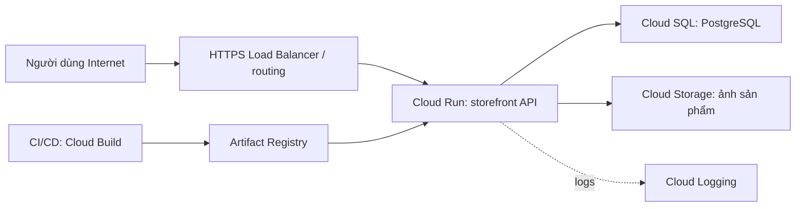
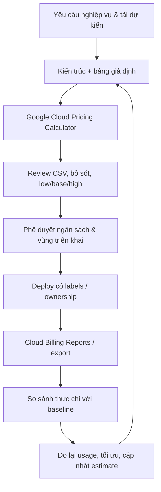

# Ước tính kiến trúc bằng Google Cloud Pricing Calculator

Trước khi triển khai một hệ thống lên Google Cloud, đội kỹ thuật cần trả lời: **Kiến trúc dự kiến tốn bao nhiêu mỗi tháng, khoản nào chiếm nhiều nhất và chi phí sẽ đổi ra sao nếu lưu lượng tăng?** Google Cloud Pricing Calculator giúp biến các lựa chọn kiến trúc thành một **ước tính chi phí dựa trên giả định sử dụng**. Đây là bước quan trọng khi chọn giữa Compute Engine, Google Kubernetes Engine (GKE) và Cloud Run, thiết kế lưu trữ/cơ sở dữ liệu, bảo vệ tài nguyên, hoạch định ngân sách và chuẩn bị phát hành.

Trong chương **Thanh toán và ngân sách**, bài này hướng dẫn phương pháp ước tính **từ kiến trúc và nhu cầu tải**, cách điền calculator, đối chiếu các khoản chi phí dễ bỏ sót, phân tích độ nhạy và bàn giao dự toán để theo dõi thực chi. Bạn sẽ thực hành trên một hệ thống bán hàng giả định; các số về lưu lượng, dung lượng và giá tính nhẩm trong bài chỉ là **dữ liệu minh họa**, không phải bảng giá hay báo giá của Google Cloud.

## Mục tiêu học tập

Sau bài học, bạn có thể:

1. Phân biệt **ước tính chi phí**, **giá niêm yết**, **giá theo hợp đồng**, **ngân sách** và **hóa đơn thực tế**.
2. Phân rã một kiến trúc Google Cloud thành những hạng mục phải ước tính trong calculator.
3. Quy đổi yêu cầu nghiệp vụ thành đầu vào có đơn vị nhất quán: request, vCPU, RAM, giờ chạy, GiB-tháng, truyền dữ liệu, thao tác lưu trữ.
4. Tạo và chia sẻ ước tính gồm nhiều sản phẩm, chọn đúng region, cấu hình và mô hình sử dụng.
5. So sánh các phương án Cloud Run, Compute Engine và GKE bằng cùng một tập giả định.
6. Xây dựng kịch bản thấp/cơ sở/cao, ghi rõ hạng mục chưa được calculator mô hình hóa, rồi đối chiếu với Cloud Billing sau triển khai.

## 1. Hiểu đúng phạm vi của Pricing Calculator

Truy cập [Google Cloud Pricing Calculator](https://cloud.google.com/products/calculator). Công cụ cho phép thêm sản phẩm và cấu hình mức sử dụng dự kiến để tạo một bản ước tính. Giao diện có các chức năng như **Add to estimate**, xem **Cost details**, chọn tiền tệ, mở bản chi tiết, **Download .csv** và **Share**. Nhãn, lựa chọn đầu vào và mức hỗ trợ có thể thay đổi theo thời điểm và loại sản phẩm.

Điều quan trọng nhất là **calculator không đo workload thực tế**. Công cụ tính theo cấu hình và mức sử dụng **do người dùng khai báo**. Dự toán là tài liệu lập kế hoạch, **không phải giá cố định, cam kết thanh toán hoặc giới hạn chi tiêu**. Chi phí trên hóa đơn được xác định bởi việc sử dụng thực tế và các điều khoản thanh toán áp dụng.

| Khái niệm | Dùng để làm gì? | Không nên hiểu thành |
| --- | --- | --- |
| **Pricing Calculator estimate** | Lập dự toán trước khi triển khai và so sánh kiến trúc | Hóa đơn chính thức, cam kết giá hay hạn mức |
| **Public list price** | Giá công khai theo sản phẩm, SKU, vùng và loại sử dụng | Giá chắc chắn áp dụng cho mọi tài khoản |
| **Contract price** | Giá riêng gắn với Cloud Billing account, nếu có | Mức giảm giá chung của mọi khách hàng |
| **Cloud Billing budget** | Mục tiêu theo dõi chi phí và cấu hình cảnh báo | Tự động ngăn mọi khoản phí vượt ngân sách |
| **Cloud Billing reports/exports** | Quan sát chi phí sử dụng thực tế sau triển khai | Dự báo hoàn hảo cho tải tương lai |
| **Quota/limits** | Giới hạn sử dụng một loại tài nguyên hoặc API | Công cụ quản lý tổng chi phí thay cho budget |

Ví dụ: Ước tính một hệ thống là **500 USD/tháng** không có nghĩa hóa đơn sẽ dừng ở 500 USD. Nếu phát sinh nhiều egress, lưu log, backup hoặc mở rộng tài nguyên hơn dự kiến, số tiền thực có thể cao hơn.

### Giá theo billing account

Calculator có thể cho phép **đăng nhập và liên kết Cloud Billing account** để xem mức giá gắn với hợp đồng của tài khoản, khi có hợp đồng và người dùng có quyền thích hợp. Tài liệu Google Cloud nêu các vai trò như **Billing Account Viewer** hoặc **Billing Account Administrator** là những vai trò dựng sẵn có thể cấp các quyền xem giá hợp đồng cần thiết. Chỉ kết nối tài khoản thanh toán đúng thẩm quyền và bảo vệ thông tin giá theo quy định nội bộ.

Khi chưa liên kết tài khoản có giá hợp đồng, hãy ghi rõ ước tính đang dựa trên **giá công khai**. Không tự giảm tổng chi phí bằng một phần trăm tùy ý rồi gọi đó là mức giá hợp đồng thực tế.

## 2. Xuất phát từ kiến trúc, không phải danh sách SKU

Giả sử một ứng dụng bán hàng có API REST, cơ sở dữ liệu PostgreSQL, ảnh sản phẩm và người dùng truy cập qua Internet. Kiến trúc minh họa:



Sơ đồ biểu diễn các dịch vụ cần **đánh giá khi lập dự toán**; không khẳng định mọi thành phần bắt buộc cho mọi ứng dụng Cloud Run. Nếu dùng domain/định tuyến mặc định của Cloud Run và không triển khai load balancer riêng, không đưa một load balancer giả định vào baseline. Nếu có load balancer ngoài, phải tính hạng mục tương ứng.

**Phân rã chi phí theo lớp:**

| Lớp kiến trúc | Dịch vụ ứng viên | Thông số cần thu thập |
| --- | --- | --- |
| Compute ứng dụng | Cloud Run / VM / GKE | Số request, thời gian xử lý, đồng thời, CPU, RAM, giờ chạy hoặc số node |
| Cơ sở dữ liệu | Cloud SQL | Engine/edition, region, HA, CPU/RAM, storage, backup, I/O, outbound |
| Lưu trữ đối tượng | Cloud Storage | Dung lượng TB/GiB theo storage class và location, read/write, retrieval, egress |
| Container image/build | Artifact Registry, Cloud Build | Dung lượng image, lần build, thời gian build, lưu trữ và truyền image |
| Mạng | Load Balancing, Cloud NAT, VPC/data transfer | Lưu lượng Internet, liên vùng, liên zone, outbound, các thành phần mạng sử dụng |
| Quan sát | Cloud Logging/Monitoring | Dung lượng logs, retention, metrics, traces và lượng dữ liệu thu thập |
| Bảo vệ/khôi phục | Snapshot, database backup, replication | Dung lượng giữ lại, tốc độ tăng, số vùng và phương án DR |

Một hạng mục có thể được tính kèm trong sản phẩm hoặc tính riêng. **Đọc phạm vi của từng cấu hình calculator** để không bỏ sót cũng như không cộng hai lần cùng một khoản.

## 3. Chuẩn hóa giả định trước khi mở calculator

Nhập nhầm **GB** với **GiB**, nhầm **tháng** với **giờ**, hoặc dùng lưu lượng **trung bình** cho tất cả các thành phần là nguồn sai số lớn. Nên lập một bảng giả định độc lập với màn hình calculator.

### Bộ giả định mẫu cho hệ thống bán hàng

| Nhóm | Giả định cơ sở | Đơn vị/phạm vi | Nguồn và điều cần xác nhận |
| --- | --- | --- | --- |
| Khu vực chính | `asia-southeast1` (Singapore) | Region | Yêu cầu độ trễ, dữ liệu và tính sẵn có |
| Lưu lượng API | 8.000.000 | Request/tháng | Dự báo người dùng và hành vi |
| Thời gian xử lý một request | 350 | ms/request trung bình | Benchmark; cần thêm p95/p99 |
| Cấu hình Cloud Run | 2 vCPU, 1 GiB RAM | Mỗi instance | Đo tải, điều kiện runtime |
| Concurrency mục tiêu | 20 | Request đồng thời/instance | Cần kiểm thử để xác nhận |
| Instance tối thiểu | 0 | Instance | Chấp nhận cold start trong ví dụ |
| Cloud SQL | PostgreSQL, HA | 2 vCPU, 8 GiB RAM (đầu vào minh họa) | Kiểm tra edition/shape thực tế được vùng hỗ trợ |
| Dung lượng Cloud SQL | 200 | GiB provisioned storage | Tăng trưởng bảng và index |
| Backup database | 200 | GiB dữ liệu backup tham chiếu | Retention, incremental backup và HA/DR |
| Cloud Storage | 1,5 TiB | Standard, một location chọn trước | Dung lượng trung bình, lifecycle |
| Đọc object | 10.000.000 | Requests/tháng | Phân biệt lớp thao tác theo bảng giá |
| Ghi object | 50.000 | Requests/tháng | Upload và thao tác metadata |
| Dữ liệu ra Internet | 6 TiB | Tháng, theo đích và đường truyền | Cần phân rã nguồn/đích; có thể gồm CDN |
| Logs | 100 GiB | Dữ liệu ghi log/tháng | Logging filter, retention |

Toàn bộ giá trị ở bảng là **bài tập mô phỏng**. Cấu hình CPU/RAM, edition và lớp lưu trữ phải được calculator xác nhận theo **sản phẩm, thời điểm, region và kiểu billing** đang chọn. Với ứng dụng thực, số liệu lấy từ load test, traces, telemetry hiện tại hoặc yêu cầu nghiệp vụ đã được phê duyệt.

### Quy đổi đơn vị

- Một tháng tính toán có thể dùng **730 giờ** để xấp xỉ một VM chạy 24/7 theo trung bình năm; tháng thực tế có 28–31 ngày, tương đương 672–744 giờ. Phải ghi rõ giả định.
- **1 GiB = 2^30 bytes**; **1 TiB = 1.024 GiB**. **1 GB = 10^9 bytes**, không bằng 1 GiB.
- **6 TiB = 6 × 1.024 = 6.144 GiB**; **1,5 TiB = 1.536 GiB**.
- **350 ms = 0,35 giây**. Tổng “request-seconds” lý thuyết là `8.000.000 × 0,35 = 2.800.000 request-seconds`; đây **không phải** số vCPU-giây hóa đơn vì concurrency, scale, thời gian idle, CPU allocation và cách billing đều tác động.
- Storage size thường cần **dung lượng trung bình trong kỳ**, không chỉ kích thước cuối tháng. Ví dụ, từ 1 TiB lên 2 TiB theo tăng trưởng đều có thể cho trung bình xấp xỉ 1,5 TiB, nhưng dữ liệu thực tế phải xác minh.

Một mẫu ghi giả định bằng YAML để lưu trong tài liệu thiết kế (ví dụ, **không phải cấu hình nhập trực tiếp vào calculator**):

```yaml
estimate:
  name: retail-prod-baseline
  date: "YYYY-MM-DD"
  currency: USD
  region: asia-southeast1
  period: monthly
  compute:
    service: Cloud Run
    requests_per_month: 8000000
    request_duration_ms_avg: 350
    vcpu_per_instance: 2
    memory_gib_per_instance: 1
    concurrency_per_instance: 20
    min_instances: 0
  database:
    service: Cloud SQL for PostgreSQL
    high_availability: true
    storage_gib: 200
  network:
    internet_egress_tib_month: 6
    destinations: "to be measured"
  assumptions:
    - "Prices depend on region and contract"
    - "HA, backup and transfer must be reviewed separately"
```

## 4. Quy trình thao tác trên Google Cloud Pricing Calculator

Giao diện có thể cập nhật; dưới đây là **trình tự logic**, dựa trên chức năng hiện có của calculator.

1. Mở [Pricing Calculator](https://cloud.google.com/products/calculator). Chọn **tiền tệ hiển thị** phù hợp để mọi thành viên so sánh cùng một đơn vị.
2. Nếu cần giá theo hợp đồng, đăng nhập và liên kết **Cloud Billing account** có quyền xem giá; nếu không, ghi rõ dùng public list price.
3. Chọn **Add to estimate**, tìm sản phẩm đầu tiên, ví dụ **Cloud Run**, rồi nhập region và các thông số tải/cấu hình mà giao diện yêu cầu.
4. Tiếp tục thêm **Cloud SQL**, **Cloud Storage**, **networking/Load Balancing**, logging, build và các sản phẩm thực tế có mặt trong sơ đồ. Với sản phẩm không có trường phù hợp, ghi một **mục bổ sung ngoài calculator** để xử lý thủ công.
5. Mở **Cost details** hoặc chế độ **detailed view** để xem từng sản phẩm/SKU và tổng ước tính hàng tháng; đối chiếu với bảng giả định.
6. Sử dụng **Share** hoặc **Download .csv** để bàn giao số liệu. Ghi lại ngày tính, tiền tệ, region, phạm vi, phiên bản kiến trúc và người duyệt bên cạnh bản xuất.
7. Tạo bản sao hoặc ước tính riêng cho **low/base/high** hoặc phương án thay thế, rồi so sánh các đầu mục chứ không chỉ tổng cuối.

Với mỗi dòng trong calculator, hãy tự hỏi:

> **“Chi phí này được tính cho sản phẩm nào, region nào, bao nhiêu đơn vị, trong bao lâu, và phần nào của sơ đồ đã được bao phủ?”**

Không tìm thấy một sản phẩm hoặc tùy chọn trong UI không có nghĩa sản phẩm đó **miễn phí**. Khi công cụ chưa mô hình hóa đủ, hãy dùng trang giá chính thức của dịch vụ, SKU trong Cloud Billing Pricing report hoặc hỏi đội quản trị chi phí để hoàn thiện dự toán.

### Bản ghi ước tính nên có gì?

| Trường bàn giao | Giá trị minh họa |
| --- | --- |
| Tên ước tính | `retail-prod-baseline-v1` |
| Ngày và người thực hiện | Ngày lập estimate, người/nhóm chịu trách nhiệm |
| Kiến trúc | Cloud Run + Cloud SQL HA + Cloud Storage + CI/CD |
| Môi trường và vùng | Production, `asia-southeast1` |
| Tiền tệ và loại giá | USD, public list price hoặc hợp đồng theo billing account |
| Kỳ tính | Chi phí **tháng**; chỉ nhân 12 để tham khảo khi tải ổn định |
| Giả định đầu vào | Request, duration, compute size, GiB-month, egress, operations |
| File/link đính kèm | Link chia sẻ calculator, CSV xuất ra, bản vẽ kiến trúc |
| Khoản chưa tính | Tax, dịch vụ ngoài công cụ, công lao động, license riêng, rủi ro tăng tải |
| Mức tin cậy | Đã đo/ước lượng từ benchmark/giả định còn thiếu |

## 5. Cách chọn đầu vào cho từng nhóm dịch vụ

### 5.1 Compute Engine: luôn-on và theo số VM

Khi chọn Compute Engine, cần xem:

- **Machine family/type**, số vCPU và RAM; một số loại cấu hình CPU/RAM tùy chỉnh có cách tính giá khác.
- **Region/zone**, số lượng VM và **giờ chạy mỗi tháng**. Một VM bật cả tháng khác VM chỉ chạy giờ làm việc.
- **Persistent Disk/Hyperdisk**, dung lượng, loại đĩa, tùy cấu hình có thể có khoản hiệu năng provisioned; snapshot và image storage.
- **Network egress**, địa chỉ IP ngoài, load balancer và các dịch vụ mạng dùng kèm.
- Loại mua và chính sách giá, chẳng hạn **on-demand**, **Spot VM**, **sustained use discount** hoặc **committed use discount**, nếu loại tài nguyên và điều kiện hiện hành cho phép.

Ví dụ hai VM chạy 24/7 với giả định 730 giờ/tháng:

```text
VM-hours = 2 VM × 730 giờ/VM = 1.460 VM-giờ/tháng
Dung lượng đĩa = 2 × 100 GiB = 200 GiB
```

Con số VM-giờ là **lượng sử dụng**, chưa phải tiền. Trong calculator, phải chọn **đúng machine type và region** để lấy đơn giá, rồi cộng disk, snapshot và mạng. Không áp giá VM giả định cho các đời máy khác nhau.

### 5.2 GKE: cluster chưa nói hết chi phí

Khi ước tính một cụm GKE, hãy phân biệt **Standard** và **Autopilot** vì nền tảng tính phí và đơn vị tài nguyên có thể khác. Tùy chế độ và cấu hình:

- Chi phí quản lý cluster (nếu áp dụng), cách tính và chính sách miễn trừ liên quan.
- Node VM, CPU/RAM hoặc tài nguyên workload được yêu cầu/cấp phát, thời gian chạy và autoscaling.
- Boot disk, Persistent Volumes, load balancer, data transfer, ingress controller, logging/metrics.
- Số region/zone, node dự phòng, yêu cầu HA; lưu lượng East–West và liên zone nếu có.

**Không** cộng thêm chi phí nguyên cluster trên mức node rồi lại nhập cùng node đó thành một nhóm Compute Engine độc lập, trừ khi đang cố ý mô tả hai cụm tài nguyên khác nhau. Khi so sánh GKE với Cloud Run, đưa vào chi phí quản trị vận hành và độ phức tạp như một **tiêu chí ngoài bảng giá**.

### 5.3 Cloud Run: theo tải, cấu hình và cách billing

Các đầu vào quan trọng của Cloud Run gồm:

- Region, **vCPU/RAM**, thời gian xử lý, số request, concurrency, số instance tối thiểu và tối đa.
- **Request-based billing** hoặc **instance-based billing** (nếu phù hợp); cách tính vCPU-seconds/GiB-seconds và request có thể khác nhau theo lựa chọn.
- Thời gian khởi động, quy mô tải theo giờ, độ trễ chấp nhận được, hiệu quả gom request vào instance.
- Networking, load balancer, Cloud SQL connection, VPC egress và log nếu có.

Công thức khái niệm:

```text
Tổng ≈ chi phí vCPU time
      + chi phí memory time
      + chi phí requests (nếu áp dụng)
      + chi phí truyền dữ liệu/các dịch vụ phụ thuộc
```

**Không** lấy `request × thời gian request × số vCPU` làm tổng CPU billed mà bỏ qua **concurrency và thời gian instance tồn tại**. Nếu có `min instances > 0`, tài nguyên có thể phát sinh chi phí ngay cả khi request thấp, tùy chế độ billing. Tải đột biến cũng có thể làm tăng số instance cùng lúc.

### 5.4 Cloud SQL: tính HA, backup và tăng trưởng

Với Cloud SQL (PostgreSQL, MySQL hoặc SQL Server), kiểm tra:

- **Engine, edition, region**, loại cấu hình, vCPU/RAM và số instance.
- **High availability** và cấu hình standby/replica; khác biệt giữa HA và read replica.
- Loại/dung lượng storage, tăng trưởng, provisioned IOPS/throughput nếu có, backup và retention.
- Network egress, cross-region replication nếu dùng DR, môi trường test/staging riêng.
- License và chính sách giá liên quan khi lựa chọn engine, cấu hình hoặc bản quyền.

Một database có 200 GiB dữ liệu **không mặc định** chỉ tốn 200 GiB lưu trữ. Backup, index, free space, replicas và snapshot có thể làm tổng dung lượng được tính phí cao hơn. Để estimate thận trọng, thêm khoản cho backup theo chính sách giữ dữ liệu và thử phương án failover/khôi phục.

### 5.5 Cloud Storage: dung lượng và thao tác

Chi phí object storage có thể liên quan đến:

- **Storage class** (ví dụ Standard, Nearline, Coldline, Archive), vị trí bucket (regional, dual-region, multi-region) và **GiB-tháng trung bình**.
- Số request theo loại thao tác và chính sách storage class.
- Truy xuất dữ liệu, thời gian lưu tối thiểu hoặc phí xóa sớm nếu áp dụng.
- **Data transfer** ra Internet, đến region khác, dịch vụ khác; CDN nếu có.
- Replication, lifecycle và phiên bản đối tượng khi được bật.

Không giả định chuyển sang lớp lưu trữ “lạnh” luôn giảm tổng chi phí: dung lượng rẻ hơn có thể đi kèm phí truy xuất hoặc lưu tối thiểu. Đánh giá **tần suất truy cập và vòng đời dữ liệu** trước khi chọn class.

### 5.6 Mạng và khả năng quan sát: chi phí dễ thiếu

Một dự toán chỉ có CPU/RAM và storage thường chưa đủ. Xem cả:

| Hạng mục | Câu hỏi cần trả lời |
| --- | --- |
| Internet egress | Bao nhiêu GiB/tháng, nguồn và **đích** ở đâu, dùng tier nào? |
| Inter-region / inter-zone | Có replication, gọi dịch vụ ở vùng khác hoặc traffic giữa zone không? |
| Load Balancer | Có dùng không, loại nào, bao nhiêu forwarding rules, dữ liệu xử lý? |
| Cloud NAT | Workload private có phải đi ra Internet qua NAT không? |
| CDN | Bao nhiêu cache hit, cache fill, egress tới người dùng và invalidation? |
| Cloud Logging | Khối lượng log được nhận/lưu, retention, exclusions; có duplication không? |
| Monitoring/Trace | Loại metric, traces và khối lượng ingest có vượt phạm vi miễn phí không? |
| Artifact Registry/Build | Dung lượng image, build minutes và truyền dữ liệu; có tăng theo deploy? |

Giá data transfer có thể phụ thuộc **vị trí nguồn/đích, loại đường đi và SKU**, vì vậy không nhân tất cả traffic với một mức “giá egress” chung. Đặc biệt phải xem dữ liệu **truyền giữa các thành phần**, giữa region và đến người dùng cuối.

## 6. Thực hành: estimate một hệ thống bán hàng

Hãy tạo bản `retail-prod-baseline-v1` với các giả định ở mục 3. Cần lưu một bản CSV và một bảng giả định độc lập để có thể kiểm tra lại.

### Bước A — Tính đường cơ sở

Điền các thành phần ứng với sơ đồ:

| Thành phần | Giá trị đầu vào/ghi chú | Ranh giới estimate |
| --- | --- | --- |
| Cloud Run API | 8 triệu request/tháng, 350 ms trung bình, 2 vCPU/1 GiB, concurrency 20, min instance 0 | Chọn đúng mô hình billing |
| Cloud SQL PostgreSQL | Region `asia-southeast1`, cấu hình 2 vCPU/8 GiB ví dụ, HA, 200 GiB storage | Bổ sung backup/replica theo chính sách |
| Cloud Storage | 1,5 TiB Standard, 10 triệu reads, 50 nghìn writes | Chọn đúng bucket location, class và loại thao tác |
| Network | 6 TiB outbound/tháng | Chia theo đích và đường đi; xem LB/CDN/NAT |
| Observability | 100 GiB log ingest/tháng | Xác định retention và các loại telemetry khác |
| Build/Artifact Registry | Số lần build + dung lượng image theo kỳ | Chỉ đưa vào nếu thực tế triển khai |

Nếu sản phẩm trong calculator yêu cầu đơn vị khác bảng, **quy đổi có ghi chép**. Ví dụ 6 TiB là 6.144 GiB; đừng nhập “6” vào trường GiB rồi coi là đúng.

### Bước B — Kiểm tra phần không hiện diện

Đối chiếu từng ô trong sơ đồ với ít nhất một dòng của estimate hoặc một ghi chú **chưa ước tính**. Rà soát HA, backup, traffic giữa zone/region, SSL/DNS nếu có, IAM/security tooling trả phí, log retention, support plan và các license bên thứ ba. Không bắt buộc mọi khoản đều được calculator hỗ trợ; phần nào chưa tính phải được ghi thành rủi ro.

### Bước C — Xem breakdown

Mở chế độ chi tiết rồi lập bảng tổng hợp, **để ô số tiền trống cho tới khi lấy từ calculator thực tế**:

| Nhóm | Estimated USD/month (điền từ kết quả) | Tỷ trọng (%) | Mức tin cậy |
| --- | ---: | ---: | --- |
| Cloud Run | — | — | Trung bình, cần load test |
| Cloud SQL + backup | — | — | Trung bình |
| Cloud Storage | — | — | Cao hơn nếu có dữ liệu thực |
| Network/LB/NAT | — | — | Thấp nếu chưa đo đích traffic |
| Logs/Monitoring | — | — | Thấp nếu chưa có sampling |
| Build/Artifact Registry | — | — | Trung bình |
| **Tổng ước tính trong calculator** | **—** | **100% sau khi điền** | Không gồm khoản ngoài phạm vi |
| Khoản ngoài calculator / dự phòng nội bộ | — | — | Phân loại riêng |

Tỷ trọng từng nhóm, sau khi có kết quả, tính bằng:

```text
Tỷ trọng nhóm (%) = Chi phí nhóm / Tổng chi phí đã tính × 100
```

**Lưu ý:** “Dự phòng nội bộ” là biên độ rủi ro do nhóm quản trị đề xuất, **không phải một SKU Google Cloud**. Không thêm một tỷ lệ dự phòng vào từng dòng rồi thêm lần nữa vào tổng.

## 7. Kiểm tra nhanh bằng phép tính độc lập

Calculator cung cấp chi tiết giá; tuy vậy, một phép tính nhẩm giúp phát hiện nhập nhầm đơn vị. Ví dụ độc lập sau **không sử dụng đơn giá thực của Google Cloud**:

Giả định hai VM chạy liên tục, một VM có **giá giả định 0,10 USD/giờ** và mỗi đĩa 100 GiB có **giá giả định 0,08 USD/GiB-tháng**. Với 730 giờ/tháng:

```text
VM-hours              = 2 × 730 = 1.460 VM-hours
Chi phí VM giả định   = 1.460 × 0,10 = 146 USD
Dung lượng đĩa        = 2 × 100 = 200 GiB-tháng
Chi phí đĩa giả định  = 200 × 0,08 = 16 USD
Tạm tính              = 146 + 16 = 162 USD/tháng
```

**162 USD chỉ là kết quả toán học của hai đơn giá do bài tập tự đặt**. Con số này không phải báo giá Compute Engine và chưa gồm snapshot, network, IP, load balancer, logging, thuế hoặc các khoản khác.

Hãy dùng phương pháp tương tự với **số lượng tiêu thụ thực tế và đơn giá lấy từ calculator** để kiểm tra:

```text
Chi phí thành phần = Σ (số lượng có tính phí theo từng SKU × đơn giá SKU)
Tổng chi phí       = Σ (chi phí thành phần trong cùng kỳ/tiền tệ)
```

Đối với chi phí bậc thang, free tier, discount hoặc gộp mức sử dụng trên billing account, phép nhân đơn giản có thể không đúng; cần áp dụng quy tắc tính phí cụ thể.

## 8. Phân tích kịch bản và so sánh lựa chọn kiến trúc

Một số duy nhất dễ tạo cảm giác chắc chắn giả tạo. Nên xây dựng ba kịch bản có cùng kiến trúc gốc:

| Giả định | Low | Baseline | High |
| --- | ---: | ---: | ---: |
| API requests/tháng | 3 triệu | 8 triệu | 20 triệu |
| Egress ra Internet/tháng | 2 TiB | 6 TiB | 15 TiB |
| Cloud Storage trung bình | 0,8 TiB | 1,5 TiB | 3 TiB |
| Logs ingest/tháng | 40 GiB | 100 GiB | 250 GiB |
| Cloud SQL CPU/RAM | Theo kiểm thử tải thấp | Theo cấu hình cơ sở | Xem xét scale-up/replica |
| Giả định khác | Giữ nguyên khi không thử độ nhạy | Giá trị cơ sở | Đổi có chủ đích và ghi rõ |

Quy trình:

1. Sao chép hoặc lập các estimate mới cho low/base/high.
2. Giữ nguyên **region, tiền tệ, mô hình hợp đồng và các giả định không được thử nghiệm**.
3. Chỉ thay những biến đã chỉ ra; với database, cần xem tại ngưỡng nào phải tăng cấu hình hoặc thêm replica.
4. Ghi tổng mới và chênh lệch từng nhóm. Chỉ đưa ra kết luận khi đã tính toán đủ khoản liên quan.

Độ nhạy chi phí với tải có thể tính:

```text
Δ chi phí (%) = (Chi phí kịch bản mới - Chi phí baseline)
               / Chi phí baseline × 100
```

Tổng không nhất thiết tăng tuyến tính: Cloud Run có cơ chế làm tròn/scale và cấu hình tính phí; database, VM/GKE có **chi phí nền** dù lưu lượng thấp; data transfer có các bậc giá và phạm vi định tuyến.

### Phương án A/B: Cloud Run hay GKE/Compute Engine?

Giả sử cùng một API và cùng tải. Muốn so sánh công bằng:

- **Giữ nguyên** database, object storage, region, egress, yêu cầu HA, log retention và SLO.
- Phương án A: Cloud Run với request concurrency, CPU/RAM, min instances và model billing đã kiểm thử.
- Phương án B: GKE Standard/Autopilot hoặc Compute Engine với số node/VM, autoscaling, disk, LB và mức sẵn sàng tương đương.
- Kiểm tra những phần **được gộp** trong từng sản phẩm để tránh cộng chi phí hai lần.
- Ngoài chi phí Google Cloud, ghi nhận thời gian triển khai, bảo trì cluster/OS, kỹ năng vận hành và khả năng scale theo tải.

**Không nên chọn phương án rẻ hơn trên bảng** nếu dự toán chưa phản ánh cùng mức độ sẵn sàng, bảo mật, đáp ứng hiệu năng và yêu cầu vận hành.

## 9. Những yếu tố khiến estimate lệch hóa đơn

| Sai lệch thường gặp | Vì sao xảy ra? | Biện pháp |
| --- | --- | --- |
| Chọn sai region | Giá SKU và tính sẵn có khác theo vị trí | Chốt region/zone theo kiến trúc rồi nhập nhất quán |
| Dùng 730 giờ cho workload có lịch | VM/job chỉ chạy vài giờ/ngày | Tính số giờ hoạt động đúng lịch |
| Bỏ qua traffic | Egress ra Internet hoặc liên vùng có thể lớn | Đo nguồn/đích và chọn SKU data transfer tương ứng |
| Tính dung lượng cuối tháng như bình quân | Dữ liệu tăng hoặc giảm trong kỳ | Ước tính GiB-tháng trung bình |
| Chỉ nhập primary database | HA, replica, backup/retention bỏ sót | Mô hình hóa từng thành phần cần thiết |
| Cho rằng serverless không có chi phí idle | Min instances, instance billing hoặc workload nền | Mô hình hóa cài đặt thực tế |
| Trừ free tier hai lần | Free tier có phạm vi áp dụng theo dịch vụ/billing account | Kiểm tra quy tắc gộp và phần đã phản ánh trong calculator |
| Dùng “20% discount” không có chứng cứ | Mức chiết khấu phụ thuộc hợp đồng/CUD/SKU | Đối chiếu Cloud Billing price sheet và điều kiện áp dụng |
| Quên hóa đơn khác | Support, license, thuế, đối tác, phí ngoài phạm vi | Ghi trong bảng điều chỉnh riêng |
| So sánh khác tiền tệ hoặc kỳ | USD/mo và một báo giá theo năm/VND không tương đương trực tiếp | Chuẩn hóa kỳ, tỷ giá giả định và cách tính thuế |
| Dùng kết quả quá cũ | Giá/sản phẩm/kiến trúc thay đổi | Ghi version/date và chạy lại estimate trước khi phê duyệt |

### Free tier, CUD/SUD và giá theo hợp đồng

- **Free tier:** Điều kiện theo từng sản phẩm và billing account có thể thay đổi; không nên coi tất cả môi trường đều nhận cùng một khoản miễn phí. Kiểm tra calculator đã phản ánh quyền lợi hay chưa.
- **Sustained use discounts:** Có thể áp dụng cho nhóm tài nguyên đủ điều kiện với quy tắc riêng; không cộng thêm chiết khấu thủ công nếu giá estimate đã tính.
- **Committed use discounts (CUDs):** Đổi cam kết sử dụng hoặc chi tiêu lấy ưu đãi có điều kiện. Phải xét **thời hạn, vùng/phạm vi, mức sử dụng thực tế và phần cam kết chưa tận dụng**; không thể xem đơn giá giảm là lợi ích miễn phí.
- **Giá hợp đồng:** Chỉ dùng khi được cấp quyền truy cập giá của billing account áp dụng. Nếu không có quyền, ghi rõ ước tính dựa trên giá công khai và chờ xác nhận.
- **Promotional credits:** Thường mang tính thời hạn và điều kiện; quản trị chi phí nên phân biệt **gross usage cost**, **discount**, **credit** và **net payable**.

### Thuế và tỷ giá

Calculator cho phép chọn đồng tiền hiển thị, nhưng điều này không thay thế **đồng tiền thanh toán thực tế, tỷ giá áp dụng khi lập hóa đơn, thuế và điều chỉnh**. Với ngân sách tại Việt Nam, nếu dùng USD để so sánh kiến trúc và VND để xin phê duyệt, ghi rõ **tỷ giá quy đổi nội bộ và ngày áp dụng**. Không tự khẳng định bản estimate USD đã gồm mọi loại thuế.

## 10. Từ estimate sang ngân sách và vận hành

Sau khi phê duyệt một baseline, bước tiếp theo là biến nó thành **điểm tham chiếu tài chính**, không phải coi đó là hạn mức tự động:



Thực hành phù hợp:

1. Tạo **Cloud Billing budget** với phạm vi Cloud Billing account, project hoặc nhãn phù hợp và ngưỡng cảnh báo theo chính sách của nhóm. **Budget alert tự nó không bảo đảm chặn chi tiêu.**
2. Gắn labels cho workload như `environment=prod`, `team=retail`, `cost_center=commerce` khi dịch vụ hỗ trợ; duy trì ánh xạ project ↔ owner.
3. Theo dõi chi phí thực tế bằng Cloud Billing Reports hoặc Billing export sang BigQuery; tách dự báo với chi phí đã ghi nhận.
4. So sánh theo cùng **tháng, tiền tệ, project, nhóm dịch vụ và loại giá**. Phân tích phần khác biệt theo usage, region, thời gian chạy, số lượng tài nguyên, discount, credit và điều chỉnh.
5. Đặt lịch rà soát khi ra mắt production, sau thay đổi lớn về kiến trúc hoặc khi thực chi lệch đáng kể so với baseline. Khả năng sử dụng và độ tin cậy phải được kiểm tra song song với chi phí.

Một bảng kiểm soát chênh lệch đơn giản:

| Nhóm | Ước tính tháng | Thực chi tháng | Chênh lệch | Nguyên nhân / hành động |
| --- | ---: | ---: | ---: | --- |
| Compute | Lấy từ calculator | Lấy từ Billing | Thực chi - ước tính | Rà soát thời gian chạy, autoscale |
| Database | Lấy từ calculator | Lấy từ Billing | Thực chi - ước tính | Backup, storage, replica |
| Network | Lấy từ calculator | Lấy từ Billing | Thực chi - ước tính | Egress tăng, khác region |
| Observability | Lấy từ calculator | Lấy từ Billing | Thực chi - ước tính | Log volume, retention |
| Tổng | Tổng đúng phạm vi | Tổng đúng phạm vi | Thực chi - ước tính | Tránh so sánh khác kỳ/thuế |

Nếu chi phí thực tế khác estimate, cần kiểm tra cả **thay đổi usage** và **phạm vi/điều kiện giá** thay vì kết luận công cụ tính sai.

## 11. Checklist review trước khi chốt dự toán

- [ ] Sơ đồ kiến trúc thể hiện đầy đủ compute, database, storage, networking, build, observability và DR.
- [ ] Các lựa chọn sản phẩm phù hợp yêu cầu IAM, VPC, bảo vệ dữ liệu, HA, reliability và phương án triển khai.
- [ ] Đã ghi nguồn của giả định tải, thời gian chạy, số request, retention và tăng trưởng dữ liệu.
- [ ] Region, zone, loại máy, storage class và phiên bản/edition dịch vụ được chọn nhất quán.
- [ ] Các đơn vị đã quy đổi chính xác: giờ/tháng, GiB-tháng, request, GiB truyền dữ liệu.
- [ ] Đã tính hoặc nêu rõ hạng mục ngoài phạm vi: backup, replica, cross-region, data transfer, LB, NAT, logs, support, license.
- [ ] Free tier, contract price, CUD/SUD, thuế và currency được xử lý theo đúng điều kiện áp dụng.
- [ ] Có các kịch bản low/base/high và phương án thay thế nếu quyết định kiến trúc còn mở.
- [ ] Đã xuất CSV hoặc lưu link Share, ghi ngày tính, người chịu trách nhiệm và phiên bản kiến trúc.
- [ ] Đã xác định budget alerts, labels và cách so sánh Cloud Billing sau deploy.

## 12. Bài tập thực hành

### Bài tập 1: Phân rã kiến trúc

Một trang thương mại điện tử gồm Cloud Run API, Cloud SQL PostgreSQL, bucket ảnh, Artifact Registry và một external Application Load Balancer. Hãy lập bảng ít nhất **10 đầu vào** cần có để estimate, phân nhóm theo dịch vụ. Chỉ rõ đầu vào nào phải đo bằng load test và đầu vào nào có thể lấy từ thiết kế.

<details>
<summary>Gợi ý đáp án</summary>

Các đầu vào có thể gồm: region, request/tháng, duration, CPU/RAM và concurrency của Cloud Run, min instances, Cloud SQL edition/HA/CPU/RAM/storage/backup, dung lượng và class của bucket, reads/writes, egress theo đích, load balancer type, log volume, build frequency. Request, duration, concurrency tối ưu, số read/write và egress nên được ước đoán từ telemetry/load test; region, HA, storage class và retention là quyết định thiết kế.
</details>

### Bài tập 2: Phát hiện đơn vị sai

Nhóm nhập **6** vào trường “GiB data transfer per month” vì yêu cầu nghiệp vụ ghi “6 TiB/tháng”. Sai ở đâu và phải nhập bao nhiêu nếu trường tính bằng GiB?

<details>
<summary>Đáp án</summary>

6 TiB bằng 6 × 1.024 = **6.144 GiB**. Nhập 6 GiB khiến lượng dữ liệu truyền thấp hơn **1.024 lần** so với yêu cầu.
</details>

### Bài tập 3: So sánh chi phí và SLO

Bạn có hai phương án: Cloud Run tự mở rộng và GKE Standard ba node chạy liên tục. Cần giữ cố định những điều kiện nào trước khi kết luận phương án nào rẻ hơn?

<details>
<summary>Gợi ý đáp án</summary>

Giữ nguyên yêu cầu tải, vùng triển khai, dữ liệu, latency/SLO, HA, network egress, storage, database, logging và các phần dùng chung. Cần đưa vào chi phí quản lý GKE/VM/Persistent Volumes/LB tương ứng, cách tính Cloud Run với concurrency/min instances và chi phí vận hành phi hạ tầng. Không kết luận chỉ từ giá CPU/RAM.
</details>

### Bài tập 4: Estimate thấp hơn hóa đơn

Sau tháng đầu production, chi phí network cao hơn dự toán 3 lần trong khi CPU gần đúng kế hoạch. Hãy nêu các giả thuyết để kiểm tra.

<details>
<summary>Gợi ý đáp án</summary>

Có thể đã bỏ qua Internet egress, CDN cache miss, chuyển dữ liệu giữa region/zone, dữ liệu backup/replication, load balancer processing, NAT hoặc cách phân loại traffic theo đích. Kiểm tra Cloud Billing SKU/network costs, sơ đồ đường đi thực tế và logs/metrics truyền dữ liệu; cập nhật giả định thay vì tăng một tỷ lệ toàn bộ estimate.
</details>

### Bài tập 5: Trình bày để được phê duyệt

Hãy nộp một bộ gồm: sơ đồ kiến trúc; bảng giả định có đơn vị; estimate low/base/high; CSV/link calculator; bảng hạng mục chưa tính; kế hoạch thiết lập Cloud Billing budget và cách đối chiếu trong 30 ngày đầu. Giải thích vì sao dự toán **không bảo đảm** hóa đơn tháng đầu giống hệt.

## Tài liệu tham khảo chính thức

- [Google Cloud Pricing Calculator](https://cloud.google.com/products/calculator): tạo ước tính theo sản phẩm, xem chi tiết, xuất CSV và chia sẻ.
- [Estimate your monthly costs — Cloud Billing](https://cloud.google.com/billing/docs/how-to/estimate-costs): mục đích, giới hạn của estimate và liên kết billing account để xem giá theo hợp đồng.
- [Google Cloud Pricing](https://cloud.google.com/pricing): thông tin giá công khai và mô hình giá theo sử dụng.
- [View and download prices — Cloud Billing](https://cloud.google.com/billing/docs/how-to/pricing-table): giá SKU, public list price và contract price khi đủ quyền.
- [Compute Engine pricing](https://cloud.google.com/compute/all-pricing): giá VM, disk và những yếu tố định giá.
- [GKE pricing](https://cloud.google.com/kubernetes-engine/pricing): Standard, Autopilot và thành phần có thể được tính phí.
- [Cloud Run pricing](https://cloud.google.com/run/pricing): cách tính request, CPU, RAM và các mô hình billing.
- [Cloud SQL pricing](https://cloud.google.com/sql/pricing): hạ tầng database và các tùy chọn liên quan.
- [Cloud Storage pricing](https://cloud.google.com/storage/pricing): storage classes, operations, retrieval và data transfer.
- [VPC pricing](https://cloud.google.com/vpc/network-pricing): data transfer và các khoản mạng.
- [Cloud Billing budgets and alerts](https://cloud.google.com/billing/docs/how-to/budgets): theo dõi chi phí và cảnh báo ngân sách.
- [Cloud Billing export to BigQuery](https://cloud.google.com/billing/docs/how-to/export-data-bigquery): phân tích chi phí thực tế và đối chiếu sau triển khai.

