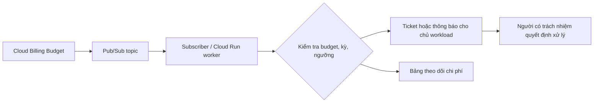

# Thiết lập budgets và cảnh báo chi tiêu

> **Chương:** Thanh toán và ngân sách  
> **Module:** CLOUD_PROVIDERS_GCP  
> **Phạm vi module:** Khám phá Google Cloud từ tổ chức project, IAM và VPC đến Compute Engine, GKE, Cloud Run, dịch vụ lưu trữ và cơ sở dữ liệu. Qua các tình huống triển khai, người học biết lựa chọn dịch vụ, bảo vệ tài nguyên, tự động hóa phát hành và theo dõi độ tin cậy cùng chi phí.

Khi ứng dụng chạy trên Google Cloud Platform (GCP), chi phí không chỉ xuất hiện khi tạo máy ảo. Một project có thể phát sinh phí từ thời gian sử dụng Compute Engine, tài nguyên GKE, request và tài nguyên cấp phát cho Cloud Run, lưu trữ dữ liệu, cơ sở dữ liệu, log, lưu lượng mạng hoặc các dịch vụ khác. **Cloud Billing budgets** giúp đặt mục tiêu chi tiêu và gửi cảnh báo khi chi phí thực tế hoặc dự báo đạt những ngưỡng đã định.

Điều quan trọng nhất cần nắm từ đầu: **budget và cảnh báo không phải giới hạn chi tiêu cứng**. Chúng không mặc nhiên ngăn tài nguyên chạy hoặc từ chối request sau khi vượt ngân sách. Người quản trị phải đọc cảnh báo, xác định nguyên nhân và thực hiện biện pháp kiểm soát phù hợp.

## Mục tiêu học tập

Sau bài này, bạn có thể:

1. Phân biệt **Cloud Billing account**, **project**, **budget**, **alert threshold** và **notification channel**.
2. Tạo budget theo tháng cho một project hoặc nhóm project; chọn đúng phạm vi chi phí cần giám sát.
3. Thiết lập các ngưỡng cảnh báo dựa trên **chi phí thực tế (actual)** và **chi phí dự báo (forecasted)**.
4. Cấu hình và kiểm tra nơi nhận thông báo qua email, Cloud Monitoring hoặc Pub/Sub khi phù hợp.
5. Đọc báo cáo chi phí, điều tra cảnh báo, xử lý tình huống vượt ngân sách và xác minh cấu hình cuối buổi.

## 1. Budget nằm ở đâu trong hệ thống Google Cloud?

Một **Cloud Billing account** quản lý quan hệ thanh toán và có thể liên kết với nhiều **project**. Project là ranh giới quản lý tài nguyên, IAM, API và nhiều quota; các khoản chi từ tài nguyên được ghi nhận theo tài khoản thanh toán liên kết, tùy loại chi phí.

```text
Cloud Billing account
├── Project: gcp-dev-lab
│   ├── Compute Engine
│   ├── Cloud Storage
│   └── Cloud Run
├── Project: gcp-staging
│   └── GKE
└── Project: gcp-production
    └── Cloud SQL

Budgets thuộc Cloud Billing account
├── Budget cho tất cả chi phí của billing account
├── Budget chỉ theo dõi project gcp-dev-lab
└── Budget theo dõi một nhóm project/dịch vụ/nhãn phù hợp
```

Budget được cấu hình trong phạm vi **Cloud Billing account**, nhưng có thể **lọc** để chỉ tính chi phí của những project, dịch vụ hoặc thuộc tính được chọn. Do đó, **budget áp dụng cho một project không có nghĩa project sở hữu một tài khoản thanh toán riêng**.

| Khái niệm | Trả lời câu hỏi | Ví dụ |
|---|---|---|
| **Billing account** | Đơn vị nào ghi nhận và thanh toán chi phí? | Tài khoản billing của công ty |
| **Project** | Tài nguyên thuộc ranh giới quản lý nào? | `gcp-dev-lab` |
| **Budget** | Mục tiêu chi phí cho phạm vi và thời kỳ nào? | 100 USD/tháng cho project lab |
| **Budget amount** | Mức tiền dùng để so sánh và tính ngưỡng? | 100 USD |
| **Alert threshold** | Khi nào chi phí đạt tỷ lệ bao nhiêu của budget? | 50%, 80%, 100% |
| **Notification** | Ai hoặc hệ thống nào nhận thông tin? | Người phụ trách, kênh Monitoring, Pub/Sub |
| **Billing report** | Chi phí đến từ đâu và thay đổi ra sao? | Phân tích theo project, service, SKU và thời gian |

**Lưu ý về tiền tệ:** budget sử dụng đơn vị tiền tệ của billing account. Nếu ví dụ ghi 100 USD nhưng billing account của bạn sử dụng đơn vị tiền tệ khác, hãy nhập và đọc các con số theo **đơn vị thực tế hiển thị**, không tự quy đổi theo một tỷ giá giả định.

## 2. Những thành phần quyết định một budget

### 2.1. Phạm vi theo dõi (scope)

Phạm vi phải phản ánh đúng câu hỏi quản trị. Một số lựa chọn thường gặp:

- **Billing account:** theo dõi toàn bộ chi phí thuộc tài khoản thanh toán đã chọn.
- **Project:** theo dõi một hoặc nhiều project được liên kết với billing account đó.
- **Service:** lọc một hoặc nhiều nhóm dịch vụ, ví dụ Compute Engine, Cloud Storage hoặc Cloud SQL.
- **Labels hoặc các bộ lọc được hỗ trợ:** thu hẹp phạm vi khi tài nguyên đã được gắn nhãn và dữ liệu chi phí đáp ứng điều kiện lọc. Không phải mọi chi phí đều mang label mong muốn; label được tạo sau này không tự bổ sung cho dữ liệu sử dụng cũ.
- **Các điều kiện tính phí/ưu đãi:** tùy giao diện và cách tính chi phí, bộ lọc có thể cho phép xét một số loại credit, giảm giá hoặc chi phí liên quan. Phải kiểm tra định nghĩa hiển thị trước khi so sánh budget với hóa đơn.

**Ví dụ:** nếu một billing account thanh toán cả project học tập và project production, budget 100 USD cho project học tập phải chọn **đúng project học tập** trong bộ lọc. Nếu để phạm vi toàn bộ billing account, chỉ riêng chi phí production có thể làm budget vượt ngưỡng ngay cả khi lab gần như không sử dụng gì.

### 2.2. Chu kỳ ngân sách (period)

Các lựa chọn chu kỳ trên giao diện có thể bao gồm **tháng, quý, năm hoặc khoảng thời gian tùy chỉnh**, tùy tính năng đang hỗ trợ. Với nhóm phát triển hoặc project học tập, **tháng** thường dễ so sánh với báo cáo Cloud Billing và dễ vận hành.

Một budget theo tháng sẽ theo dõi khoản chi trong chu kỳ tháng đã cấu hình; ngưỡng tính lại theo từng chu kỳ. Budget tùy chỉnh có thể dùng cho một chiến dịch ngắn hạn, nhưng cần kiểm tra ngày bắt đầu/kết thúc và khả năng dự báo áp dụng cho lựa chọn ấy.

### 2.3. Số tiền ngân sách (amount)

- **Specified amount:** nhập số tiền cố định. Phù hợp với project mới, môi trường lab và giới hạn chi tiêu nội bộ đã thống nhất.
- **Last period's spend**, nếu giao diện hỗ trợ: dùng mức chi của kỳ trước làm mốc. Phù hợp để quan sát xu hướng các workload đã vận hành ổn định, nhưng kỳ trước có đột biến thì mốc này cũng có thể thiếu phù hợp.

Số tiền budget cần được quyết định từ mục tiêu quản trị: khối lượng sử dụng dự kiến, môi trường, mức chấp nhận chi phí và người chịu trách nhiệm phản ứng.

### 2.4. Ngưỡng thực tế và dự báo

**Actual spend** là chi phí đã được ghi nhận theo dữ liệu billing thuộc phạm vi budget, với độ trễ cập nhật. **Forecasted spend** là mức chi được hệ thống dự đoán cho kỳ ngân sách dựa trên thông tin hiện có; dự báo **không phải hóa đơn và không phải cam kết số tiền cuối kỳ**.

Ví dụ budget là **100 USD/tháng**:

| Ngưỡng | Loại | Ý nghĩa |
|---|---|---|
| **50%** | Actual | Cảnh báo khi chi phí ghi nhận đạt khoảng 50 USD |
| **80%** | Actual | Cảnh báo để nhóm kiểm tra xu hướng khi đạt khoảng 80 USD |
| **100%** | Actual | Báo đã chạm hoặc vượt mục tiêu 100 USD |
| **100%** | Forecasted | Cảnh báo nếu dự báo tổng chi phí kỳ này đạt hoặc vượt 100 USD, dù chi thực tế chưa chạm mức đó |

Ngưỡng là **tỷ lệ phần trăm của budget amount**, không phải số tiền nhập riêng cho từng thông báo. Một budget có thể có nhiều ngưỡng. Khả năng tạo ngưỡng dự báo có thể phụ thuộc chu kỳ, dữ liệu hoặc lựa chọn hiện có trong giao diện.

## 3. Chuẩn bị: tài khoản, quyền truy cập và dữ liệu nền

Trước khi thao tác, hãy biết rõ:

1. **Billing account nào** đang thanh toán cho project bạn cần theo dõi.
2. **Project ID chính xác** của project đó; tránh nhầm tên hiển thị với project ID.
3. **Ai sẽ chịu trách nhiệm đọc cảnh báo**: chủ project, nhóm kỹ thuật, FinOps hoặc người quản lý chi phí.
4. **Mức chi dự kiến trong một chu kỳ** và hành động cần thực hiện khi đạt ngưỡng.
5. **Quyền IAM** cần thiết để xem hoặc quản lý Cloud Billing budgets. Quyền có thể được cấp qua vai trò quản lý chi phí hoặc quản trị Billing account thích hợp; quyền Owner trên project không bảo đảm tự động có quyền quản lý budget của billing account.

Trong Console, truy cập **Billing** và chọn billing account phù hợp. Nếu không thấy billing account hoặc menu Budgets & alerts, kiểm tra tài khoản đang đăng nhập và xin quyền tại **billing account** thay vì tự thêm quyền quá rộng vào project.

Nếu cần kiểm tra liên kết billing của project từ Cloud Shell, có thể chạy lệnh chỉ đọc:

```bash
PROJECT_ID="gcp-dev-lab"  # Đổi thành project ID thực tế

gcloud auth list --filter="status:ACTIVE"
gcloud billing projects describe "$PROJECT_ID"
```

Lệnh này chỉ xem liên kết billing khi danh tính có quyền; nó **không tạo budget**. Nếu bài lab chỉ nhằm học cấu hình budget, không cần triển khai VM, cluster hay database để phát sinh phí kiểm thử.

## 4. Tình huống thực hành: budget tháng cho một project phát triển

Giả sử một nhóm xây dựng API trên **Cloud Run**, lưu ảnh trong **Cloud Storage**, thử nghiệm dữ liệu với **Cloud SQL**, đôi khi dùng **Compute Engine**. Nhóm có hai môi trường tách biệt, phát triển và production, cùng liên kết một billing account.

Trong bài này, nhóm muốn **chỉ theo dõi project phát triển**, với các giả định:

| Tham số | Giá trị minh họa |
|---|---|
| Billing account | Tài khoản đang liên kết với project phát triển |
| Project theo dõi | `gcp-dev-lab` |
| Tên budget | `gcp-dev-lab-monthly-budget` |
| Chu kỳ | Calendar month |
| Phạm vi dịch vụ | Tất cả dịch vụ trong project phát triển |
| Budget amount | 100 USD (thay bằng đơn vị tiền tệ thực tế) |
| Ngưỡng actual | 50%, 80%, 100% |
| Ngưỡng forecasted | 100%, nếu lựa chọn khả dụng |
| Nơi nhận | Người phụ trách chi phí và nhóm vận hành theo cấu hình được cấp quyền |

Mục tiêu là **phát hiện sớm xu hướng vượt mức**, đối chiếu chi phí và hành động kịp thời. Cấu hình này **không thay thế** giới hạn quota, chính sách sử dụng tài nguyên hoặc quy trình phê duyệt chi phí của tổ chức.

## 5. Thực hành tạo budget qua Google Cloud Console

Đây là phương pháp chính cho bài học vì bạn có thể nhìn thấy đồng thời tên budget, bộ lọc, số tiền, ngưỡng và kênh thông báo. Tên và vị trí nút có thể thay đổi theo giao diện; hãy bám vào ý nghĩa các trường tương ứng.

### Bước 1 — Mở màn hình quản lý ngân sách

1. Đăng nhập [Google Cloud Console](https://console.cloud.google.com/).
2. Mở **Billing**; nếu có nhiều billing account, chọn **đúng** tài khoản đang thanh toán cho project cần theo dõi.
3. Mở **Budgets & alerts** (Ngân sách và cảnh báo).
4. Chọn **Create budget**.

**Điểm kiểm tra:** tiêu đề hoặc thông tin ngữ cảnh trong Console phải cho thấy bạn đang làm việc với **billing account mong muốn**. Nếu billing account không đúng, dừng trước khi lưu.

### Bước 2 — Đặt tên và phạm vi (Scope)

1. Nhập **Name**: `gcp-dev-lab-monthly-budget`.
2. Chọn **Period** là **Calendar month**.
3. Trong mục **Projects**, chọn project `gcp-dev-lab`. Nếu cần thêm project khác, chỉ chọn khi chúng thực sự cùng phạm vi chịu trách nhiệm chi phí.
4. Trong **Services**, để tất cả dịch vụ của project nếu mục tiêu là ngân sách tổng. Chỉ lọc một dịch vụ khi tạo budget chuyên biệt.
5. Với **Labels** hoặc các điều kiện bổ sung, để mặc định nếu bài lab chưa có chiến lược gắn nhãn thống nhất.
6. Kiểm tra các lựa chọn về credit hoặc khoản tính giảm trừ, nếu giao diện hiển thị, để biết rõ số tiền dùng cho so sánh.
7. Xem lại phần tóm tắt phạm vi trước khi chọn **Next**.

**Sai lầm cần tránh:** để mặc định toàn bộ billing account mà tưởng budget chỉ giám sát project đang chọn ở đầu Console. Phạm vi phải được xác nhận **ngay trong cấu hình budget**.

### Bước 3 — Chọn số tiền (Amount)

1. Chọn **Specified amount** cho project mới hoặc lab.
2. Nhập **100** nếu đơn vị tiền tệ của billing account là USD và bài lab thực sự được phép sử dụng mốc đó. Với tài khoản khác, nhập số tiền đã được người phụ trách thống nhất.
3. Đọc lại số tiền và ký hiệu tiền tệ trên giao diện.
4. Chuyển đến bước **Actions** hoặc phần ngưỡng/thông báo tiếp theo.

Ở môi trường production, budget nên dựa trên dự báo tải và chi phí; số 100 USD ở đây chỉ là **ví dụ học tập**, không phải mức mặc định an toàn cho mọi kiến trúc.

### Bước 4 — Thiết lập alert thresholds

Trong phần **Alert threshold rules**, tạo hoặc chỉnh các quy tắc:

| Threshold | Trigger | Việc nhóm nên làm khi nhận |
|---|---|---|
| 50% | Actual | Kiểm tra phân bổ chi phí, đối chiếu kế hoạch sử dụng |
| 80% | Actual | Xác định dịch vụ tăng mạnh, dọn tài nguyên thừa, cân nhắc điều chỉnh kế hoạch |
| 100% | Actual | Báo người sở hữu ngân sách và triển khai phương án ứng phó đã thống nhất |
| 100% | Forecasted | Kiểm tra tốc độ chi tiêu trước khi chi phí thực tế chạm trần mục tiêu |

Nếu màn hình hỗ trợ thêm/xóa ngưỡng, có thể dùng ba ngưỡng actual và một ngưỡng forecasted trong cùng budget. Kiểm tra **Actual vs. Forecasted** từng dòng: đặt nhầm forecasted thành actual sẽ làm thay đổi ý nghĩa cảnh báo.

**Ví dụ:** ngày giữa tháng, chi phí ghi nhận mới là 65 USD nhưng forecast cuối kỳ là 115 USD. Ngưỡng **actual 80%** chưa đạt; ngưỡng **forecasted 100%** có thể đã đủ điều kiện. Việc phát cảnh báo phụ thuộc lần hệ thống xử lý và điều kiện dự báo; không có cam kết gửi ngay tại thời điểm số tiền thay đổi.

### Bước 5 — Cấu hình nơi nhận thông báo

Cloud Billing hỗ trợ các lựa chọn thông báo tùy cấu hình, trong đó thường có:

- **Thông báo email gắn với quyền trên billing account**: phù hợp khi các vai trò billing đã đúng người chịu trách nhiệm. Kiểm tra chính xác nhóm người nhận được giao diện thông báo; không giả định mọi thành viên project đều nhận.
- **Cloud Monitoring notification channels**: hữu ích khi cần định tuyến cảnh báo đến một địa chỉ email chung hoặc các kênh mà tổ chức quản lý. Các channel phải được tạo/cấp quyền đúng và liên kết với budget nếu tính năng này khả dụng.
- **Pub/Sub notifications**: dùng khi muốn một hệ thống tiếp nhận sự kiện và tự xử lý, chẳng hạn mở ticket, gửi thông báo có cấu trúc hoặc tạo báo cáo. Cần cấu hình topic/subscription, danh tính và quyền publish/subscribe; Pub/Sub **không tự gửi email cho nhóm**.

Đối với bài lab cơ bản, chọn phương án **email** đang được tổ chức chấp thuận. Nếu thêm Cloud Monitoring channel, cần kiểm tra channel đã được xác thực và người nhận thực sự có thể nhận thông báo.

Trong phần **Manage notifications** hoặc phần tương đương:

1. Xem đối tượng nhận email mặc định của billing account.
2. Nếu tổ chức muốn thêm người nhận, dùng channel thích hợp thay vì cấp quyền quản trị billing chỉ để họ nhận email.
3. Chọn và lưu các channel hợp lệ nếu dùng.
4. Không bật Pub/Sub chỉ để thử nếu bạn chưa có nhu cầu tự động hóa hoặc chưa biết cách bảo vệ thông điệp và subscriber.

### Bước 6 — Lưu budget và xác minh

1. Chọn **Finish / Save**.
2. Quay về **Budgets & alerts** và tìm tên `gcp-dev-lab-monthly-budget`.
3. Mở lại budget, đọc lại scope, period, amount, thresholds và notification settings.
4. Xác nhận project trong bộ lọc thực sự là project phát triển; ghi lại thời điểm cấu hình để người quản trị biết khi nào bắt đầu theo dõi.

**Việc budget xuất hiện trong danh sách là bằng chứng cấu hình được lưu; đó chưa phải bằng chứng email đã tới nơi nhận.** Nếu project chưa phát sinh chi phí, có thể không có cảnh báo nào để kiểm tra ngay. Không cố tạo tài nguyên tốn tiền chỉ để vượt ngưỡng và nhận email.

## 6. Phân tích số tiền và thời điểm cảnh báo

Giả sử budget 100 USD/tháng và số liệu ghi nhận của một ngày như sau:

| Nguồn chi phí | Chi phí ghi nhận minh họa |
|---|---:|
| Compute Engine | 30 USD |
| Cloud Storage | 10 USD |
| Cloud SQL | 20 USD |
| Cloud Run và các dịch vụ khác | 15 USD |
| **Tổng actual** | **75 USD** |

Tổng chi là 75% budget; ngưỡng actual 50% đã được vượt, ngưỡng actual 80% chưa đạt. Giả sử hệ thống dự báo tổng chi cả tháng là 110 USD, ngưỡng forecasted 100% có thể phát cảnh báo sớm.

Ngày sau, chi phí actual tăng đến 85 USD: ngưỡng actual 80% được vượt. Nếu chi phí tiếp tục đến 106 USD, ngưỡng actual 100% được vượt. Các số tiền này minh họa cách đọc ngưỡng, **không phải lịch chạy hay cam kết về thời điểm gửi thông báo**.

Trong thực tế, cần xét:

- **Độ trễ dữ liệu billing:** chi phí sử dụng, báo cáo và budget có thể được cập nhật ở thời điểm khác nhau.
- **Cách tính credits/discounts:** con số trên budget và báo cáo có thể khác nếu đang chọn bộ lọc hoặc cách hiển thị khác.
- **Chu kỳ:** so sánh đúng tháng và đúng múi giờ/khoảng kỳ do hệ thống báo cáo áp dụng, không tự cộng chi phí qua nhiều tháng.
- **Chênh lệch invoice:** thuế, điều chỉnh và các khoản cuối kỳ có thể không trùng với biểu đồ chi phí đang xem tại một thời điểm.
- **Dự báo:** có thể thay đổi khi mức sử dụng hoặc mô hình chạy ứng dụng thay đổi; dự báo không thay thế theo dõi actual.

## 7. Kết hợp budget với báo cáo chi phí

Budget trả lời câu hỏi **"đang đến gần mục tiêu chi tiêu chưa?"**. Để biết **"dịch vụ nào gây ra khoản chi?"**, phải mở **Cloud Billing → Reports** (hoặc báo cáo chi phí tương đương).

Một quy trình điều tra cảnh báo:

1. Mở đúng **billing account** và chọn kỳ thời gian trùng với budget.
2. Lọc theo **project** giống cấu hình budget; nếu budget có lọc dịch vụ/label, áp cùng điều kiện để so sánh.
3. **Group by service** để tìm nhóm dịch vụ tăng chi phí: Compute Engine, GKE, Cloud SQL, Cloud Storage, Cloud Run, networking...
4. Khi cần chi tiết, xem **SKU** hoặc loại chi phí chi tiết theo tính năng báo cáo cho phép, đồng thời kiểm tra khoảng ngày chi tiêu tăng.
5. Đối chiếu với những thay đổi hệ thống: VM mới, cluster còn chạy, bản phát hành tăng request, log quá lớn, dữ liệu lưu lâu, egress tăng hoặc tài nguyên không dùng.
6. Giao người sở hữu workload xử lý, sau đó tiếp tục theo dõi actual và forecast.

### Chi phí thường gặp theo dịch vụ

| Nhóm | Nguyên nhân cần kiểm tra khi chi phí tăng | Ví dụ biện pháp |
|---|---|---|
| **Compute Engine** | VM chạy ngoài giờ, đĩa và IP còn giữ, cấu hình quá lớn | Dừng/xóa tài nguyên lab không dùng, chọn máy phù hợp, theo dõi usage |
| **GKE** | Node, workload, storage, mạng và tài nguyên cluster không còn cần | Xem mức cấp phát, autoscaling, lịch sử triển khai, tài nguyên tồn |
| **Cloud Run** | Tăng request, CPU/memory, concurrency, số instance tối thiểu | Tối ưu ứng dụng và cấu hình scaling theo tải thực tế |
| **Cloud Storage** | Dữ liệu tăng, storage class, request, version/soft delete, egress | Lifecycle policy hợp lý, dọn object thừa, xem yêu cầu lưu giữ |
| **Cloud SQL** | Instance, storage, backup, HA và cấu hình cấp phát | Chọn capacity phù hợp, kiểm tra backup/retention và môi trường lab |
| **Mạng và log** | Lưu lượng ra Internet/cross-region; tăng ingestion/retention log | Kiểm tra kiến trúc truyền dữ liệu, loại log và chính sách giữ log |

Không xóa ngay tài nguyên production chỉ vì một cảnh báo. Mỗi hành động cần xét tác động đến dữ liệu, availability, RTO/RPO và sự cho phép của chủ hệ thống.

### Dùng dữ liệu xuất để phân tích dài hạn

Khi tổ chức cần phân tích nhiều project, theo dõi biến động chi phí theo đội hoặc lập dashboard, có thể bật **Cloud Billing export to BigQuery** theo quyền và chính sách dữ liệu. Kênh này hỗ trợ truy vấn lịch sử và kết hợp với thông tin quản trị, nhưng có thể phát sinh chi phí lưu trữ/truy vấn BigQuery. Budget và cảnh báo vẫn cần cấu hình riêng.

## 8. Thiết kế thông báo và cách phản ứng

Một budget chỉ có ý nghĩa khi **có người hoặc quy trình chịu trách nhiệm** sau khi cảnh báo được gửi.

| Cấp cảnh báo | Người/nhóm nhận phù hợp | Phản ứng gợi ý |
|---|---|---|
| **50% actual** | Chủ project hoặc người quản lý chi phí | Kiểm tra hướng sử dụng và các khoản tăng bất thường |
| **80% actual** | Kỹ thuật phụ trách workload và FinOps | Điều tra theo service/SKU, dọn tài nguyên lab hoặc điều chỉnh kế hoạch |
| **100% forecasted** | Chủ ngân sách và vận hành | Đánh giá tốc độ chi, thay đổi được dự kiến và biện pháp giảm chi sớm |
| **100% actual** | Chủ ngân sách, vận hành và người có quyền phê duyệt | Escalate theo quy trình, xem xét tài nguyên và xác nhận mức chi tăng thêm |

Tổ chức cần quyết định ai có quyền điều chỉnh budget. **Nâng mức budget không làm giảm chi phí thực tế**; đó là thay đổi mục tiêu quản trị và phải có lý do, người phê duyệt và cách theo dõi mới.

### 8.1. Tự động hóa bằng Pub/Sub: khi nào cần?

Ở quy mô nhiều project, Cloud Billing budget có thể gửi **thông báo có cấu trúc** tới một Pub/Sub topic để hệ thống xử lý sự kiện, nếu đã thiết lập tính năng và quyền phù hợp.



Phần xử lý cần quan tâm:

- **Xác thực và IAM:** chỉ cho phép dịch vụ phù hợp xuất bản/đọc thông điệp; không bỏ qua kiểm tra danh tính/đầu vào.
- **Thông điệp lặp và cập nhật:** thông báo budget có thể lặp lại theo thời gian; xử lý idempotent, ví dụ dùng khóa gồm budget, chu kỳ và mức ngưỡng để tránh tạo nhiều ticket giống nhau.
- **Độ trễ:** thông điệp không phải streaming chi phí tức thời. Tự động hóa phải chấp nhận số tiền thay đổi sau khi nhận.
- **Độ an toàn:** tránh tự động tắt billing, xóa project hoặc chặn workload production chỉ vì một thông điệp, vì có thể gây gián đoạn, mất dữ liệu hoặc làm việc phục hồi phức tạp.
- **Giám sát subscriber:** cần theo dõi lỗi xử lý, retry và dead-letter theo thiết kế, để cảnh báo không bị mất trong ứng dụng nhận.

Ví dụ logic xử lý ở mức khái niệm:

```text
Khi nhận thông báo budget:
  1. Xác minh nguồn và diễn giải đúng trường trong payload.
  2. Xác định budget, kỳ chi phí và ngưỡng actual/forecasted tương ứng.
  3. So với trạng thái đã xử lý để tránh gửi lặp.
  4. Tạo ticket hoặc gửi cảnh báo cho chủ workload.
  5. Lưu dấu vết và theo dõi kết quả xử lý.
```

Không nên viết tự động hóa bằng cách giả định định dạng payload cố định từ ví dụ tự tạo: cần tham chiếu **schema sự kiện ngân sách hiện hành** và xử lý trường tùy chọn khi triển khai thực tế.

## 9. Các tình huống thực tế

### Tình huống A — Budget vô tình bao phủ production

Nhóm định theo dõi 100 USD của project dev, nhưng khi lưu budget đã để **All projects** trong cùng billing account. Chi phí production hàng ngày làm budget vượt 100% ngay lập tức.

**Chẩn đoán:** mở lại budget, kiểm tra trường Projects. So sánh với Reports theo project. **Xử lý:** sửa scope chỉ bao gồm project dev và xác minh người nhận hiểu rằng cảnh báo cũ dùng phạm vi sai.

### Tình huống B — Cloud Run tăng chi nhanh hơn dự kiến

API được thử nghiệm có lượng request tăng đột ngột. Chi phí actual mới 65% nhưng forecasted đã cao hơn 100%.

**Chẩn đoán:** kiểm tra Cloud Run metrics, request pattern, cấu hình instance, memory/CPU và Reports. **Xử lý:** đánh giá lỗi gọi lặp, giới hạn client không hợp lệ, tối ưu ứng dụng và cấu hình scaling; theo dõi lại forecast sau thay đổi.

### Tình huống C — Chi phí GKE không giảm khi không có người dùng

Nhóm ngừng gửi request nhưng cluster vẫn duy trì các node hoặc tài nguyên cấp phát.

**Chẩn đoán:** kiểm tra node pool, autoscaling, workload, storage và các khoản liên quan trong Reports. **Xử lý:** giảm hoặc dọn những tài nguyên của môi trường lab theo đúng quy trình; không dựa vào lượng request bằng 0 để suy ra chi phí bằng 0.

### Tình huống D — Budget đã vượt nhưng không ai nhận email

Budget hiển thị đạt 100%, nhưng nhóm kỹ thuật không thấy thông báo.

**Chẩn đoán:** kiểm tra cấu hình notification, quyền billing của người nhận, channel Monitoring được chọn, trạng thái email và thư mục spam, scope/threshold, thời gian cập nhật dữ liệu. Nếu dùng Pub/Sub, kiểm tra topic, publisher permission, subscription và consumer. **Xử lý:** định tuyến đến nhóm chịu trách nhiệm, kiểm tra lại và ghi nhận sự cố thông báo.

### Tình huống E — Budget 100 USD nhưng báo cáo khác hóa đơn

Người quản lý thấy số tiền trong budget khác báo cáo hoặc hóa đơn.

**Chẩn đoán:** so sánh kỳ thời gian, scope project/service, các khoản credit/discount, đơn vị tiền tệ, loại chi phí và độ trễ ghi nhận. **Xử lý:** dùng cùng điều kiện lọc, xem dữ liệu đã hoàn tất kỳ chưa và đối chiếu các khoản điều chỉnh hoặc thuế trên hóa đơn.

## 10. Cách kiểm tra budget sau khi triển khai

Thực hành tạo budget có thể hoàn tất **mà không cần tạo thêm dịch vụ có tính phí**. Dùng checklist:

| Mục kiểm tra | Kết quả đạt |
|---|---|
| Billing account | Đúng tài khoản liên kết với project muốn theo dõi |
| Tên | Budget có tên dễ nhận diện và chủ sở hữu rõ ràng |
| Scope | Lọc đúng project, dịch vụ và nhãn cần theo dõi |
| Period | Chu kỳ phù hợp với lịch xem chi phí |
| Amount | Số tiền và currency được xác nhận |
| Actual thresholds | Có các mốc cảnh báo phù hợp mức phản ứng |
| Forecasted threshold | Đã bật nếu cần và giao diện hỗ trợ |
| Email/channels | Đã cấu hình đúng nơi nhận; người nhận biết trách nhiệm |
| Lưu cấu hình | Budget xuất hiện trong Budgets & alerts và đọc lại đúng |
| Báo cáo | Có thể mở Reports, lọc đúng phạm vi và kiểm tra khoản chi |
| Quy trình ứng phó | Biết người xem cảnh báo và việc cần làm khi tới ngưỡng |

Nếu tổ chức có thể thực hiện phép thử an toàn mà không tạo chi phí bất thường, có thể xác minh channel thông báo theo tính năng kiểm tra được hỗ trợ. **Không tự ý đẩy chi phí vượt ngân sách để thử cảnh báo.**

### Nếu có lỗi, kiểm tra theo thứ tự

| Vấn đề | Nguyên nhân thường gặp | Cách xử lý |
|---|---|---|
| Không thấy Budgets & alerts | Đang chọn sai billing account hoặc thiếu quyền | Xác minh danh tính/billing account; nhờ cấp đúng vai trò |
| Không thấy project trong scope | Project liên kết billing account khác hoặc chưa được cấp quyền | Kiểm tra project ID và liên kết billing |
| Số tiền budget không như dự tính | Chọn last period's spend hoặc sai currency | Kiểm tra Amount và đơn vị tiền tệ |
| Cảnh báo đến quá muộn | Dữ liệu usage/billing và thông báo có độ trễ | Dùng ngưỡng sớm hơn, theo dõi metrics/Reports bổ sung |
| Không có cảnh báo forecasted | Kỳ dự báo hoặc dữ liệu chưa đủ hay tính năng chưa khả dụng | Xem lại điều kiện và giữ actual thresholds |
| Email không đến | Sai đối tượng nhận, channel chưa xác thực hoặc cấu hình thông báo thiếu | Kiểm tra notification settings và nơi nhận |
| Chi phí thiếu theo label | Tài nguyên không được gắn label hoặc chi phí không mang label | Kiểm tra chính sách gắn nhãn, dùng project/service filter phù hợp |
| Pub/Sub nhận nhưng không tạo ticket | Subscriber lỗi, không đủ quyền hoặc thông điệp bị xử lý trùng | Kiểm tra log, subscription, retry và idempotency |

## 11. Nguyên tắc quản lý ngân sách khi triển khai nhiều môi trường

- **Tách budget theo mục đích:** budget cấp billing account để quản trị tổng thể; budget theo project dev/staging/production để xác định chủ sở hữu. Nhiều budget có thể theo dõi các phạm vi giao nhau, nhưng chi phí không tự bị nhân đôi trên hóa đơn vì có nhiều budget.
- **Kết hợp giới hạn kỹ thuật:** IAM quyền tối thiểu, quota, chính sách tạo tài nguyên, phê duyệt hạ tầng và dọn lab tự động khi phù hợp. Quota giới hạn một loại mức sử dụng, **không bảo đảm tổng hóa đơn không vượt một con số**.
- **Theo dõi từ thiết kế:** dự kiến chi phí Compute Engine, GKE, Cloud Run, Cloud SQL, lưu trữ, network và logs trước khi phát hành. Đánh giá cả mức chi khi nhàn rỗi lẫn lúc tải tăng mạnh.
- **Tổ chức phản ứng rõ ràng:** mỗi budget nên có chủ sở hữu, nơi nhận, mức phản ứng và thời gian xem xét. Đừng để cảnh báo chỉ gửi cho một cá nhân không trực vận hành.
- **Rà soát định kỳ:** sau thay đổi kiến trúc, thêm project, chuyển billing account, tăng traffic hoặc giá sản phẩm thay đổi, kiểm tra lại scope, amount và notification settings.
- **Kiểm soát rủi ro tài chính:** ngân sách nên có đủ khoảng đệm phản ứng trước mức chi không thể chấp nhận; những dịch vụ có thể tăng rất nhanh cần thêm cơ chế theo dõi và quản trị sử dụng.

## 12. Câu hỏi tự kiểm tra

**1. Budget 100 USD đã đạt 100% actual. Google Cloud có tự động tắt project không?**  
**Trả lời:** không. Budget là công cụ giám sát/cảnh báo; hành động với tài nguyên phải được thiết kế và thực hiện riêng.

**2. Billing account có hai project, dev và production. Cần theo dõi dev thì chọn scope thế nào?**  
**Trả lời:** trong cấu hình budget, lọc **Projects** chỉ gồm project dev và kiểm tra lại phạm vi trước khi lưu.

**3. Nếu actual là 65 USD nhưng dự báo cuối tháng là 115 USD với budget 100 USD, ngưỡng nào có thể cảnh báo trước?**  
**Trả lời:** **100% forecasted** có thể được thỏa; ngưỡng **80% actual** chưa đạt. Thời điểm thông báo thực tế phụ thuộc cập nhật dữ liệu và hệ thống gửi.

**4. Có nên cấp vai trò Billing Account Administrator cho tất cả lập trình viên chỉ để họ nhận email budget không?**  
**Trả lời:** không. Dùng kênh thông báo phù hợp hoặc cơ chế định tuyến của tổ chức; quyền quản trị billing phải được cấp theo nhu cầu công việc.

**5. Chỉ xem budget có đủ để biết vì sao Cloud Run tăng phí không?**  
**Trả lời:** không. Cần kết hợp Billing Reports theo project/service/SKU với metrics và cấu hình workload để xác định nguyên nhân.

**6. Tại sao cần cả 50%, 80%, 100% actual thay vì chỉ 100%?**  
**Trả lời:** ngưỡng sớm tạo thời gian xem xét và điều chỉnh trước khi đạt mục tiêu chi tiêu; 100% thường đã quá muộn cho biện pháp phòng ngừa.

**7. Hai budget cùng theo dõi một project có khiến Google tính phí sử dụng hai lần không?**  
**Trả lời:** không. Budget là phạm vi theo dõi/cảnh báo, không tạo thêm lần tính phí sử dụng dịch vụ. Tuy nhiên, cùng một chi phí có thể xuất hiện trong nhiều báo cáo budget.

## Ghi nhớ

- **Cloud Billing budgets giúp theo dõi mục tiêu chi tiêu, nhưng không phải cơ chế khóa chi phí.**
- Chọn **billing account, project, chu kỳ, amount và bộ lọc** chính xác trước khi đặt threshold.
- Kết hợp **actual thresholds** để biết mức chi đã phát sinh và **forecasted thresholds** để phát hiện nguy cơ vượt ngân sách sớm hơn.
- Cảnh báo có giá trị khi **được gửi đến đúng người và dẫn tới hành động cụ thể**; dữ liệu billing và dự báo đều có giới hạn về độ trễ và độ chính xác.
- Khi chi phí tăng, dùng **Billing Reports và số liệu vận hành** để tìm nguồn phát sinh; liên tục rà soát ngân sách khi kiến trúc hoặc quy mô sử dụng thay đổi.

## Tài liệu tham khảo chính thức

- [Google Cloud — Create, edit, or delete budgets and budget alerts](https://cloud.google.com/billing/docs/how-to/budgets)
- [Google Cloud — Programmatic notifications for Cloud Billing budgets](https://cloud.google.com/billing/docs/how-to/notify)
- [Google Cloud — View your cost trends and forecasts](https://cloud.google.com/billing/docs/how-to/reports)
