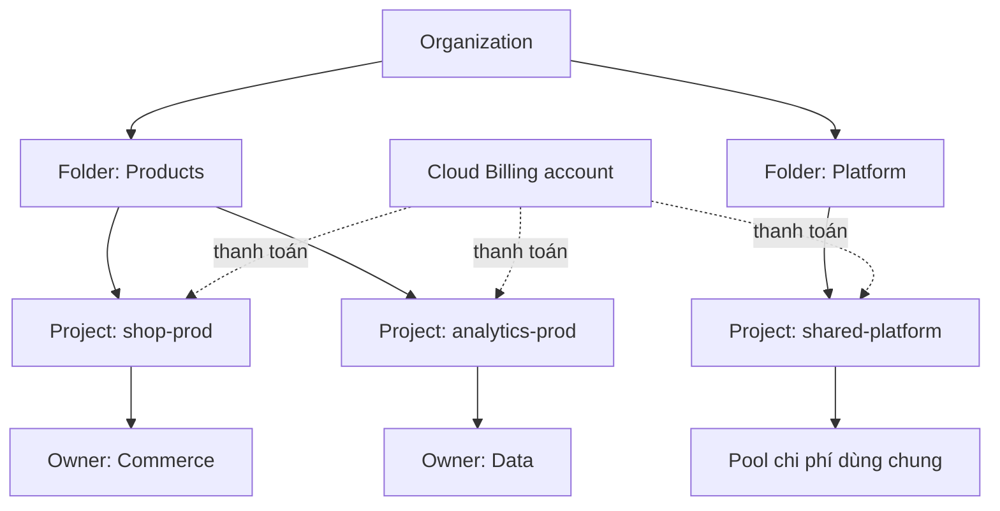
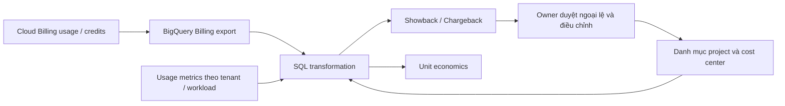

# Phân bổ chi phí theo project, nhãn và đơn vị sử dụng

Khi một doanh nghiệp triển khai nhiều hệ thống trên Google Cloud (GCP), câu hỏi “tháng này hết bao nhiêu tiền?” mới là điểm khởi đầu. Muốn quản trị chi phí, cần trả lời tiếp: **chi phí thuộc sản phẩm nào, đội nào chịu trách nhiệm, môi trường nào tạo ra, tài nguyên nào tiêu thụ, và một đơn vị nghiệp vụ thực sự tốn bao nhiêu?**

Bài học thuộc chương **Thanh toán và ngân sách** trong module `CLOUD_PROVIDERS_GCP`. Việc phân bổ chi phí kết nối các quyết định về cấu trúc Organization/Folder/Project, IAM, VPC, Compute Engine, GKE, Cloud Run, lưu trữ và cơ sở dữ liệu với quy trình phát hành, theo dõi độ tin cậy và kiểm soát ngân sách. Một hệ thống chạy đúng chức năng nhưng không xác định được người sở hữu chi phí sẽ khó tối ưu khi mở rộng.

Mục tiêu của bài là thiết kế được một quy tắc phân bổ **giải thích được, có thể truy vết đến dữ liệu Billing và được cập nhật nhất quán**. Các ví dụ tài chính và tên project bên dưới đều là giả định phục vụ học tập.

## 1. Ba góc nhìn về cùng một khoản chi phí

| Góc nhìn | Câu hỏi trả lời | Đơn vị hay dùng | Ví dụ |
| --- | --- | --- | --- |
| **Project** | Khoản chi phí được ghi nhận cho phạm vi tài nguyên GCP nào? | Project ID, billing account | `shop-prod`, `analytics-prod`, `shared-platform` |
| **Nhãn (label)** | Tài nguyên/khoản sử dụng này thuộc đội, sản phẩm hay môi trường nào? | `team`, `product`, `environment`, `cost_center` | `team=commerce`, `environment=prod` |
| **Đơn vị sử dụng** | Ai thực sự dùng tài nguyên và dùng bao nhiêu? | Phòng ban, tenant, luồng nghiệp vụ; giờ chạy, GiB-tháng, request, đơn hàng | Team Commerce; khách hàng A; 80.000 đơn/tháng |

“Đơn vị sử dụng” có **hai nghĩa cần tách rõ**:

1. **Đơn vị nhận phân bổ (consumer/cost owner):** team, phòng ban, sản phẩm, khách hàng nội bộ, tenant; nơi cuối cùng chịu trách nhiệm hoặc được báo cáo chi phí.
2. **Đơn vị đo mức tiêu thụ (metering unit):** vCPU-giờ, byte-tháng, lượt yêu cầu, số đơn xử lý thành công. Đây là thước đo dùng để quyết định chia chi phí như thế nào.

Ví dụ: Cloud SQL có thể được ghi nhận dưới project của nền tảng, có nhãn `product=orders`, nhưng nhiều tenant cùng dùng database ấy. Label không tự chỉ ra tenant nào đã dùng bao nhiêu truy vấn; cần thêm số đo từ ứng dụng và quy tắc phân bổ.

### Showback, chargeback và unit economics

- **Showback:** công bố báo cáo ai tạo ra bao nhiêu chi phí để các đội thấy và cải thiện hành vi sử dụng; chưa chuyển tiền hoặc ngân sách giữa các đơn vị.
- **Chargeback:** ghi nhận/chuyển chi phí về cost center hoặc đơn vị chịu trách nhiệm theo một quy tắc được thống nhất và kiểm toán.
- **Unit economics:** tính chi phí trên một đơn vị đầu ra, chẳng hạn USD/đơn hàng thành công hoặc USD/1.000 yêu cầu API; cần kết hợp chi phí GCP với **số liệu nghiệp vụ**, không thể suy ra toàn bộ chỉ từ Billing.

Các cách này có thể dùng cùng lúc. Trong giai đoạn đầu, showback thường hữu ích để kiểm tra chất lượng metadata trước khi áp dụng chargeback làm căn cứ tài chính.

## 2. Hiểu quan hệ Billing account, Organization, Folder và Project

Google Cloud tổ chức tài nguyên trong Organization, Folder và Project, còn **Cloud Billing account** quản lý việc thanh toán cho các project được liên kết. Một billing account có thể thanh toán cho nhiều project; mỗi project tại một thời điểm được liên kết với một billing account khi bật thanh toán. Folder và Organization giúp quản trị cấu trúc, quyền và chính sách; chúng không tự biến mọi chi phí thành khoản đã được phân bổ theo phòng ban.



Đây là quan hệ logic để thảo luận. Khi đo chi phí, phải xác nhận billing account nào đã trả cho project trong từng khoảng thời gian và có khoản phí nào không mang project ID cụ thể hay không.

### Chọn project làm ranh giới chi phí cơ bản

| Kiểu tổ chức project | Điểm mạnh | Giới hạn cần xử lý |
| --- | --- | --- |
| Một project cho mỗi sản phẩm và môi trường | Dễ xác định owner, ngân sách, IAM, quota và tách dev/prod | Nhiều project hơn; dịch vụ dùng chung cần phân bổ riêng. |
| Một project cho mỗi phòng ban | Dễ báo cáo chi phí theo bộ phận | Trong cùng phòng ban có thể có nhiều sản phẩm hoặc tenant không tách được. |
| Project nền tảng dùng chung | Tập trung mạng, observability, CI/CD hoặc cơ sở dữ liệu dùng chung | Billing ghi chi phí vào platform, chưa phải người tiêu thụ cuối; cần driver phân bổ. |
| Nhiều team cùng dùng một project | Ít thao tác quản lý project ban đầu | Khó phân quyền và xác định chi phí nếu thiếu labels, số đo và quy tắc rõ ràng. |

**Nguyên tắc thiết kế:** dùng project để tạo ranh giới ổn định về quyền và chi phí; dùng labels để tăng chiều phân tích trong project; dùng dữ liệu sử dụng để chia các khoản dùng chung hoặc phân bổ tới tenant. Không nên tạo hàng nghìn project chỉ vì muốn tính mỗi request thuộc khách hàng nào.

## 3. Thiết kế taxonomy trước khi gắn nhãn

Một hệ thống nhãn hiệu quả cần từ điển metadata nhất quán, có owner và quy tắc kiểm tra. Ví dụ:

| Khóa label | Giá trị ví dụ | Mục đích | Quy tắc |
| --- | --- | --- | --- |
| `environment` | `dev`, `staging`, `prod` | Tách chi phí theo môi trường | Dùng tập giá trị kiểm soát; tránh `production` lẫn với `prod`. |
| `team` | `commerce`, `data`, `platform` | Nhóm kỹ thuật chịu trách nhiệm | Có người quản lý mapping khi đổi tên hoặc chuyển team. |
| `product` | `orders`, `analytics` | Phân bổ theo sản phẩm | Mã ổn định qua nhiều dự án/region. |
| `cost_center` | `cc_102`, `cc_205` | Đối chiếu với hệ thống tài chính | Mã lấy từ nguồn quản trị; có ngày hiệu lực. |
| `owner` | `team_commerce` | Định tuyến cảnh báo và quy trách nhiệm | Không nhất thiết đưa email cá nhân vào label. |
| `workload` | `api`, `batch`, `database` | So sánh loại khối lượng công việc | Phân loại nhất quán, tránh tạo quá nhiều giá trị tự do. |

Các khóa trên là **quy ước minh họa**, không phải nhãn mặc định của Google Cloud. GCP có quy tắc ký tự, độ dài và số lượng labels; hãy kiểm tra giới hạn của từng tài nguyên trong tài liệu trước khi áp dụng. Không đưa dữ liệu nhạy cảm, token hoặc thông tin nhận diện khách hàng vào label.

### Phân biệt ba loại metadata dễ nhầm

1. **Project labels:** metadata gắn với project, hữu ích để quản lý nhóm sở hữu project. Không nên mặc định mọi dòng phí đều có sẵn các nhãn đó trong trường `labels` của Billing export.
2. **Resource labels:** metadata gắn trên tài nguyên **có hỗ trợ labels**; tùy dịch vụ/SKU và loại export, các nhãn phù hợp có thể xuất hiện trong Billing để phân tích chi phí. Không phải dịch vụ hay khoản phí nào cũng gắn đủ labels.
3. **Resource Manager tags:** key/value tags có mô hình quản lý riêng, có thể phục vụ điều kiện IAM hoặc Organization Policy trong các trường hợp được hỗ trợ. Đừng coi tags và labels là một hoặc mặc định cả hai hiện giống nhau trong báo cáo Billing.

Đối với chargeback, phương án an toàn là giữ một **bảng ánh xạ project → owner/cost center** đã phê duyệt; coi resource labels là thông tin tăng độ chi tiết. Nhờ đó, dòng không có `labels` vẫn có thể được phân bổ theo project nếu project có chủ sở hữu rõ ràng.

### Kiểm tra metadata bằng công cụ chỉ đọc

```bash
# Xem labels của project do bạn được phép kiểm tra
gcloud projects describe PROJECT_ID \
  --format="yaml(projectId,name,labels)"

# Xem labels của một Compute Engine VM cụ thể
gcloud compute instances describe VM_NAME \
  --project=PROJECT_ID \
  --zone=ZONE \
  --format="yaml(name,labels)"
```

Hai lệnh này không gán nhãn. Để áp dụng chính sách trong thực tế, đưa labels vào Infrastructure as Code hoặc quy trình tạo tài nguyên, xác định người có quyền sửa, kiểm tra drift và đặt nhãn bắt buộc cho những loại tài nguyên phù hợp. Nhãn mới hoặc đổi nhãn **không có nghĩa chi phí lịch sử sẽ tự được viết lại**.

## 4. Dữ liệu chi phí lấy ở đâu?

| Nguồn | Phù hợp khi | Giới hạn |
| --- | --- | --- |
| **Cloud Billing Reports** | Xem xu hướng, lọc và nhóm trực quan theo project, service, SKU, nhãn khi hỗ trợ | Chủ yếu phục vụ phân tích tương tác; độ chi tiết và cách nhóm phụ thuộc giao diện, phạm vi quyền. |
| **Cost table / hóa đơn** | Đối chiếu kỳ hóa đơn, thuế, điều chỉnh và tổng thanh toán | Không tương đương trực tiếp với biểu đồ chi phí theo ngày sử dụng. |
| **Cloud Billing export to BigQuery (standard usage cost)** | Phân tích bằng SQL theo project, service, SKU, labels và thời điểm sử dụng | Phải bật export, quản lý dataset/IAM, chuẩn hóa dữ liệu và chi phí BigQuery. |
| **Detailed usage cost export** | Cần mức chi tiết tài nguyên cao hơn ở những dịch vụ hỗ trợ | Có thêm dữ liệu và chi phí lưu/truy vấn; độ phủ ở mức resource phụ thuộc dịch vụ. |
| **Application metrics, Cloud Monitoring, logs** | Phân bổ shared resources cho team/tenant, tính chi phí trên request, job hoặc đơn hàng | Phải thiết kế đo lường và liên kết với kỳ Billing; không phải nguồn hóa đơn. |

**Không lấy số trên dashboard làm “nguồn sự thật” duy nhất** khi thực hiện chargeback. Trước hết cần thống nhất kỳ dữ liệu, đồng tiền, loại chi phí, cách xử lý credits và hóa đơn. Cloud Billing data có độ trễ, có thể điều chỉnh sau khi sử dụng; ngày sử dụng và tháng hóa đơn có thể khác nhau.

### 4.1. Bật export và lưu dữ liệu phù hợp

Một luồng triển khai điển hình:

1. Chọn Cloud Billing account và người có quyền quản lý cấu hình export.
2. Tạo hoặc chọn BigQuery dataset trong project phân tích tài chính, xác định vị trí dữ liệu, retention và IAM.
3. Trong Billing, cấu hình **BigQuery export** cho loại dữ liệu cần dùng: standard usage cost và, nếu cần, detailed usage cost.
4. Kiểm tra các bảng export và schema thực tế; ghi nhận thời điểm bắt đầu xuất dữ liệu. Khả năng truy xuất lịch sử/backfill phụ thuộc loại export và địa điểm dataset, vì vậy không mặc định có đủ mọi kỳ trước khi bật.
5. Giới hạn quyền đọc dataset vì dữ liệu có thể tiết lộ mức tiêu thụ, cấu trúc tài nguyên và thông tin kinh doanh; giám sát chi phí lưu trữ/truy vấn BigQuery.

Đường dữ liệu minh họa:



### 4.2. Những trường quan trọng trong Billing export

Schema cụ thể khác nhau theo loại export và thời điểm, nhưng các khái niệm thường gặp gồm:

| Nhóm trường | Ví dụ | Cách dùng |
| --- | --- | --- |
| Billing & project | `billing_account_id`, `project.id` | Xác định tài khoản bị tính phí và project có liên quan; một số khoản phí không gắn project. |
| Service & SKU | `service.description`, `sku.id`, `sku.description` | Hiểu chi phí đến từ sản phẩm và hạng mục tính giá nào. |
| Thời gian | `usage_start_time`, `usage_end_time`, `invoice.month` | Chọn kỳ theo **thời gian sử dụng** hoặc đối chiếu **tháng hóa đơn**; không trộn hai quy tắc trong một báo cáo. |
| Vị trí/định danh | `location` và, ở export chi tiết nếu có, thông tin resource | Phân tích region/location; xem tài nguyên cụ thể khi dữ liệu hỗ trợ. |
| Labels | `labels` và trường metadata project nếu export cung cấp | Lấy label `team`/`cost_center` để tăng độ chi tiết; chuẩn bị nhóm “chưa gắn nhãn”. |
| Tiền tệ và chi phí | `cost`, `currency`, `credits`, `cost_type` | Tính trước/sau credits, tách loại phí, tránh cộng nhiều đơn vị tiền tệ. |
| Mức sử dụng | `usage.amount`, `usage.unit`, `usage.amount_in_pricing_units`, `usage.pricing_unit` | Tính lượng dịch vụ sử dụng theo một SKU và đơn vị tương ứng. |

Lưu ý: tên và độ phủ của một số trường trong bảng **standard** hoặc **detailed** có thể thay đổi. Trước khi sao chép SQL vào môi trường thực, mở schema của bảng export đang có và so với tài liệu chính thức.

## 5. Phân bổ theo project: đường cơ sở dễ kiểm chứng nhất

Giả sử công ty có bốn project:

| Project ID minh họa | Chủ sở hữu | Mục đích | Nhóm phân bổ mặc định |
| --- | --- | --- | --- |
| `shop-prod` | Commerce | API, Cloud SQL, Cloud Storage xử lý đơn hàng | Commerce |
| `analytics-prod` | Data | Phân tích dữ liệu, BigQuery jobs | Data |
| `shop-dev` | Commerce | Dev/test cho đặt hàng | Commerce, môi trường dev |
| `shared-platform` | Platform | Networking, logging, CI/CD dùng chung | Shared cost pool |

Sau khi chọn kỳ và loại phí, tính tổng chi phí theo project. Điều này đủ cho showback cấp owner **nếu mỗi project có một owner rõ ràng**. Với `shared-platform`, cần thêm chính sách để tránh toàn bộ phí bị đẩy cho Platform dù các nhóm khác là người hưởng lợi.

### 5.1. SQL: tổng chi phí theo project và resource label

Ví dụ sau dùng BigQuery Standard SQL. Thay bảng và mốc thời gian bằng dữ liệu thật; biểu thức `labels` tương ứng **nhãn được xuất trên dòng sử dụng**, không mặc định là nhãn project.

```sql
-- Ví dụ kỳ sử dụng tháng 10/2026, theo UTC.
-- Thay tên bảng bằng bảng export thực tế của billing account.
WITH line_items AS (
  SELECT
    COALESCE(t.project.id, 'no_project') AS project_id,
    COALESCE(
      (
        SELECT l.value
        FROM UNNEST(t.labels) AS l
        WHERE l.key = 'cost_center'
        LIMIT 1
      ),
      'unlabeled'
    ) AS resource_cost_center,
    t.currency,
    t.cost AS cost_before_credits,
    IFNULL(
      (SELECT SUM(c.amount) FROM UNNEST(t.credits) AS c),
      0
    ) AS credit_amount
  FROM
    `YOUR_EXPORT_PROJECT.billing_export.gcp_billing_export_v1_XXXXXX_XXXXXX_XXXXXX` AS t
  WHERE t.usage_start_time >= TIMESTAMP('2026-10-01')
    AND t.usage_start_time < TIMESTAMP('2026-11-01')
)
SELECT
  project_id,
  resource_cost_center,
  currency,
  ROUND(SUM(cost_before_credits), 2) AS cost_before_credits,
  ROUND(SUM(credit_amount), 2) AS credits,
  ROUND(SUM(cost_before_credits + credit_amount), 2) AS cost_after_credits
FROM line_items
GROUP BY project_id, resource_cost_center, currency
ORDER BY cost_after_credits DESC;
```

Trong nhiều bản ghi, credits là số âm đại diện cho ưu đãi hoặc khoản giảm trừ. Công thức minh họa là:

\[
\text{Chi phí sau credits} = \sum(\text{cost}) + \sum(\text{credits.amount})
\]

Không đổi “sau credits” thành “tiền hóa đơn cuối cùng” mà chưa xem **thuế, điều chỉnh, rounding, phần phí không gắn project, thời điểm ghi nhận và invoice.month**. Để đối chiếu hóa đơn, sử dụng một truy vấn riêng theo tháng hóa đơn, có xét `cost_type` và các loại khoản điều chỉnh.

**Tại sao dùng subquery trong `labels`?** Vì `labels` là mảng, `CROSS JOIN UNNEST(labels)` rồi cộng cost có thể nhân đôi một dòng sử dụng khi tài nguyên có nhiều nhãn. Subquery lấy đúng giá trị của một khóa giúp tránh lỗi này. Trong dữ liệu cần tính nghiêm ngặt, còn phải kiểm tra nhãn trùng khóa, giá trị không hợp lệ và quy tắc chọn owner.

### 5.2. Nếu project không có nhãn thì sao?

Đừng tự biến nhãn `unlabeled` thành tên một team mới. Dùng quy tắc ưu tiên:

1. Nếu dòng chi phí có resource label đáng tin cậy và được phê duyệt, phân bổ theo label đó.
2. Nếu không có resource label, tra bảng project ownership có **ngày hiệu lực** (project ID → product/team/cost center).
3. Nếu project thuộc danh mục tài nguyên dùng chung, đưa vào pool để phân bổ theo driver riêng.
4. Nếu không xác định được chủ sở hữu, đặt vào **Unallocated** và giao người chịu trách nhiệm xử lý; không tự gán cho team có chi phí lớn nhất.

Khi chuyển project giữa các team, mapping nên chứa `valid_from`/`valid_to` để kỳ quá khứ vẫn phản ánh chủ sở hữu tại thời điểm phát sinh. Điều này làm chargeback có thể tái lập và kiểm toán.

## 6. Phân bổ theo SKU và đơn vị đo mức sử dụng

**SKU (Stock Keeping Unit)** trong Billing đại diện cho hạng mục tính phí của một dịch vụ, ví dụ một dạng tài nguyên compute, lưu trữ hoặc truyền dữ liệu. Một sản phẩm GCP có thể tạo ra nhiều SKU; cùng dịch vụ nhưng khác region, loại máy, tier lưu trữ hoặc đơn vị tính có thể có mức giá khác nhau.

Ví dụ tính tổng lượng sử dụng và phí trước credits theo từng SKU:

```sql
SELECT
  t.service.description AS service_name,
  t.sku.id AS sku_id,
  t.sku.description AS sku_name,
  t.usage.pricing_unit AS pricing_unit,
  t.currency,
  SUM(t.usage.amount_in_pricing_units) AS pricing_quantity,
  ROUND(SUM(t.cost), 2) AS cost_before_credits
FROM
  `YOUR_EXPORT_PROJECT.billing_export.gcp_billing_export_v1_XXXXXX_XXXXXX_XXXXXX` AS t
WHERE t.usage_start_time >= TIMESTAMP('2026-10-01')
  AND t.usage_start_time < TIMESTAMP('2026-11-01')
GROUP BY service_name, sku_id, sku_name, pricing_unit, currency
ORDER BY cost_before_credits DESC;
```

Có thể đo mức tiêu thụ theo `usage.amount`/`usage.unit` hoặc theo `usage.amount_in_pricing_units`/`usage.pricing_unit`. **Không cộng lẫn** GiB-tháng với request, vCPU-giây với byte hoặc nhiều SKU có ý nghĩa khác nhau để tạo một chỉ số “tổng usage”. Nếu muốn tính mức giá trung bình của SKU, chia chi phí cho lượng **cùng đơn vị** và chú thích credits/discounts đã bao gồm hay chưa.

### Phân biệt đơn vị tính phí với đơn vị nghiệp vụ

| Đơn vị trong Billing | Đơn vị nghiệp vụ | Dữ liệu bổ sung cần có |
| --- | --- | --- |
| Compute-seconds / resource time | USD/1.000 API requests thành công | Request metrics hoặc application logs; phân biệt request thành công, lỗi và retry. |
| Storage byte-time | USD/GB dữ liệu còn lưu của mỗi tenant | Dung lượng object hoặc bản ghi thực tế theo tenant và thời gian tồn tại. |
| Network egress bytes | USD/GB dữ liệu truyền của sản phẩm | Đo theo workload/đường truyền, xác định phạm vi egress nào nằm trong pool. |
| Database instance / storage / I/O | USD/đơn hàng | Số đơn thành công, quy tắc tính chi phí phần DB chung và phần DB nhàn rỗi. |

Billing giải thích **nhà cung cấp tính phí cho đơn vị gì**. Ứng dụng giải thích **người dùng tạo ra giá trị nghiệp vụ nào**. Hai tập số liệu phải được nối theo kỳ và phạm vi hoạt động trước khi tính unit economics.

## 7. Chia chi phí dùng chung cho team và tenant

Những khoản khó phân bổ trực tiếp thường bao gồm VPC/networking dùng chung, Cloud NAT, logging/monitoring tập trung, CI/CD, database đa tenant, storage liên dự án, chi phí idle và một số khoản support/điều chỉnh không gắn resource.

### 7.1. Quy tắc phân bổ có thứ tự

| Mức ưu tiên | Phương pháp | Ví dụ driver | Độ tin cậy tương đối |
| --- | --- | --- | --- |
| 1 | **Gán trực tiếp** theo project/resource có owner rõ | Project riêng của sản phẩm | Cao nếu mapping và labels đầy đủ. |
| 2 | **Đo mức sử dụng thực** trong shared pool | GiB log ingest theo team, CPU-seconds/job, bytes egress theo workload | Cao khi số đo đủ bao phủ và cùng kỳ. |
| 3 | **Dùng proxy có giải thích** | Số request, số job, số tenant, dung lượng dữ liệu, tỷ lệ tải trung bình | Phụ thuộc mức tương quan giữa proxy và chi phí thực. |
| 4 | **Phân bổ cố định theo chính sách** | 50/30/20 theo dự toán hoặc số lượng nhân sự | Dễ dùng tạm thời, cần ghi rõ giả định và kỳ rà soát. |
| 5 | **Unallocated có owner xử lý** | Phí không thể gắn chắc chắn hoặc thiếu nguồn dữ liệu | Minh bạch hơn việc gán tùy tiện. |

Với mỗi shared cost pool, xác định:

- **Khoản nào nằm trong pool?** Chọn tập SKU/service/project, loại chi phí nào, bao gồm credits, chiết khấu, thuế hay hỗ trợ hay không.
- **Ai là đối tượng nhận?** Team, sản phẩm hoặc tenant; có loại trừ môi trường dev hoặc team nền tảng không?
- **Driver nào được chấp thuận?** Cần số liệu cùng kỳ; xử lý missing data và retry thế nào?
- **Cách làm tròn và đối soát?** Tổng khoản phân bổ phải bằng tổng pool sau khi áp dụng quy tắc, kể cả phần còn unallocated.
- **Ai duyệt ngoại lệ?** Khi thay đổi cấu trúc hoặc người sở hữu, phải ghi lại phiên bản quy tắc.

### 7.2. Công thức và ví dụ

Đối với một pool `P` và đơn vị sử dụng `i`:

\[
\text{allocated}_{i} = P \times \frac{u_i}{\sum_j u_j}
\]

Trong đó `u_i` là mức sử dụng của đơn vị `i` đo bằng **cùng một driver và trong cùng kỳ**. Nếu mẫu số bằng 0 hoặc đo thiếu, phải sử dụng quy tắc fallback được phê duyệt hoặc để unallocated.

Giả sử trong tháng 10 (tất cả là USD, chi phí sau credits và chưa gồm thuế), có:

| Khoản chi | Số tiền | Ghi nhận ban đầu |
| --- | ---: | --- |
| `shop-prod` | 1.400 | Commerce |
| `analytics-prod` | 600 | Data |
| `shop-dev` | 150 | Commerce |
| `shared-platform` | 300 | Shared pool |
| **Tổng** | **2.450** | |

Pool `shared-platform` được chia **70% cho Commerce, 30% cho Data** theo driver dùng chung đã đo và được duyệt (con số chỉ là giả định minh họa). Khi đó:

- Commerce nhận `1.400 + 150 + 300 × 70% = 1.760 USD`.
- Data nhận `600 + 300 × 30% = 690 USD`.
- Kiểm tra bảo toàn: `1.760 + 690 = 2.450 USD`.

Nếu Commerce xử lý **80.000 đơn thành công**, chi phí hạ tầng đã phân bổ trên một đơn là:

\[
\frac{1760\ \mathrm{USD}}{80000\ \mathrm{orders}} =
0.022\ \mathrm{USD/order}
\]

Đó là **cost per order theo phạm vi chi phí đã chọn**, chưa bao gồm nhân sự, marketing, phí thanh toán, doanh thu hay các chi phí ngoài GCP. Chỉ so sánh con số giữa các tháng khi phạm vi pool, số lượng đơn thành công và quy tắc credits nhất quán.

### 7.3. Bài toán đa tenant

Giả sử một Cloud Run service và Cloud SQL phục vụ 20 khách hàng doanh nghiệp. Tất cả chạy trong một project và cùng truy cập database. Gắn một label `tenant_id` lên service dùng chung không tạo ra 20 bản ghi chi phí riêng trong Billing. Cần đo tại ứng dụng hoặc tầng kết nối, ví dụ:

- Số request hợp lệ và thời gian xử lý của mỗi tenant;
- Thời gian CPU hoặc số job xử lý theo tenant nếu có công cụ đo;
- Dung lượng dữ liệu và vòng đời lưu trữ theo tenant;
- Đọc/ghi database, nếu có cơ chế đo đáng tin cậy và không quá tốn kém.

Driver nên phản ánh **nguồn gây chi phí**. Tính phí database theo số request có thể sai nếu một tenant chạy truy vấn rất nặng; chia storage theo số request cũng không phản ánh dung lượng tồn tại. Khi không đo được chính xác, báo cáo tỷ lệ ước tính và biên độ sai số thay vì công bố số “chính xác tuyệt đối”.

## 8. Credits, discounts, thuế và kỳ báo cáo

Trong một kỳ Billing có thể xuất hiện các điều chỉnh về credits, chiết khấu cam kết sử dụng, khuyến mại, free tier, thuế, refunds hoặc các khoản sửa sai. Một vài loại credit/discount có cách biểu diễn khác nhau theo phiên bản export và hợp đồng. Vì vậy trước khi chargeback phải ban hành chính sách:

| Quyết định | Câu hỏi phải chốt | Gợi ý kiểm soát |
| --- | --- | --- |
| Gross hay net | Báo cáo trước hay sau credits/discounts? | Công bố cả hai cột khi hữu ích; tổng hợp net đúng nguồn, tránh trừ credit hai lần. |
| Commitment/discount | Team nào được hưởng ưu đãi và ai chịu rủi ro công suất cam kết không dùng hết? | Phân bổ lợi ích và chi phí cam kết theo chính sách; đối chiếu logic với dữ liệu billing thực tế. |
| Thuế/hỗ trợ/điều chỉnh | Đưa vào pool nào, phân bổ theo tỷ lệ hay giữ ở Finance? | Viết rõ trường hợp không gắn project và điều chỉnh hồi tố. |
| Currency | Có nhiều loại tiền tệ hoặc báo cáo đổi tiền không? | Không cộng các currencies trực tiếp; dùng tỷ giá và thời điểm thống nhất nếu chuyển đổi. |
| Kỳ | Dựa trên `usage_start_time` hay `invoice.month`? | Báo cáo vận hành theo usage period; đối chiếu sổ sách theo invoice period. |
| Phát sinh trễ | Một khoản phí tháng cũ xuất hiện sau khi đã chốt báo cáo? | Có cơ chế restatement/adjustment theo kỳ và lịch khóa sổ. |

**Ví dụ xung đột thường gặp:** dashboard ngày 31/10 hiển thị tổng chi phí tháng 10 theo thời điểm sử dụng, nhưng hóa đơn tháng 10 có thể bao gồm các khoản được ghi nhận/điều chỉnh theo quy tắc invoicing khác. Hai số không nhất thiết là lỗi; trước tiên hãy xác định cùng billing account, currency, bộ lọc, loại phí và thời điểm dữ liệu đã hoàn tất hay chưa.

## 9. Ngân sách và cảnh báo: phản hồi từ dữ liệu phân bổ

Sau khi có owner, ánh xạ chi phí vào ngân sách:

1. Gán người chịu trách nhiệm cho project hoặc nhóm project; định nghĩa mức chi tiêu mục tiêu theo tháng/quý và môi trường.
2. Tạo **Cloud Billing budget** với phạm vi phù hợp (billing account, project, service hoặc bộ lọc được giao diện hỗ trợ); kiểm tra bộ lọc labels nếu dùng để theo dõi chi phí theo team.
3. Đặt ngưỡng cảnh báo ví dụ **50%, 90%, 100%** so với ngân sách, và cảnh báo dự báo nếu phù hợp. Xác định người nhận, kênh vận hành và thời gian phản hồi.
4. Dùng BigQuery/Cloud Billing Reports để tìm nguyên nhân: SKU tăng, resource không dùng, tăng traffic, logging retention, egress liên region, lỗi retry hoặc tài nguyên mới.
5. Khi vượt ngưỡng, owner đánh giá **tác động đến SLO** trước khi giảm công suất, thay lớp lưu trữ hoặc đóng tài nguyên.

**Billing budget là công cụ theo dõi và gửi thông báo; mặc định không phải hard cap và không tự ngắt mọi dịch vụ ở ngưỡng đã chọn.** Có thể tích hợp Pub/Sub, Cloud Functions/Cloud Run hoặc quy trình phê duyệt để phản ứng theo chính sách, nhưng hoạt động tự động cần được thiết kế an toàn. Chi phí xuất hiện trễ cũng khiến cảnh báo không có tính tức thời.

### Chỉ số FinOps theo dõi định kỳ

| Chỉ số | Cách tính/cách diễn giải | Tín hiệu cần chú ý |
| --- | --- | --- |
| Tỷ lệ chi phí có owner | Cost gán trực tiếp hoặc theo quy tắc / tổng cost trong phạm vi | Tăng Unallocated hoặc nhãn thiếu đột ngột. |
| Chi phí prod/dev | Cost môi trường prod so với dev/test theo cùng sản phẩm | Dev/test chạy ngoài giờ hoặc snapshot tồn đọng. |
| Chi phí theo service/SKU | Tổng theo dịch vụ và SKU qua các kỳ | Egress, logging, storage hoặc database phình nhanh. |
| Tỷ lệ shared pool | Cost dùng chung / tổng cost | Pool tăng nhưng driver hoặc số người dùng không đổi. |
| Cost per successful order | Tổng chi phí đã phân bổ cho Orders / số đơn thành công | Giá tăng khi traffic giảm, retry tăng hoặc database nhàn rỗi. |
| Budget variance | Actual/forecast so với budget cùng kỳ | Vượt ngưỡng cần phân tích nguyên nhân, không cắt giảm mù quáng. |

Không chỉ theo dõi tổng số tiền: so sánh với sản lượng và chất lượng dịch vụ để phân biệt **tăng trưởng lành mạnh** với **lãng phí**. Một hệ thống có chi phí tăng 20% nhưng xử lý số đơn tăng 50% có thể đang cải thiện unit economics.

## 10. Triển khai chính sách phân bổ trong đội kỹ thuật

### Giai đoạn 1 — Chuẩn hóa chủ sở hữu

Lập danh mục mọi project đang thanh toán: project ID, billing account, owner, product, environment, cost center, ngày hiệu lực. Đưa chi phí không xác định được vào hàng đợi xử lý thay vì lờ đi. Duy trì quyền tối thiểu: kỹ sư không cần quyền quản lý Billing account chỉ để xem một dashboard phân bổ.

### Giai đoạn 2 — Gắn nhãn và đặt tiêu chuẩn phát hành

Chuẩn hóa các khóa `environment`, `team`, `product`, `cost_center` cho resource được hỗ trợ; tự động gắn nhãn trong Terraform hoặc pipeline phát hành. Kiểm tra các tài nguyên không hỗ trợ labels và xác định fallback mapping theo project. Bảo đảm service account/automation có quyền vừa đủ để tạo resource, không phải quyền rộng vô hạn.

### Giai đoạn 3 — Thu thập, đối chiếu, báo cáo

Bật Billing export, giữ nguyên dữ liệu nguồn, biến đổi thành bảng phân bổ có phiên bản quy tắc. Thêm metrics theo tenant khi cần. Đối soát tổng source và tổng đã phân bổ theo từng kỳ/currency; xuất cả phần Unallocated, không ép phân bổ 100% bằng cách ước lượng thiếu căn cứ.

### Giai đoạn 4 — Vận hành và cải tiến

Họp FinOps hàng tháng giữa Finance, Platform và product owners; đối chiếu biến động bất thường, điều chỉnh mô hình khi kiến trúc thay đổi. Nếu chuyển từ Compute Engine sang Cloud Run, hoặc từ Cloud SQL riêng sang database shared, cần xem lại driver để tránh áp dụng công thức cũ cho mô hình chi phí mới.

Một bảng phân bổ phục vụ kiểm toán có thể gồm:

```text
period_start | period_end | currency | billing_account
project_id   | resource_id (nếu có) | service | sku
raw_cost     | credits | cost_after_credits
owner_team   | product | environment | cost_center
allocation_rule_id | allocation_version | driver_name
driver_quantity | allocated_amount | allocation_status
```

Lưu **nguồn dữ liệu, phiên bản quy tắc và thời điểm chạy**. Nếu sau này có người hỏi “vì sao tháng 10 team Commerce bị tính 1.760 USD?”, bạn có thể nối từng dòng chargeback đến project/SKU gốc, pool dùng chung và tỷ lệ được duyệt.

### Checklist đối soát trước khi công bố chargeback

- [ ] Có định nghĩa kỳ theo thời gian sử dụng hoặc hóa đơn, và toàn bộ báo cáo dùng cùng quy tắc.
- [ ] Mọi dòng chi phí được xử lý theo currency và cách tính credits thống nhất.
- [ ] Tổng direct + allocated shared + unallocated khớp với tổng nguồn sau khi áp dụng các loại phí đã chọn.
- [ ] Không nhân đôi cost khi `UNNEST(labels)` hoặc khi join dữ liệu phân bổ.
- [ ] Project chuyển owner giữa kỳ được áp dụng mapping có ngày hiệu lực.
- [ ] Nhãn thiếu, resource không hỗ trợ labels, khoản không có project đều được nhận diện.
- [ ] Driver shared pool cùng kỳ, có nguồn đo và quy tắc fallback khi dữ liệu thiếu.
- [ ] Báo cáo ghi rõ phần không bao gồm (thuế, support, chi phí ngoài GCP, nhân công...).
- [ ] Người sở hữu và Finance đã xem các ngoại lệ lớn trước khi khóa sổ.

## 11. Những sai lầm thường gặp

1. **Cho rằng project và phòng ban là một:** project dùng chung có thể phục vụ nhiều nhóm, còn một nhóm có thể có nhiều project.
2. **Gắn label hôm nay rồi mong truy xuất đủ lịch sử:** metadata thay đổi theo thời gian, export có độ trễ và mức độ bao phủ khác nhau.
3. **Cộng trực tiếp số lượng usage của nhiều SKU:** trộn đơn vị và cơ chế tính giá không tương thích.
4. **Dùng `UNNEST(labels)` rồi cộng cost không kiểm soát:** dễ nhân nhiều lần chi phí khi resource có nhiều labels.
5. **Gán toàn bộ shared cost cho đội Platform:** làm chi phí sản phẩm bị đánh giá thấp và che khuất nguyên nhân tiêu thụ.
6. **Chia đều chi phí database theo tenant:** không phản ánh tenant sử dụng dung lượng, truy vấn hoặc tải khác nhau nếu không có đo lường.
7. **Lẫn dữ liệu usage và invoice:** báo cáo vận hành không khớp hóa đơn vì khác kỳ, thuế hoặc adjustment.
8. **Đưa mọi ưu đãi về một team:** đánh sai động lực tối ưu và có thể tính trùng/thiếu lợi ích cam kết.
9. **Coi budget là bộ ngắt chi tiêu:** cảnh báo đến trễ và không tự bảo đảm mọi dịch vụ dừng đúng ngưỡng.
10. **Tối ưu số tiền mà quên SLO:** tiết kiệm không có ý nghĩa nếu làm tăng lỗi giao dịch hoặc thời gian phục hồi.

## 12. Bài tập áp dụng

### Tình huống A — Cost center của sản phẩm đặt hàng

Công ty có project `orders-prod`, `orders-dev`, `shared-observability`. Resource trong `orders-prod` có các labels `team=commerce` và `cost_center=cc_102`; một số dòng Cloud SQL không có labels trong export. Hãy đề xuất thứ tự xác định owner cho mỗi dòng, cách báo cáo nhãn thiếu và cách phân chia logging dùng chung.

### Tình huống B — SaaS đa tenant

Ba tenant cùng dùng một Cloud Run service, một Cloud SQL instance và một bucket. Tenant A tạo 70% request nhưng chiếm 15% dung lượng, tenant B tạo 20% request nhưng chiếm 75% dung lượng, tenant C chiếm phần còn lại. Hãy chọn **hai driver khác nhau** cho compute và storage; giải thích vì sao lấy số request để chia toàn bộ phí sẽ sai.

### Tình huống C — Sai lệch khi đối chiếu

Báo cáo BigQuery nhóm theo `usage_start_time` cho tháng 10 là 2.450 USD sau credits; Finance nói số hóa đơn tháng 10 là 2.520 USD. Hãy liệt kê những khác biệt cần kiểm tra trước khi kết luận SQL sai: thời gian, currency, tax, `cost_type`, credits, dữ liệu đến trễ, export coverage và bộ lọc billing account.

### Tình huống D — Lập ngân sách và tối ưu

Owner phát hiện báo cáo tháng hiện tại tăng 30% so với kế hoạch. Phân tích cho thấy Cloud Logging tăng mạnh trong khi số đơn hàng không đổi. Hãy đề xuất cách phân tích theo SKU, kiểm tra lượng log và retention, xác định owner, đo ảnh hưởng đến khả năng chẩn đoán lỗi trước khi thay đổi cấu hình.

### Câu hỏi tự kiểm tra

1. Vì sao dùng project làm lớp đầu tiên của cost allocation nhưng vẫn cần labels và dữ liệu tiêu thụ?
2. Phân biệt project labels, resource labels và Resource Manager tags.
3. “Unallocated” có ý nghĩa gì và vì sao có thể chấp nhận được trong báo cáo minh bạch?
4. Tại sao phải thống nhất cách xử lý credits trước khi tính `cost per order`?
5. Một budget vượt 100% có tự động khóa toàn bộ tài nguyên GCP không?
6. Làm sao kiểm tra một bảng phân bổ đã bảo toàn tổng chi phí nguồn?

Ghi nhớ quy trình thực hành: **định nghĩa consumer và kỳ báo cáo → nhóm theo project → bổ sung labels và mapping owner → đo và chia shared usage → đối soát cost/credits/invoice → showback hoặc chargeback → theo dõi ngân sách và unit economics**.

### Tài liệu chính thức để tra cứu

- [Cloud Billing documentation](https://cloud.google.com/billing/docs)
- [Cloud Billing export to BigQuery](https://cloud.google.com/billing/docs/how-to/export-data-bigquery)
- [Cloud Billing reports](https://cloud.google.com/billing/docs/how-to/reports)
- [Cost allocation with labels](https://cloud.google.com/billing/docs/how-to/labels-usage)
- [Create, edit, or delete budgets and budget alerts](https://cloud.google.com/billing/docs/how-to/budgets)
- [Google Cloud resource labels](https://cloud.google.com/resource-manager/docs/creating-managing-labels)
- [FinOps Foundation](https://www.finops.org/framework/)

Trước khi áp dụng cho dữ liệu tài chính thật, hãy xác minh schema export, khả năng gắn nhãn theo dịch vụ, kỳ hóa đơn và chính sách phân bổ đã được phê duyệt trong tổ chức.
