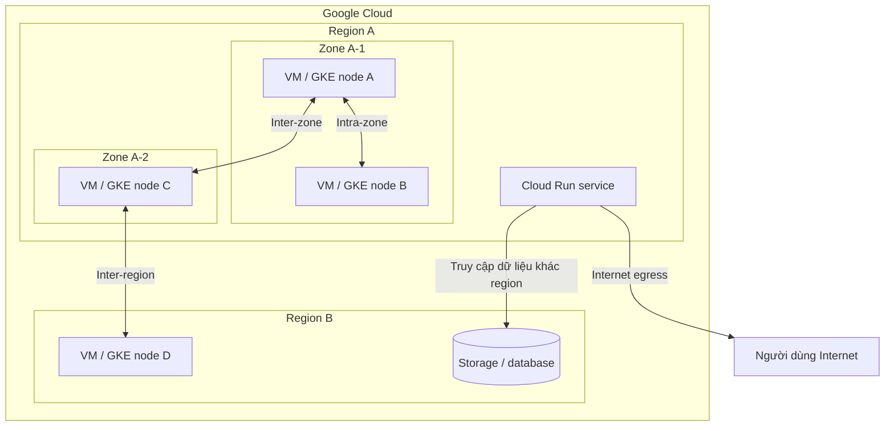

# Chi phí truyền dữ liệu giữa zone, region và Internet

## 1. Vì sao lưu lượng mạng có thể làm hóa đơn GCP tăng?

Khi lập trình viên Java triển khai ứng dụng Spring Boot lên **Cloud Run**, **GKE** hoặc **Compute Engine**, chi phí không chỉ đến từ CPU, RAM và lưu trữ. Các byte truyền giữa hai thành phần của hệ thống cũng có thể được tính phí, kể cả khi cả hai đều nằm trong Google Cloud. Chẳng hạn:

- API Java chạy ở một zone, còn một dịch vụ trên VM khác nằm ở zone khác của cùng region.
- Worker ở Singapore đọc dữ liệu từ bucket hoặc database được đặt tại region khác.
- Backend trả hàng triệu ảnh hoặc JSON response cho người dùng qua Internet.
- Ứng dụng gọi API bên ngoài thông qua Cloud NAT hoặc xuất dữ liệu qua load balancer/CDN.

Những đường truyền này có **mô hình tính phí khác nhau**. Gọi tất cả chúng là “băng thông” rồi nhân cùng một đơn giá sẽ dẫn đến dự toán sai. Trong chương **Thanh toán và ngân sách** của mô-đun **CLOUD_PROVIDERS_GCP**, bài này hướng dẫn cách xác định **lưu lượng thuộc loại nào, dịch vụ nào chịu phí, cách tính và cách quan sát hóa đơn**, để lựa chọn kiến trúc GCP vừa đáp ứng độ tin cậy vừa kiểm soát được ngân sách.

### Kết quả học tập

Sau bài học, bạn có thể:

1. Phân biệt **ingress**, **egress**, **intra-zone**, **inter-zone**, **inter-region** và **Internet egress**.
2. Xác định tác động của **VPC, IP nội bộ/IP công khai, region, Network Service Tier** và loại dịch vụ đối với phí mạng.
3. So sánh đường truyền của **Compute Engine/GKE**, **Cloud Run**, **Cloud Storage**, **Cloud SQL** và những thành phần như **Cloud NAT, Load Balancing, Cloud CDN**.
4. Ước tính phí theo **GiB × đơn giá áp dụng**, có xét chiều dữ liệu, phân tầng giá và phí phụ trợ.
5. Dùng **Billing Reports, SKU, Budgets, Billing export to BigQuery** để tìm bất thường và chọn phương án tối ưu cho hệ thống Java.

> **Nguyên tắc xuyên suốt:** mọi bảng tính và ví dụ giá ở bài học đều phải được kiểm tra lại trên [Google Cloud VPC network pricing](https://cloud.google.com/vpc/network-pricing), trang giá của **dịch vụ thực tế**, [Cloud Billing](https://cloud.google.com/billing/docs) hoặc **Cloud Pricing Calculator** trước khi đưa vào dự toán. Giá có thể thay đổi theo khu vực, đích đến, tier, thời điểm, hợp đồng và chính sách miễn phí. Các đơn giá giả định được ghi rõ **không phải báo giá**.

## 2. Định nghĩa vị trí và chiều truyền dữ liệu

### 2.1. Organization, project, region và zone không phải cùng một ranh giới

**Project** là ranh giới quản lý nhiều tài nguyên và là một đơn vị thường được sử dụng khi phân bổ chi phí; **billing account** có thể thanh toán cho nhiều project. **Region** là khu vực địa lý đặt tài nguyên, ví dụ `asia-southeast1` (Singapore). **Zone** là vị trí triển khai trong một region, ví dụ `asia-southeast1-a` và `asia-southeast1-b`.

Hai VM ở hai project khác nhau **chưa chắc** chịu phí inter-region; hai VM cùng project **vẫn có thể** chịu phí inter-region nếu đặt tại hai region. Điều phải tìm là vị trí thực tế, sản phẩm và đường đi của **source → destination**, cùng loại địa chỉ và mạng được sử dụng.

### 2.2. Ingress và egress

| Khái niệm | Ý nghĩa | Ví dụ |
| --- | --- | --- |
| **Ingress (data transfer in)** | Dữ liệu đi vào một tài nguyên hoặc một ranh giới dịch vụ | Người dùng upload 20 MiB lên API Java |
| **Egress (data transfer out)** | Dữ liệu rời khỏi tài nguyên/điểm tính phí | API trả 2 MiB JSON hoặc ảnh cho trình duyệt |
| **Intra-zone** | Dữ liệu giữa tài nguyên trong cùng zone | VM A ↔ VM B trong `asia-southeast1-a` |
| **Inter-zone** | Dữ liệu giữa các zone trong cùng region | VM A ở `-a` ↔ VM B ở `-b` |
| **Inter-region** | Dữ liệu di chuyển giữa hai region | Singapore ↔ Tokyo |
| **Internet egress** | Dữ liệu đi từ Google Cloud ra đích trên Internet công cộng | Cloud Run trả API response cho người dùng |
| **Hybrid connectivity** | Truyền đến hệ thống ngoài Google Cloud qua kết nối riêng/VPN | VM ↔ trung tâm dữ liệu qua Cloud Interconnect |

Đối với nhiều dịch vụ Google Cloud, **dữ liệu đi vào** không có phí truyền dữ liệu đầu vào theo biểu giá mạng chung. Tuy vậy, **dịch vụ xử lý ingress** như load balancer, Cloud NAT hoặc thao tác ghi/lưu trữ vẫn có thể phát sinh phí riêng. Đặc biệt, dữ liệu **phản hồi** một request thường là **egress** và có thể bị tính phí. Không nên kết luận “tải lên miễn phí” nghĩa là toàn bộ giao dịch miễn phí.

Sơ đồ minh họa ba phạm vi cơ bản:



Mũi tên trong sơ đồ cho biết **cần phân loại đường truyền**; sơ đồ không khẳng định mọi cạnh đều có phí như nhau.

## 3. Giá phụ thuộc vào sản phẩm và đường đi, không chỉ khoảng cách

### 3.1. Compute Engine và các node GKE

Theo [VPC network pricing](https://cloud.google.com/vpc/network-pricing), những quy tắc điển hình với **lưu lượng VM → VM** là:

| Nguồn → đích | Điều kiện quan trọng | Cách tính thường gặp |
| --- | --- | --- |
| Hai VM **cùng zone** | Địa chỉ IPv4 nội bộ hoặc IPv6 đủ điều kiện trong cùng VPC | **Không thu phí truyền dữ liệu nội zone** |
| Hai VM **khác zone, cùng region** | Lưu lượng đủ điều kiện trong cùng VPC | **Inter-zone**, tính theo GiB |
| Hai VM **khác region** | Vùng nguồn và vùng đích khác nhau | **Inter-region**, đơn giá phụ thuộc cặp khu vực địa lý |
| VM → Internet | Dữ liệu thực sự ra Internet | **Internet egress**, phụ thuộc region nguồn, đích và Network Service Tier |
| VM → một dịch vụ GCP | Thư viện/API và đích là sản phẩm được Google quản lý | Áp dụng **quy tắc riêng cho từng nhóm dịch vụ**, không mặc định bằng VM → VM |

Giá niêm yết trên trang VPC cho **VM → VM giữa hai zone cùng region** với điều kiện áp dụng là **0,01 USD/GiB** tại thời điểm tham khảo; cần kiểm tra lại bảng giá trước khi sử dụng. Lưu lượng giữa VM cùng zone bằng IP nội bộ đủ điều kiện có thể là **0 USD**. Nếu dùng IP công khai hoặc các VPC khác nhau, cần kiểm tra **đúng hàng trong biểu giá**, vì cơ chế định tuyến và phân loại phí có thể khác. Với GKE, **node là VM**, vì vậy trao đổi giữa các pod nằm trên các node khác zone có thể tạo lưu lượng inter-zone, bên cạnh chi phí của load balancer hoặc các dịch vụ khác.

Không thể suy từ tên một Kubernetes Service rằng mọi gói tin của ứng dụng đều nằm cùng zone. Scheduler, replica distribution, node pool, affinity và chính sách định tuyến có thể làm thay đổi đường đi; kiểm tra cả **tính sẵn sàng** khi cân nhắc giảm traffic qua zone.

### 3.2. Từ VM đến dịch vụ GCP: nhiều ngoại lệ

Trang VPC network pricing có **mục riêng cho VM → Google service**. Một số đường truyền tới Google Cloud service **cùng region** có thể không tính phí data transfer out, nhưng có **ngoại lệ** như Cloud SQL, GKE, Memorystore và Filestore, nơi cách tính có thể dựa trên quy tắc VM → VM. Kết nối khác region nhìn chung cần xem phí inter-region theo dịch vụ và đường đi cụ thể.

Vì thế, khi ứng dụng Java trên Compute Engine ghi dữ liệu vào Cloud SQL, đừng chỉ hỏi “hai bên đều ở Singapore phải không?”. Hãy kiểm tra thêm **zone và cách kết nối**. Phí **DB instance**, thao tác, backup hoặc storage vẫn là thành phần riêng dù một đường truyền mạng được miễn phí.

### 3.3. Cloud Run

Cloud Run không buộc bạn quản lý zone của từng instance như Compute Engine. Theo [Cloud Run pricing](https://cloud.google.com/run/pricing):

- **Cloud Run → Google Cloud resources cùng region** có các trường hợp **không thu phí data transfer**, ví dụ giữa hai Cloud Run services cùng region, theo quy tắc cụ thể của Cloud Run.
- **Cloud Run → VPC network** được tính theo quy tắc data transfer từ VM/VPC tương ứng; cần xét cấu hình Direct VPC egress hoặc Serverless VPC Access.
- **Cloud Run → Internet** dùng bảng giá outbound Internet theo Premium Network Service Tier, có điều kiện miễn phí/hạn mức riêng được công bố theo dịch vụ và địa lý.
- Nếu sử dụng **Serverless VPC Access connector**, chính connector có thể phát sinh phí tài nguyên, tách biệt phí dữ liệu trên tuyến.

Ví dụ: người dùng gọi Spring Boot trên Cloud Run ở Singapore, API truy vấn database ở cùng region rồi trả 500 KiB JSON cho người dùng Việt Nam. **Phần response ra Internet** cần được tính vào dự toán, dù kết nối backend tới tài nguyên cùng region có thể có quy tắc phí khác. Ngoài mạng, Cloud Run còn có phí CPU, RAM, request và cấu hình instance theo mô hình billing được chọn.

### 3.4. Cloud Storage

Cloud Storage có [biểu giá riêng](https://cloud.google.com/storage/pricing): **lưu trữ**, **thao tác/data processing**, **network usage**, và những thành phần khác tùy tính năng. Đặc biệt:

- Dữ liệu đọc từ bucket sang tài nguyên ở **cùng location đủ điều kiện** có thể được miễn phí phần network transfer. Chuyển giữa các zone trong cùng region được xem là cùng location cho quy tắc Cloud Storage.
- **Region**, **dual-region** và **multi-region** không phải các giá trị hoán đổi được; một region không tự động được xem là cùng location với multi-region bao phủ nó.
- Dữ liệu đọc/tải từ bucket sang **region khác** hoặc ra **Internet** có thể chịu đơn giá network của **Cloud Storage**, không nhất thiết theo bảng VM.
- Đọc object còn có thể phát sinh **operation charges**, **retrieval fees** với storage class phù hợp, hoặc phí replication. Cần tách chúng khỏi egress.

Ví dụ: API Java ở Singapore đọc file từ bucket Singapore rồi trả file cho người dùng ngoài Google Cloud. Cần xem **ít nhất hai đoạn**: bucket → API và API → Internet; cùng với phí đọc object, CPU/instance, CDN/load balancer nếu có. Đừng lấy chi phí bucket → API bằng tổng chi phí phục vụ file.

### 3.5. Cloud SQL, load balancer, Cloud NAT và CDN

| Thành phần | Câu hỏi phải đặt | Phí có thể phát sinh ngoài data egress |
| --- | --- | --- |
| **Cloud SQL** | Ứng dụng và DB cùng region/zone? Kết nối riêng hay công khai? Có read replica khác region? | DB instance, storage, backup, HA/replication, phí chuyển dữ liệu theo chính sách dịch vụ |
| **Cloud Load Balancing** | Request/response đi qua load balancer nào, lượng dữ liệu xử lý bao nhiêu? | Forwarding rule, data processing, policy/feature tùy loại |
| **Cloud NAT** | VM hoặc workload dùng NAT để ra ngoài? Bao nhiêu byte được NAT xử lý? | Phí gateway, GiB xử lý, địa chỉ IP, đồng thời có thể có Internet egress |
| **Cloud CDN** | Bao nhiêu request cache hit? Cache miss phải kéo từ origin ở đâu? | Cache lookup, cache data transfer out, cache fill và thành phần LB/Storage liên quan |
| **Cloud VPN/Interconnect** | Dữ liệu đi đến on-premises qua đường nào, vùng của attachment ở đâu? | Tunnel/attachment, công suất/kết nối và data transfer theo loại đường |

Theo [Cloud NAT pricing](https://cloud.google.com/nat/pricing), Public NAT có thể có **phí gateway theo giờ + phí GiB được xử lý + phí địa chỉ IP + phí egress**. Với [Cloud CDN](https://cloud.google.com/cdn/pricing), “cache hit” vẫn có thể có phí **cache data transfer out** và **lookup**; không được xem tất cả byte từ cache là miễn phí. Hai ví dụ này cho thấy cùng một byte có thể liên quan nhiều **SKU** khác nhau.

## 4. Network Service Tiers và Internet egress

Khi dữ liệu đi đến người dùng ngoài Google Cloud, cần kiểm tra hai yếu tố riêng:

1. **Đích đến của traffic**, ví dụ khu vực địa lý của người nhận; biểu giá có thể chia nhóm đích và các bậc dung lượng.
2. **Network Service Tier**: **Premium Tier** thường là mặc định; **Standard Tier** sử dụng mô hình định tuyến và bảng giá khác nếu sản phẩm/tình huống cho phép cấu hình.

Không nên mặc định “Standard luôn tốt hơn” hoặc tự áp dụng bảng Standard cho Cloud Run: mỗi sản phẩm và loại IP/load balancer hỗ trợ lựa chọn tier theo cách khác nhau. Đọc đúng tài liệu của tài nguyên nguồn và lưu ý rằng **giá thấp hơn không luôn đồng nghĩa trải nghiệm mạng tương đương**.

Trong bài này, đơn giá cho một flow được ký hiệu `r(source, destination, service, tier, volume)`. Đối với nhiều bậc giá, phải chia lưu lượng vào **từng bậc** thay vì dùng duy nhất một mức giá cho tất cả GiB.

## 5. Phương pháp tính phí truyền dữ liệu

### 5.1. Vẽ đồ thị luồng dữ liệu trước khi lấy giá

Đặt mỗi thành phần hệ thống thành một node và mỗi đường truyền thành một cạnh có **chiều**. Mỗi cạnh cần điền:

| Thuộc tính | Ví dụ |
| --- | --- |
| Nguồn | Cloud Run API, region Singapore |
| Đích | Browser người dùng hoặc bucket/DB |
| Dịch vụ nguồn tính phí | Cloud Run / Compute Engine / Cloud Storage |
| Zone/region nguồn và đích | `asia-southeast1` → `asia-northeast1` |
| Loại IP/network | Nội bộ VPC, external IP, Internet, VPC connector |
| Tổng byte theo chiều | 300 GiB/tháng, đo sau tối ưu payload nếu phù hợp |
| SKU/bảng giá | Inter-zone, inter-region, internet out, CDN cache out |
| Phí phụ trợ | NAT/LB/CDN, thao tác đọc/ghi, replication |

Đừng đếm cùng một luồng hai lần trong **một SKU**, nhưng cũng đừng bỏ sót các đoạn mạng và dịch vụ trung gian. Ví dụ browser tải ảnh qua CDN có thể tạo **cache transfer out**, **cache lookup** và khi cache miss thì thêm **cache fill**.

### 5.2. Quy đổi đơn vị

Google Cloud thường biểu diễn nhiều mục mạng bằng **GiB**, trong đó:

```text
1 KiB = 1.024 byte
1 MiB = 1.024 KiB
1 GiB = 1.024 MiB = 1.073.741.824 byte
GiB = bytes / 1.073.741.824
```

Đừng nhầm **GB (10^9 byte)** và **GiB (2^30 byte)**; kiểm tra đơn vị hiển thị của SKU cụ thể. Với request HTTP, lưu lượng phải xem theo **byte thực sự truyền** (có thể gồm header và overhead tùy cơ chế đo), không mặc định bằng dung lượng object lưu trên đĩa.

### 5.3. Công thức tổng quát

Với một đường truyền và một bậc giá đơn giản:

```text
Phí đường truyền ≈ Số GiB được tính phí × Đơn giá/GiB
```

Với nhiều flow và bậc giá:

```text
Tổng network cost
  = Σ (GiB tính phí của từng flow và từng bậc × rate tương ứng)
  + phí xử lý, gateway, IP, LB, CDN, kết nối... nếu áp dụng
```

Đây là **ước tính**, không thay thế hóa đơn cuối kỳ. Thuế, tín dụng/discount, phí dịch vụ nền, đơn vị và quy tắc áp dụng giá theo hợp đồng có thể khiến số thực tế khác phép nhân đơn giản.

### 5.4. Ví dụ có số — tất cả đơn giá dưới đây là GIẢ ĐỊNH

Giả sử một hệ thống Java có:

- 300 GiB/tháng trao đổi giữa VM A và VM B ở hai zone cùng region.
- 100 GiB/tháng được gửi từ VM sang một region khác.
- 500 GiB/tháng response API ra Internet.

Giả sử **chỉ nhằm luyện phép tính**: inter-zone là `0,01 USD/GiB`, inter-region là `0,08 USD/GiB`, Internet là `0,12 USD/GiB`. Hai mức cuối **không phải đơn giá của một tuyến GCP cụ thể**; ngay cả mức đầu cũng cần đối chiếu điều kiện áp dụng và giá hiện hành.

| Đường truyền | GiB/tháng | Giá giả định | Chi phí minh họa |
| --- | ---: | ---: | ---: |
| Inter-zone | 300 | 0,01 USD/GiB | 3,00 USD |
| Inter-region | 100 | 0,08 USD/GiB | 8,00 USD |
| Internet egress | 500 | 0,12 USD/GiB | 60,00 USD |
| **Tổng ba khoản ví dụ** | | | **71,00 USD** |

Để dự toán thật, thay mỗi mức giả định bằng **SKU/bậc giá đúng theo đường truyền, dịch vụ và billing account**, tính thêm NAT/CDN/LB, Cloud Run/GKE/VM, DB, storage, replication và các khoản liên quan. Nếu traffic thay đổi bậc giá, phải tính thành nhiều dòng.

### 5.5. Ví dụ dự toán từ đặc điểm API Java

Giả sử hệ thống xử lý **1.000.000 request/tháng**, mỗi response trung bình **200 KiB** sau khi nén và không tính các phần ngoài payload. Khi đó:

```text
1.000.000 × 200 KiB = 200.000.000 KiB
200.000.000 / 1.048.576 ≈ 190,7 GiB
```

Lưu lượng response chưa gồm request khác, download file, trao đổi nội bộ và overhead liên quan. Nếu API trả một JSON 2 MiB thay vì 200 KiB, cùng số request có thể tạo lưu lượng gấp hơn 10 lần. Vì vậy, **kích thước phản hồi và số lần gọi** là hai biến thiết kế quan trọng, đặc biệt với API Java phục vụ mobile/web ở nhiều quốc gia.

## 6. Bốn tình huống kiến trúc và cách đọc chi phí

### 6.1. Spring Boot trên GKE: pod ở nhiều zone

Một GKE regional cluster có thể phân bố node qua nhiều zone để tăng độ sẵn sàng. Service A nói chuyện với Service B, nhưng nếu pod nguồn và đích nằm trên các node khác zone, phần traffic tương ứng có thể thuộc inter-zone data transfer của VM/GKE node.

**Cách đánh giá:**

1. Quan sát lượng traffic **giữa service**, không chỉ số HTTP request từ Internet.
2. Kiểm tra cách phân bố node/pod qua zone và network path.
3. Với các luồng dữ liệu khối lượng lớn, đánh giá placement hoặc lựa chọn topology-aware routing nếu được nền tảng hỗ trợ, đồng thời đo khả năng phục hồi khi mất zone.
4. Không ép toàn bộ hệ thống vào một zone chỉ để giảm phí: mất khả năng chịu lỗi có thể gây tác động lớn hơn chi phí mạng tiết kiệm được.

### 6.2. Cloud Run Singapore gọi Cloud SQL hoặc Cloud Storage khác region

Một API ở `asia-southeast1` thường xuyên đọc file hoặc dữ liệu lưu ở region xa có thể tạo data transfer liên vùng, tăng latency và yêu cầu tuân thủ dữ liệu phức tạp hơn. Tuy nhiên, đặt mọi thứ cùng region **không tự động** xóa toàn bộ chi phí:

- Cloud Run, Cloud SQL và Cloud Storage có quy tắc network riêng; kiểm tra theo **cặp dịch vụ thực tế**.
- Cloud SQL vẫn có chi phí instance, storage, backup/replication và kết nối.
- Cloud Storage có operation/retrieval fees bên cạnh data transfer.
- Nếu người dùng ở nhiều quốc gia, vẫn có Internet egress từ API hoặc CDN.

Giải pháp thường bắt đầu bằng **đưa dữ liệu và compute gần nhau** khi phù hợp nghiệp vụ, sau đó dùng cache, phân trang, batching hoặc cấu hình replicated/read-only data có chủ đích. Replication cũng có chi phí, vì vậy cần so sánh trước/sau.

### 6.3. Cloud Run hoặc Compute Engine gọi dịch vụ ngoài Internet

Ứng dụng Java có thể gọi payment API, dịch vụ gửi email, kho dữ liệu hoặc endpoint AI từ bên thứ ba. Phân loại lưu lượng theo từng chiều:

- Request payload **đi từ GCP ra Internet** có thể là egress.
- Response **đi vào GCP** có thể thuộc ingress không tính phí data transfer ở phạm vi áp dụng.
- Nếu đi qua Cloud NAT hoặc load balancer/proxy, có thể có **phí xử lý đường truyền** ngoài network egress.

Không nên dựa vào kết quả một truy vấn DNS để kết luận đường truyền nằm trong mạng nội bộ. Điều cần kiểm chứng là tuyến, endpoint, IP, vùng nguồn và **các SKU thực tế**.

### 6.4. Phục vụ ảnh/tệp lớn cho người dùng

Giả sử API Java tạo signed URL cho một object trong Cloud Storage hoặc trả file qua chính API. Có ít nhất hai kiến trúc:

**Phương án A — Proxy qua ứng dụng:** browser → Cloud Run API → Cloud Storage. Dữ liệu object đi qua ứng dụng và trở lại browser; Cloud Run tốn tài nguyên xử lý/stream, và đường ra Internet có thể chịu network cost theo dịch vụ.

**Phương án B — Truy cập object có kiểm soát:** browser → Cloud Storage bằng signed URL có thời hạn hoặc đường phân phối CDN được cấu hình. Khi đó, phí internet/data transfer có thể xuất hiện ở Cloud Storage/CDN, còn ứng dụng bớt gánh streaming. Phải tính **phí thực tế** của hai phương án, bảo vệ URL, quyền truy cập, cache policy và yêu cầu ghi log.

Tối ưu không chỉ là “thêm CDN”: nếu nội dung ít được truy cập lặp, phí cache fill/lookup có thể làm phương án CDN kém hiệu quả hơn. Nếu nội dung phổ biến và cache hit cao, CDN có thể giảm tải origin và cải thiện latency.

## 7. Cách đo và truy nguyên phí mạng trên Cloud Billing

### 7.1. Billing Reports: xem tổng quan trước

Trong **Google Cloud Console → Billing → Reports** (giao diện có thể thay đổi), chọn đúng billing account, khoảng thời gian và lọc theo project, service, SKU hoặc vị trí khi có hỗ trợ. Bắt đầu từ **hệ thống nào đang tăng phí**, rồi đi sâu vào **SKU nào**.

Những tên SKU cần tìm thường có các từ như **Data Transfer**, **Egress**, **Inter-zone**, **Inter-region**, **Internet**, **Load Balancing**, **NAT**, **CDN**; tên cụ thể có thể thay đổi. Không dựa hoàn toàn vào từ khóa “network”, vì các dịch vụ có thể báo phí qua nhiều nhóm SKU khác nhau.

Tổng chi phí của một project còn có thể gồm compute, storage, logging, monitoring và các khoản không phải network. Đừng lấy “bills của Cloud Run” làm đồng nghĩa với “phí truyền dữ liệu của Cloud Run”.

### 7.2. Cloud Billing export → BigQuery

Với hệ thống lớn hoặc cần so sánh theo ngày, kích hoạt **standard usage cost export** hoặc **detailed usage cost export** qua Cloud Billing. Các bản ghi thường gồm thông tin service, SKU, project, location, usage, cost, credits và nhiều trường khác tùy loại export. **Không có bảo đảm dữ liệu xuất ngay lập tức**; có thể có độ trễ và quy tắc backfill tùy vị trí dataset.

SQL minh họa dưới đây nhóm phí theo **service và SKU**; thay thông tin dataset/table thật và ngày cần theo dõi:

```sql
SELECT
  service.description AS service_name,
  sku.description AS sku_name,
  ROUND(SUM(cost), 2) AS gross_cost
FROM `YOUR_BILLING_PROJECT.YOUR_DATASET.gcp_billing_export_v1_XXXX`
WHERE usage_start_time >= TIMESTAMP('2026-11-01')
  AND usage_start_time < TIMESTAMP('2026-12-01')
  AND project.id = 'YOUR_APPLICATION_PROJECT_ID'
GROUP BY service_name, sku_name
ORDER BY gross_cost DESC;
```

**Lưu ý:** `SUM(cost)` trong truy vấn minh họa là **cost trước khi tự cộng phần credits/discount ở cột riêng** theo schema; không tự hiểu là số tiền cuối hóa đơn. Thay vì lọc tất cả SKU có chữ `egress` ngay từ đầu, xem bảng SKU đầy đủ rồi phân nhóm những SKU liên quan đến đường truyền; một số phí gateway hoặc CDN không nằm dưới từ khóa này. BigQuery dùng để phân tích cũng có thể phát sinh chi phí truy vấn/lưu trữ.

Khi phân tích, đối chiếu ít nhất **ba nguồn**: sơ đồ traffic của hệ thống, metrics từ Cloud Monitoring/logs, và usage/cost theo SKU. Billing đo chi phí; logs/metrics giúp xác định **luồng nghiệp vụ** nào tạo ra bytes đó.

### 7.3. Ví dụ bảng truy nguyên bất thường

| Dấu hiệu trên hóa đơn | Câu hỏi kiểm tra | Cách xác minh |
| --- | --- | --- |
| Inter-zone tăng sau khi mở rộng GKE | Pod nào gọi qua node khác zone? | Node/pod placement, network flow/metrics, change log |
| Inter-region tăng sau khi thêm replica | Đồng bộ dữ liệu nào qua vùng? | Vị trí replica/bucket, lịch replication, SKU |
| Internet egress tăng dù RPS ổn định | Response lớn hơn? Người dùng tải thêm file? | Request/response size, endpoint metrics, storage access |
| NAT charge tăng | Workload nào đi Internet qua NAT, gateway xử lý bao nhiêu GiB? | NAT metrics/logs (nếu bật), network path, SKU |
| CDN phí lớn nhưng origin vẫn bận | Tỷ lệ cache hit, TTL, cache fill thế nào? | CDN hit/miss metrics, content-type, headers |

## 8. Budgets, alerts và kiểm soát chi phí

### 8.1. Dự toán trước khi triển khai

Với một dự án Java, lập bảng ít nhất:

1. **Traffic ngoài Internet:** API response, download, upload đi ra, HTTP calls đến nhà cung cấp ngoài.
2. **Traffic nội bộ:** inter-zone, inter-region, kết nối từ compute đến DB, cache, message broker hoặc object storage.
3. **Dịch vụ trung gian:** NAT, load balancer, CDN, VPN/Interconnect.
4. **Chi phí ngoài network:** VM/GKE/Cloud Run, Cloud SQL, Cloud Storage, logging/monitoring, dữ liệu được sao lưu.
5. **Sự kiện tăng trưởng:** số user, request, kích thước response, replication, retry và mức tăng khi gặp sự cố.

Đối với traffic biến thiên, hãy lập ba kịch bản **bình thường, tăng trưởng, đỉnh tải** và giữ lại giả định từng biến. Sử dụng [Google Cloud Pricing Calculator](https://cloud.google.com/products/calculator) để ước tính theo các sản phẩm và kiểm tra lại với kết quả Billing thực tế.

### 8.2. Budget khác với hạn mức chi tiêu

Theo tài liệu [Cloud Billing Budgets](https://cloud.google.com/billing/docs/how-to/budgets), **alerts-only budgets** giúp theo dõi chi phí và gửi thông báo theo ngưỡng (có thể dựa trên actual hoặc forecasted spend). Chúng **không tự động chặn toàn bộ phí** khi vượt ngưỡng. Google Cloud cũng có **spend cap budgets trong những trường hợp/dịch vụ hỗ trợ**, cần cấu hình riêng và đọc rõ phạm vi, điều kiện trước khi dựa vào đó.

Đối với project học tập:

- Đặt budget theo project/service hoặc labels được hỗ trợ và ngưỡng cảnh báo, ví dụ **50%, 80%, 100%**.
- Kiểm tra danh sách người nhận thông báo và quy trình phản hồi khi có cảnh báo.
- Với workload không cần liên tục, có thể triển khai lịch tắt/dọn tài nguyên hoặc automation có kiểm soát theo chính sách tổ chức.
- Ghi nhớ thông tin Billing có thể đến trễ; không dùng notification làm cơ chế bảo đảm dừng chi phí tức thời.

### 8.3. Các biện pháp kỹ thuật giảm phí mạng

| Biện pháp | Tác dụng kỳ vọng | Điều phải cân nhắc |
| --- | --- | --- |
| Đặt compute gần DB/bucket | Giảm các flow inter-region không cần thiết và latency | Data residency, tính sẵn sàng, chi phí migrate dữ liệu |
| Nén JSON/text response | Giảm bytes Internet egress | CPU nén/giải nén, response đã nén sẵn |
| Pagination, projection, field selection | Giảm dữ liệu trả về mỗi request | Nhiều round-trip, trải nghiệm người dùng |
| Batch request, tránh N+1 calls | Giảm overhead và lưu lượng lặp | Kích thước batch, retry từng phần |
| Cache phù hợp trên API/client/CDN | Giảm repeated transfer từ origin | TTL, invalidation, dữ liệu nhạy cảm và cache charges |
| Tránh polling liên tục | Giảm request/response không cần thiết | Webhook, Pub/Sub hoặc backoff thích hợp |
| Tối ưu traffic giữa microservices | Giảm inter-zone/inter-region exchange | Topology, HA, latency, coupling |
| Lifecycle/retention policy | Giảm dữ liệu lưu và kéo lại không cần thiết | Không xóa dữ liệu phục vụ audit hoặc recovery |

Một thay đổi kiến trúc chỉ được xem là tối ưu khi **tổng chi phí** và các chỉ số tin cậy vẫn phù hợp. Ví dụ chuyển ứng dụng vào cùng zone có thể giảm một khoản inter-zone nhưng làm tăng rủi ro gián đoạn khi zone đó gặp sự cố.

## 9. Thực hành: đo chi phí một API Java

### Bài thực hành A — Phân loại đường truyền

Giả sử hệ thống có một Spring Boot API trên Cloud Run ở `asia-southeast1`, Cloud SQL PostgreSQL cùng region, một bucket Cloud Storage ở `asia-northeast1` và trình duyệt của người dùng ngoài GCP.

Vẽ graph và đánh dấu:

- **Cloud Run → Cloud SQL**: kiểm tra quy tắc Cloud Run và Cloud SQL, kết nối được cấu hình và phí dịch vụ nền.
- **Cloud Run → bucket Tokyo**: khác region; tra đúng biểu giá nguồn/dịch vụ và chiều dữ liệu.
- **Cloud Run → browser**: Internet data transfer out, cần kiểm tra region/tier.
- **Browser → Cloud Run**: inbound upload, vẫn có thể có chi phí xử lý request/compute.

Lập bảng dự toán cho 10.000, 100.000 và 1.000.000 request, giữ cố định kích thước JSON response để thấy chi phí tăng theo dung lượng.

### Bài thực hành B — Tính từ byte và SKU

Một endpoint `GET /orders/export` trả tệp CSV trung bình 5 MiB, được gọi 100.000 lần/tháng. Tính dữ liệu response:

```text
100.000 × 5 MiB = 500.000 MiB
500.000 / 1.024 ≈ 488,28 GiB
```

Từ **GiB** này, tra đúng **Internet egress SKU** theo region/tier/service. Hãy tính thêm kịch bản bật compression giúp giảm kích thước mỗi file xuống 2 MiB và so sánh số GiB còn lại. Bài tập chỉ tính **lưu lượng payload**; bổ sung overhead, mức giá và phí liên quan khi làm dự toán thực tế.

### Bài thực hành C — Truy nguyên bất thường trong Billing

1. Trên project thử nghiệm có billing, xem **Billing Reports** theo project và theo SKU trong một khoảng thời gian có dữ liệu.
2. Ghi ra các SKU liên quan đến data transfer, Internet egress, NAT, CDN hoặc LB nếu có.
3. Với mỗi SKU, xác định dịch vụ tạo phí và đường truyền khả dĩ từ sơ đồ triển khai.
4. Nếu có Billing export, chạy truy vấn nhóm theo `service.description` và `sku.description`, đối chiếu kết quả báo cáo.
5. Đề xuất một thay đổi có thể đo được: giảm response size, chuyển bucket cùng region nếu phù hợp hoặc cải thiện cache hit; nêu cả chi phí triển khai và rủi ro.

**Không cần** cố tình phát sinh traffic lớn để hoàn thành bài. Có thể dùng dữ liệu mẫu và bảng tính nếu không có tài nguyên GCP/billing.

### Bài thực hành D — Kiểm soát ngân sách

Tạo một budget cảnh báo cho project học tập, chọn ngưỡng, người nhận và ghi lại hướng xử lý khi vượt ngưỡng. Kiểm tra có đang sử dụng **alerts-only** hay cơ chế **spend cap** được hỗ trợ; ghi rõ cơ chế nào thực sự giới hạn chi phí. Xóa tài nguyên thử nghiệm không cần thiết sau khi đánh giá.

## 10. Checklist trước khi đưa ứng dụng lên production

- [ ] Có sơ đồ đầy đủ **nguồn → đích** và các byte lớn trong hệ thống.
- [ ] Đã phân biệt **zone**, **region**, **project**, **VPC**, **internal/external IP** và nơi dữ liệu đi ra Internet.
- [ ] Biết **dịch vụ nào sở hữu SKU** của từng dòng chi phí mạng.
- [ ] Đã đối chiếu đúng trang giá **Compute Engine/GKE, Cloud Run, Cloud Storage, Cloud SQL, NAT, LB/CDN** đang dùng.
- [ ] Dự toán có **GiB sau nén**, số request, tần suất retry, cache fill, replication và traffic peak.
- [ ] Đã tách **network egress** khỏi compute/storage/operations và các khoản phí trung gian.
- [ ] Có **Billing Reports hoặc Billing export**, metrics về request size, traffic và lịch review SKU.
- [ ] Có **budget/alert** và người chịu trách nhiệm xử lý, hiểu tính năng nào thực sự giới hạn chi tiêu.
- [ ] Mọi đề xuất tối ưu đã được cân bằng với **latency, data residency, bảo mật, HA và recovery**.

Khi triển khai ứng dụng Java trên Google Cloud, câu hỏi cần trả lời không phải chỉ là “server ở region nào?”, mà là **mỗi byte đi từ đâu đến đâu, đi qua dịch vụ nào, xuất hiện dưới SKU gì và có thật sự cần phải di chuyển hay không**. Biết phân tích đường đi giúp đưa ra quyết định hợp lý giữa Cloud Run, GKE, Compute Engine, database và storage, đồng thời xây dựng ngân sách có thể kiểm chứng được.

## 11. Tài liệu Google Cloud tham khảo

- [VPC network pricing — ingress, VM-to-VM, inter-zone, inter-region, Internet egress](https://cloud.google.com/vpc/network-pricing)
- [Cloud Run pricing — networking và VPC](https://cloud.google.com/run/pricing)
- [Cloud Storage pricing — network usage và location](https://cloud.google.com/storage/pricing)
- [Cloud NAT pricing — gateway và processing](https://cloud.google.com/nat/pricing)
- [Cloud CDN pricing — cache transfer out, cache fill, lookup](https://cloud.google.com/cdn/pricing)
- [Cloud Billing budgets and alerts](https://cloud.google.com/billing/docs/how-to/budgets)
- [Set up Cloud Billing export to BigQuery](https://cloud.google.com/billing/docs/how-to/export-data-bigquery-setup)
- [Google Cloud Pricing Calculator](https://cloud.google.com/products/calculator)
