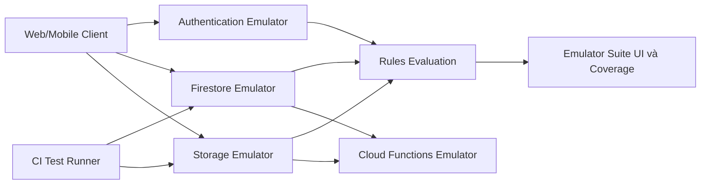
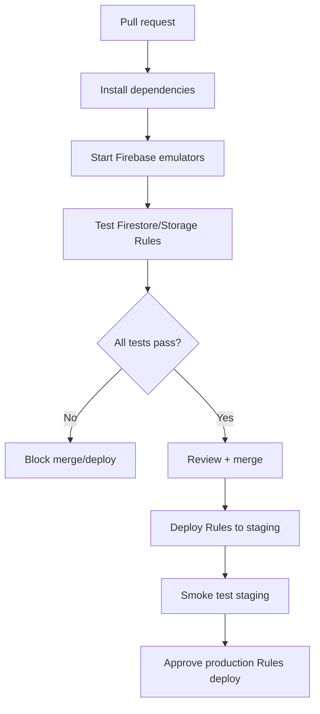

# Firebase Local Emulator Suite và kiểm thử Security Rules

Khi phát triển ứng dụng với Cloud Firestore, Realtime Database hoặc Cloud Storage for Firebase, kiểm thử tính năng chưa đủ: hệ thống phải bảo đảm người dùng không thể đọc, sửa hoặc xóa dữ liệu của người khác. **Firebase Security Rules** giúp thực thi các điều kiện truy cập ở phía dịch vụ cho request từ Firebase client SDK. **Firebase Local Emulator Suite** giúp chạy các dịch vụ giả lập trên máy phát triển hoặc trong CI để thử nghiệm những điều kiện này mà không tác động đến dữ liệu production.

Trong module `CLOUD_PROVIDERS_GCP`, người học khám phá Google Cloud từ cách tổ chức project, IAM và VPC đến Compute Engine, GKE, Cloud Run, dịch vụ lưu trữ và cơ sở dữ liệu. Qua các tình huống triển khai, người học biết lựa chọn dịch vụ, bảo vệ tài nguyên, tự động hóa phát hành và theo dõi độ tin cậy cùng chi phí. Firebase Emulator Suite bổ sung một vòng phản hồi nhanh cho các ứng dụng web/mobile và backend tích hợp GCP: test quyền truy cập trước khi deploy, kiểm tra kết hợp Authentication–Firestore–Storage và biến những yêu cầu bảo mật thành test chạy tự động.

Emulator là môi trường dành cho **development, prototyping và testing**, không phải phiên bản Firebase tự host dùng cho production. Các điểm khác biệt với dịch vụ thật cần được hiểu rõ; test chạy thành công ở emulator không đồng nghĩa tất cả chỉ mục, giới hạn, IAM hay hành vi thực tế đều đã được xác minh.

## Mục tiêu học tập

Sau bài học, người học có thể:

- Giải thích các thành phần Firebase Local Emulator Suite và cách chúng phối hợp để kiểm thử ứng dụng.
- Thiết lập project demo, Firebase CLI, `firebase.json`, `firestore.rules`, `storage.rules` và các emulator cần dùng.
- Phân biệt Firebase Security Rules với Google Cloud IAM và cách Admin SDK/server SDK truy cập dữ liệu.
- Viết Firestore Rules theo nguyên tắc *deny by default*, phân biệt get/list/create/update/delete, kiểm soát chủ sở hữu và schema.
- Dùng `@firebase/rules-unit-testing` kiểm thử tình huống anonymous, người sở hữu, người khác và truy vấn collection.
- Kiểm thử Storage Security Rules, cân nhắc Realtime Database Rules và giả lập Authentication.
- Chạy test bằng `firebase emulators:exec`, xem kết quả đánh giá rules và rule coverage report.
- Đưa test Security Rules vào CI/CD và phát hiện các giới hạn của emulator so với production.

## 1. Firebase Local Emulator Suite là gì?

### Mô hình hoạt động

Firebase Local Emulator Suite bao gồm các tiến trình giả lập cho một số sản phẩm Firebase/GCP. Ứng dụng có thể gọi emulator bằng Firebase SDK hoặc API được hỗ trợ thay vì gọi tài nguyên thật. Một số emulator phối hợp với nhau: Authentication cung cấp danh tính cho request; Firestore/Realtime Database/Cloud Storage đánh giá Security Rules; Cloud Functions có thể phản ứng với event phát sinh trong emulator.



### Những emulator thường gặp

| Emulator | Vai trò | Port mặc định thường dùng |
|---|---|---|
| Authentication | Giả lập đăng nhập, token và user để test luồng xác thực. | `9099` |
| Cloud Firestore | Đọc/ghi document, chạy query và đánh giá Firestore Security Rules. | `8080` |
| Realtime Database | Đọc/ghi dữ liệu JSON tree và đánh giá Realtime Database Rules. | `9000` |
| Cloud Storage for Firebase | Upload/download object và đánh giá Storage Security Rules. | `9199` |
| Cloud Functions | Chạy HTTP/background functions trong môi trường cục bộ. | `5001` |
| Firebase Hosting | Phục vụ web app cục bộ. | `5000` |
| Pub/Sub | Phục vụ một số workflow sự kiện trong emulator. | `8085` |
| Emulator Suite UI | Xem dữ liệu, log và quá trình đánh giá rules. | `4000` |

Port có thể thay đổi trong `firebase.json`. Không phải mọi sản phẩm Firebase đều có emulator hoặc hỗ trợ đầy đủ mọi tính năng. Những emulator đang ở trạng thái Preview/Beta có thể thay đổi hành vi; luôn kiểm tra tài liệu tương ứng của dịch vụ khi xây test.

### Chọn test nào dùng emulator?

| Loại kiểm thử | Công cụ phù hợp | Mục tiêu |
|---|---|---|
| Unit test business logic | Framework test của ngôn ngữ, mock/stub | Kiểm tra logic mà không cần mạng hay Firebase. |
| Security Rules unit test | `@firebase/rules-unit-testing` + emulator | Đảm bảo request được cho phép/từ chối theo actor và dữ liệu. |
| Integration test | SDK thật trỏ vào emulator | Kiểm tra luồng Auth → Firestore → Storage → Functions. |
| Smoke test môi trường thật | Firebase staging project có quyền và quota riêng | Xác minh cấu hình deploy, chỉ mục, IAM và khác biệt production. |

Không dùng Admin SDK để thay cho Security Rules unit test: Admin SDK thường truy cập tài nguyên qua IAM và **bỏ qua Firebase Security Rules**. Test rules phải tạo request giống client SDK để rules được thực thi.

## 2. Chuẩn bị môi trường và project demo

### Công cụ cần có

Một môi trường thử nghiệm phổ biến gồm:

- Node.js phiên bản được Firebase CLI và Firebase JS SDK hỗ trợ.
- Firebase CLI (`firebase-tools`) và trình quản lý package `npm`.
- Java Runtime/JDK tương thích khi dùng emulator phụ thuộc Java, chẳng hạn Firestore hoặc Realtime Database.
- Trình soạn thảo để quản lý các file rules và JavaScript test.
- Port cục bộ chưa bị dịch vụ khác chiếm dụng.

Ví dụ cài CLI và thư viện test trong một project Node.js (không chạy các lệnh này trên máy production):

```bash
npm init -y
npm install --save-dev firebase-tools @firebase/rules-unit-testing
npm install firebase

npx firebase --version
```

Trong ví dụ, `firebase` là Firebase JavaScript Client SDK, dùng để phát ra request mà Security Rules phải đánh giá. `@firebase/rules-unit-testing` tạo ngữ cảnh người dùng giả và cung cấp assertion test. `firebase-tools` giúp bật/tắt emulator theo vòng đời CI. Nên khóa dependency bằng lockfile, cập nhật chúng theo lịch và kiểm thử khi nâng cấp Firebase CLI.

### Vì sao nên dùng project `demo-*`?

Firebase hỗ trợ **demo projects** có project ID bắt đầu bằng `demo-`, ví dụ `demo-rules-lab`. Demo project không có tài nguyên Firebase thật. Nếu mã vô tình gọi một dịch vụ chưa được emulated, request sẽ lỗi thay vì sửa dữ liệu production. Đây là lớp bảo vệ hữu ích cho test môi trường local và CI.

Nếu dùng project ID thật để chạy emulator, một SDK chưa được cấu hình kết nối emulator có thể vẫn gọi tài nguyên live của project đó. Vì vậy, không dùng credential production, project production hay data thật trong security tests. Giữ project ID nhất quán giữa Firebase CLI, ứng dụng, Auth emulator, Firestore emulator và các unit tests.

### Cấu hình `firebase.json`

Ví dụ cấu hình chủ động chỉ rõ file rules và port:

```json
{
  "firestore": {
    "rules": "firestore.rules"
  },
  "storage": {
    "rules": "storage.rules"
  },
  "emulators": {
    "auth": { "host": "127.0.0.1", "port": 9099 },
    "firestore": { "host": "127.0.0.1", "port": 8080 },
    "storage": { "host": "127.0.0.1", "port": 9199 },
    "ui": { "enabled": true, "port": 4000 }
  }
}
```

Lưu file cùng thư mục với `firestore.rules`, `storage.rules` và `package.json`. Có thể dùng `firebase init emulators` để cấu hình nhanh, sau đó review các file được CLI tạo. Nếu kiểm thử Realtime Database, thêm trường `database.rules` và emulator `database` vào cấu hình.

**Cảnh báo:** Nếu không cấu hình đường dẫn rules và cũng không nạp rules bằng testing API, emulator Firestore/Realtime Database/Storage có thể chạy với quy tắc mở. Vì vậy, test thành công khi rules chưa được nạp là kết quả không đáng tin cậy. CI nên xác minh file rules có tồn tại và được đọc thành công.

### Cấu hình project ID khi chạy

Có thể chỉ định project demo trực tiếp trong lệnh:

```bash
npx firebase emulators:start \
  --only auth,firestore,storage \
  --project demo-rules-lab
```

Emulator Suite UI thường truy cập tại `http://127.0.0.1:4000`. Với cách chạy tương tác, tiến trình tồn tại cho tới khi người dùng dừng. Với CI hoặc test script, nên dùng `emulators:exec` để CLI tự bật emulator, chạy test và dừng emulator khi xong.

### Tránh mở emulator ra mạng công cộng

Emulator được thiết kế cho phát triển và không cung cấp bảo đảm bảo mật như dịch vụ production. Giữ host `127.0.0.1` nếu test chỉ chạy trong một máy. Nếu chạy trong Docker hoặc runner nhiều container, cấu hình mạng nội bộ và giới hạn cổng thay vì công bố endpoint ra Internet.

## 3. Hiểu Firebase Security Rules

### Firebase Security Rules khác với IAM

Firebase Security Rules là chính sách dành cho truy cập từ Firebase client SDK vào Firestore, Realtime Database và Cloud Storage for Firebase. Rules có thể dựa vào `request.auth`, đường dẫn, nội dung dữ liệu cũ/mới, loại thao tác và metadata để quyết định một request được phép hay không.

Google Cloud IAM quản lý quyền truy cập hạ tầng và các API phía server. Ứng dụng Java/Spring Boot dùng Google Cloud Firestore server SDK hoặc Firebase Admin SDK thường được xác thực bằng service account/IAM và **không chịu kiểm soát của Firebase Security Rules**. Phải thiết kế authorization của backend riêng, ví dụ kiểm tra token người dùng trong API, xác minh role từ nguồn tin cậy và giới hạn IAM cho service account.

| Client / đường truy cập | Kiểm tra truy cập chính |
|---|---|
| Firebase Web/Android/iOS SDK gọi Firestore | Firestore Security Rules. |
| Firebase Web/Android/iOS SDK gọi Storage for Firebase | Storage Security Rules. |
| Firebase Client SDK gọi Realtime Database | Realtime Database Security Rules. |
| Java/Spring Boot dùng Firestore server client, Admin SDK hoặc REST với server credential | Google Cloud IAM và authorization do backend xây dựng; không dựa vào Firebase Security Rules. |

Không diễn giải rằng một test rules đã bảo vệ toàn bộ backend Cloud Run hoặc GKE. Nếu service account của backend có quyền rộng, request qua backend cần được kiểm tra quyền người dùng độc lập.

### Deny by default

Định hướng an toàn là mặc định từ chối, sau đó mở đúng thao tác và actor. Tránh quy tắc thử nghiệm như:

```text
allow read, write: if true;
```

Đây là cấu hình cho phép bất kỳ client nào đọc/ghi dữ liệu phù hợp với path. Không deploy vào môi trường chứa dữ liệu thật. Tương tự, `request.auth != null` chỉ xác định đã đăng nhập, không chứng minh người đó được xem dữ liệu của người khác.

### Các biến dữ liệu quan trọng trong Firestore Rules

- `request.auth`: thông tin đăng nhập; có `uid` và `token` (custom claims) nếu đã xác thực.
- `resource.data`: dữ liệu document hiện tại trước khi thao tác cập nhật/xóa, hoặc được truy vấn khi đọc.
- `request.resource.data`: trạng thái document mới mà thao tác create/update muốn ghi.
- `request.query`: thông tin về truy vấn, ví dụ giới hạn số document.
- `get()` và `exists()`: đọc document khác trong Security Rules theo giới hạn truy cập rules.

Không tin `ownerId`, `role` hoặc `isAdmin` do client gửi nếu không đối chiếu với `request.auth.uid`, custom claims do server cấp hoặc document quyền từ nguồn tin cậy.

## 4. Ví dụ Firestore Security Rules: ghi chú cá nhân

### Yêu cầu nghiệp vụ

Một ứng dụng cho người dùng lưu ghi chú ở collection `notes`. Mỗi document gồm `ownerId` và `title`:

```json
{
  "ownerId": "alice",
  "title": "Lịch họp nhóm"
}
```

Quy định:

1. Chỉ chủ sở hữu đọc ghi chú của mình.
2. Người chưa đăng nhập không được đọc hoặc ghi.
3. Người tạo phải đặt `ownerId` trùng Firebase Auth UID của chính mình.
4. Chủ sở hữu được sửa `title`, nhưng không thể chuyển `ownerId` sang người khác.
5. Chỉ nhận đúng hai field `ownerId` và `title`; title là chuỗi không rỗng, tối đa 120 ký tự.

### File `firestore.rules`

```javascript
rules_version = '2';
service cloud.firestore {
  match /databases/{database}/documents {
    match /notes/{noteId} {
      function signedIn() {
        return request.auth != null;
      }

      function isOwner() {
        return signedIn() && resource.data.ownerId == request.auth.uid;
      }

      function validNote() {
        return request.resource.data.keys().hasAll(['ownerId', 'title'])
          && request.resource.data.keys().hasOnly(['ownerId', 'title'])
          && request.resource.data.title is string
          && request.resource.data.title.size() > 0
          && request.resource.data.title.size() <= 120
          && request.resource.data.ownerId == request.auth.uid;
      }

      allow get, list: if isOwner();
      allow create: if signedIn() && validNote();
      allow update: if isOwner()
        && validNote()
        && request.resource.data.ownerId == resource.data.ownerId;
      allow delete: if isOwner();
    }
  }
}
```

Giải thích:

- `match /notes/{noteId}` chỉ bao phủ các document ở collection `notes`, không tự cấp quyền cho các subcollection.
- `allow get` áp dụng khi đọc một document cụ thể.
- `allow list` áp dụng khi query/list collection.
- `allow create` kiểm tra document mới và UID của người tạo.
- `allow update` kiểm tra cả dữ liệu cũ lẫn dữ liệu sau cập nhật để ngăn chuyển chủ sở hữu.
- `allow delete` chỉ cho phép chủ sở hữu xóa document.
- `rules_version = '2'` sử dụng cú pháp Rules hiện đại, cần cân nhắc khi làm việc với recursive wildcard và collection group queries.

Các hàm `signedIn`, `isOwner`, `validNote` giúp giảm trùng lặp. Mặc dù `validNote` đọc `request.auth.uid`, nó chỉ được gọi trong nhánh create/update đã xác minh actor đăng nhập qua biểu thức `&&` trước đó. Với ứng dụng nhiều trường, nên tách logic validation schema rõ ràng hơn và viết test cho từng trường hợp biên.

### Firestore Rules không phải bộ lọc dữ liệu

Một query không tự động lọc các document mà người dùng không được phép đọc. Nếu rule cho phép đọc chỉ khi `resource.data.ownerId == request.auth.uid`, client phải truy vấn có điều kiện đảm bảo mọi kết quả đều thuộc user đó:

```javascript
import { collection, getDocs, query, where } from 'firebase/firestore';

const mine = query(
  collection(db, 'notes'),
  where('ownerId', '==', auth.currentUser.uid)
);

const result = await getDocs(mine);
```

Gọi `getDocs(collection(db, 'notes'))` không có filter sẽ bị từ chối vì truy vấn có thể trả về document của người khác. Test phải bao gồm cả hai tình huống. Đồng thời, query đúng rules vẫn có thể cần index trong Firestore production; emulator không thực thi đầy đủ các yêu cầu index như dịch vụ thật.

## 5. Viết unit test Security Rules bằng Node.js

### API kiểm thử hiện đại

Package `@firebase/rules-unit-testing` cung cấp những API chính:

| API | Mục đích |
|---|---|
| `initializeTestEnvironment()` | Tạo môi trường test kết nối emulator và có thể nạp rules. |
| `authenticatedContext(uid, tokenOptions)` | Giả lập actor đã đăng nhập, có thể thêm custom claims. |
| `unauthenticatedContext()` | Giả lập request chưa đăng nhập. |
| `withSecurityRulesDisabled()` | Ghi dữ liệu test fixture mà không bị rules chặn. Chỉ dùng để chuẩn bị dữ liệu, không dùng khi assert quyền. |
| `assertSucceeds(promise)` | Xác minh thao tác được phép. |
| `assertFails(promise)` | Xác minh thao tác bị từ chối vì Security Rules. |
| `clearFirestore()` | Xóa dữ liệu Firestore của project test để tránh ảnh hưởng giữa các case. |
| `cleanup()` | Dọn các test contexts và tài nguyên client khi hoàn tất. |

Thư viện test sử dụng Firebase Client SDK bên dưới để phát request giống client. Nó chỉ hoạt động nếu emulator tương ứng đang chạy, không tự khởi động emulator.

### File kiểm thử `tests/firestore.rules.test.mjs`

Ví dụ sau dùng Node.js built-in test runner. File `firebase.json` và `firestore.rules` đặt ở root; test được chạy từ root project. Test dùng những API Firebase JS modular hiện đại và một project demo nhất quán.

```javascript
import { readFileSync } from 'node:fs';
import { before, after, beforeEach, test } from 'node:test';
import {
  initializeTestEnvironment,
  assertSucceeds,
  assertFails
} from '@firebase/rules-unit-testing';
import {
  doc, collection, query, where,
  setDoc, getDoc, updateDoc, deleteDoc, getDocs
} from 'firebase/firestore';

let env;

before(async () => {
  env = await initializeTestEnvironment({
    projectId: 'demo-rules-lab',
    firestore: {
      host: '127.0.0.1',
      port: 8080,
      rules: readFileSync('firestore.rules', 'utf8')
    }
  });
});

beforeEach(async () => {
  await env.clearFirestore();
});

after(async () => {
  if (env) await env.cleanup();
});

async function seedNote(id, ownerId) {
  await env.withSecurityRulesDisabled(async (context) => {
    await setDoc(doc(context.firestore(), 'notes', id), {
      ownerId,
      title: 'Bản ghi thử nghiệm'
    });
  });
}

test('chủ sở hữu được đọc và sửa title', async () => {
  await seedNote('note-1', 'alice');
  const db = env.authenticatedContext('alice').firestore();
  const noteRef = doc(db, 'notes', 'note-1');

  await assertSucceeds(getDoc(noteRef));
  await assertSucceeds(updateDoc(noteRef, { title: 'Đã cập nhật' }));
});

test('người chưa đăng nhập không đọc được ghi chú', async () => {
  await seedNote('note-1', 'alice');
  const db = env.unauthenticatedContext().firestore();

  await assertFails(getDoc(doc(db, 'notes', 'note-1')));
});

test('bob không đọc hoặc xóa được ghi chú của alice', async () => {
  await seedNote('note-1', 'alice');
  const db = env.authenticatedContext('bob').firestore();
  const noteRef = doc(db, 'notes', 'note-1');

  await assertFails(getDoc(noteRef));
  await assertFails(deleteDoc(noteRef));
});

test('alice được tạo đúng ownerId, bob không mạo danh alice', async () => {
  const alice = env.authenticatedContext('alice').firestore();
  const bob = env.authenticatedContext('bob').firestore();

  await assertSucceeds(setDoc(doc(alice, 'notes', 'new-1'), {
    ownerId: 'alice', title: 'Hợp lệ'
  }));
  await assertFails(setDoc(doc(bob, 'notes', 'new-2'), {
    ownerId: 'alice', title: 'Mạo danh'
  }));
});

test('chủ sở hữu không đổi ownerId hoặc thêm field lạ', async () => {
  await seedNote('note-1', 'alice');
  const alice = env.authenticatedContext('alice').firestore();
  const noteRef = doc(alice, 'notes', 'note-1');

  await assertFails(updateDoc(noteRef, { ownerId: 'bob' }));
  await assertFails(updateDoc(noteRef, { isAdmin: true }));
});

test('query phải giới hạn theo ownerId', async () => {
  await seedNote('note-1', 'alice');
  await seedNote('note-2', 'bob');
  const alice = env.authenticatedContext('alice').firestore();

  const mine = query(collection(alice, 'notes'), where('ownerId', '==', 'alice'));
  await assertSucceeds(getDocs(mine));
  await assertFails(getDocs(collection(alice, 'notes')));
});
```

Các test phía trên chủ động thêm **negative cases**. Nếu chỉ thử owner đọc được dữ liệu, một rule mở cho mọi người cũng có thể khiến test pass. Ngược lại, nếu chỉ thử request bị từ chối, một rule cấm tất cả cũng sẽ pass. Bộ test phải kiểm chứng cả quyền được phép và quyền bị từ chối.

### Tại sao phải clear dữ liệu?

Emulator thường giữ dữ liệu trong bộ nhớ suốt thời gian tiến trình hoạt động. Nếu test trước tạo document và test sau phụ thuộc vào ID đó, kết quả có thể thay đổi khi đổi thứ tự hoặc chạy lại suite. `clearFirestore()` làm các test độc lập hơn. Dùng `await` cho mọi thao tác setup/assert/cleanup để tránh race condition.

Node test runner mặc định chạy các test trong cùng file theo thứ tự nếu không bật concurrency riêng. Nếu bật chạy song song hoặc có nhiều file test dùng cùng project ID, các lần `clearFirestore()` có thể xóa fixture của nhau. Khi cần song song, tách project ID/namespace cho mỗi worker hoặc serialize các test thao tác cùng một emulator dataset.

## 6. Giả lập Authentication và custom claims

### Mock Auth cho unit test rules

`authenticatedContext('alice')` tạo context có `request.auth.uid == 'alice'` khi Firestore/Storage evaluate Rules. Không cần thực hiện đăng nhập email/password thực tế để kiểm thử logic phân quyền. `unauthenticatedContext()` tạo context không có Auth token, cho phép thử trường hợp anonymous.

Có thể thêm custom claims qua `tokenOptions` để kiểm thử role:

```javascript
const editor = env.authenticatedContext('alice', { role: 'editor' });
const viewer = env.authenticatedContext('bob', { role: 'viewer' });
```

Rules có thể xét `request.auth.token.role`, nhưng trong production custom claims phải được thiết lập bởi backend có quyền thích hợp. Không tin role do client gửi trong document nếu không xác minh bởi nguồn được kiểm soát. Unit testing library cố ý cho phép mock claims để kiểm tra các nhánh rules; tính năng đó không có nghĩa client production có thể tự thay đổi token tùy ý.

### Authentication Emulator cho integration test

Authentication emulator mô phỏng luồng tạo user, đăng nhập và phát hành token trong môi trường local. Khi kiểm thử ứng dụng web chạy thực tế, cấu hình Auth SDK kết nối `http://127.0.0.1:9099`. Firestore/Storage emulator có thể nhận token từ Auth emulator khi cùng project ID.

Phân biệt hai kiểu test:

- Rules unit test: dùng `authenticatedContext` để dựng `request.auth` nhanh, không cần mô phỏng toàn bộ login flow.
- App integration test: dùng Auth emulator và client SDK để kiểm tra đăng nhập, trạng thái người dùng và thao tác dữ liệu xuyên dịch vụ.

Không dùng Auth emulator token trong production. Không đưa thông tin xác thực production hay dữ liệu người dùng thật vào môi trường local.

## 7. Kết nối Firebase Client SDK với emulator

### Ví dụ Web SDK

Trong code chỉ dành cho local/dev/test, kết nối SDK tới các emulator **trước khi** thực hiện request đầu tiên:

```javascript
import { initializeApp } from 'firebase/app';
import { getAuth, connectAuthEmulator } from 'firebase/auth';
import { getFirestore, connectFirestoreEmulator } from 'firebase/firestore';
import { getStorage, connectStorageEmulator } from 'firebase/storage';

const app = initializeApp({
  apiKey: 'demo-api-key',
  authDomain: 'demo-rules-lab.firebaseapp.com',
  projectId: 'demo-rules-lab',
  appId: 'demo-app'
});

const auth = getAuth(app);
const db = getFirestore(app);
const storage = getStorage(app, 'gs://demo-rules-lab.firebasestorage.app');

if (import.meta.env?.DEV) {
  connectAuthEmulator(auth, 'http://127.0.0.1:9099');
  connectFirestoreEmulator(db, '127.0.0.1', 8080);
  connectStorageEmulator(storage, '127.0.0.1', 9199);
}
```

Đoạn code minh họa một ứng dụng bundler có `import.meta.env.DEV` (ví dụ Vite). Với Node.js hoặc bundler khác, dùng cơ chế phân biệt môi trường phù hợp thay vì chép nguyên biến này. Trong cấu hình release production, phải bảo đảm nhánh emulator không được kích hoạt.

`127.0.0.1` là máy đang chạy ứng dụng. Trong Android emulator, địa chỉ máy host thường là `10.0.2.2`; trong Docker/Kubernetes, cần dùng DNS/network được cấu hình để truy cập container emulator. Không dùng host local nếu thiết bị thử nghiệm ở một máy khác.

### Biến môi trường cho server SDK

Một số Google Cloud server SDK hoặc Firebase Admin SDK hỗ trợ environment variables để kết nối emulator. Ví dụ Firestore Java/Node server SDK có thể sử dụng:

```bash
export FIRESTORE_EMULATOR_HOST=127.0.0.1:8080
```

Biến không có tiền tố `http://`. Các Firebase emulator khác có biến môi trường riêng, ví dụ `FIREBASE_AUTH_EMULATOR_HOST`. Tuy nhiên, **request từ server SDK/Admin SDK thường bỏ qua Security Rules**, kể cả khi trỏ vào emulator. Dùng chúng để kiểm thử logic backend và workflow, không dùng làm bằng chứng rules đã từ chối một user.

## 8. Cloud Storage for Firebase Security Rules

### Storage rules khác Firestore rules thế nào?

Cloud Storage for Firebase tổ chức dữ liệu theo bucket và object path, không phải collection/document. Storage Rules có thể dựa vào path, Firebase Auth, kích thước upload và metadata như `contentType`. Dùng rules để hạn chế người nào có thể upload, đọc, thay thế hoặc xóa file.

Ví dụ yêu cầu: user chỉ được upload và đọc ảnh trong thư mục của chính họ, file ảnh có kích thước dưới 5 MiB.

### File `storage.rules`

```javascript
rules_version = '2';
service firebase.storage {
  match /b/{bucket}/o {
    match /users/{userId}/{fileName} {
      function isOwner() {
        return request.auth != null && request.auth.uid == userId;
      }

      allow read: if isOwner();
      allow create, update: if isOwner()
        && request.resource.size < 5 * 1024 * 1024
        && request.resource.contentType.matches('image/.*');
      allow delete: if isOwner();
    }
  }
}
```

Đây là quy tắc minh họa cho object nằm trực tiếp dưới `/users/{userId}/`. Nếu cần subfolder nhiều cấp, phải thiết kế match path phù hợp và kiểm thử recursive wildcard cẩn thận. Rules chỉ cho phép đọc/ghi file đúng UID và loại MIME phù hợp theo metadata client cung cấp.

**Lưu ý bảo mật:** `contentType` là metadata do client có thể khai báo; rules kiểm tra chuỗi metadata không đảm bảo nội dung file thực sự là ảnh sạch hoặc không độc hại. Với file upload nhạy cảm, cần kiểm tra ở backend, quét file, giới hạn download và triển khai quy trình xử lý malware/content validation độc lập.

### Test matrix cho Storage Rules

| Actor | Thao tác | Đường dẫn | Kỳ vọng |
|---|---|---|---|
| Alice đã đăng nhập | Upload PNG dưới 5 MiB | `/users/alice/avatar.png` | Được phép. |
| Bob đã đăng nhập | Download file của Alice | `/users/alice/avatar.png` | Bị từ chối. |
| Anonymous | Upload file | `/users/alice/avatar.png` | Bị từ chối. |
| Alice đã đăng nhập | Upload file trên 5 MiB | `/users/alice/big.png` | Bị từ chối. |
| Alice đã đăng nhập | Upload text với contentType `text/plain` | `/users/alice/report.txt` | Bị từ chối. |
| Alice đã đăng nhập | Xóa file của mình | `/users/alice/avatar.png` | Được phép. |

Sử dụng `initializeTestEnvironment` với `storage: { host, port, rules }`, rồi tạo context `.storage()` của Alice/Bob/anonymous để gửi request bằng Firebase Storage Client SDK. Dùng `assertSucceeds`/`assertFails` với Promise upload/download/delete tương ứng. Khi chuẩn bị dữ liệu, `withSecurityRulesDisabled` giúp tạo fixture không phụ thuộc vào quy tắc đang thử.

## 9. Realtime Database Rules

Realtime Database lưu dữ liệu dạng JSON tree và sử dụng cú pháp rule khác với Firestore hoặc Storage. Nếu hệ thống có Realtime Database, cần thêm `database.rules.json` trong `firebase.json` và chạy emulator `database` ở port 9000.

Ví dụ chỉ cho người dùng đọc/ghi hồ sơ thuộc UID của họ:

```json
{
  "rules": {
    "profiles": {
      "$uid": {
        ".read": "auth != null && auth.uid === $uid",
        ".write": "auth != null && auth.uid === $uid",
        ".validate": "newData.hasChildren(['displayName']) && newData.child('displayName').isString()"
      }
    }
  }
}
```

Trong Realtime Database, `.read`, `.write` và `.validate` có vai trò riêng. Validation không phải lúc nào cũng áp dụng giống thao tác ghi, đặc biệt xóa dữ liệu. Cần viết test cho create, update, partial update, delete, query và các trường hợp dữ liệu thiếu hoặc sai kiểu. Không sao chép Rules syntax từ Firestore sang Realtime Database vì tên biến và cách đánh giá khác nhau.

## 10. Chạy test tự động bằng `emulators:exec`

### Chạy tương tác

Để quan sát thủ công trên Emulator Suite UI:

```bash
npx firebase emulators:start \
  --only auth,firestore,storage \
  --project demo-rules-lab
```

Khi emulator đang chạy, có thể mở UI và chạy test ở terminal khác:

```bash
node --test
```

Node tìm file test có tên phù hợp như `tests/firestore.rules.test.mjs`. Đảm bảo Node.js phiên bản đang dùng hỗ trợ built-in test runner.

### Chạy trong CI

Lệnh sau bật các emulator được chỉ định, chạy test rồi tắt chúng:

```bash
npx firebase emulators:exec \
  --only auth,firestore,storage \
  --project demo-rules-lab \
  "node --test"
```

`emulators:exec` trả về mã thoát của lệnh test; pipeline phải fail nếu test fail. Không nên cho bước deploy Rules tiếp tục khi unit tests thất bại.

Ví dụ script trong `package.json`:

```json
{
  "scripts": {
    "test:rules": "firebase emulators:exec --only auth,firestore,storage --project demo-rules-lab \"node --test\""
  }
}
```

Trong CI, cài dependency từ lockfile (ví dụ `npm ci`) rồi chạy `npm run test:rules`. Nếu project có nhiều test suite, có thể dùng Mocha/Jest/Vitest thay cho Node built-in runner, nhưng phải bảo đảm mọi test Promise được `await` và môi trường emulator được dọn dẹp.

### Ví dụ mô hình pipeline



Không dùng project production làm nơi test để tránh dữ liệu thật. Chỉ deploy rules từ mã nguồn đã được review và đã qua unit tests; môi trường staging phải có dữ liệu giả lập và quyền thử nghiệm phù hợp.

## 11. Xem rule coverage và debug

### Request evaluation trong Emulator UI

Firestore Emulator có giao diện xem request và quá trình đánh giá Rules. Khi một request bị từ chối ngoài dự kiến:

1. Xác định actor (`request.auth.uid`) và custom claims được mock.
2. Xem operation là `get`, `list`, `create`, `update` hay `delete`.
3. Kiểm tra document path và dữ liệu `resource.data`/`request.resource.data`.
4. Xem biểu thức nào đánh giá thành `false` hoặc thiếu dữ liệu.
5. Đối chiếu với testcase và viết thêm negative case cho trường hợp chưa bao phủ.

### Firestore rule coverage report

Khi Firestore Emulator đang chạy ở port 8080, có thể mở báo cáo HTML:

```text
http://127.0.0.1:8080/emulator/v1/projects/demo-rules-lab:ruleCoverage.html
```

Hoặc dữ liệu JSON:

```text
http://127.0.0.1:8080/emulator/v1/projects/demo-rules-lab:ruleCoverage
```

Report thể hiện số lần biểu thức rules được đánh giá và giá trị trả về, hỗ trợ phát hiện nhánh chưa có test. Với Realtime Database emulator, endpoint coverage có dạng `/.inspect/coverage?ns=DATABASE_NAME` hoặc `/.inspect/coverage.json?ns=DATABASE_NAME`.

Coverage cao không tự chứng minh rules đúng; ví dụ rules quá rộng có thể được chạy thường xuyên nhưng vẫn không ngăn data leak. Kết hợp coverage với test matrix có cả expected allowed/denied. Khi dùng `emulators:exec`, emulator sẽ dừng ngay sau khi script kết thúc; muốn lấy report trong CI, cần tải report **trước** khi emulator dừng hoặc chạy một script đồng thời với test runner.

## 12. Những giới hạn của emulator so với production

Emulator mô phỏng nhiều hành vi Firebase nhưng không cung cấp bản sao đầy đủ của dịch vụ production.

### Cloud Firestore

- **Indexes:** Emulator có thể chạy một truy vấn mà production đòi composite index. Test staging/production phải xác nhận index cần thiết.
- **Transactions:** Locking và xử lý transaction đồng thời khác production; một số thao tác có thể đợi lâu trong emulator.
- **Limits:** Emulator không áp dụng tất cả giới hạn request, kích thước transaction hoặc hành vi quota của production.
- **Performance/latency:** Tốc độ local không đo được latency network thực tế, khả năng mở rộng hoặc chi phí.
- **Multiple databases:** Emulator có hỗ trợ named database nhưng UI và một số hành vi cấu hình có giới hạn; cần đối chiếu theo phiên bản Firebase CLI.

### Authentication, Storage và Functions

- Authentication emulator giúp mô phỏng identity nhưng không thay thế kiểm thử luồng xác minh của nhà cung cấp OAuth ngoài đời thực.
- Storage emulator hỗ trợ kiểm thử rules nhưng không đại diện đầy đủ cho mọi tính năng vận hành và bảo mật của Cloud Storage production.
- Functions emulator hữu ích cho event-driven integration, nhưng timeout, quota, concurrency và behavior của dịch vụ Google Cloud thật cần được kiểm tra riêng.
- Một số SDK hoặc API không được trỏ vào emulator có thể gọi tài nguyên thật nếu dùng project ID thật. Dùng demo project để giảm nguy cơ.

### IAM, backend Java và Spring Boot

Firebase Security Rules test không đánh giá IAM của Cloud Run, GKE, service account hay quyền Cloud Storage IAM. Nếu backend Java/Spring Boot dùng Firebase Admin SDK hoặc Google Cloud client libraries, emulator có thể giúp test dữ liệu và sự kiện, nhưng không chứng minh backend đã chặn người dùng trái phép. Cần test authorization của REST API và môi trường GCP staging với IAM thật.

## 13. Chiến lược kiểm thử Security Rules toàn diện

### Ma trận quyền truy cập

Một thiết kế tốt bắt đầu bằng bảng actor × operation × resource × expected result:

| Actor | Resource | Get | List/query | Create | Update | Delete |
|---|---|---|---|---|---|---|
| Anonymous | `/notes/n1` | Deny | Deny | Deny | Deny | Deny |
| Alice (owner) | Ghi chú của Alice | Allow | Allow nếu query đúng | Allow với dữ liệu hợp lệ | Allow khi giữ nguyên ownerId | Allow |
| Bob (non-owner) | Ghi chú của Alice | Deny | Deny nếu query yêu cầu dữ liệu Alice | Deny mạo danh Alice | Deny | Deny |
| Alice | Ghi chú có field ngoài schema | — | — | Deny | Deny | — |

Đặc biệt kiểm thử **đường đi biên** như thiếu `request.auth`, field `ownerId` không tồn tại, `title` null, kiểu dữ liệu khác string, title rỗng, title quá dài, query thiếu filter, thao tác batch và truy cập subcollection không được dự định.

### Bất biến bảo mật nên test

Với ứng dụng nhiều người dùng, một số invariant thường gặp:

1. Không user nào có thể đọc dữ liệu của user khác nếu không có quyền rõ ràng.
2. Client không thể tự cấp role hoặc thay đổi trường phân quyền do server quản lý.
3. Không thể tạo document với chủ sở hữu khác UID đã xác thực.
4. Không thể dùng query không giới hạn để lấy toàn bộ dữ liệu khi mỗi user chỉ được thấy bản ghi của mình.
5. File upload phải tuân theo giới hạn path, kích thước và metadata đã định nghĩa.
6. Rules mặc định deny đối với collection/path chưa được định nghĩa.
7. Khi thêm collection mới hoặc thay schema, test phải cập nhật cùng rules.

### Đừng dùng fixture bypass làm assertion

`withSecurityRulesDisabled` cần thiết khi setup dữ liệu mà client bình thường không thể tạo trực tiếp, chẳng hạn fixture đại diện cho document của user khác. Nhưng nếu đặt cả thao tác cần kiểm thử bên trong callback bypass, test sẽ không còn xác minh Security Rules. Hãy seed dữ liệu bằng bypass rồi tạo authenticated/unauthenticated context cho hành động thật.

### Nhất quán giữa test và cấu hình deploy

File rules mà test đọc phải là file được cấu hình trong `firebase.json` để deploy. Nếu CI thử `test.rules` nhưng pipeline deploy `firestore.rules` khác, kết quả kiểm thử không bảo vệ đúng chính sách đang triển khai. Khi rules phức tạp, có thể dùng script sinh rules từ template, nhưng output cuối cùng phải được kiểm thử và version-control cùng code.

## 14. Từ emulator tới staging và production

### Vòng đời đề xuất

1. Thiết kế rules theo nguyên tắc deny by default và viết test matrix.
2. Viết `firestore.rules`, `storage.rules`, và test cùng pull request.
3. Chạy `firebase emulators:exec` trong CI. Pipeline fail nếu có positive/negative test sai.
4. Review thay đổi Rules như thay đổi security-sensitive code.
5. Deploy rules vào **Firebase staging project thật** với dữ liệu giả và IAM tách production.
6. Smoke test client SDK, Auth, Firestore/Storage indexes, network và các integration mà emulator không mô phỏng đầy đủ.
7. Sau phê duyệt mới deploy production; theo dõi tỷ lệ permission-denied và hành vi người dùng.
8. Có quy trình rollback rules hoặc phát hành bản sửa khẩn cấp nếu khóa nhầm người dùng hợp lệ.

### Deploy rules có chọn lọc

Khi quy trình đã được kiểm soát và xác minh project đích, Firebase CLI hỗ trợ deploy riêng rules:

```bash
# Trỏ tới project staging thật trước khi chạy.
firebase deploy --only firestore:rules --project STAGING_PROJECT_ID

firebase deploy --only storage --project STAGING_PROJECT_ID
```

Lệnh này là ví dụ thao tác **thật** trên cloud, không thuộc phần test offline. Không chạy deploy vào production trước khi kiểm tra project ID, quyền và kết quả test. Với nhiều Firestore database trong cùng project, cần kiểm tra cấu hình `firebase.json` và các target database để tránh deploy rules nhầm scope.

### Quan sát sau phát hành

Theo dõi lỗi permission-denied trong client, logs của backend và trải nghiệm người dùng. Một rules change có thể chặn query cũ hoặc làm ứng dụng lỗi ngay sau deploy dù unit tests xanh. Trước khi mở quyền để “sửa nhanh”, cần xem lại rule path, actor, claim, schema và truy vấn thực tế; tránh nới lỏng thành `allow read, write: if true`.

## 15. Tình huống thực hành: ứng dụng ghi chú nhiều người dùng

### Bài toán

Một ứng dụng web dùng Firebase Authentication và Cloud Firestore. Mỗi người dùng có thể tạo, đọc, sửa và xóa ghi chú của chính mình. Ảnh đính kèm được lưu trong Cloud Storage for Firebase theo prefix UID. Backend Spring Boot có thể xử lý nghiệp vụ nâng cao nhưng không được vô tình bỏ qua authorization.

### Thiết kế test cần có

| Test ID | Tình huống | Kỳ vọng |
|---|---|---|
| F01 | Alice tạo ghi chú `ownerId=alice` | Allow |
| F02 | Bob tạo ghi chú `ownerId=alice` | Deny |
| F03 | Anonymous đọc ghi chú của Alice | Deny |
| F04 | Alice sửa title ghi chú của mình | Allow |
| F05 | Alice cập nhật `ownerId=bob` | Deny |
| F06 | Bob xóa ghi chú của Alice | Deny |
| F07 | Alice truy vấn với `where('ownerId','==','alice')` | Allow |
| F08 | Alice truy vấn collection mà không có filter | Deny |
| S01 | Alice upload ảnh của Alice dưới giới hạn | Allow |
| S02 | Bob tải ảnh của Alice | Deny |
| S03 | Alice upload file sai contentType | Deny |
| S04 | Anonymous upload ảnh | Deny |

Sau khi test pass, chạy web app trỏ vào emulator, kiểm tra Auth login flow, lưu ghi chú và upload ảnh. Dùng Emulator UI để xem document, request và rules trace. Sau đó test ở Firebase staging project nhằm phát hiện khác biệt về index, IAM và những tính năng bên ngoài emulator.

## 16. Troubleshooting

| Triệu chứng | Nguyên nhân thường gặp | Cách kiểm tra |
|---|---|---|
| Test `ECONNREFUSED` | Emulator chưa chạy hoặc sai host/port. | Kiểm tra `firebase emulators:exec`, port `8080/9199`, project ID và firewall. |
| Test nào cũng được cho phép | Chưa load rules; emulator đang chạy open rules hoặc test dùng bypass/Admin SDK. | Kiểm tra `firebase.json`, `initializeTestEnvironment({ rules })` và context SDK đang dùng. |
| Test nào cũng bị từ chối | Rules deny-all, sai path, thiếu auth hoặc chưa tạo fixture. | Kiểm tra rule trace, `request.auth`, document path và setup data. |
| Query bị `permission-denied` | Query thiếu điều kiện mà Rules yêu cầu hoặc query không được chứng minh an toàn. | Bổ sung `where`, kiểm tra `list` rule và test với SDK. |
| Test không ổn định | Thiếu `await`, nhiều test dùng chung dataset hoặc context chưa cleanup. | Dùng `clearFirestore()`, `await`, chạy tuần tự hoặc project ID riêng. |
| Auth user không được nhận ra | Project ID của SDK khác CLI; Auth SDK không trỏ emulator. | Đồng bộ project ID và kết nối Auth emulator trước request. |
| Storage test gửi request tới production | Chưa gọi `connectStorageEmulator` hoặc dùng project thật. | Dùng demo project, kiểm tra URL và guard `DEV/test`. |
| Test pass local nhưng production báo thiếu index | Emulator không kiểm tra compound indexes đầy đủ. | Tạo index theo yêu cầu Firestore và test staging. |
| Backend Spring Boot đọc dữ liệu vượt Rules | Dùng Admin SDK/server credentials nên bypass rules. | Bổ sung authorization ở API server và IAM riêng. |
| Coverage report trống | Chưa có request đến emulator hoặc đã tắt emulator trước khi lấy report. | Chạy testcase khi emulator còn bật rồi mở `ruleCoverage.html`. |

Không sửa lỗi thiếu quyền bằng cách mở toàn bộ Rules; hãy điều tra actor, điều kiện và resource path cụ thể. Nếu phát hiện rules quá rộng trong production, thu hẹp quyền theo quy trình incident response, kiểm tra log và đánh giá dữ liệu có thể bị truy cập.

## 17. Checklist trước khi merge thay đổi Security Rules

- [ ] Firebase CLI, Firebase SDK và `@firebase/rules-unit-testing` được khóa phiên bản qua lockfile.
- [ ] Test dùng project ID `demo-*` nhất quán giữa CLI, SDK và test environment.
- [ ] `firebase.json` tham chiếu đúng file `firestore.rules`/`storage.rules` đang deploy.
- [ ] Emulator chỉ bind trong mạng test nội bộ; không được dùng cho production.
- [ ] Rules mặc định deny, không còn `allow read, write: if true` ngoài ví dụ thử nghiệm có kiểm soát.
- [ ] Positive và negative tests bao phủ authenticated/unauthenticated, owner/non-owner.
- [ ] Firestore tests kiểm tra get, list, create, update, delete và truy vấn có/không có filter.
- [ ] Kiểm tra schema, trường phân quyền, thao tác sửa ownerId, dữ liệu thiếu/sai kiểu.
- [ ] Storage tests kiểm tra owner path, kích thước, contentType và trường hợp file độc hại.
- [ ] Test fixture dùng `withSecurityRulesDisabled` chỉ trong setup; assertion dùng client context bình thường.
- [ ] Test được chạy tuần tự hoặc cô lập dataset, có `clearFirestore` và `cleanup`.
- [ ] CI chạy `firebase emulators:exec` và dừng deploy khi test fail.
- [ ] Đã review rule coverage và các nhánh chưa có test, không dùng coverage làm bằng chứng bảo mật duy nhất.
- [ ] Backend Java/Spring Boot có authorization riêng vì Admin/server SDK không bị Firebase Security Rules ràng buộc.
- [ ] Có smoke test staging, kiểm tra indexes, IAM, quota và khác biệt emulator.
- [ ] Có quy trình rollback Security Rules và giám sát lỗi permission-denied sau deploy.

## 18. Kết luận

Firebase Local Emulator Suite cung cấp môi trường nhanh và an toàn hơn để kiểm thử luồng Firebase mà không cần sửa dữ liệu production. Kết hợp Firestore, Authentication và Storage emulator giúp xác minh rằng Security Rules cho phép đúng người, đúng thao tác và đúng dữ liệu. Thư viện `@firebase/rules-unit-testing` biến các quy tắc đó thành test có thể chạy lại trong CI.

Chìa khóa của kiểm thử Security Rules không phải viết thật nhiều test đọc/ghi thành công, mà là diễn đạt rõ các ranh giới truy cập và thử những hành vi bị cấm: người chưa đăng nhập, truy cập chéo UID, thay đổi quyền sở hữu, query quá rộng và upload không hợp lệ. Sau khi test pass, vẫn cần kiểm tra staging với dịch vụ thật, đặc biệt với index, quota, IAM và backend dùng server SDK. Quy trình này giúp ứng dụng GCP/Firebase bảo vệ dữ liệu tốt hơn trong suốt vòng đời phát triển và phát hành.

## Tài liệu tham khảo

- [Firebase Local Emulator Suite — Overview](https://firebase.google.com/docs/emulator-suite)
- [Install, configure and integrate Local Emulator Suite](https://firebase.google.com/docs/emulator-suite/install_and_configure)
- [Connect your app to the Cloud Firestore Emulator](https://firebase.google.com/docs/emulator-suite/connect_firestore)
- [Connect your app to the Authentication Emulator](https://firebase.google.com/docs/emulator-suite/connect_auth)
- [Connect your app to the Cloud Storage Emulator](https://firebase.google.com/docs/emulator-suite/connect_storage)
- [Set up the Local Emulator Suite for Security Rules](https://firebase.google.com/docs/rules/emulator-setup)
- [Build unit tests for Security Rules](https://firebase.google.com/docs/rules/unit-tests)
- [Test Cloud Firestore Security Rules](https://firebase.google.com/docs/firestore/security/test-rules-emulator)
- [Rules unit testing library API](https://firebase.google.com/docs/reference/emulator-suite/rules-unit-testing/rules-unit-testing)
- [Generate Security Rules test reports](https://firebase.google.com/docs/rules/emulator-reports)
- [Write and manage Cloud Firestore Security Rules](https://firebase.google.com/docs/firestore/security/get-started)
- [Secure Cloud Storage for Firebase with Security Rules](https://firebase.google.com/docs/storage/security)
- [Manage and deploy Firebase Security Rules](https://firebase.google.com/docs/rules/manage-deploy)
- [Cloud Firestore IAM and Security Rules](https://firebase.google.com/docs/firestore/security/overview)
