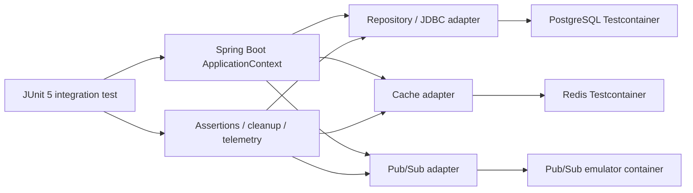
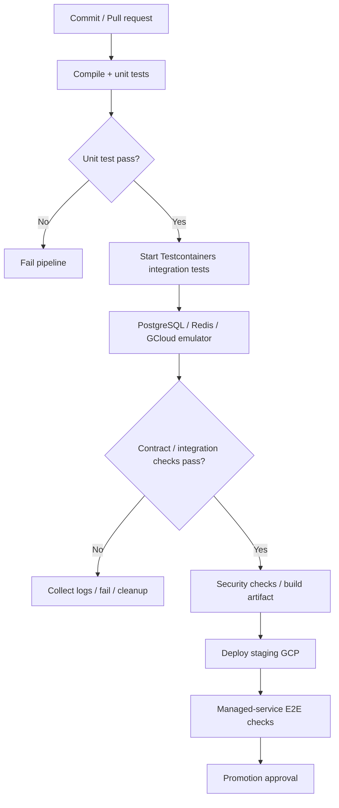

# Testcontainers cho thành phần dữ liệu phụ trợ của ứng dụng GCP

Một dịch vụ Java/Spring triển khai lên Google Cloud thường phụ thuộc vào nhiều hệ thống: Cloud SQL hoặc AlloyDB để lưu giao dịch, Memorystore để cache, Pub/Sub để trao đổi sự kiện, Firestore hoặc Spanner để lưu dữ liệu, và đôi khi Cloud Storage để giữ tệp. Unit test với mock giúp kiểm tra logic nhanh nhưng chưa chứng minh ứng dụng kết nối đúng, chạy SQL thật, xử lý transaction chính xác hoặc tương tác đúng với message broker.

**Testcontainers for Java** cho phép bài kiểm thử khởi động những dependency cần thiết trong container có vòng đời được quản lý, lấy endpoint động, chạy mã ứng dụng với dịch vụ thử nghiệm và dọn tài nguyên khi hoàn thành. Với ứng dụng GCP, một số dependency được chạy bằng sản phẩm mã nguồn mở tương thích giao thức, một số dùng emulator chính thức; cả hai đều không thay thế hoàn toàn kiểm thử trên dịch vụ managed thực tế.

Bài học thuộc chương **Kiểm thử ứng dụng GCP**, module **CLOUD_PROVIDERS_GCP**. Trọng tâm là thiết kế integration test tin cậy cho thành phần dữ liệu phụ trợ của ứng dụng Java/Spring trước khi triển khai lên Cloud Run, GKE hoặc môi trường Google Cloud khác.

## 1. Mục tiêu học tập

Sau bài học, bạn có thể:

- Giải thích Testcontainers khác mock, embedded database, emulator và môi trường GCP thật như thế nào.
- Thiết lập JUnit 5, Testcontainers 2.x và Spring Boot với Maven/Gradle.
- Chạy PostgreSQL container để kiểm thử JPA, JDBC, Flyway và ràng buộc giao dịch.
- Chạy Redis container để kiểm thử cache, TTL và hành vi key/value.
- Dùng Testcontainers GCloud để chạy Pub/Sub, Firestore hoặc Spanner emulator.
- Tiêm endpoint và credentials thử nghiệm vào application context mà không hard-code cổng.
- Tổ chức dữ liệu fixture, cách ly bài test, thời điểm khởi tạo và teardown.
- Chọn đúng phần cần kiểm chứng trên GCP thật, đặc biệt IAM, network, quota và managed-service features.
- Thiết kế pipeline CI kiểm thử có kiểm soát tài nguyên và Docker daemon.

## 2. Testcontainers nằm ở đâu trong chiến lược kiểm thử?

Các loại test giải quyết các rủi ro khác nhau:

| Cấp kiểm thử | Dependency | Mục tiêu | Tốc độ tương đối |
|---|---|---|---|
| Unit test | Mock hoặc fake trong bộ nhớ | Kiểm tra logic, phép tính, validation | Rất nhanh |
| Component test | Service thật được container hóa hoặc fake có contract | Kiểm tra repository, cache, serialization và adapter | Trung bình |
| Integration test | Nhiều component được khởi động cùng nhau | Kiểm tra luồng giao tiếp, transaction, event và data flow | Chậm hơn |
| E2E trên GCP | Dịch vụ managed và IAM/network thật | Kiểm chứng tích hợp nền tảng, cấu hình và vận hành | Tốn thời gian/chi phí hơn |

Ví dụ dịch vụ đặt hàng: unit test kiểm tra tổng tiền; PostgreSQL container kiểm tra unique constraint và transaction; Redis container kiểm tra cache invalidation; Pub/Sub emulator kiểm tra publish/consume cơ bản; E2E trên GCP kiểm tra quyền service account, networking, quota, delivery semantics và hệ thống deploy.

**Không cần Testcontainers cho mọi test.** Dùng mock cho logic thuần; dùng container khi hành vi của database, broker hoặc client integration là điều đang được kiểm chứng. Một bộ test tốt thường có nhiều unit test, một số integration test chọn lọc và một nhóm E2E nhỏ nhưng có giá trị.

### 2.1. Vì sao không chỉ dùng H2 thay PostgreSQL?

H2 là embedded database hữu ích cho một số trường hợp nhưng không tương đương PostgreSQL:

- Khác cú pháp SQL, kiểu dữ liệu, extension và cách lập chỉ mục.
- Khác isolation level, locking, transaction và concurrency.
- Khác hành vi JSONB, UUID, array, collation hoặc constraint.
- Migration chạy trên H2 chưa chắc chạy được trên Cloud SQL for PostgreSQL.

Dùng image PostgreSQL tương ứng với major version trên Cloud SQL giúp kiểm tra SQL và driver thực tế tốt hơn. Tuy nhiên, PostgreSQL container **không mô phỏng** Cloud SQL connector, IAM database authentication, HA/failover, backup, private IP hoặc giới hạn managed service.

### 2.2. Container không luôn đồng nghĩa emulator

Một database PostgreSQL container chạy PostgreSQL thật. Redis container chạy Redis thật. Ngược lại, Pub/Sub Emulator hoặc Firestore Emulator là phiên bản giả lập giao thức/hành vi được thiết kế cho phát triển và kiểm thử; tính năng và semantics có thể khác dịch vụ production.

| Phụ thuộc GCP | Thành phần nên dùng trong Testcontainers | Cần kiểm tra thêm trên GCP |
|---|---|---|
| Cloud SQL for PostgreSQL / AlloyDB | PostgreSQLContainer, major version phù hợp | Cloud SQL Auth Proxy/Connector, IAM, HA, backup, performance |
| Memorystore for Redis | Redis image qua GenericContainer | TLS/auth topology, cluster mode, failover, managed networking |
| Pub/Sub | PubSubEmulatorContainer | IAM, retry policy, ordering, DLQ, quota, exactly-once tùy cấu hình |
| Firestore | FirestoreEmulatorContainer | Composite indexes, security rules, TTL, IAM, latency và quota |
| Spanner | SpannerEmulatorContainer | IAM, transaction performance, split/replica, production limits |
| Cloud Storage | Emulator bên thứ ba hoặc fake theo HTTP contract | IAM, signed URLs, retention, generation, checksum, bucket policy |

Trong bảng, “kiểm tra thêm” không có nghĩa mọi tính năng đều thiếu ở emulator; đó là các hành vi **không nên mặc định đã được chứng minh** chỉ bởi test local.

## 3. Kiến trúc bộ test

Một kiến trúc gọn cho ứng dụng Spring Boot:



Testcontainers khởi động các backend dùng trong test. Spring Boot nhận địa chỉ động từ Testcontainers thông qua `@ServiceConnection` hoặc `@DynamicPropertySource`. Adapter nên có interface hoặc điểm cấu hình rõ ràng, tránh khởi tạo Cloud client với endpoint cố định ngay trong business logic.

## 4. Prerequisites và quản lý phiên bản

Cần có:

1. JDK phù hợp với ứng dụng (ví dụ JDK 21).
2. Maven/Gradle và JUnit Jupiter.
3. Container runtime tương thích Docker API đang chạy.
4. Quyền tải image từ registry hoặc image cache/mirror được phê duyệt.
5. Tài nguyên CPU/RAM đủ cho tổng số container chạy đồng thời.
6. Mạng cho phép ứng dụng test kết nối container đã map port.

Testcontainers kiểm tra khả năng sử dụng container runtime khi chạy. Nếu không tìm thấy Docker socket hoặc endpoint được hỗ trợ, test sẽ thất bại trước khi gọi application code. CI không nên kỳ vọng có Docker daemon chỉ vì runner đang nằm trong container.

### 4.1. Phiên bản và package Testcontainers 2.x

Ví dụ trong bài dùng **Testcontainers 2.0.5** và JUnit 5. Ở Testcontainers 2.x, các specialized modules dùng artifact/package mới. Ví dụ:

- PostgreSQL: `org.testcontainers:testcontainers-postgresql` với class `org.testcontainers.postgresql.PostgreSQLContainer`.
- GCloud: `org.testcontainers:testcontainers-gcloud` với class dưới package `org.testcontainers.gcloud`.
- JUnit Jupiter: `org.testcontainers:testcontainers-junit-jupiter`.
- GenericContainer: class `org.testcontainers.containers.GenericContainer` trong core library.

Không trộn tài liệu Testcontainers 1.x và 2.x: một số hướng dẫn cũ sử dụng artifact `postgresql` hoặc package `org.testcontainers.containers.PostgreSQLContainer`. Hãy kiểm tra BOM và API theo **một** phiên bản thống nhất; không copy import cũ vào code sử dụng artifact mới.

### 4.2. Maven dependency management

Ví dụ phần bổ sung cho ứng dụng Spring Boot có dependency Spring JDBC/JPA và driver PostgreSQL:

```xml
<dependencyManagement>
  <dependencies>
    <dependency>
      <groupId>org.testcontainers</groupId>
      <artifactId>testcontainers-bom</artifactId>
      <version>2.0.5</version>
      <type>pom</type>
      <scope>import</scope>
    </dependency>
  </dependencies>
</dependencyManagement>

<dependencies>
  <dependency>
    <groupId>org.springframework.boot</groupId>
    <artifactId>spring-boot-starter-test</artifactId>
    <scope>test</scope>
  </dependency>
  <dependency>
    <groupId>org.springframework.boot</groupId>
    <artifactId>spring-boot-testcontainers</artifactId>
    <scope>test</scope>
  </dependency>
  <dependency>
    <groupId>org.testcontainers</groupId>
    <artifactId>testcontainers-junit-jupiter</artifactId>
    <scope>test</scope>
  </dependency>
  <dependency>
    <groupId>org.testcontainers</groupId>
    <artifactId>testcontainers-postgresql</artifactId>
    <scope>test</scope>
  </dependency>
  <dependency>
    <groupId>org.testcontainers</groupId>
    <artifactId>testcontainers-gcloud</artifactId>
    <scope>test</scope>
  </dependency>
  <dependency>
    <groupId>org.postgresql</groupId>
    <artifactId>postgresql</artifactId>
    <scope>runtime</scope>
  </dependency>
</dependencies>
```

`testcontainers-gcloud` chỉ cần cho test GCP emulator. Nếu chỉ dùng PostgreSQL hoặc Redis GenericContainer thì không cần kéo tất cả module vào dependency graph.

### 4.3. Gradle dependency

```groovy
dependencies {
    testImplementation platform("org.testcontainers:testcontainers-bom:2.0.5")
    testImplementation "org.springframework.boot:spring-boot-starter-test"
    testImplementation "org.springframework.boot:spring-boot-testcontainers"
    testImplementation "org.testcontainers:testcontainers-junit-jupiter"
    testImplementation "org.testcontainers:testcontainers-postgresql"
    testImplementation "org.testcontainers:testcontainers-gcloud"
    runtimeOnly "org.postgresql:postgresql"
}

tasks.withType(Test).configureEach {
    useJUnitPlatform()
}
```

Nếu ứng dụng dùng Spring Boot parent/BOM để quản lý Testcontainers, kiểm tra phiên bản đã được giải quyết trước khi ghi đè; BOM Spring và Testcontainers phải tương thích với JDK/Spring Boot hiện có. Mẫu trên biểu diễn cách quản lý một phiên bản 2.0.5 nhất quán, không phải yêu cầu cập nhật không kiểm soát.

## 5. Vòng đời container với JUnit 5

`@Testcontainers` kích hoạt extension; `@Container` đánh dấu container cần start/stop theo vòng đời test. Trường `static` thường được dùng cho container sống trong phạm vi một test class; trường instance có thể được tạo riêng theo mỗi test method.

Ví dụ đơn giản chạy Redis:

```java
import org.junit.jupiter.api.Test;
import org.testcontainers.containers.GenericContainer;
import org.testcontainers.junit.jupiter.Container;
import org.testcontainers.junit.jupiter.Testcontainers;
import org.testcontainers.utility.DockerImageName;

import static org.junit.jupiter.api.Assertions.assertTrue;

@Testcontainers
class RedisAvailabilityIT {

    @Container
    static GenericContainer<?> redis = new GenericContainer<>(
            DockerImageName.parse("redis:7.4-alpine"))
            .withExposedPorts(6379);

    @Test
    void redisPortIsMapped() {
        assertTrue(redis.isRunning());
        assertTrue(redis.getMappedPort(6379) > 0);
        System.out.println(redis.getHost() + ":" + redis.getMappedPort(6379));
    }
}
```

Đây là smoke test của container, chưa kiểm chứng cache adapter. Bài test nghiệp vụ nên tạo client Redis thực, thao tác set/get và xác nhận TTL hoặc cache invalidation.

### 5.1. Không hard-code localhost:port

Testcontainers thường map cổng container ra **một cổng động** trên host. Code test phải lấy:

```java
String host = redis.getHost();
int port = redis.getMappedPort(6379);
```

Không mặc định `localhost:6379`, vì trên CI, Docker Desktop hoặc remote runtime, host/port có thể khác. Hai container cùng expose 6379 vẫn có thể chạy song song do mapped port khác nhau.

### 5.2. Vòng đời và tái sử dụng

Container `static` có thể được chia sẻ giữa test methods trong cùng class, nhưng dữ liệu trong PostgreSQL/Redis **không tự reset** sau từng method. Nếu muốn reuse container để giảm thời gian startup, hãy dọn database, key prefix hoặc fixture giữa các test.

Spring TestContext có thể cache `ApplicationContext` giữa các test class. Nếu một context còn giữ endpoint của container đã dừng, test sau có thể lỗi bất ngờ. Thiết kế base class, context cache và lifecycle thống nhất, tránh để một context tái dùng kết nối đến container đã bị JUnit extension dọn.

## 6. PostgreSQL Testcontainer cho Cloud SQL và AlloyDB adapter

Giả sử ứng dụng Spring Boot có repository lưu đơn hàng trong Cloud SQL for PostgreSQL. Ta muốn kiểm tra:

- Mapping entity và SQL syntax.
- Unique constraint và foreign key.
- Transaction commit/rollback.
- Migration chạy thành công với PostgreSQL phiên bản phù hợp.
- Tính idempotency khi gọi repository lặp lại.

### 6.1. Ví dụ Spring Boot + DynamicPropertySource

Đây là ví dụ dùng Spring JDBC với bảng minh họa. Trong dự án thực, schema thường do Flyway/Liquibase quản lý.

```java
import org.junit.jupiter.api.BeforeEach;
import org.junit.jupiter.api.Test;
import org.springframework.beans.factory.annotation.Autowired;
import org.springframework.boot.test.context.SpringBootTest;
import org.springframework.jdbc.core.JdbcTemplate;
import org.springframework.test.context.DynamicPropertyRegistry;
import org.springframework.test.context.DynamicPropertySource;
import org.testcontainers.junit.jupiter.Container;
import org.testcontainers.junit.jupiter.Testcontainers;
import org.testcontainers.postgresql.PostgreSQLContainer;

import static org.junit.jupiter.api.Assertions.assertEquals;
import static org.junit.jupiter.api.Assertions.assertThrows;

@Testcontainers
@SpringBootTest
class OrderRepositoryIT {

    @Container
    static PostgreSQLContainer postgres =
            new PostgreSQLContainer("postgres:16.6")
                    .withDatabaseName("orders_test")
                    .withUsername("test")
                    .withPassword("test");

    @DynamicPropertySource
    static void databaseProperties(DynamicPropertyRegistry registry) {
        registry.add("spring.datasource.url", postgres::getJdbcUrl);
        registry.add("spring.datasource.username", postgres::getUsername);
        registry.add("spring.datasource.password", postgres::getPassword);
    }

    @Autowired
    JdbcTemplate jdbc;

    @BeforeEach
    void resetData() {
        jdbc.execute("""
            CREATE TABLE IF NOT EXISTS orders (
              id BIGINT PRIMARY KEY,
              external_id TEXT NOT NULL UNIQUE
            )
            """);
        jdbc.execute("TRUNCATE TABLE orders");
    }

    @Test
    void persistsAndEnforcesUniqueBusinessKey() {
        jdbc.update(
            "INSERT INTO orders (id, external_id) VALUES (?, ?)",
            1L, "ext-101");

        long count = jdbc.queryForObject(
            "SELECT COUNT(*) FROM orders WHERE external_id = ?",
            Long.class, "ext-101");
        assertEquals(1L, count);

        assertThrows(
            org.springframework.dao.DataIntegrityViolationException.class,
            () -> jdbc.update(
                "INSERT INTO orders (id, external_id) VALUES (?, ?)",
                2L, "ext-101")
        );
    }
}
```

Điều kiện: project có `spring-boot-starter-jdbc` (hoặc JPA/JDBC tương ứng), test starter và driver PostgreSQL. Nếu ứng dụng đã chạy Flyway/Liquibase, hãy dùng migration thật để tạo bảng thay vì tạo bảng trong `@BeforeEach`; nếu cần dữ liệu, dùng SQL fixture hoặc repository setup.

Cách trên kiểm tra **ràng buộc thật của PostgreSQL**. Nó chưa kiểm tra Cloud SQL Auth Proxy, private network, IAM DB auth hay cấu hình high availability.

### 6.2. ServiceConnection khi Spring Boot hỗ trợ

Spring Boot có thể tự lấy thông tin kết nối từ container qua `@ServiceConnection`, nhờ đó không cần tự đăng ký URL, username và password bằng `@DynamicPropertySource`.

```java
import org.junit.jupiter.api.Test;
import org.springframework.boot.test.context.SpringBootTest;
import org.springframework.boot.testcontainers.service.connection.ServiceConnection;
import org.testcontainers.junit.jupiter.Container;
import org.testcontainers.junit.jupiter.Testcontainers;
import org.testcontainers.postgresql.PostgreSQLContainer;

@Testcontainers
@SpringBootTest
class OrderServiceConnectionIT {

    @Container
    @ServiceConnection
    static PostgreSQLContainer postgres =
        new PostgreSQLContainer("postgres:16.6");

    @Test
    void startsWithPostgresDatasource() {
        // Gọi repository hoặc service thật và assert kết quả nghiệp vụ.
    }
}
```

Cần dependency `spring-boot-testcontainers` và phiên bản Spring Boot phù hợp. Spring tạo `ConnectionDetails` cho container được nhận diện, ghi đè connection properties tương ứng. Nếu cần giả lập PostgreSQL với cấu hình phức tạp hơn hoặc custom client, dùng `@DynamicPropertySource` để kiểm soát riêng từng property.

### 6.3. Kiểm tra transaction và isolation

Một integration test có giá trị nên xác minh:

- Unique constraint thực sự từ chối insert trùng.
- Rollback không lưu dữ liệu sau exception.
- Concurrent transaction xử lý optimistic locking hoặc conflict theo nghiệp vụ.
- Migration upgrade không làm mất dữ liệu có sẵn.
- SQL query thực thi được trên major version dự định dùng.

Không dùng `@Transactional` trên mọi test rồi cho rằng mọi tác động đã rollback: tác vụ bất đồng bộ, message consumer hoặc giao dịch trong thread khác có thể commit riêng. Với test như vậy cần cleanup và kiểm tra dữ liệu sau khi xử lý.

## 7. Redis Testcontainer cho cache và session

Memorystore có thể cung cấp Redis để dùng làm cache, distributed lock hoặc ephemeral state. Redis container chạy Redis thật, phù hợp để kiểm tra key serialization, TTL, expiration và cache adapter. Tuy nhiên, nó không thay thế môi trường managed Memorystore với HA, TLS, networking hoặc policy thực tế.

### 7.1. GenericContainer và Spring DynamicPropertySource

```java
import org.junit.jupiter.api.Test;
import org.springframework.beans.factory.annotation.Autowired;
import org.springframework.boot.test.context.SpringBootTest;
import org.springframework.data.redis.core.StringRedisTemplate;
import org.springframework.test.context.DynamicPropertyRegistry;
import org.springframework.test.context.DynamicPropertySource;
import org.testcontainers.containers.GenericContainer;
import org.testcontainers.junit.jupiter.Container;
import org.testcontainers.junit.jupiter.Testcontainers;
import org.testcontainers.utility.DockerImageName;

import java.time.Duration;

import static org.junit.jupiter.api.Assertions.assertEquals;

@Testcontainers
@SpringBootTest
class CacheAdapterIT {

    @Container
    static GenericContainer<?> redis = new GenericContainer<>(
            DockerImageName.parse("redis:7.4-alpine"))
            .withExposedPorts(6379);

    @DynamicPropertySource
    static void redisProperties(DynamicPropertyRegistry registry) {
        registry.add("spring.data.redis.host", redis::getHost);
        registry.add("spring.data.redis.port", () -> redis.getMappedPort(6379));
    }

    @Autowired
    StringRedisTemplate template;

    @Test
    void writesAndReadsCacheEntry() {
        template.opsForValue().set("test:order:101", "PAID",
                Duration.ofMinutes(1));

        assertEquals("PAID",
                template.opsForValue().get("test:order:101"));

        template.delete("test:order:101");
    }
}
```

Điều kiện: có `spring-boot-starter-data-redis`. Tên property và cấu trúc cấu hình tùy phiên bản Spring Boot; ví dụ dùng namespace `spring.data.redis.*`.

### 7.2. Những thứ nên kiểm thử

- Serialization/deserialization của key và value.
- TTL có được đặt và cập nhật đúng khi ghi lại không.
- Cache invalidation sau update dữ liệu gốc.
- Hành vi cache miss, cache server unavailable và fallback.
- Xử lý concurrent request có race hoặc stale value.
- Key prefix theo tenant/environment để tránh xung đột.

Không dùng `Thread.sleep(60_000)` để chờ TTL hết; hãy dùng TTL ngắn có độ dư hợp lý, kiểm tra trạng thái expiration theo thời gian giới hạn và tránh assertion quá nhạy. Với app có nhiều test song song, dùng key riêng theo test ID.

## 8. Pub/Sub emulator qua Testcontainers GCloud

Testcontainers có module **GCloud** khởi động emulator cho một số dịch vụ Google Cloud. Module này được tài liệu Testcontainers đánh dấu **INCUBATING**, nên API có thể thay đổi qua phiên bản. Các ví dụ dùng Testcontainers 2.0.5.

### 8.1. Khởi tạo PubSubEmulatorContainer

```java
import org.junit.jupiter.api.Test;
import org.testcontainers.gcloud.PubSubEmulatorContainer;
import org.testcontainers.utility.DockerImageName;

import static org.junit.jupiter.api.Assertions.assertTrue;

class PubSubEmulatorSmokeIT {

    @Test
    void startsPubSubEmulator() {
        try (PubSubEmulatorContainer emulator =
                 new PubSubEmulatorContainer(
                     DockerImageName.parse(
                       "gcr.io/google.com/cloudsdktool/google-cloud-cli:583.0.0-emulators"
                     ))) {

            emulator.start();
            String endpoint = emulator.getEmulatorEndpoint();
            assertTrue(endpoint.contains(":"));
        }
    }
}
```

Image chứa Google Cloud CLI emulator cần được pin theo tag đã được xác minh trong CI. API `getEmulatorEndpoint()` trả endpoint có host và port được map để client ngoài container kết nối.

Đây mới là smoke test container. Integration test cần tạo topic/subscription, publish message, receive/ack và kiểm tra tác động lên dữ liệu nghiệp vụ.

### 8.2. Cấu hình Java Pub/Sub client cho emulator

Client gRPC phải kết nối endpoint local và không dùng credentials thật. Dưới đây là ví dụ tạo topic thử nghiệm:

```java
import com.google.api.gax.core.NoCredentialsProvider;
import com.google.api.gax.grpc.GrpcTransportChannel;
import com.google.api.gax.rpc.FixedTransportChannelProvider;
import com.google.api.gax.rpc.TransportChannelProvider;
import com.google.cloud.pubsub.v1.TopicAdminClient;
import com.google.cloud.pubsub.v1.TopicAdminSettings;
import com.google.pubsub.v1.TopicName;
import io.grpc.ManagedChannel;
import io.grpc.ManagedChannelBuilder;
import org.testcontainers.gcloud.PubSubEmulatorContainer;
import org.testcontainers.utility.DockerImageName;

public class PubSubClientExample {

    static void createTopic() throws Exception {
        try (PubSubEmulatorContainer emulator =
                 new PubSubEmulatorContainer(
                     DockerImageName.parse(
                         "gcr.io/google.com/cloudsdktool/google-cloud-cli:583.0.0-emulators"))) {

            emulator.start();

            ManagedChannel channel = ManagedChannelBuilder
                .forTarget(emulator.getEmulatorEndpoint())
                .usePlaintext()
                .build();

            try {
                TransportChannelProvider provider =
                    FixedTransportChannelProvider.create(
                        GrpcTransportChannel.create(channel));

                TopicAdminSettings settings = TopicAdminSettings.newBuilder()
                    .setTransportChannelProvider(provider)
                    .setCredentialsProvider(NoCredentialsProvider.create())
                    .build();

                try (TopicAdminClient client = TopicAdminClient.create(settings)) {
                    client.createTopic(TopicName.of("test-project", "orders"));
                }
            } finally {
                channel.shutdownNow();
                channel.awaitTermination(
                    10, java.util.concurrent.TimeUnit.SECONDS);
            }
        }
    }
}
```

Đoạn mã dùng thư viện `google-cloud-pubsub` và các dependency gRPC liên quan được quản lý theo BOM Google Cloud. Không sử dụng ADC thật khi nói chuyện với emulator. Trong ứng dụng Spring, hãy tách cấu hình transport, credentials và project ID theo profile test; không để giá trị emulator rò sang cấu hình production.

### 8.3. Những gì cần kiểm chứng trong luồng sự kiện

Một integration test Pub/Sub nên có:

1. Khởi động emulator và tạo topic/subscription thử nghiệm.
2. Khởi động adapter publish của ứng dụng.
3. Gửi sự kiện có event ID và payload hợp lệ.
4. Chờ consumer xử lý bằng điều kiện eventual consistency có timeout.
5. Xác nhận trạng thái database thay đổi đúng.
6. Gửi sự kiện lặp lại và xác nhận idempotency.
7. Kiểm tra xử lý dữ liệu lỗi, retry và ack/nack theo khả năng emulator.

Không dùng fixed sleep để đoán message đã được xử lý; dùng polling có giới hạn thời gian (ví dụ Awaitility) hoặc API nhận message được kiểm soát. Mỗi test cần topic/subscription riêng hoặc cleanup để tránh message còn sót.

### 8.4. Giới hạn Pub/Sub emulator

Emulator rất hữu ích cho giao thức và luồng message cơ bản nhưng không thay thế kiểm thử:

- IAM, service account và Workload Identity Federation.
- Quota, latency, scaling, network failure và managed routing.
- Exactly-once delivery, ordering keys hoặc dead-letter policy trong mọi trường hợp.
- Push authentication, retry behavior và các tính năng nâng cao có thể khác dịch vụ thật.

Đối với luồng production quan trọng, chạy một nhóm contract/E2E test trên project GCP thử nghiệm với topic và subscription thật có lifecycle rõ ràng.

## 9. Firestore và Spanner emulator

### 9.1. FirestoreEmulatorContainer

Ví dụ khởi động Firestore emulator và cấu hình Java client:

```java
import com.google.auth.oauth2.NoCredentials;
import com.google.cloud.firestore.Firestore;
import com.google.cloud.firestore.FirestoreOptions;
import org.junit.jupiter.api.Test;
import org.testcontainers.gcloud.FirestoreEmulatorContainer;
import org.testcontainers.utility.DockerImageName;

import static org.junit.jupiter.api.Assertions.assertNotNull;

class FirestoreAdapterIT {

    @Test
    void canConnectToFirestoreEmulator() throws Exception {
        try (FirestoreEmulatorContainer emulator =
                 new FirestoreEmulatorContainer(
                     DockerImageName.parse(
                         "gcr.io/google.com/cloudsdktool/google-cloud-cli:583.0.0-emulators"))) {

            emulator.start();

            FirestoreOptions options = FirestoreOptions
                .getDefaultInstance()
                .toBuilder()
                .setProjectId("test-project")
                .setHost(emulator.getEmulatorEndpoint())
                .setCredentials(NoCredentials.getInstance())
                .build();

            try (Firestore db = options.getService()) {
                db.collection("orders").document("order-101")
                    .set(java.util.Map.of("status", "NEW")).get();

                var snapshot = db.collection("orders")
                    .document("order-101").get().get();

                assertNotNull(snapshot.getData());
            }
        }
    }
}
```

Đoạn mã sử dụng `google-cloud-firestore`, giả định client phiên bản tương thích với ví dụ Testcontainers. Test thực tế nên kiểm tra truy vấn, transaction, batch write và mapping dữ liệu ứng dụng.

Firestore emulator không chứng minh đầy đủ tình trạng index, IAM, security rules (tùy cách triển khai), TTL và quota của Firestore production. Nếu ứng dụng phụ thuộc vào rule hoặc index, phải có bài kiểm tra bổ sung theo môi trường tương ứng.

### 9.2. SpannerEmulatorContainer

Spanner emulator có image riêng. Ví dụ khởi động:

```java
import org.junit.jupiter.api.Test;
import org.testcontainers.gcloud.SpannerEmulatorContainer;
import org.testcontainers.utility.DockerImageName;

import static org.junit.jupiter.api.Assertions.assertTrue;

class SpannerSmokeIT {

    @Test
    void startsSpanner() {
        try (SpannerEmulatorContainer emulator =
                 new SpannerEmulatorContainer(
                     DockerImageName.parse(
                         "gcr.io/cloud-spanner-emulator/emulator:1.4.0"))) {

            emulator.start();
            assertTrue(emulator.getEmulatorGrpcEndpoint().contains(":"));
        }
    }
}
```

Khi kiểm tra Spanner adapter thực tế, cấu hình `SpannerOptions` với emulator gRPC endpoint, tạo instance/database thử nghiệm và chạy DDL trước khi insert/query. Test cần xác minh mutation và transaction, không chỉ container chạy thành công. Không kỳ vọng emulator tái tạo hiệu năng phân tán, IAM hay multi-region consistency của Spanner managed service.

### 9.3. Chọn emulator theo giá trị kiểm thử

| Adapter | Test địa phương có giá trị | Kiểm tra ở GCP thật |
|---|---|---|
| Firestore | Data mapping, query logic, transaction cơ bản | Indexes, IAM, security rules, quota |
| Spanner | DDL, mutations, SQL, transaction behavior cơ bản | Latency, scaling, transaction constraints, IAM |
| Pub/Sub | Serialization, publish/consume, ack flow | Managed delivery behavior, IAM, quota |
| Bigtable | Row key, family, mutation, read | Capacity, performance, IAM |
| Datastore | Entity/query cơ bản | Index config, IAM, operational behavior |

Không dựng emulator cho một backend mà application thực tế không dùng; tối giản các container cho phép test nhanh và ít tài nguyên hơn.

## 10. Cloud Storage và lựa chọn fake-gcs-server

Khác Pub/Sub, Firestore hoặc Spanner, **Testcontainers GCloud module không cung cấp một official Cloud Storage emulator trong danh sách module nêu trên**. Nếu cần kiểm thử adapter dùng Cloud Storage, có ba lựa chọn:

- Fake hoặc mock `Storage`/HTTP client trong unit test để kiểm tra nghiệp vụ và cách ánh xạ lỗi.
- Chạy một Cloud Storage-compatible emulator của bên thứ ba bằng `GenericContainer`, ví dụ fake-gcs-server, theo version và API được dự án kiểm chứng.
- Chạy integration test trên một bucket thật trong project thử nghiệm khi cần kiểm chứng generation preconditions, IAM, metadata, retention, checksum, signed URL hoặc policy thực tế.

Không gọi fake-gcs-server là emulator chính thức của Google Cloud. Emulator bên thứ ba có thể khác API production. Trong pipeline CI, cần pin image digest/tag, kiểm tra độ tin cậy của image và tránh truy cập nhầm bucket thật.

Một abstraction đơn giản giúp chọn backend theo test:

```java
public interface ObjectStore {
    void put(String key, byte[] data);
    byte[] get(String key);
    void delete(String key);
}
```

Unit test tập trung vào hành vi của business service qua fake `ObjectStore`. Integration test tập trung vào adapter cụ thể dùng emulator hoặc bucket GCP thật. Nhờ tách adapter, test không phải khởi động emulator cho mọi trường hợp logic.

## 11. Tách cấu hình test và production

Vấn đề phổ biến nhất là test vô tình gọi dịch vụ GCP thật vì một bean dùng ADC mặc định hoặc một property chưa được override.

### 11.1. Cấu hình theo profile

Trong Spring Boot:

- `application.yaml` chứa thiết lập chung.
- `application-test.yaml` chỉ chứa cấu hình môi trường test không nhạy cảm.
- `@DynamicPropertySource` bổ sung endpoint động khi container start.
- `@ServiceConnection` có thể cung cấp connection details cho container được hỗ trợ.
- Client cần cấu hình emulator explicit `host`, `projectId` và `NoCredentials`/`NoCredentialsProvider`.
- Bean test có thể dùng `@TestConfiguration` để thay client production bằng emulator-bound client.

Không để production profile tự động tìm Pub/Sub emulator từ biến môi trường cũ. Không dùng default credentials để gọi emulator local và không dùng NoCredentials cho client GCP thật.

### 11.2. Client factory và dependency injection

Nên có interface adapter và factory nhận configuration. Ví dụ:

```java
public interface EventPublisher {
    void publish(String topic, String payload);
}
```

Trong production, adapter dùng Google Cloud Pub/Sub client thực và ADC. Trong test, cùng interface được cấu hình endpoint emulator và fake credentials. Business logic không quan tâm endpoint đến từ đâu, chỉ quan tâm kết quả publish và error mapping.

### 11.3. DynamicPropertySource hay ServiceConnection?

| Cách | Ưu điểm | Nên dùng khi |
|---|---|---|
| `@DynamicPropertySource` | Rõ property, dùng được với custom adapter/emulator | Client cần host, port hoặc project ID riêng |
| `@ServiceConnection` | Spring Boot tự cấu hình ConnectionDetails | Container type được Spring nhận diện, như PostgreSQL |
| `@TestConfiguration` | Tùy chỉnh bean và transport phức tạp | GCloud emulator, custom credentials, nhiều client |
| Env vars ở process | Phù hợp một số client SDK | Test runner kiểm soát độc lập từng process |

Không giả định `@ServiceConnection` tự động nhận diện mọi `PubSubEmulatorContainer` hoặc `FirestoreEmulatorContainer`. Tùy tích hợp, bạn vẫn phải cấu hình client hoặc bean.

## 12. Test data, isolation và deterministic assertions

### 12.1. Container mới không luôn đồng nghĩa test sạch

Một container `static` có thể chứa dữ liệu từ các test method trước đó. Nếu nhiều test chạy song song, thao tác truncate hoặc FLUSHALL có thể xóa dữ liệu test khác.

Các chiến lược:

- Tạo key prefix riêng theo test ID.
- Dùng database/schema riêng nếu backend hỗ trợ.
- Khởi tạo fixture ở `@BeforeEach` và cleanup ở `@AfterEach` theo phạm vi sở hữu.
- Dùng transaction rollback cho các test đồng bộ phù hợp.
- Dùng container riêng theo test class nếu cần isolation mạnh hơn.
- Tránh dùng shared external database không có namespace hoặc isolation.

### 12.2. Seed bằng migration và fixture

Với PostgreSQL:

1. Khởi động container.
2. Spring Boot/Flyway/Liquibase chạy migration của ứng dụng.
3. Seed dữ liệu mẫu rõ ràng và ít phụ thuộc thứ tự.
4. Gọi repository/service thật.
5. Assert trạng thái DB, event hoặc cache.
6. Cleanup đúng dữ liệu test tạo.

Tránh schema giả khác production vì điều đó làm mất mục tiêu integration test.

### 12.3. Eventual consistency và timeout

Message broker và các worker bất đồng bộ không bảo đảm ngay lập tức thấy kết quả. Thay vì:

```java
Thread.sleep(2000); // test dễ flake nếu CI chậm
```

Có thể dùng Awaitility hoặc polling bounded:

```java
await()
    .atMost(java.time.Duration.ofSeconds(10))
    .pollInterval(java.time.Duration.ofMillis(200))
    .untilAsserted(() ->
        assertEquals("PROCESSED", orderRepository.findStatus("order-101"))
    );
```

Đây là ví dụ với Awaitility được khai báo là test dependency và các static imports cần thiết. Timeout phải đủ để chứa biến động hợp lý nhưng không che tình trạng treo; log phải cho biết điều kiện nào chưa đạt.

### 12.4. Đừng chỉ assert container start

Một test như `assertTrue(postgres.isRunning())` chỉ chứng minh runtime được khởi động. Test có giá trị phải kiểm tra contract của ứng dụng: SQL, transaction, cache, serialization, retry, idempotency và output nghiệp vụ.

## 13. Networking và giao tiếp giữa nhiều container

### 13.1. Test JVM chạy trên host

Khi JVM test chạy bên ngoài container:

```java
String host = redis.getHost();
int mappedPort = redis.getMappedPort(6379);
```

Spring/client phải dùng host và mapped port; không dùng internal port nếu không ở cùng network.

### 13.2. Ứng dụng cũng nằm trong container

Khi cả application và dependency đều do Testcontainers chạy:

- Tạo shared `Network`.
- Gán network alias cho database/Redis.
- Application container kết nối qua alias và **internal port**.
- Đừng dùng mapped host port từ trong một container khác nếu không cần.
- Đóng Network và các container sau test.

Ví dụ conceptual:

```java
try (Network network = Network.newNetwork()) {
    GenericContainer<?> redis = new GenericContainer<>("redis:7.4-alpine")
        .withNetwork(network)
        .withNetworkAliases("redis")
        .withExposedPorts(6379);

    // Application container trong cùng network dùng redis:6379.
    redis.start();
    // ... tạo app container, chạy test, đóng container.
}
```

Ví dụ trên cần import `org.testcontainers.containers.Network` và `GenericContainer`; nó minh họa topology mạng, không phải một test đầy đủ có assertions. Nếu test Docker runtime ở remote host, hãy chú ý hostname, mapped port và cách các container nhìn thấy nhau.

### 13.3. Wait strategy và readiness

Không cho rằng process vừa được khởi động đã sẵn sàng nhận request. Với `GenericContainer`, dùng wait strategy phù hợp:

```java
GenericContainer<?> redis = new GenericContainer<>("redis:7.4-alpine")
    .withExposedPorts(6379)
    .waitingFor(
        org.testcontainers.containers.wait.strategy.Wait
            .forListeningPort()
            .withStartupTimeout(java.time.Duration.ofSeconds(60))
    );
```

Database container chuyên dụng thường có readiness logic riêng. Nếu test vẫn không kết nối được, xem container logs và kiểm tra thực tế cổng đã mở, DNS resolution và authentication; không tăng timeout vô hạn để che vấn đề.

## 14. Hiệu năng và tổ chức test suite

### 14.1. Giảm thời gian start

Container thường chậm hơn mock do phải pull image và start process. Cách tối ưu:

- Pin và pre-pull image vào CI runner khi phù hợp.
- Dùng static container trong class, nhưng giữ isolation dữ liệu.
- Nhóm các integration test theo dependency tương tự.
- Giới hạn số container nặng chạy đồng thời.
- Không tạo tất cả emulator cho mọi test nếu chỉ cần PostgreSQL.
- Tách unit test nhanh khỏi integration test trong CI.
- Giữ test fixture nhỏ và tránh import dump production.

Không bật reusable containers mặc định trong CI chia sẻ nếu không có chính sách dọn dẹp, isolation và bảo mật. Reuse là tính năng thử nghiệm tùy phiên bản và có thể khiến dữ liệu rò giữa các lần chạy.

### 14.2. Phân loại và chạy test

Đặt tên và nhóm test rõ ràng, ví dụ:

- `*Test` cho unit tests nhanh.
- `*IT` cho integration tests.
- Tag JUnit `@Tag("integration")` để lọc.
- Maven Surefire cho unit test và Failsafe cho IT tùy cấu hình.
- Gradle test task riêng hoặc profile để chọn nhóm.

Quan trọng là CI phải thực sự chạy các test đã viết. Đặt tên `*IT` mà Maven Surefire không bắt được và không cấu hình Failsafe sẽ khiến bộ test bị bỏ qua.

### 14.3. Theo dõi thời gian và độ ổn định

Ghi lại:

- Container startup time, image pull time.
- Test runtime.
- Số test flaky và nguyên nhân.
- Các trường hợp retry.
- Mức RAM/CPU sử dụng.
- Lỗi registry, Docker daemon và port/network.

Không tự động retry toàn bộ test thất bại để “làm xanh” CI mà không lưu bằng chứng. Retry có thể hữu ích khi phân biệt hạ tầng CI bất ổn với lỗi nghiệp vụ; cần log và theo dõi tỷ lệ flake.

## 15. Chạy Testcontainers trong Cloud Build hoặc CI

### 15.1. Kiểm tra container runtime

Cloud Build và nhiều hệ thống CI chạy step trong container; cách truy cập Docker API phụ thuộc runner và cấu hình. Không mặc định Testcontainers có sẵn Docker socket hoặc quyền tạo container anh em bên trong mọi step.

Một pipeline Testcontainers cần:

1. Runner có Docker-compatible daemon được phép sử dụng.
2. Biến môi trường Docker endpoint phù hợp khi cần.
3. Quyền pull image và truy cập registry.
4. Dung lượng RAM/CPU/đĩa đủ cho PostgreSQL và các emulator.
5. Network cho phép test JVM nói chuyện với mapped ports.
6. Cơ chế dọn resource sau failure hoặc timeout.
7. Chính sách bảo vệ Docker socket vì nó có quyền rất cao.

Nếu Cloud Build mặc định không đáp ứng các điều kiện đó, dùng worker pool/runner có hỗ trợ được phê duyệt hoặc chuyển integration tests sang môi trường CI thích hợp. Không cố mount socket hoặc chạy privileged container mà chưa có đánh giá bảo mật.

### 15.2. Thiết kế pipeline CI



Production credentials không được dùng cho local emulator test. Nếu một job test cần quyền GCP, hãy dùng service account của project thử nghiệm và Workload Identity Federation hoặc cơ chế runner identity phù hợp.

### 15.3. Bảo mật container images

Chỉ pull image từ registry được chấp thuận; pin tag hoặc digest theo chính sách. Theo dõi CVE của base images và cập nhật định kỳ. Không dùng image `latest` trên pipeline cần tái lập. Nếu mirror image qua Artifact Registry, cập nhật Testcontainers image name/substitution phù hợp.

Không đưa key JSON của production vào container test. Testcontainers có thể hiển thị environment variables và logs; không truyền secrets không cần thiết vào container.

### 15.4. Log khi có failure

Khi test thất bại, thu thập:

- Test name và assertion lỗi.
- Container ID, image, mapped port (không ghi secret).
- Logs của PostgreSQL, Redis hoặc emulator được giới hạn dung lượng.
- Thời điểm start, ready và stop.
- Thông tin phiên bản Testcontainers/JDK/Spring.
- Logs ứng dụng có correlation ID.

Giới hạn log có chứa payload người dùng hoặc credentials. Với lỗi mạng, thông tin `DOCKER_HOST`, host/mapped port và wait strategy hữu ích hơn việc tăng timeout vô điều kiện.

## 16. Khi nào phải test trên GCP thật?

Testcontainers hiệu quả nhất để kiểm chứng business adapter và giao thức ở môi trường cô lập. Một số hành vi bắt buộc dùng managed-service integration/E2E:

| Rủi ro | Vì sao Testcontainers chưa đủ? | Cách kiểm chứng |
|---|---|---|
| IAM/service account | Emulator thường bỏ qua authentication/authorization thật | Test với service account hạn chế quyền trong project thử nghiệm |
| VPC/private IP | Docker network không mô phỏng toàn bộ GCP networking | Deploy staging hoặc ephemeral test workload trên GCP |
| Cloud SQL connector | PostgreSQL container không có Cloud SQL Auth Proxy behavior | Test kết nối Cloud SQL thực, IAM DB auth nếu dùng |
| Pub/Sub managed delivery | Emulator có thể khác retries, ordering, quota | Test topic/subscription thật, traffic nhỏ có kiểm soát |
| Firestore indexes/rules | Emulator có thể không bắt hết production configuration | Test index, IAM/security rules trên môi trường tương ứng |
| Spanner scaling | Emulator không có topology phân tán | Performance/consistency test trên instance phù hợp |
| Cloud Storage policy | Fake emulator không tái tạo retention/IAM/generation đầy đủ | Test bucket riêng có policy giống production |
| Reliability và failover | Container thường chạy một instance | Chaos/failover exercise trên staging hoặc sandbox |

Đặt mục tiêu là một **ma trận kiểm chứng**, không phải dùng duy nhất một loại test cho mọi rủi ro.

## 17. Ví dụ luồng đặt hàng kết hợp nhiều thành phần

Giả sử Spring Boot xử lý:

1. Nhận yêu cầu tạo đơn hàng.
2. Ghi order vào PostgreSQL.
3. Cập nhật hoặc invalidation cache Redis.
4. Publish sự kiện `OrderCreated` qua Pub/Sub.
5. Worker khác tiêu thụ sự kiện và tạo báo cáo.

Bộ test nên chia thành:

- **RepositoryIT:** PostgreSQL container; kiểm tra schema, transaction và unique constraint.
- **CacheAdapterIT:** Redis container; kiểm tra TTL, invalidation và serialization.
- **PublisherIT:** Pub/Sub emulator; kiểm tra topic, publish, subscription, ack và idempotency.
- **OrderFlowIT:** kết hợp đúng những container cần thiết để kiểm tra end-to-end trong phạm vi JVM/adapter.
- **GcpStagingE2E:** dùng Cloud SQL, Memorystore, Pub/Sub và IAM thực để kiểm tra cấu hình triển khai, quyền và managed behavior.

Với OrderFlowIT, hãy seed dữ liệu ở nơi kiểm soát, dùng test ID duy nhất, chờ xử lý bất đồng bộ có timeout, rồi assert trạng thái cuối. Khi một bài test fail, log phải cho biết giai đoạn nào lỗi: ghi DB, xóa cache, publish hay consume.

## 18. Lỗi thường gặp và hướng xử lý

| Hiện tượng | Nguyên nhân có thể | Cách xử lý |
|---|---|---|
| `Could not find a valid Docker environment` | Daemon/socket không khả dụng | Kiểm tra Docker runtime và cấu hình CI |
| `Connection refused` | Sai host/port, container chưa ready | Dùng `getHost`/`getMappedPort` và wait strategy |
| Spring vẫn dùng DB local | Property test không override hoặc context cache | Kiểm tra `@DynamicPropertySource`/`@ServiceConnection` |
| PostgreSQL import không tìm thấy | Đang dùng Testcontainers 2.x nhưng import package 1.x | Dùng `org.testcontainers.postgresql.PostgreSQLContainer` |
| Test pass riêng, fail khi chạy suite | Data bleed hoặc test context reuse sai | Tách fixture, cleanup và lifecycle |
| Test Pub/Sub gọi production | Client mặc định ADC và endpoint chưa override | Trỏ gRPC tới emulator, dùng NoCredentials |
| Redis test flaky do TTL | Assertion thời gian quá sát | Dùng polling/timeout có khoảng dư |
| Emulator pass nhưng GCP fail | IAM, quota, index hoặc managed feature khác | Thêm staging/E2E managed-service |
| CI bị OOM | Quá nhiều container nặng song song | Giới hạn parallelism và tối ưu image/fixture |
| Lỗi tải image | Rate limit, tag không tồn tại, proxy | Pin image version, registry mirror và pre-pull |
| Test chạy chậm bất thường | Pull image lặp, khởi tạo quá nhiều container | Nhóm IT, cache image, reuse có kiểm soát |
| Secrets xuất hiện trong log | Truyền nhầm production config vào test | Dùng env test riêng và redaction |

## 19. Bài thực hành

**Mục tiêu:** tạo integration test cho một dịch vụ Spring Boot có PostgreSQL, Redis và một Pub/Sub emulator.

1. Chuẩn bị JDK, Docker-compatible runtime và dependencies theo Testcontainers 2.0.5.
2. Viết test class `OrderRepositoryIT` chạy `PostgreSQLContainer`, truyền JDBC properties động và kiểm tra unique constraint.
3. Viết test class `CacheAdapterIT` chạy `GenericContainer` với Redis, kiểm tra set/get và xóa key theo prefix test.
4. Viết smoke test `PubSubEmulatorSmokeIT` dùng `PubSubEmulatorContainer`, sau đó tạo topic/subscription qua client cấu hình emulator.
5. Mở rộng Pub/Sub test để publish và consume một message chứa order ID; assert payload đã xử lý.
6. Thêm một test mô phỏng event trùng lặp và xác nhận consumer idempotent.
7. Tạo JUnit tag `integration` và cấu hình build chạy nhóm IT riêng.
8. Chạy toàn bộ suite hai lần để phát hiện data bleed, lỗi teardown và context cache.
9. Chạy trên CI runner có Docker runtime được phê duyệt; thu log failure nhưng không ghi credential.
10. Bổ sung ít nhất một managed-service E2E trên project thử nghiệm để kiểm tra IAM và network.

**Tiêu chí hoàn thành:** test không phụ thuộc Redis/PostgreSQL cài sẵn trên máy, không gọi dịch vụ GCP production, không dùng fixed port, dữ liệu được dọn sau test và kết quả có thể tái lập.

## 20. Checklist trước khi áp dụng cho dự án GCP

- [ ] Đã xác định đúng backend và mức độ cần kiểm thử.
- [ ] Dùng Testcontainers 2.x nhất quán, không trộn module/package 1.x.
- [ ] JUnit Jupiter và runtime Docker API được cấu hình đúng.
- [ ] Container image được pin version theo chính sách.
- [ ] Test dùng host/mapped port do Testcontainers cung cấp.
- [ ] Spring nhận endpoint qua ServiceConnection, DynamicPropertySource hoặc TestConfiguration.
- [ ] GCloud emulator client dùng NoCredentials và endpoint test riêng.
- [ ] Dữ liệu fixture không rò giữa các test hoặc worker song song.
- [ ] Các bài test bất đồng bộ dùng polling có timeout, không sleep tùy tiện.
- [ ] Kiểm tra SQL migration/constraint bằng PostgreSQL thật.
- [ ] Redis test bao phủ TTL, serialization và invalidation.
- [ ] Pub/Sub test bao phủ message, ack/retry/idempotency theo khả năng emulator.
- [ ] Có nhóm E2E trên Google Cloud để kiểm tra IAM, network và managed feature.
- [ ] Docker socket/runner CI có quyền tối thiểu theo kiến trúc được chấp thuận.
- [ ] Test không chứa production keys, secrets hoặc dữ liệu người dùng thật.
- [ ] CI chạy thực sự các integration test, không chỉ compile chúng.
- [ ] Logs và metrics đủ điều tra container startup và lỗi connectivity.
- [ ] Test suite ổn định khi chạy toàn bộ và chạy song song phù hợp.

## Kết luận

Testcontainers giúp ứng dụng Java/Spring kiểm thử integration với những thành phần phụ trợ giống thực tế hơn mock: PostgreSQL xử lý SQL và transaction thật; Redis xử lý cache/TTL thật; Pub/Sub, Firestore, Spanner emulator giúp kiểm tra hợp đồng client mà không cần mỗi developer tạo tài nguyên GCP. Các container được tạo khi test chạy, lấy endpoint động và được dọn theo lifecycle đã chọn.

Tuy nhiên, một container chạy thành công không chứng minh production GCP sẽ hoạt động đúng. IAM, networking, quota, managed-service behavior, performance và failover vẫn cần kiểm chứng trên dự án GCP phù hợp. Chiến lược bền vững là dùng unit test cho logic, Testcontainers cho adapter/component, và staging/E2E thật cho các giả định về nền tảng.

## Tài liệu tham khảo

- [Testcontainers for Java — Overview](https://java.testcontainers.org/)
- [Testcontainers for Java — JUnit 5 Quickstart](https://java.testcontainers.org/quickstart/junit_5_quickstart/)
- [Testcontainers for Java — PostgreSQL module](https://java.testcontainers.org/modules/databases/postgres/)
- [Testcontainers for Java — GCloud module](https://java.testcontainers.org/modules/gcloud/)
- [Testcontainers for Java — Network and communicating with containers](https://java.testcontainers.org/features/networking/)
- [Testcontainers for Java — Waiting for container readiness](https://java.testcontainers.org/features/startup_and_waits/)
- [Spring Boot — Testcontainers integration](https://docs.spring.io/spring-boot/reference/testing/testcontainers.html)
- [Google Cloud — Pub/Sub emulator](https://cloud.google.com/pubsub/docs/emulator)
- [Google Cloud — Firestore emulator](https://cloud.google.com/firestore/native/docs/emulator)
- [Google Cloud — Spanner emulator](https://cloud.google.com/spanner/docs/emulator)
- [Google Cloud — Best practices for testing applications](https://cloud.google.com/docs/terraform/best-practices/testing)

