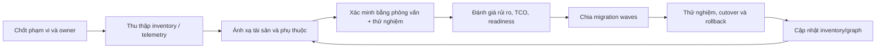
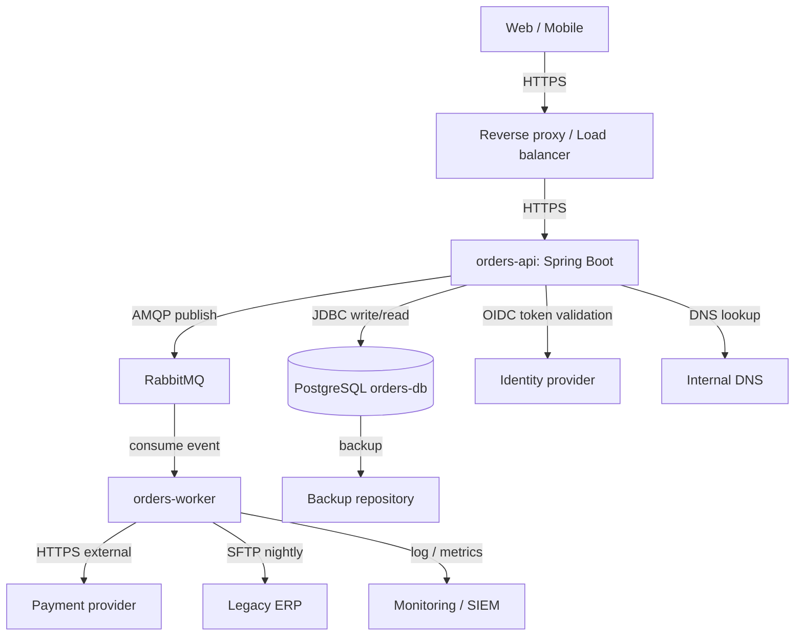
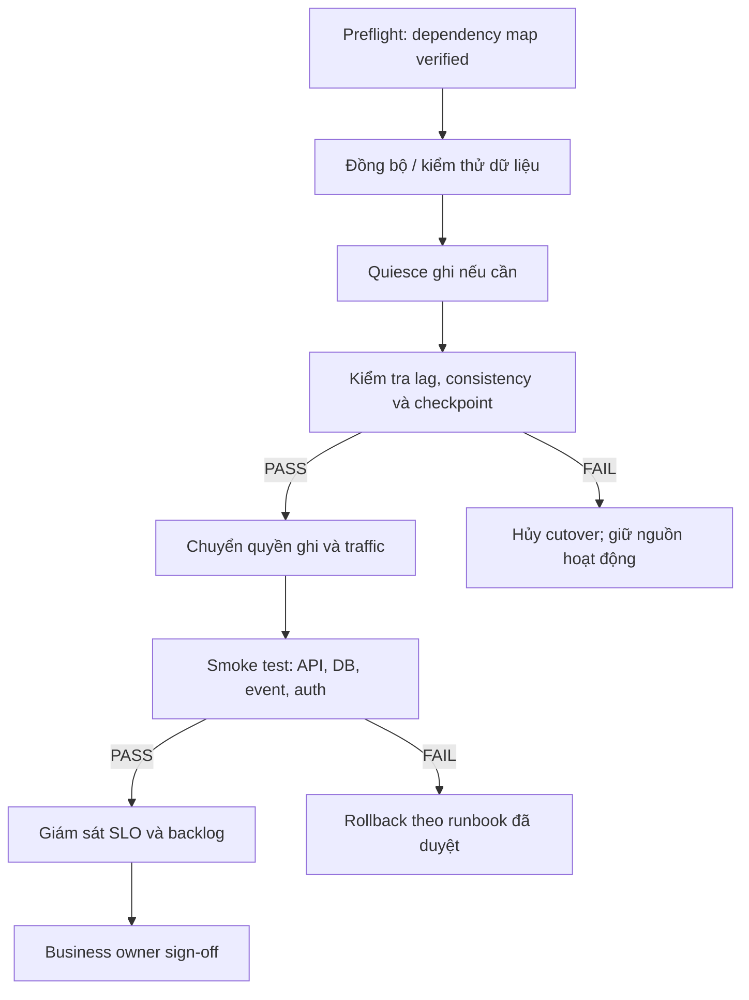

# Khảo sát hệ thống nguồn và lập danh mục phụ thuộc

Kế hoạch di chuyển một ứng dụng lên Google Cloud thường thất bại không phải vì không tạo được VM hay Kubernetes cluster, mà vì bỏ sót một dịch vụ ít được biết đến: hệ thống xác thực nội bộ, máy chủ DNS, tác vụ batch chạy cuối tháng, kết nối đến nhà cung cấp thanh toán hoặc một database mà nhiều ứng dụng cùng ghi. Nếu chỉ đếm số VM và kích thước disk, nhóm migration chưa biết hệ thống **thực sự vận hành như thế nào**, nên khó chọn thứ tự di chuyển, giới hạn thời gian gián đoạn hoặc thiết kế rollback.

Khảo sát hệ thống nguồn (*discovery*) là quá trình tìm, đo đạc và xác minh các tài sản công nghệ, workload và các mối phụ thuộc đang tồn tại trước khi quyết định kiến trúc đích. Kết quả không chỉ là một bảng kiểm kê mà còn là **bản đồ quan hệ có bằng chứng, người chịu trách nhiệm và mức tin cậy**. Đây là đầu vào cho đánh giá mức độ sẵn sàng cloud, lựa chọn phương án rehost/replatform/refactor, thiết kế mạng và IAM, ước tính chi phí, chia migration wave và diễn tập cutover.

Trong chương **Di chuyển lên Google Cloud** của module `CLOUD_PROVIDERS_GCP`, nội dung tập trung vào khảo sát nguồn từ on-premises, môi trường hosting hoặc một cloud khác. Phần tiếp theo của hành trình có thể triển khai Compute Engine, GKE, Cloud Run, Cloud Storage, database, VPC và IAM; tuy nhiên **không nên quyết định dịch vụ đích trước khi hiểu workload, dữ liệu và phụ thuộc nguồn**. Bài học sử dụng hệ thống Java/Spring Boot làm tình huống xuyên suốt, nhưng cách làm phù hợp với cả ứng dụng thương mại, middleware, batch job và hệ thống legacy.

## 1. Kết quả cần có sau giai đoạn khảo sát

Một đợt discovery có chất lượng phải trả lời được những câu hỏi sau:

- **Có những gì?** Ứng dụng, VM, máy vật lý, container, database, storage, load balancer, dịch vụ mạng, công cụ triển khai và hệ thống bên thứ ba.
- **Ai chịu trách nhiệm?** Business owner, technical owner, đội vận hành, security, DBA và liên hệ hỗ trợ nhà cung cấp.
- **Chạy ra sao?** Phiên bản OS/JDK/framework, CPU/RAM/disk, peak usage, lịch batch, giờ cao điểm, mùa vụ, license và vòng đời hỗ trợ.
- **Phụ thuộc vào gì?** API, database, message broker, identity provider, DNS, NTP, PKI, file share, secret store, CI/CD và các tích hợp bên ngoài.
- **Quan trọng đến mức nào?** Mức độ ảnh hưởng nghiệp vụ, SLO/SLA, RTO, RPO, khung giờ bảo trì, yêu cầu audit và data residency.
- **Có thể di chuyển cùng hay phải đi trước?** Nhóm workload có liên kết chặt, tài nguyên dùng chung, kết nối xuyên mạng, thứ tự khởi động và quy trình cutover/rollback.
- **Dữ liệu có đáng tin?** Bằng chứng lấy từ đâu, quan sát trong khoảng nào, được owner xác nhận chưa, còn giả định nào chưa kiểm chứng?

Các đầu ra tối thiểu nên gồm một **asset inventory**, một **workload catalog**, một **dependency register/graph**, danh sách **rủi ro và giả định**, cùng đề xuất phân nhóm **migration wave**. Một sơ đồ đẹp nhưng thiếu bản ghi và bằng chứng vận hành không đủ để dùng làm kế hoạch migration.

## 2. Phân biệt asset, workload, dependency và migration wave

| Thuật ngữ | Ý nghĩa | Ví dụ |
|---|---|---|
| Asset | Tài sản cụ thể có thể quản lý hoặc đo đạc | VM `vm-app-02`, database instance, NAS share, firewall |
| Workload | Tập hợp thành phần thực hiện một mục tiêu nghiệp vụ hoặc kỹ thuật | Dịch vụ xử lý đơn hàng gồm API, worker, database, queue |
| Application/service | Đơn vị chức năng được sở hữu và vận hành | `orders-api`, `payments-adapter`, hệ thống ERP |
| Dependency | Quan hệ mà hoạt động của một thành phần dựa vào thành phần khác | `orders-api` gọi `payments-api` qua HTTPS |
| Shared service | Dịch vụ được nhiều workload dùng chung | Active Directory, DNS, PKI, Kafka, file gateway |
| Migration wave | Nhóm workload/data được chuyển trong một đợt có kế hoạch và kiểm soát | Wave 2: đơn hàng + adapter + các tác vụ batch liên quan |
| Cutover | Thời điểm hoặc quy trình chuyển hoạt động sang môi trường mới | Đổi routing, chuyển điểm ghi DB, xác nhận giao dịch mới |
| Rollback/failback | Chuyển ngược có kiểm soát khi triển khai không đạt yêu cầu | Quay về endpoint cũ và khôi phục đồng bộ dữ liệu an toàn |

**Một workload có thể trải trên nhiều asset; một asset có thể phục vụ nhiều workload.** Ví dụ một PostgreSQL instance dùng chung ba database cho hai ứng dụng. Nếu chỉ gán mỗi VM cho một ứng dụng, nhóm migration sẽ bỏ sót quan hệ dùng chung và đánh giá sai blast radius khi tắt hệ thống cũ.

### Chu trình discovery → assessment → planning



Discovery là **quá trình lặp lại**, không phải hoạt động chạy một lần rồi khóa sổ. Hệ thống nguồn vẫn thay đổi trong lúc nhóm migration chuẩn bị network, landing zone và target architecture. Google Cloud Architecture Center cũng khuyến nghị tiếp tục cập nhật mapping workload, infrastructure và phụ thuộc trong suốt quá trình migration.

## 3. Xác định phạm vi, trách nhiệm và cách lấy bằng chứng

Trước khi dùng công cụ quét hạ tầng, cần lập danh sách đơn vị, site, môi trường và quyền được khảo sát. Một dự án có thể bao gồm nhiều data center, VMware vCenter, bare metal, một số VM AWS/Azure, các managed database và hệ thống SaaS. Không nên giả định dữ liệu từ một vCenter đại diện cho toàn bộ môi trường sản xuất.

### Xây dựng phạm vi có kiểm soát

1. Liệt kê **business capability** và dịch vụ quan trọng: bán hàng, thanh toán, nhân sự, báo cáo, xác thực, backup.
2. Chọn môi trường cần khảo sát: production, staging, disaster recovery, văn phòng chi nhánh và batch/ETL.
3. Xác định nguồn dữ liệu: CMDB, asset register, hypervisor, cloud account, monitoring, SIEM, APM, network flow, DNS, load balancer, code/config và phỏng vấn owner.
4. Ghi lại vùng được phép kết nối/quét, lịch chạy, loại quyền cấp cho collector và người phê duyệt.
5. Phân loại độ nhạy của metadata thu thập, nơi lưu dữ liệu, retention và quyền truy cập.
6. Định nghĩa tiêu chí hoàn tất: tỷ lệ tài sản có owner, tỷ lệ workload có dependency map, số quan hệ chưa xác minh và danh sách ngoại lệ.

### Ma trận vai trò đơn giản

| Vai trò | Đóng góp trong discovery | Quyết định/xác nhận |
|---|---|---|
| Migration lead | Điều phối phạm vi, tiến độ, quản lý blocker | Phê duyệt inventory baseline và wave đề xuất |
| Business owner | Mô tả quy trình, thời gian quan trọng, tính liên tục dịch vụ | Xác nhận criticality, downtime và cutover window |
| Application owner | Cung cấp kiến trúc, API, batch, cấu hình, ứng dụng phụ thuộc | Xác nhận service map và integration contract |
| Infra/VM team | Cung cấp host, CPU/RAM/storage, hypervisor và capacity | Xác nhận asset inventory và giới hạn hạ tầng |
| DBA/data owner | Cung cấp database, dung lượng, replication, backup, data lineage | Xác nhận quyền ghi, RPO, phương án chuyển dữ liệu |
| Network/security/IAM | Cung cấp routes, firewall, DNS, TLS, proxy và danh tính | Xác nhận luồng kết nối, bảo mật, compliance |
| SRE/operations | Cung cấp telemetry, on-call, runbook, lịch bảo trì | Xác nhận SLO, monitoring, recovery và thử nghiệm |

Không để việc xác nhận phụ thuộc chỉ do người quản trị VM thực hiện. Một port TCP mở cho thấy kết nối, nhưng không cho biết tác động nghiệp vụ, SLA hoặc trình tự xử lý khi endpoint thay đổi; cần ý kiến application owner và người quản lý dữ liệu.

### Chính sách bảo mật cho hoạt động khám phá

Các công cụ guest discovery có thể quan sát tên host, địa chỉ IP, tên process, command-line arguments, network sockets và cấu hình middleware. Một số trường có thể vô tình chứa token, URL nhạy cảm hoặc dữ liệu nội bộ. Hãy dùng tài khoản collector **quyền tối thiểu**, bảo vệ credentials bằng kho bí mật, mã hóa dữ liệu khi lưu/chuyển và kiểm tra nội dung trước khi xuất ra ngoài tổ chức.

Không đưa password trong command-line flags, email, CSV chia sẻ hoặc tài liệu sơ đồ. Hạn chế quyền đối với raw scan, tài liệu topology, file export và danh sách endpoint. Môi trường PCI/HIPAA hoặc có data residency nghiêm ngặt cần quy trình phê duyệt riêng trước khi chạy scan và đồng bộ dữ liệu lên cloud.

## 4. Thu thập inventory ở nhiều lớp

Khảo sát chỉ VM, CPU và RAM không đủ để vẽ kiến trúc. Một workload nên được mô tả ở các lớp sau:

| Lớp | Trường thông tin quan trọng | Ví dụ nguồn xác minh |
|---|---|---|
| Nghiệp vụ | Tên dịch vụ, owner, mức độ quan trọng, lịch cao điểm, SLO/RTO/RPO | Business owner, SLA, incident history |
| Ứng dụng | Runtime, module, version, API contract, JVM flags, cron, config | Source/config review, APM, ứng dụng owner |
| Compute | VM/physical host, OS, vCPU, RAM, container, hypervisor, uptime | vCenter, OS inventory, cloud API, collector |
| Storage và dữ liệu | Database engine, schema, volume, growth, backup, replication, dữ liệu nhạy cảm | DBA, backup catalog, DB metrics, data owner |
| Mạng | IP, subnet, VLAN/VPC, DNS, port, protocol, LB, firewall, egress, TLS | Netflow, firewall logs, DNS, LB config |
| Identity và secret | AD/LDAP/OIDC, service account, certificate, HSM, secret manager | IAM/security team, PKI, config metadata |
| Middleware/tích hợp | Kafka/RabbitMQ, Redis, SMTP, SFTP, ESB, SaaS API | Broker metadata, integration inventory, trace |
| Vận hành | CI/CD, artifact store, scheduler, monitoring, alerts, on-call, runbook | CI platform, ticketing, observability |
| Ràng buộc | Licensing, support/EOL, residency, performance, latency, compliance | Vendor, security, business and legal stakeholders |

Đối với ứng dụng Java/Spring Boot, cần ghi riêng **phiên bản JDK/Spring**, application server (Tomcat/JBoss/WebLogic), thư viện native/JNI, JAR/WAR packaging, JDBC driver, JVM heap/GC flags, số thread và khả năng container hóa. Một VM có thể chạy nhiều Java process phục vụ các workload khác nhau, nên không được suy quan hệ VM ↔ ứng dụng chỉ từ hostname.

### Định danh thống nhất và chống trùng tài sản

Mỗi asset và workload nên có ID không phụ thuộc IP hoặc hostname. IP có thể thay đổi, hostname có thể trùng giữa môi trường và một máy có thể có nhiều NIC. Ví dụ:

- `WL-ORDER-PROD`: workload xử lý đơn hàng production.
- `APP-ORDERS-API`: thành phần Java API.
- `ASSET-VM-0102`: VM nguồn, gắn với ID của hypervisor/cloud account.
- `DB-ORDERS-PRIMARY`: database deployment đang phục vụ ghi.
- `EXT-PAYMENT-PROVIDER`: hệ thống bên thứ ba.

Sử dụng `environment`, `site`, `owner`, `source_system`, `first_seen`, `last_seen` và `evidence` để phân biệt bản ghi. Khi thấy một asset từ CMDB và collector, hợp nhất bằng ID ổn định rồi lưu các nguồn chứng cứ; không tạo hai asset chỉ vì tên khác nhau.

## 5. Mẫu danh mục workload/asset có thể kiểm chứng

Một bảng kê hữu ích thường có **hai phần**: bảng workload nói về nghiệp vụ và bảng asset nói về tài nguyên. Tách hai lớp để xử lý đúng các quan hệ nhiều-nhiều.

### Bảng workload catalog (ví dụ giả định)

| Workload ID | Thành phần | Owner | Criticality | Môi trường | RTO/RPO | Hướng khảo sát |
|---|---|---|---|---|---|---|
| `WL-ORDER-PROD` | `orders-api`, `orders-worker`, PostgreSQL | Commerce team | High | PROD | 2h / 15m | Java API + giao dịch + queue |
| `WL-REPORT-PROD` | Scheduler, reporting ETL, object archive | Data team | Medium | PROD | 24h / 8h | Batch theo ngày/tháng |
| `WL-IDENTITY-PROD` | AD/LDAP và OIDC gateway | Security team | Critical | PROD | 1h / 5m | Dịch vụ dùng chung, ảnh hưởng diện rộng |

Giá trị RTO/RPO ở bảng chỉ mang tính minh họa, không phải mục tiêu mặc định của Google Cloud hoặc mọi doanh nghiệp. Các giá trị phải được business owner phê duyệt và đối chiếu với khả năng thực tế của database, backup và dịch vụ liên quan.

### Bảng asset inventory (ví dụ giả định)

| Asset ID | Kiểu / nguồn | Cấu hình chính | Liên kết workload | Mức sử dụng/tồn đọng |
|---|---|---|---|---|
| `ASSET-VM-0102` | VMware Linux VM | 4 vCPU, 16 GiB RAM, JDK 17 | `WL-ORDER-PROD` | CPU peak 65%; có batch 23:00 |
| `DB-ORDERS-PRIMARY` | PostgreSQL database | 800 GiB, tăng 35 GiB/tháng | `WL-ORDER-PROD`, `WL-REPORT-PROD` | 2 ứng dụng truy cập, cần kiểm tra quyền ghi |
| `MQ-BROKER-01` | RabbitMQ cluster | 3 node, persistent queue | `WL-ORDER-PROD`, `WL-REPORT-PROD` | Queue retry và DLQ chưa xác minh |
| `IDP-01` | OIDC/LDAP gateway | Active-passive, TLS | Nhiều workload | Shared dependency critical |

Các số liệu là ví dụ học tập, không phải kết quả scan thực. Bảng nguồn thật nên có thêm `asset_id`, `source_id`, IP/subnet, OS, storage IOPS/throughput, software inventory, license, data classification, timestamp, nguồn evidence và **confidence**. Không gộp giá trị quan sát (ví dụ `CPU 65%`) với dự đoán hoặc kiến nghị (ví dụ `VM đích 2 vCPU`) trong cùng trường mà thiếu nhãn phân biệt.

### Mẫu cấu trúc CSV để trao đổi giữa các nhóm

```csv
workload_id,asset_id,environment,component,owner,source,first_seen,last_seen,confidence,status
WL-ORDER-PROD,ASSET-VM-0102,prod,orders-api,commerce-team,vcenter+apm,2026-10-15,2026-11-15,verified,in_scope
WL-ORDER-PROD,DB-ORDERS-PRIMARY,prod,postgresql,commerce-team,dba+monitoring,2026-10-15,2026-11-15,verified,in_scope
WL-ORDER-PROD,MQ-BROKER-01,prod,rabbitmq,platform-team,network+app-owner,2026-10-20,2026-11-15,probable,to_validate
```

Định dạng CSV là **schema đề xuất để dùng trong dự án**, không phải định dạng import chuẩn của Migration Center. Nếu dùng Migration Center import, phải theo schema được Google Cloud hỗ trợ cho từng loại asset. Tránh đặt mật khẩu, thông tin khách hàng hay token vào CSV export.

## 6. Chọn phương pháp discovery và công cụ phù hợp

Không có một công cụ duy nhất hiểu đầy đủ ứng dụng, database, kết nối mạng và quy trình nghiệp vụ. Cần kết hợp **thu thập tự động** với **phỏng vấn/chứng cứ thủ công**. Google Cloud Migration Center hỗ trợ khảo sát hạ tầng và phân tích migration; APM, tracing, logs, CMDB và chủ sở hữu ứng dụng bổ sung ngữ nghĩa nghiệp vụ còn thiếu.

| Cách thu thập | Điểm mạnh | Giới hạn và lưu ý |
|---|---|---|
| CMDB, tài liệu sơ đồ, ticket | Tên dịch vụ, owner, danh sách hợp đồng và quy trình | Có thể lỗi thời, thiếu tài nguyên mới |
| vCenter/hypervisor/cloud inventory | Danh sách VM, CPU, RAM, storage, lịch sử performance | Không hiểu đầy đủ logic ứng dụng hoặc phụ thuộc nghiệp vụ |
| Guest discovery từ OS | Process, service, cổng, package, middleware, cấu hình máy | Cần quyền và network access; có thể chứa metadata nhạy cảm |
| Network flow/firewall/LB logs | IP/port/protocol, hướng truy cập, tần suất | Một kết nối có thể là health check, scan hoặc traffic qua proxy/NAT |
| APM/distributed tracing | Call chain, API và dependency ở request path | Phụ thuộc instrument, sampling; có thể bỏ sót batch và traffic hiếm |
| DBA/scheduler/broker metadata | Database mapping, replication, queue, cron/batch | Không phải dịch vụ nào cũng có metadata tập trung |
| Phỏng vấn owner và thử nghiệm | Xác minh vai trò, criticality, failover và đường đi nghiệp vụ | Cần thời gian; ý kiến cần gắn bằng chứng và người xác nhận |

### Google Cloud Migration Center: điểm bắt đầu cho hạ tầng nguồn

Migration Center có thể thu thập inventory server, VM và một số nguồn database để ước tính sizing, TCO và gợi ý đích đến. Các cách thu thập gồm:

1. **One-time discovery:** dùng `mcdc` CLI để lấy snapshot tại một thời điểm, chạy inventory discovery, guest discovery hoặc IP range scan theo hỗ trợ của nền tảng.
2. **Continuous discovery:** cài **discovery client** trên máy Windows có thể kết nối đến các asset trong phạm vi, cấu hình quét định kỳ để thu thập thông tin trong nhiều ngày/tuần.
3. **Manual collection/import:** xuất dữ liệu từ công cụ hiện có hoặc dùng collection script theo loại asset rồi nhập vào Migration Center.

`mcdc` CLI chạy trên Linux và Windows, hỗ trợ **offline assessment**. Dữ liệu do CLI thu thập không tự được upload cho đến khi người vận hành thực hiện thao tác export lên Migration Center. Ngược lại, discovery client ở chế độ kết nối có thể đồng bộ dữ liệu theo cấu hình. Cách triển khai và quyền quét phải được phê duyệt theo chính sách tổ chức.

Phân biệt giới hạn quan trọng:

- **Discovery client giao diện cài đặt trên Windows** có thể khảo sát host Windows/Linux, nhưng không dùng nó như một trình quét database tổng quát. Đối với database, dùng `mcdc` CLI guest discovery có tùy chọn database engine, hoặc database collection scripts/import thích hợp.
- `mcdc` CLI hỗ trợ inventory discovery cho một số môi trường như VMware, AWS và Azure theo giới hạn từng tính năng, đồng thời hỗ trợ guest discovery qua SSH/WMI/vSphere hoặc collection script chạy cục bộ.
- Khả năng thu thập phụ thuộc hệ điều hành, quyền của collector và phương thức truy cập. `root`/administrator có thể nhìn sâu hơn nhưng mở rộng rủi ro bảo mật; chọn privilege theo nhu cầu thu thập.
- Discovery client và report thường hỗ trợ đánh giá **infrastructure/network**, không tự xác minh bảng dữ liệu, giao dịch nghiệp vụ, contract hay quyền truy cập trong source application.

Ví dụ minh họa **một lệnh guest discovery qua SSH** trên host Linux nơi `mcdc` CLI đã được cài và được phép truy cập máy nguồn:

```bash
# Chạy trên máy collector đã được tổ chức phê duyệt
./mcdc discover ssh 192.0.2.10
```

`192.0.2.10` là địa chỉ ví dụ (documentation range). Tên lệnh, cơ chế xác thực và quyền SSH phụ thuộc bản CLI/OS; hãy kiểm tra tài liệu `mcdc` đang dùng và thử ở scope nhỏ trước khi quét hàng loạt. Không đưa password trực tiếp vào dòng lệnh vì có nguy cơ bị ghi vào shell history/process list. Không chạy quét production ngoài lịch đã được phê duyệt.

### Database discovery là một luồng riêng

Database cần dữ liệu chi tiết hơn việc quan sát port `5432`, `3306` hoặc `1433`. Với PostgreSQL, MySQL hoặc SQL Server, có thể dùng database collection script hay guest discovery hỗ trợ engine tương ứng. Thông tin cần thu thập gồm engine/version/edition, cấu hình replication, size, transaction rate, IOPS, backup, các client truy cập, schema, extension, stored procedures, license và độ trễ chấp nhận được.

Một IP nói chuyện qua cổng PostgreSQL không chứng minh đó là **database ứng dụng**: có thể là management connection, monitoring hoặc client dùng chung. Cần DBA xác nhận instance, database/schema cụ thể, quyền đọc/ghi, dữ liệu nhạy cảm và vai trò trong cutover. Không scan dữ liệu bảng chứa thông tin khách hàng chỉ để lấy inventory; chỉ thu metadata cần thiết và dùng quyền read-only theo quy trình.

### Cloud Asset Inventory phục vụ môi trường GCP đã tồn tại

**Cloud Asset Inventory** là dịch vụ metadata inventory của **tài nguyên Google Cloud**, ví dụ Compute Engine, Cloud Storage, IAM policy và quan hệ tài nguyên. Nó hữu ích khi tổ chức đang có landing zone hoặc workload trên GCP và muốn so sánh asset đích với thiết kế. Cloud Asset Inventory **không thay thế discovery của VM/ứng dụng on-prem** và không phải nguồn real-time duy nhất cho quyết định vận hành sản xuất. Đối với hệ thống nguồn ngoài GCP, vẫn cần Migration Center, công cụ nguồn và xác nhận với owner.

## 7. Đo tải đủ lâu để tránh chọn sai kích thước đích

Snapshot CPU ở một thời điểm có thể đánh giá thấp workload. Một VM thường idle vào ban ngày nhưng bận trong batch cuối tháng, hoặc một ứng dụng có traffic gấp nhiều lần vào ngày khuyến mãi. Để sizing lên Compute Engine, GKE hay Cloud Run, cần thu thập **time series** và lưu bối cảnh của từng giai đoạn.

Các nhóm số liệu nên có:

| Nhóm | Chỉ số quan sát | Ý nghĩa migration |
|---|---|---|
| Compute | CPU p50/p95/peak, RAM used/committed, process, thread, JVM heap | Ước lượng capacity, headroom và cấu hình runtime |
| Disk | Used/free, growth, IOPS, throughput, p95 latency, backup size | Chọn storage class, migration bandwidth và thời gian copy |
| Network | Ingress/egress, peak Mbps, connection count, endpoint và port | Thiết kế VPC, VPN/Interconnect, firewall, egress cost |
| Application | RPS, p95/p99 latency, error rate, session, concurrency, batch duration | Đặt SLO baseline và xác minh sau migration |
| Database | QPS/TPS, connections, slow queries, replication lag, growth | Đánh giá downtime, CDC, sizing Cloud SQL/Spanner/AlloyDB |
| Reliability | Incident, recovery time, backup/restore thử nghiệm, cron/scheduler windows | Thiết kế RTO/RPO và rollback |

Khoảng thời gian đo nên **bao phủ chu kỳ nghiệp vụ**, không chỉ theo số ngày cố định. Với dịch vụ thông thường, nhiều ngày đến vài tuần có thể cho bức tranh đủ tốt; với batch theo tháng/quý cần bổ sung log lịch sử hoặc quan sát xuyên kỳ. Khi thiếu dữ liệu peak, đánh dấu `estimated` và tăng hệ số an toàn có giải thích thay vì đưa ra sizing chính xác giả tạo.

Một số dữ liệu quan sát như thời gian peak, CPU throttling và file IO không thể suy ra từ CPU/RAM cấu hình. Bảo đảm phân biệt **capacity được cấp** với **usage thật** và **requirements**. Ví dụ VM 16 vCPU không nhất thiết cần 16 vCPU ở GCP; ngược lại, CPU trung bình thấp không có nghĩa ứng dụng không cần nhiều CPU trong khoảng ngắn.

### Kiểm tra chất lượng dữ liệu thu thập

Sau mỗi kỳ thu thập, đối chiếu các chỉ số:

- **Coverage:** số asset đã phát hiện / số asset ước tính trong scope; các subnet và cloud account nào chưa quét?
- **Freshness:** lần cuối thấy asset/connection; có VM nào mới thêm hoặc đã decommission?
- **Completeness:** asset nào thiếu owner, OS, CPU, RAM, database mapping hoặc metrics?
- **Confidence:** quan hệ nào do owner xác nhận, quan hệ nào chỉ do port/network flow suy đoán?
- **Outliers:** RAM cao bất thường, tên host trùng, network flow không khớp hoặc thay đổi IP.
- **Temporal coverage:** đã quan sát batch đêm, ngày cuối tháng, kỳ backup và DR exercise chưa?

Không xóa “unknown asset” khỏi sơ đồ chỉ vì không quét được; đánh dấu trạng thái chưa nhận diện và giao người xử lý. Unknown endpoint có thể chính là dependency quan trọng nhất trong cutover.

## 8. Danh mục phụ thuộc phải là một đồ thị có hướng

Một danh sách kiểu “orders-api phụ thuộc database và payment” vẫn chưa đủ để thực hiện migration. Cần mô tả **ai gọi ai**, qua kênh gì, mức độ phụ thuộc, điều kiện lỗi và khoảng thời gian hoạt động. Hãy biểu diễn ứng dụng/tài nguyên thành **node**, kết nối hoặc phụ thuộc thành **edge** có thuộc tính.

### Định nghĩa một dependency edge

| Trường | Ví dụ | Vì sao cần |
|---|---|---|
| `source` → `target` | `orders-api` → `orders-db` | Xác định chiều gọi và đường ảnh hưởng |
| `type` | sync API / async event / SQL / file / identity / DNS | Phân biệt cách cutover và retry |
| `protocol`/`port` | TCP 5432, HTTPS 443, AMQP 5672 | Chuẩn bị firewall, VPC, proxy, LB |
| `endpoint` | `orders-db.internal.example` | Ghi DNS name được cấu hình thay vì chỉ IP |
| `purpose` | Ghi đơn hàng | Giải thích hậu quả nghiệp vụ nếu lỗi |
| `criticality` | blocking / degraded / optional | Ưu tiên wave và smoke test |
| `frequency` | Mỗi request / mỗi đêm / cuối tháng | Tránh bỏ sót phụ thuộc ít xuất hiện |
| `latency_budget` | p99 dưới 50 ms (giả định) | Đánh giá rủi ro kết nối hybrid xuyên khu vực |
| `auth` | mTLS, OIDC, service account, DB role | Chuẩn bị IAM, DNS, certificate, secret |
| `evidence` | Trace, firewall flow, config, owner | Biết cách xác minh hoặc phản biện |
| `owner/status` | Commerce team / verified | Tránh đồ thị không ai chịu trách nhiệm |

Một đường kết nối có thể là **phụ thuộc hai chiều về nghiệp vụ** nhưng các lần gọi kỹ thuật không đối xứng. Ví dụ `orders-api` gửi event đến broker, broker sau đó phân phối event cho `reporting-worker`: đó là hai edge có ý nghĩa khác nhau, không phải một mũi tên từ API thẳng đến reporting.

### Ví dụ đồ thị nguồn cho hệ thống đặt hàng



Đây là sơ đồ **giả định để học cách lập graph**, không phải topology thật. Chẳng hạn payment provider có thể được gọi trực tiếp bởi API thay vì worker; cần xác nhận bằng trace và owner. Sơ đồ chỉ là view; dependency register phải chứa thông tin chi tiết, bằng chứng, thời gian và nguồn khảo sát cho từng edge.

### Phụ thuộc trực tiếp, gián tiếp và chu trình

- **Trực tiếp:** `orders-api` gọi `orders-db` qua JDBC.
- **Gián tiếp:** `orders-api` phụ thuộc `payment-provider` thông qua broker và worker; lỗi payment có thể làm backlog tăng dù API vẫn nhận request.
- **Shared:** nhiều ứng dụng dùng chung DNS, identity provider hoặc broker. Nếu hệ thống shared bị thay đổi, nhiều wave có thể bị ảnh hưởng.
- **Cyclic:** A gọi B, B lại gọi A (hoặc dùng chung database khiến khó tách). Các thành phần có vòng phụ thuộc thường cần chuyển cùng wave, tách interface hoặc xây dựng cơ chế hybrid tạm thời.
- **Temporal:** payroll chỉ kết nối ERP ngày cuối tháng; một đợt quan sát hai ngày có thể bỏ sót hoàn toàn.

Trước khi đưa một workload vào wave, cần tìm **strongly connected components** hoặc ít nhất nhóm tài nguyên có liên kết hai chiều/khó tách. Đây là cơ sở để quyết định migration unit thực tế, không nhất thiết trùng với một ứng dụng trong CMDB.

## 9. Network connection không đồng nghĩa dependency nghiệp vụ

Migration Center có thể tạo network dependencies report chứa kết nối giữa server assets theo dữ liệu đã thu thập. Report giúp thấy IP, port, protocol, tần suất kết nối và những asset chưa được nhận diện. Tính năng visualization của Migration Center hiển thị graph server connection và đang được Google Cloud công bố ở trạng thái **Preview**; không nên dựa hoàn toàn vào tính năng Preview cho bước kiểm soát quan trọng nếu chưa xác minh giới hạn hỗ trợ.

Cần đặc biệt cẩn thận khi giải thích dữ liệu mạng:

| Quan sát | Có thể là | Cần xác minh thêm |
|---|---|---|
| API gọi TCP 5432 | PostgreSQL workload | Database/schema thực tế, read/write, pool, TLS |
| Nhiều host gọi TCP 443 một IP | API/IdP/SaaS hoặc proxy | TLS SNI, hostname, proxy route, application trace |
| Truy cập cổng 53 | DNS resolver | Domain nào, TTL, private zone, split-horizon |
| Kết nối TCP 5672 | AMQP broker | Exchange, queue, routing key, retry/DLQ, consumer |
| Kết nối ngắn hiếm gặp | Health check hoặc cron theo lịch | Lịch chạy, owner, log dài hạn |
| Nhiều IP sau NAT/LB | Một backend hoặc nhiều dịch vụ | LB config, reverse proxy, DNS, service discovery |
| Không thấy kết nối | Có thể không có traffic trong cửa sổ quan sát | Chạy batch/test, xem config, hỏi owner |

Một report quan hệ mạng của Migration Center có thể tổng hợp kết nối theo tháng, và thời gian lưu/khả năng thu thập phụ thuộc phương thức. Tài liệu hiện tại lưu ý network dependencies report sử dụng dữ liệu OS scan của discovery client; chỉ inventory từ vSphere không đủ để suy mọi kết nối ứng dụng. Khi dùng CLI hoặc phương thức khác, cần kiểm tra đúng loại dữ liệu đã thu và tính năng visualize có hỗ trợ đầu vào đó hay không.

**Bằng chứng nên được phân loại:**

1. `observed`: có flow/trace/log khớp endpoint trong khoảng thời gian chỉ rõ.
2. `declared`: được cấu hình hoặc owner xác nhận nhưng chưa có telemetry quan sát.
3. `inferred`: suy luận từ port, package, tên server hoặc pattern; cần kiểm chứng.
4. `deprecated`: từng tồn tại nhưng đã có bằng chứng ngừng sử dụng.
5. `unknown`: chưa có bằng chứng đủ để khẳng định hoặc loại trừ.

Không dùng `inferred` như `verified`. Mỗi relationship cần lưu `confidence`, `observed_at`, `validated_by` và action kế tiếp nếu còn nghi vấn. Điều này đặc biệt quan trọng khi đội network chuẩn bị firewall rule hoặc đội DBA chuẩn bị cutover database.

## 10. Khảo sát ứng dụng Java và Spring Boot trước khi di chuyển

Đối với hệ thống Java/Spring đang chạy trên máy ảo hoặc application server, thông tin từ OS scan chỉ cho biết process và thư viện đã cài. Cần bổ sung code/config review có kiểm soát và phỏng vấn nhóm ứng dụng để tìm integration khó quan sát. Những chủ đề sau thường quyết định có thể chuyển sang Compute Engine nguyên trạng hay nên replatform lên GKE/Cloud Run:

| Nhóm kiểm tra | Câu hỏi và bằng chứng | Rủi ro nếu bỏ sót |
|---|---|---|
| Java/runtime | JDK/JRE, phiên bản Spring, application server, native library, unsupported OS | Runtime không tương thích hoặc hết hỗ trợ |
| Packaging | JAR/WAR/EAR, script khởi động, systemd service, local config | Container mới không khởi động đúng |
| Database | JDBC URL, connection pool, driver, SQL dialect, XA/distributed transaction | Không tương thích DB hoặc timeout do latency |
| HTTP/gRPC | Base URL, proxy, mTLS, API gateway, retry/backoff, timeout | Request thất bại qua hybrid network |
| Identity | LDAP/AD, OIDC/SAML, service credential, certificate truststore | Không đăng nhập/ủy quyền sau cutover |
| Messaging | Kafka/RabbitMQ/JMS, consumer group, queue, DLQ, ordering | Mất/nhân đôi event, backlog không xử lý |
| Scheduler | `@Scheduled`, Quartz, cron, Airflow, shell, batch cuối tháng | Job chạy trùng hoặc bị bỏ sót |
| Local state | File upload, `/tmp`, shared NFS/SMB, session memory, cache | Dữ liệu mất khi chạy stateless hoặc thay Pod |
| Observability | Log file, trace propagation, JMX/Actuator, alert và dashboard | Mất khả năng chẩn đoán trong migration |
| Security | Secrets, `keystore`/`truststore`, TLS version, certificate rotation | Lộ secret, lỗi handshake hoặc vi phạm chính sách |
| Deployment | CI/CD, artifact repository, rollback script, DB migration tool | Không triển khai/rollback nhất quán |

Ví dụ trong ứng dụng Spring Boot, các thuộc tính `spring.datasource.url`, `spring.kafka.bootstrap-servers`, `spring.rabbitmq.host`, `spring.security.oauth2.*` và cấu hình ứng dụng riêng thường chứa đầu mối integration. Chỉ ghi lại **tên property, loại dịch vụ và endpoint đã được làm sạch**, không sao chép giá trị password, token hoặc toàn bộ secret vào tài liệu migration.

### Các nguồn chứng cứ cần đối chiếu

1. Danh sách application process, JVM command line, listener port và process owner.
2. Hệ thống cấu hình/secret store, biến môi trường có tên liên quan đến DB, Kafka, OIDC, SFTP; không xuất giá trị nhạy cảm.
3. API gateway/OpenAPI spec, Service discovery, reverse proxy và load balancer configuration.
4. Distributed traces và application logs theo business flow thực tế; đối chiếu với network graph.
5. Scheduler/quartz tables, batch calendar, sự kiện từ broker và dead-letter queue.
6. Database client metadata, quyền truy cập schema và các giao dịch liên hệ đến hệ thống khác.
7. Source repository, dependency/SBOM và build scripts nếu tổ chức cho phép đọc; chú ý runtime EOL và license.

Một ứng dụng sử dụng database “chung” cần xác định rõ nó **đọc, ghi hay thực hiện schema migration**. Hai ứng dụng cùng đọc một DB có thể tách wave dễ hơn hai ứng dụng cùng ghi vào một bảng. Một job batch duy nhất sửa dữ liệu có thể quyết định thời điểm cutover cho cả hệ thống.

## 11. Đánh giá phụ thuộc dữ liệu và ràng buộc vận hành

Di chuyển compute trước khi hiểu luồng dữ liệu dễ tạo latency, phát sinh data egress và tình trạng ghi vào hai hệ thống không được đồng bộ. Với mỗi database, file store, object archive hoặc event stream, hãy lập **data dependency passport**:

| Trường | Nội dung cần thu thập |
|---|---|
| System of record | Hệ thống nào là nguồn dữ liệu có thẩm quyền? |
| Owner/classification | Data owner, public/internal/confidential/restricted, PII/PCI nếu có |
| Engine và version | PostgreSQL/MySQL/SQL Server/Oracle, extension, collation, charset |
| Size/growth | Dung lượng hiện tại, growth/month, churn, largest table/file |
| Change rate | TPS/QPS, CDC volume, write patterns, peak/off-peak |
| Consistency | Strong/eventual, transaction boundary, cross-system writes |
| Backup/restore | Lịch backup, retention, restore test, encrypted backup |
| RTO/RPO | Mục tiêu được owner phê duyệt, độ trễ replication chấp nhận |
| Consumers | API, batch, analytics, vendor và owner của từng consumer |
| Cutover method | Quiesce writes, bulk load, CDC, dual-run, verification và rollback |

### Những loại phụ thuộc dữ liệu cần ghi rõ

- **Online transaction:** request mới cần ghi vào primary database; việc chuyển application endpoint phải đồng bộ với chuyển quyền ghi.
- **Read-only/reporting:** có thể chuyển sau nếu chấp nhận latency và độ trễ replication, nhưng cần đo data egress.
- **Batch/ETL:** cron chạy theo lịch ít xuất hiện; cần xác định nguồn/đích và cửa sổ xử lý.
- **File transfer:** SFTP/SMB/NFS, naming convention, permission, khóa file, retry và cơ chế xác nhận nhận file.
- **Event stream:** topic/queue, consumer offsets, ordering key, exactly-once assumptions, idempotency và DLQ.
- **Identity data:** nhóm/role trong AD/LDAP/OIDC, quyền truy cập, token/certificate trust và phụ thuộc thời gian.

Không mặc định **backup = DR**. Một hệ thống có backup nhưng chưa được restore test không chứng minh đạt RTO/RPO. Nếu dữ liệu được sao chép bất đồng bộ, phải đo lag và xác định rủi ro mất dữ liệu ở cutover. Nếu có phương án dual-write, cần đánh giá idempotency, conflict resolution và cách đảo ngược khi rollback, không triển khai chỉ dựa trên ý tưởng “ghi vào cả hai nơi”.

## 12. Chuyển phụ thuộc nguồn thành yêu cầu kiến trúc GCP

Discovery chưa phải bước chọn giải pháp cuối cùng, nhưng mỗi ràng buộc được phát hiện cần chuyển thành **design requirement** để đội kiến trúc có thể so sánh phương án.

| Phát hiện ở nguồn | Câu hỏi kiến trúc GCP | Lựa chọn cần đánh giá (không tự động áp dụng) |
|---|---|---|
| Java app có state local | Có thể stateless hóa và tách session/file không? | Compute Engine rehost, GKE, Cloud Run và storage ngoài process |
| Hệ thống dùng SMB/NFS | Có cần POSIX locking, throughput, quyền file không? | Filestore hoặc giải pháp phù hợp; Cloud Storage có semantics khác file system |
| PostgreSQL primary và batch đọc/ghi | Có thể đổi engine/phiên bản, cần HA/RPO nào? | Cloud SQL PostgreSQL, AlloyDB, self-managed DB theo nhu cầu |
| Nhiều endpoint nội bộ cố định | DNS split-horizon, routing, firewall, TLS hoạt động ra sao? | VPC, Cloud DNS, Cloud VPN/Interconnect, load balancing |
| Queue cũ có ordering/transaction semantics | Có thể chuyển giao thức và bảo đảm xử lý không trùng không? | Pub/Sub hoặc giữ broker trên GKE/VM nếu cần tương thích |
| Sử dụng AD/LDAP hoặc on-prem IdP | Cơ chế identity hybrid và secret rotation thế nào? | IAM federation, Cloud Identity/IdP integration, Secret Manager |
| Vendor chỉ cho phép IP nguồn cố định | Egress đi từ đâu, cần NAT/allowlist nào? | Cloud NAT, proxy egress, dedicated networking |
| Log ứng dụng lưu trên disk | Cần structured logging, retention và audit trails nào? | Cloud Logging/Monitoring, OpenTelemetry |

Chọn Google Cloud service cần dựa vào **capability, SLA, giới hạn kỹ thuật, khu vực dữ liệu và tổng chi phí**, không chỉ tên dịch vụ tương tự. Ví dụ RabbitMQ và Pub/Sub có mô hình xử lý khác nhau; di chuyển broker có thể đòi thay code consumer/producer và contract thay vì một thao tác cấu hình.

### Mô hình kết nối hybrid trong giai đoạn chuyển tiếp

Không phải mọi thành phần có thể chuyển trong một lần. Vì thế discovery cần tính đường liên lạc giữa nguồn và GCP trong thời gian hybrid: DNS, routing, MTU, bandwidth, firewall, source IP, proxy và TLS. Một ứng dụng đặt ở GKE region xa database on-prem có thể tăng latency mỗi giao dịch nhiều lần. Nếu request thực hiện hàng chục round trip SQL, tác động có thể lớn hơn nhiều so với độ trễ của một HTTP request đơn lẻ.

Đo ứng dụng trong trạng thái hybrid trước cutover production; ghi rõ **dependency nào vẫn nằm nguồn**, ai chịu trách nhiệm kết nối và chi phí truyền dữ liệu. Xác minh cả chiều application → database/API và chiều callback/notification từ hệ thống nguồn hoặc vendor → GCP.

## 13. Xây dựng workload passport để ra quyết định

Một **workload passport** là bản tóm tắt có cấu trúc cho một đơn vị migration. Ví dụ minh họa (đã dùng tên và IP giả định):

```yaml
workload_id: WL-ORDER-PROD
name: orders-platform
business_capability: order-processing
environment: production
business_owner: commerce-lead
technical_owner: orders-team
criticality: high
source_environment:
  provider: on-premises-vmware
  assets:
    - ASSET-VM-0102
    - ASSET-VM-0103
    - DB-ORDERS-PRIMARY
    - MQ-BROKER-01
runtime:
  application: Spring Boot
  jdk: "17"
  packaging: jar
nonfunctional:
  rto: 2h
  rpo: 15m
  business_peak: month-end-and-campaigns
  data_classification: confidential
dependencies:
  - target: DB-ORDERS-PRIMARY
    type: sql
    direction: outbound
    role: blocking
    evidence: app-config-plus-dba
    confidence: verified
  - target: MQ-BROKER-01
    type: amqp
    direction: outbound
    role: degraded-if-unavailable
    evidence: network-flow-plus-app-owner
    confidence: verified
open_questions:
  - Can reporting workload share the database during cutover?
  - Does nightly ERP transfer support replay after failure?
candidate_strategy: assessment-required
```

Đây là **mẫu tài liệu do nhóm migration tự định nghĩa**, không phải manifest dành cho Google Cloud API. `candidate_strategy: assessment-required` nhắc rằng chưa có quyết định kỹ thuật cuối cùng trước khi giải quyết các câu hỏi còn mở. Khuyến khích ghi liên kết đến bằng chứng và người xác nhận trong hệ thống quản lý chính thức thay vì chèn raw secrets hoặc bản dump dữ liệu vào YAML.

### Mẫu dependency register (CSV)

```csv
edge_id,source,target,type,protocol,criticality,frequency,evidence,confidence,owner,validated_at
DEP-001,orders-api,orders-db,sql,tcp/5432,blocking,per-request,trace+dba,verified,commerce-team,2026-11-10
DEP-002,orders-api,rabbitmq,message,amqp/5672,degraded,per-order,config+flow,verified,platform-team,2026-11-10
DEP-003,orders-worker,legacy-erp,file,sftp/22,blocking,nightly,scheduler+owner,verified,integration-team,2026-11-12
DEP-004,orders-api,identity-provider,auth,https/443,blocking,on-login,config-only,probable,security-team,
```

Đối với edge `DEP-004`, trường `validated_at` trống có chủ đích: đây là giả định chưa được owner ký xác nhận. Điều này giúp lập **discovery gap backlog**, thay vì làm cho một bản đồ phụ thuộc không hoàn chỉnh trông như đã sẵn sàng cutover.

## 14. Phân nhóm migration wave dựa trên dependency graph

Sau discovery, nhóm migration bắt đầu sắp xếp workload thành các đợt chuyển. Không chỉ ưu tiên VM nhỏ hoặc hệ thống ít CPU. Thứ tự phải dựa trên phụ thuộc, tính quan trọng, khả năng rollback và cơ hội học hỏi từ pilot.

Một số nguyên tắc:

1. **Pilot trước bằng workload ít phụ thuộc và có rollback đơn giản.** Đây là cơ hội kiểm tra landing zone, IAM, logging, network, CI/CD và quy trình thay đổi.
2. **Nhóm các thành phần liên kết chặt.** Application và database có quá nhiều round trip có thể nên chuyển gần nhau để tránh latency khi hybrid.
3. **Đưa shared dependencies vào kế hoạch riêng.** DNS, IdP, PKI và broker dùng chung cần có owner, khả năng hybrid và thời điểm thay đổi tương thích với các wave khác.
4. **Cân nhắc chiều phụ thuộc.** Nếu A gọi B, có thể cần chuẩn bị B hoặc đảm bảo A còn truy cập B qua hybrid connection trước khi di chuyển A.
5. **Phân tách dependency mềm/cứng.** Message queue cho phép chịu gián đoạn tạm thời khác với synchronous call không có fallback.
6. **Tránh vòng phụ thuộc không có phương án tách.** Chuyển đồng thời nhóm có strongly connected components hoặc thực hiện refactor/bridge trước.
7. **Không gộp quá nhiều dịch vụ critical trong một window.** Giảm blast radius; có checkpoint và tiêu chí stop/go.

### Ví dụ chia wave từ đồ thị đã khám phá

| Wave | Workload chính | Điều kiện trước khi bắt đầu | Kiểm tra bắt buộc |
|---|---|---|---|
| 0 — Foundation | VPC, DNS, IAM, connectivity, observability, CI/CD | Landing zone, quota, policy và team ownership đã sẵn | Routing, TLS, logs/metrics, account access |
| 1 — Pilot | Internal reporting service stateless | Có đường đọc database nguồn qua hybrid; có rollback | RPS/latency, kết quả báo cáo, network egress |
| 2 — Core data | PostgreSQL và thành phần tích hợp cần đồng bộ | CDC/backup, replication lag, owner phê duyệt RPO | Row counts, checksum, query correctness, application smoke test |
| 3 — Orders | `orders-api`, `orders-worker`, queue adapter | DB đích sẵn; payment/ERP/IdP endpoint được kiểm thử | Tạo đơn, thanh toán giả lập, event replay, rollback |
| 4 — Legacy cleanup | Thành phần cũ còn lại, traffic drain, decommission | Không còn producer/consumer dùng endpoint cũ | 0 traffic hợp lệ, backup lưu trữ, owner sign-off |

Đây chỉ là **một phương án minh họa**. Nếu reporting có write access vào cùng database hoặc bộ phận payment phải chạy đồng thời với orders, thứ tự cần thay đổi. Wave 0 có thể được thực hiện song song với một phần khảo sát, nhưng không có nghĩa team đã được phép migrate khi dependency critical vẫn chưa biết.

### Ưu tiên theo mức độ rủi ro và tính sẵn sàng

Có thể dùng ma trận đánh giá tương đối trước khi quyết định thứ tự. Ví dụ cho điểm 1–5:

| Tiêu chí | Điểm thấp | Điểm cao |
|---|---|---|
| Dependency complexity | Ít dependency, không có vòng | Nhiều shared service và vòng phụ thuộc |
| Data complexity | Stateless, có thể dựng lại | Ghi giao dịch nhiều nơi, RPO nghiêm ngặt |
| Compatibility | Runtime được hỗ trợ, image sẵn | OS/EOL, native plugin, license khó |
| Cutover/rollback | DNS hoặc routing rollback đơn giản | Schema/data conversion khó đảo ngược |
| Observability | Metrics, logs, trace và test đầy đủ | Không có baseline, owner không rõ |

Điểm cao thể hiện nhiều rủi ro hơn, không phải ưu tiên migrate sớm. Cộng điểm có thể dùng để so sánh sơ bộ, nhưng quyết định cuối phải có business owner, migration lead và các nhóm kỹ thuật liên quan. Một workload critical với nhiều dependency đôi khi phải đi trước để mở khóa các hệ thống khác; không thể thay thế phán đoán kỹ thuật bằng một công thức điểm duy nhất.

## 15. Chuẩn bị cutover và rollback từ giai đoạn khảo sát

Nếu tới ngày triển khai mới hỏi “ứng dụng đang gọi database nào?” thì discovery chưa hoàn tất. Từ dependency register, lập danh sách thay đổi cần thực hiện khi chuyển workload:

- **Network/DNS:** tên miền, private DNS zone, endpoint, LB, NAT, proxy, source IP allowlist, firewall rules, TLS certificate.
- **Identity:** service account, quyền DB/schema, OIDC redirect URI, client certificate, token issuer/audience, secret rotation.
- **Data:** backup điểm khôi phục, CDC, replication lag, quyền ghi primary, schema compatibility, validation và cutover sequencing.
- **Messaging:** event producer/consumer, offset, DLQ, replay, idempotency và backlog drain.
- **Application:** configuration, feature flag, deployment version, health endpoint, JVM memory/concurrency, fallback.
- **Operations:** monitoring dashboards, alert routing, on-call, incident commander, rollback owner và giờ bảo trì.
- **External parties:** vendor allowlist, callback endpoint, SLA, lịch thay đổi và kế hoạch phối hợp.

### Luồng cutover minh họa cho ứng dụng đặt hàng



Rollback không phải lúc nào cũng có thể thực hiện bằng cách trỏ DNS về hệ thống cũ: khi đã có giao dịch mới ghi vào database đích, nguồn có thể thiếu dữ liệu hoặc conflict. Điều kiện rollback, phương pháp đồng bộ ngược, thời điểm dừng ghi và ranh giới quyết định phải được thiết kế từ trước với DBA và business owner.

Đừng dùng việc đổi DNS làm bằng chứng rằng traffic đã chuyển toàn bộ. Client cache, DNS TTL, connection pooling, job scheduler và đối tác bên ngoài có thể tiếp tục sử dụng endpoint cũ. Cần quan sát kết nối, access logs và transaction counts ở cả nguồn và đích để quyết định khi nào có thể decommission.

## 16. Kiểm soát chất lượng và nghiệm thu danh mục

Discovery cần một bước **sign-off** để tránh tình trạng bảng kê luôn ở trạng thái nháp. Mỗi workload có thể đi qua các trạng thái: `discovered` → `mapped` → `validated` → `migration-ready` → `migrated` → `decommissioned`. Định nghĩa rõ điều kiện chuyển trạng thái; không đánh dấu `migration-ready` chỉ vì đã có đủ cột trong spreadsheet.

### Tiêu chí nghiệm thu đề xuất

| Tiêu chí | Cách xác minh |
|---|---|
| Mỗi workload có owner và service boundary | Application owner và business owner xác nhận |
| Asset được ánh xạ vào workload | Có ID nguồn, environment, software/runtime, timestamp |
| Dependency critical có hướng và phân loại | Có source/target, protocol, purpose, criticality và evidence |
| Shared service được nhận diện | DNS, IdP, broker, CI/CD, monitoring, backup có owner |
| Data inventory và RPO/RTO đã duyệt | DBA, data owner, business owner xác nhận |
| Telemetry đủ chu kỳ nghiệp vụ | Có peak/batch/backup window hoặc danh sách khoảng trống |
| Unknown endpoints đã được phân loại | Có action owner, deadline hoặc phương án giảm rủi ro |
| Migration wave có điều kiện trước và rollback | Có runbook, stop/go criteria, test và người phê duyệt |
| Security/privacy review hoàn tất | Collector permissions, data handling, retention và consent được duyệt |

Có thể đặt chỉ tiêu nội bộ như 100% **critical dependencies** được owner xác nhận trước cutover và không còn blocker mức `high` chưa có phương án giảm thiểu. Con số này là ví dụ tiêu chí dự án, không phải chuẩn mặc định của Google Cloud. Cần thống nhất trước với migration governance để tránh thay đổi điều kiện nghiệm thu vào phút cuối.

### Quản lý thay đổi đối với danh mục

- Lưu phiên bản baseline và thời điểm hiệu lực của inventory/graph.
- Đặt owner cho từng bản ghi, có `last_verified_at` và lịch rà soát.
- Nhận thay đổi từ CMDB, CI/CD, monitoring và ticket; xem tác động đến dependency và wave.
- Gắn liên kết bằng chứng thay vì đính kèm dữ liệu nhạy cảm trực tiếp.
- Đối chiếu graph sau mỗi pilot, migration wave hoặc incident phát hiện dependency mới.
- Tách trường `observation` với `assumption` và `decision` để dễ kiểm toán.

## 17. Những sai lầm thường gặp

| Sai lầm | Hậu quả | Cách xử lý |
|---|---|---|
| Chỉ xuất danh sách VM | Không biết app, database và integration nào cùng di chuyển | Lập workload catalog và map asset nhiều-nhiều |
| Coi CMDB là nguồn duy nhất | Bỏ sót VM mới, shadow IT, batch và endpoint cũ | Đối chiếu scanner, telemetry, ticket và owner |
| Quét trong một ngày làm việc | Bỏ sót batch đêm/cuối tháng và peak season | Thu thập đủ chu kỳ hoặc bổ sung dữ liệu lịch sử |
| Dùng mỗi IP/port để suy ứng dụng | Nhầm proxy, DNS, NAT, health check với dependency | Phối hợp traces, config và application owner |
| Không ghi chiều gọi và quyền ghi | Sai thứ tự cutover, database split-brain | Gắn direction, read/write role và consistency contract |
| Bỏ qua dịch vụ dùng chung | Một thay đổi gây lỗi cho nhiều wave | Lập shared service register và review blast radius |
| Lưu raw config chứa secret vào catalog | Tăng rủi ro lộ credential/data | Chỉ ghi metadata cần thiết, phân quyền và làm sạch |
| Đánh giá idle VM là tài nguyên thừa | Gỡ bỏ hệ thống chạy batch định kỳ | Kiểm tra scheduler, lịch nghiệp vụ và logs dài hạn |
| Chọn Cloud Run/GKE trước discovery | Phải thay đổi thiết kế khi phát hiện local state/unsupported runtime | Giữ `candidate strategy` ở trạng thái đánh giá cho đến khi có chứng cứ |
| Di chuyển ứng dụng trước DB mà không đo latency | Tăng thời gian xử lý giao dịch qua hybrid network | Benchmark phụ thuộc xuyên mạng, đổi wave hoặc cải tiến app |
| Không có rollback dữ liệu | Không thể quay về nguồn sau khi phát sinh giao dịch mới | Thiết kế checkpoint/CDC/reverse sync và stop/go |
| Không cập nhật danh mục sau pilot | Wave sau dựa trên giả định cũ | Có owner và vòng discovery refresh liên tục |

## 18. Bài tập tình huống: khảo sát hệ thống thương mại điện tử

Giả sử doanh nghiệp có hệ thống đặt hàng trên VMware, một PostgreSQL database, RabbitMQ, OIDC provider, máy ERP on-prem, máy báo cáo batch và một payment SaaS. Mục tiêu là đánh giá khả năng di chuyển phần ứng dụng Java/Spring lên GCP mà không làm gián đoạn giao dịch quan trọng.

1. **Xác định scope:** liệt kê các site, cluster VM, môi trường, chủ sở hữu và thời gian cho phép discovery.
2. **Tạo workload catalog:** tách `orders`, `payment-adapter`, `reporting`, `identity`, `ERP integration`; gắn ít nhất một owner cho mỗi workload.
3. **Tạo asset inventory:** ghi VM ID, OS/JDK version, CPU/RAM, disk, DB instance, broker, backup, IP/subnet và nguồn bằng chứng.
4. **Thu thập telemetry:** quan sát request rate, CPU, RAM, disk IOPS, network flows, database connections, batch schedule trong chu kỳ đại diện.
5. **Vẽ dependency graph có hướng:** bao gồm API → DB, API → broker, worker → ERP, API → IdP, payment adapter → SaaS, reporting → DB.
6. **Xác minh từng edge:** phân biệt observed và inferred, thêm frequency, owner, quyền ghi, latency, TLS, criticality và trạng thái.
7. **Lập risk register:** ví dụ shared DB, SFTP ban đêm, webhook callback, vendor IP allowlist, TLS certificate, hệ thống khó rollback.
8. **Đề xuất migration wave:** nêu workload pilot, nhóm cần chuyển cùng nhau, dịch vụ shared phải giữ hybrid và điều kiện để bật production.
9. **Soạn cutover checklist:** DNS, firewall, DB replication, consumer offsets, IdP redirect, smoke test và rollback checkpoint.
10. **Nghiệm thu:** viết ba câu hỏi chưa được trả lời và xác định ai có trách nhiệm giải quyết trước go/no-go.

Đầu ra thực hành là một workload catalog, một bảng asset, một dependency register, một sơ đồ graph, danh sách gap và một đề xuất wave. Không cần tạo tài nguyên Google Cloud thật để hoàn thành bài tập; trọng tâm là chứng minh **mỗi quyết định migration đều dựa trên chứng cứ và ràng buộc nguồn**.

## 19. Checklist trước khi chuyển sang thiết kế đích

- [ ] Phạm vi data center, VMware/cloud accounts, database và SaaS integration được xác nhận.
- [ ] Có inventory gồm cả production, batch, DR, observability và shared services.
- [ ] Workload và asset có ID duy nhất, owner, môi trường và nguồn dữ liệu.
- [ ] CPU/RAM/IOPS/network, peak season và growth được quan sát hoặc đánh dấu ước tính.
- [ ] Java/JDK/Spring runtime, OS, license, local state và deployment process được kiểm kê.
- [ ] Mọi dependency blocking có source/target, hướng, protocol, endpoint và chức năng nghiệp vụ.
- [ ] Database read/write, data classification, RTO/RPO, backup và replication được DBA xác minh.
- [ ] Unknown endpoints, kết nối qua NAT/proxy, lịch batch và callback của vendor được rà soát.
- [ ] IAM, OIDC/LDAP, DNS, PKI, secret và TLS là một phần của dependency graph.
- [ ] Dữ liệu thu thập được bảo vệ; không có raw credentials trong catalog/export.
- [ ] Có migration waves với prerequisite, tiêu chí go/no-go và rollback path.
- [ ] Business owner, application owner, DBA, network/security và SRE đã xác nhận nội dung liên quan.
- [ ] Có baseline version, ngày kiểm chứng và kế hoạch cập nhật danh mục trong suốt dự án.

## 20. Kết luận

Khảo sát hệ thống nguồn là bước đặt nền móng cho một cuộc di chuyển an toàn lên Google Cloud. Danh sách máy chủ cho biết **có bao nhiêu tài nguyên**, nhưng workload catalog và dependency graph mới giải thích **vì sao chúng phải hoạt động cùng nhau**, cần chuyển theo thứ tự nào và điều gì có thể hỏng khi thay đổi endpoint hoặc dữ liệu. Hãy kết hợp Migration Center, telemetry, CMDB, dữ liệu từ nhóm DBA/network và phỏng vấn owner; lưu rõ nguồn, thời gian và độ tin cậy của từng phát hiện. Từ đó mới có thể thiết kế landing zone, Compute Engine/GKE/Cloud Run, database, mạng hybrid, IAM và các migration wave có thể kiểm thử, đo lường và rollback.

## Tài liệu tham khảo

- [Migrate to Google Cloud: Assess and discover your workloads — Cloud Architecture Center](https://docs.cloud.google.com/architecture/migration-to-gcp-assessing-and-discovering-your-workloads)
- [Migrate to Google Cloud: Best practices for validating a migration plan](https://docs.cloud.google.com/architecture/migration-to-google-cloud-best-practices)
- [About infrastructure discovery and assessment — Migration Center](https://docs.cloud.google.com/migration-center/docs/discovery-and-assessment-overview)
- [Start an asset discovery — Migration Center](https://docs.cloud.google.com/migration-center/docs/start-asset-discovery)
- [Migration Center discovery client overview](https://docs.cloud.google.com/migration-center/docs/discovery-client-overview)
- [Migration Center discovery client CLI overview](https://docs.cloud.google.com/migration-center/docs/discovery-client-cli-overview)
- [Run a guest discovery — Migration Center](https://docs.cloud.google.com/migration-center/docs/run-guest-discovery)
- [Discover and import databases — Migration Center](https://docs.cloud.google.com/migration-center/docs/discover-and-import-databases)
- [Visualize network dependencies — Migration Center (Preview)](https://docs.cloud.google.com/migration-center/docs/visualize-network-dependencies)
- [Generate and analyze network dependencies report — Migration Center](https://docs.cloud.google.com/migration-center/docs/network-dependencies-report)
- [About migration planning — Migration Center](https://docs.cloud.google.com/migration-center/docs/migration-planning-overview)
- [Cloud Asset Inventory overview](https://docs.cloud.google.com/asset-inventory/docs/asset-inventory-overview)
