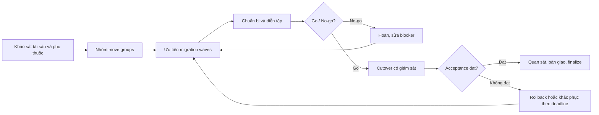
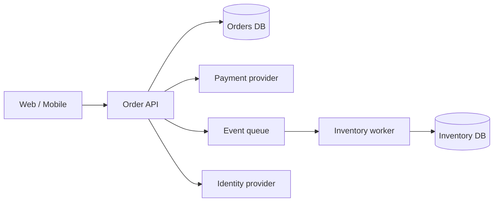
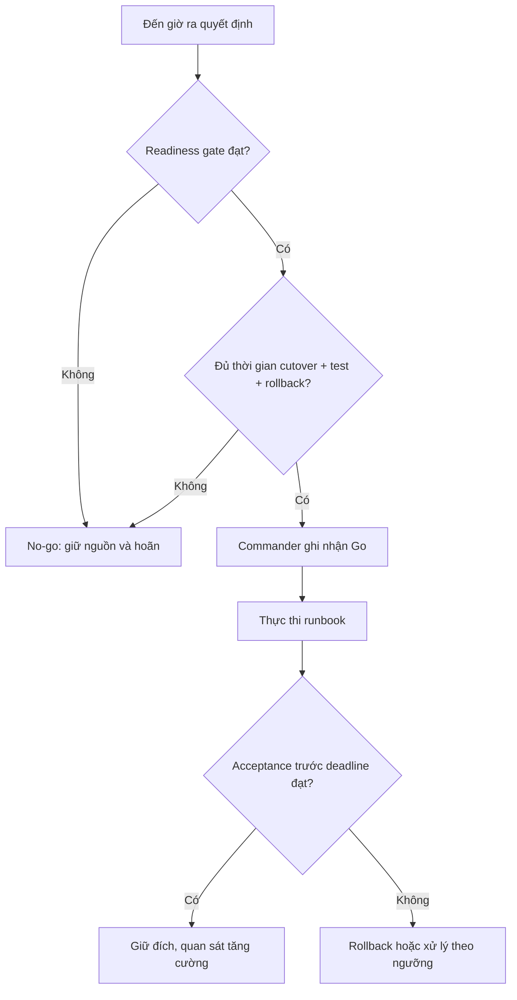

# Lập migration waves, tiêu chí nghiệm thu và kế hoạch cutover

> **Chương:** Di chuyển lên Google Cloud  
> **Phạm vi:** Chuyển các workload từ hệ thống hiện hữu lên Google Cloud, từ chọn thứ tự di chuyển đến nghiệm thu và chuyển traffic.

## 1. Bức tranh tổng thể

Để đưa một hệ thống từ data center hoặc một đám mây khác lên Google Cloud, chỉ sao chép VM hoặc database là chưa đủ. Đội triển khai còn phải quản lý mối phụ thuộc, xác định lúc nào dịch vụ đích đủ an toàn để nhận người dùng và chuẩn bị quay lại nguồn nếu có sự cố. Ba câu hỏi cốt lõi là:

1. **Di chuyển nhóm nào trước?** Chia công việc thành các *migration waves*, mỗi wave có phạm vi, thứ tự và kết quả mong đợi.
2. **Lấy gì chứng minh hệ thống đã sẵn sàng?** Định nghĩa tiêu chí nghiệm thu và các cổng quyết định *Go/No-go* với số đo, bằng chứng, người phê duyệt.
3. **Chuyển như thế nào, xử lý ra sao nếu thất bại?** Soạn *cutover runbook* theo thời gian, nêu hành động, chủ sở hữu, kiểm tra, giới hạn dừng và kế hoạch rollback/failback.

Google Cloud Migration Center khuyến nghị lập danh mục ứng dụng, xác định phụ thuộc, nhóm workload thành các waves, kiểm thử và cải tiến kế hoạch qua mỗi wave. Các bước kỹ thuật cụ thể phụ thuộc đích đến: Compute Engine, GKE, Cloud Run, Cloud SQL hoặc dịch vụ dữ liệu khác. Không có một thủ tục cutover áp dụng nguyên xi cho mọi loại workload.

**Sau bài học, bạn có thể:** lập wave backlog từ catalog và dependency graph; viết ma trận nghiệm thu đo được; thiết kế Go/No-go; dựng timeline cutover và rollback với trách nhiệm rõ ràng; giải thích khi nào mới được finalize và dọn hệ thống nguồn.

## 2. Thuật ngữ và ranh giới công việc

| Thuật ngữ | Ý nghĩa | Ví dụ |
| --- | --- | --- |
| **Migration program** | Chương trình tổng thể, gồm ngân sách, mục tiêu, danh mục và lộ trình. | Chuyển 30 ứng dụng trong hai quý. |
| **Migration wave** | Tập workload được nhóm theo đặc điểm hoặc phụ thuộc và có lịch triển khai riêng. | Wave 1 gồm hai dịch vụ nội bộ ít phụ thuộc. |
| **Move group** | Nhóm tài nguyên cần chuyển cùng nhau hoặc theo thứ tự chặt chẽ. | Order API, hàng đợi sự kiện và kho dữ liệu giao dịch. |
| **Sprint / batch** | Đơn vị thực thi nhỏ trong wave, có checklist và người phụ trách. | Sprint dựng môi trường, sprint diễn tập và cắt chuyển. |
| **Cutover** | Sự kiện chuyển hoạt động nghiệp vụ sang đích, có thể gồm đổi writer, endpoint, DNS hoặc route. | Chuyển người dùng sang ứng dụng trên GCP. |
| **Rollback / failback** | Trở lại nguồn hoặc trạng thái ổn định trước thay đổi và xử lý dữ liệu phát sinh. | Dừng ghi tại đích, đối soát đơn hàng mới, đưa traffic về nguồn. |
| **Finalize / decommission** | Bàn giao, kết thúc di chuyển và thu hồi nguồn sau khi ổn định. | Dừng công cụ replication rồi mới xóa VM cũ theo phê duyệt. |

Một wave có thể gồm nhiều move group; một move group có thể phải thực hiện nhiều bước kỹ thuật trong cùng maintenance window. **Danh sách VM không thay thế được sơ đồ luồng nghiệp vụ và quan hệ dữ liệu.**



## 3. Những đầu vào phải có trước khi chia waves

Mỗi ứng dụng cần có một bản ghi được owner kỹ thuật và owner nghiệp vụ xác nhận.

| Nhóm dữ liệu | Câu hỏi cần trả lời | Hệ quả khi xếp wave |
| --- | --- | --- |
| Catalog và ownership | Ứng dụng/VM/database/queue nào đang chạy? Ai chịu trách nhiệm? | Xác định phạm vi và người duyệt. |
| Dependency | API đồng bộ, job batch, webhook, database dùng chung, message queue, SSO, DNS? | Tránh chia tách ứng dụng vẫn phụ thuộc chặt vào nguồn. |
| Data | Dung lượng, tốc độ thay đổi, yêu cầu nhất quán, replication/CDC, backup? | Lập thời gian copy, final sync và rollback. |
| Business | Độ quan trọng, giờ cao điểm, mùa cao điểm, nhóm người dùng, RTO/RPO? | Chọn mức rủi ro và khung bảo trì. |
| Landing zone | Project, VPC, Cloud VPN/Interconnect, firewall, IAM, quota, logging, monitoring? | Định nghĩa gate trước khi đưa workload lên GCP. |
| Security/compliance | Dữ liệu nhạy cảm, residency, mã hóa, giấy phép, retention? | Xác định các blocker pháp lý và kỹ thuật. |
| Khả năng di chuyển | Rehost, replatform, refactor, replace hoặc retire; hệ điều hành và dịch vụ được hỗ trợ? | Chọn công cụ, test và thời gian thực thi. |
| Vận hành | Baseline p95, error rate, peak load, SLO, lịch backup, nhân sự trực? | Xây ngưỡng nghiệm thu và giám sát. |

### 3.1. Xử lý dependency trước khi chọn số thứ tự

Ví dụ một luồng đặt hàng:



Khi di chuyển Order API lên Google Cloud, vẫn có thể cần kết nối tới Orders DB ở nguồn, kiểm tra webhook thanh toán, hàng đợi và đồng bộ inventory. Chuyển mỗi API thành một wave độc lập có thể tăng latency hoặc làm sai dữ liệu nếu quan hệ này chưa được thử.

Thực hiện theo trình tự:

1. Ghi rõ **mỗi cạnh phụ thuộc**: network route, DNS, xác thực, giao thức, SLA, lưu lượng và chiều đọc/ghi.
2. Phân loại thành **phải chuyển cùng nhau**, **có thể chạy hybrid tạm thời**, hoặc **đã độc lập**.
3. Ghép các thành phần giao dịch chặt hoặc cùng điểm ghi dữ liệu thành **move group**; xác định các nhóm có thể đưa lên GCP trước.
4. Ghi rõ điều kiện cho các dependency xuyên wave: Cloud VPN/Interconnect, firewall, private DNS, độ trễ, tính tương thích API/schema, khóa giao dịch.
5. Với từng ngoại lệ tách wave, lưu bằng chứng kiểm thử và người chịu trách nhiệm chấp nhận rủi ro.

Không giả định chỉ vì server giao tiếp được qua mạng thì một giao dịch phân tán sẽ hoạt động đúng trong tình huống mất kết nối, retry hoặc queue gửi trùng.

## 4. Ưu tiên và thiết kế các waves

Google Cloud khuyến nghị chọn workload đầu tiên ít quan trọng, ít phụ thuộc, ít yêu cầu refactor và có khả năng chấp nhận cutover window. Các wave sau mở rộng dần từ bài học của wave đầu. Thứ tự ưu tiên cũng phải xét giá trị kinh doanh, mức thay đổi kiến trúc, tính tuân thủ và khả năng vận hành.

**Một ma trận ưu tiên thực dụng** có thể cho điểm từ 1 đến 5 đối với: giá trị được tạo ra, độ phức tạp, rủi ro ngừng dịch vụ, số phụ thuộc, tính sẵn sàng của đội vận hành và khả năng rollback. Điểm chỉ hỗ trợ thảo luận; không được dùng để vượt qua điều kiện bắt buộc về dữ liệu hoặc compliance.

### 4.1. Ví dụ: lộ trình của hệ thống thương mại

| Nhóm | Phạm vi giả định | Vì sao xếp ở đây | Gate cần đạt |
| --- | --- | --- | --- |
| **Foundation (Wave 0)** | Google Cloud projects, IAM, VPC, Cloud VPN, DNS, secrets, monitoring, backup, quota | Chuẩn bị nền tảng để workload có thể chạy và được theo dõi. | Mạng/IAM/quota/audit/backup đã kiểm thử. |
| **Wave 1 — Pilot** | Cổng quản trị, worker xuất báo cáo không quan trọng | Ít dependency, khả năng phục hồi đơn giản, phù hợp học quy trình. | Test clone hoặc môi trường thử, rehearsal rollback, on-call. |
| **Wave 2 — Read path** | Catalog API và bộ nhớ đệm, các thành phần đọc dữ liệu liên quan | Có thể kiểm soát traffic nếu data path và cache nhất quán. | Load test, cache invalidation, latency, endpoint ngoài hệ thống. |
| **Wave 3 — Transaction path** | Order API, Orders DB, queue, Inventory worker thuộc move group chặt | Nhạy cảm với data loss/split-brain, cần freeze writes và final sync. | CDC khỏe, đối soát dữ liệu, Go/No-go đầy đủ, rollback có phương án cho ghi mới. |
| **Wave 4 — Consolidation** | Các batch/đối tác còn lại, tối ưu và retire nguồn | Dọn phụ thuộc còn sót và đóng chương trình. | Không còn client nguồn, đáp ứng retention và phục hồi. |

**Wave 0** là giai đoạn chuẩn bị nên có tổ chức không đếm như một migration wave. **Wave 4** có hoạt động decommission, nhưng chỉ thực hiện sau khi nghiệm thu; không nên xóa nguồn ngay trong phút cutover.

### 4.2. Bản ghi wave mẫu

Những ID, thời lượng và chỉ tiêu dưới đây chỉ là **ví dụ**, cần thay bằng dữ liệu thật khi áp dụng:

```yaml
wave_id: "W03"
name: "Transaction path"
scope:
  move_groups: ["MG-ORDERS"]
  workloads: ["order-api", "orders-db", "inventory-worker"]
source: "on-premises"
target: "gcp-prod"
business_owner: "Commerce Lead"
technical_owner: "Application Lead"
migration_commander: "Migration Lead"
window: "YYYY-MM-DD 22:00-23:00 Asia/Ho_Chi_Minh"
blocked_by: ["private-connectivity", "payment-allowlist", "cdc-health"]
migration_pattern: "app deployment + database continuous migration"
planned_downtime_minutes: 30
target_rpo_minutes: 0
risk: "high"
readiness_evidence:
  - "uat-report"
  - "reconciliation-report"
  - "rollback-drill-report"
gate_status: "PENDING"
cutover_runbook_version: "W03-v1.0"
rollback_owner: "Database Lead"
```

Ví dụ `RPO = 0` là **mục tiêu nghiệp vụ được giả định**, không phải cam kết của công cụ. Mỗi mục tiêu phải được thử qua rehearsal; nếu không đạt, cần đổi phương án hoặc xin phê duyệt lại rủi ro.

### 4.3. Quản lý sức tải đội ngũ

Không mở quá nhiều wave đồng thời khi cùng đội DBA, network hoặc SRE phải trực. Mỗi wave phải có thời gian chuẩn bị, diễn tập, triển khai, theo dõi ổn định và đánh giá bài học. Các wave dùng chung database, load balancer hoặc kênh thanh toán cần lịch phối hợp tránh làm thay đổi cùng điểm lỗi.

## 5. Tiêu chí nghiệm thu có thể đo được

Một tiêu chí chỉ hữu ích nếu gồm đủ **điều cần đạt + phép đo + ngưỡng + thời điểm + owner + bằng chứng**. Ví dụ “ứng dụng hoạt động tốt” không thể làm căn cứ Go/No-go. Hãy tách:

- **Readiness trước cutover:** dữ liệu/đích/nguồn lực đã đủ điều kiện bắt đầu.
- **Acceptance sau cutover:** người dùng và nghiệp vụ đã phục vụ đúng ở GCP.
- **Exit/finalize:** ổn định đủ lâu, ownership được bàn giao và có thể thu hồi môi trường cũ.

### 5.1. Ma trận nghiệm thu mẫu

**Các con số đều là ngưỡng minh họa để học cách viết tiêu chí**; production phải căn cứ baseline, SLO, tải và thỏa thuận của chính hệ thống.

| ID | Tiêu chí | Phép đo và ngưỡng ví dụ | Bằng chứng | Owner |
| --- | --- | --- | --- | --- |
| A01 | Chức năng nghiệp vụ | 100% luồng trọng yếu (đăng nhập, đặt đơn, thanh toán, hoàn tiền nếu có) PASS; không còn lỗi mức Sev 1/2 chưa được chấp nhận. | Kết quả UAT, request/transaction ID thử. | Business/QA |
| A02 | Đầy đủ dữ liệu | Không thiếu giao dịch đã commit trước freeze; đối soát khóa chính, số bản ghi, tổng giá trị giao dịch, checksum theo timestamp chung. | Reconciliation report nguồn và đích. | DBA/Business |
| A03 | Đồng bộ dữ liệu | Tại thời điểm promotion, replication lag ở ngưỡng phê duyệt, lý tưởng bằng 0 khi mục tiêu không mất dữ liệu. | Migration job/CDC metrics, log cuối. | DBA |
| A04 | Hiệu năng | p95 API trong SLO; không chậm hơn baseline trên 20% với tải tương đương trong 30 phút thử. | Cloud Monitoring, load-test report. | App/SRE |
| A05 | Độ sẵn sàng | Error rate 5xx dưới 1%, health check xanh trong 60 phút quan sát; downtime trong giới hạn được duyệt. | Dashboard timestamp, synthetic tests. | SRE |
| A06 | Kết nối và tích hợp | DNS/TLS, firewall, SSO, webhook, external allowlist, queue consumers, batch đạt toàn bộ case trọng yếu. | Connectivity matrix/test logs. | Network/App |
| A07 | An toàn | IAM, mã hóa/secrets, logging, data residency, quyền truy cập mạng đáp ứng policy, không mở endpoint không chủ đích. | Security approval/audit logs. | Security |
| A08 | Phục hồi/vận hành | Backup thành công, restore được diễn tập; dashboard/alerts, on-call và runbook có người nhận. | Restore drill/alert test report. | Operations/DBA |
| A09 | Quota và chi phí | Quota đủ tải dự kiến; dự báo chi phí trong hạn mức được duyệt. | Quota checklist, cost estimate. | Platform/FinOps |
| A10 | Bàn giao | Business và Operations xác nhận; CMDB, service catalog, tài liệu và dashboard cập nhật. | Sign-off/approval record. | Migration Lead |

Các test phải được thực hiện trước khi mở traffic và lặp lại **sau khi cutover thật**. Kết quả của *test-clone* hoặc staging chỉ chứng minh một số khả năng, chưa phải nghiệm thu production. Ngoài kiểm thử chức năng, cần đo backlog, latency, error rate, bộ nhớ, CPU, quota, log và các nghiệp vụ chỉ chạy cuối ngày.

### 5.2. RTO, RPO, downtime và observation window

- **RTO:** thời gian tối đa chấp nhận để phục hồi dịch vụ sau sự cố; không tự động bằng thời gian bảo trì được lên lịch.
- **RPO:** khoảng mất dữ liệu có thể chấp nhận. RPO bằng 0 cần chứng cứ đảm bảo toàn bộ giao dịch đã commit được bảo tồn khi cắt chuyển hoặc phục hồi.
- **Cutover downtime:** đo từ lúc người dùng thực sự mất khả năng thao tác đến khi đích phục vụ ổn định; đừng chỉ lấy “job migration succeeded”.
- **Observation window:** khoảng theo dõi tăng cường sau cutover (ví dụ 24–72 giờ, hoặc đủ một chu kỳ nghiệp vụ), khác với maintenance window.

Với **Database Migration Service** cho migration liên tục, hướng dẫn của Google Cloud yêu cầu dừng writes ở nguồn, đợi replication lag về hoặc gần 0 rồi promotion. Promotion trước khi hết lag có thể khiến đích thiếu dữ liệu. Đối soát tổng giá trị nghiệp vụ, khóa chính và giao dịch là bước bổ sung, không thể thay bằng một chỉ số lag.

## 6. Go/No-go: ai được phép cho chuyển?

Cuộc họp Go/No-go diễn ra trước maintenance window hoặc gần thời điểm cutover, có **Migration Commander**, chủ nghiệp vụ, App, DBA, SRE/Operations, Network và Security nếu bắt buộc.

**Gate Go chỉ đạt khi:**

1. Scope/runbook phiên bản đúng đã được duyệt; maintenance window, điểm liên lạc và danh sách người trực đầy đủ.
2. Landing zone có sẵn project, IAM, VPC, firewall, DNS/LB, connectivity hybrid, quotas, TLS/secrets, logging/monitoring và backup.
3. Kiểm thử chức năng, tải, tích hợp và bảo mật đã đạt; các lỗi còn tồn đọng có người chịu trách nhiệm và phê duyệt rủi ro.
4. Replication/CDC ổn định, có phép đo và kế hoạch freeze/final sync/đối soát đã diễn tập.
5. Rollback đã thử: owner, backup/restore, kịch bản dữ liệu ghi mới, ước lượng thời gian và mốc quyết định cuối.
6. Không có release/job batch/thay đổi IAM/DNS song song gây xung đột; người chịu trách nhiệm chính đều sẵn sàng.
7. Business Owner và Commander xác nhận **Go** bằng bản ghi có timestamp.

**No-go** nếu không thể đảm bảo dữ liệu, chưa thử dependency trọng yếu, mất khả năng rollback, thiếu nhân sự, hạ tầng đích không đủ năng lực hoặc không đủ thời gian còn lại cho cả kiểm tra và hoàn nguyên. Không “cố chạy cho kịp lịch” khi một điều kiện bắt buộc thất bại.



## 7. Xây dựng cutover runbook theo thời gian

Một runbook tốt ghi **thời điểm, owner, thao tác, kết quả mong đợi, cách đo và hành động khi lỗi**. Các trường phải có:

- Wave/move group, hệ thống nguồn/đích, phiên bản runbook, danh sách tất cả endpoints và thành phần dữ liệu.
- Thời gian bắt đầu/kết thúc **kèm múi giờ**, điểm ra quyết định Go/No-go, hạn cuối cho rollback và thời lượng dự phòng.
- SLA/SLO, RTO/RPO, downtime budget, baseline và vị trí dashboard/báo cáo đối soát.
- Owner kỹ thuật từng bước, Commander, người duyệt nghiệp vụ, on-call/escalation và kênh điều phối.
- Quy trình freeze writes, xử lý transaction đang mở, final sync, promotion, bật writer đích, chuyển traffic, khôi phục jobs.
- Phương án khôi phục từng thay đổi (DNS, route, LB, feature flag, database endpoint), phương án xử lý dữ liệu phát sinh ở đích.
- Nơi lưu bằng chứng, quyết định và thời gian thực tế.

### 7.1. Timeline minh họa

Giả định cửa sổ bảo trì **22:00–23:00 giờ Việt Nam**, dịch vụ gồm API và database được đồng bộ trước. Các mốc phụ thuộc khả năng thực tế; **không chạy theo bảng nếu chưa diễn tập**.

| Mốc | Người thực hiện | Hành động, tín hiệu hoàn tất | Nếu lỗi |
| --- | --- | --- | --- |
| **T-7 ngày đến T-48 giờ** | Lead/App/DBA/SRE | Khóa phạm vi, diễn tập cutover + rollback, kiểm thử restore, kiểm tra cấu hình đích, quota, on-call. | Hoãn nếu còn blocker. |
| **T-48 đến T-24 giờ** | Network/SRE | Kiểm tra DNS, load balancer, firewall, cert, health; cân nhắc giảm TTL có kiểm soát để cache cũ kịp hết hạn. | Không giả định mọi resolver tuân TTL. |
| **T-60 phút** | Commander/Business/đội kỹ thuật | Điểm danh, đọc readiness evidence, xác nhận cửa sổ và Go/No-go. | Ghi No-go, nguồn tiếp tục chạy. |
| **T-15 phút** | App/DBA | Dừng batch/job phụ thuộc, thông báo bảo trì, xác nhận backup và các writer nguồn. | Không chuyển nếu không kiểm soát writes. |
| **T0** | App/DBA | Chuyển app sang maintenance/read-only; cho transaction đang mở hoàn tất, ghi checkpoint/timestamp. | Chặn bước promote nếu writes còn tiếp diễn. |
| **T+5 phút** | DBA/Migration Engineer | Final sync; kiểm tra replication lag, đối soát dữ liệu và log cuối. | No-go/rollback nếu thiếu dữ liệu trọng yếu. |
| **T+15 phút** | DBA/Platform | Promote dữ liệu hoặc cutover VM theo công cụ; chỉ duy trì một phía nhận ghi. | Kiểm soát split-brain và đánh giá failback. |
| **T+25 phút** | Network/App | Chuyển DNS/LB/routing/endpoint; kiểm tra health từ các mạng thực tế. | Không mở traffic tới đích chưa khỏe. |
| **T+30–40 phút** | QA/Business/SRE | Smoke test giao dịch, webhook, queue, xác thực, p95, error rate, dữ liệu ghi mới. | Escalate, đối chiếu ngưỡng rollback. |
| **T+40 phút** | Commander/Business | Quyết định **Accept**, **Fix within window** hoặc **Rollback** theo số liệu và thời gian còn lại. | Không vượt rollback decision deadline. |
| **T+40–60 phút** | App/DBA/SRE | Accept: trực tăng cường và thông báo. Rollback: theo mục 8, xác minh phục hồi. | Chỉ kéo dài maintenance khi có phê duyệt. |
| **T+24–72 giờ** | Ops/Business | Kiểm tra peak, batch, backup, báo cáo, chi phí; ký nhận bàn giao nếu đạt. | Không finalize khi còn lỗi nghiêm trọng. |

**Đây là mẫu phối hợp, không phải chuỗi lệnh áp dụng cho mọi sản phẩm.** Với **Migrate to Virtual Machines**, cut-over dừng source VM, thực hiện final replication rồi tạo VM đích trên Compute Engine; cần kiểm thử đích và lên lịch downtime. Với database migration liên tục, dừng writes và promotion theo quy trình của Database Migration Service. Đối với Cloud Run/GKE, chuyển ứng dụng có thể nhanh nhưng database, schema và client compatibility vẫn là rủi ro riêng.

### 7.2. Kiểm tra đích và hệ thống công khai

Có thể dùng những lệnh **chỉ đọc** như ví dụ sau khi đã thay placeholder bằng giá trị thật:

```bash
# Kiểm tra trạng thái một VM đã di chuyển trên Compute Engine:
gcloud compute instances describe app-prod-01 \
  --project=TARGET_PROJECT \
  --zone=asia-southeast1-b \
  --format="value(status)"

# Kiểm tra HTTPS health endpoint; dùng hostname nội bộ/khách hàng phù hợp:
curl --fail --silent --show-error --max-time 10 \
  https://app.example.com/healthz
```

Lệnh trả OK chỉ là một tín hiệu. Nên có dashboard Cloud Monitoring cho request rate, error rate, p95/p99 latency, CPU/memory/saturation, số job trễ, queue backlog và replication lag. Smoke test nghiệp vụ cần kiểm tra cả giao dịch, dữ liệu và tích hợp bên ngoài. Không in secret/token/dữ liệu cá nhân vào log.

## 8. Rollback/failback khi chuyển đổi không đạt

**Rollback không có nghĩa mọi thứ tự động quay về như trước.** Sau cutover, hệ thống đích có thể đã nhận đơn hàng, cập nhật inventory, gửi webhook hoặc sinh invoice. Chỉ đổi DNS về nguồn có nguy cơ mất giao dịch hoặc phát lại không đúng thứ tự.

### 8.1. Xác định ngưỡng rollback trước thời điểm Go

Ví dụ các điều kiện kích hoạt:

- Giao dịch đã xác nhận thiếu ở dữ liệu đích hoặc hệ thống phụ thuộc, hoặc có dấu hiệu trùng thanh toán.
- Không thể hoàn thành luồng nghiệp vụ trọng yếu trong thời hạn đã định.
- Error rate, latency, độ sẵn sàng hoặc mạng vượt ngưỡng được duyệt trong khoảng quan sát.
- Không thể bảo đảm một writer duy nhất; rủi ro dữ liệu/bảo mật vượt mức chấp nhận.
- Đã đến **hạn cuối quyết định rollback**, không còn đủ thời gian phục hồi và kiểm thử nguồn trước khi hết cửa sổ bảo trì.

Không hạ ngưỡng nghiệm thu giữa sự cố để biến thất bại thành kết quả “PASS”.

### 8.2. Quy trình rollback nguyên tắc

1. **Commander ra lệnh dừng**, ghi thời gian và lý do; ngăn tiếp tục ghi mới ở đích nếu hệ thống có trạng thái.
2. DBA/App xác định giao dịch cuối đã commit ở nguồn, giao dịch mới tại đích, các message/webhook chưa xử lý và cơ chế idempotency.
3. Chọn đường phục hồi: nếu chưa ghi dữ liệu mới, có thể quay traffic; nếu đã ghi mới, thực hiện đối soát và đồng bộ có kiểm soát hoặc tạm bảo trì để đảm bảo không mất/trùng giao dịch.
4. Bật lại nguồn và endpoint nguồn, kiểm tra chỉ một nơi có quyền ghi; đưa DNS/LB/route/queue/cron về trạng thái đã duyệt.
5. Chạy smoke test và đối soát dữ liệu sau rollback, xác nhận với nghiệp vụ, theo dõi SLI, thông báo sự cố.
6. Giữ nguyên log/snapshot/backup/decision record phục vụ phân tích; cập nhật runbook trước khi thử lại.

**Các giới hạn Google Cloud phải được ghi trong kế hoạch:**

- Với **Migrate to Virtual Machines**, cut-over dừng source VM và replication. Theo tài liệu Google Cloud, rollback là **thao tác thủ công**: khởi động lại VM nguồn, đưa traffic về nguồn và xử lý dữ liệu mới phát sinh trên VM đích nếu cần. Dữ liệu này **không tự đồng bộ ngược** về nguồn.
- Với **Database Migration Service**, promotion ngắt quan hệ replication ban đầu và làm đích thành primary độc lập tùy phương án; không giả định có nút “undo” hoặc replication ngược tự động. Thiết kế trước cách đối soát, restore hoặc chuyển dữ liệu ngược.
- Với **ứng dụng stateless** trên Cloud Run/GKE, đổi release hoặc traffic nhanh không đảm bảo schema/database/contract tương thích ngược; có thể phải giữ migration schema tương thích trong giai đoạn chuyển tiếp.
- DNS TTL giảm chỉ hỗ trợ một phần vì client có cache, connection pooling và retry; phải xem xét session hiện hữu và IP allowlist của đối tác.

### 8.3. Chọn phương án chuyển traffic phù hợp

| Cách cutover | Khi nào phù hợp | Nguy cơ quan trọng |
| --- | --- | --- |
| **Big bang** | Nghiệp vụ nhỏ, phụ thuộc dày, chấp nhận maintenance. | Toàn hệ thống chuyển cùng lúc, downtime và blast radius lớn; cần freeze và rollback rõ ràng. |
| **Canary / gradual traffic** | Backend stateless hoặc có cơ chế định tuyến và tính nhất quán dữ liệu được thiết kế. | Session, phân phối request và writer có thể không nhất quán; không để hai primary độc lập cùng ghi. |
| **Blue/green** | Hai bản triển khai ứng dụng có thể hoạt động song song. | Rollback app dễ hơn nhưng database/schema/data vẫn cần plan riêng. |

## 9. Quyền quyết định và decision log

| Vai trò | Trách nhiệm |
| --- | --- |
| **Migration Commander / Lead** | Chốt phạm vi và timeline, đưa lệnh Go/No-go, dừng hoặc rollback, điều phối liên lạc. |
| **Business Owner** | Xác nhận ngưỡng nghiệp vụ, độ gián đoạn được chấp nhận, ký nghiệm thu. |
| **Application Lead** | Quản lý writes và feature flag, kiểm tra endpoint/luồng nghiệp vụ, vận hành app. |
| **Database Lead** | Replication/CDC, final sync, promotion, kiểm tra dữ liệu, backup và failback. |
| **Network/Platform Lead** | DNS, LB, firewall, IAM, VPN/Interconnect, quota và tài nguyên đích. |
| **SRE/Operations** | Dashboard, alert, SLO/SLI, incident và theo dõi sau chuyển đổi. |
| **Security/Compliance** | Quyền truy cập, mã hóa, audit và dữ liệu theo chính sách. |

Tổ chức có thể sử dụng RACI đầy đủ; điều quan trọng là mỗi bước có người **thực hiện**, mỗi cổng có người **quyết định** và có người **trực sau cutover**.

**Mẫu quyết định để lưu cùng hồ sơ wave:**

```text
WAVE: W03                  RUNBOOK: W03-v1.0
TIME: YYYY-MM-DD HH:mm Asia/Ho_Chi_Minh
DECISION: GO | NO-GO | ACCEPT | ROLLBACK
COMMANDER: <người quyết định>
BUSINESS OWNER: <người duyệt nghiệp vụ>
EVIDENCE:
  - UAT/functional: PASS/FAIL + report
  - Data reconciliation: PASS/FAIL + last transaction/checkpoint
  - Replication lag: <giá trị + timestamp>
  - SLI: error rate, p95 latency, availability
  - Network/IAM/security: PASS/FAIL + owner
  - Rollback readiness: READY/BLOCKED
TIME REMAINING: <phút>
RISK ACCEPTANCE: <nếu có>
REASON: <bằng chứng hỗ trợ quyết định>
NEXT ACTION: <owner + deadline>
```

Lưu cả lần ra quyết định **No-go**. Đây là đầu vào để ước lượng sai số, năng lực nhân sự và cải thiện wave tiếp theo.

## 10. Nghiệm thu sau cutover và kết thúc wave

Sau khi đích nhận traffic, chưa nên đóng wave chỉ vì migration job hiển thị `Succeeded`.

1. **0–2 giờ:** theo dõi request, lỗi, latency, đơn hàng và dữ liệu ghi mới, queue backlog, webhook, audit và điều kiện rollback.
2. **24–72 giờ hoặc đủ một chu kỳ nghiệp vụ:** kiểm tra tải cao điểm, batch cuối ngày, báo cáo, backup, chi phí và client ít sử dụng.
3. **Bàn giao vận hành:** cập nhật on-call, dashboard, CMDB, IP/DNS, knowledge base, quy trình incident, backup/restore và ownership.
4. **Họp retrospective:** ghi thời gian thực tế, downtime, sai số replication, blocker, các quyết định, bài học và cách chỉnh gates cho wave tiếp theo.
5. **Finalize / decommission:** chỉ dọn resources di chuyển, tắt replication, xóa nguồn hoặc tối ưu chi phí khi đã được ký nhận, hết thời gian quan sát và đáp ứng backup/retention/audit. Việc xóa nguồn có thể làm mất khả năng rollback.

## 11. Bài tập tình huống

Hệ thống gồm **web frontend**, **Order API**, **PostgreSQL**, **Redis**, **Inventory worker** và **payment webhook**. Mục tiêu là di chuyển sang Google Cloud. Doanh nghiệp không cho phép mất đơn hàng đã xác nhận và chấp nhận tối đa 20 phút ngừng phục vụ trong khung được phê duyệt.

Yêu cầu:

1. Vẽ dependency graph có đầy đủ mọi luồng đọc/ghi và thành phần ngoại vi; lập ít nhất hai move groups hoặc chứng minh vì sao chúng phải đi cùng nhau.
2. Đề xuất ba waves, trong đó có một pilot ít quan trọng, kèm gate bắt đầu/kết thúc và owner.
3. Viết tối thiểu sáu acceptance criteria với phép đo, ngưỡng, bằng chứng và người ký nhận.
4. Lập timeline T-48 giờ đến T+24 giờ, gồm Go/No-go, freeze writes, final sync, promotion, smoke tests, deadline rollback.
5. Giả định có **10 đơn hàng được tạo mới tại GCP** rồi phát hiện lỗi. Giải thích vì sao đổi DNS ngay về nguồn là nguy hiểm và xây kế hoạch đối soát, xử lý trùng và bảo toàn các giao dịch.
6. Hoàn thành mẫu decision log với lựa chọn Accept, Fix within window hoặc Rollback dựa trên chỉ số cụ thể.

**Tiêu chí tự đánh giá:** Có dependency owners và kế hoạch cho từng luồng quan trọng; không hai nơi cùng nhận writes thiếu kiểm soát; deadline quyết định đủ thời gian rollback; có đối soát data khi failback; môi trường nguồn chỉ được dọn khi đã hoàn tất nghiệm thu.

## 12. Tài liệu chính thức

1. [Google Cloud Migration Center — Plan your migration waves](https://docs.cloud.google.com/migration-center/docs/plan-migration-waves): application catalog, ưu tiên và nhóm waves.
2. [Migration Center — About migration planning](https://docs.cloud.google.com/migration-center/docs/migration-planning-overview): yêu cầu đầu vào, inventory, dependency và phương án di chuyển.
3. [Migration Center — Execute your migration](https://docs.cloud.google.com/migration-center/docs/migration-execution): migration checklist, wave/move group, RACI, runbook, testing, rollback.
4. [Google Cloud Architecture Center — Best practices for validating a migration plan](https://docs.cloud.google.com/architecture/migration-to-google-cloud-best-practices): POC, tiêu chí thành công, downtime và rollback.
5. [Migrate to Virtual Machines — VM migration process](https://docs.cloud.google.com/migrate/virtual-machines/docs/5.0/discover/lifecycle): replicate, test-clone, cut-over, finalize, hạn chế rollback.
6. [Migrate to Virtual Machines — Migrate VM groups](https://docs.cloud.google.com/migrate/virtual-machines/docs/5.0/migrate/migrating-vm-groups): cut-over VM nhóm, test và giới hạn nhất quán snapshot.
7. [Database Migration Service — Promote a PostgreSQL migration job](https://docs.cloud.google.com/database-migration/docs/postgres/promote-migration): dừng writes, kiểm tra replication lag, promotion và tác động dữ liệu.

> **Lưu ý:** Các ứng dụng, số đo, ngưỡng, lịch và vai trò trong bài chỉ minh họa; khi áp dụng vào production cần thay bằng baseline, chính sách, owner và thủ tục chính thức của từng dịch vụ đang dùng.
