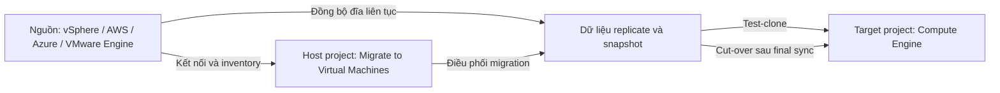

# Migrate to Virtual Machines và di chuyển VM

## Mục tiêu và vị trí trong kiến trúc Google Cloud

**Migrate to Virtual Machines (M2VM)** là dịch vụ hỗ trợ chuyển máy ảo (virtual machine, VM) và đĩa của VM từ môi trường được hỗ trợ sang **Compute Engine** hoặc đĩa lưu trữ trên Google Cloud. Đây là phương án **rehost/lift-and-shift**: giữ phần lớn hệ điều hành và ứng dụng, thực hiện một số điều chỉnh cần thiết để VM chạy trên hạ tầng mới, sau đó mới cân nhắc hiện đại hóa ứng dụng.

Bài học thuộc phạm vi **CLOUD_PROVIDERS_GCP**, nối quyết định di chuyển với các khái niệm project, IAM, VPC, Compute Engine, quản lý bảo mật, triển khai, độ tin cậy và chi phí. Sau bài học, người học có thể:

1. Chọn đúng công cụ di chuyển cho từng loại nguồn VM và nhận diện giới hạn tương thích.
2. Chuẩn bị host project, target project, danh tính, mạng, quota và kế hoạch cut-over.
3. Thực hiện quy trình onboard → replicate → target details → test-clone → cut-over → finalize.
4. Kiểm chứng ứng dụng sau di chuyển, xử lý lỗi và thực hiện rollback có kiểm soát.

M2VM thích hợp khi cần đưa ứng dụng chạy trên VM sang Compute Engine với thay đổi phần mềm ban đầu tương đối nhỏ. Nó **không tự chuyển** ứng dụng thành Cloud Run, GKE hoặc Cloud SQL, không tự giải quyết mọi phụ thuộc của ứng dụng và không cam kết di chuyển không có gián đoạn.

## 1. Chọn đường di chuyển và hiểu thành phần

Các nguồn chính được Google Cloud liệt kê cho M2VM 5.x:

| Nguồn | Ví dụ | Điểm cần chuẩn bị |
|---|---|---|
| VMware vSphere tại trung tâm dữ liệu | VM ứng dụng Linux/Windows on-premises | vCenter, **Migrate Connector**, quyền vSphere, kết nối đến Google Cloud APIs |
| Amazon Web Services | Amazon EC2 | Tạo AWS source và quyền truy cập phù hợp theo hướng dẫn tích hợp |
| Microsoft Azure | Azure Virtual Machines | Đăng ký ứng dụng, tạo quyền truy cập nguồn Azure, kiểm tra giới hạn loại đĩa |
| Google Cloud VMware Engine | VM chạy trong môi trường VMware Engine | Cấu hình nguồn VMware Engine và kết nối phù hợp |

**Đích đến:** thông thường là một VM Compute Engine trong **target project**; nếu chỉ cần dữ liệu đĩa, quy trình **disk migration** đưa dữ liệu sang Persistent Disk thay cho việc chuyển nguyên VM. Kiểm tra phiên bản hệ điều hành và giới hạn theo từng nguồn trước khi chọn chiến lược: M2VM hỗ trợ di chuyển VM Linux/Windows Server **64-bit x86**, không nên suy ra rằng mọi bản phân phối, phiên bản kernel hay kiến trúc ARM đều được hỗ trợ.

Trong thiết kế, cần phân biệt:

- **Host project:** project bật M2VM API, đăng ký nguồn và điều phối hoạt động di chuyển. Bắt buộc phải có.
- **Target project:** project chứa VM Compute Engine sau di chuyển; có thể trùng host project hoặc là project khác.
- **Source:** kết nối đến vSphere, EC2, Azure hoặc VMware Engine để đọc inventory và đồng bộ đĩa.
- **Migrate Connector:** thành phần triển khai tại môi trường VMware để kết nối vCenter và truyền dữ liệu; không phải bước cần cài đặt cho mọi nguồn cloud.
- **Test-clone:** VM thử nghiệm được dựng từ một chu kỳ replication đã hoàn thành; nguồn vẫn tiếp tục chạy.
- **Cut-over:** thao tác chuyển sang đích production, gồm dừng VM nguồn, đồng bộ lần cuối và tạo VM đích.



Với nguồn VMware, Migrate Connector đọc inventory và thực hiện thao tác với đĩa/vCenter; kết nối Google Cloud APIs qua HTTPS cổng 443. Luồng mạng và cơ chế xác thực thực tế phụ thuộc loại nguồn. Replication đồng bộ dữ liệu đĩa theo chu kỳ (gồm đồng bộ ban đầu và các thay đổi tăng dần) **trong khi VM nguồn vẫn có thể phục vụ người dùng**; sau đó M2VM có thể thực hiện **OS adaptation** để VM thích nghi với Compute Engine. Kiểm thử ứng dụng vẫn là trách nhiệm của nhóm triển khai.

Nguồn chính thức: [kiến trúc M2VM](https://docs.cloud.google.com/migrate/virtual-machines/docs/5.0/discover/architecture), [quy trình migration](https://docs.cloud.google.com/migrate/virtual-machines/docs/5.0/discover/lifecycle).

## 2. Khảo sát và lập kế hoạch trước khi di chuyển

Không nên bắt đầu từ thao tác bấm **Start Replication**. Trước hết, lập inventory cho từng VM và gắn VM với **nhóm ứng dụng** hoặc **migration wave** để tránh bỏ sót phụ thuộc.

| Nhóm thông tin | Cần ghi nhận | Lý do |
|---|---|---|
| Nguồn | Hypervisor/cloud, hệ điều hành và phiên bản, kiến trúc CPU, CPU/RAM, đĩa, loại boot, mã hóa | Kiểm tra khả năng tương thích và cấu hình đích |
| Phần mềm | Dịch vụ khởi động cùng hệ thống, giấy phép, agent, lịch batch, kernel driver | Phát hiện thứ có thể hỏng sau OS adaptation |
| Dữ liệu | Dung lượng sử dụng, tốc độ phát sinh dữ liệu, độ nhạy cảm, RPO, backup, cơ sở dữ liệu | Ước lượng thời gian sao chép và xử lý tính nhất quán |
| Kết nối | Địa chỉ IP, DNS, port, luồng ingress/egress, proxy, phụ thuộc LDAP/AD, DB, message broker | Thiết kế VPC, firewall và chuyển hướng lưu lượng |
| Vận hành | Monitoring, log, backup, lịch bảo trì, người trực, RTO, cách rollback | Đảm bảo có thể vận hành sau cut-over |
| Chi phí | Loại máy đích, dung lượng/tier đĩa, băng thông, test-clone, tài nguyên nguồn song song | Tránh duy trì chi phí hai đầu không cần thiết |

Ví dụ, một VM web truy cập PostgreSQL qua địa chỉ nội bộ và xác thực với Active Directory có thể **khởi động thành công nhưng vẫn không sử dụng được** nếu target VPC thiếu đường đến DB hoặc DNS nội bộ. Phải kiểm tra đường đi của dịch vụ, không chỉ kiểm tra trạng thái VM.

Đối với cơ sở dữ liệu đang ghi nhiều, snapshot cấp đĩa không thay thế quy trình backup/restore nhất quán với ứng dụng. Cần phối hợp với chủ hệ thống để lên lịch giảm hoặc ngừng ghi, thực hiện kiểm tra giao dịch và có phương án sao lưu độc lập trước thời điểm cut-over. Xác định rõ **RTO** (thời gian gián đoạn chấp nhận) và **RPO** (mức mất dữ liệu chấp nhận), rồi kiểm chứng bằng diễn tập thay vì coi chúng là cam kết mặc định của M2VM.

### Kiểm tra khả năng tương thích

- Đối chiếu OS và phiên bản nguồn với [danh sách hệ điều hành được hỗ trợ](https://docs.cloud.google.com/migrate/virtual-machines/docs/5.0/discover/supported-os-versions).
- Kiểm tra hạn mức Compute Engine CPU, đĩa, IP, subnet và khả năng dùng đúng machine type tại zone đích. Không đặt mặc định rằng cấu hình vCPU/RAM và tên zone của nguồn sẽ được giữ nguyên.
- Với Azure, **ephemeral OS disks** và **non-managed disks** không được hỗ trợ để di chuyển theo quy trình Azure source; dữ liệu trên **temporary disks** không được bảo đảm tồn tại sau di chuyển.
- Kiểm tra license, phần mềm gắn với phần cứng/IP, yêu cầu UEFI/BIOS và tính phù hợp của agent hoặc driver trên Compute Engine. Đánh giá kỹ hệ thống có phụ thuộc thiết bị ngoại vi hoặc kernel module riêng.
- Nếu có VPC firewall, proxy, private access hoặc yêu cầu khóa CMEK, xử lý trước khi sao chép dữ liệu.

## 3. Chuẩn bị Google Cloud: project, API, IAM và mạng

### 3.1. Host project và dịch vụ cần bật

Tạo hoặc chọn host project có billing phù hợp, xác định region và quyền triển khai. Ví dụ sau dùng **Google Cloud CLI** đã được cài đặt, người thực hiện có quyền bật API; thay `HOST_PROJECT_ID` bằng ID thực tế:

```bash
gcloud auth login
gcloud config set project HOST_PROJECT_ID

gcloud services enable \
  vmmigration.googleapis.com \
  servicemanagement.googleapis.com \
  servicecontrol.googleapis.com \
  iam.googleapis.com \
  cloudresourcemanager.googleapis.com \
  compute.googleapis.com

gcloud services list --enabled --project=HOST_PROJECT_ID
```

Host project có thể kiêm target project cho lab đơn giản. Với môi trường nhiều nhóm, thường tách host project quản lý migration và target project chạy production để áp dụng IAM, quota, ngân sách và chính sách riêng. Trước khi test-clone hoặc cut-over, **thêm target project vào M2VM** nếu đích khác host project.

### 3.2. Quyền IAM và service account

| Chủ thể | Ví dụ quyền hoặc vai trò liên quan | Lưu ý |
|---|---|---|
| Người quản trị migration | `roles/vmmigration.admin` trên host project | Đăng ký nguồn và thực hiện các thao tác migration |
| Người chỉ xem tiến độ | `roles/vmmigration.viewer` | Theo dõi, không vận hành migration |
| Người thêm target project | `roles/vmmigration.admin` ở host và quyền phù hợp trên target (tài liệu nêu `roles/resourcemanager.projectIamAdmin`) | Có thể cần quản trị viên target hỗ trợ cấp quyền service agent |
| Người cấu hình target | `roles/compute.viewer` trên target project; Shared VPC có thể cần xem host VPC | Đọc được loại máy, network, subnet để cấu hình đích |
| M2VM service agent | Tài khoản dịch vụ do M2VM tạo khi bật API | Phải có quyền cần thiết tại target để tạo VM và đĩa |
| M2VM service agent trên Shared VPC | `roles/compute.networkUser` tại Shared VPC host/subnet phù hợp | Cho phép dùng subnet của Shared VPC |

Đây là **vai trò tham chiếu**, không phải lệnh cấp quyền hàng loạt. Tài khoản dùng để **chạy VM đích** có quyền riêng; không dùng service account có đặc quyền quản trị rộng nếu ứng dụng chỉ cần quyền tối thiểu. Kiểm tra thêm IAM phía vCenter/AWS/Azure và cách xử lý secret theo từng nguồn.

Tài liệu: [bật dịch vụ và predefined roles](https://docs.cloud.google.com/migrate/virtual-machines/docs/5.0/get-started/enable-services), [roles và quyền chi tiết](https://docs.cloud.google.com/migrate/virtual-machines/docs/5.0/reference/roles-reference).

### 3.3. Kết nối mạng đích và tính sẵn sàng

Chuẩn bị VPC, subnet, firewall rules, route, Private Google Access/VPN/Interconnect nếu cần và DNS cho target VM. Xác minh:

1. VM đích có IP, subnet và route đúng, không trùng dải IP với môi trường cần kết nối.
2. Nhân viên hoặc hệ thống kiểm thử có thể truy cập VM theo cách được tổ chức phê duyệt (ví dụ IAP, VPN, bastion); không mở SSH/RDP ra Internet chỉ để kiểm tra nhanh.
3. VM gọi được các phụ thuộc cần thiết như database, registry, endpoint nội bộ, LDAP/AD, hệ thống license và DNS.
4. Service account đích có quyền truy cập dịch vụ Google Cloud thực sự cần dùng.
5. Dự trù quota cho đĩa replica, VM test-clone và VM production, cộng headroom trong thời gian vận hành song song.

Với nguồn VMware, Migrate Connector cần tới Google Cloud APIs qua HTTPS/443; có thể sử dụng kết nối Internet, Cloud VPN, Private Google Access hoặc Cloud Interconnect tùy thiết kế được hỗ trợ. Không nhầm **đường truyền replication** với **đường ứng dụng đích truy cập các hệ thống nghiệp vụ**: chúng là hai bài toán cần kiểm thử độc lập.

## 4. Đăng ký nguồn di chuyển

Mở [Google Cloud Console → Migrate to Virtual Machines](https://console.cloud.google.com/migrate/virtual-machines) trên **host project**, chọn **Sources** và cấu hình loại nguồn phù hợp.

### Nếu nguồn là VMware vSphere

1. Xác nhận phiên bản vSphere/vCenter được hỗ trợ, tạo tài khoản vCenter có các quyền tối thiểu mà Migrate Connector yêu cầu (đọc đĩa, snapshot, change tracking, thao tác shutdown khi cut-over).
2. Chuẩn bị VM/appliance **Migrate Connector** từ OVA theo hướng dẫn chính thức, kết nối tới vCenter và API Google Cloud. Connector cần tài khoản Google Cloud đăng ký và service account vận hành; bảo vệ thông tin xác thực.
3. Kiểm tra mạng, DNS, chứng chỉ/thumbprint của vCenter và khả năng tới API; trên connector có CLI `m2vm` để kiểm tra trạng thái và đăng ký.
4. Đăng ký connector vào host project và region, rồi xác nhận source xuất hiện ở trạng thái **Active** trong Sources.

Trên chính **Migrate Connector appliance**, các lệnh quản trị tham khảo là:

```bash
m2vm status
m2vm register
m2vm status
```

`m2vm register` là thao tác tương tác, yêu cầu thông tin vCenter, dự án, vùng và định danh; chỉ dùng theo hướng dẫn connector. Không chạy các lệnh này trên VM ứng dụng hoặc nhầm với `gcloud`.

### Nếu nguồn là AWS, Azure hoặc VMware Engine

- **AWS EC2:** cấu hình AWS source, xác thực và quyền nguồn theo hướng dẫn; xác nhận source Active và danh sách VM cần di chuyển.
- **Azure VM:** đăng ký ứng dụng Azure, cấp quyền bằng role thích hợp, tạo Azure source với region nguồn/đích phù hợp; lưu trữ client secret an toàn, ghi nhận kỳ hạn hết hạn secret.
- **Google Cloud VMware Engine:** tạo nguồn VMware Engine theo hướng dẫn cho môi trường này, kiểm tra kết nối và quyền truy cập nguồn.

Các quy trình đăng ký, hạn mức và chi phí ở hệ thống nguồn không đồng nhất, vì vậy không sao chép cấu hình connector VMware để áp dụng cho AWS/Azure. Xem: [VMware source](https://docs.cloud.google.com/migrate/virtual-machines/docs/5.0/migrate/create-a-vmware-source), [Migrate Connector](https://docs.cloud.google.com/migrate/virtual-machines/docs/5.0/migrate/migrate-connector), [AWS source](https://docs.cloud.google.com/migrate/virtual-machines/docs/5.0/migrate/create-an-aws-source), [Azure source](https://docs.cloud.google.com/migrate/virtual-machines/docs/5.0/migrate/create-an-azure-source), [VMware Engine source](https://docs.cloud.google.com/migrate/virtual-machines/docs/5.0/migrate/create-a-gcve-source).

## 5. Thực hiện migration theo các giai đoạn

Quy trình sau dành cho **VM migration** sang Compute Engine; tên nút có thể thay đổi nhẹ theo phiên bản Console. Đường dẫn thao tác chi tiết: [Migrate individual VMs](https://docs.cloud.google.com/migrate/virtual-machines/docs/5.0/migrate/migrating-vms).

### Giai đoạn 1 — Onboard VM

Tại **Sources**, chọn source đã **Active**, kiểm tra inventory và đánh dấu VM mục tiêu. Chọn **Add Migrations → VM Migration**, xác nhận. VM chuyển qua trạng thái khởi tạo và cuối cùng sẵn sàng với **Ready**. M2VM chỉ tạo migration cho VM được chọn; nhóm VM có thể được tổ chức thành migration group để quản lý theo đợt.

**Điểm kiểm soát:** xác nhận đúng VM ID, đủ các đĩa, không nhận nhầm VM production ngoài phạm vi và có chủ dịch vụ xác nhận cửa sổ thay đổi.

### Giai đoạn 2 — Start Replication

Trong **Migrations**, chọn VM ở trạng thái Ready, chọn **Migration → Start Replication**. Quan sát `Replication status`, `Replication history` và **adaptation report**.

- Lần đầu cần chuyển khối lượng dữ liệu lớn; những chu kỳ sau chủ yếu phản ánh thay đổi so với chu kỳ trước.
- Replication diễn ra trong nền khi VM nguồn chạy; theo dõi lỗi snapshot, quyền, băng thông, dung lượng và giới hạn nguồn.
- Chỉ tiến hành test-clone sau khi đã hoàn thành ít nhất một chu kỳ replication.
- Có thể điều chỉnh chính sách/tần suất replication theo giao diện. Tần suất nhỏ không tự bảo đảm RPO nhỏ nếu sao chép mất nhiều thời gian hoặc đường truyền bị nghẽn.

**Điểm kiểm soát:** replication ổn định qua vài chu kỳ; đo thời lượng, ước lượng dữ liệu còn lại và kiểm tra adaptation report trước thử nghiệm.

### Giai đoạn 3 — Set VM target details

Chọn **Edit target details** để cấu hình VM Compute Engine. Xác định:

| Trường | Câu hỏi thiết kế |
|---|---|
| Project, region, zone | VM sẽ chạy ở đâu? Có đáp ứng residency, SLA và phụ thuộc vùng? |
| Machine type, vCPU/RAM | Quy mô nào phù hợp với tải thực đo và khả năng hỗ trợ? |
| Đĩa | Dung lượng/tier, tên đĩa, hiệu năng IOPS/throughput có phù hợp? |
| VPC, subnet, IP, firewall | Gọi được hệ thống phụ thuộc và nhận được lưu lượng hợp lệ? |
| Service account, bảo mật | Quyền tối thiểu, cách truy cập, mã hóa, policy của tổ chức? |
| Tên VM, metadata/labels | Có tuân thủ quy ước vận hành và cách phân biệt test với production? |

Không giả định mọi lựa chọn nâng cao của Compute Engine đều cấu hình được từ màn hình M2VM; một số thuộc tính chỉ sửa được sau khi VM đã được tạo. Các **target details có hiệu lực tại thời điểm test-clone/cut-over**, nên thay đổi về sau không tự cập nhật VM test-clone đã dựng.

### Giai đoạn 4 — Test-clone trong môi trường cô lập

Trong **Migrations**, chọn VM đã đồng bộ, dùng **Cut-Over and Test-Clone → Test-Clone**. Dịch vụ dựng VM thử nghiệm từ chu kỳ replication đã hoàn tất gần nhất, trong khi nguồn tiếp tục chạy. Đặt VM test trong subnet và tên khác production; tránh kết nối đồng thời vào queue, scheduler, mail relay hoặc DB production nếu điều đó gây tác dụng phụ.

Bài kiểm thử tối thiểu:

- **Boot/OS:** VM khởi động, phân vùng/đĩa mount đúng, thời gian hệ thống và agent hoạt động.
- **Ứng dụng:** service khởi động được, endpoint sẵn sàng, đọc/ghi thử nghiệm và kết nối phụ thuộc phù hợp.
- **Mạng/IAM:** DNS, TLS, ingress/egress, firewall, danh tính của ứng dụng và secret hoạt động.
- **Vận hành:** log, metric, backup, cảnh báo, cơ chế restart và giám sát được cấu hình.
- **Dữ liệu:** đối chiếu bản ghi hoặc checksum theo cách phù hợp với ứng dụng, tránh chỉ so dung lượng đĩa.

Ví dụ các lệnh **kiểm tra trên VM Linux test-clone** (thay tên service/URL theo ứng dụng):

```bash
uname -a
lsblk -f
df -h
systemctl --failed
systemctl status example-app
curl --fail --show-error --silent http://127.0.0.1:8080/health
```

VM Windows có thể kiểm tra trong PowerShell bằng `Get-Service`, `Get-Disk`, `Get-Volume`, `Test-NetConnection`. Đối với DB hoặc hệ thống nhiều đĩa, cần kiểm tra **tính nhất quán ứng dụng** thay vì coi việc test-clone thành công là bảo đảm nhất quán dữ liệu ở mọi thời điểm. Lưu lại kết quả kiểm thử và lỗi trước khi cho phép chuyển production.

### Giai đoạn 5 — Cut-over có lịch và xác nhận

Chỉ cut-over khi người phụ trách ứng dụng, hạ tầng, an ninh và vận hành đã chấp nhận kết quả thử nghiệm. Chuẩn bị runbook với thời gian bắt đầu/kết thúc, người trực, ngưỡng hủy, trình tự đổi DNS/load balancer và cách phục hồi.

**Trước cửa sổ:**

1. Xác nhận replication gần nhất thành công, target details production, quota và mạng đáp ứng yêu cầu.
2. Chuẩn bị backup độc lập và kế hoạch dừng ghi; hạ DNS TTL trước cut-over nếu phù hợp chính sách.
3. Đóng các công việc batch, ngăn giao dịch mới hoặc đưa ứng dụng vào maintenance mode theo thiết kế; xác minh cách nhận biết data divergence.
4. Ghi baseline: số request, thời gian đáp ứng, tình trạng DB, kiểm tra health, cấu hình IP/DNS và lịch liên lạc.

**Trong cửa sổ:**

1. Tại **Migrations**, chọn VM có replication đang hoạt động và target hợp lệ.
2. Chọn **Cut-Over and Test-Clone → Cut-Over**.
3. M2VM **dừng VM nguồn**, thực hiện đồng bộ đĩa cuối, dừng replication và tạo VM Compute Engine đích. Đây là giai đoạn **có downtime**; không hứa “zero downtime”.
4. Quan sát trạng thái `Cut-over job completed` và xác minh VM đích hoạt động.
5. Thực hiện smoke test rồi đổi DNS/load balancer/route đến đích; chỉ mở lại ghi khi nhóm vận hành xác nhận chuyển đổi thành công.

Nếu cut-over đã bắt đầu nhưng gặp lỗi, cần đánh giá trạng thái nguồn và target trước khi thử lại. Hủy cut-over **không đồng nghĩa** nguồn tự được khởi động lại.

### Giai đoạn 6 — Finalize khi ổn định

Sau khi chạy production ổn định và hết thời gian giữ phương án rollback, chọn VM trong **Cut-Over** rồi chọn **Finalize**. Thao tác này **xóa dữ liệu và các tài nguyên lưu trữ replication** gắn với migration. Nó **không xóa VM Compute Engine đã cut-over**, đồng thời **không tự xóa test-clone**; cần xóa thủ công các test-clone không còn dùng và xác nhận chi phí đã dừng phát sinh.

Đừng finalize ngay sau khi VM vừa boot thành công: khi đã xóa replication state, khả năng sử dụng lại dữ liệu replication để thử cut-over tiếp bị mất. Tài liệu mô tả thời hạn hoạt động của migrating VM; không để migration dang dở vô thời hạn vì có cơ chế hết hạn và phát sinh chi phí tài nguyên.

## 6. Rollback và cách xử lý sự cố

**Rollback sau cut-over là quy trình thủ công**. Khi cut-over, VM nguồn bị dừng và dữ liệu **mới ghi tại VM đích không tự đồng bộ ngược về nguồn**. Do đó phải quyết định điểm chốt dữ liệu và cách đối soát trước khi chuyển lưu lượng về nguồn, nhất là với ứng dụng giao dịch.

Kịch bản vận hành tiêu biểu:

1. Phát hiện tiêu chí thất bại, ví dụ health check liên tục thất bại, không kết nối được DB, hoặc thời gian phản hồi vượt ngưỡng.
2. Đưa VM đích vào trạng thái không tiếp nhận ghi mới; xác định các giao dịch đã ghi ở đích.
3. Xử lý phần dữ liệu phát sinh trong thời gian chạy đích theo quy trình nghiệp vụ (xuất, đối chiếu, nhập lại hoặc chấp nhận mất dữ liệu trong RPO được phê duyệt).
4. Khởi động lại VM nguồn khi an toàn và chuyển DNS/load balancer/route về nguồn. Không để hai VM cùng ghi vào một hệ thống logic nếu ứng dụng không hỗ trợ.
5. Nếu cần thử lại, điều tra lỗi, **Resume Replication** theo quy trình M2VM và lập cut-over mới; chỉ finalize sau khi xác nhận đích đã ổn định.

Một số tình huống thường gặp:

| Hiện tượng | Hướng điều tra |
|---|---|
| Source `Offline` hoặc không thấy VM | Kết nối và đăng ký source, trạng thái Migrate Connector hoặc quyền AWS/Azure, region và lọc inventory |
| Replication lỗi hoặc kéo dài | Quyền snapshot/change tracking, dung lượng, tốc độ thay đổi dữ liệu, mạng outbound, quota và log thao tác |
| Test-clone không boot | OS support, lỗi OS adaptation, bootloader, kernel/driver, cấu hình đĩa và serial console |
| VM boot nhưng service không đáp ứng | Cấu hình ứng dụng, secret, DNS, subnet/firewall, phụ thuộc DB, route, service account |
| Không tạo được VM đích | IAM ở target/Shared VPC, quota, region/zone, loại máy hoặc giới hạn policy |
| Cut-over kéo dài hơn dự kiến | Thời lượng final sync, biến động dữ liệu cuối, thao tác shutdown, khả năng tạo disk/VM |
| Chi phí tiếp tục tăng sau chuyển đổi | VM test-clone chưa xóa, replication chưa finalize, đĩa/snapshot/IP dư thừa hoặc nguồn vẫn được duy trì |

Dùng **Replication History**, **Test-Clone/Cut-Over History**, **adaptation report** và logs theo hướng dẫn của sản phẩm để xác định bước lỗi. Không tự xóa snapshot do M2VM quản lý trong quá trình replication vì có thể làm hỏng chuỗi đồng bộ.

Tham khảo: [Migration progress details](https://docs.cloud.google.com/migrate/virtual-machines/docs/5.0/migrate/migration-progress-details), [VM migration process và rollback](https://docs.cloud.google.com/migrate/virtual-machines/docs/5.0/discover/lifecycle).

## 7. Tình huống minh họa: chuyển VM web nội bộ từ VMware

Giả sử doanh nghiệp có VM **`web-legacy-01`** chạy Linux x86-64 trên vSphere, 4 vCPU, 8 GiB RAM, đĩa 150 GiB; dịch vụ HTTPS kết nối PostgreSQL và DNS nội bộ. Mục tiêu là chạy trên Compute Engine với downtime được phê duyệt trong khung giờ bảo trì buổi tối.

**Khảo sát.** Nhóm dự án ghi OS version, service web, port, đích DB, đường DNS, TLS certificate, dung lượng ghi mỗi ngày, backup và ràng buộc compliance. Xác minh PostgreSQL vẫn ở on-premises thì target VM cần VPN/Interconnect và firewall phù hợp; nếu chuyển cả DB thì nhóm DB phải có wave riêng và kế hoạch nhất quán dữ liệu.

**Chuẩn bị.** Dùng host project `mig-host` và target project `app-prod` (tên minh họa); bật APIs, triển khai Migrate Connector kết nối vCenter, cấp quyền IAM đủ dùng, tạo subnet test riêng và subnet production ở region đã chọn. Chọn máy Compute Engine và đĩa bằng benchmark thay vì chỉ sao chép số vCPU/RAM.

**Di chuyển thử.** Onboard VM và bắt đầu replication. Khi hoàn thành initial sync, tạo test-clone trong subnet cô lập, kiểm tra `systemctl`, các mount, kết nối DB ở môi trường thử và endpoint HTTPS. Nếu kết nối DB chưa sẵn sàng, sửa route/firewall rồi dựng lại test-clone khi thay đổi target details ảnh hưởng đến cấu hình VM.

**Cắt chuyển.** Trong cửa sổ đã duyệt, đưa web vào maintenance mode, kiểm tra backup cuối, chọn Cut-over, đợi final sync và tạo VM production. Kiểm tra instance, app health, chứng chỉ TLS, DB transaction thử, metric; sau đó chuyển DNS hoặc load balancer sang IP/VIP đích.

**Ổn định.** Theo dõi lỗi HTTP, độ trễ, CPU, đĩa, log và backup trong khoảng thời gian được thỏa thuận. Nếu phải quay lại, đóng ghi tại đích, xử lý dữ liệu phát sinh rồi khởi động VM nguồn và đổi lại routing. Khi hoàn tất thời gian chấp nhận, finalize và dọn test-clone.

Lệnh tham khảo để **xác minh thông tin VM Compute Engine** (không phải lệnh thực hiện cut-over):

```bash
gcloud compute instances describe web-legacy-01 \
  --project=TARGET_PROJECT_ID \
  --zone=TARGET_ZONE
```

Lệnh trên chỉ đúng nếu tên VM production đã cấu hình là `web-legacy-01`; hãy thay theo tên Compute Engine thực tế. Với hệ thống nhiều VM, chuyển theo **migration waves** dựa trên phụ thuộc và kiểm tra từng đợt trước khi mở rộng.

## 8. Chi phí, bảo mật và vận hành sau migration

Dịch vụ **Migrate to Virtual Machines 5.x không thu phí dịch vụ cho migration vào Google Cloud**, nhưng vẫn phát sinh phí tài nguyên sử dụng trong và sau di chuyển: Compute Engine cho test-clone/cut-over, disk/snapshot và storage replication, mạng/egress, các dịch vụ phụ trợ, cũng như chi phí EC2/EBS/Azure VM/disk/network ở nguồn tương ứng.

Để vận hành có kiểm soát:

- Thiết lập budget/alert theo host và target project; gắn labels khi có thể để tách chi phí thử nghiệm và production.
- Đảm bảo VM production có backup/snapshot theo RPO, giám sát Cloud Monitoring/Logging, cảnh báo health, patching và quy trình khôi phục riêng.
- Kiểm tra firewall và phân quyền IAM sau di chuyển; thu hồi quyền hoặc credential của source/connector theo quy trình bảo mật khi không còn sử dụng.
- Chỉ xóa các tài nguyên source sau khi nghiệp vụ và vận hành xác nhận thành công; finalize migration không có nghĩa là xóa VM source.
- Đánh giá lại máy và đĩa sau vài tuần có dữ liệu đo thực tế; chỉ sau đó mới quyết định tối ưu chi phí, autoscaling hoặc hiện đại hóa ứng dụng.

Xem [bảng giá Migrate to Virtual Machines](https://cloud.google.com/migrate/virtual-machines/pricing) và [Google Cloud Pricing Calculator](https://cloud.google.com/products/calculator).

## 9. Checklist nghiệm thu

Dùng bảng này trong biên bản cut-over; thay cột kết quả bằng bằng chứng cụ thể của hệ thống:

| Mục kiểm tra | Bằng chứng mong đợi |
|---|---|
| Tương thích và inventory | Đúng VM nguồn, OS/disk hỗ trợ, có sơ đồ phụ thuộc và chủ hệ thống |
| Host/source/target | API, source Active, IAM, region, quota và VPC đã được xác nhận |
| Replication | Đồng bộ đầu tiên và chu kỳ gần nhất hoàn thành, không còn lỗi blocking |
| Test-clone | Có kết quả boot, network, ứng dụng, dữ liệu, bảo mật và monitoring |
| Kế hoạch cut-over | Có lịch bảo trì, owner, backup, ngưỡng rollback và phương thức liên lạc |
| Production acceptance | Health, giao dịch nghiệp vụ, log, latency, DNS, backup và giám sát đạt chuẩn |
| Finalize/cleanup | Được phê duyệt sau thời gian ổn định; replication state và test-clone đã dọn |
| Tài liệu vận hành | Cập nhật CMDB, runbook, liên hệ sự cố, chi phí và quyền truy cập |

## 10. Câu hỏi tự kiểm tra

1. Vì sao replication có thể diễn ra khi VM nguồn đang hoạt động, nhưng cut-over vẫn cần cửa sổ downtime?
2. Host project và target project khác nhau ở vai trò nào? Shared VPC ảnh hưởng đến quyền IAM ra sao?
3. Test-clone giúp kiểm tra điều gì, và tại sao test-clone thành công chưa đồng nghĩa có thể bỏ kiểm tra ứng dụng?
4. Sau cut-over thất bại, tại sao không nên chỉ khởi động VM nguồn rồi để cả nguồn và đích cùng ghi?
5. Finalize xóa tài nguyên nào và không tự xóa tài nguyên nào? Điều đó ảnh hưởng chi phí ra sao?

## Tài liệu Google Cloud chính thức

- [Migrate to Virtual Machines 5.0 — tổng quan](https://docs.cloud.google.com/migrate/virtual-machines/docs/5.0)
- [Migrate to Virtual Machines architecture](https://docs.cloud.google.com/migrate/virtual-machines/docs/5.0/discover/architecture)
- [VM migration process](https://docs.cloud.google.com/migrate/virtual-machines/docs/5.0/discover/lifecycle)
- [Enable Migrate to Virtual Machines services](https://docs.cloud.google.com/migrate/virtual-machines/docs/5.0/get-started/enable-services)
- [Migrate individual VMs](https://docs.cloud.google.com/migrate/virtual-machines/docs/5.0/migrate/migrating-vms)
- [Supported operating systems](https://docs.cloud.google.com/migrate/virtual-machines/docs/5.0/discover/supported-os-versions)
- [Roles and permissions reference](https://docs.cloud.google.com/migrate/virtual-machines/docs/5.0/reference/roles-reference)
- [Migration progress details](https://docs.cloud.google.com/migrate/virtual-machines/docs/5.0/migrate/migration-progress-details)
- [Migrate to Virtual Machines pricing](https://cloud.google.com/migrate/virtual-machines/pricing)

*Tài liệu tham khảo được đối chiếu ngày 19/11/2026. Giao diện Console, API và hạn mức có thể thay đổi; đối chiếu trang chính thức tương ứng với môi trường trước khi triển khai production.*

