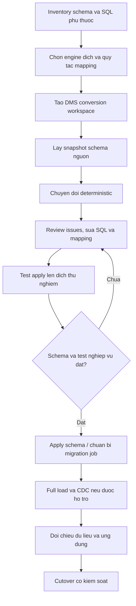

# Chuyển đổi schema, SQL dialect và tính tương thích

Khi đưa một cơ sở dữ liệu lên Google Cloud, di chuyển dữ liệu mới chỉ là một phần công việc. Ứng dụng còn phụ thuộc vào cách cơ sở dữ liệu định nghĩa bảng, khóa, kiểu dữ liệu, các câu SQL và hành vi giao dịch. Một bản sao dữ liệu có đủ số hàng vẫn có thể gây lỗi nếu truy vấn cũ không biên dịch, khóa ngoại mất hiệu lực hoặc thời gian và số tiền được hiểu khác đi.

Trong hành trình học Google Cloud — từ tổ chức project, IAM, VPC đến Compute Engine, GKE, Cloud Run, lưu trữ, cơ sở dữ liệu, tự động hóa và giám sát độ tin cậy/chi phí — bài này tập trung vào việc **chuyển đổi cấu trúc và hành vi của hệ quản trị dữ liệu**. Ví dụ chính là **SQL Server → Cloud SQL for PostgreSQL**. Các khác biệt Oracle, MySQL và Spanner được giới thiệu để biết khi nào phải đánh giá lại thiết kế.

**Mục tiêu sau bài học:** biết phân loại thay đổi schema và SQL dialect; lập bản đồ kiểu dữ liệu và đối tượng; sử dụng conversion workspace trong Database Migration Service (DMS) đúng phạm vi; kiểm chứng tương thích bằng phép thử dữ liệu, truy vấn, giao dịch và ứng dụng; lập kế hoạch cutover có điều kiện dừng và quay lui.

## 1. Xác định đúng bài toán chuyển đổi

Có ba lớp tương thích phải tách riêng:

| Lớp | Cần đánh giá | Ví dụ hỏng khi bỏ qua |
| --- | --- | --- |
| **Schema / DDL** | Bảng, cột, kiểu dữ liệu, khóa chính/ngoại, index, view, sequence, identity, default, check, trigger, procedure | Chuyển `IDENTITY` thành cột `BIGINT` thường khiến các lệnh insert mới thiếu khóa |
| **SQL dialect / DML** | Cú pháp truy vấn, hàm, cú pháp paging, upsert, tham số, quoting, thứ tự NULL, xử lý lỗi | `SELECT TOP` của SQL Server không chạy trên PostgreSQL |
| **Hành vi runtime** | Transaction isolation, lock, collation, múi giờ, NULL, driver, ORM, kết nối, quyền truy cập, đặc tính hiệu năng | So sánh chuỗi hoặc timestamp thay đổi kết quả dù query chạy thành công |

**Homogeneous migration** giữ cùng engine, ví dụ PostgreSQL tự quản lý → Cloud SQL for PostgreSQL hoặc MySQL → Cloud SQL for MySQL. Rủi ro chủ yếu nằm ở khác biệt phiên bản, cấu hình, extension, đặc quyền và tính năng của dịch vụ được quản lý.

**Heterogeneous migration** đổi engine, ví dụ Oracle/SQL Server → Cloud SQL for PostgreSQL. Khi đó cần dịch DDL, SQL và nhiều quy tắc nghiệp vụ. Khả năng DMS hỗ trợ tự động phải được kiểm tra riêng cho **đúng cặp nguồn–đích và phiên bản**; không suy rằng mọi tuyến chuyển cơ sở dữ liệu đều có conversion workspace.

Đích cũng quyết định mức độ cần sửa:

- **Cloud SQL for PostgreSQL** và **AlloyDB for PostgreSQL** dựa trên hệ sinh thái PostgreSQL, nhưng phải kiểm tra tính năng/extension/phiên bản được hỗ trợ ở dịch vụ và phiên bản đích.
- **Cloud SQL for MySQL** hoặc **Cloud SQL for SQL Server** giữ dialect tương ứng, song không bảo đảm tương thích tuyệt đối với tất cả tính năng của bản tự quản lý.
- **Spanner** có dialect GoogleSQL hoặc PostgreSQL tùy cơ sở dữ liệu. Dialect PostgreSQL của Spanner không đồng nghĩa với một PostgreSQL server đầy đủ; kiến trúc phân tán, khả năng chạy code trong database, transaction và mô hình khóa cần được đánh giá riêng.

## 2. Khảo sát trước khi dịch schema

Bắt đầu bằng snapshot cấu trúc của nguồn và danh sách các truy cập SQL trong toàn bộ ứng dụng. Đừng chỉ xuất một tệp `CREATE TABLE`: còn có view, trigger, procedure, job, quyền, quy trình ETL và SQL được sinh động từ ORM.

### 2.1. Lập danh mục đối tượng và phụ thuộc

| Nhóm đối tượng | Câu hỏi cần trả lời | Hồ sơ kết quả |
| --- | --- | --- |
| Tables / columns | Số bảng, kích thước, PK, cột nullable, computed/generated, identity, default, kiểu đặc biệt? | DDL nguồn, dung lượng, row count, đường dẫn đổi kiểu |
| Constraints / indexes | FK, unique, check, filtered index, partitioning, index hỗ trợ workload nào? | Graph phụ thuộc, mức ưu tiên tạo lại |
| Functions / procedures / triggers | Có T-SQL, PL/SQL, SQL động, truy cập hệ thống, side effect? | Danh sách mã cần dịch hoặc đưa sang ứng dụng |
| Users / jobs / integrations | Login, role, scheduler, linked server, ETL, BI, CDC, audit? | Kế hoạch IAM và dịch vụ thay thế |
| Application SQL | Raw SQL, JDBC, JPA/Hibernate, batch, reports, migrations (Flyway/Liquibase)? | Inventory câu SQL, luồng dùng, mức độ rủi ro |
| Data semantics | Múi giờ, encoding, precision, collations, giá trị trống/NULL, enum, binary? | Quy tắc chuyển dữ liệu và test đối chiếu |

Với SQL Server, truy vấn mẫu để lấy danh sách cột (chạy trên **nguồn**, quyền chỉ đọc theo chính sách):

```sql
SELECT
    TABLE_SCHEMA, TABLE_NAME, COLUMN_NAME,
    DATA_TYPE, CHARACTER_MAXIMUM_LENGTH,
    NUMERIC_PRECISION, NUMERIC_SCALE, IS_NULLABLE
FROM INFORMATION_SCHEMA.COLUMNS
WHERE TABLE_SCHEMA NOT IN ('sys', 'INFORMATION_SCHEMA')
ORDER BY TABLE_SCHEMA, TABLE_NAME, ORDINAL_POSITION;
```

Để lập danh sách procedure, view, function và trigger, có thể đối chiếu `sys.objects`, `sys.sql_modules`, `sys.indexes` và `sys.foreign_keys` theo quyền truy cập. Các view `INFORMATION_SCHEMA` không mô tả hết mọi tính năng đặc thù của SQL Server, vì thế cần bổ sung metadata hệ thống và DDL do công cụ quản trị xuất ra.

### 2.2. Lập ma trận khả năng tương thích

Đặt mỗi phát hiện vào một trong bốn nhóm:

1. **Tương đương trực tiếp:** ví dụ `DECIMAL(18,2)` → `NUMERIC(18,2)` khi giới hạn và cách làm tròn phù hợp.
2. **Cần đổi cú pháp:** `TOP (20)` → `LIMIT 20`, `ISNULL` → `COALESCE` sau khi kiểm tra thứ tự ép kiểu.
3. **Cần thay đổi mô hình:** SQL Server `rowversion` hoặc job của SQL Server Agent không có bản dịch ngữ nghĩa đơn giản sang PostgreSQL; có thể cần cơ chế version/ETag hoặc bộ lập lịch khác.
4. **Không tương thích / cần quyết định sản phẩm:** phụ thuộc tính năng không có tại đích, giới hạn dịch vụ, độ trễ hay hành vi transaction không đạt SLO.

Mỗi dòng trong backlog cần ghi rõ **object/đường dẫn code**, loại lỗi, ảnh hưởng, cách sửa, người chịu trách nhiệm, bài test và điều kiện nghiệm thu. Ưu tiên theo tác động lên dữ liệu hoặc tính đúng của nghiệp vụ, không chỉ theo số lỗi mà công cụ phát hiện.

## 3. Chuyển đổi kiểu dữ liệu: ý nghĩa quan trọng hơn tên kiểu

Bảng sau chỉ là **điểm xuất phát để đánh giá**, không phải bảng ánh xạ tự động áp dụng cho mọi trường hợp.

| SQL Server nguồn | PostgreSQL thường cân nhắc | Điều phải xác minh |
| --- | --- | --- |
| `INT` / `BIGINT` | `integer` / `bigint` | Phạm vi giá trị, dấu, tự sinh khóa |
| `DECIMAL(p,s)`, `NUMERIC(p,s)` | `numeric(p,s)` | Precision/scale, rounding, overflow |
| `NVARCHAR(n)` | `varchar(n)` hoặc `text` | Unicode, số ký tự so với độ dài nguồn, normalization và collation |
| `BIT` | `boolean` | Ánh xạ 0/1/NULL, driver và biểu thức lọc |
| `UNIQUEIDENTIFIER` | `uuid` | Định dạng giá trị và cách sinh UUID |
| `DATETIME2(p)` | `timestamp(p) without time zone` | Giá trị có thực sự là UTC hay chỉ là giờ địa phương? |
| `DATETIMEOFFSET(p)` | `timestamp(p) with time zone` (`timestamptz`) | Giữ thời điểm, nhưng offset gốc không được giữ như thuộc tính riêng |
| `VARBINARY(MAX)` | `bytea` | Dung lượng, stream/batch, encoding của consumer |
| `IDENTITY` | `GENERATED ... AS IDENTITY` | Bảo toàn khóa cũ, seed sequence và hành vi insert |

Đối với **Oracle → PostgreSQL**, các điểm nhạy cảm thường là `NUMBER` (có/không precision và scale), `DATE` của Oracle (có phần thời gian, khác PostgreSQL `date`), `VARCHAR2`, `CLOB`/`BLOB`, sequence, synonym, package và PL/SQL. Ví dụ `NUMBER` không khai báo `p,s` có thể cần `numeric` hoặc một quyết định kiểu đích dựa trên miền giá trị thực; chuyển tùy tiện sang `integer` có thể làm mất dữ liệu. Oracle coi chuỗi rỗng trong nhiều ngữ cảnh là NULL, trong khi PostgreSQL phân biệt `''` và `NULL`; đó là thay đổi nghiệp vụ cần test.

Đối với **MySQL → PostgreSQL**, chú ý `UNSIGNED`, `ENUM`/`SET`, `AUTO_INCREMENT`, zero-date, JSON, cách so sánh chuỗi và các collation; kiểm chứng đầu vào thực tế trước khi chọn kiểu. Nếu giữ MySQL ở Cloud SQL for MySQL, một số phép đổi dialect có thể không cần, nhưng kiểm tra engine/version/SQL mode vẫn quan trọng.

### 3.1. Thời gian, múi giờ và tiền tệ

- `timestamp without time zone` lưu giá trị ngày giờ, không gắn một instant toàn cầu. `timestamptz` biểu diễn thời điểm và hiển thị theo timezone của session; cần xác định cách diễn giải giá trị nguồn khi nạp.
- Nếu ứng dụng nguồn lưu giờ UTC trong `datetime2`, có thể giữ dạng `timestamp` và quy ước UTC, hoặc chuyển sang `timestamptz` **sau khi thiết kế và kiểm thử việc gắn UTC đúng cách**. Không giả sử phép cast mặc định tự hiểu ngữ cảnh.
- Với dữ liệu tiền tệ, dùng kiểu thập phân chính xác theo độ lớn nghiệp vụ; kiểm tra phép cộng, tính thuế, quy tắc làm tròn và giới hạn khi nhập, tránh thay bằng `float` nếu tính chính xác là yêu cầu.
- Kiểm tra giá trị cực trị, ngày lịch sử, leap day, precision micro/millisecond và cách serialize thành JSON/JDBC.

### 3.2. Khóa, index và ràng buộc

PK/FK và unique constraint giúp bảo vệ tính toàn vẹn; index giúp truy vấn đúng SLO. Cùng danh sách cột không đồng nghĩa có index tương đương: filtered index, included columns, collation, operator class, thứ tự NULL và partitioning có thể khác. Với bảng không có primary key, phải kiểm tra riêng khả năng DMS di chuyển/cập nhật dữ liệu và yêu cầu của luồng CDC; không tự đặt một khóa chỉ vì công cụ gợi ý nếu khóa đó không thực sự ổn định hoặc duy nhất.

Lập thứ tự tạo đối tượng phù hợp: schema/tables, khóa, dữ liệu, index/constraint phức tạp, view, function/trigger (tùy chiến lược tải và ràng buộc được kiểm chứng). Khi dùng công cụ chuyển đổi, tuân theo thứ tự apply được hướng dẫn cho tuyến migration cụ thể; việc tự tắt FK/trigger để nạp nhanh phải có bước kiểm tra lại đầy đủ.

## 4. Ví dụ thực hành: SQL Server → Cloud SQL for PostgreSQL

Một hệ thống bán hàng dùng bảng đơn hàng và cần giữ nguyên `order_id` để các hệ thống khác vẫn tham chiếu được.

### 4.1. DDL nguồn SQL Server

```sql
CREATE TABLE dbo.orders (
    order_id BIGINT IDENTITY(1,1) NOT NULL PRIMARY KEY,
    customer_id BIGINT NOT NULL,
    amount DECIMAL(18,2) NOT NULL,
    status NVARCHAR(20) NOT NULL
        CONSTRAINT DF_orders_status DEFAULT N'NEW',
    created_at DATETIME2(3) NOT NULL
        CONSTRAINT DF_orders_created_at DEFAULT SYSUTCDATETIME(),
    CONSTRAINT CK_orders_amount CHECK (amount >= 0)
);

CREATE INDEX IX_orders_customer_time
    ON dbo.orders (customer_id, created_at DESC);
```

Ở đây nghiệp vụ **quy ước** `created_at` là giờ UTC, nhưng SQL Server `DATETIME2` tự thân không mang timezone. Dữ liệu cũ phải được audit để bảo đảm tuân thủ quy ước ấy.

### 4.2. Thiết kế DDL đích PostgreSQL

Đây là **mẫu thiết kế minh họa do người học viết**, không phải cam kết rằng DMS sẽ sinh ra DDL giống hệt:

```sql
CREATE SCHEMA IF NOT EXISTS sales;

CREATE TABLE sales.orders (
    order_id BIGINT GENERATED BY DEFAULT AS IDENTITY PRIMARY KEY,
    customer_id BIGINT NOT NULL,
    amount NUMERIC(18,2) NOT NULL,
    status VARCHAR(20) NOT NULL DEFAULT 'NEW',
    created_at TIMESTAMP(3) WITHOUT TIME ZONE NOT NULL
        DEFAULT (CURRENT_TIMESTAMP AT TIME ZONE 'UTC'),
    CONSTRAINT ck_orders_amount CHECK (amount >= 0)
);

CREATE INDEX ix_orders_customer_time
    ON sales.orders (customer_id, created_at DESC);
```

Giải thích lựa chọn:

- `dbo` được ánh xạ có chủ đích sang `sales`; nếu chọn giữ nguyên tên schema thì phải cập nhật connection/search path và đối tượng tham chiếu tương ứng.
- `GENERATED BY DEFAULT AS IDENTITY` cho phép nạp các `order_id` hiện có. Sau khi nạp xong, kiểm tra và đồng bộ sequence trước khi ứng dụng tạo hàng mới; DMS hoặc quy trình đích có thể đã xử lý bước này, nên **đo và kiểm tra trước khi sửa**.
- `DATETIME2(3)` được giữ tương đương dạng `TIMESTAMP(3) WITHOUT TIME ZONE` vì nguồn có quy ước lưu UTC. Default đích dùng UTC rõ ràng để hạn chế phụ thuộc timezone session.
- PK, `CHECK`, default và index đều phải được thử với dữ liệu và workload thật. Tên constraint, schema và thứ tự tạo có thể thay đổi khi qua công cụ chuyển đổi.

Nếu muốn đổi thành `timestamptz`, trước tiên xác minh ý nghĩa dữ liệu lịch sử và chuyển đổi với timezone nguồn minh bạch; khi đó cả ứng dụng lẫn báo cáo phải được kiểm tra lại.

### 4.3. Chuyển query và hàm SQL

Truy vấn SQL Server lấy 20 đơn gần đây của một khách hàng:

```sql
SELECT TOP (20)
    order_id,
    ISNULL(status, N'UNKNOWN') AS status,
    amount
FROM dbo.orders
WHERE customer_id = @customer_id
  AND created_at >= DATEADD(day, -7, SYSUTCDATETIME())
ORDER BY created_at DESC, order_id DESC;
```

Phiên bản PostgreSQL:

```sql
SELECT
    order_id,
    COALESCE(status, 'UNKNOWN') AS status,
    amount
FROM sales.orders
WHERE customer_id = $1
  AND created_at >= (CURRENT_TIMESTAMP AT TIME ZONE 'UTC')
                    - INTERVAL '7 days'
ORDER BY created_at DESC, order_id DESC
LIMIT 20;
```

Hai truy vấn đều cần **ORDER BY có tiêu chí phụ** để ổn định kết quả khi nhiều hàng có `created_at` giống nhau. `$1` là placeholder kiểu PostgreSQL ở ví dụ SQL trực tiếp; với JDBC `PreparedStatement` thường dùng dấu `?` và bind tham số qua driver. Không nối trực tiếp giá trị người dùng vào SQL.

| SQL Server / Oracle / MySQL | PostgreSQL tham khảo | Nguy cơ cần test |
| --- | --- | --- |
| SQL Server `TOP (n)`, MySQL `LIMIT n`, Oracle `FETCH FIRST ...` | `LIMIT n` hoặc `FETCH FIRST n ROWS ONLY` | Thiếu `ORDER BY`, thứ tự tie, paging |
| SQL Server `ISNULL(x,y)`, Oracle `NVL(x,y)`, MySQL `IFNULL(x,y)` | `COALESCE(x,y)` | Kiểu trả về, implicit casts, NULL |
| SQL Server `GETDATE()` / `SYSUTCDATETIME()` | `CURRENT_TIMESTAMP` hoặc biểu thức timezone rõ ràng | Transaction timestamp so với clock time, timezone |
| SQL Server `DATEADD(day, 7, ts)` | `ts + INTERVAL '7 days'` | DST, kiểu cột và phép tính ngày |
| Oracle `DECODE` | `CASE ... END` | So sánh NULL, ép kiểu, nhánh mặc định |
| MySQL `ON DUPLICATE KEY UPDATE` | `INSERT ... ON CONFLICT (...) DO UPDATE` | Phải có unique/PK phù hợp; nhiều unique key |
| SQL Server dấu `[name]`, MySQL backtick | Identifier chuẩn `"name"` nếu bắt buộc quote | PostgreSQL gập identifier không quote về chữ thường |
| T-SQL/PLSQL procedures, packages, job | PL/pgSQL hoặc logic ứng dụng/dịch vụ | Transaction, exception, cursor, SQL động và quyền |

Trong PostgreSQL, `NULL` không bằng chính nó, và `WHERE col = NULL` không đúng để lọc NULL; dùng `IS NULL`. Hãy kiểm tra các phép `NOT IN` khi tập có NULL, `COUNT(col)` so với `COUNT(*)`, phép chia số nguyên, chuỗi có dấu và cách sắp xếp mặc định. Đây là các khác biệt có thể làm sai báo cáo mà không gây lỗi cú pháp.

### 4.4. Upsert và đồng bộ sequence

Với bảng có khóa duy nhất trên `order_id`, một lệnh upsert ở PostgreSQL có thể là:

```sql
INSERT INTO sales.orders
    (order_id, customer_id, amount, status, created_at)
VALUES ($1, $2, $3, $4, $5)
ON CONFLICT (order_id) DO UPDATE
SET customer_id = EXCLUDED.customer_id,
    amount      = EXCLUDED.amount,
    status      = EXCLUDED.status,
    created_at  = EXCLUDED.created_at;
```

Câu lệnh này là một ví dụ nghiệp vụ, **không phải hướng dẫn ghi vào đích song song với DMS**. Nếu cần replay idempotent, kiểm tra version event, thứ tự cập nhật và trường hợp dữ liệu cũ ghi đè dữ liệu mới. `ON CONFLICT` dựa trên constraint phù hợp; không thể thay thế mù quáng mọi `MERGE` hoặc thủ tục upsert cũ.

Sau khi kết thúc replication, khóa ghi nguồn và xác nhận dữ liệu đích đã bắt kịp, kiểm tra giá trị sequence nếu quy trình cutover yêu cầu:

```sql
SELECT MAX(order_id) AS max_id, COUNT(*) AS row_count
FROM sales.orders;

SELECT last_value, is_called
FROM sales.orders_order_id_seq;
```

Tên sequence ở ví dụ có thể khác do công cụ tạo schema; dùng `pg_get_serial_sequence('sales.orders', 'order_id')` để xác định thay vì đoán. Chỉ điều chỉnh sequence trong một bước cutover đã kiểm soát, sau khi biết chính xác trạng thái hiện tại.

## 5. DMS conversion workspace làm gì và không làm gì?

Google Cloud **Database Migration Service** hỗ trợ những tuyến migration được công bố, bao gồm các workflow không đổi engine và những tuyến đổi engine như SQL Server → Cloud SQL for PostgreSQL hoặc Oracle → Cloud SQL for PostgreSQL. Ở các tuyến có conversion workspace, công cụ giúp dịch đối tượng sang syntax đích và kiểm tra kết quả. Phạm vi hỗ trợ thay đổi theo **loại nguồn, đích, phiên bản và đối tượng**; luôn xem bảng hỗ trợ và hạn chế cho tuyến đã chọn.

Quy trình có thể hình dung:



### 5.1. Trình tự thao tác có kiểm soát

1. Chốt source/target engine và phiên bản được DMS hỗ trợ; chuẩn bị kết nối, quyền tối thiểu và một database đích **thử nghiệm**.
2. Tạo conversion workspace phù hợp với tuyến hỗ trợ; lấy schema snapshot qua source connection profile hoặc theo phương án file metadata trong Cloud Storage nếu tài liệu tuyến đó hỗ trợ.
3. Chọn nhóm đối tượng để chuyển đổi. DMS có thể thực hiện **deterministic conversion**; một số workflow cung cấp tính năng hỗ trợ bằng Gemini. Kết quả tự động cần người có hiểu biết hệ thống kiểm tra lại.
4. Đọc danh sách conversion issues, mở code nguồn/đích, sửa cú pháp bằng interactive editor hoặc custom conversion mapping khi được hỗ trợ. Lặp lại conversion.
5. Dùng chức năng **Test application** của workspace để kiểm tra khả năng áp dụng schema vào database đích, rồi **Apply** sau khi xử lý các vấn đề. Kết quả apply thành công chỉ chứng minh DDL có thể tạo được, **không chứng minh tính đúng của ứng dụng hay dữ liệu**.
6. Khởi tạo/chạy migration job theo hướng dẫn riêng cho cặp nguồn–đích; theo dõi initial load, CDC/replication lag và lỗi đối tượng. Kiểm tra toàn vẹn dữ liệu rồi mới promote/cutover.

**Giới hạn cần nhớ:** các tài liệu DMS cho tuyến SQL Server → PostgreSQL nêu rằng đối tượng tạo sau khi job bắt đầu và thay đổi schema trong lúc job chạy **không được tự động chuyển sang đích**; instance-level jobs, logins, chứng chỉ và quyền cũng cần phương án riêng. Với thay đổi cấu trúc trong khoảng migration, phải đồng bộ lại snapshot/conversion workspace và cập nhật job theo hướng dẫn tuyến đó. Tùy nguồn, bảng thiếu primary key hoặc cấu hình CDC có thể yêu cầu xử lý riêng.

### 5.2. Tự động hóa và Gemini hỗ trợ đến đâu?

Conversion workspace có thể giảm phần việc mang tính cơ học như đổi tên kiểu, hàm phổ biến và DDL. Tuy nhiên:

- SQL động được ghép thành chuỗi, stored procedure có side effect, quyền xuyên database và logic lỗi/transaction cần review thủ công.
- Kết quả AI hỗ trợ không phải bằng chứng tương đương về ngữ nghĩa. Reviewer phải có bản SQL nguồn, SQL đích, bộ test đầu vào/đầu ra và quyết định được ghi lại.
- Một số đối tượng không thể hoặc không nên tái hiện trong database đích; có thể chuyển thành logic Java/Spring, Cloud Run, job/scheduler hoặc dịch vụ khác, với kiểm thử transaction và idempotence phù hợp.

Trong CI/CD, quản lý SQL đã duyệt và test migration bằng công cụ schema versioning như Flyway/Liquibase nếu dự án có dùng; xác định rõ công cụ nào là **nguồn chân lý** của DDL để tránh chạy lại migration tạo ra đối tượng trùng hoặc sửa schema trái với DMS. Giữ quyền ứng dụng runtime khác quyền chạy migration; dùng IAM, Secret Manager và mạng riêng khi thích hợp.

## 6. Kiểm chứng tính tương thích ở bốn tầng

### 6.1. Tầng schema: kiểm kê và so sánh cấu trúc

Đối chiếu số lượng và định nghĩa: bảng/cột, kiểu dữ liệu, `NOT NULL`, default, PK, FK, unique, check, index, sequence, view, function, trigger và những object bị bỏ qua. Không chỉ so sánh tên; kiểm tra các phụ thuộc giữa object và thứ tự chạy migration.

Truy vấn kiểm tra metadata ở **PostgreSQL đích**:

```sql
SELECT table_schema, table_name, column_name,
       data_type, is_nullable, column_default
FROM information_schema.columns
WHERE table_schema = 'sales'
ORDER BY table_name, ordinal_position;

SELECT conname, contype, convalidated
FROM pg_constraint
WHERE conrelid = 'sales.orders'::regclass;
```

`convalidated` giúp phát hiện constraint chưa được xác thực. Nếu cố ý tạo constraint theo cách `NOT VALID` để nạp dữ liệu, phải có bước `VALIDATE CONSTRAINT` và đối chiếu lỗi trước khi nhận bàn giao.

### 6.2. Tầng dữ liệu: so sánh sau một mốc nhất quán

Các phép đo mẫu sau chạy **riêng trên nguồn và đích**, có thể có cú pháp phù hợp engine:

```sql
-- PostgreSQL đích
SELECT COUNT(*) AS rows_total,
       COUNT(DISTINCT order_id) AS distinct_orders,
       COUNT(*) FILTER (WHERE customer_id IS NULL) AS null_customers,
       MIN(created_at) AS first_order,
       MAX(created_at) AS last_order,
       SUM(amount) AS total_amount
FROM sales.orders;
```

Cần so sánh theo **cùng thời điểm logic**: sau snapshot nhất quán hoặc sau khi đã ngừng ghi ở nguồn và replication bắt kịp. Trong CDC đang chạy, khác row count ở hai thời điểm khác nhau chưa đủ để kết luận lỗi. Với bảng lớn, chia theo khoảng PK/ngày và đối chiếu số hàng, MIN/MAX, tổng tiền, mã trạng thái, dữ liệu NULL, độ dài chuỗi và hash từng hàng sau khi chuẩn hóa kiểu/timezone/encoding.

Không dùng tổng số hàng là tiêu chuẩn duy nhất: 2 hàng có thể bị tráo giá trị mà `COUNT(*)` vẫn giống. Với dữ liệu nhạy cảm, ưu tiên chỉ lưu hash/kết quả kiểm định và bảo vệ log; không xuất toàn bộ dữ liệu thật vào file thử nghiệm.

### 6.3. Tầng câu SQL và giao dịch

Thiết lập bộ **golden queries** cho các thao tác quan trọng: đọc đơn hàng, tìm kiếm, phân trang, phân quyền hàng dữ liệu, ghi nhận thanh toán, cập nhật tồn kho, đối soát báo cáo.

Mỗi ca kiểm tra phải có input, output kỳ vọng, schema version, số bản ghi được ảnh hưởng và điều kiện lỗi. Ngoài happy path, cần có NULL, giá trị rỗng, Unicode, số lớn, ngày biên, dữ liệu trùng và transaction bị rollback.

Đặc biệt test:

- **Transaction/isolation:** phantom read, lock wait, deadlock, retry, tương tác giữa hai transaction; đừng mặc định isolation/locking của SQL Server giống PostgreSQL.
- **Constraint và upsert:** vi phạm unique/FK, cascading, trigger, trả về ID; application retry có thể làm chạy một thao tác nhiều lần.
- **Ordering và collation:** `ORDER BY` cho paging, chữ hoa/thường, ký tự có dấu, thứ tự NULL; index có còn phục vụ query không.
- **Planner/performance:** so sánh execution plan (`EXPLAIN (ANALYZE, BUFFERS)` cho PostgreSQL trên môi trường thử nghiệm), truy vấn chậm, bloat, pool kết nối, giới hạn IOPS/CPU, khả năng mở rộng.
- **Driver/ORM:** kiểu JDBC, SQL do ORM sinh, timezone của JVM, entity mapping, dialect Hibernate, native queries, migration scripts, connection timeout và exception code.

### 6.4. Tầng ứng dụng và vận hành

Chạy smoke/integration test, sau đó thử tải với dữ liệu có phân bố tương tự production. Thử cả luồng batch, BI, báo cáo, công việc theo lịch và các service ngoài. Xác nhận IAM/database roles, TLS, networking, secret rotation, backups/PITR, giám sát lỗi và dự báo chi phí tại đích.

Một bảng nghiệm thu minh họa:

| Kiểm chứng | Tiêu chí gợi ý | Kết luận |
| --- | --- | --- |
| DDL | Không còn lỗi apply; tất cả object bắt buộc được tạo và phụ thuộc hợp lệ | PASS/FAIL |
| Dữ liệu | Đối chiếu theo snapshot/CDC barrier, không mất khóa/hàng/số tiền | PASS/FAIL |
| Golden queries | Đầu ra tương đương theo ngữ nghĩa đã thỏa thuận; testcase biên qua | PASS/FAIL |
| Giao dịch | Retry, rollback, isolation, concurrency đều đạt yêu cầu | PASS/FAIL |
| Hiệu năng | p95 latency, throughput, tải batch và chi phí trong ngân sách đã đặt | PASS/FAIL |
| Vận hành | Có giám sát, backup/restore thử được, role đúng, phương án quay lui | PASS/FAIL |

Các ngưỡng p95, sai số cho dữ liệu làm tròn hoặc thời lượng gián đoạn phải được **đội dự án thống nhất trước khi chạy migration**; không có một ngưỡng mặc định phù hợp mọi hệ thống.

## 7. Cutover, rollback và thay đổi schema sau migration

**Runbook cutover tham khảo:**

1. Đóng băng DDL trên nguồn và kiểm tra mọi thay đổi đã được đưa vào conversion workspace. Nếu cần sửa schema trong lúc migration đang hoạt động, làm theo quy trình refresh riêng của DMS, tránh tự sửa table đích gây đứt replication.
2. Kiểm tra tất cả job, replication errors, độ trễ CDC, danh sách object bị bỏ qua; chạy đối soát theo mốc dữ liệu đã xác định.
3. Đặt ứng dụng vào chế độ chỉ đọc hoặc tạm dừng ghi theo thiết kế, ghi nhận mốc giao dịch cuối, chờ đích bắt kịp, chạy đối soát cuối.
4. Kiểm tra sequence/identity, quyền DB, extension, connection string, session timezone và query execution plan. Chuyển traffic theo phương án đã thử: canary/đổi cấu hình/mốc chuyển toàn bộ.
5. Theo dõi lỗi ứng dụng, p95/p99, transaction rollback, độ trễ và tính đúng dữ liệu trong khoảng giám sát đã định. Chỉ đóng source sau khi hết thời hạn giữ an toàn đã được phê duyệt.

**Rollback phải được thiết kế trước cutover.** Nếu đích đã nhận ghi mới, chuyển connection string về nguồn cũ có thể làm mất các giao dịch mới hoặc tạo hai nguồn sự thật. Cần xác định ngưỡng dừng, quyền quyết định, điểm khôi phục, cơ chế quay lại dữ liệu (nếu khả thi) và khoảng thời gian source được giữ nguyên. Đừng giả định DMS cung cấp reverse replication tự động.

Sau cutover, mỗi lần thay đổi DDL mới đi qua cùng quy trình migration script, review, test, backup và quan sát hiệu năng. Tắt hoặc hoàn tất migration job theo tài liệu tuyến tương ứng khi không còn cần thiết; tránh giữ quyền/luồng replication lâu hơn cần thiết.

## 8. Lỗi thường gặp và cách xử lý

| Hiện tượng | Khả năng cao | Cách xác minh và sửa |
| --- | --- | --- |
| Câu `TOP`, `NVL`, `GETDATE` báo syntax error | Chưa dịch dialect hoặc thiếu mapping hàm | Tra SQL nguồn, viết SQL đích, chạy golden query |
| Lỗi số tiền sai vài đơn vị nhỏ | Scale/rounding thay đổi hoặc dùng kiểu floating-point | Đối chiếu `numeric(p,s)`, phép tính và input biên |
| Timestamp lệch nhiều giờ | Nguồn lưu giờ địa phương nhưng đích giả định UTC | Kiểm tra timezone ứng dụng/DB/session và phép convert |
| Hàng trùng hoặc thiếu sau CDC | Khóa không ổn định, event ordering hoặc bảng không đáp ứng điều kiện DMS | Xem giới hạn tuyến migration, PK và mốc replication |
| DDL apply được nhưng Java vẫn lỗi | Native SQL, JDBC type, ORM dialect hoặc procedure còn phụ thuộc engine cũ | Chạy integration test theo từng repository/service |
| Paging đổi thứ tự giữa các lần chạy | Collation, NULL order hoặc thiếu tie-breaker | Thêm `ORDER BY` rõ ràng và test với giá trị trùng |
| Sequence tạo lại ID đã dùng | Nạp dữ liệu giữ khóa nhưng sequence không đồng bộ | Sau cutover xác minh sequence trước khi mở ghi |
| Trigger/permission/job không xuất hiện | Object hoặc instance-level feature ngoài phạm vi chuyển | Kiểm tra danh sách object được hỗ trợ, lập phương án thay thế |
| CDC chạy nhưng schema mới không có | DDL tạo sau khi migration job bắt đầu | Refresh snapshot/conversion workspace và cập nhật job theo hướng dẫn |
| Query chậm hơn sau migrate | Plan, index, statistic, collation, connection pool khác | So sánh `EXPLAIN`, index, thống kê, concurrency và tài nguyên đích |

## 9. Bài tập có tiêu chí chấm

**Bối cảnh:** Một ứng dụng Java/Spring đang dùng SQL Server với bảng `dbo.orders`, có 10 triệu bản ghi, báo cáo đơn theo ngày, một stored procedure tổng hợp đơn và một SQL Server Agent job chạy ban đêm. Nhóm định chuyển sang Cloud SQL for PostgreSQL, cần hạn chế thời gian gián đoạn và giữ chính xác các số liệu tiền tệ.

Hãy chuẩn bị một hồ sơ migration gồm:

1. **Inventory** đối tượng, phụ thuộc và query; phân loại chỗ tương đương trực tiếp, cần đổi cú pháp, cần viết lại logic và không hỗ trợ.
2. **Schema map** SQL Server → PostgreSQL cho `BIGINT IDENTITY`, `DECIMAL`, `NVARCHAR`, `DATETIME2`, PK, FK, index, sequence. Giải thích lựa chọn timezone và schema `dbo` → `sales`.
3. **SQL rewrite** ít nhất ba query: lấy N đơn mới nhất, tính tổng doanh thu theo ngày, upsert có ràng buộc unique. Dùng tham số an toàn.
4. **Conversion workspace**: mô tả cách lấy snapshot, đọc conversion issues, sửa và test-apply trên đích staging; ghi rõ việc nào cần người review thủ công.
5. **Compatibility tests**: ít nhất 12 ca gồm NULL, Unicode, thời gian, rounding, sequence, trùng khóa, rollback, truy vấn phân trang, concurrency và dữ liệu sai ràng buộc.
6. **Cutover runbook**: nguồn ngừng ghi lúc nào, xác nhận CDC bắt kịp bằng gì, cách đối chiếu dữ liệu, thời điểm chuyển Java connection string, điều kiện hủy cutover và phương án xử lý ghi mới khi rollback.
7. **Vận hành**: đề xuất cách chuyển SQL Server Agent job, lưu secrets, giám sát lỗi migration/truy vấn, backup và giới hạn quyền.

**Tiêu chí đạt:** Hồ sơ cho thấy một trường dữ liệu hoặc hành vi được đổi **vì sao**, test tương đương ở đâu, có ai chịu trách nhiệm xử lý lỗi và có điều kiện dừng rõ ràng. Không chấp nhận kết luận “conversion completed” chỉ vì công cụ báo apply schema thành công.

## Tài liệu tham khảo chính thức

- [Google Cloud — Database Migration Service: tài liệu và các tuyến migration](https://cloud.google.com/database-migration/docs)
- [Google Cloud — SQL Server → Cloud SQL for PostgreSQL: hướng dẫn migration](https://cloud.google.com/database-migration/docs/sqlserver-to-csql-pgsql/guide)
- [Google Cloud — SQL Server → PostgreSQL: chuyển đổi schema và mã SQL](https://cloud.google.com/database-migration/docs/sqlserver-to-csql-pgsql/convert-sql)
- [Google Cloud — SQL Server → PostgreSQL: hạn chế đã biết](https://cloud.google.com/database-migration/docs/sqlserver-to-csql-pgsql/known-limitations)
- [Google Cloud — SQL Server → PostgreSQL: conversion issues reference](https://cloud.google.com/database-migration/docs/sqlserver-to-csql-pgsql/conversion-issues-reference)
- [Google Cloud — Oracle → Cloud SQL for PostgreSQL: conversion workspace](https://cloud.google.com/database-migration/docs/oracle-to-postgresql/about-conversion-workspaces)
- [Google Cloud — Oracle → PostgreSQL: sửa và test schema đã chuyển](https://cloud.google.com/database-migration/docs/oracle-to-postgresql/convert-sql)
- [Google Cloud — Migrating Oracle users to Cloud SQL: data types](https://cloud.google.com/solutions/migrating-oracle-users-to-cloud-sql-for-postgresql-data-types)
- [Google Cloud — Migrating PostgreSQL to Spanner PostgreSQL dialect](https://cloud.google.com/spanner/docs/migrating-postgres-spanner-pgcompat)
- [Google Cloud — Spanner application migration](https://cloud.google.com/spanner/docs/application-migration)

Các tài liệu chuyển đổi và giới hạn sản phẩm thay đổi theo phiên bản; đối chiếu lại trang hỗ trợ chính thức của đúng tuyến migration trước khi lập kế hoạch triển khai thật.
