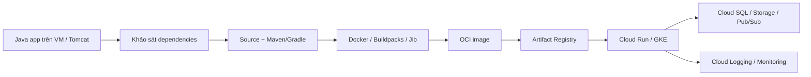
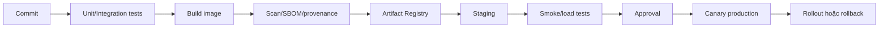

# Di chuyển ứng dụng Java sang container trên GCP

Di chuyển ứng dụng Java từ máy chủ vật lý, máy ảo hoặc application server truyền thống sang container trên Google Cloud là một bước **replatform** hoặc **modernization**: chuyển đơn vị triển khai từ máy chủ sang OCI image được build, kiểm thử và phát hành nhất quán. Container không tự động biến một hệ thống cũ thành cloud-native. Nhóm phát triển vẫn phải giải quyết phụ thuộc hệ điều hành, cấu hình, dữ liệu, phiên làm việc, kết nối mạng, bảo mật, giám sát và rollback.

Trong module `CLOUD_PROVIDERS_GCP`, người học khám phá Google Cloud từ tổ chức project, IAM và VPC đến Compute Engine, GKE, Cloud Run, dịch vụ lưu trữ và cơ sở dữ liệu. Qua các tình huống triển khai, người học biết lựa chọn dịch vụ, bảo vệ tài nguyên, tự động hóa phát hành và theo dõi độ tin cậy cùng chi phí. Bài học này áp dụng kiến thức đó cho hành trình cụ thể: khảo sát ứng dụng Java, tạo image, đẩy lên Artifact Registry, chạy trên Cloud Run hoặc GKE và chuyển traffic an toàn.

Các ví dụ sử dụng Spring Boot tên `order-api`, Java 21, Maven và region `asia-southeast1`. Thay các placeholder `PROJECT_ID`, `REGION`, `SERVICE_ACCOUNT_EMAIL`, `IMAGE_URI` bằng giá trị đã được phê duyệt. Không chạy lệnh deploy vào production khi chưa kiểm thử và xác nhận quyền.

## Mục tiêu học tập

Sau bài học, người học có thể:

- Khảo sát Java runtime, app server, OS/native dependencies, database, file system và các dịch vụ ngoại vi.
- Phân biệt containerization, replatform, refactoring và khi nào nên giữ Compute Engine VM.
- Chọn Cloud Run services, Cloud Run Jobs, Cloud Run worker pools, GKE Autopilot hoặc GKE Standard cho từng workload.
- Containerize ứng dụng Spring Boot JAR, Tomcat WAR bằng Dockerfile multi-stage, Buildpacks hoặc Jib.
- Dùng Artifact Registry, Cloud Build và image digest để xây quy trình CI/CD truy vết được.
- Tách configuration, secrets, runtime identity và dữ liệu bền vững khỏi image.
- Thiết kế health checks, resource limits, DB pool, networking, monitoring, canary và rollback.
- Lập kế hoạch cutover, xác nhận SLO, kiểm thử restore và decommission server cũ.

## 1. Từ Java trên VM sang Java trong container

### Khác biệt về đơn vị triển khai

Trên VM, ứng dụng có thể phụ thuộc vào JDK cài sẵn, Tomcat do sysadmin quản lý, file ở `/etc`, log ở `/var/log`, cron, keystore và trạng thái lưu trên đĩa. Những chi tiết đó có thể không tồn tại trong Git và khác nhau theo từng VM. Container image mô tả runtime và artifact tương đối nhất quán; môi trường chạy cấp cấu hình, network, quyền IAM và lưu trữ.



| Hạng mục | Java trên VM | Java trong container |
|---|---|---|
| Runtime | JDK, libraries, process manager cấu hình trên host. | JRE/JDK, app và dependency nằm trong image. |
| Phát hành | Copy JAR/WAR rồi restart process hoặc server. | Build/push image và cập nhật revision/Deployment. |
| Configuration | File local, script, system properties. | Environment variables, Secret Manager, ConfigMap/volume. |
| Dữ liệu local | Có thể lưu bền vững trên VM disk. | Filesystem container không nên dùng cho dữ liệu bền vững. |
| Mở rộng | Thêm VM và cân bằng tải. | Cloud Run autoscale hoặc GKE replicas/HPA. |
| Rollback | Khôi phục artifact và config cũ. | Chuyển revision/image, vẫn phải xử lý dữ liệu/schema. |

Container hóa giúp nhất quán môi trường và phát hành, **không** tự sửa nợ kỹ thuật, race conditions, transaction phân tán hay ứng dụng phụ thuộc một host cố định.

### Chiến lược migration

1. **Containerize gần nguyên trạng:** đóng gói WAR cùng Tomcat/JBoss tương thích. Giảm mức thay đổi trong bước đầu nhưng vẫn mang theo giới hạn của kiến trúc cũ.
2. **Replatform có điều chỉnh:** chuyển thành executable JAR, tách config, logs và state; dùng Cloud SQL/Cloud Storage/Secret Manager.
3. **Refactor/modernize:** tách dịch vụ, chuyển batch thành job, dùng Pub/Sub cho event, thay đổi domain boundary, nâng cấp framework khi có giá trị kinh doanh.
4. **Giữ trên VM tạm thời:** workload phụ thuộc kernel/OS, phần mềm có license đặc thù, binary không tương thích container hoặc yêu cầu vận hành chưa đáp ứng.

Không nên nâng JDK, đổi `javax` sang `jakarta`, chuyển database, chia microservices và cutover toàn hệ thống cùng một lúc nếu không có lý do bắt buộc. Phân tách thay đổi để dễ kiểm thử và rollback.

## 2. Discovery: khảo sát ứng dụng và vẽ bản đồ phụ thuộc

Trước khi viết Dockerfile, kiểm kê:

| Nhóm | Câu hỏi quan trọng | Nguồn kiểm tra |
|---|---|---|
| Build | Maven/Gradle? Build có tái lập được? | `pom.xml`, `build.gradle`, CI logs. |
| Runtime | Java 8/11/17/21? JDK vendor, JVM flags, charset/timezone? | `java -version`, startup scripts. |
| Packaging | JAR, WAR, EAR? Tomcat/JBoss/WebSphere version? | Artifact và app server config. |
| Native | JNI, font, CA cert, timezone, `glibc`, shared libs, shell scripts? | OS packages, integration tests. |
| State | HTTP session, local cache, file upload, cron, long-running threads? | Code, logs, file paths. |
| Data | PostgreSQL/MySQL/Oracle? Schema migration, backup, RPO/RTO? | Datasource config và DB inventory. |
| Network | DNS, private endpoint, proxy, fixed egress IP, VPN? | Flow logs, firewall rules, dependency map. |
| Security | Secrets, keystore, IAM, mTLS, certificates? | Credential inventory và policy. |
| Capacity | CPU/RAM peak, heap, GC, p95 latency, requests/sec? | APM và monitoring baseline. |
| Operations | Health checks, deployment window, rollback owner, SLO? | Runbooks, change history. |

**Ví dụ:** Tomcat VM có thư mục `/var/app/uploads`, session trong memory, cron xử lý email và JDBC URL tới database nội bộ. Nếu copy WAR vào container rồi chạy ba replicas, file upload không chia sẻ giữa replicas, session mất khi restart và cron có thể chạy ba lần. Cần quyết định giải pháp cho từng phụ thuộc trước khi scale.

### Các blockers phổ biến

- **Java EE/Jakarta:** code `javax.servlet.*` có thể không chạy trên Tomcat 10+ hoặc Spring Boot 3 nếu chưa migrate sang `jakarta.*`. Có thể giữ server phiên bản tương thích ở pha đầu.
- **Native libraries:** JNI, font rendering, timezone, OS certificates hoặc shared libs có thể thiếu trong image tối giản.
- **CPU architecture:** image manifest/native binaries phải tương thích với kiến trúc nền tảng; kiểm tra trước khi deploy.
- **Session/file:** local disk không phải durable storage; sticky session không thay thế shared session store.
- **Credential:** VM service account/key cũ không tự động chuyển thành service identity trên Cloud Run/GKE.
- **Network:** database/private API có thể yêu cầu Direct VPC egress, VPC connector, VPN/Interconnect, firewall và DNS.
- **Lifecycle:** background workers, cron và task không giới hạn thời gian có thể không phù hợp với mô hình Cloud Run HTTP service scale to zero.

Đặt baseline trước khi thay đổi: p50/p95/p99, error rate, throughput, CPU/RAM, GC, DB connections, backlog, cost và incident frequency. Những số liệu này làm tiêu chí đánh giá sau migration.

## 3. Chọn đích: Cloud Run, GKE hay Compute Engine?

| Workload | Nên cân nhắc | Lý do |
|---|---|---|
| REST/GraphQL API stateless, web app HTTP với traffic biến động | **Cloud Run services** | Revision, autoscaling và vận hành đơn giản. |
| Batch có điểm kết thúc, ETL, theo lịch | **Cloud Run Jobs** | Task chạy đến khi hoàn tất, không cần HTTP listener. |
| Worker/consumer liên tục, long-running processing | **GKE** hoặc **Cloud Run worker pools** khi phù hợp | Chủ động quản lý process lifecycle/scaling. |
| Kubernetes operators, custom networking, nhiều services/policy | **GKE Autopilot hoặc Standard** | Có Kubernetes API, Deployment, Service, HPA, RBAC. |
| Legacy app phụ thuộc kernel/OS, phần mềm không phù hợp container | **Compute Engine** trước | Giảm rủi ro khi chưa thể containerize. |

Cloud Run Jobs không dùng cho HTTP service. Cloud Run service cần ingress container lắng nghe trên cổng được nền tảng cấp. GKE tăng độ linh hoạt nhưng cũng tăng trách nhiệm vận hành Kubernetes; đừng chọn GKE chỉ vì ứng dụng được đóng gói thành image.

### Công cụ Migrate to Containers

Google Cloud **Migrate to Containers** có thể hỗ trợ trích xuất workload từ VM và tạo artifacts container cho một số ứng dụng, bao gồm những workload trên Tomcat, JBoss, WebSphere hoặc Linux, tùy phiên bản và môi trường nguồn được hỗ trợ. Đây là một hướng đi khi app chạy lâu năm trên VM hoặc thiếu pipeline source build. Output được sinh vẫn cần review về image, cấu hình, network, IAM, licensing và behavior.

Với ứng dụng có source code, Maven/Gradle và CI hiện hữu, trực tiếp tạo image từ source thường cho phép quản lý dependency và provenance rõ ràng hơn.

## 4. Chuẩn bị Java app để chạy cloud-native

### Externalized configuration

Không hardcode DB host, password, port hoặc profile vào source. Với Spring Boot:

```yaml
# src/main/resources/application.yaml
spring:
  application:
    name: order-api

server:
  address: 0.0.0.0
  port: ${PORT:8080}
  shutdown: graceful

app:
  region: ${APP_REGION:asia-southeast1}
  downstream-url: ${DOWNSTREAM_URL:http://localhost:9090}

management:
  endpoints:
    web:
      exposure:
        include: health,info
  endpoint:
    health:
      probes:
        enabled: true
```

`PORT` là biến do Cloud Run cấp cho ingress container; ứng dụng phải bind `0.0.0.0`, không chỉ `127.0.0.1`. `SPRING_PROFILES_ACTIVE=prod` chọn profile nhưng không phải ranh giới bảo mật: IAM và project mới quyết định dữ liệu nào ứng dụng truy cập được.

### Tách trạng thái

| Thói quen trên VM | Giải pháp phù hợp container |
|---|---|
| HTTP session lưu RAM Tomcat | Stateless session token hoặc session store dùng chung; không dựa hoàn toàn sticky session. |
| Upload vào `/var/app/uploads` | Chuyển object sang Cloud Storage. |
| Log ghi file `/var/log/app.log` | Ghi stdout/stderr, cấu trúc JSON để Cloud Logging thu thập. |
| Cron chạy trong web process | Cloud Scheduler + Cloud Run Jobs hoặc Kubernetes CronJob. |
| Cache local là nguồn dữ liệu chính | External cache/database, idempotency và cache invalidation rõ ràng. |
| File tạm dài hạn trên disk | Cloud Storage hoặc dịch vụ dữ liệu bền vững. |

Container có thể bị restart, thay revision hoặc scale-out bất cứ lúc nào. HTTP request, xử lý queue và transaction phải có chiến lược retry, timeout, shutdown và duplicate delivery.

### Kết nối database và schema migration

- Kiểm tra JDBC driver, SQL dialect, schema, encoding, collation và timezone.
- Dùng Cloud SQL khi phù hợp PostgreSQL/MySQL/SQL Server; nếu dữ liệu cần tiếp tục ở on-prem trong giai đoạn hybrid, bảo đảm private connectivity, latency và failover.
- Chạy Flyway/Liquibase theo quy trình có kiểm soát, tránh mỗi replica đồng thời apply migration nặng khi khởi động.
- Thiết kế thay đổi schema **expand-and-contract** để old/new versions cùng hoạt động trong thời gian canary.
- Cấu hình connection pool theo max replicas; ví dụ 30 containers × pool 20 có thể gây 600 connections.
- Kiểm thử backup/restore, RPO/RTO, transaction retries và DB failover trước cutover.

Ví dụ Hikari:

```yaml
spring:
  datasource:
    url: ${JDBC_URL}
    username: ${DB_USER}
    password: ${DB_PASSWORD}
    hikari:
      maximum-pool-size: 5
      connection-timeout: 30000
```

`DB_PASSWORD` cần được cấp bằng Secret Manager hoặc cơ chế secret đáng tin cậy, không đưa giá trị literal vào image.

### Graceful shutdown

Cloud Run gửi SIGTERM trước khi dừng instance và chỉ có thời gian ngắn cho shutdown. Spring Boot có thể bật graceful shutdown; cần cấu hình timeout phù hợp, đóng connection pools và hoàn tất những request còn xử lý trong giới hạn nền tảng. Task kéo dài nên chuyển thành job/work queue có trạng thái bên ngoài process.

## 5. Tạo Docker image cho Spring Boot JAR

### Cấu trúc dự án

```text
order-api/
├── pom.xml
├── src/main/java/
├── src/main/resources/application.yaml
├── src/test/
├── Dockerfile
├── .dockerignore
└── cloudbuild.yaml
```

### Multi-stage Dockerfile

```dockerfile
# Build stage: Maven và JDK.
FROM maven:3.9-eclipse-temurin-21 AS builder
WORKDIR /workspace
COPY pom.xml ./
COPY src ./src
RUN mvn -B -DskipTests package

# Runtime stage: không mang Maven/compile tool theo.
FROM eclipse-temurin:21-jre-jammy
WORKDIR /app
COPY --from=builder /workspace/target/*.jar /app/app.jar
USER 10001:10001
EXPOSE 8080
ENTRYPOINT ["java", "-jar", "/app/app.jar"]
```

Ví dụ này giả định Maven build ra **một** executable Spring Boot JAR trong `target/`. Nếu có `original-*.jar`, tests jar hoặc nhiều module, dùng đường dẫn artifact cụ thể để tránh copy nhầm. Tùy build pipeline, có thể chọn `mvn package` chạy test ngay trong Dockerfile; `-DskipTests` chỉ hợp lý khi CI đã chạy test trước đó.

Ở production, pin base image bằng digest đã review, quét CVE, update theo lịch và bảo đảm đúng `linux/amd64` hoặc architecture mà nền tảng chạy hỗ trợ. `USER 10001:10001` giảm quyền; ứng dụng không được kỳ vọng ghi vào `/app`. Nếu cần fonts, CA cert, timezone hoặc native libs, thêm đúng dependencies cần thiết, tránh copy toàn bộ VM.

### Docker build context

```dockerignore
.git
.idea
.vscode
target
build
*.log
.env
.env.*
*.pem
*.p12
*.tfstate
*.tfstate.*
```

`.dockerignore` giảm nguy cơ đưa file không cần thiết vào image và tăng tốc build nhưng không thay thế secret scanning. Không truyền token qua `ARG`/`ENV` hoặc lưu credential vào layer. Với private package registry, dùng token ngắn hạn và build secrets khi công cụ hỗ trợ.

### Test local

```bash
docker build -t order-api:local .
docker run --rm \
  -p 8080:8080 \
  -e PORT=8080 \
  -e SPRING_PROFILES_ACTIVE=dev \
  order-api:local
```

Kiểm tra `/actuator/health` hoặc endpoint nghiệp vụ; thử chạy lại với cấu hình resource limit để quan sát JVM memory, thread và GC. Test local không chứng minh IAM/network production đúng.

## 6. Buildpacks và Jib: lựa chọn không cần tự quản Dockerfile

### Cloud Native Buildpacks

Buildpacks nhận diện source Java, runtime và dependency rồi tạo container image. Với Cloud Run, `gcloud run deploy --source .` có thể build image từ source và deploy một lần:

```bash
gcloud run deploy order-api \
  --source . \
  --project=PROJECT_ID \
  --region=asia-southeast1
```

Đây là lệnh triển khai **thật**: chỉ chạy trong project thử nghiệm được phê duyệt. Với Java version không mặc định, kiểm tra tài liệu Buildpacks và `project.toml` tương ứng; đừng giả định mọi builder đều dùng đúng JDK của app cũ.

### Jib

**Jib** tạo OCI images từ Maven/Gradle cho Java, thường không cần Docker daemon trên máy build. Jib phân lớp dependency và class files giúp build caching tốt. Ví dụ Maven plugin, cần pin phiên bản phù hợp và cấu hình auth/base image trước khi dùng:

```xml
<plugin>
  <groupId>com.google.cloud.tools</groupId>
  <artifactId>jib-maven-plugin</artifactId>
  <version>3.4.5</version>
  <configuration>
    <to>
      <image>asia-southeast1-docker.pkg.dev/PROJECT_ID/java-images/order-api</image>
    </to>
  </configuration>
</plugin>
```

| Cách build | Phù hợp với | Cần chú ý |
|---|---|---|
| Multi-stage Dockerfile | Kiểm soát OS/native libs, build phức tạp. | Base image, rootless runtime, secrets, layers. |
| Buildpacks | Ứng dụng phổ biến, muốn deploy từ source nhanh. | Runtime/builder version, policy và provenance. |
| Jib | Java thuần Maven/Gradle, caching tốt, hạn chế Docker daemon. | Plugin, base image, registry credentials. |

Chọn một cách build được team hỗ trợ tốt; không cần thêm cả ba vào pipeline cùng lúc.

## 7. Artifact Registry và quản lý image

Artifact Registry lưu Docker/OCI images trong repository với IAM, location và lifecycle. Image URL dạng:

```text
REGION-docker.pkg.dev/PROJECT_ID/REPOSITORY/IMAGE:TAG
```

Ví dụ `asia-southeast1-docker.pkg.dev/my-project/java-images/order-api:release-001`. Repository là tài nguyên riêng cần tạo trước khi push:

```bash
gcloud services enable artifactregistry.googleapis.com \
  --project=PROJECT_ID

gcloud artifacts repositories create java-images \
  --repository-format=docker \
  --location=asia-southeast1 \
  --description="Java service images" \
  --project=PROJECT_ID
```

Push từ workstation hoặc runner đã được cấp quyền:

```bash
gcloud auth configure-docker asia-southeast1-docker.pkg.dev

IMAGE="asia-southeast1-docker.pkg.dev/PROJECT_ID/java-images/order-api:release-001"
docker build -t "$IMAGE" .
docker push "$IMAGE"

gcloud artifacts docker images list \
  asia-southeast1-docker.pkg.dev/PROJECT_ID/java-images \
  --include-tags
```

Build identity cần Artifact Registry Writer (`roles/artifactregistry.writer`) trên repository, runtime/Cloud Run/GKE cần quyền đọc image tương ứng; cross-project access phải được kiểm tra riêng. Docker credential helper chỉ cung cấp xác thực, không tự cấp IAM.

**Bảo mật chuỗi cung ứng:** dùng base image có nguồn tin cậy, pin digest, quét dependency/container vulnerabilities, tạo SBOM/provenance, kiểm soát quyền push, không lưu secret trong image và lưu image đủ lâu cho rollback. Đối với release production, triển khai bằng **image digest** (`image@sha256:...`) thay vì chỉ tag dễ bị thay đổi.

## 8. Triển khai Java container lên Cloud Run

### Service identity

Tạo runtime service account riêng, chỉ cấp quyền mà ứng dụng thực sự dùng:

```bash
gcloud services enable run.googleapis.com --project=PROJECT_ID

gcloud iam service-accounts create order-api-runtime \
  --project=PROJECT_ID \
  --display-name="Order API runtime"
```

Ví dụ quyền runtime: `roles/pubsub.publisher` trên topic, `roles/secretmanager.secretAccessor` trên secret, `roles/cloudsql.client` cho Cloud SQL và quyền Cloud Storage được giới hạn ở bucket. Deployer khác runtime, và người deploy cần `iam.serviceAccounts.actAs` để gắn service account vào service.

### Deploy image

```bash
gcloud run deploy order-api \
  --image=asia-southeast1-docker.pkg.dev/PROJECT_ID/java-images/order-api:release-001 \
  --project=PROJECT_ID \
  --region=asia-southeast1 \
  --service-account=order-api-runtime@PROJECT_ID.iam.gserviceaccount.com \
  --port=8080 \
  --memory=1Gi \
  --cpu=1 \
  --concurrency=40 \
  --max-instances=5 \
  --timeout=60s \
  --set-env-vars=SPRING_PROFILES_ACTIVE=prod
```

Các giá trị CPU/RAM/concurrency là ví dụ để thử tải, không phải khuyến nghị áp dụng nguyên cho mọi JVM. Kiểm tra Cloud Run Invoker, ingress và chính sách công khai theo yêu cầu; không mở public chỉ để dễ smoke test.

### Runtime contract

Một Cloud Run **service** phải lắng nghe `0.0.0.0` ở port được cấu hình (`PORT`). HTTP request phải được trả về trong request timeout. Container filesystem không phải nơi lưu dữ liệu bền vững. Instance có thể scale-in, restart và nhận `SIGTERM`; ứng dụng cần graceful shutdown và không để công việc bắt buộc hoàn tất phụ thuộc vào một tiến trình web tồn tại mãi.

Không chép JSON service account key vào image hoặc đặt `GOOGLE_APPLICATION_CREDENTIALS` trỏ tới key local trên Cloud Run; dùng Application Default Credentials (ADC) lấy từ service identity qua metadata server.

### Kiểm tra revision và health

```bash
gcloud run services describe order-api \
  --project=PROJECT_ID --region=asia-southeast1

gcloud run revisions list \
  --service=order-api \
  --project=PROJECT_ID --region=asia-southeast1
```

Nếu service private, test runner cần danh tính có quyền gọi Cloud Run và identity token phù hợp. Đừng đổi service thành public để chạy test. Actuator `/actuator/health/liveness` và `/actuator/health/readiness` hữu ích cho probes; không mở `/actuator/env` hoặc `/actuator/configprops` công khai.

### Cloud Run Jobs cho batch

Batch hoặc dữ liệu migration chạy đến khi hoàn tất nên dùng Cloud Run Jobs. Job không cần lắng nghe HTTP port; tiến trình phải kết thúc với exit code `0` khi thành công và nonzero khi thất bại. Không chuyển cron xử lý email từ VM sang web container nếu khiến mọi instance cùng chạy lịch đó.

## 9. Triển khai trên GKE khi cần Kubernetes

GKE Autopilot giảm việc quản lý node và áp dụng nhiều cơ chế quản lý tài nguyên; GKE Standard cho phép tùy chỉnh node pool và hạ tầng sâu hơn. Cả hai cần quản lý Deployment, Service, RBAC, IAM, networking và observability.

Ví dụ `Deployment`/`Service`:

```yaml
apiVersion: apps/v1
kind: Deployment
metadata:
  name: order-api
spec:
  replicas: 2
  selector:
    matchLabels:
      app: order-api
  template:
    metadata:
      labels:
        app: order-api
    spec:
      serviceAccountName: order-api-ksa
      containers:
        - name: order-api
          image: asia-southeast1-docker.pkg.dev/PROJECT_ID/java-images/order-api:release-001
          ports:
            - containerPort: 8080
          env:
            - name: PORT
              value: "8080"
            - name: SPRING_PROFILES_ACTIVE
              value: prod
          startupProbe:
            httpGet:
              path: /actuator/health/liveness
              port: 8080
            periodSeconds: 10
            failureThreshold: 30
          readinessProbe:
            httpGet:
              path: /actuator/health/readiness
              port: 8080
          livenessProbe:
            httpGet:
              path: /actuator/health/liveness
              port: 8080
          resources:
            requests:
              cpu: 250m
              memory: 512Mi
            limits:
              memory: 1Gi
---
apiVersion: v1
kind: Service
metadata:
  name: order-api
spec:
  type: ClusterIP
  selector:
    app: order-api
  ports:
    - port: 80
      targetPort: 8080
```

Cần tạo Kubernetes ServiceAccount `order-api-ksa` trước và cấu hình Workload Identity Federation for GKE nếu workload gọi Google Cloud APIs. Không lưu Google Cloud JSON key trong Kubernetes Secret chỉ để xác thực. `ClusterIP` chỉ phục vụ trong cluster; muốn public HTTP cần Gateway/Ingress, load balancer, TLS và policy phù hợp.

```bash
kubectl apply -f deployment.yaml
kubectl rollout status deployment/order-api

# Quay về Deployment revision trước khi có sự cố:
kubectl rollout undo deployment/order-api
```

`kubectl rollout undo` chỉ rollback Deployment spec/image; không tự đảo ngược database schema hay side effects. Chọn requests/limits bằng tải thực và đánh giá HPA không làm quá tải Cloud SQL.

## 10. IAM, Secret Manager, Cloud SQL và networking

### Tách build/deploy/runtime identity

| Principal | Công việc | Quyền tham khảo |
|---|---|---|
| Build identity | Chạy test, dựng/push image. | Artifact Registry Writer trên repository cần dùng. |
| Deployer identity | Cập nhật Cloud Run/GKE. | Cloud Run Developer, quyền actAs cho runtime SA; hoặc Kubernetes RBAC. |
| Runtime identity | Gọi Google Cloud APIs trong request. | Secret Accessor, Cloud SQL Client, Pub/Sub Publisher, Storage permissions theo resource. |
| Auditor | Xem provenance/logs/cấu hình. | Read-only IAM scope phù hợp. |

Không cấp project Owner/Editor cho runtime để “sửa nhanh” lỗi `PERMISSION_DENIED`.

### Secrets

Lưu password/API key trong **Secret Manager**, không đưa vào `Dockerfile`, `application-prod.yaml`, Cloud Build substitutions, image layer hoặc image `ENV`. Cloud Run có thể tham chiếu secret version như environment variable/volume mount; Spring hoặc Google Cloud client libraries cũng có thể đọc từ Secret Manager bằng runtime identity có `roles/secretmanager.secretAccessor`.

Chọn version/rotation theo chính sách; không giả định một JVM đã nạp secret lúc startup sẽ tự đổi giá trị khi có version mới. Nếu secret bị lộ, thu hồi credential ở hệ thống đích và xoay vòng; xóa log không đủ.

### Cloud SQL và VPC

Ứng dụng cần JDBC driver, database user, network path và quyền Cloud SQL Client phù hợp. Với private IP, cấu hình Direct VPC egress/VPC connector trên Cloud Run hoặc VPC-native networking trên GKE và firewall. Cần kiểm tra connection timeout, DNS, TLS/certificate, IAM, max connections và failover.

Cloud SQL Client không thay thế database authentication. Khi autoscale, tổng số connections bằng pool mỗi instance × số instance tối đa; đặt Hikari pool nhỏ phù hợp và dùng retry/backpressure.

### Lưu trữ dữ liệu

Hóa đơn, ảnh upload và report nên lưu Cloud Storage với location, bucket IAM và lifecycle phù hợp. Signed URLs có thể giảm tải dữ liệu đi qua API nhưng cần giới hạn phương thức, thời hạn và điều kiện. Không dùng thư mục `/tmp` của container làm nguồn dữ liệu cần khôi phục.

## 11. CI/CD: build một lần, deploy nhiều môi trường



Ví dụ `cloudbuild.yaml`:

```yaml
substitutions:
  _IMAGE_URI: asia-southeast1-docker.pkg.dev/$PROJECT_ID/java-images/order-api:$SHORT_SHA

options:
  dynamicSubstitutions: true

steps:
  - id: test
    name: maven:3.9-eclipse-temurin-21
    entrypoint: mvn
    args: ["-B", "test"]

  - id: image
    name: gcr.io/cloud-builders/docker
    args: ["build", "-t", "${_IMAGE_URI}", "."]

images:
  - "${_IMAGE_URI}"
```

`images` giúp Cloud Build upload image đã build; build service account cần quyền repo writer. `dynamicSubstitutions: true` cho phép giá trị `_IMAGE_URI` tham chiếu `$PROJECT_ID` và `$SHORT_SHA`, kể cả khi chạy build thủ công. Trong trigger `$SHORT_SHA` lấy từ commit; khi chạy submit thủ công, truyền `_IMAGE_URI` rõ ràng để không dựa vào biến trigger:

```bash
gcloud builds submit \
  --config=cloudbuild.yaml \
  --project=PROJECT_ID \
  --substitutions=_IMAGE_URI=asia-southeast1-docker.pkg.dev/PROJECT_ID/java-images/order-api:release-001 \
  .
```

Kiểm soát test, dependency scanning, image scanning, release approval, provenance và digest. Build image một lần rồi promote cùng digest giữa staging/production. Không cấp production secret cho build pull request không đáng tin cậy. Việc test trong Dockerfile có thể được skip khi Cloud Build đã chạy tests ở một step bắt buộc trước đó.

## 12. Chuyển traffic: blue/green, canary và rollback

### Chọn chiến lược

| Cách | Cơ chế | Rủi ro |
|---|---|---|
| Big-bang | Đổi toàn bộ traffic một lần. | Blast radius lớn, rollback gấp. |
| Blue/green | Chạy cũ/mới đồng thời, đổi routing sau kiểm thử. | Tốn tài nguyên và phải xử lý data consistency. |
| Canary | Tăng traffic 1–5% rồi tăng dần theo metric. | Cần routing và SLO theo từng version. |
| Shadow | Sao chép traffic để quan sát nhưng tránh side effects. | Có nguy cơ duplicate writes nếu không cô lập. |

### Cloud Run rollout

Với service đã có revision phục vụ, deploy revision mới chưa nhận traffic:

```bash
gcloud run deploy order-api \
  --image=IMAGE_URI \
  --project=PROJECT_ID \
  --region=asia-southeast1 \
  --no-traffic \
  --tag=candidate
```

Smoke test tagged revision theo đúng IAM/ingress. Sau khi đạt, chuyển 5% traffic:

```bash
gcloud run services update-traffic order-api \
  --project=PROJECT_ID \
  --region=asia-southeast1 \
  --to-revisions=NEW_REVISION=5,OLD_REVISION=95
```

Rollback:

```bash
gcloud run services update-traffic order-api \
  --project=PROJECT_ID \
  --region=asia-southeast1 \
  --to-revisions=OLD_REVISION=100
```

Thay `IMAGE_URI`, `NEW_REVISION`, `OLD_REVISION` bằng tên thật. Chuyển traffic không tức thời tuyệt đối: các request in-flight có thể tiếp tục ở revision trước. Rollback app **không** rollback schema DB, message đã phát, hóa đơn đã ghi hoặc secrets đã đổi.

### Cutover checklist

1. Kiểm thử backup/restore, RTO/RPO; lưu snapshot và runbook.
2. Đóng băng schema không tương thích; dùng expand-and-contract.
3. Deploy no-traffic, smoke test auth/DB/Storage/PubSub/health.
4. Xác định error-rate, p95 latency và business metrics làm ngưỡng canary.
5. Chuyển traffic từng phần qua LB/DNS/Cloud Run theo kiến trúc được chọn.
6. Quan sát DB load, SLO, billings, retries và duplicate events.
7. Giữ workload cũ sẵn sàng rollback trong thời gian đã định nhưng tránh double writes.
8. Decommission VM/Tomcat sau giai đoạn ổn định và xác minh không còn consumer cũ.

## 13. JVM performance, autoscaling và chi phí

### Bộ nhớ Java trong container

Java hiện đại nhận biết giới hạn tài nguyên container, nhưng không được giả định `-Xmx` bằng toàn bộ RAM container. RSS còn gồm metaspace, direct buffers, thread stacks, JIT, JNI và OS memory. Ví dụ có thể dùng:

```bash
JAVA_TOOL_OPTIONS="-XX:MaxRAMPercentage=65.0 -XX:+ExitOnOutOfMemoryError"
```

65% là **ví dụ**, không phải ngưỡng chung. Đo RSS, heap, GC pauses, CPU và số thread dưới tải thực để chọn heap/resource limits. JVM version hoặc base image mới có thể làm thay đổi startup và GC behavior; đối chiếu với baseline trước migration.

### Bottlenecks hay gặp

- Cold start do Spring context, JIT, tải config/secrets và khởi tạo DB connections.
- Request concurrency quá cao làm tăng thread, heap và contention.
- Autoscaling quá nhanh làm quá tải DB pool hoặc dịch vụ downstream.
- Long-lived connections bị reset; SDK cần retry và reconnect có giới hạn.
- Cross-region database/API gây tăng latency và egress fees.
- Container image lớn làm tăng thời gian pull/startup và attack surface.
- Background task chạy trong HTTP service bị chậm hoặc gián đoạn do vòng đời instance.

Tính chi phí Cloud Run/GKE compute, Cloud SQL, Artifact Registry, Cloud Build, Cloud Storage, VPC egress và Cloud Logging/Monitoring. So sánh theo cùng workload/SLO, không chỉ giá mỗi vCPU.

## 14. Quan sát và nghiệm thu sau migration

### Logging

Ghi log structured JSON ra stdout/stderr, gồm severity, service, event, request/trace ID, duration, error code và release/revision. Không ghi access token, mật khẩu, cookie xác thực, dữ liệu cá nhân hoặc body nhạy cảm.

```json
{
  "severity": "ERROR",
  "service": "order-api",
  "event": "order_submit_failed",
  "code": "UPSTREAM_TIMEOUT",
  "duration_ms": 2800
}
```

### Metrics

| Nhóm | Metric theo dõi |
|---|---|
| API | RPS, 4xx/5xx, p95/p99 latency, timeouts, SLO burn rate. |
| JVM | Heap/non-heap, GC pauses, threads, startup duration. |
| Container | CPU, RSS/OOM, instance count, cold starts, deployment failures. |
| Database | Connections, query latency, saturation, failover/retries. |
| Async | Queue backlog, ack latency, retry/DLQ, duplicate handling. |
| Migration | Success rate cũ/mới, canary traffic, business transactions và cost. |

Cloud Monitoring dashboards và alerting nên tập trung vào SLI/SLO người dùng; “container đang chạy” chưa đủ chứng minh luồng nghiệp vụ đúng.

## 15. Case study: Tomcat VM sang Cloud Run

**Hiện trạng:** Java WAR trên Tomcat VM, PostgreSQL ở VM riêng, upload hóa đơn xuống `/var/app/invoices`, session RAM, cron báo cáo và password lưu trong file config.

**Mục tiêu:** Order API là executable Spring Boot JAR trên Cloud Run, image trong Artifact Registry, invoice trong Cloud Storage, password trong Secret Manager, database trên Cloud SQL hoặc hybrid trong giai đoạn chuyển đổi, cron tách thành Cloud Run Jobs và session dùng external store/stateless auth.

**Pha A — Discovery:** kiểm tra Java/Tomcat version, `javax`/`jakarta`, native libraries, JVM flags, kết nối và baseline SLO. Nếu chưa thể chuyển JAR, containerize WAR/Tomcat tương thích trước để giảm scope.

**Pha B — Containerization:** tạo Dockerfile hoặc chọn Buildpacks/Jib, chuyển config và secrets ra ngoài image, viết unit/integration tests. Cấu hình health, graceful shutdown và container memory.

**Pha C — Staging:** push Artifact Registry, deploy Cloud Run private với runtime service account IAM tối thiểu, thử Cloud SQL/Storage/PubSub/VPC và đo chi phí. Verify job không chạy trùng.

**Pha D — Canary:** phối hợp DNS/load balancer để đưa traffic từ VM sang Cloud Run, giữ old/new cùng tồn tại với schema tương thích, theo dõi error/p95/business success rate, đảm bảo không double writes.

**Pha E — Stabilize:** tối ưu heap, DB pool, autoscaling và log volume; review SLO, data consistency, security findings và runbook. Chỉ tắt VM sau khi cửa sổ rollback đóng và xác nhận không còn tích hợp phụ thuộc.

### Tiêu chí nghiệm thu gợi ý

| Hạng mục | Điều kiện |
|---|---|
| Chức năng | Critical user journeys pass qua staging và canary. |
| Hiệu năng | p95 đáp ứng baseline/SLO đã thống nhất ở tải tương đương. |
| Lỗi | 5xx, timeouts và retry trong ngân sách lỗi cho phép. |
| Dữ liệu | Backup/restore đã test, không mất hóa đơn/transaction. |
| Bảo mật | IAM hẹp, không leak secret, container/dependency scans đạt policy. |
| Vận hành | Dashboard/alert/runbook/rollback owner và chi phí đã phê duyệt. |

## 16. Troubleshooting

| Triệu chứng | Nguyên nhân thường gặp | Cách kiểm tra |
|---|---|---|
| Cloud Run không ready/listen | Bind `localhost`, sai `PORT`, app crash/startup chậm. | `${PORT:8080}`, `0.0.0.0`, startup logs, probes. |
| `UnsupportedClassVersionError` | Java compiler target cao hơn runtime. | `java -version`, Maven compiler/release và image JRE. |
| `ClassNotFoundException` | App server hoặc `javax`/`jakarta` không tương thích. | Dependency tree, WAR/JAR và phiên bản Tomcat/Spring. |
| Image không start | Sai architecture, `ENTRYPOINT`, native library hoặc thiếu JAR. | Docker run local, image manifest, startup stderr. |
| Artifact Registry 403 | Build/deployer thiếu IAM repo hoặc cross-project pull. | Principal thực tế và roles Artifact Registry. |
| Secret `PERMISSION_DENIED` | Runtime service account sai hoặc không có Secret Accessor. | Secret IAM, project/version và audit logs. |
| DB timeout/too many connections | Egress route sai, Hikari pool × replicas quá lớn. | VPC, JDBC, Cloud SQL connections và autoscale. |
| Upload mất sau restart | Dữ liệu lưu trong container filesystem. | Chuyển sang Cloud Storage, test lại upload/download. |
| Cron chạy nhiều lần | Mỗi web replica khởi động scheduler. | Chuyển sang Jobs/CronJob có locking/idempotency. |
| Rollback app không hết lỗi | Dữ liệu/schema thay đổi không tương thích. | Expand-and-contract, backup, kế hoạch DB rollback. |
| Chi phí tăng | Instance min cao, log ingestion/egress, DB tier dư. | Billing, Cloud Monitoring, cleanup/lifecycle. |

Không giải quyết IAM lỗi bằng cách cấp project Owner hoặc nhúng key JSON vào image; cần tìm đúng principal, resource scope và network path.

## 17. Checklist di chuyển Java sang container

- [ ] Đã kiểm kê JDK, build tool, WAR/JAR/EAR, native libraries, license và OS dependencies.
- [ ] Đã đo baseline RPS, p95, error rate, heap/GC, CPU/RAM và database connections.
- [ ] Đã phân loại workload: HTTP service, batch/job, worker hay giữ VM.
- [ ] Cloud Run/GKE/Jobs được chọn theo execution model và SLO.
- [ ] Config, secret, log, upload, HTTP session và cron đã tách khỏi VM.
- [ ] Có lộ trình xử lý Java EE `javax`/Jakarta và app server tương thích.
- [ ] Image build reproducible, không root, không chứa secret, scan và pin base image/digest.
- [ ] Có smoke test container local, unit/integration và load tests.
- [ ] Artifact Registry có IAM reader/writer đúng scope; deploy theo image digest.
- [ ] Build, deploy, runtime identities tách biệt và dùng credential ngắn hạn.
- [ ] Secret Manager, Cloud SQL, Storage, Pub/Sub, IAM, VPC egress đã kiểm chứng.
- [ ] App lắng nghe `PORT` trên `0.0.0.0`; health/graceful shutdown hợp lý.
- [ ] JVM heap, resource limits, Hikari pool, concurrency và autoscaling đã được thử tải.
- [ ] CI/CD có scanning, provenance, approval và rollback.
- [ ] Cutover/canary, data migration, backup/restore và SLO ngưỡng đã có owner.
- [ ] Có runbook, kế hoạch decommission VM cũ và khả năng quay lại trong migration window.

## 18. Kết luận

Di chuyển ứng dụng Java sang container trên Google Cloud bắt đầu bằng **khảo sát phụ thuộc**, không phải chỉ viết Dockerfile. Image cần tách khỏi state, secret và cấu hình môi trường; JVM phải phù hợp resource limits; ứng dụng phải chịu được instance restart, concurrency và kết nối downstream biến động. Dockerfile multi-stage, Buildpacks hoặc Jib tạo image; Artifact Registry lưu và kiểm soát image; Cloud Run, Jobs hoặc GKE cung cấp môi trường chạy tùy workload.

Thành công migration được đo bằng tính đúng đắn nghiệp vụ, SLO, bảo mật, khả năng rollback, quản lý dữ liệu và chi phí sau cutover. Quy trình có baseline, staging, canary, audit, backup/restore và trách nhiệm vận hành rõ ràng sẽ an toàn hơn một lần chuyển toàn bộ VM mà không chuẩn bị.

## Tài liệu tham khảo

- [Google Cloud — Containerized application migration](https://docs.cloud.google.com/docs/migration/scenarios/container-migration)
- [Google Cloud — Migrate to Containers overview](https://docs.cloud.google.com/migrate/containers/docs/getting-started)
- [Google Cloud — Migrate to Containers migration journey](https://docs.cloud.google.com/migrate/containers/docs/migration-journey)
- [Google Cloud — Deploy Java Spring Boot to Cloud Run](https://docs.cloud.google.com/run/docs/quickstarts/build-and-deploy/deploy-java-service)
- [Google Cloud — Cloud Run container runtime contract](https://docs.cloud.google.com/run/docs/container-contract)
- [Google Cloud — Deploy Cloud Run services](https://docs.cloud.google.com/run/docs/deploying)
- [Google Cloud — Rollouts, rollbacks, and traffic migration](https://docs.cloud.google.com/run/docs/rollouts-rollbacks-traffic-migration)
- [Google Cloud — Cloud Run service identity](https://docs.cloud.google.com/run/docs/securing/service-identity)
- [Google Cloud — Artifact Registry Docker quickstart](https://docs.cloud.google.com/artifact-registry/docs/docker/store-docker-container-images)
- [Google Cloud — Artifact Registry Docker authentication](https://docs.cloud.google.com/artifact-registry/docs/docker/authentication)
- [Google Cloud — Cloud Build Java containerization](https://docs.cloud.google.com/build/docs/building/build-containerize-java)
- [Google Cloud — GKE Workload Identity Federation](https://docs.cloud.google.com/kubernetes-engine/docs/concepts/workload-identity)
- [Google Cloud — Cloud SQL from Cloud Run](https://docs.cloud.google.com/sql/docs/postgres/connect-run)
- [Google Cloud — Secret Manager overview](https://docs.cloud.google.com/secret-manager/docs/overview)
- [Google Cloud — Cloud Logging structured logging](https://docs.cloud.google.com/logging/docs/structured-logging)
- [Jib project](https://github.com/GoogleContainerTools/jib)
- [Spring Boot — Container Images](https://docs.spring.io/spring-boot/reference/packaging/container-images/index.html)
