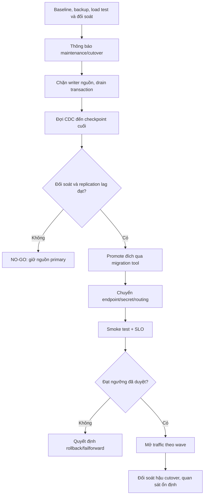

# Đối soát dữ liệu, kiểm thử tải và kế hoạch rollback

Di chuyển một ứng dụng lên Google Cloud không kết thúc khi VM, Cloud SQL, Cloud Run, GKE hay bucket mới đã hoạt động. Migration chỉ có thể được chấp nhận khi **dữ liệu đúng và đầy đủ**, **hiệu năng đáp ứng tải thực tế** và **kế hoạch phục hồi đã được diễn tập**.

Ví dụ, một hệ thống đơn hàng chuyển database PostgreSQL từ on-premises sang Cloud SQL for PostgreSQL. Số dòng có thể khớp nhưng cập nhật cuối cùng trong nguồn chưa được CDC áp dụng. API có thể vượt smoke test ở 5 request/giây nhưng timeout tại 500 request/giây. Nếu đã nhận đơn hàng mới ở đích sau cutover, việc sửa connection string để trỏ lại database cũ không thể tự đưa những đơn hàng đó về nguồn.

Bài thuộc chương **Di chuyển lên Google Cloud** trong module **CLOUD_PROVIDERS_GCP**. Nội dung nối tiếp việc khảo sát dependency, chọn nền tảng Compute Engine/GKE/Cloud Run, cơ sở dữ liệu và lưu trữ, IAM/VPC, phát hành tự động, observability, độ tin cậy và chi phí.

## 1. Mục tiêu học tập

Sau bài học, bạn có thể:

- Phân biệt xác thực cấu trúc, kiểm tra số lượng, đối soát theo khóa, hash và bất biến nghiệp vụ.
- Lựa chọn checkpoint nhất quán khi chuyển dữ liệu bằng snapshot, CDC hoặc incremental copy.
- Thiết kế reconciliation report có thể kiểm toán và có tiêu chí pass/fail theo mức độ quan trọng.
- Lập load test plan với workload mix, throughput, latency p95/p99, error rate và saturation.
- Xác định ngưỡng go/no-go dựa trên SLO, RTO, RPO và business requirements.
- Viết runbook cutover và rollback/failback/failforward phù hợp với trạng thái dữ liệu.
- Chỉ rõ giới hạn của DMS, Datastream, backup/PITR và các bước cần làm trước/sau khi đích nhận ghi mới.
- Triển khai rehearsal và kiểm chứng migration sau khi mở traffic Production.

## 2. Ba trụ cột xác nhận một migration

| Trụ cột | Câu hỏi cần trả lời | Bằng chứng |
|---|---|---|
| Đối soát dữ liệu | Dữ liệu nguồn và đích có đầy đủ, chính xác và còn nhất quán không? | Row count, key diff, checksums, invariants, checkpoint |
| Kiểm thử tải | Đích có chịu được workload hiện tại, peak và failure mode dự kiến không? | RPS/TPS, p95/p99, error rate, CPU, memory, DB connections |
| Rollback/khôi phục | Khi xảy ra sự cố có thể khôi phục ứng dụng và dữ liệu trong giới hạn chấp nhận không? | Runbook, rehearsal, backup/PITR test, RTO/RPO, approver |

Không được coi một trong ba trụ cột là bằng chứng thay thế hai trụ cột còn lại. Dữ liệu đúng ở trạng thái tĩnh có thể sai khi hệ thống nhận ghi đồng thời; load test thành công có thể không phát hiện một đơn hàng bị thiếu; có backup chưa có nghĩa phục hồi được trong RTO.

### 2.1. Vai trò trong migration wave

- **Migration lead/incident commander:** điều phối cửa sổ thay đổi và quyết định STOP.
- **DBA/data owner:** quản lý schema, snapshot, CDC, đối soát, backup và khôi phục.
- **Application owner:** kiểm chứng luồng nghiệp vụ, endpoint, retry, cache và background worker.
- **SRE/on-call:** theo dõi SLI/SLO, load test, alert và thời gian phục hồi.
- **Security/IAM owner:** xác nhận danh tính, quyền, mã hóa, network và audit trail.
- **Business approver:** xác nhận phạm vi rủi ro, downtime và mức dữ liệu có thể mất.

Mỗi bước phải có owner, deadline và tiêu chí tiếp tục hoặc hủy bỏ. Đừng chờ đến giờ cutover mới xác định người được phép đưa ra quyết định.

## 3. Lập danh mục dữ liệu cần kiểm chứng

Phạm vi không chỉ có bảng SQL. Một workload có thể dùng:

| Loại dữ liệu | Ví dụ | Cách xác nhận |
|---|---|---|
| Transaction | Đơn hàng, thanh toán, sổ cái | PK, amount, transaction, trạng thái, bất biến |
| Reference/master | Khách hàng, sản phẩm, bảng mã | Danh sách key, version, foreign key |
| Object/blob | Hình ảnh, PDF, tài liệu trong Cloud Storage | Manifest object, size, checksum, metadata |
| Analytical | BigQuery partition, bảng tổng hợp | Tổng hợp theo partition, freshness, totals |
| Event/queue | Pub/Sub hoặc outbox | Event ID, offset/checkpoint, backlog, idempotency |
| Cache | Redis/Memorystore | Thường invalidate hoặc rebuild có kế hoạch |
| Search index | Bộ chỉ mục tra cứu | Số tài liệu, kết quả truy vấn mẫu, freshness |

Phân loại **source of truth**, derived data, cache và dữ liệu có thể rebuild. Không đối xử với cache như database giao dịch. Nếu một đối tượng bị chuyển đổi kiểu dữ liệu, schema hoặc encoding, định nghĩa ánh xạ trước khi so sánh giá trị.

### 3.1. Data inventory

Với từng dataset ghi lại:

- Source endpoint/engine, destination service và location.
- Chủ sở hữu dữ liệu, sensitivity classification và retention.
- Phạm vi bản ghi: tenant, thời gian, soft delete, archived rows.
- Mapping schema và transformation version.
- Phương pháp initial load, CDC hoặc incremental sync.
- Checkpoint snapshot và transaction log position.
- Số lượng, kích thước, tốc độ thay đổi dự kiến.
- Quy tắc pass/fail cho dữ liệu thường và dữ liệu critical.

Một nhóm bảng không có tiêu chí đối soát rõ ràng nên được xem là **chưa sẵn sàng cutover**, dù công cụ copy báo hoàn tất.

## 4. Đối soát schema trước khi đối soát nội dung

Kiểm tra ở cả nguồn và đích:

- Danh sách database/schema/table/collection.
- Tên cột, type, precision/scale, nullability, default value.
- Primary key, unique, foreign key, indexes.
- Collation, encoding Unicode, timezone và timestamp precision.
- Sequence/identity và giá trị tiếp theo.
- Trigger, stored procedure, scheduled jobs, extension.
- Partitioning, TTL, retention, audit và soft-delete behavior.

Ví dụ nếu decimal(18,2) bị chuyển sang float, hai phía có thể đếm đúng dòng nhưng số tiền đã bị làm tròn. Nếu timestamp nguồn lưu timezone địa phương mà đích hiểu UTC, dữ liệu có thể bị lệch giờ và rơi sang partition ngày khác.

Với heterogeneous migration, schema nguồn và đích có thể **cố ý khác nhau**. Hãy lập mapping specification và test transformation thay vì so sánh DDL thô.

## 5. Các lớp đối soát dữ liệu

### 5.1. Lớp 1: Row count

Ví dụ với PostgreSQL:

```sql
-- Chạy trên snapshot nguồn và đích cùng mốc logic.
SELECT COUNT(*) AS order_count
FROM orders
WHERE created_at < TIMESTAMPTZ '2026-11-01 00:00:00+00';
```

Một báo cáo giả định:

| Dataset | Nguồn | Đích | Sai lệch | Kết luận |
|---|---:|---:|---:|---|
| customers | 1.800.000 | 1.800.000 | 0 | Count pass, chưa đủ |
| orders | 3.200.000 | 3.199.998 | -2 | Fail, cần điều tra |
| order_items | 8.100.000 | 8.100.000 | 0 | Kiểm tra nội dung |
| payment_events | 4.400.000 | 4.400.000 | 0 | Kiểm tra event ID và nghiệp vụ |

Hai row count bằng nhau không chứng minh các bản ghi giống nhau. Một key thiếu và một key dư có thể triệt tiêu trong COUNT.

### 5.2. Lớp 2: Tổng hợp theo chunk

Chia dữ liệu lớn theo ngày, tenant hoặc khoảng primary key để xác định vùng sai lệch:

```sql
SELECT
  DATE(created_at AT TIME ZONE 'UTC') AS event_day,
  COUNT(*) AS row_count,
  SUM(total_minor_units) AS total_minor_units
FROM orders
WHERE created_at >= TIMESTAMPTZ '2026-10-01 00:00:00+00'
  AND created_at <  TIMESTAMPTZ '2026-11-01 00:00:00+00'
GROUP BY 1
ORDER BY 1;
```

Nếu dữ liệu có nhiều loại tiền tệ, phải nhóm theo `currency`; không cộng USD và VND thành một tổng vô nghĩa. Với decimal, chuẩn hóa rounding trước khi so sánh. Với dữ liệu có key skew, chia chunk bằng PK range hoặc token range ổn định thay vì chỉ theo ngày.

### 5.3. Lớp 3: So khớp key và từng bản ghi

Kiểm tra:

- Key tồn tại ở nguồn nhưng thiếu ở đích.
- Key tồn tại ở đích nhưng không thuộc tập nguồn.
- Bản ghi cùng key nhưng khác giá trị sau chuẩn hóa.
- Version, modified timestamp, soft-delete tombstone.
- Giá trị foreign key và các trường domain-critical.

SQL minh họa khi hai tập đã được nạp vào **một database so sánh**:

```sql
SELECT
    COALESCE(s.id, d.id) AS order_id,
    CASE
      WHEN s.id IS NULL THEN 'ONLY_DESTINATION'
      WHEN d.id IS NULL THEN 'ONLY_SOURCE'
      WHEN s.status IS DISTINCT FROM d.status
        OR s.total_minor_units IS DISTINCT FROM d.total_minor_units
        THEN 'VALUE_MISMATCH'
      ELSE 'MATCH'
    END AS verdict
FROM source_snapshot_orders s
FULL OUTER JOIN destination_snapshot_orders d USING (id)
WHERE s.id IS NULL
   OR d.id IS NULL
   OR s.status IS DISTINCT FROM d.status
   OR s.total_minor_units IS DISTINCT FROM d.total_minor_units;
```

Không mặc định câu SQL có thể query trực tiếp hai database ở hai mạng khác nhau. Khi so sánh cross-system, dùng reconciliation job đọc theo key chunk hoặc đưa snapshot đã được kiểm soát vào môi trường đối soát.

### 5.4. Lớp 4: Hash/checksum

Khi bảng lớn, hash chunk giúp phát hiện khác biệt dù count trùng. Quy trình:

1. Chọn tập cột và transformation version.
2. Chuẩn hóa encoding, timezone, decimal, null và thứ tự mảng.
3. Sắp xếp theo primary key ổn định.
4. Mã hóa record theo định dạng không nhập nhằng, có length-prefix hoặc canonical serialization.
5. Tính hash từng record (ví dụ SHA-256), rồi gộp hash theo chunk một cách xác định.
6. So sánh checksum; nếu mismatch thì drill down đến key.
7. Ghi snapshot checkpoint, số bản ghi, algorithm/version và kết quả.

```text
for each deterministic primary-key chunk:
  source_rows = read_source_at_checkpoint(chunk)
  destination_rows = read_destination_at_checkpoint(chunk)
  assert primary_keys match

  for each key:
    source_hash = SHA256(canonicalize(source_row))
    destination_hash = SHA256(canonicalize(destination_row))
    if source_hash != destination_hash:
      record_mismatch(key)

  save_report(chunk, mismatch_count, checkpoint)
```

Không coi COUNT hoặc tổng CRC32 là bằng chứng mật mã mạnh. CRC32C hữu ích phát hiện lỗi truyền dữ liệu, nhưng có thể xảy ra va chạm và không phù hợp thay thế checksum mạnh cho dữ liệu tài chính.

### 5.5. Lớp 5: Invariant nghiệp vụ

Một số sai lệch không lộ ra nếu so sánh một cột riêng lẻ:

- `order_total = SUM(order_items) + tax - discount`.
- Balance của sổ cái bảo toàn theo transaction đã commit.
- Không có payment thành công thiếu order hợp lệ.
- Không có event bị xử lý hai lần gây gửi hóa đơn trùng.
- Inventory không âm trừ những ngoại lệ đã được thống nhất.
- Foreign key và uniqueness vẫn được bảo toàn.
- Tổng tiền theo currency/tenant/day khớp với hệ thống kế toán.

Owner nghiệp vụ phải ký xác nhận invariant và ngưỡng chấp nhận. Với dữ liệu tiền, mismatch một giao dịch có thể là lỗi nghiêm trọng; không dùng một ngưỡng sai lệch 0,1% chung cho mọi bảng.

## 6. Chọn checkpoint nhất quán

### 6.1. Nguy cơ khi dữ liệu vẫn thay đổi

Nếu đọc nguồn lúc 10:00 và đích lúc 10:03 trong khi CDC đang chạy, có thể thấy:

- Đơn hàng mới đã có ở nguồn nhưng chưa có ở đích.
- Đơn hàng cập nhật giá ở nguồn trong lúc đích còn version trước.
- Bản ghi xóa đã được apply ở một phía, nhưng phía khác chưa đến checkpoint.

Báo cáo so sánh hai thời điểm không đồng nhất có thể tạo false mismatch hoặc thậm chí che mất dữ liệu thiếu.

### 6.2. Các chiến lược checkpoint

- **Write freeze:** dừng ghi nguồn và đợi CDC bắt kịp mốc cuối.
- **Consistent snapshot:** đọc snapshot transaction nhất quán theo khả năng của engine.
- **Log watermark:** ghi LSN/WAL, binlog position, GTID hoặc event sequence có ý nghĩa ở hai đầu.
- **Application version:** dùng sequence/version domain nếu cơ chế ghi được thiết kế trước.

Không sử dụng timestamp của hai host như bằng chứng đồng bộ nếu có clock skew hoặc timestamp không phản ánh commit order. Cũng không trộn LSN nguồn với offset event downstream khi chưa có ánh xạ.

### 6.3. DMS, Datastream và transfer công cụ trên GCP

| Nhu cầu | Công cụ thường phù hợp | Điểm phải kiểm chứng |
|---|---|---|
| Database sang Cloud SQL/AlloyDB | Database Migration Service với engine và migration type được hỗ trợ | Full load, CDC, replication delay, promotion |
| CDC đến analytics/đích được hỗ trợ | Datastream | Backfill, apply ordering, delay, schema changes |
| Tệp và object lớn | Storage Transfer Service hoặc công cụ chuyển dữ liệu | Manifest, checksum, failure retry, metadata |
| Heterogeneous schema | Tool chuyên dụng + transform/ETL | Mapping, precision, duplicate và semantic |
| Near-zero downtime cần ghi song song | CDC, outbox, dual-write có thiết kế | Conflict, idempotency, partial failure |

DMS hỗ trợ quá trình initial load và CDC cho nhiều kịch bản liên quan. “Migration job Running” hoặc “Completed” chỉ phản ánh trạng thái công cụ, không xác nhận tất cả invariant nghiệp vụ.

### 6.4. Gate trước promotion

Trước khi chuyển ghi nguồn sang đích:

- Đảm bảo không còn writer nguồn ngoài kiểm soát.
- Dừng batch/scheduler, drain transaction đang mở và xác nhận write freeze.
- Ghi checkpoint cuối đã commit.
- Đợi thay đổi CDC đến checkpoint đó được apply.
- Xem replication delay ở hoặc gần 0 theo tiêu chí đã duyệt.
- Xác nhận không có table chưa backfill hoặc lỗi chưa xử lý.
- Đối soát dữ liệu critical theo key/hash/invariant.
- Smoke test quyền truy cập, kết nối mạng, secrets và ứng dụng đích.

Replication lag gần 0 **không chứng minh** dữ liệu đúng nếu có lỗi schema mapping hoặc event bị lọc. Nó cần đi cùng báo cáo đối soát.

## 7. Reconciliation report và xử lý mismatch

Một báo cáo có thể lưu dưới JSON/YAML:

```yaml
migration_wave: orders-wave-3
source: onprem-postgres
destination: cloudsql-postgres-orders
checkpoint: checkpoint-id-or-log-position
snapshot_time_utc: "2026-11-01T00:00:00Z"
mapping_version: "v4"
datasets:
  - name: orders
    source_count: 3200000
    destination_count: 3200000
    missing_keys: 0
    extra_keys: 0
    content_mismatches: 0
    invariant_failures: 0
    status: PASS
  - name: payment_events
    source_count: 4400000
    destination_count: 4400000
    missing_keys: 0
    content_mismatches: 0
    invariant_failures: 0
    status: PASS
approved_by: DATA_OWNER
```

Đây là dữ liệu minh họa. Trong production, report cần thêm thời gian bắt đầu/kết thúc, danh tính job, partition, hash algorithm, số lỗi đọc dữ liệu, mã run/retry và chữ ký người phê duyệt.

Phân loại sai lệch:

| Nhóm | Nghĩa | Hướng điều tra |
|---|---|---|
| MISSING_TARGET | Key ở nguồn nhưng không có ở đích tại checkpoint | CDC backlog, filter, failed copy |
| EXTRA_TARGET | Key bất thường chỉ có ở đích | Dữ liệu test, stale destination, duplicate |
| CONTENT_MISMATCH | Key giống nhưng giá trị khác | Transform, timestamp, update chưa apply |
| IN_FLIGHT | Đang chờ đến watermark | So lại sau catch-up |
| INTENTIONAL_EXCLUDE | Đã thỏa thuận không di chuyển | So với mapping specification |
| READ_PERMISSION_ERROR | Tool không đủ quyền để kiểm tra | IAM, snapshot và connection |
| BUSINESS_INVARIANT | Logic nghiệp vụ sai dù bản ghi đủ | Kiểm tra mapping và transaction |

Không cho phép báo cáo PASS khi một phần quan trọng bị bỏ qua do lỗi permission hoặc job timeout. Mỗi exception phải có owner, lý do, thời hạn và quyết định.

## 8. Baseline hiệu năng trước khi chuyển tải

Load test đích không thể có ý nghĩa nếu chưa biết tải nguồn. Thu baseline từ một khoảng đại diện:

- RPS/TPS theo giờ, ngày và chiến dịch.
- p50, p95, p99 latency ở client và server.
- Error ratio, timeout, retry, circuit breaker events.
- CPU, memory, disk IOPS, network egress/ingress.
- DB connections, connection pool wait, query latency, deadlocks/locks.
- Request payload size và response size distribution.
- Tỷ lệ đọc/ghi, hot key, số query trên một request.
- Queue backlog, processing age và batch completion time.

Cần thống nhất đơn vị, cách tính percentile và vùng thời gian. Không so p95 đo từ client ở nguồn với p95 đo tại server ở đích mà không ghi rõ khác biệt TLS/network.

### 8.1. Workload mix

Ví dụ giả định:

| Nhóm request | Tỷ trọng | Đặc điểm |
|---|---:|---|
| Read catalog | 55% | Nhiều đọc, có cache |
| Read order | 20% | Đọc SQL |
| Create/update order | 15% | Transaction, lock, event |
| Authentication/profile | 10% | IAM/session, đọc dữ liệu |

Giả định traffic thường ngày 200 RPS, peak đã quan sát 500 RPS và capacity test cần kiểm tra 750 RPS. Đây là **số liệu ví dụ**, phải thay bằng số thực của tổ chức. Một hệ thống chịu được 500 RPS read-only có thể thất bại với 100 RPS ghi do lock hoặc database connections.

## 9. Các loại load test nên thực hiện

| Test | Mục tiêu |
|---|---|
| Baseline | So sánh đích với nguồn cùng workload |
| Load/steady-state | Đảm bảo duy trì tải đã cam kết |
| Spike | Kiểm tra đột biến trong thời gian ngắn |
| Stress | Xác định ngưỡng suy giảm và phương án giới hạn tải |
| Soak | Phát hiện memory/connection leak, queue backlog |
| Failover | Kiểm tra phục hồi khi node, instance hoặc dependency lỗi |
| Migration rehearsal | Đo downtime, CDC catch-up, cutover và rollback |

Tránh dùng một lần stress test không kiểm soát gây ảnh hưởng production. Test nên chạy trên project hoặc môi trường được phép, có timebox, quota/chi phí được giới hạn và stop condition rõ ràng.

### 9.1. Ví dụ load test k6

Ví dụ chỉ dành cho **staging/sandbox được phê duyệt**, dùng endpoint read-only có dữ liệu thử nghiệm:

```javascript
import http from 'k6/http';
import { check } from 'k6';

const baseUrl = __ENV.BASE_URL;
if (!baseUrl) {
  throw new Error('Set BASE_URL to an approved staging endpoint');
}

export const options = {
  scenarios: {
    steady: {
      executor: 'constant-arrival-rate',
      rate: 50,
      timeUnit: '1s',
      duration: '5m',
      preAllocatedVUs: 50,
      maxVUs: 150
    }
  },
  thresholds: {
    http_req_failed: ['rate<0.01'],
    http_req_duration: ['p(95)<800']
  }
};

export default function () {
  const res = http.get(baseUrl + '/api/catalog?limit=20', {
    timeout: '10s',
    tags: { operation: 'catalog-read' }
  });
  check(res, { 'status is 200': r => r.status === 200 });
}
```

Ngưỡng 50 RPS, p95 < 800 ms và lỗi < 1% là minh họa, **không phải SLO mặc định**. Với k6 arrival-rate executor, `preAllocatedVUs` và `maxVUs` là giới hạn về virtual users có thể thực hiện kịch bản, không phải tốc độ request thực. Nếu generator không đủ công suất, measured RPS có thể thấp hơn target dù đích chưa bão hòa.

Với bài test ghi, dùng account/tenant và idempotency key riêng cho load test. Không dùng dữ liệu khách hàng thật hoặc credential production trong script.

### 9.2. Quy trình tăng tải

1. Warm-up ở mức thấp, xác nhận autoscaling và readiness.
2. Duy trì mức tải tương đương trung bình.
3. Tăng đến peak đã quan sát.
4. Thử mức dự phòng theo capacity requirement.
5. Chạy soak trong thời lượng đủ để phát hiện leak/backlog.
6. Giảm tải và quan sát khả năng phục hồi.
7. Lặp lại với workload ghi và workload hỗn hợp.
8. Kiểm tra dữ liệu mới sinh ra sau load test.

Đặt stop condition trước: error rate vượt ngưỡng nguy hiểm, database disk gần đầy, queue age tăng không kiểm soát, chi phí vượt ngân sách hoặc môi trường khác bị ảnh hưởng.

### 9.3. Công thức throughput và concurrency

Theo Little's Law, khi hệ thống gần trạng thái ổn định:

```text
concurrency ≈ throughput × average response time

500 requests/second × 0.25 second ≈ 125 in-flight requests
```

Giá trị là xấp xỉ trung bình. Phải quan sát thêm p95/p99, retry, burst và connection reuse. Không dùng riêng mean latency để kết luận trải nghiệm người dùng.

## 10. Theo dõi thành phần GCP trong load test

### 10.1. Cloud Run

Quan sát request count, p95/p99, error ratio, CPU/memory, instance count, container concurrency, startup latency và maximum instances. Nếu max instances đạt giới hạn, thêm traffic có thể tạo queue và timeout. Nếu số instance tăng quá nhanh, Cloud SQL có thể gặp connection storm.

Đặt pool connections và concurrency theo capacity DB; không nâng max instances đơn độc mà bỏ qua bottleneck của dependency.

### 10.2. GKE

Quan sát pod readiness, crash/restart, resource request/limit, CPU throttling, HPA desired/actual replicas, pending pods, cluster/node autoscaler, ingress latency và service-to-service errors.

HPA có thể yêu cầu nhiều replica nhưng node pool không còn capacity, khiến pod pending. Trong lúc load test, phân biệt lỗi ứng dụng và lỗi platform scheduling.

### 10.3. Compute Engine và database

Với VM/Cloud SQL/AlloyDB, xem CPU, memory, disk IOPS, active connections, pool wait, slow queries, lock wait, deadlocks, transaction latency và network RTT. Với CDC đang chạy, quan sát write-ahead log/binlog growth, apply throughput và replication delay khi tải ghi tăng.

Load test có thể làm replication backlog tăng trước cutover. Cần đo thời gian catch-up sau khi giảm hoặc ngừng ghi, không chỉ đo API throughput.

### 10.4. Bảng tiêu chí minh họa

| Metric | Nguồn baseline | Đích staging | Gate ví dụ |
|---|---:|---:|---|
| Stable throughput | 500 RPS | 520 RPS | ≥ 500 RPS |
| HTTP error ratio | 0,08% | 0,06% | ≤ 0,1% |
| p95 latency | 380 ms | 350 ms | ≤ 450 ms |
| p99 latency | 900 ms | 820 ms | ≤ 1.000 ms |
| Peak DB connections | 320 | 280 | ≤ 400 |
| CDC delay under write test | 2 s | 3 s | ≤ 10 s |

Các số đều giả định. Với mỗi dự án, tiêu chí phải được chọn trước khi chạy test và có owner ký xác nhận; không điều chỉnh ngưỡng sau khi xem kết quả chỉ để báo cáo PASS.

## 11. Kết hợp load test với data verification

Bộ dữ liệu trống không đại diện production. Đảm bảo test dataset giống production ở:

- Số lượng bản ghi, kích thước bảng, phân bố tenant.
- Hot key và skew theo thời gian.
- Index, partition, query statistics và read/write ratio.
- Tỷ lệ payload nhỏ/lớn.
- Queue/event traffic và dependency chain.

Không copy dữ liệu nhạy cảm vào sandbox nếu chưa masking và được duyệt. Masking nên giữ tương đối phân phối dữ liệu, không lộ thông tin cá nhân.

Sau load test phải kiểm tra:

- Số transaction được xác nhận commit và số order cuối cùng.
- Không có payment event được xử lý hai lần.
- Queue backlog giảm sau khi load kết thúc.
- Retry và timeout không làm tạo bản ghi trùng.
- Không có data corruption, khóa treo hoặc sequence collision.
- Dữ liệu test được cleanup đúng phạm vi mà không ảnh hưởng người dùng.

## 12. Go/No-Go gate trước cutover

Checklist chuẩn bị:

- [ ] Workload inventory, dependency, source/destination đã được chốt.
- [ ] Data mapping và reconciliation report ở checkpoint rõ ràng.
- [ ] Zero critical mismatch và các ngoại lệ khác được duyệt.
- [ ] Migration job/CDC không có lỗi chưa xử lý; replication delay đạt ngưỡng.
- [ ] Load/stress/soak test đạt tiêu chí tối thiểu.
- [ ] IAM, secrets, VPC, DNS, certificates và endpoint đích được kiểm thử.
- [ ] Backup/PITR và restore rehearsal đã PASS.
- [ ] Mọi writer và background job được liệt kê.
- [ ] Có cách chặn ghi và drain in-flight transaction.
- [ ] SLO dashboard, alert và on-call đang trực.
- [ ] Có điểm no-return rõ ràng và runbook theo trạng thái dữ liệu.
- [ ] Business owner ký RPO/RTO và downtime window.

Một gate dạng dữ liệu:

```yaml
cutover_gate:
  data:
    critical_mismatches: 0
    source_writes_frozen: true
    all_changes_to_checkpoint_applied: true
  load:
    peak_throughput_passed: true
    p95_within_slo: true
    error_ratio_within_slo: true
  recovery:
    restore_rehearsal_passed: true
    rto_rpo_approved: true
  security:
    iam_and_network_verified: true
  decision: APPROVE_OR_NO_GO
```

Đây là checklist minh họa, không phải cấu hình API Google Cloud. Không tiến hành cutover nếu một điều kiện bắt buộc chưa có bằng chứng.

## 13. Runbook cutover từng bước



Quy trình mẫu:

1. **T-1 ngày:** chốt code/schema, kiểm tra backup và rehearsal, lưu đối soát vòng đầu.
2. **T-60 phút:** mở war room, xác nhận decision maker, SRE, DBA, data owner.
3. **T-15 phút:** tắt batch/scheduler có nguy cơ ghi, giảm TTL DNS nếu đã duyệt.
4. **T0:** chặn writer nguồn và drain in-flight requests/transaction.
5. **T+N:** ghi mốc transaction cuối, đợi CDC apply toàn bộ thay đổi đến mốc.
6. **T+N:** chạy đối soát cuối và xác nhận zero mismatch critical.
7. **T+N:** promote destination đúng migration type, chờ operation hoàn tất.
8. **T+N:** chuyển application config, service account, endpoint, routing và worker.
9. **T+N:** chạy smoke test có dữ liệu synthetic, đo SLI, tra log lỗi.
10. **T+N:** tăng traffic theo wave, đo performance và integrity.
11. **T+N:** ký xác nhận cutover và bắt đầu thời gian quan sát.
12. **Sau đó:** giữ nguồn/backup theo cửa sổ fallback, chưa xóa ngay.

Mọi bước T+N phải có thời gian giới hạn dựa trên rehearsal. Nếu vượt giới hạn, incident commander kích hoạt quyết định STOP/NO-GO/rollback tương ứng.

### 13.1. DMS PostgreSQL promotion

Google Cloud mô tả với continuous migration PostgreSQL:

- Dừng tất cả thao tác ghi, script và client connection đến nguồn.
- Đợi replication delay bằng hoặc gần 0.
- Thực hiện promote theo job đã xác nhận.
- Promotion ngắt liên kết replication và biến đích thành primary database độc lập.

Lệnh tham khảo **chỉ chạy khi đã được phê duyệt cutover**:

```bash
gcloud database-migration migration-jobs promote MIGRATION_JOB_ID \
  --region=REGION \
  --project=PROJECT_ID
```

Lệnh có thể trả về long-running operation; không coi operation ID trả về là promotion đã hoàn tất. Theo dõi trạng thái job/operation trước khi chuyển ứng dụng. Sau promote, xác minh lại backup, PITR, quyền và cấu hình IaC cho destination theo yêu cầu từng engine/migration mode.

## 14. Phân biệt rollback, failback và failforward

- **Rollback:** đảo một bước thay đổi hoặc đưa ứng dụng về phiên bản cũ với dữ liệu tương thích.
- **Failback:** chuyển workload từ đích về nguồn trước đây, có thể cần đồng bộ ngược dữ liệu.
- **Failforward:** giữ đích là source of truth và sửa lỗi bằng cấu hình, tăng capacity, rollback code hoặc khôi phục có chọn lọc.

Đổi connection string không phải là kế hoạch rollback dữ liệu.

### 14.1. Ma trận quyết định

| Trạng thái | Hướng xử lý khả thi | Điều kiện |
|---|---|---|
| Trước write freeze | Hủy migration và tiếp tục nguồn | Nguồn còn nguyên và authoritative |
| Sau freeze, trước promote | Thường có thể mở lại nguồn sau xác minh | Không có transaction/job dang dở |
| Sau promote, trước destination writes | Có thể cân nhắc routing về nguồn | Phải kiểm tra không có side effect hay ghi mới |
| Đích đã nhận ghi mới | Không chuyển thẳng về nguồn | Cần reverse sync/reconciliation hoặc failforward |
| Schema mới không tương thích ứng dụng cũ | Rollback code có thể không an toàn | Dùng expand/contract, forward fix hoặc restore |
| Đích có lỗi runtime, data vẫn tốt | Ưu tiên rollback ứng dụng hoặc failforward | Xác nhận database đích vẫn authoritative |

**Point of no simple return** thường xuất hiện khi đích đã nhận giao dịch mới mà nguồn chưa có. Sau DMS promote, không mặc định replication tiếp tục theo chiều ngược; nếu muốn failback, cần một cơ chế đã được thiết kế và kiểm chứng độc lập.

### 14.2. Rollback trước promotion

1. Dừng công việc cutover và thông báo NO-GO.
2. Xác nhận nguồn vẫn có dữ liệu và quyền truy cập đầy đủ.
3. Xem các transaction in-flight và lịch job.
4. Mở writer nguồn theo thứ tự đã duyệt.
5. Khôi phục scheduler, consumer, endpoint ứng dụng trước cutover.
6. Chạy smoke test trên nguồn và kiểm tra bất biến nghiệp vụ.
7. Ghi log nguyên nhân và cải thiện trước lần migration tiếp theo.

Không hủy quá trình replicate hoặc xóa destination khi đang điều tra nếu còn cần dữ liệu so sánh làm bằng chứng.

### 14.3. Failback sau destination writes

Trường hợp nguy hiểm: một số đơn hàng đã commit ở Cloud SQL đích, nguồn cũ không có. Muốn quay về nguồn:

1. Giảm hoặc chặn ghi đích theo quy trình khẩn cấp.
2. Ghi checkpoint và lưu dữ liệu/event phát sinh sau cutover.
3. Phát hiện key/version chỉ có ở đích.
4. Xác định conflict resolution theo từng entity.
5. Chạy reverse replication/CDC nếu đã thiết kế, hỗ trợ và test; hoặc export/replay có kiểm soát.
6. Đối soát khóa, nội dung, event và invariant.
7. Chỉ sau khi nguồn được xác nhận nhất quán mới chuyển traffic.
8. Smoke test, theo dõi số giao dịch và side effects.

Nếu không có cách đồng bộ ngược đáng tin cậy, failback không thể được hứa trong vài phút. Có thể cần bảo trì kéo dài, forward fix hoặc restore+replay theo RPO đã duyệt.

### 14.4. Rollback code nhưng giữ Cloud SQL

Nếu lỗi là container image, config hoặc feature flag, nhiều khi đơn giản và an toàn hơn khi:

- Giữ Cloud SQL đích là nguồn dữ liệu chính.
- Đưa Cloud Run revision/GKE image về bản đã biết tốt.
- Xác nhận schema và event format vẫn tương thích với code cũ.
- Dùng feature flag để tắt luồng lỗi.
- Kiểm tra latency, error ratio và consistency.

Rollback application không tự hoàn tác migration dữ liệu, schema hoặc sự kiện đã gửi ra ngoài.

## 15. RPO, RTO và backup/PITR

**RPO** là lượng dữ liệu tối đa có thể mất (tính theo khoảng thời gian). **RTO** là thời gian tối đa chấp nhận được để khôi phục dịch vụ sau sự cố. Hai mục tiêu phải do nghiệp vụ định nghĩa.

Ví dụ một hệ thống thanh toán yêu cầu RPO=0 cho transaction đã xác nhận. Snapshot cách đây 15 phút không đáp ứng yêu cầu đó. Với analytics có thể replay từ event log, freshness lag vài phút có thể được chấp nhận.

Trước migration:

- Xác nhận backup nguồn hoạt động và có thể restore.
- Xác nhận backup/retention ở destination sau promote.
- Xác minh KMS key, quyền restore và vị trí lưu backup.
- Diễn tập restore vào môi trường cách ly, không ghi đè production.
- Đo thời gian restore thật và so với RTO.
- Tách phương án restore dữ liệu khỏi phương án rollback application.
- Giữ nguồn và backup đến hết cửa sổ fallback.

PITR cho phép phục hồi về thời điểm được hỗ trợ, nhưng **không bảo đảm bảo toàn mọi giao dịch sau thời điểm đó**. Nếu cần không mất dữ liệu, phải có cơ chế replay/merge hoặc replication đáng tin cậy.

### 15.1. Timeline rehearsal ví dụ

| Bước | Thời gian đo | Giới hạn |
|---|---:|---:|
| Write freeze | 2 phút | 5 phút |
| CDC catch-up | 4 phút | 10 phút |
| Final reconciliation | 3 phút | 8 phút |
| Chuyển endpoint/routing | 5 phút | 10 phút |
| Smoke test và quyết định | 4 phút | 7 phút |
| Tổng cutover | 18 phút | 40 phút |

Số liệu chỉ minh họa. Trong hệ thống thật, nếu từng bước vượt giới hạn, kích hoạt nhánh rollback/NO-GO, không đợi hết toàn bộ maintenance window.

## 16. Runbook rollback cần chứa những gì?

```text
MIGRATION_WAVE: orders-wave-3
CURRENT_SOURCE_OF_TRUTH: [source | destination]
LAST_VERIFIED_CHECKPOINT: [...]
DESTINATION_WRITES_SINCE_CUTOVER: [yes | no | unknown]

STOP TRIGGERS:
  - critical data mismatch
  - error ratio or latency exceeds agreed SLO
  - migration step exceeds maximum duration
  - IAM/network failure prevents safe operations

ACTIONS:
  1. Incident commander declares STOP.
  2. Pause or restrict new writes and traffic as authorized.
  3. Record checkpoints; preserve logs, backup and evidence.
  4. Confirm whether destination has committed new writes.
  5. Select rollback app / failback data / failforward.
  6. Execute the corresponding tested branch.
  7. Reconcile data and run smoke tests.
  8. Confirm SLI recovery, communicate, document incident.
```

Nếu trạng thái có ghi mới là **unknown**, không được mặc định là **no**. Đầu tiên phải xác minh trước khi chuyển về nguồn. Mỗi nhánh runbook cần owner, lệnh/hành động, thời gian tối đa và tiêu chí thành công.

## 17. Giảm blast radius của migration

### 17.1. Chia wave và canary

Một migration theo tenant, region hoặc workload có thể giảm rủi ro. Tuy nhiên, canary ứng dụng không tự giải quyết dữ liệu phân kỳ. Các phiên bản cũ/mới cần cùng hiểu hệ thống nào đang authoritative; không để một user ghi đồng thời vào hai database nếu không có thiết kế conflict/reconciliation.

### 17.2. Dual-write và outbox

Dual-write có thể giảm downtime nhưng gây lỗi một phía thành công, một phía thất bại. Nếu dùng, cần:

- Idempotency key và event ID.
- Quy tắc retry, xử lý partial success.
- Outbox hoặc change log để replay.
- Conflict resolution và thứ tự transaction.
- Đối soát định kỳ theo checkpoint.
- Hạn chế phạm vi và rehearsal có failure injection.

Không bổ sung dual-write vào production trong ngày cutover chỉ để “có rollback”.

### 17.3. DNS, secret và background writer

- DNS TTL không buộc mọi client cập nhật ngay lập tức.
- Connection pool có thể giữ kết nối cũ sau khi đổi secret/endpoint.
- Batch job, scheduler và message consumer có thể không đi qua HTTP routing.
- Một external integration có thể vẫn đẩy dữ liệu vào nguồn.
- Thay đổi IAM/VPC/private IP cần kiểm chứng từ danh tính thật của workload.

Phải có danh sách tất cả writer, không chỉ API frontend.

## 18. Observability trong và sau cutover

Dashboard chung:

| Lớp | Metric |
|---|---|
| Trải nghiệm người dùng | Availability, p95/p99, error ratio, RPS |
| Runtime | CPU/memory, concurrency, restart, OOM, autoscaling |
| Database | Connection count, locks, slow query, disk I/O |
| CDC/pipeline | Backfill progress, errors, replication lag, checkpoint |
| Messaging | Pub/Sub unacked messages, oldest message age, retry |
| Network | Latency, connectivity, load balancer errors |
| Bảo mật | IAM denied, secrets access, KMS/audit logs |
| Chi phí | VM/instance count, database tier, network egress, operation volume |

Theo dõi nhiều giờ hoặc nhiều ngày sau cutover tùy SLA và rủi ro. Chỉ decommission nguồn khi hết thời hạn fallback, không còn dependency, data owner đã chấp nhận dữ liệu và không còn mismatch critical.

## 19. Lỗi thường gặp

| Lỗi | Hậu quả | Cách tránh |
|---|---|---|
| Chỉ đối soát row count | Nội dung sai vẫn có thể lọt | Key/hash/invariant theo checkpoint |
| Chạy so sánh ở hai thời điểm | False mismatch do CDC in-flight | Dùng checkpoint hoặc write freeze |
| Chỉ nhìn replication lag | Không phát hiện mapping/backfill lỗi | Kiểm tra từng bảng và nội dung |
| Load test database rỗng | Performance không đại diện | Dataset có quy mô và phân bố thực tế |
| Test toàn request đọc | Không thấy lock và write bottleneck | Traffic mix giống production |
| Generator không đủ công suất | Đánh giá sai capacity | Theo dõi cả máy sinh tải |
| Chạy load trên prod không phê duyệt | Ảnh hưởng người dùng/chi phí | Sandbox và stop condition |
| Promote khi nguồn còn writer | Mất/phân kỳ dữ liệu | Freeze, drain và checkpoint |
| Chuyển lại DNS sau khi đích ghi mới | Nguồn thiếu transaction | Reverse sync hoặc failforward |
| Backup có nhưng chưa restore | Không biết RTO thật | Rehearsal restore/PITR |
| Rollback code khi schema breaking | App cũ không chạy | Expand/contract compatibility |
| Quên background consumer | Vẫn ghi nhầm DB | Danh sách writer đầy đủ |
| Xóa nguồn ngay | Mất phương án fallback | Retention theo kế hoạch |
| Không có deadline step | Kéo dài downtime không kiểm soát | Timebox và STOP gate |

## 20. Bài thực hành có hướng dẫn

**Bối cảnh:** ứng dụng Java/Spring xử lý đơn hàng; nguồn là PostgreSQL tự quản lý, đích là Cloud SQL for PostgreSQL; app target chạy Cloud Run hoặc GKE.

**Dữ liệu thử nghiệm:**

- 100.000 orders và 300.000 order_items.
- 10.000 payment_events có event ID riêng.
- Một số update/delete diễn ra trong lúc copy.
- Không dùng dữ liệu người dùng thật.

**Thực hiện:**

1. Tạo schema nguồn/đích trong project thử nghiệm.
2. Seed dữ liệu mẫu và mô phỏng các đợt ghi.
3. Dùng công cụ phù hợp để copy ban đầu và đồng bộ thay đổi.
4. Ghi checkpoint, chạy count và so key/hash theo chunk.
5. Cố tình tạo một mismatch để xem báo cáo FAIL.
6. Chạy k6/JMeter với tỷ lệ đọc/ghi có kiểm soát và đo p95/p99.
7. Giảm tải rồi kiểm tra database connections, CDC catch-up.
8. Diễn tập write freeze, chốt checkpoint, final reconciliation.
9. Thử NO-GO trước promote và xác minh nguồn vẫn phục vụ.
10. Thử rollback application khi đích đã hoạt động, nhưng không cố đồng bộ ngược dữ liệu theo cách chưa được thiết kế.
11. Lưu evidence: test report, timeline, decision record.

**Tiêu chí hoàn thành ví dụ:** zero critical mismatch, không duplicate payment, peak throughput và latency đạt SLO giả định, chỉ promote sau khi CDC đến checkpoint, có runbook phân biệt trước/sau destination writes và có bản restore rehearsal.

## 21. Checklist cuối trước khi ký hoàn thành

- [ ] Schema mapping, encoding, timezone, precision và constraint đã kiểm tra.
- [ ] Dữ liệu có snapshot/checkpoint logic chung.
- [ ] Count, key, hash và business invariant đạt tiêu chí.
- [ ] Mismatch đã được phân loại và giải quyết/được duyệt.
- [ ] CDC/backfill/replication lag không có lỗi chưa xử lý.
- [ ] Đã thu baseline và chạy load/stress/soak phù hợp.
- [ ] Dữ liệu tải test đại diện, không lộ PII.
- [ ] Đã kiểm tra peak RPS, p95/p99, error ratio và saturation.
- [ ] DMS promote/cutover chỉ được phép sau write freeze và reconciliation.
- [ ] RTO/RPO, backup/PITR và restore rehearsal đã ký duyệt.
- [ ] Mọi writer, job và consumer đều nằm trong runbook.
- [ ] Có owner, war room, alert, deadline và stop condition.
- [ ] Rollback trước promote đã thử.
- [ ] Sau destination writes có reverse sync đã kiểm chứng hoặc không hứa failback tức thì.
- [ ] Có kịch bản rollback code/failforward khi dữ liệu đích đã tốt.
- [ ] Audit, telemetry và post-cutover reconciliation đã sẵn sàng.
- [ ] Chỉ decommission nguồn sau thời hạn ổn định và quyết định chính thức.

## Kết luận

Đối soát dữ liệu, kiểm thử tải và kế hoạch rollback tạo thành bộ ba kiểm soát cho một lần migration trên Google Cloud. Đối soát phải dùng checkpoint nhất quán và kết hợp số lượng, khóa, hash cùng bất biến nghiệp vụ; kiểm thử tải phải phản ánh traffic và dữ liệu thực, đo latency p95/p99, throughput, error ratio, saturation và tốc độ CDC catch-up.

Rollback chỉ đáng tin cậy khi có ranh giới rõ ràng giữa trước và sau khi đích nhận ghi mới. DMS promotion ngắt replication nguồn-đích theo workflow được hỗ trợ và không tự tạo cơ chế sao chép ngược. Runbook nên ưu tiên bảo toàn transaction, có lựa chọn failforward khi thích hợp, rehearsal backup/PITR và tiêu chí go/no-go được phê duyệt trước ngày cutover.

## Tài liệu tham khảo

- [Google Cloud Architecture Center — Migrate large datasets](https://docs.cloud.google.com/architecture/migration-to-google-cloud-transferring-your-large-datasets)
- [Google Cloud Architecture Center — Validate a migration plan](https://docs.cloud.google.com/architecture/migration-to-google-cloud-best-practices)
- [Google Cloud Migration Center — Execute your migration](https://docs.cloud.google.com/migration-center/docs/migration-execution)
- [Google Cloud — Database Migration Service overview](https://docs.cloud.google.com/database-migration/docs/overview)
- [Google Cloud — Verify a MySQL migration](https://docs.cloud.google.com/database-migration/docs/mysql/verify-migration)
- [Google Cloud — Promote a PostgreSQL migration job](https://docs.cloud.google.com/database-migration/docs/postgres/promote-migration)
- [Google Cloud — Promote a MySQL migration job](https://docs.cloud.google.com/database-migration/docs/mysql/promote-migration)
- [Google Cloud — Cloud Run load testing best practices](https://docs.cloud.google.com/run/docs/about-load-testing)
- [Google Cloud — Migrate data and batch across regions](https://docs.cloud.google.com/architecture/migrate-across-regions/prepare-data-and-batch-workloads)
- [Google Cloud — Datastream FAQ](https://docs.cloud.google.com/datastream/docs/faq)
- [Google Cloud — Cloud SQL PostgreSQL replication lag](https://docs.cloud.google.com/sql/docs/postgres/replication/replication-lag)

