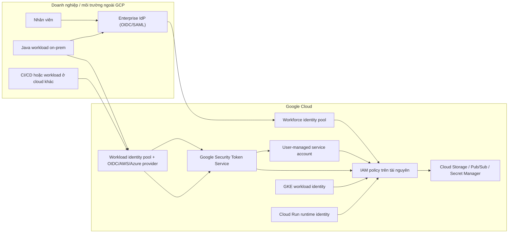
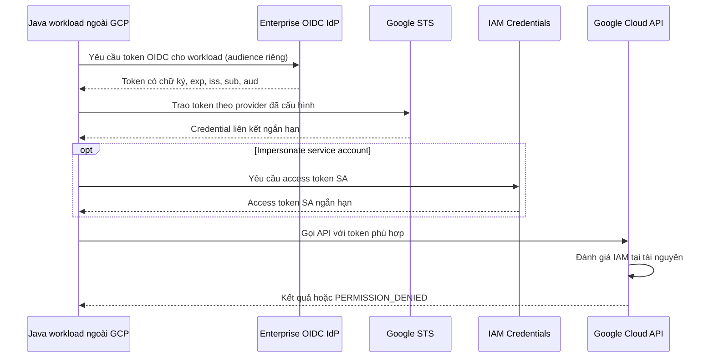
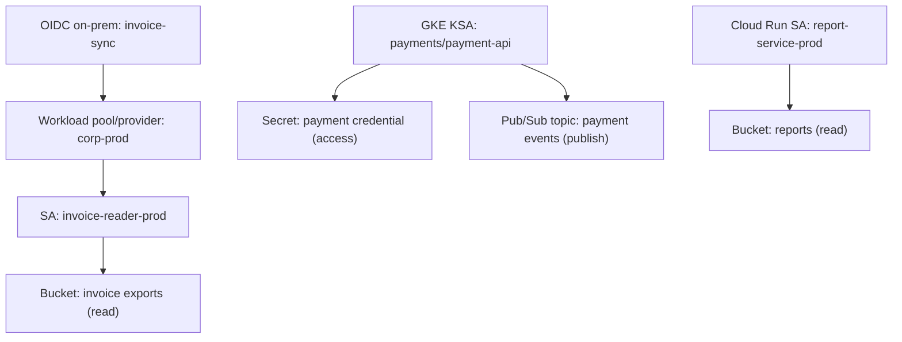

# Liên kết danh tính doanh nghiệp với workload trên GCP

> **Chương:** Hạ tầng lai và đa đám mây  
> **Phạm vi:** Google Cloud, mô-đun `CLOUD_PROVIDERS_GCP`. Bài học kết nối kiến thức tổ chức project, IAM, VPC, Compute Engine, GKE, Cloud Run, lưu trữ và cơ sở dữ liệu với tình huống triển khai thực tế: lựa chọn dịch vụ, bảo vệ tài nguyên, tự động hóa phát hành, giám sát độ tin cậy và kiểm soát chi phí.

## 1. Mục tiêu học tập và bài toán doanh nghiệp

Sau bài học, người học có thể:

1. Phân biệt **danh tính nhân sự**, **danh tính workload**, **service account**, **nhà cung cấp danh tính (IdP)** và **quyền IAM**.
2. Chọn đúng cơ chế cho người dùng doanh nghiệp, ứng dụng trên GCP, ứng dụng on-premises, ứng dụng ở đám mây khác và pipeline CI/CD.
3. Diễn giải luồng trao đổi token ngắn hạn bằng **Security Token Service (STS)**, cơ chế **Workload Identity Federation (WIF)** và **service account impersonation**.
4. Thiết kế ánh xạ thuộc tính, ràng buộc trust, quyền tối thiểu và cô lập môi trường production/staging.
5. Triển khai kịch bản tham chiếu ứng dụng Java chạy ngoài GCP truy cập Cloud Storage không sử dụng khóa JSON dài hạn.
6. Vận hành, kiểm tra audit, xử lý lỗi và thu hồi quyền khi nhà cung cấp danh tính hoặc workload gặp sự cố.

### Bối cảnh

Một doanh nghiệp có Active Directory/Microsoft Entra ID hoặc IdP OIDC/SAML, hệ thống nghiệp vụ Java đặt tại trung tâm dữ liệu, dịch vụ Kubernetes trên GKE, ứng dụng Cloud Run và pipeline phát hành ở một nền tảng CI bên ngoài. Các ứng dụng cần gọi Cloud Storage, Pub/Sub hoặc Secret Manager. Cách làm thiếu an toàn là sao chép khóa JSON của Google service account tới từng máy chủ, container và kho mã nguồn. Khóa có thể tồn tại rất lâu, bị rò rỉ khó phát hiện và phải quản trị vòng đời thủ công.

Thiết kế ưu tiên là **xác thực danh tính hiện có → kiểm chứng điều kiện tin cậy → nhận thông tin xác thực ngắn hạn → IAM kiểm tra quyền trên tài nguyên đích**. Danh tính có thể xuất phát từ IdP doanh nghiệp, cloud khác, Kubernetes hoặc Google-managed runtime; nhưng **không phải tất cả đều dùng cùng một pool hoặc cùng một giao thức**.

## 2. Tách bạch năm khái niệm

| Khái niệm | Chức năng | Ví dụ | Hiểu nhầm cần tránh |
|---|---|---|---|
| Identity provider (IdP) | Phát hành khẳng định danh tính sau khi xác thực | OIDC issuer doanh nghiệp, Microsoft Entra ID, Okta, AWS identity | IdP xác thực thành công không đồng nghĩa được cấp quyền trên GCP |
| Principal | Chủ thể được IAM nhận diện | Google user, group, service account, federated subject | Principal có thể là ứng dụng chứ không phải con người |
| Workload | Tiến trình thực thi cần gọi API | Java batch on-prem, GKE pod, Cloud Run service | Một workload không nên dùng tài khoản người phát triển |
| Authentication / federation | Chứng minh danh tính và trao đổi token | OIDC JWT → Google STS → access token | Không tự động cho phép truy cập mọi tài nguyên |
| Authorization (IAM) | Xác định hành động được phép trên tài nguyên | `roles/storage.objectViewer` trên bucket cụ thể | Token hợp lệ vẫn có thể nhận `PERMISSION_DENIED` |

**Service account (SA)** là danh tính dành cho ứng dụng trên Google Cloud. SA thường được gắn vào runtime GCP hoặc được một danh tính bên ngoài **mạo danh có ủy quyền** (*service account impersonation*) để lấy access token ngắn hạn. Không đánh đồng SA với file khóa riêng tư của SA: **SA có thể được sử dụng mà không tạo khóa**.

**Federation** là thiết lập quan hệ tin cậy có điều kiện với nguồn danh tính khác. Nó không chuyển toàn bộ tài khoản doanh nghiệp vào Google Cloud, không đồng bộ mọi nhóm một cách mặc định và không tạo kết nối mạng riêng thay cho VPN/Interconnect.

### 2.1. Danh tính người dùng và danh tính máy là hai bài toán khác nhau

- **Nhân viên/quản trị viên**: dùng Google Workspace/Cloud Identity (có thể liên kết danh bạ công ty) hoặc **Workforce Identity Federation** để truy cập bảng điều khiển, CLI và API theo vai trò được cấp. SSO/MFA và quy trình gia nhập–rời tổ chức thuộc lớp nhân sự.
- **Workload ngoài GCP**: dùng **Workload Identity Federation** với workload identity pool/provider, liên kết một token từ IdP/CI/cloud bên ngoài và nhận credential ngắn hạn.
- **Workload trên GKE**: dùng **Workload Identity Federation for GKE**, dựa trên danh tính Kubernetes service account (KSA) và cơ chế metadata của GKE.
- **Workload trên Cloud Run/Compute Engine**: gắn **user-managed service account** vào tài nguyên chạy, để metadata server cung cấp token mà không phải phân phối khóa riêng.

Tên gọi giống nhau nhưng **Workforce Identity Federation** và **Workload Identity Federation** là hai sản phẩm/phạm vi khác nhau. Không dùng workforce pool để định danh một daemon hoặc pipeline, và không dùng workload pool để cấp quyền đăng nhập console cho nhân viên.

## 3. Kiến trúc tham chiếu cho hạ tầng lai



**Các mũi tên là quan hệ danh tính và phân quyền, không phải tuyến mạng.** Ở nhánh trực tiếp, federated principal được IAM cấp quyền trên tài nguyên đích; ở nhánh impersonation, principal được phép lấy token của SA và tài nguyên cấp quyền cho SA. Chọn **một** mô hình rõ ràng cho từng ứng dụng, không vô tình cộng dồn quyền của cả hai.

### 3.1. Mô hình tin cậy ba tầng

1. **Nguồn danh tính**: ai ký/phát hành token, endpoint issuer nào, subject và audience mang ý nghĩa gì, khóa ký được xoay vòng ra sao?
2. **Ranh giới liên kết**: pool/provider nào chấp nhận token, quy tắc ánh xạ (`google.subject`, thuộc tính tùy chỉnh), `attributeCondition` và audience nào được chấp nhận?
3. **Ranh giới tài nguyên**: principal/SA nào được IAM cấp role trên project, bucket, topic, secret hoặc tập tài nguyên cụ thể?

Từ chối ở bất kỳ tầng nào phải khiến truy cập thất bại. VPC, firewall, private routing và DNS vẫn cần thiết nếu ứng dụng hoặc dịch vụ yêu cầu kết nối mạng riêng; token federation không tạo tunnel.

## 4. Bảng chọn cơ chế theo nơi chạy

| Đối tượng | Cơ chế ưu tiên | Có cần khóa JSON SA? | Đặc điểm |
|---|---|---|---|
| Nhân viên vận hành | Cloud Identity/Google Workspace hoặc Workforce Identity Federation | Không | SSO, MFA, lifecycle người dùng, IAM cho user/group/federated principal |
| Java batch on-prem có OIDC token hợp lệ | Workload Identity Federation + STS, trực tiếp hoặc impersonation | Không | Cần issuer đáng tin và token có vòng đời ngắn |
| Ứng dụng trên AWS/Azure | Workload Identity Federation với provider thích hợp | Không | Tận dụng danh tính workload gốc của cloud |
| Pipeline CI/CD bên ngoài | Workload Identity Federation với issuer CI, lọc repo/branch/environment | Không | Tránh lưu SA key làm CI secret |
| Pod trên GKE | Workload Identity Federation for GKE | Không | Ràng buộc KSA/namespace với quyền Google Cloud |
| Cloud Run / Compute Engine | Gắn user-managed service account | Không | Runtime metadata cung cấp credential |
| Ứng dụng rất cũ không hỗ trợ federation | Kiểm tra khả năng dùng proxy/token broker trước | Không nên | Khóa dài hạn chỉ là ngoại lệ có kiểm soát |

**Quy tắc quyết định:** ưu tiên danh tính gốc của môi trường chạy và credential ngắn hạn; chỉ sử dụng service account impersonation khi cần khả năng tương thích, chính sách tập trung hoặc API không hỗ trợ quyền trực tiếp cho principal liên kết.

## 5. Nền tảng IAM và cấu trúc principal

### 5.1. Tách project, pool và service account

Một thiết kế production thường có:

- Project tài nguyên ứng dụng (buckets, topics, secrets) được tách khỏi staging/dev.
- Project quản trị danh tính chứa pool/provider hoặc một project bảo mật dùng chung với quy trình thay đổi chặt chẽ.
- Service account chuyên biệt theo **ứng dụng + môi trường + mục đích**, ví dụ `invoice-reader-prod@PROJECT_ID.iam.gserviceaccount.com`.
- IAM role gắn vào tài nguyên hẹp nhất; không mặc định cấp `roles/editor` hay `roles/owner`.
- Tách người **quản lý federation/provider** khỏi người **cấp quyền sử dụng SA** và người **sửa IAM tài nguyên**.

Tạo pool/provider **không tự động cấp quyền truy cập**. Chỉ sau khi policy ràng buộc đúng principal hoặc SA vào một role, API tương ứng mới có thể được sử dụng.

### 5.2. Cú pháp principal trong IAM

Với Workload Identity Federation ngoài GCP, đường dẫn pool dùng **project number**, không phải project ID dạng chữ:

```text
principal://iam.googleapis.com/projects/PROJECT_NUMBER/locations/global/workloadIdentityPools/POOL_ID/subject/SUBJECT

principalSet://iam.googleapis.com/projects/PROJECT_NUMBER/locations/global/workloadIdentityPools/POOL_ID/attribute.ATTRIBUTE_NAME/ATTRIBUTE_VALUE
```

- `principal://.../subject/...` nhận diện một subject cụ thể.
- `principalSet://.../attribute.../...` nhận diện tập subject có thuộc tính đã được ánh xạ. Thuộc tính phải đủ hẹp để không bao gồm workload ngoài ý muốn.
- `google.subject` phải có nguồn gốc đáng tin và ổn định; tránh chỉ dùng email/tên hiển thị có thể bị thay đổi hoặc tái sử dụng.
- `attribute.env=prod` **một mình không đủ** nếu nhiều ứng dụng đều có thể phát hành `env=prod`. Nên bổ sung tenant/workload/repository/issuer trong điều kiện provider hoặc chọn principal hẹp hơn.

**Phân biệt:** pool được tạo trong project chứa trust configuration, còn resource/SA được cấp IAM role có thể nằm ở project khác. Khi tạo member principal, dùng **project number của project sở hữu pool**, không phải số của project đích.

### 5.3. Ánh xạ thuộc tính và điều kiện truy cập

OIDC JWT điển hình có claims như `iss`, `sub`, `aud`, `exp`, `tenant`, `environment` và `workload_id`. Không phải IdP nào cũng phát hành cùng tên claim.

Ví dụ thiết kế:

| Claim IdP | Ánh xạ trên provider | Mục đích |
|---|---|---|
| `sub` | `google.subject=assertion.sub` | Nhận diện duy nhất chủ thể |
| `workload_id` | `attribute.workload_id=assertion.workload_id` | Phân biệt ứng dụng |
| `environment` | `attribute.env=assertion.environment` | Cô lập môi trường |
| `tenant` | Kiểm tra trong điều kiện | Chỉ chấp nhận tenant doanh nghiệp |
| `aud` | Danh sách audience được provider cho phép | Chống nhầm token phát cho bên nhận khác |

Điều kiện ví dụ:

```text
assertion.tenant == 'company-prod' &&
assertion.environment == 'prod' &&
assertion.workload_id == 'invoice-sync'
```

Issuer, chữ ký, thời gian hết hạn, audience và điều kiện thuộc tính đều cần khớp. **Không** tin những claim được ứng dụng tự gửi nếu hệ thống phát hành token không bảo đảm tính toàn vẹn và chính sách cấp claim.

## 6. Luồng Workload Identity Federation ngoài GCP



Các bước vận hành:

1. IdP doanh nghiệp xác thực workload bằng biện pháp riêng (mTLS, managed identity, agent hoặc secret được quản trị nội bộ) và phát OIDC token **dành cho** quan hệ trust với Google.
2. Google STS xác thực token dựa trên provider: issuer, khóa ký, audience, ánh xạ và điều kiện.
3. Nếu cấp quyền **trực tiếp**, federated principal gọi API với quyền IAM trên tài nguyên tương ứng.
4. Nếu **impersonation**, IAM kiểm tra quyền `roles/iam.workloadIdentityUser` của federated principal trên SA; IAM Credentials phát access token của SA; API đánh giá IAM gắn với SA.
5. Client library làm mới credential khi gần hết hạn, miễn là nguồn token doanh nghiệp cũng cung cấp token mới.

**Lưu ý bảo mật:** token gốc và token Google đều là bearer credential có giá trị trong thời hạn tồn tại. Không đưa token vào URL, log, lỗi HTTP, artifact CI, snapshot hoặc file cấu hình được commit.

## 7. Thực hành: Java on-prem đọc Cloud Storage không có SA key

Giả sử:

- Ứng dụng `invoice-sync` chạy trong trung tâm dữ liệu doanh nghiệp.
- Doanh nghiệp vận hành OIDC issuer `https://identity.corp.example/oidc`. Đây là **địa chỉ minh họa**, phải thay bằng issuer thật có thể xác minh từ GCP.
- IdP phát token có `aud=gcp-invoice-prod`, `tenant=company-prod`, `environment=prod`, `workload_id=invoice-sync`, `sub` ổn định, chữ ký/`exp` hợp lệ.
- Ứng dụng chỉ được **đọc object** trong bucket `gs://invoice-prod-export`.
- Người thao tác có quyền quản lý workload pool/provider và IAM binding thích hợp. Không dùng Owner cho hoạt động thường ngày.

### 7.1. Chuẩn bị biến và dịch vụ

Các lệnh sau minh họa CLI trên Bash; **không thực thi nguyên xi trong production**. Thay placeholder, rà soát project/bucket và thay đổi bằng quy trình được phê duyệt.

```bash
export PROJECT_ID="identity-security-prod"
export PROJECT_NUMBER="$(gcloud projects describe "$PROJECT_ID" --format='value(projectNumber)')"
export RESOURCE_PROJECT_ID="finance-prod"
export POOL_ID="corp-onprem-prod"
export PROVIDER_ID="corp-oidc"
export SA_EMAIL="invoice-reader-prod@finance-prod.iam.gserviceaccount.com"
export BUCKET="gs://invoice-prod-export"

# Các API dùng cho trust exchange, impersonation và resource API.
gcloud services enable sts.googleapis.com iam.googleapis.com \
  iamcredentials.googleapis.com --project="$PROJECT_ID"

# Nếu service account nằm ở project khác, bật API cần thiết tại đó.
gcloud services enable iamcredentials.googleapis.com \
  storage.googleapis.com --project="$RESOURCE_PROJECT_ID"
```

Với môi trường nhiều project, cần xác minh dịch vụ nào được bật ở project dùng làm consumer/quota project, quy định của tổ chức và quyền `serviceusage.services.enable`. Đừng bật API bừa bãi trên project ngoài phạm vi được giao.

### 7.2. Tạo workload identity pool

```bash
gcloud iam workload-identity-pools create "$POOL_ID" \
  --location="global" \
  --display-name="Corporate on-prem production" \
  --description="WIF for approved on-prem production workloads" \
  --project="$PROJECT_ID"
```

Pool là vùng cấu hình trust. Nó không chứa khóa riêng của workload và cũng chưa cho phép workload truy cập Cloud Storage.

### 7.3. Tạo OIDC provider có kiểm tra claim

```bash
gcloud iam workload-identity-pools providers create-oidc "$PROVIDER_ID" \
  --project="$PROJECT_ID" \
  --location="global" \
  --workload-identity-pool="$POOL_ID" \
  --display-name="Corporate workload OIDC" \
  --issuer-uri="https://identity.corp.example/oidc" \
  --allowed-audiences="gcp-invoice-prod" \
  --attribute-mapping="google.subject=assertion.sub,attribute.workload_id=assertion.workload_id,attribute.env=assertion.environment" \
  --attribute-condition="assertion.tenant == 'company-prod' && assertion.environment == 'prod' && assertion.workload_id == 'invoice-sync'"
```

**Kiểm tra thực tế trước khi áp dụng:**

- URL issuer phải đúng với trường `iss` của JWT và metadata OIDC/JWKS khả dụng theo yêu cầu provider. Nếu nguồn IdP không thể đáp ứng, cân nhắc phương án cấp token/broker được thiết kế riêng, không bỏ kiểm tra chữ ký.
- Giá trị audience phải khớp chính xác claim `aud` của token mà IdP thực sự cấp; audience được gán cho một ứng dụng khác không nên được tái sử dụng.
- Định nghĩa và điều kiện ở trên **cố tình hạn chế một workload**. Với nhiều ứng dụng, cần thiết kế lại chia pool/provider hoặc điều kiện chung + binding hẹp, không xóa điều kiện để “cho dễ chạy”.
- Provider có thể được tạo trong project chuyên về identity; project chứa bucket không nhất thiết trùng.
- Nếu cần nâng cấp/khôi phục provider, quản lý bằng IaC và review; kiểm tra trạng thái của provider trước khi chuyển lưu lượng.

### 7.4. Cho phép federated workload mạo danh đúng SA

Trước tiên tạo SA tại project tài nguyên nếu chưa có:

```bash
gcloud iam service-accounts create invoice-reader-prod \
  --project="$RESOURCE_PROJECT_ID" \
  --display-name="Invoice export read-only workload"
```

Sau đó cấp quyền tối thiểu:

```bash
# Chỉ danh tính có attribute.workload_id=invoice-sync trong pool
# (và đã qua điều kiện của provider) được impersonate SA này.
export WIF_MEMBER="principalSet://iam.googleapis.com/projects/$PROJECT_NUMBER/locations/global/workloadIdentityPools/$POOL_ID/attribute.workload_id/invoice-sync"

gcloud iam service-accounts add-iam-policy-binding "$SA_EMAIL" \
  --project="$RESOURCE_PROJECT_ID" \
  --member="$WIF_MEMBER" \
  --role="roles/iam.workloadIdentityUser"

# Quyền dữ liệu chỉ gắn lên bucket đích, không cấp Storage Admin toàn project.
gcloud storage buckets add-iam-policy-binding "$BUCKET" \
  --member="serviceAccount:$SA_EMAIL" \
  --role="roles/storage.objectViewer"
```

Ở ví dụ này, ứng dụng **không** được tự ý tạo bucket, xóa object, đọc bucket khác hoặc quản trị IAM. Quyền đọc metadata/list object cụ thể còn phụ thuộc thao tác SDK và chính sách bucket; nếu `list` không cần thiết, đánh giá custom role hoặc cấu trúc truy cập hẹp hơn.

**Nguyên tắc quan trọng:** `roles/iam.workloadIdentityUser` được cấp **trên SA**, còn `roles/storage.objectViewer` được cấp **trên bucket**. Không nhầm quyền được mạo danh SA với quyền đọc dữ liệu. Nếu bucket nằm ở project khác, cú pháp binding vẫn dùng SA email, nhưng cần quyền sửa IAM tại đúng bucket.

### 7.5. Tạo external-account credential configuration

Credential configuration mô tả cách SDK trao token, **không phải khóa JSON của SA**. Ví dụ nguồn OIDC token được IdP/agent nội bộ cập nhật vào file có quyền đọc hạn chế:

```bash
export PROVIDER_RESOURCE="projects/$PROJECT_NUMBER/locations/global/workloadIdentityPools/$POOL_ID/providers/$PROVIDER_ID"

gcloud iam workload-identity-pools create-cred-config \
  "$PROVIDER_RESOURCE" \
  --service-account="$SA_EMAIL" \
  --credential-source-file="/var/run/corp-identity/oidc-token" \
  --output-file="/etc/gcp/invoice-wif-config.json"
```

Lưu ý vận hành:

- File `/var/run/corp-identity/oidc-token` chứa **token nhạy cảm**, phải do agent đáng tin cập nhật nguyên tử và được mount/ACL chỉ cho workload cần dùng; không commit lên Git.
- File `/etc/gcp/invoice-wif-config.json` là cấu hình external account; không chứa private key, nhưng vẫn cần kiểm soát toàn vẹn và nguồn tải để ngăn sửa đường dẫn/endpoint độc hại.
- SDK có thể làm mới Google token, nhưng **không thể cứu** nguồn OIDC token đã hết hạn nếu IdP/agent không cấp token mới.
- Nếu chạy trong container, chú ý mount file read-only, UID/GID và thời gian đồng hồ; không tạo token mới bằng cách chép lại file JWT cũ.
- Với môi trường không có endpoint OIDC/JWKS truy cập được theo thiết kế, cần giải pháp kết nối/issuer phù hợp thay vì tắt xác minh.

### 7.6. Java dùng Application Default Credentials (ADC)

Client library Google Cloud hỗ trợ ADC, bao gồm external-account configuration ở các phiên bản thư viện xác thực tương thích. Ví dụ Maven chỉ minh họa tọa độ dependency; phiên bản cụ thể cần đồng bộ theo BOM của dự án:

```xml
<dependency>
    <groupId>com.google.cloud</groupId>
    <artifactId>google-cloud-storage</artifactId>
</dependency>
```

Chương trình đọc danh sách object (nếu không cần list, đổi sang đọc một object định danh):

```java
import com.google.api.gax.paging.Page;
import com.google.cloud.storage.Blob;
import com.google.cloud.storage.Storage;
import com.google.cloud.storage.StorageOptions;

public final class InvoiceExportReader {
    public static void main(String[] args) {
        // ADC: external-account config khi chạy on-prem,
        // metadata identity khi chạy trên GCP.
        Storage storage = StorageOptions.getDefaultInstance().getService();

        Page<Blob> page = storage.list(
            "invoice-prod-export",
            Storage.BlobListOption.prefix("exports/")
        );

        for (Blob blob : page.iterateAll()) {
            System.out.println(blob.getName());
        }
    }
}
```

Cấu hình tiến trình Java ở **môi trường ngoài GCP**:

```bash
export GOOGLE_APPLICATION_CREDENTIALS="/etc/gcp/invoice-wif-config.json"
java -jar invoice-sync.jar
```

Đừng đặt `GOOGLE_APPLICATION_CREDENTIALS` trỏ tới file khóa JSON SA. Với Cloud Run/GKE, ưu tiên identity được cấp từ runtime/metadata, thường **không cần** đặt biến này. Phân biệt `gcloud auth login` của CLI và **ADC của ứng dụng**: đăng nhập CLI không bảo đảm tiến trình Java đang dùng cùng credential.

### 7.7. Kiểm thử theo hướng "ít quyền"

Lần lượt xác minh:

1. Token OIDC hợp lệ đến từ issuer thật, đúng `aud` và claims. Không in token vào log.
2. STS chấp nhận token và IAM Credentials cho phép impersonation đúng SA.
3. Java đọc được dữ liệu trong **bucket được cấp**, không đọc được bucket production khác.
4. Token sai tenant, environment, workload ID, audience, issuer, chữ ký hoặc hết hạn đều bị từ chối.
5. Thu hồi IAM binding trên SA hoặc disable provider làm các credential **được cấp mới** không còn sử dụng được; lưu ý token **đã phát hành** có thể tiếp tục hợp lệ đến khi hết hạn.
6. Audit ghi nhận thử nghiệm; đường dẫn metadata và nguồn token vẫn được bảo vệ khi ứng dụng restart hoặc rollout.

Không dùng `gcloud auth print-access-token` để đưa bearer token vào terminal, CI artifact hoặc kênh hỗ trợ.

## 8. Lựa chọn cấp quyền trực tiếp cho federated principal

Thay vì impersonation SA, một số dịch vụ/tài nguyên hỗ trợ cấp IAM role trực tiếp cho workload principal:

```bash
export DIRECT_MEMBER="principalSet://iam.googleapis.com/projects/$PROJECT_NUMBER/locations/global/workloadIdentityPools/$POOL_ID/attribute.workload_id/invoice-sync"

gcloud storage buckets add-iam-policy-binding "$BUCKET" \
  --member="$DIRECT_MEMBER" \
  --role="roles/storage.objectViewer"
```

Khi dùng **direct access**, cấu hình credential không kèm `--service-account`. Quyền được kiểm tra trên federated principal, không qua danh tính SA. Cần kiểm tra API và client library đích có hỗ trợ đúng cơ chế; nhiều hệ thống cũ chỉ hỗ trợ đường đi qua SA.

| Tiêu chí | Direct resource access | Service account impersonation |
|---|---|---|
| Chủ thể IAM trên tài nguyên | Federated principal/`principalSet` | Google service account |
| Điểm cấp quyền | Tài nguyên trực tiếp | Quyền impersonate SA + quyền của SA |
| Khả năng tương thích | Phụ thuộc API/tài nguyên | Thường thuận tiện cho nhiều API |
| Dấu vết | Trực tiếp gắn với federated principal | Có thêm bước IAM Credentials; cần correlation |
| Rủi ro cấu hình | Cấp `principalSet` quá rộng | Tái dùng SA quá nhiều hoặc cho nhiều principal impersonate |

Không cấp cả hai bộ quyền chỉ để khắc phục lỗi thiếu quyền. Chọn một trust path, kiểm tra kỹ log và nguyên tắc đặc quyền tối thiểu.

## 9. GKE: danh tính Kubernetes liên kết với Google Cloud IAM

Trên GKE, ứng dụng nên dùng **Workload Identity Federation for GKE**, không mount SA key vào Kubernetes Secret.

### 9.1. Các chủ thể tham gia

- **Kubernetes ServiceAccount (KSA)**: danh tính mà pod khai báo qua `serviceAccountName`.
- **GKE metadata server**: cung cấp credential cho workload dựa trên danh tính được gán; cấu hình phụ thuộc chế độ cluster/node pool.
- **IAM principal của KSA**: dùng để cấp quyền trực tiếp lên tài nguyên hoặc để được phép impersonate Google service account.

GKE Autopilot và GKE Standard có hành vi cấu hình WIF khác nhau; với Standard cần xác minh cluster/workload pool và node pool phù hợp. Đừng suy luận rằng chỉ tạo KSA là đủ.

### 9.2. Ví dụ cấp quyền trực tiếp cho một KSA

Giả sử GKE cluster dùng workload pool `PROJECT_ID.svc.id.goog`, namespace `payments` và KSA `report-reader`:

```yaml
apiVersion: v1
kind: ServiceAccount
metadata:
  name: report-reader
  namespace: payments
---
apiVersion: apps/v1
kind: Deployment
metadata:
  name: report-reader
  namespace: payments
spec:
  replicas: 2
  selector:
    matchLabels:
      app: report-reader
  template:
    metadata:
      labels:
        app: report-reader
    spec:
      serviceAccountName: report-reader
      containers:
        - name: app
          image: REGION-docker.pkg.dev/PROJECT/REPO/report-reader:VERSION
          ports:
            - containerPort: 8080
```

Cấp quyền trực tiếp lên bucket:

```bash
export GKE_PROJECT_ID="gke-prod-project"
export GKE_PROJECT_NUMBER="$(gcloud projects describe "$GKE_PROJECT_ID" --format='value(projectNumber)')"
export KSA_PRINCIPAL="principal://iam.googleapis.com/projects/$GKE_PROJECT_NUMBER/locations/global/workloadIdentityPools/$GKE_PROJECT_ID.svc.id.goog/subject/ns/payments/sa/report-reader"

gcloud storage buckets add-iam-policy-binding "gs://reports-prod" \
  --member="$KSA_PRINCIPAL" \
  --role="roles/storage.objectViewer"
```

Trong pod, thư viện Java dùng ADC qua metadata server, không cần file credential JSON.

**Rủi ro cần nhận diện:** KSA cùng namespace và tên ở các cluster chia sẻ cùng workload identity pool có thể được IAM coi là một principal tương đương. Với yêu cầu cách ly nghiêm ngặt theo cluster, thiết kế namespace/SA, policy, project và selector/điều kiện được hỗ trợ cho phù hợp, rồi kiểm thử chéo cluster.

### 9.3. Nếu phải dùng impersonation trên GKE

Đường thay thế là cấp `roles/iam.workloadIdentityUser` trên Google SA cho principal KSA và cấu hình annotation `iam.gke.io/gcp-service-account` trên KSA (theo cơ chế cluster hỗ trợ). Khi đó quyền dữ liệu gắn với Google SA. Không trộn lẫn hai kiểu mapping nếu chưa có nhu cầu và bài kiểm thử cụ thể.

### 9.4. Điều kiện vận hành GKE

- Namespace và quyền tạo/sửa KSA là ranh giới bảo mật, không chỉ là cách đặt tên.
- Không cho workload thường tùy ý sửa pod `serviceAccountName` hoặc annotation của KSA đặc quyền.
- NetworkPolicy, GKE RBAC, Pod Security và node metadata exposure phải cùng được kiểm soát.
- Metadata token không thay cho quản lý image supply chain, admission policy hay cập nhật thư viện.

## 10. Cloud Run và Compute Engine: dùng runtime service account

Một Cloud Run service được gắn service account chuyên dụng; ứng dụng Java dùng ADC mặc định:

```bash
gcloud run services update invoice-api \
  --project="finance-prod" \
  --region="asia-southeast1" \
  --service-account="invoice-api-prod@finance-prod.iam.gserviceaccount.com"
```

Ví dụ dùng `StorageOptions.getDefaultInstance().getService()`, `SecretManagerServiceClient.create()` hoặc client Pub/Sub tương ứng sẽ sử dụng quyền của runtime identity, không cần `GOOGLE_APPLICATION_CREDENTIALS` trỏ tới khóa.

Cần phân biệt ba quyền:

1. **Quyền triển khai** của người/pipeline cập nhật Cloud Run.
2. **Quyền actAs** (`roles/iam.serviceAccountUser`) để đính kèm SA vào runtime theo mô hình quyền phù hợp.
3. **Quyền tài nguyên của runtime SA** để đọc secret, tải object hay publish message.

Trên Compute Engine, cũng ưu tiên service account đính kèm VM và metadata server, đồng thời rà soát IAM role và OAuth access scope của VM theo cấu hình hiện hành. Không trộn SA của môi trường build với SA chạy production.

## 11. Danh tính nhân sự doanh nghiệp: SSO, nhóm và Workforce Federation

Một yêu cầu phổ biến là “nhân viên đăng nhập bằng tài khoản công ty để quản lý workload GCP”. Đây là **lớp nhân sự**, không phải WIF cho ứng dụng.

### 11.1. Hai cách tích hợp thường gặp

**Phương án A — Google identities được quản trị:** dùng Cloud Identity/Google Workspace, tổ chức tài khoản/nhóm và có thể đồng bộ lifecycle với directory nội bộ. IAM cấp quyền cho Google group/user đã được quản trị, trong khi IdP doanh nghiệp có thể cung cấp đăng nhập liên kết theo cấu hình tổ chức.

**Phương án B — Workforce Identity Federation:** thiết lập workforce pool/provider tin cậy IdP OIDC/SAML bên ngoài, ánh xạ thuộc tính người dùng/nhóm, cấp IAM cho các principal hoặc principal set tương ứng. Nhân viên dùng luồng đăng nhập được hỗ trợ; không bắt buộc phải cấp Google-managed user riêng chỉ để được IAM nhận diện.

Hai phương án có hệ quả khác nhau đối với quản trị nhóm, chính sách tổ chức, trải nghiệm console/CLI, vòng đời truy cập và hệ thống SIEM. Phải chọn theo nhu cầu danh tính, không dựa vào việc cùng IdP hỗ trợ OIDC.

### 11.2. Quy tắc an toàn với nhóm và lifecycle

- Chỉ dùng group claim đáng tin, có chính sách thành viên và tránh tên nhóm có thể giả mạo.
- Áp dụng SSO/MFA, quản lý thiết bị và xác thực có điều kiện ở IdP theo rủi ro.
- Khi người dùng rời tổ chức, thu hồi quyền tại IdP/nhóm/IAM và đánh giá session/token đã cấp.
- Không cấp quyền deploy production cho mọi tài khoản trong nhóm “developers”.
- Dùng break-glass identity với quy trình lưu giữ, giám sát, kiểm thử định kỳ riêng; không sử dụng thường xuyên.
- Audit cần truy nguyên được **cá nhân thực** khi họ thực hiện thao tác người dùng, không dùng chung tài khoản vận hành.

**Đường đi tiêu biểu:** nhân viên SSO → workforce/Google principal → IAM quyền deploy; service triển khai → runtime SA → IAM quyền tài nguyên. IAM quyền deploy không được ngầm trở thành quyền đọc dữ liệu ứng dụng.

## 12. AWS, Azure và CI/CD: cùng mô hình trust, khác nguồn chứng thực

### 12.1. Workload chạy trên AWS/Azure

Workload Identity Federation có các kiểu provider/nguồn chứng thực phù hợp với AWS hoặc Azure. Ý tưởng chung là dùng **danh tính native của môi trường gốc**, trao credential ngắn hạn qua Google STS rồi truy cập API theo IAM.

- **AWS**: thiết kế trust gắn với account/role được phép; giới hạn role và đường thực thi, không tin mọi identity trong account.
- **Azure**: dùng danh tính workload được nền tảng phát hành cùng issuer/audience/claim đúng cấu hình provider; tránh nhầm user token với app/managed identity token.
- **Kubernetes ngoài GCP**: cân nhắc IdP OIDC/JWT phù hợp, ranh giới cluster/namespace và quy trình rotate.
- **On-premises không có OIDC đáng tin**: đầu tiên thiết kế nguồn danh tính workload an toàn, không tạo issuer chấp nhận token tự ký tùy tiện từ host bị xâm nhập.

Dù nguồn khác nhau, ba kiểm tra bắt buộc vẫn là **issuer/audience/subject (hoặc native identity)**, **attribute condition**, và **IAM tối thiểu**.

### 12.2. Ví dụ pipeline CI/CD ngoài GCP

Với CI hỗ trợ OIDC, nên giới hạn trust dựa trên các claim được issuer ký và gắn với thực thể bất biến nếu có: tổ chức/repository ID, branch hoặc environment được bảo vệ, workflow và nguồn event. Không tin riêng một chuỗi `repo_name` dễ đổi tên.

Kịch bản nguy hiểm: pipeline từ pull request bên ngoài được chạy với provider chấp nhận mọi branch, sau đó lấy quyền triển khai production. Giải pháp là policy provider/binding chỉ cho phép identity từ repository được phê duyệt, protected environment, ref/release và workflow phù hợp; người sửa pipeline phải chịu kiểm soát code review.

Không lưu JSON key trong CI secret store làm phương án mặc định. Khi thu hồi provider hoặc IAM binding, cần kiểm tra hệ thống phát hành có tự retry hoặc cache token cũ không.

## 13. Thiết kế quyền theo trust boundary

### 13.1. Mô hình ma trận cấp quyền

| Principal hoặc SA | Tài nguyên | Role tối thiểu minh họa | Không nên có |
|---|---|---|---|
| `invoice-sync` federated principal | SA `invoice-reader-prod` | `roles/iam.workloadIdentityUser` | Impersonate SA deploy/admin |
| `invoice-reader-prod` SA | Bucket `invoice-prod-export` | `roles/storage.objectViewer` | `roles/storage.admin` ở project |
| `report-reader` KSA | Bucket `reports-prod` | `roles/storage.objectViewer` | Quyền với bucket khác |
| `invoice-api-prod` SA | Một secret ứng dụng | `roles/secretmanager.secretAccessor` trên secret cụ thể | Secret Admin trên project |
| Pipeline triển khai | Cloud Run service + runtime SA | Quyền deploy cần thiết + `roles/iam.serviceAccountUser` trên đúng SA | Quyền đọc dữ liệu nghiệp vụ không cần thiết |

Role minh họa phải được kiểm tra trên thao tác API thực tế và chính sách tổ chức. Có thể cần custom role khi predefined role rộng hơn nhu cầu. Không cấp `roles/iam.serviceAccountTokenCreator` một cách máy móc để “sửa lỗi” impersonation WIF nếu `roles/iam.workloadIdentityUser` là quyền phù hợp.

### 13.2. Tách môi trường và kiểm soát quyền thừa

Thiết kế production nên có ít nhất:

- IdP claim hoặc cloud identity phân biệt dev/staging/prod theo giá trị được phát hành có kiểm soát.
- Provider condition tương ứng; tránh để token staging được nhận trong production.
- SA và resource IAM riêng; giới hạn phạm vi ở từng bucket, secret, topic.
- Quy trình xét duyệt mọi thay đổi `allowed-audiences`, mapping, condition, impersonation binding và project-level IAM.
- Chính sách ngăn tạo/đưa SA key ra ngoài nếu tổ chức hỗ trợ, kèm giám sát ngoại lệ.
- Đánh giá định kỳ các binding không dùng, credential bất thường và tài khoản nghỉ việc.

**Không coi environment string là bằng chứng tin cậy** nếu người gọi tự quyết định claim. Phải bảo đảm IdP chỉ phát `environment=prod` cho đúng workload đã được chứng minh.

## 14. Bảo mật token và vòng đời tin cậy

### 14.1. Mô hình đe dọa

| Mối đe dọa | Biểu hiện | Kiểm soát |
|---|---|---|
| Token nhầm audience | Token phát cho hệ thống A đem dùng tại GCP | Audience riêng và allowlist chặt |
| Subject/claim spoofing | Provider tin thuộc tính do user tự điền | Issuer có chữ ký đáng tin; mapping và condition cụ thể |
| Provider quá rộng | Bất kỳ identity của issuer đều vào pool | Thu hẹp tenant, workload ID, repo/role, môi trường |
| Token rò rỉ | JWT hoặc access token xuất hiện trong log/CI artifact | Masking, bảo vệ file, TTL ngắn, hạn chế telemetry payload |
| Service account dùng chung | Một SA gắn nhiều app, quyền tích lũy | Một SA theo app/môi trường, kiểm tra IAM định kỳ |
| PR/pipeline injection | Job không tin cậy được cấp quyền production | Protected branch/environment, OIDC claim filtering |
| Workload bị chiếm quyền | Attacker dùng metadata/token tại container | Hardening runtime, isolation, RBAC, network controls |
| Identity lifecycle sai | Workload nghỉ dùng vẫn còn quyền | Thu hồi provider/binding, inventory và cảnh báo |
| Token cũ còn hiệu lực | Thu hồi binding nhưng token phát trước vẫn tồn tại | TTL ngắn, thiết kế sự cố xét thời gian token hết hạn |

### 14.2. Kiểm soát cấu hình

- Xác thực đầy đủ JWT từ issuer được đăng ký; không tự xây token parser hay bỏ kiểm tra chữ ký/audience/expiry.
- Chỉ chấp nhận HTTPS endpoint IdP theo yêu cầu; quản lý vòng đời khóa ký và kế hoạch rotate JWKS.
- Đặt TTL cho token doanh nghiệp ngắn phù hợp, đồng bộ thời gian, có retry/backoff theo giới hạn.
- Không phát mã truy cập OAuth với scope/quyền rộng hơn cần thiết, không phát token thay mặt user ngoài mục đích.
- Tách người sửa pool/provider khỏi ứng dụng tiêu thụ, giữ lịch sử thay đổi trong IaC/review.
- Xem xét Organization Policy để hạn chế creation/upload service account keys theo khả năng tổ chức.
- Khi dùng external account config, chỉ tải cấu hình từ nguồn tin cậy; tài liệu cấu hình không phải secret nhưng sửa nó có thể thay đổi nguồn cấp credential.

### 14.3. Quy trình thu hồi khi có sự cố

1. Xác định danh tính nguồn, pool/provider, principal hoặc SA, tài nguyên bị truy cập.
2. Chặn phát token tại IdP hoặc khóa workload bị xâm nhập.
3. Gỡ IAM binding hoặc disable provider; khi cần, thu hồi quyền SA ở tài nguyên.
4. Nhớ rằng **token ngắn hạn đã phát hành có thể tiếp tục tồn tại đến expiry**; cân nhắc biện pháp cô lập ứng dụng/tài nguyên và giới hạn network.
5. Phân tích Cloud Audit Logs và nhật ký IdP/CI, so khớp thời gian, provider, principal subject, SA và request.
6. Khôi phục bằng provider/binding đã review; kiểm thử phủ định và bổ sung cảnh báo.

Không xóa log, không quay lại phát service account key vì một hệ thống token tạm thời lỗi.

## 15. Quan sát, audit và chẩn đoán

### 15.1. Nguồn log

- **Cloud Audit Logs** ghi thay đổi IAM, service accounts, workload identity pools/providers và các truy cập API theo loại log được hỗ trợ/bật.
- **STS** và **IAM Service Account Credentials API** có thể để lại dấu vết hữu ích khi trao đổi token/impersonation; cần kiểm tra cấu hình Data Access log, quyền xem log và thời gian lưu giữ.
- **IdP/CI audit logs** cho thấy token được phát cho workload/subject nào, điều kiện đăng nhập nào, bởi job/pod/role nào.
- **Application logs** chỉ nên log correlation ID, loại thao tác, mã lỗi và resource đích đã được phép; **không log JWT hoặc access token**.

Ví dụ bộ lọc Cloud Logging để điều tra, cần chỉnh theo project, loại log và trường thực tế:

```text
(
  protoPayload.serviceName="sts.googleapis.com" OR
  protoPayload.serviceName="iamcredentials.googleapis.com"
)
```

Tùy kiểu bản ghi, kiểm tra `protoPayload.authenticationInfo.principalSubject`, service account, resource name, method name, status và timestamp. Không phải mọi exchange thành công đều hiện ra nếu loại log tương ứng chưa được bật; absence of log **không chứng minh** không có truy cập.

### 15.2. Chỉ số và cảnh báo đề xuất

- Số lần token exchange thất bại theo provider/issuer, tỷ lệ lỗi theo phút và biến động sau thay đổi IaC.
- Yêu cầu impersonation từ principal hoặc SA bất thường.
- Lần đầu sử dụng một federated principal đối với tài nguyên production.
- Bất kỳ thay đổi `allowed-audiences`, `attribute-mapping`, `attribute-condition`, IAM `workloadIdentityUser` hoặc quyền quản trị.
- SA key mới được tạo, nếu tổ chức vẫn có ngoại lệ cho phép.
- Truy cập ngoài khung giờ/đường triển khai thông thường theo thông tin IdP/CI.

Tối ưu chi phí bằng cách chọn log cần thiết, lưu giữ/phân tầng phù hợp và cảnh báo có ngưỡng thay vì bật thu thập vô hạn mọi debug payload.

## 16. Xử lý sự cố theo tầng

| Triệu chứng | Tầng nghi vấn | Cách kiểm tra |
|---|---|---|
| `invalid_grant` hoặc token bị từ chối khi exchange | IdP / STS | Kiểm tra `iss`, `aud`, `exp`, chữ ký, độ lệch đồng hồ, mapping, condition; không paste token lên chat |
| Không lấy được token nguồn | IdP/agent bên ngoài | File token có mới không, mount/ACL, quyền của workload, network/DNS |
| `PERMISSION_DENIED` khi impersonate SA | IAM trên SA | `roles/iam.workloadIdentityUser` trên **đúng SA**, member principal path và project number |
| Exchange thành công nhưng Cloud Storage bị từ chối | IAM tài nguyên | Role trên bucket, đúng SA hoặc direct principal, resource name, điều kiện IAM |
| Java dùng sai identity | ADC | Kiểm tra `GOOGLE_APPLICATION_CREDENTIALS`, default credential chain, workload metadata |
| Chạy local được, GKE thất bại | GKE identity | Cluster workload pool, node/metadata setup, pod KSA, namespace và IAM |
| Cloud Run không truy cập Secret Manager | Runtime SA | SA gắn vào revision, role secretAccessor tại đúng secret, account khác với deployer |
| Chạy được ở staging, prod thất bại | Trust boundary | Issuer/audience/claim/prod provider/binding khác nhau là thiết kế có chủ ý |
| 403 xuất hiện lúc đổi token | TTL / refresh / quota | Token nguồn mới, client library, IAM Credentials API quota và retry/backoff |
| Không thấy bản ghi audit | Logging | Cấu hình Admin Activity/Data Access, log exclusion, project log đúng, quyền viewer |

### Trình tự điều tra an toàn

1. **Xác định nguồn:** ứng dụng chạy ở đâu và dùng loại identity nào?
2. **Xác định credential:** ADC chọn file external account hay metadata? Không giải mã/chia sẻ JWT trên kênh công cộng.
3. **Xác định trust:** issuer, audience, attribute condition, principal URI và project number có đúng?
4. **Xác định quyền:** lỗi ở impersonation SA hay ở API tài nguyên? Tách hai bài kiểm thử.
5. **Xác định môi trường:** staging/prod, cluster, namespace, service account, bucket/secret có bị tráo?
6. **Xác định bằng chứng:** phối hợp request timestamp, audit log và log IdP trước khi đổi IAM.

Nên ghi lại **điều kiện thất bại được mong đợi** như một bài kiểm thử tự động, không chỉ kiểm thử “đọc được bucket”.

## 17. Tình huống thiết kế: ba ứng dụng, một tổ chức

Giả sử doanh nghiệp có:

- `invoice-sync` on-prem chỉ đọc export bucket.
- `payment-api` trên GKE chỉ truy cập một secret và publish vào một Pub/Sub topic.
- `report-service` trên Cloud Run chỉ đọc report bucket.

Phương án thiết kế:

| Ứng dụng | Identity thực thi | Quyền | Kiểm soát ranh giới |
|---|---|---|---|
| `invoice-sync` | Corporate OIDC → WIF → `invoice-reader-prod` SA | Storage Object Viewer trên export bucket | Provider giới hạn tenant, env, workload ID; SA impersonation riêng |
| `payment-api` | KSA `payments/payment-api` qua WIF for GKE | Secret Accessor trên một secret; Pub/Sub Publisher trên một topic | Namespace/KSA được bảo vệ, quyền gắn tài nguyên cụ thể |
| `report-service` | Cloud Run runtime SA `report-service-prod` | Storage Object Viewer trên report bucket | Deployer chỉ được `actAs` đúng SA; không tạo SA key |

**Sơ đồ đích:**



Khi on-prem bị chiếm quyền, đối tượng xấu không nên tự nhiên lấy được secret thanh toán hoặc bucket report. Nếu điều đó xảy ra, quyền đã bị mở rộng sai ở provider, principal set hoặc SA/tài nguyên.

### Bài thực hành kiểm chứng

1. Vẽ inventory cho từng workload gồm nơi chạy, IdP/issuer, token audience, subject, môi trường, SA và tài nguyên đích.
2. Chọn direct access hay impersonation với lý do cụ thể.
3. Viết bảng IAM minh họa, chỉ rõ resource level và role.
4. Tạo một luồng thử nghiệm trong sandbox, không dùng dữ liệu thật.
5. Kiểm tra ba trường hợp thành công và ít nhất bốn trường hợp thất bại: wrong audience, wrong environment, unauthorized SA, unauthorized resource.
6. Mô phỏng thu hồi IAM binding và kiểm tra lại sau thời hạn token ngắn hạn; ghi rõ tác động độ trễ của cache.
7. Kiểm tra nhật ký IdP/GCP và ước tính chi phí log/STS/IAM Credentials theo tài liệu giá hiện hành trước khi vận hành quy mô lớn.

## 18. Checklist triển khai production

**Danh tính và trust**

- [ ] Đã xác định rõ human identity hay workload identity, không dùng nhầm workforce/workload pool.
- [ ] Issuer được sở hữu/quản trị rõ ràng; khóa ký, discovery/JWKS, audience và TTL được kiểm chứng.
- [ ] `google.subject` ổn định và không thể bị mạo danh; mapping và condition giới hạn tenant, workload, môi trường.
- [ ] Khi dùng AWS/Azure/CI, đã giới hạn account/role/repository/environment được phép phát token.

**IAM và ứng dụng**

- [ ] Service account theo workload/môi trường, không dùng SA mặc định có quyền quá rộng.
- [ ] Impersonation binding chỉ cấp trên đúng SA; quyền dữ liệu gắn tài nguyên hẹp.
- [ ] Đã kiểm tra quyền direct principal nếu không dùng SA.
- [ ] GKE sử dụng KSA/namespace đúng; Cloud Run/VM sử dụng runtime SA và ADC.
- [ ] Không lưu SA private key trong Git, container image, CI secret mặc định hoặc máy on-prem.

**Vận hành và sự cố**

- [ ] Có owner của provider, quy trình thay đổi IaC/code review và lịch review IAM.
- [ ] Có lịch rotate/thu hồi, kế hoạch khi IdP outage, dự phòng phù hợp với yêu cầu RTO/RPO.
- [ ] Test thành công **và** test từ chối đã được tự động hóa.
- [ ] Có audit correlation từ IdP qua STS/IAM Credentials đến API tài nguyên.
- [ ] Token không xuất hiện trong log, telemetry, lỗi HTTP hoặc artifact; chi phí giám sát được dự trù.
- [ ] Đã kiểm tra chính sách tổ chức, region/data residency và rủi ro pháp lý cho luồng liên kết danh tính.

## 19. Thuật ngữ và kết luận

| Thuật ngữ | Diễn giải ngắn |
|---|---|
| IdP | Hệ thống xác thực và phát hành khẳng định danh tính |
| OIDC | Giao thức danh tính trên OAuth 2.0, thường dùng JWT |
| STS | Dịch vụ Google trao credential ngoài GCP thành credential liên kết ngắn hạn |
| Workload Identity Federation | Cơ chế cho workload bên ngoài GCP liên kết danh tính để gọi Google Cloud |
| Workforce Identity Federation | Cơ chế cho nhân sự từ IdP bên ngoài dùng Google Cloud IAM |
| Service account impersonation | Federated principal được IAM cho phép lấy access token của SA |
| ADC | Chuỗi tìm credential chuẩn của thư viện Google Cloud |
| KSA | Kubernetes ServiceAccount gắn cho pod |
| IAM principalSet | Biểu thức nhóm các principal theo pool/attribute có điều kiện |

**Kết luận:** Liên kết danh tính doanh nghiệp với workload trên GCP là thiết kế xuyên qua ba ranh giới: **nguồn danh tính đáng tin**, **federation có điều kiện**, và **IAM tại tài nguyên**. On-premises, cloud khác, GKE và Cloud Run có điểm xuất phát khác nhau nhưng cùng nguyên tắc: **credential ngắn hạn, không phân phối SA key, quyền tối thiểu, có thể truy vết và thu hồi**. Thành công không chỉ là gọi được API; còn phải chứng minh một danh tính khác, một môi trường khác và một tài nguyên ngoài phạm vi đều **không** được truy cập.
