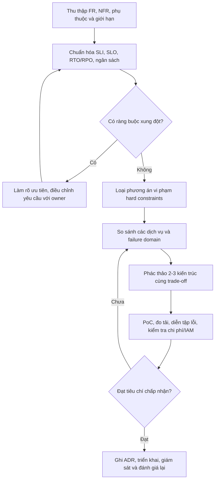
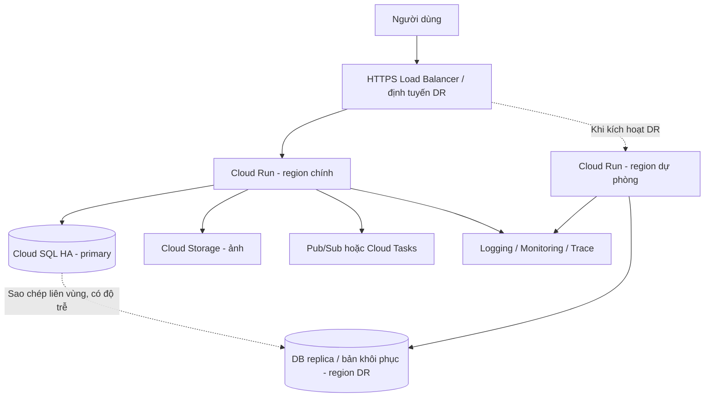

# Chuyển yêu cầu phi chức năng thành lựa chọn dịch vụ GCP

## 1. Từ yêu cầu kinh doanh đến quyết định kiến trúc

Khi thiết kế hệ thống trên Google Cloud, biết ứng dụng **cần làm gì** chưa đủ để chọn dịch vụ. Hai ứng dụng cùng có chức năng đặt hàng có thể phải dùng kiến trúc khác nhau: một hệ thống nội bộ chịu được ngừng hoạt động một giờ, trong khi nền tảng thanh toán cần độ trễ thấp, kiểm soát dữ liệu nghiêm ngặt và quy trình khôi phục sau sự cố đã kiểm chứng.

**Yêu cầu chức năng** (functional requirements, FR) mô tả hành vi: người dùng tạo đơn, thanh toán, xem lịch sử; hệ thống gửi thông báo. **Yêu cầu phi chức năng** (non-functional requirements, NFR) mô tả các thuộc tính chất lượng và giới hạn: tốc độ, độ tin cậy, khả năng phục hồi, bảo mật, vị trí dữ liệu, khả năng mở rộng, chi phí và khả năng vận hành.

Bài học thuộc chương **Thiết kế kiến trúc GCP** của mô-đun `CLOUD_PROVIDERS_GCP`. Từ nền tảng tổ chức project, IAM, VPC đến Compute Engine, GKE, Cloud Run, lưu trữ và cơ sở dữ liệu, mục tiêu là **chọn dịch vụ bằng bằng chứng và ràng buộc đo được**, bảo vệ tài nguyên, tự động hóa phát hành, rồi giám sát độ tin cậy cùng chi phí.

Sau bài học, người học có thể:

1. Chuyển phát biểu mơ hồ như “hệ thống phải nhanh và luôn sẵn sàng” thành SLI/SLO, RTO/RPO, điều kiện kiểm thử và người chịu trách nhiệm.
2. Phân biệt **ràng buộc bắt buộc** với mục tiêu có thể đánh đổi; phát hiện các NFR xung đột trước khi chọn dịch vụ.
3. Lập bảng ánh xạ NFR sang Cloud Run, GKE, Compute Engine, Cloud SQL, Spanner, Cloud Storage và các dịch vụ mạng/bảo mật/vận hành tương ứng.
4. So sánh ít nhất hai kiến trúc cùng các rủi ro còn lại, ghi lại quyết định bằng ADR (Architecture Decision Record).
5. Xây dựng kế hoạch đo tải, thử khôi phục, kiểm chứng IAM, giám sát SLO và kiểm soát chi phí.

> **Tư tưởng xuyên suốt:** NFR xác định **tiêu chí chấp nhận**; thiết kế dịch vụ chỉ là **giả thuyết kỹ thuật**. Kiến trúc được chấp nhận sau khi dữ liệu kiểm thử và quy trình vận hành chứng minh có khả năng đáp ứng tiêu chí.

## 2. Viết NFR có thể kiểm chứng

Một câu “ứng dụng phải mở rộng tốt” chưa phải yêu cầu đủ để lựa chọn. Hãy mô tả theo mẫu:

> Trong **điều kiện tải và phạm vi xác định**, hệ thống phải đạt **chỉ số (SLI)** với **ngưỡng (SLO)** trong **khoảng thời gian đánh giá**, có **cách đo**, **mức ưu tiên** và **người chịu trách nhiệm**.

| Phát biểu ban đầu | NFR đo được — ví dụ minh họa | Bằng chứng chấp nhận |
|---|---|---|
| “Trang phải nhanh” | `p95` thời gian phản hồi API tra cứu ≤ 350 ms với 250 request/giây, dữ liệu có kích thước đại diện, tải ổn định trong 30 phút | Kết quả load test, Cloud Monitoring và Cloud Trace |
| “Luôn sẵn sàng” | SLO **99,95% thời gian** trong cửa sổ 30 ngày, đo bằng synthetic probe từ vị trí ngoài hệ thống | SLO dashboard, chuỗi sự kiện downtime và error budget |
| “Không mất đơn hàng” | RPO ≤ 15 phút cho dữ liệu đặt hàng trong kịch bản mất cả region | Kết quả diễn tập khôi phục với số giao dịch đã xác nhận |
| “Khôi phục nhanh” | RTO ≤ 60 phút tính từ lúc công bố sự cố mất region đến lúc chức năng đặt hàng phục hồi | Biên bản DR drill, mốc bắt đầu/kết thúc, dữ liệu khôi phục |
| “An toàn” | 100% tài khoản runtime không dùng khóa service account tĩnh; chỉ danh tính được cấp quyền truy cập PII; secret không nằm trong image/repository | IAM review, audit logs, quét repository và kiểm tra truy cập âm tính |
| “Không vượt ngân sách” | Dự toán chi phí vận hành khoảng 1.500 USD/tháng ở mức tải giả định và báo động khi dự báo vượt ngân sách | Pricing Calculator, export billing, budgets, dashboard chi phí |
| “Dữ liệu ở đúng nơi” | Dữ liệu PII và bản sao lưu chỉ nằm tại các location đã được pháp chế/phụ trách dữ liệu phê duyệt | Danh mục tài nguyên, policy location và kiểm tra vị trí backup/replica |

Các con số trên **chỉ là tình huống học tập**, không phải cam kết mặc định của dịch vụ GCP hay báo giá. Giá, hạn mức, phiên bản, tính năng và SLA của từng dịch vụ cần kiểm tra tại thời điểm triển khai.

### 2.1. Phân biệt SLI, SLO và SLA

- **SLI (Service Level Indicator):** đại lượng quan sát được, ví dụ tỉ lệ request thành công hoặc `p95` latency của endpoint.
- **SLO (Service Level Objective):** mức mục tiêu đối với SLI, ví dụ “≥ 99,9% request hợp lệ thành công trong 28 ngày”.
- **SLA (Service Level Agreement):** thỏa thuận dịch vụ giữa các bên, có thể bao gồm cam kết, điều kiện và cơ chế bồi hoàn. **SLA của Cloud Run/Cloud SQL không tự động là SLO của toàn bộ ứng dụng.**

Ví dụ với SLO **theo số request**: trong 1.000.000 request hợp lệ, mục tiêu 99,9% thành công cho phép tối đa 1.000 request lỗi trong cửa sổ được định nghĩa. Đây là **error budget theo request**.

Với SLO **theo thời gian** 99,95% trong 30 ngày, lượng downtime tương đương nếu tính tuyến tính:

```text
30 ngày × 24 giờ × 60 phút × (1 - 0,9995) = 21,6 phút
```

Không lấy 21,6 phút để diễn giải một SLO tính theo **request**; cách chọn mẫu, phạm vi loại trừ và traffic thực tế làm hai phép đo khác nhau. Khi xây dựng SLO phải xác định rõ mẫu số, status nào tính lỗi, thời điểm đo và cách bỏ qua lỗi do client.

### 2.2. Phân biệt HA, DR, RTO và RPO

| Khái niệm | Câu hỏi cần trả lời | Ví dụ |
|---|---|---|
| High availability (HA) | Làm thế nào giảm gián đoạn khi một thành phần hoặc zone lỗi? | Cloud SQL cấu hình HA có primary/standby ở hai zone **trong cùng region** |
| Disaster recovery (DR) | Hệ thống hoạt động thế nào nếu **cả region** hoặc dữ liệu gặp sự cố lớn? | Kịch bản khôi phục ở region thứ hai, khởi động app và chuyển traffic |
| RTO | Chấp nhận ngừng dịch vụ tối đa bao lâu sau sự cố? | 60 phút để khôi phục chức năng cốt lõi |
| RPO | Có thể mất tối đa bao nhiêu dữ liệu theo thời gian? | 15 phút dữ liệu đã ghi trước sự cố |

**Điểm dễ sai:** Cloud SQL HA chống lỗi máy/zone, không tự giải quyết sự cố mất cả region. Backup và replica có khả năng phục hồi khác nhau; **replica bất đồng bộ** có thể có độ trễ nên không mặc nhiên bảo đảm một RPO cụ thể. RTO/RPO phải được đo bằng diễn tập thực tế, tính cả đổi DNS/routing, khôi phục secret và phụ thuộc bên ngoài. [Tham khảo DR planning guide](https://docs.cloud.google.com/architecture/dr-scenarios-planning-guide).

### 2.3. Phân loại độ ưu tiên

Đặt mỗi NFR vào một trong ba lớp:

1. **Hard constraint:** bắt buộc; phương án vi phạm bị loại, dù rẻ và nhanh. Ví dụ dữ liệu chỉ được lưu tại vùng địa lý đã duyệt hoặc không được sử dụng VM tự quản.
2. **SLO bắt buộc kiểm chứng:** phải đạt kết quả đo/diễn tập trước khi go-live, ví dụ `p95` ≤ 350 ms, RTO ≤ 60 phút.
3. **Mục tiêu tối ưu:** có thể đánh đổi, ví dụ giảm công vận hành, chi phí hoặc lượng phát thải khi các ràng buộc trên vẫn được đáp ứng.

Nếu hai ràng buộc bất khả thi đồng thời, báo rõ cho người sở hữu yêu cầu và đề xuất điều chỉnh. Ví dụ “dữ liệu không rời một quốc gia chỉ có một GCP region được chấp thuận” đồng thời “bảo đảm hoạt động khi toàn region hỏng” là xung đột cần giải quyết bằng policy và lựa chọn nơi phục hồi, **không thể giải bằng cách bật HA hai zone**.

## 3. Quy trình chuyển NFR thành lựa chọn dịch vụ



**Bước 1 — Khảo sát tải và phụ thuộc.** Ghi loại ứng dụng (HTTP, batch, streaming, transaction), vùng người dùng, traffic trung bình/đỉnh, kích thước dữ liệu, tỉ lệ đọc/ghi, loại truy vấn, độ lớn payload, các API bên ngoài và thời hạn lưu dữ liệu. Phân biệt dữ liệu nguồn sự thật (system of record) với cache, log, object và dữ liệu phân tích.

**Bước 2 — Chuẩn hóa số đo.** Định nghĩa endpoint quan trọng, `p50/p95/p99`, RPS/TPS, lỗi 5xx, concurrency, SLO window, tăng trưởng, RTO/RPO cho từng loại dữ liệu. Gán chủ sở hữu nghiệp vụ, chủ sở hữu kỹ thuật và phương pháp đo.

**Bước 3 — Chốt ràng buộc.** Xác minh quốc gia/region dữ liệu, yêu cầu mã hóa và khóa, mô hình danh tính, quyền quản trị hạ tầng, các giao thức đặc biệt, kỹ năng nhóm và giới hạn chi phí.

**Bước 4 — Lập phương án.** Lựa chọn compute, database, storage, networking, IAM, logging, DR như **một hệ thống hoàn chỉnh**; đánh giá tính sẵn có theo location và quota, tránh kết luận từ tính năng của một sản phẩm đơn lẻ.

**Bước 5 — Kiểm chứng và ghi quyết định.** PoC/load test, failure injection có kiểm soát, kiểm tra restore, xem chi phí thực tế, ghi ADR và điều kiện xem xét lại lựa chọn. NFR thay đổi khi sản lượng, thị trường và yêu cầu tuân thủ đổi.

## 4. Ánh xạ NFR sang nhóm dịch vụ Google Cloud

### 4.1. Compute: yêu cầu vận hành quyết định mức trừu tượng

| Nhu cầu nổi bật | Dịch vụ ứng viên | Khi phù hợp | Trade-off phải tính |
|---|---|---|---|
| API HTTP stateless, traffic biến động, nhóm nhỏ muốn giảm vận hành | **Cloud Run** | Container request-driven, tự co giãn, triển khai revision | Cold start, concurrency, giới hạn instance/quota, ứng dụng cần xử lý stateless; mỗi deployment có phạm vi location |
| Nhiều microservice cần điều khiển Kubernetes sâu, policy/networking và scheduler tùy biến | **GKE Autopilot hoặc Standard** | Đã có năng lực vận hành Kubernetes và cần hệ sinh thái K8s | Chi phí nền cụm, cấu hình autoscale/cluster, upgrade, quan sát, security posture |
| Cần quyền hệ điều hành/kernel, phần mềm đặc thù hoặc mô hình VM | **Compute Engine** + Managed Instance Groups khi phù hợp | Workload không dễ container hóa hoặc cần kiểm soát VM | Tự quản OS, patch, image, capacity, load balancing, failover |
| Job chạy theo lịch, chạy hết rồi dừng | **Cloud Run jobs**, **Cloud Scheduler**, **Batch** tùy workload | Không cần HTTP endpoint chạy liên tục | Giới hạn thời gian, tài nguyên, retry, idempotency và lịch |

Không chọn GKE chỉ vì dự báo “tương lai sẽ lớn”; yêu cầu điều khiển orchestration là lý do quan trọng hơn. Tương tự, Cloud Run không tự loại bỏ giới hạn hệ thống: nếu database chỉ có một số connection tối đa, việc tăng instance API có thể đẩy nút thắt xuống database. [Google Cloud: Choose compute options](https://docs.cloud.google.com/docs/compute-area/choose-compute-options).

Để đáp ứng độ trễ, Cloud Run hỗ trợ cấu hình **minimum instances** để giảm cold start và **concurrency** theo CPU/đặc điểm xử lý; minimum instances là mục tiêu best effort và có chi phí tài nguyên nhàn rỗi. Kiểm thử với traffic thật trước khi chọn số cụ thể. [Cloud Run min instances](https://docs.cloud.google.com/run/docs/configuring/min-instances) · [Cloud Run concurrency](https://docs.cloud.google.com/run/docs/about-concurrency).

### 4.2. Dữ liệu: mô hình truy cập và mức nhất quán quan trọng hơn tên sản phẩm

| Đặc tính dữ liệu/NFR | Dịch vụ ứng viên | Nhận xét kiến trúc |
|---|---|---|
| Giao dịch quan hệ, SQL, join, tương thích ứng dụng hiện hữu | **Cloud SQL** (PostgreSQL/MySQL/SQL Server tùy khả năng hỗ trợ) | HA ở hai zone trong một region; backup/PITR, replica và DR khu vực khác phải thiết kế riêng |
| Giao dịch SQL quy mô lớn, đồng nhất mạnh, nhu cầu phân phối địa lý | **Spanner** | Regional/dual-region/multi-region có đặc tính availability, latency, edition và chi phí khác nhau; đặt compute gần vùng ghi |
| Ứng dụng document, đồng bộ dữ liệu linh hoạt, không đòi SQL join truyền thống | **Firestore** | Xem mô hình query/index, transaction, quota, địa điểm database và chi phí theo thao tác |
| Khối dữ liệu key/wide-column throughput lớn, truy cập theo row key | **Bigtable** | Phù hợp time-series/IoT hoặc truy vấn dựa trên key; thiết kế key tránh hotspot |
| Object, ảnh, file, bản xuất, backup | **Cloud Storage** | Region/dual-region/multi-region ảnh hưởng đến độ trễ, data residency, mức dự phòng, egress và giá |
| Truy vấn phân tích OLAP/BI | **BigQuery** | Không thay thế cơ sở dữ liệu giao dịch chính; kiểm soát scan, partition và quyền truy cập |
| Cache để giảm latency và tải backend | **Memorystore** | Dữ liệu có thể tái tạo; không coi cache là nguồn dữ liệu gốc hoặc bảo đảm RPO |

Ví dụ: dịch vụ đặt hàng cần transaction và foreign key trong một vùng thường có thể bắt đầu với Cloud SQL HA; hệ thống cần ghi SQL đồng nhất trên nhiều region với RTO nghiêm ngặt có thể đánh giá Spanner multi-region, song phải chấp nhận trade-off write latency và chi phí. **Không suy ra rằng thay Cloud SQL bằng Spanner tự động làm toàn hệ thống multi-region**: API, identity, queue, DNS, keys, dependencies và cách triển khai đều phải chịu lỗi tương ứng.

Cloud Storage **dual-region** giúp dự phòng object qua hai region; replication giữa các region có thể bất đồng bộ. Đối với RPO rất nhỏ cần xem **turbo replication**, vị trí cặp region được hỗ trợ và mục tiêu sao chép thực tế. Việc tạo bucket đa vùng không có nghĩa dữ liệu vừa ghi đã đồng thời hiện diện ở mọi nơi. [Cloud Storage locations](https://docs.cloud.google.com/storage/docs/locations) · [Availability and durability](https://docs.cloud.google.com/storage/docs/availability-durability).

### 4.3. Giao tiếp, mạng và bảo mật

| NFR | Lựa chọn GCP thường dùng | Điều phải kiểm chứng |
|---|---|---|
| Không để tác vụ chậm làm tăng độ trễ API | **Pub/Sub** + worker Cloud Run/GKE; **Cloud Tasks** cho tác vụ HTTP cần kiểm soát dispatch/retry | At-least-once/redelivery, idempotency, retry, dead-letter handling, ordering nếu dùng |
| Public HTTPS và lớp bảo vệ trước backend | **Application Load Balancer**, **Cloud Armor**, **Cloud CDN** nếu có nội dung phù hợp | TLS, cache policy, rate limiting, WAF, origin accessibility và quyền |
| Truy cập dịch vụ nội bộ/DB không dùng public IP khi có thể | **VPC**, kết nối private phù hợp, firewall/IAM/Private Service Connect theo dịch vụ | Route, DNS, egress, phân tách project, IP exhaustion, latency qua mạng |
| Không lưu secret trong mã nguồn | **Secret Manager**, runtime service account | Luân chuyển secret, quyền đọc theo principal, audit logs; không log giá trị nhạy cảm |
| Danh tính tối thiểu và kiểm soát build/deploy | **IAM**, service account chuyên biệt, Workload Identity Federation/Workload Identity theo môi trường | Tách quyền CI/CD/runtime; tránh khóa dài hạn và quyền editor không cần thiết |
| Chính sách vị trí dữ liệu / khóa do khách hàng quản lý | Organization Policy resource locations, **Cloud KMS/CMEK** khi dịch vụ hỗ trợ | Region được phép, vị trí backup/replica/log, khóa và quyền decrypt, dịch vụ hỗ trợ CMEK |
| SLO, điều tra lỗi và chi phí | **Cloud Monitoring**, Cloud Logging, Cloud Trace, Billing budgets/exports | Metrics đúng SLI, cảnh báo burn rate, chi phí egress, retention và phân quyền dữ liệu quan sát |

**Hàng rào bảo mật phải kiểm tra trên từng luồng dữ liệu**, không chỉ một dấu tick “encryption enabled”. Ví dụ luồng HTTP → Cloud Run → Cloud SQL và Cloud Storage sẽ dùng ít nhất hai loại IAM principal và có chính sách mạng/vị trí dữ liệu riêng.

## 5. Thiết kế độ tin cậy từ failure domain

Nên phân cấp sự cố thay vì nhảy thẳng vào “multi-region”:

| Phạm vi lỗi | Biện pháp thường xem xét | Giới hạn |
|---|---|---|
| Một process/container | Readiness, startup checks, retry có backoff, triển khai nhiều instance, idempotency | Retry vô hạn có thể làm quá tải downstream |
| Một VM/node | Managed Instance Group, GKE replicas/health probes, managed service có khả năng thay thế instance | Dịch vụ phụ trợ vẫn có thể là single point of failure |
| Một zone | Dịch vụ regional có dự phòng zone, Cloud SQL HA, GKE regional/VM đa zone khi cần | Không bảo vệ sự cố toàn region |
| Một region | Triển khai app tại region thứ hai, routing/failover, kế hoạch DB replication/restore, secrets/IAM đủ tại vùng đích | Data consistency, quota, chi phí chạy standby, data residency và RPO/RTO cần kiểm chứng |
| Xóa nhầm hoặc bị mã độc | Backup tách biệt, versioning/retention, PITR, chính sách khôi phục và quyền xóa hạn chế | Replication có thể **sao chép cả thao tác xóa hoặc lỗi logic**; backup vẫn cần thiết |

**Cloud Run đặt tại một region** (dù nội bộ được quản lý dư thừa theo zone). Để phục vụ từ nhiều region, triển khai đến nhiều region rồi cấu hình global load balancing thích hợp. **Tự động failover liên vùng cần thêm cơ chế xác định backend lành mạnh** như Cloud Run service health với readiness probes/minimum instances hoặc cơ chế được tài liệu hỗ trợ; chỉ có load balancer và hai endpoint chưa đủ để khẳng định failover tự động khi app trả lỗi. [Cloud Run: multiple regions](https://docs.cloud.google.com/run/docs/multiple-regions) · [Service health](https://docs.cloud.google.com/run/docs/configuring/configure-service-health).

Với dữ liệu giao dịch, đặt câu hỏi: trong 60 phút phục hồi, hệ thống có thể tiếp nhận **đơn hàng mới** không, hay chỉ phục vụ các trang đọc? Thử DR phải xác minh tính đúng đắn của giao dịch, không chỉ HTTP 200. Với replica bất đồng bộ, cần đo replication lag, giới hạn mất dữ liệu thực tế, phương án promote và cách ngăn hiện tượng ghi vào hai primary khi chuyển vùng.

## 6. Tình huống mẫu: nền tảng đặt hàng trực tuyến

### 6.1. Bộ yêu cầu và các giả định

Một nhóm triển khai API Spring Boot phục vụ khách hàng tại Đông Nam Á, có cơ sở dữ liệu giao dịch và ảnh sản phẩm. Đây là bộ NFR **giả định** để luyện thiết kế:

| Mã | NFR | Mức ưu tiên | Tiêu chí xác nhận |
|---|---|---|---|
| NFR-01 | API tạo/đọc đơn có `p95` ≤ 350 ms tại 250 RPS, burst 500 RPS trong 5 phút | Phải đạt | Tải 30 phút với dữ liệu/connection pool đại diện; báo cáo `p95/p99`, throughput và 5xx |
| NFR-02 | Sẵn sàng ≥ 99,95% theo synthetic uptime trong 30 ngày | Phải đạt | Monitoring SLO và error budget |
| NFR-03 | Sự cố mất cả region: RTO ≤ 60 phút | Phải đạt | Diễn tập chuyển lưu lượng và DB phục hồi, đo thời điểm kinh doanh chấp nhận |
| NFR-04 | Dữ liệu đơn hàng: RPO ≤ 15 phút khi mất cả region | Phải đạt | So sánh giao dịch được xác nhận trước sự cố với dữ liệu sau DR |
| NFR-05 | PII chỉ được lưu ở **các location đã được phê duyệt**; ví dụ tổ chức chấp thuận Singapore và Jakarta | Hard constraint | Kiểm tra project/resource locations, DB replica, backup, bucket và log |
| NFR-06 | Runtime dùng service account riêng, secret ngoài source, log truy cập; least privilege | Hard constraint | Audit IAM, kiểm tra truy cập trái phép và secret handling |
| NFR-07 | Tối ưu tổng chi phí khoảng 1.500 USD/tháng ở giả định tải hiện tại | Mục tiêu tối ưu | Pricing Calculator và billing sau pilot; xem riêng egress, storage, standby |

**Giả định chức năng:** API HTTP stateless, PostgreSQL với transaction quan hệ, object ảnh trên Cloud Storage, gửi email bất đồng bộ; ứng dụng không cần quyền kernel hay Kubernetes tùy biến. Không suy ra ngân sách 1.500 USD chắc chắn đủ — cần tính tài nguyên thực tế.

### 6.2. Chọn baseline rồi xác định phần bổ sung để đạt DR

**Phương án baseline một region**:

- Cloud Run chạy Spring Boot; autoscale theo tải, giới hạn max instances để tránh quá tải PostgreSQL, cấu hình concurrency sau test và minimum instances khi cold start ảnh hưởng `p95`.
- Cloud SQL for PostgreSQL **HA trong region chính**; bật backup và point-in-time recovery; điều chỉnh connection pool và giới hạn connection từ nhiều instance Cloud Run.
- Cloud Storage regional cho ảnh nếu người dùng/phần lớn compute cùng region; xem xét dual-region nếu cần dữ liệu ảnh sẵn sàng khi region chính gặp sự cố và vị trí cặp region được chấp thuận.
- Pub/Sub hoặc Cloud Tasks để gửi email/notification bất đồng bộ; xử lý tiêu thụ idempotent và có đường xử lý lỗi.
- Secret Manager, IAM tối thiểu, Cloud Logging/Monitoring/Trace và budget alert.

Baseline có thể đáp ứng nhiều mục tiêu về vận hành, hiệu năng và lỗi **zone**, nhưng **chưa chứng minh NFR-03/04 khi mất region**. Vì vậy không đánh dấu kiến trúc đạt yêu cầu chỉ dựa vào Cloud SQL HA.

**Phần cần bổ sung cho DR liên vùng** nếu các location được chấp thuận:

1. Triển khai API hoặc chuẩn bị phiên bản warm standby tại region thứ hai; có Artifact Registry image, cấu hình, runtime identity, secrets, quota và kết nối đến DB phù hợp. Kiểm tra luồng routing bằng global Application Load Balancer khi cần.
2. Xác định chiến lược dữ liệu: cross-region replica khả dụng cho engine/edition đã chọn, backup/PITR và thủ tục promote/restore; đặt cảnh báo replication lag. Xác minh các giới hạn kỹ thuật trước khi ký RPO.
3. Chạy DR drill: giả lập primary region không dùng được, chuyển traffic, khôi phục/quyền ghi DB, kiểm tra đơn mới và đối chiếu transaction bị mất hoặc trùng. Đo từ lúc kích hoạt đến khi **nghiệp vụ** hoạt động, không chỉ lúc app start.
4. Quy định điều kiện **failback**, reconciliation, xử lý giao dịch trùng/đứt quãng và cơ chế chặn split-brain. Thực hiện diễn tập định kỳ, cập nhật runbook và chủ sở hữu.



Sơ đồ thể hiện **phương án thiết kế**, không phải mọi mũi tên đều đã tự động hóa. Trong trạng thái bình thường, DB phụ thường không nhận ghi; chỉ cho phép ghi sau khi tiến hành promote/failover theo runbook đã duyệt và kiểm tra nhất quán. Với nội dung object, phải xác minh cả khả năng đọc ảnh sau khi mất region chính, không chỉ database.

### 6.3. So sánh lựa chọn và tiêu chí loại

| Phương án | Ưu điểm | Rủi ro / đánh đổi | Kết luận trước PoC |
|---|---|---|---|
| **A:** Cloud Run + Cloud SQL HA + Storage regional tại một region | Đơn giản, dễ vận hành, có dự phòng zone | Mất cả region sẽ ảnh hưởng compute/DB; không chứng minh NFR-03/04 | **Loại nếu** bắt buộc chống mất region |
| **B:** Cloud Run tại hai region + Cloud SQL HA chính, DR replica/backup + routing + runbook | Giữ PostgreSQL, có đường phục hồi region, kiểm soát chi phí theo warm/cold standby | Replica async có lag; promote, failback, IAM/secret, consistency và RTO phải diễn tập | **Ứng viên** nếu DR drill chứng minh RTO/RPO và policy location |
| **C:** App đa region + Spanner dual/multi-region phù hợp + lưu trữ/phụ thuộc đa vùng | Khả năng nhất quán và phân phối dữ liệu cao, giảm gánh nặng một số thành phần DR | Khác biệt mô hình DB, edition, chi phí, write latency, chuyển đổi schema/SQL và các phụ thuộc vẫn còn | **Ứng viên** khi nhu cầu scale/tính sẵn sàng biện minh cho chuyển đổi |

Nếu quy định thay NFR-05 thành “PII **chỉ** trong Singapore”, phương án B dùng replica tại Jakarta phải bị loại. Spanner cũng phải được kiểm tra topology thực tế, không được mặc định có một cấu hình đa region chỉ nằm trong Singapore. Quyết định đúng có thể là **thương lượng lại RTO/RPO hoặc phạm vi lưu trữ**, hoặc chọn giải pháp DR khác đáp ứng quy định; không tự ý sao chép PII sang vùng cấm.

### 6.4. Ma trận truy vết NFR → thiết kế → phép thử

| NFR | Quyết định thiết kế cần kiểm tra | Bài test / quan sát | Người sở hữu |
|---|---|---|---|
| NFR-01 | Cloud Run concurrency/min-max instances + tối ưu SQL/index/cache, đặt compute gần DB | Load test ở 250 RPS và burst 500 RPS; đo `p95/p99`, DB CPU, pool, cold starts | Lead backend/SRE |
| NFR-02 | Health, đủ capacity, rollback, autoscale, SLO alerts | Synthetic uptime, burn-rate alerts, kiểm tra deploy rollback | SRE |
| NFR-03 | Secondary region, routing + DB promote/runbook | Diễn tập mất region; thời gian từ sự cố tới đơn hàng mới thành công ≤ 60 phút | SRE + DBA |
| NFR-04 | Backup/PITR, replica theo độ trễ cho phép, transaction reconciliation | So sánh committed transaction trước/sau failover, RPO thực đo ≤ 15 phút | DBA + product owner |
| NFR-05 | Policy location, vị trí DB/replica/bucket/backups/analytics/logs | Rà soát inventory, audit config và vị trí data paths | Security/data owner |
| NFR-06 | SA riêng, IAM least privilege, Secret Manager, audit | Policy review, thử deny access, quét secret, kiểm tra logs | Security |
| NFR-07 | Sizing, autoscale, storage lifecycle, budget/FinOps | Pricing estimate, Billing export và điều chỉnh sau pilot | FinOps/product owner |

> **Điểm nghiệm thu:** một hàng ma trận chỉ được đánh dấu “đạt” khi có bằng chứng đo hoặc thử nghiệm tương ứng. “Dịch vụ có hỗ trợ” không tương đương “hệ thống đã được cấu hình và kiểm chứng”.

## 7. Đo hiệu năng, khả năng mở rộng và reliability trước khi chốt thiết kế

Một PoC đáng tin phải mô phỏng **khối lượng dữ liệu, sự phân bố request và dependency** tương tự production. Các bước thực tế:

1. **Tạo baseline:** lưu `p50/p95/p99`, 5xx, CPU/memory, cold starts, concurrency, số connection DB và chi phí cho tải thấp.
2. **Tăng tải theo nấc:** ví dụ 50 → 150 → 250 RPS, mỗi nấc đủ dài để autoscaler và DB ổn định. Chạy thêm burst 500 RPS trong 5 phút.
3. **Thử đường dữ liệu:** transaction tạo đơn, truy vấn index, write latency, queue backlog, cache hit ratio; kiểm tra lỗi do giới hạn DB connection hay quota trước khi tăng max instances.
4. **Thử phát hành:** canary hoặc phân chia traffic khi phù hợp, health và rollback; quan sát thay đổi `p95` ngay sau deploy.
5. **Thử lỗi:** restart instance; ngắt một dependency trong lab; diễn tập promote DB, chuyển vùng và khôi phục từ backup. Đo RTO/RPO cùng độ chính xác đơn hàng.
6. **Kiểm tra quan sát:** Cloud Monitoring SLO, alert burn rate, log có correlation/trace ID, dashboard cho DBA/SRE; ghi test report theo release/version.

Ví dụ định nghĩa một SLI theo request:

```text
SLI_success_rate =
  count(request hợp lệ, mã phản hồi được xác định là thành công)
  --------------------------------------------------------------
  count(tất cả request hợp lệ trong cửa sổ đo)

SLO_success_rate >= 0,999 trong 28 ngày
```

Nếu một API trả HTTP 200 nhưng ghi đơn bị thất bại, chỉ nhìn HTTP status sẽ đánh giá sai tính đúng đắn. Cần thêm **business SLI**, chẳng hạn “tỉ lệ đơn hàng được ghi và đọc lại thành công”. Các synthetic probes phải đi qua các dependency quan trọng và chạy từ một điểm giám sát không phụ thuộc chính region cần kiểm tra.

Một phép thử tải cho thấy `p95` 300 ms nhưng 15% request 503 vẫn **không đạt** mục tiêu; quan sát cả độ trễ và tỉ lệ lỗi. Kiểm tra tải tăng đột biến, thời gian khởi động, database saturation và sự phục hồi sau khi tải giảm.

## 8. Kiểm soát bảo mật, dữ liệu và chi phí từ đầu

### 8.1. Bảo mật và quy định

- Dùng folder/project tách môi trường; áp dụng IAM theo service account và quyền cần thiết, không dùng tài khoản cá nhân làm runtime identity.
- Định nghĩa luồng dữ liệu từ ingress, compute, queue, database, storage đến logging/backup. Ghi rõ dữ liệu được mã hóa, lưu ở đâu, giữ bao lâu và ai được đọc.
- Dùng Secret Manager cho thông tin đăng nhập; dùng CMEK khi chính sách yêu cầu **và** dịch vụ cụ thể hỗ trợ tại location dự định.
- Chọn private connectivity, authentication/authorization và Cloud Armor dựa trên threat model; không coi network isolation là phương án thay thế IAM.
- Với chính sách dữ liệu, kiểm tra **vị trí bản sao, log, backup, dữ liệu phân tích và luồng xuất dữ liệu**, thay vì chỉ vị trí DB chính.

### 8.2. Công thức ước lượng TCO thực dụng

```text
Tổng chi phí dự tính mỗi tháng
  = compute thường trực và theo tải
  + database/replica/backup
  + object storage và request operations
  + mạng, inter-region egress và load balancing
  + log/metrics/trace và lưu giữ
  + build/deployment/security tooling liên quan
  + giấy phép, hỗ trợ và công vận hành liên quan
```

Tính cả **môi trường dự phòng** và thử DR, không chỉ steady-state production. Dùng [Google Cloud Pricing Calculator](https://cloud.google.com/products/calculator) với giả định RPS, tài nguyên, GB-tháng, egress và request rõ ràng; sau pilot so sánh với Billing export. **Billing budget chủ yếu cung cấp cảnh báo, không phải cơ chế ngắt tính phí tức thời**; muốn hạn chế tiêu thụ cần kết hợp quota, giới hạn autoscale, policy và phản ứng vận hành, nhưng các giới hạn đó cũng có thể gây lỗi khi traffic tăng.

Chi phí là một biến chất lượng: giảm xuống 0 minimum instances có thể tăng cold start, giảm số replica/region có thể làm xấu RTO, tăng cache có thể tạo rủi ro nhất quán hoặc lộ dữ liệu. Mỗi tối ưu phải ghi ảnh hưởng đến SLO khác.

## 9. Ghi lại quyết định bằng ADR và quản trị thay đổi

Sau khi so sánh và thử nghiệm, ghi một **Architecture Decision Record** ngắn nhưng có thể truy vết:

```markdown
# ADR-001: Chọn Cloud Run + Cloud SQL HA và phương án DR liên vùng

Trạng thái: Proposed (chưa phê duyệt triển khai production)

## Bối cảnh
- API Spring Boot stateless, giao dịch PostgreSQL.
- NFR-01: p95 <= 350 ms ở 250 RPS.
- NFR-03/04: mất region thì RTO <= 60 phút, RPO <= 15 phút.
- NFR-05: chỉ dùng các locations đã được data owner duyệt.

## Phương án
A. Một region: Cloud Run + Cloud SQL HA.
B. Hai region: Cloud Run + Cloud SQL HA chính, chiến lược DR
   dựa trên replica/backup, routing và runbook.
C. App đa region + Spanner phù hợp về edition/topology.

## Quyết định đề xuất
Thử B trước vì giữ mô hình PostgreSQL và có khả năng đáp ứng DR.
Chỉ phê duyệt sau load test, region failover drill, kiểm tra IAM,
data residency và chi phí. Nếu không đạt RPO hoặc RTO, đánh giá lại C.

## Hệ quả
- Phải vận hành replication lag alerts và lịch DR drill.
- Cần runbook promote/failback và kiểm tra split-brain.
- Chi phí có standby, egress và các tài nguyên phụ trợ.

## Điều kiện xem xét lại
RTO/RPO thay đổi, traffic tăng lớn, lỗi DR drill, quy định data location
thay đổi hoặc TCO vượt ngưỡng được phê duyệt.
```

Trong tài liệu kiến trúc chính thức, bổ sung bản đồ dependency, sơ đồ dữ liệu, bảng NFR với version, bằng chứng PoC/DR drill, bảng rủi ro và chữ ký phê duyệt từ owner. Lưu ADR cạnh cấu hình IaC hoặc kho quản trị kiến trúc để quyết định không tách rời thay đổi thực tế.

## 10. Các lỗi tư duy kiến trúc thường gặp

| Cách nghĩ sai | Vì sao sai | Cách xử lý |
|---|---|---|
| “Dùng managed service là đủ HA” | Managed không mặc nhiên chịu được mất region hoặc lỗi logic dữ liệu | Liệt kê failure domains và kiểm chứng topology từng service |
| “Cloud SQL HA có thể failover qua region” | HA của Cloud SQL sử dụng các zone trong một region | Thiết kế DR liên vùng với replica/backup và runbook riêng |
| “Có backup nên RPO = 0” | Thời điểm backup/PITR, khả năng truy cập và thời gian restore khác nhau | Xác định RPO/RTO, diễn tập và đo giao dịch bị mất |
| “Có hai Cloud Run region là failover tự động” | Routing theo vùng gần nhất không nhất thiết phát hiện app lỗi | Cấu hình health/failover được hỗ trợ, thử chuyển vùng end-to-end |
| “Độ trễ trung bình tốt thì SLO đạt” | Tail latency `p95/p99` và 5xx có thể rất xấu | Đo percentiles, lỗi và business outcome trong tải thật |
| “Tăng số instance luôn tăng throughput” | DB connection, external quota và queue có thể là nút thắt | Capacity test cả đường xử lý, đặt giới hạn phù hợp |
| “Multi-region luôn rẻ và nhanh hơn” | Cross-region consensus, replication và egress có thể tăng latency/chi phí | Chỉ dùng nếu NFR biện minh, đo write path và TCO |
| “Đặt billing budget là chặn được mọi chi phí” | Budget alert không phải hard billing cap | Dùng cảnh báo + quota/limit + review chi phí |
| “Cloud Storage multi-region = zero data loss ngay khi upload” | Cross-region replication có thể chưa hoàn tất | Kiểm tra mô hình redundancy và mục tiêu replication |
| “Compliance chỉ là chọn region của database” | Log, backup, export, cache và replica cũng chứa dữ liệu | Trace toàn bộ vòng đời dữ liệu và tài nguyên phụ thuộc |

## 11. Bài thực hành trên giấy trước khi triển khai hạ tầng

Giả sử một hệ thống mới yêu cầu: HTTP API 100 RPS bình thường/800 RPS đỉnh; `p95` ≤ 250 ms; lưu đơn hàng dạng SQL; ảnh sản phẩm; RTO 4 giờ; RPO 1 giờ; dữ liệu phải nằm ở vị trí được phê duyệt; ngân sách và nhân sự vận hành hạn chế.

Hãy tạo tài liệu thiết kế với bốn phần:

1. **NFR contract:** chuyển từng câu thành SLI, SLO, load profile, nguồn dữ liệu đo và owner; đánh dấu hard constraints.
2. **Hai phương án:** ví dụ Cloud Run + Cloud SQL + Cloud Storage so với GKE + Cloud SQL hoặc biến thể có DR; giải thích tại sao workload cần/không cần orchestration.
3. **Decision matrix:** ánh xạ 6 NFR quan trọng nhất tới dịch vụ, configuration, test và rủi ro còn lại; ghi lý do loại.
4. **Kiểm chứng:** phác thảo một load test 800 RPS, một khôi phục từ backup và một DR drill, cùng ngân sách dự kiến bằng Pricing Calculator.

Một bài làm được chấp nhận khi **không hứa RTO/RPO chỉ từ tên dịch vụ**, nhận ra hard constraints về location và chỉ đề nghị phát hành sau khi có test report đáp ứng tiêu chí.

## 12. Tài liệu chính thức nên đối chiếu

- [Google Cloud Well-Architected Framework](https://docs.cloud.google.com/architecture/framework) — sáu trụ cột: operational excellence, security, reliability, cost, performance, sustainability.
- [Well-Architected: Reliability](https://docs.cloud.google.com/architecture/framework/reliability) — mục tiêu tin cậy, dự phòng và vận hành.
- [Disaster recovery planning guide](https://docs.cloud.google.com/architecture/dr-scenarios-planning-guide) — cách định nghĩa RTO/RPO và chọn chiến lược phục hồi.
- [Choose compute options](https://docs.cloud.google.com/docs/compute-area/choose-compute-options) — Cloud Run, GKE, Compute Engine và các lựa chọn tính toán.
- [Cloud Run: serve traffic from multiple regions](https://docs.cloud.google.com/run/docs/multiple-regions) — triển khai và định tuyến đa vùng.
- [Cloud Run: automate cross-region failover](https://docs.cloud.google.com/run/docs/configuring/configure-service-health) — service health, readiness và giới hạn.
- [Cloud SQL: high availability](https://docs.cloud.google.com/sql/docs/mysql/high-availability) — giới hạn HA trong region (ví dụ MySQL; kiểm tra trang engine đang dùng).
- [Spanner: instance configurations](https://docs.cloud.google.com/spanner/docs/instance-configurations) — regional, dual-region và multi-region.
- [Cloud Storage bucket locations](https://docs.cloud.google.com/storage/docs/locations) — vị trí, replication, latency và chi phí.
- [Cloud Storage availability and durability](https://docs.cloud.google.com/storage/docs/availability-durability) — rủi ro replication giữa vùng.
- [Google Cloud Pricing Calculator](https://cloud.google.com/products/calculator) — tính giá từ giả định về tải và tài nguyên.

Tài liệu được thiết kế như **phương pháp ra quyết định có kiểm chứng**. Khi áp dụng, tra lại tính khả dụng theo region, hạn mức/quota, giá, SLA và tính năng theo edition tại thời điểm xây dựng kiến trúc.
