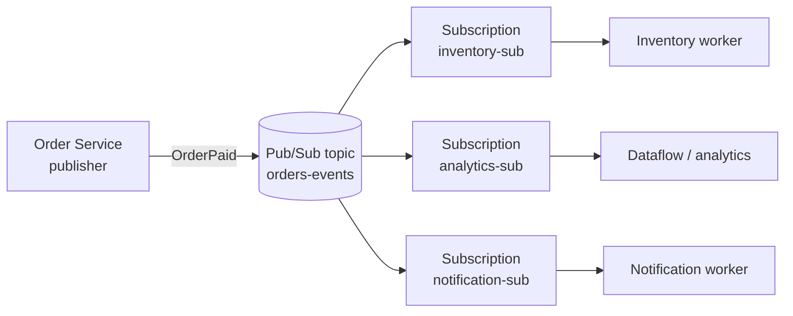
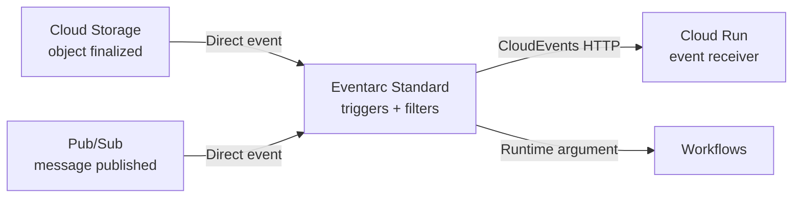
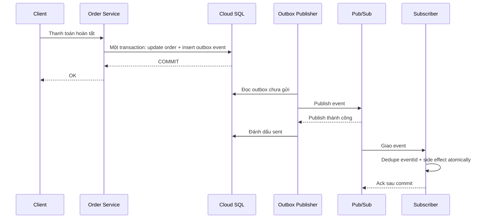
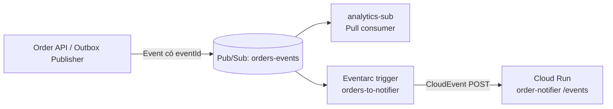

# Kiến trúc event-driven với Pub/Sub và Eventarc

## Mục tiêu bài học

Trong chương **Thiết kế kiến trúc GCP**, bài này trình bày cách xây dựng kiến trúc **event-driven** trên Google Cloud bằng **Pub/Sub** và **Eventarc**, từ việc xác định sự kiện nghiệp vụ, chọn cơ chế phân phối, bảo đảm khả năng xử lý lại đến triển khai và vận hành dịch vụ nhận sự kiện.

Đây là một phần của **CLOUD_PROVIDERS_GCP**: học cách tổ chức project và IAM, kết nối VPC, lựa chọn Compute Engine/GKE/Cloud Run, dùng dịch vụ lưu trữ và cơ sở dữ liệu, tự động hóa phát hành, quan sát độ tin cậy và quản lý chi phí. Sau bài học, người học có thể:

1. Giải thích được event-driven architecture (EDA), phân biệt sự kiện, lệnh và yêu cầu đồng bộ.
2. Thiết kế luồng fan-out bằng Pub/Sub topic và các subscription độc lập.
3. Dùng Eventarc để đưa sự kiện từ Google Cloud, Pub/Sub hoặc nguồn phù hợp đến Cloud Run/Workflows/GKE.
4. Áp dụng hợp đồng sự kiện, idempotency, retry, dead-letter, ordering, bảo mật và observability.
5. Chọn kiến trúc phù hợp với điều kiện nhất quán dữ liệu, khả năng phục hồi và chi phí.

> **Nguyên tắc:** Pub/Sub và Eventarc giúp tách rời các dịch vụ về thời gian và vị trí triển khai; tính đúng đắn của nghiệp vụ vẫn phụ thuộc thiết kế giao dịch, hợp đồng sự kiện và mã xử lý ở consumer.

## 1. Event-driven giải quyết vấn đề gì?

Kiến trúc đồng bộ đơn giản thường là `Order API → Payment API → Inventory API → Email API` trong cùng yêu cầu HTTP. Nếu dịch vụ gửi email chậm hoặc lỗi, người mua có thể chờ lâu dù giao dịch thanh toán đã hoàn tất. Khi số lượng dịch vụ tăng lên, cách gọi trực tiếp làm tăng phụ thuộc và tạo chuỗi lỗi.

Trong EDA, dịch vụ **producer** tạo **event** mô tả điều vừa xảy ra, chẳng hạn `OrderPaid`. Nhiều **consumer** đăng ký nhận event để xử lý công việc của mình: cấp hàng, gửi thông báo, ghi dữ liệu phân tích. Producer không cần biết consumer nào tồn tại hoặc mất bao lâu để xử lý.

- **Sự kiện (event)**: sự thật đã xảy ra, diễn đạt ở thì quá khứ: `OrderPaid`, `InvoiceIssued`, `ObjectFinalized`.
- **Lệnh (command)**: yêu cầu một hệ thống làm một việc, ví dụ `ReserveInventory`. Lệnh thường có một chủ thể chịu trách nhiệm thực hiện và có thể cần phản hồi rõ ràng.
- **Query**: đọc dữ liệu hiện tại, thường phù hợp HTTP/gRPC đồng bộ hơn.
- **Message**: đơn vị dữ liệu được chuyển qua hệ thống messaging; một message có thể mang event hoặc command, nhưng phải được diễn giải theo **hợp đồng**.
- **Eventual consistency**: các consumer cập nhật bản sao hoặc trạng thái của mình ở thời điểm khác nhau; dữ liệu có thể tạm thời chưa đồng nhất.

**Khi phù hợp:** có nhiều downstream độc lập, hệ thống chịu tải biến động, chấp nhận độ trễ xử lý, cần thêm consumer mà ít sửa producer, hoặc muốn phản ứng với sự kiện từ Cloud Storage/Google Cloud.

**Khi cần cân nhắc khác:** thao tác cần trả kết quả ngay cho người gọi, bước giao dịch phải hoàn tất đồng thời, quy trình phê duyệt dài và có trạng thái rõ ràng, hoặc cần lịch xử lý nhiệm vụ theo giờ. Có thể kết hợp HTTP đồng bộ, Cloud Tasks hoặc Workflows với EDA; không cần ép mọi bước thành sự kiện.

## 2. Vai trò của Pub/Sub và Eventarc

| Tiêu chí | Pub/Sub | Eventarc Standard | Eventarc Advanced |
|---|---|---|---|
| Vai trò chính | Hệ thống messaging publish/subscribe; truyền thông điệp qua topic/subscription | Lọc và định tuyến sự kiện từ nhà cung cấp đến đích bằng trigger | Bus, enrollment, pipeline để tập trung, lọc, biến đổi, định tuyến nhiều nguồn và đích |
| Đơn vị cấu hình | Topic, subscription, publisher, subscriber | Trigger, provider, event filters, destination, trigger service account | Bus, enrollment, pipeline và điểm đích |
| Nguồn | Publisher gửi dữ liệu vào topic | Pub/Sub, Cloud Storage, Cloud Audit Logs, nguồn Google/third-party được hỗ trợ | Nhiều nguồn Google, custom và bên thứ ba được hỗ trợ |
| Đích | Pull/push consumer, các loại subscription xuất dữ liệu | Cloud Run, Cloud Run functions, GKE, Workflows, internal HTTP và đích hỗ trợ | Các đích thông qua cơ chế bus/pipeline theo tài liệu Advanced |
| Định dạng khi nhận | Raw Pub/Sub message (data là bytes, có attributes) | **CloudEvents** qua HTTP cho các đích HTTP | Cơ chế CloudEvents với khả năng lọc/chuyển đổi thêm |
| Khi nào chọn | Cần chủ động quản lý backlog, ack, subscription, DLQ, stream xử lý | Cần đơn giản hóa routing từ event provider đến một dịch vụ | Muốn quản trị nhiều nguồn/đích, lọc hoặc biến đổi nâng cao |

**Không coi Eventarc là dịch vụ thay thế hoàn toàn cho Pub/Sub.** Eventarc Standard thường sử dụng Pub/Sub làm lớp transport phía dưới. Khi sự kiện đã nằm trong một topic và chỉ muốn đẩy trực tiếp vào Cloud Run, tài liệu Cloud Run hiện tại còn khuyến nghị **direct Pub/Sub push trigger** cho cấu hình đơn giản; dùng Eventarc-based trigger khi cần chung cơ chế CloudEvents với các provider, điều kiện lọc/routing phù hợp. Định dạng dữ liệu mà Cloud Run nhận được ở hai cách là **khác nhau**.

### 2.1. Pub/Sub: topic và subscription

Một **topic** là nơi producer publish message; **subscription** là nơi consumer nhận. Mỗi subscription có backlog và checkpoint/ack riêng. Publish một message lên topic có nhiều subscription sẽ tạo **fan-out theo subscription**. Hai worker cùng đọc **một** pull subscription thì chia nhau công việc, không phải mỗi worker đều nhận một bản.



Muốn thêm chức năng kiểm tra gian lận, có thể thêm một subscription và consumer mới mà không phải sửa Order Service. Ngược lại, thêm consumer vào **cùng** subscription không tạo ra fan-out cho từng instance.

### 2.2. Eventarc: provider → filter → trigger → destination

Eventarc Standard nhận sự kiện từ nhà cung cấp được hỗ trợ; một **trigger** khai báo loại sự kiện, filter và đích, ví dụ:

- Cloud Storage phát `google.cloud.storage.object.v1.finalized` khi object được tạo/ghi đè thành generation mới.
- Pub/Sub phát `google.cloud.pubsub.topic.v1.messagePublished` khi có message được publish lên topic.
- Cloud Audit Logs phát `google.cloud.audit.log.v1.written` nếu bản ghi audit phù hợp với `serviceName` và `methodName`; một số loại audit log phải được bật trước khi sinh bản ghi.
- Đích có thể là Cloud Run service, Cloud Run functions, Workflows hoặc GKE, tùy tổ hợp được hỗ trợ.



**Eventarc Standard không cam kết FIFO.** Việc Eventarc dùng Pub/Sub làm transport không làm mất yêu cầu idempotency ở ứng dụng; cũng không có nghĩa tính năng exactly-once của một **pull subscription** tự động áp dụng cho trigger Eventarc.

Nguồn: [Pub/Sub subscription overview](https://docs.cloud.google.com/pubsub/docs/subscription-overview), [Eventarc Standard overview](https://docs.cloud.google.com/eventarc/standard/docs/overview), [chọn Standard hoặc Advanced](https://docs.cloud.google.com/eventarc/advanced/docs/choose-product-edition).

## 3. Thiết kế hợp đồng sự kiện trước khi viết trigger

Không nên publish toàn bộ hàng dữ liệu chỉ vì thao tác này dễ làm. Sự kiện cần có **ý nghĩa nghiệp vụ**, **danh tính ổn định**, **phiên bản**, **thời gian phát sinh** và đủ dữ liệu để consumer ra quyết định. Ví dụ payload JSON mang trong `message.data` của Pub/Sub:

```json
{
  "eventId": "evt-20261119-00421",
  "eventType": "com.example.order.paid",
  "schemaVersion": 1,
  "aggregateId": "order-2048",
  "occurredAt": "2026-11-19T08:30:00Z",
  "traceId": "7d9bdc7e8fb9440c",
  "data": {
    "orderId": "order-2048",
    "currency": "VND",
    "amount": 590000
  }
}
```

Đây là **hợp đồng sự kiện ứng dụng tự định nghĩa**, không phải CloudEvent hoàn chỉnh. `eventType` trong payload nghiệp vụ khác với header `ce-type` của Eventarc, vốn chỉ kiểu sự kiện transport khi provider là Pub/Sub (`google.cloud.pubsub.topic.v1.messagePublished`).

Thiết kế hợp đồng:

1. **`eventId` do producer sinh** và ổn định cho cùng một sự kiện logic. Pub/Sub còn cấp `messageId` của lần publish, nhưng publish lại cùng sự kiện logic có thể tạo `messageId` mới. Với nghiệp vụ, dedupe dựa vào business `eventId` là cần thiết.
2. **`eventType` và `schemaVersion`** giúp consumer hiểu ngữ nghĩa. Ưu tiên thay đổi tương thích ngược: thêm trường tùy chọn, giá trị mặc định, không tùy tiện đổi tên hoặc xóa trường.
3. **`occurredAt` là event time**, khác `publishTime` (thời điểm Pub/Sub nhận) và thời gian xử lý; sử dụng đúng khi dựng báo cáo trễ hoặc theo event time.
4. **`aggregateId`** như order ID dùng cho trace, phân vùng logic và có thể làm **ordering key** nếu buộc duy trì thứ tự trong một aggregate.
5. Dùng attributes Pub/Sub cho routing/filter đơn giản, ví dụ `eventType=com.example.order.paid` và `schemaVersion=1`. **Subscription filter của Pub/Sub đánh giá attributes**, không tự đọc JSON sâu bên trong `data`.
6. Hạn chế PII, secret và bản ghi lớn. Lưu payload lớn vào Cloud Storage với quyền truy cập phù hợp rồi gửi event chỉ mang URI/metadata và version.
7. Nếu muốn Pub/Sub kiểm tra cấu trúc dữ liệu khi publish, có thể gắn **Pub/Sub schema** sử dụng Apache Avro hoặc Protocol Buffers (khác với quy ước JSON minh họa ở trên).

### Phân biệt bao gói dữ liệu

**Pub/Sub message** có `data` là chuỗi byte và `attributes` là chuỗi key/value; SDK gửi/nhận byte, còn API JSON thường biểu diễn `data` dưới dạng base64.

**Pub/Sub push** gửi HTTP JSON đến endpoint với cấu trúc gần như sau:

```json
{
  "message": {
    "data": "eyJldmVudElkIjoiZXZ0LTEifQ==",
    "messageId": "123456789",
    "attributes": {"eventType": "com.example.order.paid"}
  },
  "subscription": "projects/demo-project/subscriptions/notification-push"
}
```

**Eventarc Standard** gửi **CloudEvents binary content mode**: metadata ở HTTP headers `ce-id`, `ce-source`, `ce-type`, `ce-specversion`, còn HTTP body chứa data của event. Với nguồn là Pub/Sub, phần body JSON chứa đối tượng như `message` (data vẫn là base64) và `subscription`. Ví dụ:

```http
POST /events HTTP/1.1
Content-Type: application/json; charset=utf-8
ce-specversion: 1.0
ce-id: 123456789
ce-source: //pubsub.googleapis.com/projects/demo-project/topics/orders-events
ce-type: google.cloud.pubsub.topic.v1.messagePublished

{"message":{"data":"eyJldmVudElkIjoiZXZ0LTEifQ==","messageId":"123456789"}}
```

Các giá trị minh họa này không phải định danh tài nguyên thực. Event từ Cloud Storage có `ce-type` khác và body khác; receiver cần kiểm tra event type trước khi parse. Khi nhận vào **Workflows**, Eventarc chuyển sự kiện thành đối tượng JSON runtime argument thay vì yêu cầu Workflow phải đọc HTTP headers thủ công.

Nguồn: [Pub/Sub schemas](https://docs.cloud.google.com/pubsub/docs/schemas), [Eventarc event format](https://docs.cloud.google.com/eventarc/standard/docs/event-format), [CloudEvents JSON format](https://docs.cloud.google.com/eventarc/docs/cloudevents-json).

## 4. Delivery semantics: thứ dễ gây lỗi nhất

### 4.1. At-least-once và idempotency

Theo mặc định, Pub/Sub cung cấp **at-least-once delivery**. Vì lỗi mạng, timeout, ack thất bại hoặc retry, subscriber có thể nhận cùng message **nhiều lần**. Một message đã gửi nhưng chưa ack thành công có thể được gửi lại.

Ví dụ consumer xử lý `OrderPaid` bằng cách cộng điểm thưởng:

- Lần 1: database đã cộng 100 điểm nhưng consumer chết **trước khi ack**.
- Lần 2: Pub/Sub giao lại sự kiện.
- Nếu handler cứ cộng thêm 100 điểm, tài khoản được cộng **200 điểm** — sai nghiệp vụ.

Giải pháp nên có **inbox/idempotency record** trong database của consumer:

```text
BEGIN TRANSACTION
  INSERT INTO processed_events(consumer_name, event_id)
  VALUES ('loyalty', 'evt-20261119-00421')
  ON CONFLICT DO NOTHING;

  Nếu INSERT thành công:
      UPDATE loyalty_balance ... (cộng 100 điểm)
  Nếu INSERT xung đột:
      bỏ qua thay đổi nghiệp vụ (đã xử lý)
COMMIT
ACK hoặc trả HTTP 2xx chỉ sau khi COMMIT thành công
```

Bắt buộc có **unique constraint** trên `(consumer_name, event_id)`; đọc rồi kiểm tra ở hai thao tác rời rạc không tránh được race condition khi hai instance xử lý song song. Nếu downstream là API bên ngoài, dùng idempotency key do bên đó hỗ trợ hoặc cơ chế ghi kết quả và reconciliation phù hợp.

**Exactly-once của Pub/Sub có phạm vi hẹp:** là tùy chọn cho **pull/StreamingPull subscription**, theo `messageId` trong cùng region và dựa trên ack thành công. **Push/export subscription không hỗ trợ exactly-once**. Tính năng đó không tự bảo đảm “business transaction chính xác một lần” khi cùng nghiệp vụ có nhiều lần publish hoặc khi lỗi xảy ra giữa side effect và ack. Vì thế hệ thống vẫn nên xử lý idempotent.

### 4.2. Thứ tự và concurrency

Mặc định Pub/Sub **không bảo đảm thứ tự**. Có thể bật message ordering cho subscription và publish với `orderingKey=order-2048`; các message cùng ordering key, publish trong cùng region, được giao theo thứ tự Pub/Sub nhận. Điều này **không cung cấp thứ tự toàn cục giữa mọi đơn hàng**. Với ordered delivery, message sau cùng key có thể bị chặn bởi message trước thất bại; tăng concurrency cần cân bằng.

Eventarc Standard **không có cam kết FIFO**. Nếu một ứng dụng yêu cầu thứ tự bất biến cho tất cả sự kiện thuộc một aggregate, hãy đánh giá dùng Pub/Sub subscription bật ordering với pull consumer; ngoài ra gắn `aggregateVersion` và kiểm tra phiên bản trong database để phát hiện đến sai thứ tự.

### 4.3. Ack, retry và dead-letter

| Vấn đề | Phương án |
|---|---|
| Xử lý thành công | Pull subscriber gọi ack sau durable commit; Pub/Sub push/Eventarc trả HTTP thành công sau commit |
| Lỗi tạm thời (DB timeout, 503) | Không ack hoặc trả HTTP không thành công để hệ thống giao lại theo retry policy |
| Thao tác kéo dài | Cấu hình ack deadline, client library tự gia hạn (pull) hoặc tách xử lý thành job phù hợp; tránh để request vượt timeout |
| Message lỗi vĩnh viễn | Ghi nguyên nhân, gửi vào dead-letter/quarantine theo cơ chế được hỗ trợ, cảnh báo cho chủ dịch vụ |
| Lỗi lan truyền | Giới hạn concurrency, max instances/rate, backoff, circuit breaker và tránh retry storm |
| Cần xử lý lại | Dùng retain/seek/snapshot trên Pub/Sub khi hỗ trợ; thiết kế consumer idempotent trước khi replay |

Với **Pub/Sub dead-letter topic (DLQ)**, cấu hình đặt trên **subscription**, với `maxDeliveryAttempts` trong khoảng **5–100**; việc chuyển vào DLQ được thực hiện **best-effort**, không nên dựa vào con số chính xác tuyệt đối. DLQ phải có **subscription riêng để đọc**, và Pub/Sub service agent cần quyền publish vào DLQ, quyền subscribe phù hợp theo tài liệu. Đưa message từ DLQ trở lại hệ thống nên có quy trình sửa nguyên nhân, kiểm duyệt và phát lại có kiểm soát.

Đối với Eventarc Standard, cơ chế retry gắn với transport Pub/Sub; **đọc kỹ retry policy của trigger và subscription do Eventarc quản lý**. Tài liệu hiện hành nêu mặc định Eventarc dùng thời gian giữ message **24 giờ** với exponential backoff; một số thao tác tạo trigger Cloud Run trên **Console** có thể đặt **một lần gửi, không retry**. Vì thế không được giả định mọi Eventarc trigger sẽ giao lại vô thời hạn. Nếu yêu cầu DLQ/replay/ack chuyên sâu, hãy cân nhắc subscription Pub/Sub do ứng dụng quản lý và vận hành riêng.

Nguồn: [subscription properties](https://docs.cloud.google.com/pubsub/docs/subscription-properties), [exactly-once delivery](https://docs.cloud.google.com/pubsub/docs/exactly-once-delivery), [dead-letter topics](https://docs.cloud.google.com/pubsub/docs/dead-letter-topics), [Eventarc Standard overview](https://docs.cloud.google.com/eventarc/standard/docs/overview).

## 5. Thiết kế luồng giao dịch không làm mất event

### 5.1. Vấn đề dual-write

Giả sử Order Service:

1. Ghi trạng thái order từ `CREATED` sang `PAID` trong Cloud SQL.
2. Publish `OrderPaid` lên Pub/Sub.

Nếu bước 1 commit xong nhưng bước 2 lỗi mạng, order đã thanh toán mà các hệ thống phụ thuộc không nhận được event. Đảo thứ tự publish trước rồi ghi DB cũng nguy hiểm: event đã phát nhưng transaction lưu order có thể rollback. **Hai hệ thống không tự có một transaction chung**.

### 5.2. Transactional outbox

Một thiết kế bền vững cho producer có database giao dịch:



Outbox publisher có thể chạy theo scheduler, CDC hoặc kiến trúc phù hợp. Khi publisher publish thành công nhưng chết trước khi đánh dấu sent, cùng event **có thể publish lại**. Thiết kế outbox **giảm rủi ro mất event**, nhưng vẫn cần dedupe ở consumer.

Điểm quan trọng khi ứng dụng thực tế: ghi order và outbox **trong cùng transaction của cùng database**, có retry publish/backoff, retention/quản lý kích thước outbox và cảnh báo khi số event chưa phát tăng lâu.

### 5.3. Choreography và orchestration

Nếu `OrderPaid` kéo theo nhiều phản ứng độc lập (gửi mail, phân tích, cộng điểm), **choreography** qua fan-out phù hợp. Nếu cần quy trình `ReserveInventory → ChargePayment → ShipOrder` với timeout và bước bù trừ rõ ràng, có thể dùng **Workflows/Saga orchestration** để nhìn rõ trạng thái quy trình; chỉ phát sự kiện sau khi thay đổi trạng thái thành công. Không kỳ vọng publish nhiều event sẽ tự tạo atomic transaction xuyên dịch vụ.

## 6. Bảo mật: IAM, danh tính, quyền mạng và dữ liệu

### 6.1. Tách danh tính theo trách nhiệm

| Principal | Quyền điển hình | Cấp ở đâu |
|---|---|---|
| Producer service account | `roles/pubsub.publisher` | Trên topic tương ứng (ưu tiên mức hẹp) |
| Pull subscriber service account | `roles/pubsub.subscriber` | Trên subscription mà consumer xử lý |
| Người cấu hình Eventarc trigger | Quyền tạo trigger và `roles/iam.serviceAccountUser` để gắn service account | Project/SA theo yêu cầu |
| **Trigger service account** Eventarc → Cloud Run riêng tư | `roles/run.invoker` | Trên **Cloud Run service** đích |
| Trigger service account nhận direct event từ dịch vụ Google khác | Có thể cần `roles/eventarc.eventReceiver` | Theo loại event/nguồn; **không cần** role này khi chỉ route direct Pub/Sub event |
| Google-managed service agent | Role dịch vụ do Google Cloud cung cấp | Giữ đúng quyền do Google Cloud cấp; không dùng làm runtime SA ứng dụng |

Cloud Storage direct trigger còn có thể cần **Cloud Storage service agent** được cấp `roles/pubsub.publisher` vì lớp transport dùng Pub/Sub. Dự án cũ với Pub/Sub service agent được bật từ trước **08/04/2021** có yêu cầu IAM riêng về Service Account Token Creator; kiểm tra tài liệu khi triển khai.

**Cloud Run đích nên yêu cầu xác thực.** Eventarc dùng trigger service account để gửi request, vì vậy cấp `roles/run.invoker` cho đúng danh tính; không mở public access chỉ để trigger hoạt động. Mặt khác, Cloud Run runtime service account dùng để truy cập database/secret có quyền khác với trigger service account.

### 6.2. Các lớp an toàn bổ sung

- Chỉ publish từ workload identity/SA được phép; tránh lưu service account key trong code hoặc trong repo.
- Xác minh event type, kích thước, schema version, ID; nội dung message **không phải dữ liệu đáng tin tuyệt đối** chỉ vì đến qua Pub/Sub.
- Mã hóa, CMEK và location policy theo nhu cầu tổ chức; với yêu cầu residency, thiết lập **Pub/Sub message storage policy** (và cân nhắc `enforceInTransit`), region nguồn/trigger/destination theo ma trận hỗ trợ.
- Không đặt thông tin nhạy cảm trong attributes, log hay URL của Cloud Storage; thiết lập Secret Manager và kiểm soát quyền truy cập.
- Audit thay đổi topic/subscription, trigger và IAM; phân tách project dev/test/prod, dùng Terraform/CI để quản lý cấu hình.
- Với direct Cloud Storage event, **bucket và trigger phải phù hợp location** theo tài liệu (cùng project và location tương ứng); Pub/Sub trigger của Eventarc dùng **single-region location**, không tạo trigger Pub/Sub global.

Nguồn: [Eventarc Cloud Run roles and permissions](https://docs.cloud.google.com/eventarc/docs/roles-permissions), [Eventarc locations](https://docs.cloud.google.com/eventarc/docs/understand-locations), [Pub/Sub message storage policies](https://docs.cloud.google.com/pubsub/docs/resource-location-restriction).

## 7. Ví dụ từng bước: Pub/Sub → Eventarc Standard → Cloud Run

### 7.1. Yêu cầu của ví dụ

Giả sử một hệ thống đơn hàng phát `OrderPaid`. Ta muốn dịch vụ `order-notifier` trên Cloud Run nhận sự kiện qua Eventarc, còn `analytics-sub` là **subscription độc lập** cho pipeline phân tích.



Tạo trigger Eventarc **không cần tự tạo analytics subscription**; nó quản lý transport riêng cho routing. Mẫu sau yêu cầu project đã có billing, Cloud Run service `order-notifier` đã được deploy trong region được hỗ trợ, Google Cloud CLI đã được cài và người chạy có đủ IAM để tạo API/SA/trigger. **Đây là lệnh minh họa trong Bash**; thay các placeholder viết hoa bằng giá trị thực. Không chạy trong production khi chưa kiểm tra chính sách tổ chức.

### 7.2. Bật API, tạo topic và subscription

```bash
gcloud config set project PROJECT_ID

gcloud services enable \
  pubsub.googleapis.com \
  eventarc.googleapis.com \
  eventarcpublishing.googleapis.com \
  run.googleapis.com \
  logging.googleapis.com

gcloud pubsub topics create orders-events

# Subscription minh họa cho một nhóm consumer độc lập.
gcloud pubsub subscriptions create analytics-sub \
  --topic=orders-events
```

Trong production, chỉ cấp `roles/pubsub.publisher` cho publisher trên topic, và `roles/pubsub.subscriber` cho analytics worker trên subscription. **Mỗi team/nhóm xử lý độc lập cần subscription riêng** nếu muốn nhận đầy đủ từng sự kiện.

### 7.3. Tạo danh tính Eventarc và quyền gọi Cloud Run

```bash
gcloud iam service-accounts create order-events-trigger \
  --display-name="Eventarc trigger for order events"

# Cho phép trigger gọi Cloud Run service đã yêu cầu xác thực.
gcloud run services add-iam-policy-binding order-notifier \
  --region=REGION \
  --member="serviceAccount:order-events-trigger@PROJECT_ID.iam.gserviceaccount.com" \
  --role="roles/run.invoker"
```

Người tạo trigger cũng cần quyền Eventarc phù hợp và quyền **Service Account User** đối với `order-events-trigger` để gắn SA đó. Đối với **direct Pub/Sub event**, không cần cấp `roles/eventarc.eventReceiver` cho trigger SA. Đợi IAM propagation hoàn tất trước khi kết luận lỗi nếu vừa bật API hoặc tạo trigger đầu tiên.

### 7.4. Tạo trigger Pub/Sub → Cloud Run

```bash
gcloud eventarc triggers create orders-to-notifier \
  --location=REGION \
  --destination-run-service=order-notifier \
  --destination-run-region=REGION \
  --destination-run-path=/events \
  --event-filters="type=google.cloud.pubsub.topic.v1.messagePublished" \
  --transport-topic=projects/PROJECT_ID/topics/orders-events \
  --service-account=order-events-trigger@PROJECT_ID.iam.gserviceaccount.com

gcloud eventarc triggers describe orders-to-notifier \
  --location=REGION
```

Thay `REGION` bằng vị trí Eventarc và Cloud Run đã chọn; kiểm tra ma trận hỗ trợ region của provider/destination. Filter `type=google.cloud.pubsub.topic.v1.messagePublished` nhận **tất cả các message publish tới topic đã khai báo**, không tự lọc `eventType` trong payload JSON.

Basic Eventarc filters theo **exact match**, không mặc nhiên hỗ trợ wildcard hoặc regex. Eventarc Advanced có khả năng lọc/chuyển đổi nâng cao, nhưng không thể suy ra một Standard trigger sẽ lọc được mọi trường JSON. Nếu một topic chứa nhiều loại event và chỉ muốn xử lý `OrderPaid`, cân nhắc tạo topic riêng, Pub/Sub subscription filter theo attributes (ở consumer do ứng dụng quản lý), hoặc kiểm tra `eventType` trong handler.

### 7.5. Publish test event

```bash
gcloud pubsub topics publish orders-events \
  --message='{"eventId":"evt-demo-001","eventType":"com.example.order.paid","schemaVersion":1,"aggregateId":"order-demo-01","data":{"orderId":"order-demo-01"}}' \
  --attribute=eventType=com.example.order.paid
```

Đợi trigger chuyển sang trạng thái **ACTIVE** rồi mới đánh giá. Có thể kiểm tra:

```bash
gcloud eventarc triggers list --location=REGION

gcloud run services logs read order-notifier \
  --region=REGION \
  --limit=50

# Chỉ để kiểm tra thủ công trên lab; --auto-ack xác nhận ngay dữ liệu
# từ analytics-sub và không phải cách xử lý production.
gcloud pubsub subscriptions pull analytics-sub \
  --limit=5 \
  --auto-ack
```

Việc pull từ `analytics-sub` không làm mất message của trigger Eventarc: mỗi subscription có tiến độ xử lý riêng. Một trigger mới tạo có thể cần thời gian để hoạt động; đánh giá log, IAM, đúng region, topic và HTTP status trước khi kết luận message bị mất.

Nguồn: [Route Pub/Sub events to Cloud Run](https://docs.cloud.google.com/eventarc/standard/docs/run/route-trigger-cloud-pubsub), [Eventarc authenticated Cloud Run](https://docs.cloud.google.com/eventarc/standard/docs/run/pubsub-authenticated), [Cloud Run Pub/Sub trigger options](https://docs.cloud.google.com/run/docs/triggering/pubsub-triggers).

## 8. Consumer Java/Spring Boot: đọc CloudEvent an toàn

Ví dụ sau mô tả một endpoint Spring Boot **nhận sự kiện Pub/Sub qua Eventarc**, không phải direct Pub/Sub push. Cloud Run service nhận đường dẫn `/events` theo trigger ở phần 7.

```java
@RestController
public class OrderEventController {
    private final ObjectMapper mapper;
    private final OrderEventService service;

    public OrderEventController(ObjectMapper mapper, OrderEventService service) {
        this.mapper = mapper;
        this.service = service;
    }

    @PostMapping(path = "/events", consumes = MediaType.APPLICATION_JSON_VALUE)
    public ResponseEntity<Void> onEvent(
            @RequestHeader("ce-type") String cloudEventType,
            @RequestHeader("ce-id") String cloudEventId,
            @RequestBody JsonNode body) throws Exception {

        if (!"google.cloud.pubsub.topic.v1.messagePublished"
                .equals(cloudEventType)) {
            // Không xử lý dữ liệu của một event type không được hỗ trợ.
            return ResponseEntity.badRequest().build();
        }

        String encoded = body.path("message").path("data").asText(null);
        if (encoded == null || encoded.isBlank()) {
            return ResponseEntity.badRequest().build();
        }

        byte[] raw = Base64.getDecoder().decode(encoded);
        JsonNode event = mapper.readTree(raw);

        String eventId = event.path("eventId").asText(null);
        String kind = event.path("eventType").asText(null);
        String orderId = event.path("data").path("orderId").asText(null);

        if (eventId == null || orderId == null) {
            return ResponseEntity.badRequest().build();
        }

        // Nhiều event type có thể cùng topic. Loại không quan tâm
        // được xác nhận là đã bỏ qua (không gây retry vô ích).
        if (!"com.example.order.paid".equals(kind)) {
            return ResponseEntity.noContent().build();
        }

        // applyPaidOnce phải chạy transaction trong DB:
        // unique (consumer_name, event_id) + side effect.
        // Nếu lỗi tạm thời, exception tạo HTTP 5xx để có thể retry.
        service.applyPaidOnce(eventId, orderId);

        return ResponseEntity.noContent().build(); // HTTP 204 sau commit
    }
}
```

Các kiểu Java cần import tương ứng (`ObjectMapper`, `JsonNode`, `Base64`, `ResponseEntity`, `MediaType` và annotations Spring); `OrderEventService.applyPaidOnce` là **API nghiệp vụ giả định cần tự triển khai** với giao dịch và unique constraint. Đoạn này tập trung minh họa ranh giới HTTP/CloudEvents, **chưa phải một ứng dụng build và deploy độc lập**.

Với message sai định dạng, Eventarc có thể retry khi receiver trả mã không thành công. Trong production, phải thống nhất chính sách **poison message**: quarantine hoặc ghi thông tin lỗi/định danh một cách an toàn, sau đó ack khi đã cô lập; đừng để một lỗi schema cố định bị retry liên tục. Mã xử lý cần giới hạn kích thước payload, xác thực `schemaVersion`, bắt lỗi base64/JSON, và tránh log dữ liệu nhạy cảm. `cloudEventId` dùng cho truy vết delivery; `eventId` nghiệp vụ mới là khóa dedupe trong ví dụ.

**Không trả HTTP 2xx trước khi side effect được lưu bền vững** nếu muốn retry có ý nghĩa. Ngược lại, handler xử lý xong rồi trả 5xx sẽ làm event được giao lại; đó là lý do `applyPaidOnce` phải idempotent.

### Nếu chuyển sang direct Pub/Sub push

Với **direct push subscription**, Cloud Run nhận HTTP body kiểu Pub/Sub push (`message`, `subscription`) **không có nghĩa Eventarc đã tự thêm các header `ce-*`**. Khi thay cơ chế delivery, đổi handler cho đúng input contract và xác thực OIDC push endpoint theo cấu hình Pub/Sub. Có thể chọn đường này khi chỉ cần subscription đẩy message vào Cloud Run và muốn quản lý subscription/retry/DLQ trực tiếp.

## 9. Xử lý lỗi, theo dõi và vận hành production

### 9.1. Chỉ số và cảnh báo nên có

| Phần hệ thống | Quan sát | Ý nghĩa và hành động |
|---|---|---|
| Pub/Sub subscription | `subscription/num_unacked_messages_by_region` | Số message còn chưa được ack tăng liên tục có thể do consumer không theo kịp |
| Pub/Sub subscription | `subscription/oldest_unacked_message_age_by_region` | Tuổi backlog, quan trọng cho SLO độ trễ event-to-action |
| Pub/Sub subscription | `subscription/delivery_latency_health_score` | Chẩn đoán latency do các thành phần Pub/Sub/subscriber |
| Pub/Sub DLQ | `subscription/dead_letter_message_count` | Phát hiện message vượt khả năng xử lý và bị chuyển vào DLQ |
| Eventarc trigger | Trigger ACTIVE, event delivery failure và log liên quan | Phát hiện IAM, route/filter sai hoặc destination lỗi |
| Cloud Run receiver | HTTP 4xx/5xx, p95/p99 latency, concurrency, instance và application errors | Đánh giá retry và giới hạn khả năng xử lý |
| Ứng dụng | Số event nhận/xử lý/trùng/quarantine, lag theo `occurredAt`, lỗi side effect | Đo độ đúng nghiệp vụ, không chỉ delivery status |

Google Cloud Monitoring có các chỉ số regional và global. Khi theo dõi khả năng phục hồi theo vùng, tài liệu Pub/Sub khuyến nghị dùng các metric **`_by_region`** cho backlog thay vì chỉ dựa vào bản global. Thiết lập SLO ví dụ “99% `OrderPaid` được xử lý trong 2 phút” bằng metric từ thời điểm event phát sinh tới lúc consumer commit (đây là **mục tiêu thiết kế**, không phải SLA của Pub/Sub/Eventarc).

### 9.2. Bài kiểm thử phải có

1. **Happy path:** publish một event hợp lệ → mỗi consumer độc lập cập nhật đúng một lần.
2. **Duplicate:** publish hai message chứa cùng `eventId` → side effect chỉ phát sinh một lần.
3. **Out of order:** phát `OrderCancelled` trước `OrderPaid` để kiểm tra aggregate version hoặc cách xử lý nghiệp vụ khi sự kiện đến muộn.
4. **Consumer down:** tắt một consumer; kiểm tra backlog, retry, độ tuổi message; consumer khác vẫn hoạt động.
5. **Poison message:** payload lỗi schema/field, xác nhận có thông báo và quy trình quarantine/DLQ.
6. **IAM denied:** gỡ quyền mô phỏng trong môi trường thử rồi khôi phục, quan sát 403 và trigger logs.
7. **Scale/load:** xuất nhiều message, kiểm tra concurrency, throttling, chi phí và khả năng đáp ứng SLO.
8. **Replay:** phát lại dữ liệu test có chủ đích, xác minh idempotency và không tạo giao dịch/ email trùng.

### 9.3. Sự cố và hướng xử lý

| Triệu chứng | Nguyên nhân thường gặp | Điều tra |
|---|---|---|
| Publish thành công, không thấy consumer | Sai subscription/topic, filter không match, trigger chưa ACTIVE | Kiểm tra topology, trạng thái trigger, attributes và logs |
| Cloud Run báo 403 | Trigger SA không có `roles/run.invoker` hoặc cấu hình xác thực sai | Xác nhận IAM trên đúng service/region và identity thực gửi request |
| Cloud Run liên tục 5xx | DB lỗi, timeout, payload không hợp lệ, exception | Xem request logs, error logs và correlation ID; phân biệt transient/poison |
| Nhận trùng email hoặc cộng điểm | Handler không idempotent, ack trước commit hoặc DB không unique | Kiểm tra outbox/inbox, transaction và dedupe key |
| Backlog tăng | Consumer thiếu năng lực, lỗi downstream, flow control | Kiểm tra lag, CPU/memory/concurrency, tăng consumer có kiểm soát |
| Thứ tự sự kiện không như mong đợi | Không bật ordering, nhiều region, nhiều key hoặc Eventarc | Xác nhận semantics; thiết kế aggregate version |
| Lỗi message chỉ xuất hiện khi đổi schema | Consumer không tương thích schema version | Khôi phục hợp đồng tương thích ngược, contract test, quarantine |
| Chi phí bất ngờ | Quá nhiều subscriber, payload lớn, retry storm hoặc log quá chi tiết | Tách chi phí Pub/Sub, Eventarc, Cloud Run, egress, Logging |

Nguồn: [Pub/Sub monitoring](https://docs.cloud.google.com/pubsub/docs/monitoring), [Eventarc observability](https://docs.cloud.google.com/eventarc/standard/docs/observability).

## 10. Khả năng mở rộng, multi-region và chi phí

- **Tải tăng:** Pub/Sub giúp tích lũy backlog để consumer xử lý theo năng lực. Cloud Run có thể autoscale nhưng giới hạn max instances/concurrency và quota của database đích phải đi cùng nhau; đẩy quá nhanh chỉ chuyển điểm nghẽn xuống DB.
- **Ordering:** ordering key có thể giảm song song hóa trong một aggregate và gây head-of-line blocking nếu một event lỗi. Chỉ bật khi có nhu cầu nghiệp vụ thật sự.
- **Vùng:** Pub/Sub là dịch vụ toàn cầu về tên topic, nhưng vị trí lưu/xử lý message có thể giới hạn bằng policy. Eventarc trigger có quy tắc location theo provider; cân nhắc nguồn, đích, vùng dữ liệu, độ trễ, network egress và DR.
- **Availability:** dự phòng theo nhiều zone/region cho producer/consumer không xóa được sự cần thiết của retry và idempotency. Thiết kế dựa trên RTO/RPO, hạn lưu message, cơ chế replay và nhu cầu phân vùng dữ liệu.
- **Giữ dữ liệu:** Pub/Sub subscription có giới hạn retention và trạng thái expiration; không dùng nó thay kho lưu sự kiện lịch sử dài hạn. Muốn audit/replay nhiều tháng nên cân nhắc lưu bản sự kiện vào hệ thống lưu trữ phù hợp (ví dụ Cloud Storage/BigQuery theo chính sách).
- **Chi phí:** tính đến dung lượng Pub/Sub publish/delivery và retention, số subscription tạo thêm bản giao, số Eventarc events được route, số Cloud Run requests và CPU/memory, network egress và Cloud Logging. Retry storm hoặc payload lớn có thể khiến chi phí tăng nhanh. Dùng labels và Cloud Billing budgets/alerts, quan sát chi phí từng môi trường.
- **Chọn đúng công cụ:** xử lý công việc một đích với lịch/retry theo task có thể hợp Cloud Tasks; workflow nhiều bước có trạng thái có thể hợp Workflows; stream xử lý biến đổi phức tạp, phân tích thời gian thực có thể cần Dataflow. EDA không buộc mọi luồng phải đi qua cùng một topic.

Tham khảo: [Pub/Sub pricing](https://cloud.google.com/pubsub/pricing), [Eventarc pricing](https://cloud.google.com/eventarc/pricing), [Cloud Run pricing](https://cloud.google.com/run/pricing), [Pub/Sub location policies](https://docs.cloud.google.com/pubsub/docs/resource-location-restriction).

## 11. Checklist thiết kế trước triển khai

| Câu hỏi nghiệm thu | Tiêu chí đạt |
|---|---|
| Event có biểu thị sự kiện đã xảy ra? | Tên/ý nghĩa rõ ràng, producer chỉ publish khi sự thật nghiệp vụ đã commit |
| Có hợp đồng và version? | `eventId`, `eventType`, schemaVersion, thời gian, ID nghiệp vụ và cơ chế tương thích |
| Fan-out đúng? | Mỗi nhóm consumer độc lập có subscription hoặc trigger/routing riêng phù hợp |
| Idempotent chưa? | Có unique constraint và side effect trong cùng transaction hoặc idempotency key hợp lệ |
| Xử lý dual-write thế nào? | Outbox hoặc giải pháp tương đương được kiểm chứng |
| Retry có giới hạn? | Timeout, backoff, retention, poison-message và DLQ/quarantine rõ ràng |
| Ordering có thật sự cần? | Nếu cần, có ordering key/aggregate version và hiểu giới hạn vùng |
| Phân quyền tối thiểu? | Publisher, subscriber, trigger SA, Cloud Run Invoker và service agent được tách đúng |
| Có giám sát đầu cuối? | Backlog/lag, consumer errors, business metrics, correlation ID và cảnh báo |
| Có vận hành và chi phí? | Playbook xử lý lỗi/replay, dữ liệu nhạy cảm, quota, region và budget |

## 12. Câu hỏi tự kiểm tra

1. Vì sao hai consumer cùng đọc một subscription sẽ không tạo fan-out cho cả hai? Phải cấu hình gì để mỗi nhóm đều nhận event?
2. Điểm khác nhau giữa **direct Pub/Sub push** và **Eventarc Pub/Sub trigger** về dữ liệu HTTP mà Cloud Run nhận là gì?
3. Tại sao exactly-once của Pub/Sub pull không loại bỏ nhu cầu idempotency nghiệp vụ?
4. Cơ chế transactional outbox giải quyết rủi ro gì, và trong trường hợp nào nó vẫn có thể publish trùng?
5. Nếu cần đảm bảo thứ tự của các trạng thái trong một đơn hàng, nên chọn chiến lược nào và hạn chế của Eventarc là gì?
6. Vì sao handler không nên trả HTTP 2xx trước khi cập nhật database thành công? Làm gì với message không thể xử lý do sai schema?
7. Khi Eventarc trigger không gửi được tới Cloud Run riêng tư, cần kiểm tra những danh tính và quyền IAM nào?
8. Một hệ thống tăng đột ngột lên 100.000 sự kiện/phút: backlog, concurrency, database, retention và chi phí cần được đánh giá ra sao?

## Tài liệu Google Cloud chính thức

- [Pub/Sub overview, topics và subscriptions](https://docs.cloud.google.com/pubsub/docs/subscription-overview)
- [Pub/Sub subscription properties](https://docs.cloud.google.com/pubsub/docs/subscription-properties)
- [Pub/Sub exactly-once delivery](https://docs.cloud.google.com/pubsub/docs/exactly-once-delivery)
- [Pub/Sub dead-letter topics](https://docs.cloud.google.com/pubsub/docs/dead-letter-topics)
- [Pub/Sub schemas](https://docs.cloud.google.com/pubsub/docs/schemas)
- [Pub/Sub monitoring](https://docs.cloud.google.com/pubsub/docs/monitoring)
- [Eventarc Standard overview](https://docs.cloud.google.com/eventarc/standard/docs/overview)
- [Eventarc Standard event format](https://docs.cloud.google.com/eventarc/standard/docs/event-format)
- [Eventarc Pub/Sub → Cloud Run](https://docs.cloud.google.com/eventarc/standard/docs/run/route-trigger-cloud-pubsub)
- [Eventarc roles and permissions for Cloud Run](https://docs.cloud.google.com/eventarc/docs/roles-permissions)
- [Eventarc Advanced vs Standard](https://docs.cloud.google.com/eventarc/advanced/docs/choose-product-edition)
- [Cloud Run Pub/Sub trigger options](https://docs.cloud.google.com/run/docs/triggering/pubsub-triggers)

*Tài liệu đã đối chiếu ngày 19/11/2026. Tùy edition, source, location, IAM và cấu hình trigger, API/CLI và semantics cụ thể có thể khác nhau; kiểm tra tài liệu tương ứng trước khi triển khai production.*

