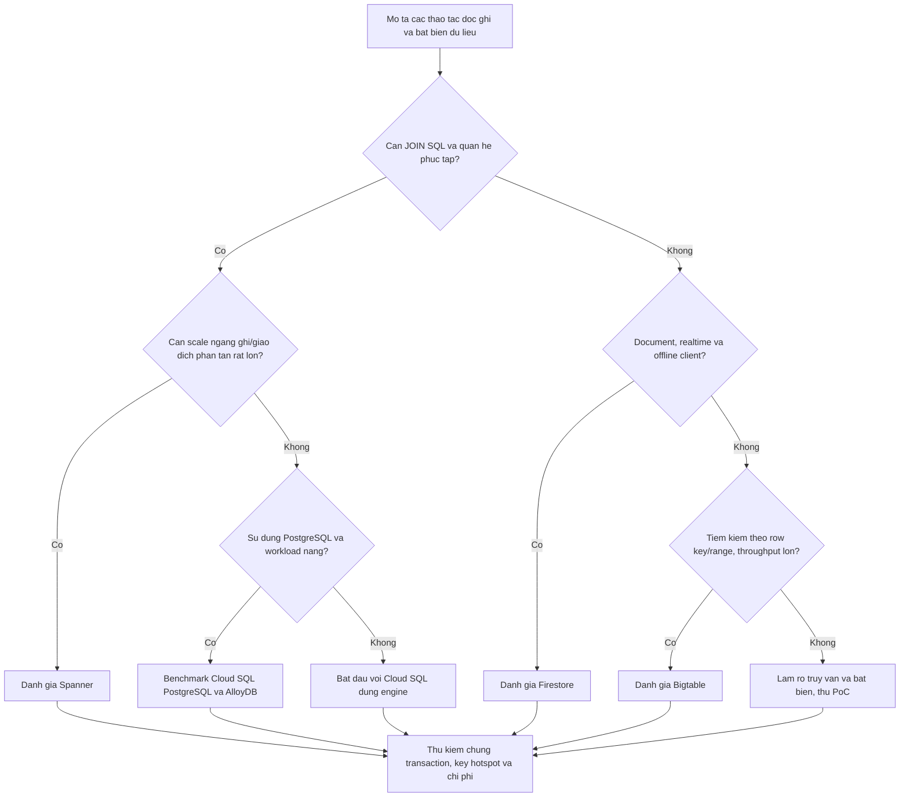
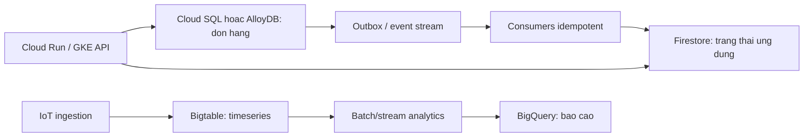

# Lựa chọn Cloud SQL, AlloyDB, Spanner, Firestore hoặc Bigtable

Khi thiết kế cơ sở dữ liệu trên Google Cloud, lựa chọn quan trọng không phải là dịch vụ nào “mạnh nhất”, mà là dịch vụ nào đáp ứng đúng **bất biến dữ liệu, cách truy vấn, yêu cầu giao dịch, mô hình mở rộng và ngân sách** của ứng dụng. Một cửa hàng thương mại điện tử, hệ thống chat thời gian thực, sổ cái giao dịch đa vùng và hệ thống thu thập hàng tỷ số đo IoT có yêu cầu lưu trữ hoàn toàn khác nhau, dù tất cả đều có thể chạy trên Cloud Run hoặc GKE.

Trong lộ trình **CLOUD_PROVIDERS_GCP**, người học đã tiếp cận tổ chức project, IAM, VPC, Compute Engine, GKE, Cloud Run, lưu trữ, cơ sở dữ liệu, tự động hóa phát hành và theo dõi độ tin cậy/chi phí. Bài học trong chương **Thiết kế kiến trúc GCP** này kết nối các chủ đề đó thành một quyết định kiến trúc có thể giải thích, kiểm chứng và vận hành được.

Sau bài học, người học có thể:

1. Phân biệt mô hình quan hệ, document và wide-column/key-value; xác định yêu cầu transaction, consistency và query.
2. Đánh giá **Cloud SQL, AlloyDB for PostgreSQL, Spanner, Firestore và Bigtable** với đúng đặc tính được Google Cloud hỗ trợ.
3. Chọn được phương án ban đầu, giải thích khi nào cần đổi hoặc kết hợp dịch vụ, và nhận biết chi phí/rủi ro của mỗi lựa chọn.
4. Xây dựng một proof of concept (PoC) có tiêu chí hiệu năng, tính đúng, khôi phục sau sự cố và chi phí trước khi chốt kiến trúc.

> **Nguyên tắc:** Xác định cách ứng dụng **đọc, ghi và sửa dữ liệu trong cùng một nghiệp vụ** trước khi xét dung lượng tổng hoặc quảng cáo tốc độ. Một thiết kế dữ liệu không đáp ứng giao dịch của nghiệp vụ sẽ khó sửa bằng cách tăng CPU hay thêm replica.

## 1. Chốt yêu cầu trước khi chọn sản phẩm

Hãy viết **workload profile** của từng miền dữ liệu, không chỉ của toàn ứng dụng. Một hệ thống thương mại điện tử có thể cần lưu đơn hàng quan hệ, hồ sơ người dùng dạng document và số liệu clickstream dạng chuỗi thời gian.

| Câu hỏi thiết kế | Thông tin cần chốt | Ý nghĩa đối với lựa chọn |
| --- | --- | --- |
| Mô hình và truy vấn | Bảng và JOIN, document theo ID, tìm kiếm theo tiền tố/range key, tổng hợp dữ liệu? | Quyết định relational hay NoSQL và cách lập index |
| Bất biến nghiệp vụ | Có phải cập nhật nhiều bảng/hàng hoặc document một cách nguyên tử? | Loại bỏ phương án không hỗ trợ phạm vi transaction cần thiết |
| Nhất quán | Sau ghi phải đọc thấy ngay từ mọi nơi? Có chấp nhận dữ liệu cũ trên replica? | Quyết định consistency/routing/replication |
| Tải hiện tại và tăng trưởng | QPS đọc/ghi, tỉ lệ read/write, kích thước mỗi bản ghi, dữ liệu 1–3 năm, hệ số tăng | Phân biệt scale-up, read scaling và write scaling phân tán |
| Độ trễ và vị trí | p50/p95/p99 ở vùng nào, client ở đâu, có cần đa vùng ghi? | Ảnh hưởng khoảng cách mạng, topology và placement |
| Độ sẵn sàng | RTO, RPO, nhu cầu HA/DR, thời gian backup/restore | Chọn topology và quy trình vận hành |
| Khả năng tương thích | Ứng dụng đang dùng PostgreSQL/MySQL/SQL Server, JDBC, ORM, extension, SQL đặc thù? | Quyết định độ khó chuyển đổi và thay code |
| Chi phí, vận hành, bảo mật | Tải ổn định hay đột biến, ngân sách, IAM, dữ liệu nhạy cảm, trách nhiệm backup? | Quyết định dịch vụ có capacity provisioned hay serverless và kiểm soát truy cập |

**Phân biệt ba mục tiêu thường bị lẫn:**

- **HA (high availability)**: giữ dịch vụ hoạt động khi một thành phần/zone lỗi; không tự bảo đảm rằng dữ liệu bị xóa nhầm sẽ được phục hồi.
- **DR (disaster recovery)**: phục hồi khi xảy ra thảm họa hoặc mất vùng; cần kiểm tra RTO/RPO, replication và kế hoạch chuyển vùng thực tế.
- **Scale**: tăng năng lực xử lý. Có thể tách **read scaling** (replica/read pool) khỏi **write scaling** (nhiều shard hoặc kiến trúc phân tán); nhiều read replica không làm một primary đơn có sức ghi vô hạn.

Đừng dùng “một triệu người dùng” làm số liệu capacity nếu không biết họ tạo bao nhiêu truy vấn/giây, truy vấn phức tạp tới đâu và dữ liệu phân bố thế nào.

## 2. So sánh nhanh năm dịch vụ

| Tiêu chí | **Cloud SQL** | **AlloyDB for PostgreSQL** | **Spanner** | **Firestore** | **Bigtable** |
| --- | --- | --- | --- | --- | --- |
| Mô hình chính | RDBMS quản lý sẵn | RDBMS tương thích PostgreSQL | CSDL quan hệ, phân tán; SQL và ACID | CSDL NoSQL document, serverless | Wide-column/key-value, dữ liệu theo row key |
| Truy vấn nổi bật | SQL, JOIN, index, transaction theo engine | PostgreSQL SQL, JOIN, phân tích kết hợp OLTP theo khả năng hệ thống | GoogleSQL hoặc PostgreSQL dialect có giới hạn; truy vấn SQL | Query document và index; realtime listeners ở Native mode | Tra key, prefix/range scan, streaming; không có JOIN quan hệ |
| Giao dịch | ACID theo MySQL/PostgreSQL/SQL Server | ACID theo PostgreSQL | Giao dịch phân tán, strong consistency; serializable/external consistency ở chế độ tương ứng | Giao dịch nguyên tử trên một/nhiều document theo giới hạn sản phẩm | Atomic ở cấp hàng; multi-row ACID không phải mô hình chính |
| Mở rộng ghi | Chủ yếu nâng cấp primary; cân nhắc chia tải/shard phía ứng dụng | Primary xử lý ghi, storage/compute tách biệt; mở rộng đọc qua read pools | Scale ngang phân tán cả workload theo thiết kế khóa và capacity | Tự điều chỉnh quy mô theo tải, vẫn có hotspot và giới hạn document/index | Scale ngang theo row-key ranges và node/compute phù hợp |
| Nhất quán khi đọc | Primary theo engine; read replica có thể trễ | Đọc qua primary/read pool; kiểm tra độ trễ replica | Strong reads mặc định; stale reads tùy lựa chọn | Strongly consistent reads mặc định từ server; cache offline có thể cũ | Single cluster mạnh; đa cluster thường eventual giữa các cluster |
| Vận hành/capacity | Chọn tier, storage, HA, replica; quản lý kết nối | Chọn cluster, primary/read pools, capacity; tuning workload | Chọn instance/capacity/region, thiết kế schema/key phân tán | Serverless, tính phí theo mức dùng và storage/index | Chọn compute/cluster/capacity/replication, theo dõi hotspot |
| Phù hợp khởi đầu | Ứng dụng quan hệ thông thường, chuyển MySQL/PG/SQL Server | PostgreSQL tải giao dịch nặng hoặc cần tăng hiệu năng/read scale | OLTP rất lớn, giao dịch mạnh xuyên nhiều key/vùng | Mobile/web realtime, document, đồng bộ offline | IoT, metrics, time series, dữ liệu rất lớn theo key |
| Điểm cần cân nhắc | Giới hạn scaling của primary, replica lag, connection count | Chi phí baseline/capacity; hỗ trợ extension, tính năng phải xác nhận | Thiết kế key và SQL khác DB truyền thống; chi phí/topology | Không có relational JOIN; index/read cost, hot document | Thiết kế row key cẩn thận; không JOIN, transaction chỉ mức hàng |

Bảng thể hiện xu hướng kiến trúc, không phải số giới hạn cứng. Các khả năng, edition, quota và cấu trúc giá thay đổi theo thời gian và vùng. Luôn đối chiếu phiên bản, edition và tài liệu chính thức khi chọn cấu hình thực tế.

Một số nhầm lẫn cần sửa ngay:

- **Firestore không đơn thuần là eventual-consistency database.** Truy vấn/đọc từ server mặc định có tính nhất quán mạnh; dữ liệu trong cache offline có thể cũ. Firestore có transaction nhiều document, với các giới hạn và hành vi retry riêng.
- **Bigtable không chỉ “lưu cột” như một OLAP warehouse.** Mô hình là row key được sắp xếp, column family, qualifier và phiên bản cell; hiệu năng phụ thuộc vào pattern truy cập bằng key. Bigtable không thay thế BigQuery cho mọi bài toán phân tích SQL.
- **Spanner có PostgreSQL interface không có nghĩa là một PostgreSQL server hoàn chỉnh.** Spanner hỗ trợ tập con cú pháp và một số client; các extension, procedure và công cụ quản trị cần kiểm tra riêng.
- **AlloyDB tương thích PostgreSQL**, nhưng khả năng chạy extension/flag cụ thể và cách hoạt động của read pool phải được xác nhận trên phiên bản/edition đã chọn.

## 3. Quy trình lựa chọn bằng câu hỏi loại trừ

### 3.1. Cây quyết định cho workload chính



Cây trên đưa ra **ứng viên để thử nghiệm**, không phải đáp án cuối cùng. Nếu yêu cầu kết hợp nhiều kiểu dữ liệu, một kiến trúc nhiều data store có thể hợp lý, nhưng phải xác định nguồn chân lý và đồng bộ sự kiện.

### 3.2. Các điều kiện loại trừ sớm

1. Nghiệp vụ cần transaction chuyển tiền giữa nhiều tài khoản, có ràng buộc liên bảng và kiểm toán chặt chẽ: bắt đầu từ **hệ quan hệ** (Cloud SQL, AlloyDB hoặc Spanner tùy tải và vùng).
2. Client web/mobile cần đồng bộ dữ liệu thay đổi gần realtime, sử dụng offline và chủ yếu truy xuất document theo đường dẫn/index: xét **Firestore Native mode**.
3. Ghi lượng lớn điểm đo theo thiết bị và truy xuất một thiết bị trong khoảng thời gian: xét **Bigtable**, kiểm thử row-key design trước.
4. Ứng dụng hiện có MySQL/PostgreSQL/SQL Server và cần di chuyển nhanh, tải vừa: xét **Cloud SQL** để giảm lượng code cần thay.
5. PostgreSQL có tải lớn, nhiều đọc và query kết hợp OLTP với phân tích: benchmark **AlloyDB**, kể cả lựa chọn columnar engine/read pool nếu phù hợp.
6. Cần quan hệ và giao dịch nhất quán mạnh trên bộ dữ liệu phân tán quy mô lớn, có yêu cầu vùng/multi-region: xét **Spanner**, nhưng đánh giá lại thiết kế primary key và khác biệt SQL.

Không chọn Bigtable chỉ vì có “hàng tỷ hàng”, Spanner chỉ vì cần HA, hoặc AlloyDB chỉ vì nghe nói nhanh hơn. Tốc độ và chi phí phụ thuộc query mix, dữ liệu, region, topology, cấu hình và cách thử nghiệm.

## 4. Hiểu sâu từng dịch vụ và ranh giới ứng dụng

### 4.1. Cloud SQL: relational database quen thuộc cho ứng dụng vận hành

Cloud SQL quản lý **MySQL, PostgreSQL và SQL Server** với backup, HA/failover, mạng, bảo trì và giám sát. Ứng dụng Java/Spring thường tiếp tục dùng JDBC, ORM hoặc thư viện SQL quen thuộc, nhưng vẫn cần kiểm tra phiên bản engine, extension, flag, đặc quyền, kết nối và phương pháp migration.

**Nên chọn khi:**

- Đã có schema quan hệ, FOREIGN KEY, JOIN và transaction theo engine; tải và tăng trưởng có thể đáp ứng bằng tier/primary và replica.
- Muốn giảm công việc DBA và chuyển ứng dụng có sẵn lên Compute Engine, GKE hoặc Cloud Run với thay đổi ít nhất.
- Team cần một baseline dễ hiểu và kiểm soát vận hành, với phương án backup/PITR/HA và ngân sách rõ ràng.

**Đặc tính và giới hạn:**

- Mô hình có **primary** xử lý ghi; read replicas chủ yếu giúp **mở rộng đọc** và dùng replication bất đồng bộ. Một lần đọc trên replica có thể chưa nhìn thấy bản ghi vừa commit trên primary.
- HA là một cấu hình cụ thể và có thêm chi phí; thiết lập instance ở một zone không tự đạt RTO/RPO production. Kiểm tra vùng có hỗ trợ các lựa chọn HA/DR.
- Cloud SQL không giải quyết vô hạn ghi trên một primary; nếu mọi traffic dồn vào một bảng/hàng nóng, tăng replica không xử lý nút thắt ghi.
- Từ Cloud Run/GKE cần tính **connection pooling** và giới hạn kết nối. Instance có thể nghẽn vì quá nhiều kết nối dù CPU chưa cao.

**Ví dụ:** hệ quản lý đơn hàng cho một thị trường, vài trăm request/giây, cần kiểm tra tồn kho và khóa ngoại khi tạo đơn. Cloud SQL for PostgreSQL là baseline hợp lý. Nếu workload tăng mạnh, hãy đo bottleneck trước khi quyết định tăng instance, read replica, tối ưu index hoặc chuyển sản phẩm.

### 4.2. AlloyDB for PostgreSQL: PostgreSQL cho workload đòi hỏi cao

AlloyDB dùng giao thức và cú pháp PostgreSQL, nhưng kiến trúc tách **compute** khỏi **storage phân tán**, có **primary instance** cho giao dịch ghi và **read pool instances** để phục vụ tải đọc. Google Cloud mô tả columnar engine giúp tăng tốc một số phép quét, JOIN và aggregate bằng bản lưu trữ cột trong bộ nhớ.

**Nên đánh giá khi:**

- Ứng dụng đã dùng PostgreSQL, muốn giữ phần lớn SQL/ORM và cần hiệu năng/capacity cao cho OLTP hoặc workload hỗn hợp OLTP + đọc phân tích.
- Đọc nhiều, có nhu cầu mở rộng qua read pool, hoặc cần các tối ưu vận hành của AlloyDB.
- Có kế hoạch quản lý read path và kiểm thử độ trễ dữ liệu trên các instance phục vụ đọc.

**Không suy luận rằng:**

- AlloyDB là Spanner: giao dịch ghi vẫn đi qua primary theo kiến trúc của dịch vụ; read pool không biến hệ thống thành multi-primary distributed SQL.
- Mọi extension PostgreSQL đều hoạt động y hệt bản tự quản lý: cần tra danh sách extension/version/flag và thử migration scripts.
- Columnar engine sẽ tăng tốc mọi query: chỉ phù hợp query pattern nhất định, có overhead/tài nguyên; phải đo bằng workload thật.

**Ví dụ:** dịch vụ đặt hàng với PostgreSQL, nhiều report operational chạy liên tục và lượng đọc cao hơn lượng ghi; PoC so sánh Cloud SQL PostgreSQL và AlloyDB với cùng dữ liệu, query, connection pool và yêu cầu RPO/RTO. Nếu hiệu năng và tổng chi phí của AlloyDB tốt hơn ở tải mục tiêu, có cơ sở để chọn.

### 4.3. Spanner: relational OLTP phân tán, giao dịch nhất quán mạnh

Spanner là database phân tán quản lý sẵn, hỗ trợ SQL và transaction ACID ở quy mô lớn. Ở mức isolation **serializable**, tài liệu Spanner mô tả **external consistency**: các transaction có thứ tự commit tương thích với thứ tự thực tế. Strong reads là mặc định; stale reads có thể chủ động dùng để tối ưu một số workload.

**Nên đánh giá khi:**

- Dữ liệu và tải ghi/đọc quan hệ cần mở rộng ngang qua nhiều phân vùng mà vẫn giữ các bất biến transaction.
- Ứng dụng có yêu cầu nhất quán mạnh và khả năng phục vụ đa vùng phù hợp topology Spanner đã chọn.
- Team chấp nhận thiết kế schema/query cho môi trường phân tán và kiểm thử latency/chi phí của transaction qua nhiều key/vùng.

**Bẫy thiết kế:**

- Key tăng tuần tự hoặc timestamp làm **prefix của khóa chính** với tải ghi lớn dễ tạo hotspot; dùng UUID phân tán, bit-reversed sequence hoặc thiết kế shard phù hợp truy vấn.
- Giao dịch qua nhiều key có thể tăng latency hoặc contention; giữ transaction gọn, thiết kế khả năng retry và đo p99.
- **PostgreSQL dialect của Spanner là tập con PostgreSQL**; không mặc định có tất cả trigger, extension, thủ tục tự định nghĩa hoặc câu SQL hiện có. Việc dùng PostgreSQL JDBC/PGAdapter không xóa các khác biệt ngữ nghĩa và quản trị.

**Ví dụ:** hệ thống đặt chỗ vé toàn cầu cần kiểm soát việc bán trùng một chỗ, quy mô nhiều khu vực, lượng giao dịch lớn. Spanner là ứng viên để giữ bất biến tồn kho/chỗ ngồi trong transaction phân tán, nhưng phải thử các thao tác giao dịch cụ thể và topology nhiều vùng; quy mô khu vực nhỏ có thể vẫn phù hợp Cloud SQL hoặc AlloyDB.

### 4.4. Firestore: document database serverless cho web/mobile và realtime

Firestore lưu **document trong collection**. Với **Firestore in Native mode**, client SDK có realtime listeners và cơ chế offline caching/sync phù hợp web/mobile. Dữ liệu truy vấn dựa trên trường/index; mô hình thường denormalize một số thông tin để đọc hiệu quả, không có JOIN quan hệ tương đương RDBMS.

**Điểm phân biệt quan trọng:**

- Firestore đọc từ server **strongly consistent** theo tài liệu. Bản sao offline cache trên client có thể cũ hoặc chưa đồng bộ; không nhầm cache với bảo đảm đọc từ server.
- Firestore hỗ trợ **transaction trên nhiều document** và atomic batched writes theo giới hạn kích thước/thời gian. Một transaction có thể tự chạy lại khi có tranh chấp; callback transaction phải không có side effect bên ngoài.
- Serverless không nghĩa là mỗi pattern ghi đều mở rộng vô hạn. Một document quá nóng, field được index tăng tuần tự, hoặc index fanout lớn đều có thể gây latency và tăng chi phí.
- **Edition và data-access mode khác nhau**: Standard edition và Enterprise edition có các khả năng/giá/giới hạn khác nhau; Firestore Native API, Datastore mode và MongoDB compatibility không được coi là một interface duy nhất. Hãy chọn đúng edition/mode trước khi triển khai, vì mode không thể tùy tiện đổi sau khi tạo database.

**Nên chọn khi:**

- Ứng dụng cần trạng thái realtime theo user/room, dữ liệu document linh hoạt, offline-first và truy vấn theo đường dẫn/id/index.
- Đội phát triển ưu tiên SDK và mô hình serverless, không phụ thuộc nhiều relational JOIN/truy vấn báo cáo liên bảng.
- Tính phí theo hoạt động truy cập/storage/index phù hợp quy mô và pattern đọc ghi đã dự báo.

**Ví dụ document mang tính minh họa:**

```json
{
  "roomId": "room-21",
  "lastMessage": {
    "authorId": "user-007",
    "text": "Cuộc họp bắt đầu lúc 9 giờ",
    "sentAt": "2026-11-19T02:00:00Z"
  },
  "memberCount": 18
}
```

Lưu ở đường dẫn `rooms/room-21`; client có thể subscribe document này. Tin nhắn thực tế thường nằm ở subcollection riêng `rooms/room-21/messages/{messageId}` để tránh mọi bản tin ghi vào cùng một document “mảng tin nhắn” ngày càng lớn. Với phòng có traffic rất cao, vẫn phải đánh giá hotspot của các document tổng hợp như `memberCount` hoặc `lastMessage`.

### 4.5. Bigtable: throughput lớn, dữ liệu theo row key và time series

Bigtable dùng mô hình **sparse wide-column** với row key sắp xếp theo thứ tự từ điển, column families và nhiều phiên bản cell. Mô hình truy vấn hiệu quả nhất thường là **tra cứu row key hoặc dải key**. Dữ liệu có thể rất lớn, ví dụ hàng tỷ đo đạc IoT hoặc lịch sử metric.

**Nên chọn khi:**

- Rất nhiều sự kiện/số đo ghi đều, cần tra gần như trực tiếp bằng định danh thiết bị, customer, sensor hoặc khoảng thời gian.
- Truy cập bằng key/range phù hợp tự nhiên, có thể denormalize/precompute theo read path.
- Team sẵn sàng chọn row-key schema, compute nodes, column families, retention/garbage collection và replication routing.

**Các giới hạn chính:**

- Bigtable **không hỗ trợ JOIN quan hệ**; các API/khả năng SQL trên Bigtable không biến nó thành relational RDBMS cho ORM.
- Tính nguyên tử và transaction thường là **trong một hàng**; không dùng để thay trực tiếp transaction cập nhật nhiều hàng/tài khoản.
- Single-cluster read/write có thể giữ nhất quán mạnh. Với replication nhiều cluster, replication **eventual giữa các cluster**; cấu hình app profile và routing ảnh hưởng read-your-writes và single-row transaction.
- Một row key có prefix là timestamp đang tăng rất dễ dồn ghi vào một khoảng key nhỏ; cần tạo khóa phân tán dựa trên entity/hash phù hợp truy vấn.

**Ví dụ thiết kế row key:** muốn lấy metric của một thiết bị theo khoảng thời gian, có thể dùng:

```text
<bucket-or-hash>#<device-id>#<reverse-or-normalized-timestamp>
07#sensor-0021#20261119090000
14#sensor-0098#20261119090000
```

Đây là **phác thảo khóa**, không phải key schema để copy nguyên vào production. Nếu hai dòng trên chứa literal placeholder timestamp giống nhau, truy vấn thực tế cần xây giá trị timestamp và prefix theo quy tắc đã định; phải xác định rõ đọc chủ yếu theo thiết bị hay theo thời gian. Một prefix **device ID duy nhất** khi có hàng triệu thiết bị có thể phân tán tốt, nhưng vài thiết bị phát sinh cực nhiều dữ liệu vẫn có thể tạo hotspot. Nếu dùng shard/hash để phân tán, truy vấn một thiết bị có thể phải quét nhiều shard; đó là đánh đổi cần đo.

## 5. Các tiêu chí thường đảo ngược quyết định

### 5.1. Transaction, consistency và phân bố địa lý

Đừng dùng thuật ngữ “ACID” như một thuộc tính có/không duy nhất. Hãy ghi **phạm vi transaction** và những cách dữ liệu được đọc:

| Yêu cầu | Ứng viên và chú ý |
| --- | --- |
| Ghi nhiều bảng và JOIN trong một request nghiệp vụ | Cloud SQL, AlloyDB; Spanner nếu cần phân tán quy mô lớn |
| Giao dịch cập nhật nhiều bản ghi quan hệ xuyên các partition | Spanner; cần test contention và latency |
| Transaction một/vài document có liên hệ | Firestore, trong các giới hạn và quy tắc retry |
| Cập nhật một row time-series/record theo key | Bigtable; kiểm tra API và app profile được dùng |
| Đọc ngay sau ghi trên read replica | Cloud SQL/AlloyDB: cần xác định route đến primary hoặc chấp nhận lag |
| Đọc sau ghi trên nhiều cluster Bigtable | Chọn routing/consistency có chủ đích; multi-cluster default eventual |
| Offline client phải đọc khi mất mạng | Firestore Native SDK cache, nhưng kết quả có thể stale và giao dịch offline bị giới hạn |

Chuyển tiền giữa hai tài khoản là ví dụ **không được** chia thành hai write độc lập rồi chỉ hy vọng “eventually consistent” nếu bất biến số dư phải đúng ngay tại commit. Nếu thiết kế eventual consistency giữa dịch vụ, cần outbox, idempotency, đối soát, compensation và thiết kế nghiệp vụ chấp nhận các trạng thái trung gian.

### 5.2. Truy vấn, index và chi phí truy cập

- Với Cloud SQL/AlloyDB, chi phí chính của truy vấn phụ thuộc execution plan, index, CPU, memory, I/O và connection. Kiểm tra `EXPLAIN (ANALYZE, BUFFERS)` trên môi trường test và điều kiện cho phép; tối ưu N+1 query của ORM.
- Với Spanner, truy vấn cần cân nhắc **key distribution**, number of splits, transaction và cấu trúc index. Một thiết kế được tối ưu cho một RDBMS truyền thống có thể gây hotspot khi scale ngang.
- Với Firestore, mỗi pattern query gắn với index và số operation/index entry. Một màn hình realtime có hàng nghìn listeners hoặc không kiểm soát phân trang có thể gây chi phí đọc cao; denormalization có thể tăng số write.
- Với Bigtable, một full scan để lọc điều kiện tùy ý đắt hơn truy vấn có row-key prefix phù hợp. Thiết kế schema theo truy vấn cần phục vụ; dùng BigQuery cho phân tích ad hoc/phân tích quy mô lớn khi phù hợp.

### 5.3. Giá trị “serverless” và baseline cost

“Serverless” mô tả cách cấp phát capacity và tính phí, **không bảo đảm rẻ ở mọi quy mô**. Firestore thường gắn chi phí vào document reads/writes/deletes, storage và các thành phần sử dụng khác tùy edition. Bigtable và Spanner cần tính capacity/compute hoặc processing units và storage/replication; Cloud SQL/AlloyDB có thành phần instance/compute, storage, backup, mạng, HA và replica. Kiểm tra **bảng giá hiện hành của region/edition**; không đưa giá cố định vào bài toán khi chưa có workload và giá theo thời điểm.

Một mô hình tổng chi phí hữu ích:

```text
TCO/tháng ≈ compute hoặc capacity
          + storage + backup + replication
          + operations / I/O / index (nếu có)
          + network egress + monitoring
          + chi phí vận hành, phát triển và migration
```

Đối với Firestore và Bigtable, phần lớn chi phí kiến trúc có thể nằm ở **số lần truy cập phát sinh từ data model**. Vì thế lập hóa đơn bằng số bản ghi hoặc dung lượng mà không có query profile sẽ dẫn đến quyết định sai.

## 6. Bốn tình huống thiết kế thực tế

### 6.1. Hệ thống quản lý đơn hàng Java/Spring

**Yêu cầu:** ghi đơn hàng, trừ tồn kho, tạo dòng thanh toán trong transaction; có SQL JOIN, báo cáo theo ngày; traffic một quốc gia, tăng trưởng ổn định.

**Ứng viên ban đầu:** Cloud SQL for PostgreSQL hoặc MySQL. Các invariant và truy vấn phù hợp relational SQL, đội Java dùng Hibernate/JDBC. Kiểm thử primary throughput, lock contention, connection pool từ Cloud Run/GKE, failover và kế hoạch backup.

**Khi nào xem lại:** nếu bottleneck PostgreSQL tại quy mô lớn hoặc read-heavy/hybrid analytics, benchmark AlloyDB. Nếu dữ liệu và giao dịch cần phân tán đa vùng ở quy mô vượt mô hình primary truyền thống, thử Spanner và đánh giá chuyển schema/dialect. Không khuyến nghị dùng Firestore hay Bigtable làm kho sổ cái chỉ vì chúng là NoSQL.

### 6.2. Nền tảng chat và theo dõi trạng thái người dùng

**Yêu cầu:** client di động cập nhật phòng chat realtime, đọc được cuộc hội thoại gần đây khi offline, mỗi người dùng có danh sách phòng; message document là đơn vị truy xuất chính.

**Ứng viên ban đầu:** Firestore Native mode. Collection tài khoản, phòng, message; client listeners theo query; thiết kế Security Rules/IAM thích hợp và đảm bảo quyền đọc không vượt phạm vi người dùng. Khi nhiều message, tránh dồn tất cả vào một document; quản lý phân trang/index.

**Ranh giới:** hóa đơn thanh toán của nền tảng chat có thể cần Cloud SQL cho số dư/giao dịch; không nhất thiết buộc toàn ứng dụng lưu trên một database.

### 6.3. Nền tảng giám sát IoT với lượng đo khổng lồ

**Yêu cầu:** nhiều cảm biến phát dữ liệu từng giây, truy vấn theo sensor và khoảng thời gian, giữ dữ liệu lịch sử; ghi liên tục cao, ít JOIN.

**Ứng viên ban đầu:** Bigtable. Xây row key theo sensor + thời gian với chiến lược tránh hotspot; lựa chọn column families, garbage collection, tuyến ghi/đọc và số cluster dựa workload. Kiểm tra chi phí read range scan và replication.

**Bổ sung:** chuyển các dữ liệu tổng hợp/phân tích tự do sang BigQuery qua pipeline phù hợp. Điều này cho phép Bigtable giữ vai trò kho truy cập key nhanh, còn BigQuery phục vụ báo cáo SQL ad hoc. Cần thiết kế đường đi sự kiện và đối soát khi hai hệ thống cập nhật bất đồng bộ.

### 6.4. Đặt chỗ xuyên nhiều khu vực với bất biến tuyệt đối

**Yêu cầu:** nhiều địa điểm cùng cập nhật số lượng ghế/tài nguyên, không thể bán vượt tồn kho, lượng ghi lớn; giao dịch cần nhất quán xuyên các phần dữ liệu liên quan.

**Ứng viên:** Spanner, nếu workload và kinh phí cần khả năng phân tán và strong consistency của nó. Kiểm tra read/write transaction ở topology multi-region thực tế, kế hoạch retry và p99. Thiết kế primary key không có timestamp tăng liên tục đứng đầu.

**Đối chiếu bắt buộc:** một cluster Cloud SQL/AlloyDB trong vùng chính với cơ chế HA/DR có thể đã đáp ứng bài toán nếu giao dịch và tổng tải còn nhỏ. Không chọn một hệ phân tán toàn cầu trước khi đo yêu cầu thực sự.

## 7. Khi cần phối hợp nhiều database

Một kiến trúc có thể dùng hai hay ba dịch vụ nếu **có ranh giới dữ liệu rõ**:



**Nguyên tắc tổ chức:**

1. Chỉ định rõ **system of record** cho từng aggregate/bất biến. Ví dụ, số tiền đã thanh toán có nguồn chân lý ở relational transaction store, Firestore chỉ là bản hiển thị cập nhật bất đồng bộ.
2. Đồng bộ qua event/outbox và consumer idempotent khi không có transaction xuyên hai database. Theo dõi lag, retry, dead-letter, deduplication và replay.
3. Tách tầng dữ liệu không làm mất sự nhất quán cần thiết; UI phải biết một bản sao có thể cũ. Với thay đổi cần đọc ngay, route tới nguồn chân lý hoặc chờ cập nhật theo mốc phiên bản.
4. Thiết kế giới hạn kết nối, private networking, secret/identity và quan sát lỗi cho từng client, nhất là khi workload Cloud Run có thể scale số instance nhanh.
5. Có cơ chế **rebuild read model**, backup/restore và chạy đối soát sau sự cố. Không lấy bản copy Firestore hoặc Bigtable thay cho backup transaction store.
6. Tránh “polyglot persistence” không cần thiết: mỗi database thêm vận hành, mô hình quyền, luồng đồng bộ, chi phí và một loại lỗi mới.

## 8. Bảo mật, độ tin cậy và vận hành khi chốt kiến trúc

### 8.1. Mạng và quyền truy cập

- Cloud SQL/AlloyDB: dùng cách kết nối bảo mật được dịch vụ hỗ trợ (private IP/Cloud SQL connectors hoặc proxy theo sản phẩm), service identity phù hợp, TLS nếu cần, quyền DB tối thiểu và secret rotation. IAM truy cập hạ tầng **không đồng nghĩa** với database privileges trong engine.
- Spanner: quyền IAM theo instance/database và các cơ chế kiểm soát dữ liệu do sản phẩm cung cấp; đánh giá vùng lưu trữ và topology replication phù hợp chính sách.
- Firestore: phân biệt truy cập client Native SDK theo Security Rules với truy cập backend qua Google Cloud server SDK/IAM; quyền kiểm tra từ backend phải do ứng dụng thực thi, không giả định Security Rules thay thế IAM.
- Bigtable: IAM cho instance/table, app profile/routing và mạng kết nối; tách ingestion identity khỏi identity của batch analytics.

Với dữ liệu nhạy cảm, xác định yêu cầu mã hóa, khóa, retention, audit logs, backup, quyền khôi phục và xóa dữ liệu theo chính sách. Không giả định mọi chức năng quản trị hay mã hóa khóa tùy chỉnh có cùng mức hỗ trợ giữa năm dịch vụ.

### 8.2. SLO và thao tác bắt buộc thử

- Xác định trước p95/p99 latency theo thao tác, mục tiêu availability, RTO và RPO cụ thể.
- Thiết lập alerts cho lỗi kết nối, CPU/storage/capacity, lag replication, transaction retry/contention, throttling, quota và chi phí.
- Thử failover/recovery trên môi trường kiểm soát; đo thời gian kết nối lại, client retry và tính đúng của ghi.
- Thử backup **và restore**, bao gồm khôi phục tới mốc nếu hệ thống hỗ trợ; backup tồn tại nhưng chưa từng restore được chưa phải kế hoạch DR đáng tin cậy.
- Mô phỏng tải tăng đột ngột, key/document hotspot, thao tác đồng thời trên cùng entity và mất kết nối region.
- Đối chiếu tiêu chí giới hạn/region/edition mới nhất với tài liệu chính thức trước khi áp dụng production.

## 9. Proof of concept và ma trận ra quyết định

Một quyết định có căn cứ cần cùng bộ test trên các ứng viên khả thi. So sánh phải **cùng dataset, cùng phân bố khóa, cùng network region và cùng mô hình retry/connection**. Không so sánh kết quả một query đơn giản trên dịch vụ A với benchmark tổng hợp khác ở dịch vụ B.

### 9.1. Bảng chấm điểm mẫu

Điểm số 1–5 do **đội dự án chấm sau khi thử nghiệm**, không phải bảng xếp hạng sẵn có của sản phẩm.

| Tiêu chí và trọng số mẫu | Cách chấm theo bằng chứng |
| --- | --- |
| Tính đúng nghiệp vụ – 30% | Các bất biến giao dịch và consistency pass/fail với test concurrency |
| Truy vấn và tích hợp – 20% | Golden queries/SDK/ORM được hỗ trợ; nỗ lực sửa code và migration |
| Hiệu năng, tăng trưởng – 20% | p95/p99, throughput, hotspot, headroom ở tải dự báo |
| Độ tin cậy – 15% | Kiểm tra HA/DR, restore, RTO/RPO thực tế |
| Tổng chi phí – 10% | Ước lượng 12 tháng từ benchmark và giá region/edition |
| Vận hành, kỹ năng – 5% | Mức sẵn sàng của team, monitoring, security, day-2 operations |

**Cách sử dụng:** đầu tiên loại ứng viên không đáp ứng invariant bắt buộc; sau đó chấm điểm các ứng viên còn lại. Trọng số là ví dụ, nhóm tài chính có thể ưu tiên integrity cao hơn; dự án IoT có thể ưu tiên throughput và retention hơn. Khi chấm phải lưu link benchmark, cấu hình, giá và ngày kiểm tra.

### 9.2. Kịch bản thử nghiệm

1. **Tạo dữ liệu đại diện:** phân phối key lệch thật, bản ghi lớn/nhỏ, foreign keys hoặc documents, retention và tỷ lệ dữ liệu nóng/lạnh.
2. **Đo chuẩn nghiệp vụ:** read by ID, filtered/range read, write/update, transaction nhiều đối tượng nếu có, pagination, batch/analytics, xóa/TTL.
3. **Đo đồng thời:** tăng người dùng, ghi cùng một key/document, read-after-write, replication lag và replica failover.
4. **Đo tài nguyên/giá:** CPU/compute/capacity, storage/index, operation count, network egress, backup, replication và vận hành.
5. **Đánh giá chuyển đổi:** SQL dialect, driver/JDBC, extension, indexing, scripts, CDC và downtime dự kiến.
6. **Ghi kết luận:** dịch vụ được chọn, hai rủi ro lớn nhất, cách giảm rủi ro, tiêu chí chuyển đổi/rollback và ngày review lại khi tải tăng.

### 9.3. Bài tập

Một công ty phát triển **nền tảng học trực tuyến** phục vụ hàng triệu học viên có bốn nhóm dữ liệu:

- Đăng ký khóa học và thanh toán có ràng buộc transaction.
- Thông báo lớp học và tiến độ theo học viên cần cập nhật realtime trên điện thoại, có offline support.
- Sự kiện xem video, điểm tương tác và telemetry phát sinh liên tục với lưu trữ dài hạn.
- Báo cáo phân tích tổng hợp cho sản phẩm và tài chính.

Hãy lập đề xuất kiến trúc với các yêu cầu sau:

1. Mỗi miền dữ liệu chọn **tối đa hai ứng viên** trong Cloud SQL, AlloyDB, Spanner, Firestore, Bigtable; xác định nguồn chân lý và vì sao dịch vụ khác bị loại.
2. Vẽ luồng ghi/đọc, mô tả các invariant của thanh toán, cách đồng bộ event và xử lý trùng sự kiện.
3. Thiết kế schema hoặc key đại diện: bảng ghi thanh toán, đường dẫn document tiến độ, row key telemetry; trình bày rủi ro hotspot.
4. Xác định 6 kịch bản kiểm thử về transaction, latency, concurrency, read-after-write, offline, DR và cách thu thập bằng chứng.
5. Ước tính cấu trúc chi phí cho ba mức tải thấp/trung bình/cao; không cần số giá cố định nếu chưa có region và cấu hình.
6. Đưa ra tiêu chí khi cần xét AlloyDB hoặc Spanner thay cho Cloud SQL, và vì sao Bigtable không phù hợp làm hệ thống lưu giao dịch thanh toán.

**Tiêu chí đạt:** quyết định gắn với câu truy vấn, bất biến dữ liệu, SLO, trải nghiệm client và kết quả thử nghiệm. Một câu trả lời chỉ ghi “Firestore nhanh, Spanner mở rộng, Bigtable dữ liệu lớn” chưa chứng minh được lựa chọn.

## Tài liệu chính thức cần tra cứu

- [Google Cloud — Các dịch vụ cơ sở dữ liệu](https://cloud.google.com/products/databases)
- [Cloud SQL — Tổng quan](https://cloud.google.com/sql/docs/introduction)
- [Cloud SQL for PostgreSQL — Replication và read replicas](https://cloud.google.com/sql/docs/postgres/replication)
- [AlloyDB — Tổng quan kiến trúc](https://cloud.google.com/alloydb/docs/overview)
- [AlloyDB — Columnar engine](https://cloud.google.com/alloydb/docs/columnar-engine/about)
- [Spanner — Tổng quan transaction](https://cloud.google.com/spanner/docs/transactions)
- [Spanner — PostgreSQL interface, khả năng và giới hạn](https://cloud.google.com/spanner/docs/postgresql-interface)
- [Spanner — Best practices schema và hotspot](https://cloud.google.com/spanner/docs/schema-design)
- [Firestore — Tổng quan Native mode](https://cloud.google.com/firestore/native/docs/overview)
- [Firestore — Editions và data access modes](https://cloud.google.com/firestore/native/docs/editions-overview)
- [Firestore — Transactions và batched writes](https://cloud.google.com/firestore/native/docs/manage-data/transactions)
- [Firestore — Read/write scale](https://cloud.google.com/firestore/native/docs/understand-reads-writes-scale)
- [Firestore — Offline data](https://cloud.google.com/firestore/native/docs/manage-data/enable-offline)
- [Bigtable — Tổng quan](https://cloud.google.com/bigtable/docs/overview)
- [Bigtable — Thiết kế schema và row key](https://cloud.google.com/bigtable/docs/schema-design)
- [Bigtable — Replication và consistency](https://cloud.google.com/bigtable/docs/replication-overview)
- [Bigtable — Routing và giao dịch mức hàng](https://cloud.google.com/bigtable/docs/routing)

**Lưu ý:** mô tả, giá, giới hạn transaction, availability SLA và các edition có thể thay đổi. Với production, xác minh lại tài liệu theo region/edition/phiên bản và đo bằng workload thực của dự án tại thời điểm triển khai.
