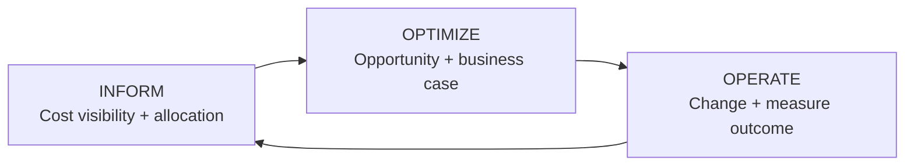
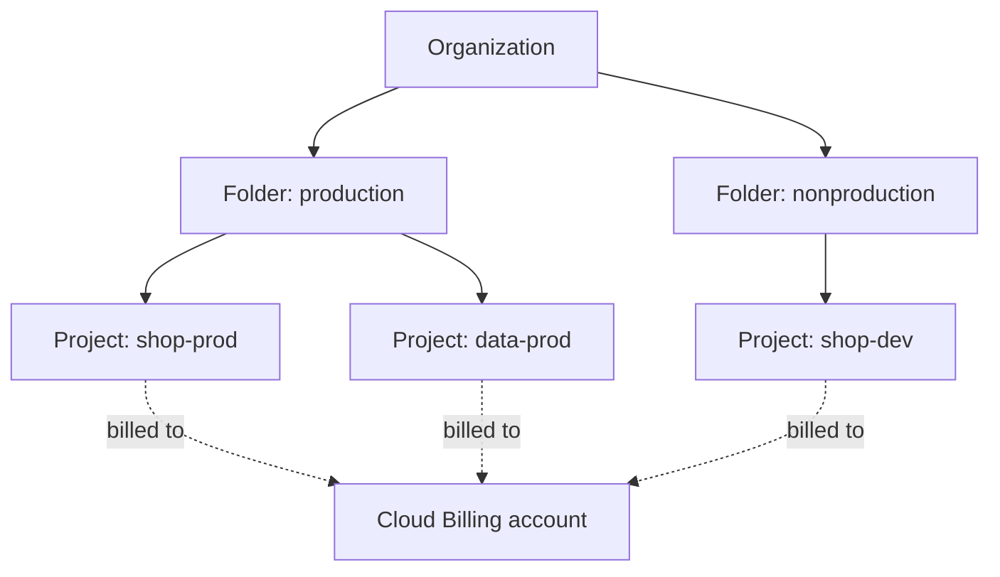

# Thiết lập quy trình FinOps cho nhóm sử dụng Google Cloud

## Mục tiêu và bối cảnh

**FinOps (Cloud Financial Operations)** là cách các nhóm **kỹ thuật, tài chính và nghiệp vụ** cùng quản lý chi phí công nghệ dựa trên dữ liệu sử dụng, giá trị sản phẩm và trách nhiệm rõ ràng. Mục tiêu không chỉ là giảm hóa đơn Google Cloud: một quyết định tiết kiệm làm ứng dụng mất độ tin cậy, tăng thời gian đáp ứng hoặc chậm phát hành có thể khiến **chi phí trên một kết quả kinh doanh** tăng lên.

Bài học thuộc chương **Hiệu năng và FinOps** của module **CLOUD_PROVIDERS_GCP**. Sau khi học về project, IAM, VPC, Compute Engine, GKE, Cloud Run, lưu trữ, cơ sở dữ liệu, triển khai và độ tin cậy, nhóm có thể kết hợp các khả năng đó vào một quy trình kiểm soát **chi phí – hiệu năng – giá trị** được lặp lại thường xuyên.

Sau bài học, người học có thể:

1. Tổ chức trách nhiệm FinOps cho từng project, team, sản phẩm và chi phí dùng chung.
2. Thiết lập khả năng nhìn thấy chi phí bằng Cloud Billing Reports, Budgets, Cost Anomalies và Billing Export to BigQuery.
3. Xây dựng quy tắc phân bổ (allocation), showback/chargeback, KPI và kế hoạch ngân sách.
4. Xử lý cảnh báo vượt ngưỡng, điều tra tăng chi phí và ưu tiên các cơ hội tối ưu dựa trên số liệu.
5. Điều hành họp FinOps định kỳ, kiểm chứng tiết kiệm thực tế và bảo vệ SLO của ứng dụng.

**Điều kiện áp dụng:** tổ chức có ít nhất một Google Cloud Billing account liên kết với các project; người triển khai được cấp quyền đọc chi phí phù hợp, còn quyền thay đổi tài nguyên chỉ cấp cho các nhóm được ủy quyền. Các tên, số tiền, tài khoản và project trong bài là **ví dụ minh họa**.

## 1. Hiểu FinOps như một vòng lặp vận hành

FinOps Foundation mô tả ba giai đoạn được lặp lại liên tục:

| Giai đoạn | Câu hỏi | Hoạt động của nhóm | Kết quả |
|---|---|---|---|
| **Inform** (minh bạch) | Ai đang dùng gì, tốn bao nhiêu, tạo ra giá trị gì? | Gán chủ sở hữu, phân bổ chi phí, báo cáo, dự báo, unit economics | Báo cáo chi phí đáng tin cậy theo team/sản phẩm |
| **Optimize** (lựa chọn) | Có thể cải thiện giá trị hoặc giảm lãng phí ở đâu? | Rightsizing, autoscaling, lưu trữ, mạng, CUD, cải thiện thiết kế | Danh sách cơ hội có ước lượng, rủi ro và owner |
| **Operate** (thực thi) | Ai thay đổi, kiểm chứng và ngăn vấn đề tái diễn? | Phê duyệt, triển khai, theo dõi SLO, so sánh trước/sau, cập nhật quy định | Kết quả được xác nhận và thói quen tối ưu thường xuyên |



Ba giai đoạn **không nhất thiết theo tuyến tính**. FinOps có thể đang chuẩn hóa nhãn của một nhóm, đồng thời SRE điều chỉnh tài nguyên của nhóm khác và tài chính rà soát cam kết sử dụng dài hạn. Hướng thực tế là triển khai với **phạm vi nhỏ, dữ liệu đo được và chu kỳ ngắn**, sau đó mở rộng.

Phân biệt các khái niệm thường gặp:

- **Cost visibility:** biết chi phí đến từ project, service, SKU, team và thời điểm nào.
- **Allocation:** quy gán chi phí cho đơn vị chịu trách nhiệm, có quy tắc xử lý phần chưa phân bổ.
- **Showback:** báo cáo chi phí để nhóm biết mức tiêu thụ; không chuyển tiền nội bộ.
- **Chargeback:** hạch toán/chuyển chi phí cho nhóm theo chính sách tài chính đã thống nhất.
- **Unit economics:** chi phí cho một kết quả kinh doanh, ví dụ chi phí mỗi 1.000 đơn hàng hoặc mỗi GB dữ liệu xử lý.
- **Rate optimization:** trả mức giá phù hợp cho phần tải cần dùng (ví dụ CUD).
- **Usage optimization:** điều chỉnh phần tài nguyên đang tiêu thụ (ví dụ tắt VM nhàn rỗi).
- **Architecture optimization:** thay đổi thiết kế để đạt cùng mục tiêu với hiệu quả sử dụng tài nguyên tốt hơn.

Nguồn: [FinOps Framework – Phases](https://framework.finops.org/framework/phases/), [What is Cloud FinOps? – Google Cloud](https://cloud.google.com/learn/what-is-finops).

## 2. Khởi tạo nhóm FinOps và trách nhiệm quyết định

FinOps là nhiệm vụ **liên chức năng**. Một người phụ trách hóa đơn đơn lẻ khó biết liệu VM có thể tắt, cluster nào có SLO khắt khe hay khoản tăng chi phí nào là do doanh số tăng.

| Vai trò | Trách nhiệm | Quyền quyết định tiêu biểu |
|---|---|---|
| **FinOps lead / Cloud Center of Excellence** | Xác định taxonomy, báo cáo, cadence, backlog tối ưu; thúc đẩy đối soát | Điều phối, chốt quy tắc đo và trình phương án |
| **Engineering/Product owner** | Xác nhận chủ sở hữu hệ thống, ưu tiên giá trị sản phẩm, chấp nhận phương án | Duyệt thay đổi hành vi ứng dụng và mục tiêu ngân sách của team |
| **SRE/Platform** | Đo hiệu năng, sửa cấu hình, autoscaling, tối ưu tài nguyên, bảo vệ độ tin cậy | Triển khai thay đổi hạ tầng đã được phê duyệt |
| **Finance/FP&A** | Lập ngân sách, forecast, định nghĩa chi phí phân bổ, ghi nhận thực chi | Chốt phân loại chi phí, báo cáo tài chính, showback/chargeback |
| **Security/Governance** | IAM, chính sách resource/tag, audit, hạn truy cập dữ liệu chi phí | Phê duyệt ngoại lệ chính sách và truy cập |
| **Procurement/Management** | Đánh giá cam kết dài hạn, hợp đồng, mức rủi ro và lợi ích | Phê duyệt mua CUD hoặc nghĩa vụ tài chính dài hạn |

Một bản **RACI** tối thiểu cho mỗi nhiệm vụ:

| Hoạt động | Responsible (làm) | Accountable (chịu trách nhiệm cuối) | Consulted (tham vấn) |
|---|---|---|---|
| Quy định labels và chủ sở hữu | Platform/FinOps | FinOps lead | Finance, Product |
| Dự báo chi phí mỗi sản phẩm | Finance + Product analyst | Product owner | FinOps, SRE |
| Xử lý cảnh báo chi phí bất thường | Owner tài nguyên + SRE | Product owner | FinOps |
| Rightsizing VM/GKE/Cloud SQL | SRE/Engineering | Service owner | FinOps, Security |
| Mua CUD 1 hoặc 3 năm | FinOps/Procurement | Người được ủy quyền tài chính | SRE, Finance |
| Đối soát hóa đơn và phương pháp phân bổ | Finance | Finance lead | FinOps, Product |

**Artefact cần tạo khi khởi động:** danh mục project → team → owner → ứng dụng; quy tắc phân bổ; báo cáo chuẩn; ngân sách; quy trình phản ứng với bất thường; backlog tối ưu; biên bản quyết định. Không cần mua công cụ chuyên dụng trước khi các nhóm thống nhất tên gọi và quyền sở hữu.

## 3. Đặt phạm vi: billing account, project, labels và tags

### 3.1. Thiết kế đơn vị quản lý chi phí

Trong Google Cloud, một **Cloud Billing account** có thể thanh toán cho nhiều **project**, còn tại một thời điểm một project liên kết với **một** Cloud Billing account. Thông tin tổ chức thường được tổ chức theo `Organization → Folder → Project → Resource`, trong khi Billing account là mối quan hệ thanh toán riêng.

Ví dụ:



**Không dùng tên project làm nguồn sự thật duy nhất**: một project có thể chứa nhiều dịch vụ hoặc team; một sản phẩm có thể chạy ở nhiều project. Để quản lý chi phí chính xác, chọn **project làm ranh giới mặc định**, sau đó bổ sung labels/tags cho các chi phí chia sẻ hoặc nhiều ứng dụng trên cùng project.

### 3.2. Taxonomy tối thiểu

Thống nhất các nhãn trước khi triển khai diện rộng. Ví dụ áp dụng **resource labels** nơi dịch vụ hỗ trợ:

| Key | Ví dụ value | Quy tắc |
|---|---|---|
| `team` | `checkout`, `analytics`, `platform` | Theo danh bạ đội chịu trách nhiệm |
| `application` | `storefront`, `etl` | Theo danh mục ứng dụng |
| `environment` | `prod`, `staging`, `dev` | Danh sách giá trị cố định |
| `cost_center` | `cc100`, `cc200` | Đồng bộ với Finance |
| `owner` | `checkout-team` | Dùng tên nhóm, tránh đưa email hoặc dữ liệu cá nhân vào labels |
| `managed_by` | `terraform`, `manual` | Giúp quy trách nhiệm vòng đời resource |

**Labels** là cặp key/value gắn trên các resource hỗ trợ và có thể hiện diện trong Billing Export. **Resource Manager tags** là cơ chế quản trị riêng, có thể kế thừa qua cấp hierarchy và hỗ trợ chính sách; một số tags cũng có mặt trong dữ liệu Billing. Tags và labels **không hoàn toàn tương đương** về đối tượng áp dụng và thời điểm xuất dữ liệu. Kiểm tra mức hỗ trợ của từng service trước khi coi mọi dòng chi phí đều có nhãn.

Chính sách vận hành nên quy định: khi tạo resource phải khai báo owner, cost center, environment; trong CI/Terraform kiểm tra những giá trị bắt buộc ở loại tài nguyên hỗ trợ; với chi phí không có nhãn, có quy tắc phân bổ hoặc hạch toán `unallocated` tường minh. **Gắn nhãn ngày hôm nay không làm dữ liệu sử dụng của các tháng trước tự được gắn nhãn lại**.

### 3.3. Quy tắc cho chi phí dùng chung

Một mô hình có thể bắt đầu:

1. **Direct cost**: resource/projet có owner rõ ràng, gán 100% cho team đó.
2. **Shared platform cost**: VPC, CI, observability, cluster dùng chung; phân bổ theo tỷ lệ đã thống nhất (usage, số lượng workload, doanh thu hoặc chia đều), đồng thời giữ rõ con số **shared chưa phân bổ** khi chưa đủ dữ liệu.
3. **Central/enterprise cost**: phí liên quan tổ chức/thuế/điều chỉnh/commitment; Finance xác định cách hạch toán riêng, không ép tất cả vào một team.
4. **Unallocated cost**: chưa có dữ liệu hoặc thiếu nhãn; công bố tỷ trọng, ghi người phụ trách và ngày xử lý.

Không nên ép chi phí shared vào một team bất kỳ để có báo cáo “100% allocated” nhìn đẹp nhưng sai. Khi chuyển từ **showback** sang **chargeback**, Finance phải phê duyệt định nghĩa chi phí ròng/gộp, cách xử lý chiết khấu, thuế, biến động tiền tệ và phần dùng chung.

Nguồn: [Cloud Billing exports to BigQuery](https://docs.cloud.google.com/billing/docs/how-to/export-data-bigquery-setup), [BigQuery export schema](https://docs.cloud.google.com/billing/docs/how-to/export-data-bigquery-tables/standard-usage).

## 4. Công cụ Google Cloud theo mục tiêu vận hành

| Mục tiêu | Công cụ | Lưu ý thực tế |
|---|---|---|
| Xem chi phí theo thời gian/service/project/SKU | **Cloud Billing Reports** | Có thể lọc, nhóm, so sánh và xem forecast; số liệu có độ trễ |
| Đặt kế hoạch chi phí và nhắc nhở | **Budgets & alerts** | Cảnh báo khi vượt ngưỡng; **không mặc định chặn chi tiêu** |
| Điều tra tăng chi phí bất thường | **Cost Anomalies** | Dùng mô hình phát hiện spike và phân tích nguyên nhân theo service/SKU/region |
| Dữ liệu chi tiết, audit, chargeback, BI | **Cloud Billing export to BigQuery** | Standard, Detailed, Pricing và dữ liệu CUD; có phí lưu trữ/truy vấn |
| Danh sách cơ hội tối ưu | **FinOps hub / Recommender** | Idle, rightsizing, cam kết, tiết kiệm tiềm năng; cần review rủi ro |
| Xu hướng tải và SLO | **Cloud Monitoring/Logging** | Kết nối mức tiêu thụ với độ trễ, lỗi, CPU, request, throughput |
| Ước lượng trước thiết kế | **Google Cloud Pricing Calculator** | Ước lượng từ giả định, cần so với thực chi |
| Thiết lập quy tắc tự động | **Budgets API, Pub/Sub, Workflows/Cloud Run, CI/IaC** | Tự động hóa có quyền hạn và cơ chế phê duyệt phù hợp |

**IAM cơ bản:** người xem tổng chi phí trên Billing account có thể cần `roles/billing.viewer` (Billing Account Viewer); người bật export cần các quyền Cloud Billing và BigQuery phù hợp (ví dụ Billing Account Costs Manager hoặc Billing Account Administrator tùy loại export). Người chỉ được phép xem dự án có thể chỉ thấy chi phí project được cấp quyền. **Đọc khuyến nghị** và **thực hiện khuyến nghị** cần quyền khác nhau. Không cấp `roles/billing.admin` cho mọi thành viên chỉ để họ xem báo cáo; ưu tiên nguyên tắc đặc quyền tối thiểu, quyền dataset BigQuery có giới hạn và báo cáo tổng hợp cho người không cần xem dữ liệu chi tiết.

**FinOps hub** cung cấp các nhóm gợi ý như tắt tài nguyên idle, rightsizing, thay đổi cấu hình và mua CUD; các con số **potential savings** là ước lượng, có thể không phản ánh toàn bộ khoản CUD đã sở hữu. FinOps score và một số tính năng account-level chỉ có khi người xem có quyền phù hợp, không nên dùng điểm số đơn lẻ làm KPI đánh giá team.

Nguồn: [Billing Reports](https://docs.cloud.google.com/billing/docs/how-to/reports), [FinOps hub](https://docs.cloud.google.com/billing/docs/how-to/finops-hub), [Cost Anomalies](https://docs.cloud.google.com/billing/docs/how-to/manage-anomalies).

## 5. Thiết lập một quy trình FinOps có thể chạy mỗi tuần

### Bước 1 — Xác định baseline và mục tiêu

Trong 30 ngày gần nhất (hoặc nhiều kỳ nếu tải có mùa vụ), ghi chi phí theo billing account, project, service và SKU. Đối soát:

- Chi phí **gộp (gross)** trước credits so với **ròng (net)** sau credits, theo định nghĩa nội bộ.
- Chi phí phân theo **tháng sử dụng** so với **tháng hóa đơn**.
- Project mới/tắt, dịch vụ tăng tải, khối lượng request, số job, GB lưu trữ và thay đổi triển khai.
- Hiệu năng/SLO và các cam kết sắp hết hạn hoặc đang trả tiền nhưng dùng chưa hết.

Chọn **baseline hữu ích cho quyết định**, ví dụ: chi phí ròng trên 1.000 đơn hàng, tỷ lệ allocated cost, chi phí môi trường dev, backlog khuyến nghị đã xác nhận. Nếu sản phẩm tăng gấp đôi giao dịch, hóa đơn tăng 30% vẫn có thể là kết quả tốt về **unit cost**.

### Bước 2 — Gắn owner và công bố báo cáo minh bạch

FinOps lead cùng Platform lập mapping `project → application → team → cost_center`, thỏa thuận nhãn chung. Tạo ba góc nhìn từ cùng nguồn dữ liệu:

- **Executive/Finance:** tổng chi phí so với budget, forecast, variance và unit economics.
- **Engineering owner:** chi phí theo service/SKU, thay đổi theo deployment và danh sách tài nguyên tối ưu.
- **Platform:** chi phí dùng chung, trạng thái labels, quota, tối ưu cross-project và CUD.

Gắn ngày chốt số liệu và currency trên dashboard. Mỗi báo cáo phải nêu rõ **time zone**, gross/net, cách xử lý credit/thuế và khoảng thời gian; nếu không, hai dashboard có thể đúng riêng nhưng số tổng khác nhau.

### Bước 3 — Tạo ngân sách, ngưỡng và cảnh báo

Ở **Google Cloud Console → Billing → Cost management → Budgets & alerts**:

1. Chọn billing account, scope theo project/service/label hoặc phạm vi được giao.
2. Chọn kỳ ngân sách (ví dụ mỗi tháng) và số tiền theo đơn vị tiền của Billing account.
3. Đặt threshold cho **actual spend** hoặc **forecasted spend**, ví dụ 50%, 80%, 100%.
4. Chỉ định người nhận email phù hợp; có thể cấu hình **Pub/Sub programmatic notification** để kết nối runbook/on-call.
5. Lưu ngân sách; xác nhận quyền người nhận và gửi thử luồng thông báo bằng cách vận hành kiểm chứng trong môi trường được phép.

Ví dụ `shop-prod` có budget 12.000 USD/tháng, cảnh báo thực chi tại 6.000, 9.600 và 12.000 USD; forecast có thể cảnh báo sớm trước khi vượt 100%. Đây là **số liệu minh họa**, không phải khuyến nghị ngân sách cho mọi team.

**Budgets không phải hard spending cap.** Cảnh báo có độ trễ do cập nhật billing và có thể đến sau khi chi phí đã phát sinh. Tự động tắt billing/project khi chạm ngưỡng có thể phá dịch vụ production và gây mất khả năng truy cập; nếu muốn tự động hành động, áp dụng chính sách phân loại môi trường, xác nhận owner và phê duyệt tương ứng. Với dev/test có thể tự động dừng tài nguyên được phép thay vì tắt cả project.

Nguồn: [Create budgets and alerts](https://docs.cloud.google.com/billing/docs/how-to/budgets).

### Bước 4 — Theo dõi và xử lý anomaly

Thiết lập **Cost Anomalies** với ngưỡng mức tăng tuyệt đối và phần trăm phù hợp. Khi có cảnh báo, phân biệt:

- **Tăng trưởng hợp lệ:** traffic tăng, chiến dịch marketing, batch migration, job định kỳ, dự kiến nâng cấp.
- **Thay đổi cấu hình:** VM to hơn, Cloud Run min instances tăng, GKE node/requests tăng, BigQuery truy vấn quét nhiều dữ liệu.
- **Lãng phí:** instance idle, disk/snapshot bỏ quên, log quá nhiều, tài nguyên test không có ngày hết hạn.
- **Rủi ro vận hành/bảo mật:** credential lộ, API usage bất thường, tác vụ lặp vô hạn hoặc công việc bị retry liên tục.

**Runbook khi nhận cảnh báo:**

```text
1. Nhận alert -> ghi thời điểm, billing account/project, mức deviation.
2. Mở Cost Anomalies và Billing Reports -> khoanh service/SKU/region.
3. Gắn owner, hỏi thay đổi đã triển khai và business volume.
4. Đối chiếu Cloud Monitoring/Logging với request, CPU, job, errors.
5. Phân loại: expected / unexpected / cần điều tra thêm.
6. Nếu unexpected: khống chế đúng workload theo chính sách;
   rollback hoặc đặt giới hạn phù hợp, tránh tắt hệ thống tùy tiện.
7. Ghi impact, hành động, người phê duyệt, kết quả 24-48 giờ sau.
8. Cập nhật ngưỡng/cấu hình và postmortem khi có tác động lớn.
```

Một alert “mức tăng $200 và 20% so với kỳ vọng” chỉ là **ví dụ thiết lập**. Cost Anomalies còn có tính năng **early signals cho một số AI workloads** ở trạng thái preview, số liệu chưa phải chi phí hóa đơn cuối cùng. Không nhầm anomaly detection với cảnh báo budget: budget so sánh **chi phí với kế hoạch**, anomaly so sánh **chi phí với hành vi dự kiến dựa trên lịch sử**.

Nguồn: [View and manage cost anomalies](https://docs.cloud.google.com/billing/docs/how-to/manage-anomalies).

### Bước 5 — Duy trì backlog tiết kiệm có owner

Mỗi đề xuất phải gồm:

| Trường | Ví dụ |
|---|---|
| Mã và scope | `FIN-027`, project `shop-prod`, VM `batch-worker-3` |
| Đơn vị chịu trách nhiệm | Platform + Batch owner |
| Bằng chứng | VM CPU thấp, chỉ chạy job lúc đêm; biểu đồ 30 ngày |
| Hành động | Điều chỉnh instance size, lịch stop/start có điều kiện |
| Ước lượng tiết kiệm | 150 USD/tháng **ước lượng trước triển khai** |
| Rủi ro | Job trễ hoặc peak tải thiếu CPU |
| Điều kiện được phép | SLO job hoàn thành trước 06:00 và backup đã kiểm chứng |
| Phê duyệt và lịch | Owner ứng dụng/SRE, thử staging trước |
| Kết quả xác nhận | So chi phí và latency sau 1–2 chu kỳ, ghi variance |

Đo **realized savings** dựa trên mức chi phí quan sát sau thay đổi, hiệu chỉnh traffic và mùa vụ; không cộng tất cả “potential savings” của nhiều recommendation như tiền chắc chắn tiết kiệm. Tránh tính trùng cơ hội, ví dụ cùng VM vừa rightsize vừa mua CUD.

## 6. Thiết lập Billing Export to BigQuery cho phân tích lặp lại

Cloud Billing Reports phù hợp để xem nhanh. Khi cần báo cáo theo team, SQL kiểm chứng được, phân bổ chi phí dùng chung, phân tích SKU và chargeback, dùng **Cloud Billing export to BigQuery**.

### 6.1. Chuẩn bị export

1. Chọn hoặc tạo một **FinOps project** riêng, có billing được bật và liên kết với Billing account cần xuất.
2. Tạo BigQuery dataset (ví dụ `finops_billing`) ở **location được Cloud Billing export hỗ trợ**; đặt quyền truy cập riêng và cân nhắc yêu cầu residency.
3. Ở **Billing → Billing export → BigQuery export**, bật ít nhất **Standard usage cost export**. Bật **Detailed usage cost export** nếu cần thông tin ở mức resource, thêm **Pricing/CUD metadata export** nếu bài toán yêu cầu.
4. Đảm bảo service account xuất dữ liệu do Google quản lý vẫn có quyền ghi dataset; không thu hồi IAM này khi export đang hoạt động.
5. Xác minh bảng export xuất hiện và số liệu đủ ngày trước khi đưa vào báo cáo chính thức. Tạo **BigQuery view** chuẩn hóa schema để dashboard không phụ thuộc trực tiếp vào mọi thay đổi cột.

Tên bảng chuẩn:

- Standard: `gcp_billing_export_v1_BILLING_ACCOUNT_ID`.
- Detailed: `gcp_billing_export_resource_v1_BILLING_ACCOUNT_ID`.
- Pricing: `cloud_pricing_export`.
- Google Cloud còn có **FOCUS usage cost export** đang được mô tả ở trạng thái **Preview** trong tài liệu hiện hành; FOCUS là chuẩn dữ liệu liên nhà cung cấp, không bắt buộc để bắt đầu bài lab này.

**Giới hạn dữ liệu cần công khai:** giá trị export đến theo nhiều đợt, không bảo đảm cập nhật ngay thời điểm sử dụng; khi lần đầu bật export với BigQuery dataset ở multi-region `US` hoặc `EU`, có thể có dữ liệu hồi tố từ đầu tháng trước, còn dataset ở region đơn được hỗ trợ thường bắt đầu từ ngày bật. Backfill lần đầu có thể mất vài ngày. Thay đổi nhãn/hierarchy không cập nhật bản ghi lịch sử; dữ liệu Billing Export và hóa đơn có thể khác kỳ khi phát sinh adjustment hoặc ghi nhận muộn.

**Billing Export cũng có chi phí BigQuery** cho lưu trữ và truy vấn; hãy dùng partition/filter, dashboard tổng hợp và kiểm soát số lượng truy vấn. Dữ liệu billing có thể nhạy cảm về tài chính và kiến trúc, nên giới hạn IAM dataset, views và service accounts.

Nguồn: [Set up Cloud Billing export](https://docs.cloud.google.com/billing/docs/how-to/export-data-bigquery-setup), [Billing data export tables and timing](https://docs.cloud.google.com/billing/docs/how-to/export-data-bigquery-tables).

### 6.2. SQL ví dụ: chi phí theo ngày, project và service

Sau khi bật Standard export, thay toàn bộ `FINOPS_PROJECT.finops_billing.gcp_billing_export_v1_XXXXXX_XXXXXX_XXXXXX` bằng tên bảng thực tế. Truy vấn sau là **GoogleSQL (BigQuery Standard SQL)**; phạm vi thời gian chỉ là ví dụ trong tháng 10/2026:

```sql
WITH billing_rows AS (
  SELECT
    DATE(usage_start_time, 'Asia/Ho_Chi_Minh') AS usage_day,
    COALESCE(project.id, '_no_project') AS project_id,
    service.description AS service,
    currency,
    cost AS gross_cost,
    IFNULL(
      (SELECT SUM(c.amount) FROM UNNEST(credits) AS c),
      0
    ) AS credit_amount
  FROM
    `FINOPS_PROJECT.finops_billing.gcp_billing_export_v1_XXXXXX_XXXXXX_XXXXXX`
  WHERE
    usage_start_time >= TIMESTAMP('2026-10-01 00:00:00+07')
    AND usage_start_time < TIMESTAMP('2026-11-01 00:00:00+07')
)
SELECT
  usage_day,
  project_id,
  service,
  currency,
  ROUND(SUM(gross_cost), 2) AS gross_cost,
  ROUND(SUM(credit_amount), 2) AS credits,
  ROUND(SUM(gross_cost + credit_amount), 2) AS net_cost
FROM billing_rows
GROUP BY 1, 2, 3, 4
ORDER BY usage_day DESC, net_cost DESC;
```

**Cách đọc:**

- `cost` thường là số tiền gộp của dòng usage, `credits.amount` thường âm; net = cost + credits. Không lấy `SUM(cost)` rồi gọi đó là số đã trừ chiết khấu.
- `usage_start_time` phản ánh thời điểm sử dụng và có thể phân tích theo ngày. `invoice.month` (YYYYMM) là **tháng hóa đơn** và có thể khác tháng sử dụng; khi đối soát hóa đơn phải chuyển nhóm theo `invoice.month` và xử lý tax, adjustments, rounding.
- Ghi rõ currency lấy từ export; **không cộng trực tiếp các đồng tiền khác nhau** nếu đang tổng hợp nhiều nguồn.
- Với cost allocation, xây dựng thêm view theo `project.id`, resource labels hoặc project labels và quy tắc `unallocated`; tránh dựa vào tài nguyên có thể không được gắn nhãn hoặc chỉ tồn tại sau khi thay nhãn.

Bảng export sử dụng dữ liệu phát sinh thật; các dòng chưa có project hoặc adjustment không nên âm thầm bị bỏ qua. Google khuyến nghị cân nhắc các phép cộng theo **micros** khi cần đối chiếu số tiền tuyệt đối để tránh sai khác do dấu chấm động.

Nguồn: [Standard export schema and query examples](https://docs.cloud.google.com/billing/docs/how-to/export-data-bigquery-tables/standard-usage).

### 6.3. SQL ví dụ: đo độ phủ phân bổ bằng cost center

Truy vấn sau minh họa một cách lấy nhãn `cost_center` tại cấp resource hoặc project, đưa những dòng không có nhãn về `unallocated`. Điều chỉnh taxonomy và quyền truy cập theo thực tế:

```sql
WITH attributed_rows AS (
  SELECT
    COALESCE(
      (SELECT l.value
       FROM UNNEST(labels) AS l
       WHERE l.key = 'cost_center' LIMIT 1),
      (SELECT pl.value
       FROM UNNEST(project.labels) AS pl
       WHERE pl.key = 'cost_center' LIMIT 1),
      'unallocated'
    ) AS cost_center,
    cost + IFNULL(
      (SELECT SUM(c.amount) FROM UNNEST(credits) AS c), 0
    ) AS net_cost
  FROM
    `FINOPS_PROJECT.finops_billing.gcp_billing_export_v1_XXXXXX_XXXXXX_XXXXXX`
  WHERE
    usage_start_time >= TIMESTAMP('2026-10-01')
    AND usage_start_time < TIMESTAMP('2026-11-01')
)
SELECT
  cost_center,
  ROUND(SUM(net_cost), 2) AS net_cost
FROM attributed_rows
GROUP BY cost_center
ORDER BY net_cost DESC;
```

**Lưu ý khi đo KPI:** nếu credits/adjustments làm một số dòng âm, chỉ dùng **tỷ lệ trên chi phí net** có thể gây tỷ lệ phân bổ âm hoặc vượt 100%. Tổ chức nên định nghĩa rõ mẫu số, thường tính **eligible gross usage cost dương** và đưa taxes/adjustments/CUD fees vào nhóm riêng trước khi báo cáo “allocation coverage”; báo cáo net dùng để tài chính đối chiếu chứ không nhất thiết dùng chung mẫu số cho tỷ lệ gắn nhãn.

## 7. Chọn tối ưu nào trước: quyền lợi, rủi ro và hiệu năng

### 7.1. Ba nhóm cơ hội

**1. Usage optimization**

- Compute Engine: loại bỏ VM không dùng, tắt VM dev/test ngoài giờ hợp lệ, giảm machine type dựa trên CPU/memory/IO thực đo, dọn disk/IP/snapshot không còn dùng.
- GKE: kiểm tra request/limit, pod bin-packing, Horizontal Pod Autoscaler, cluster autoscaler, node pool cho tải khác nhau; xem rủi ro OOM, latency, pod disruption và workload burst.
- Cloud Run: chọn min/max instances, concurrency, memory/CPU allocation và thời gian xử lý phù hợp; kiểm tra cold start, timeout, latency và chi phí request/CPU.
- Cloud SQL: đánh giá kích thước instance, số replica, dung lượng storage và cấu hình backup sau khi đo tải; không giảm dự phòng/HA chỉ để tối ưu số tiền.
- BigQuery: hạn chế `SELECT *` trên bảng lớn, dùng partition pruning/clustering, materialized views hoặc cấu hình reservation phù hợp; theo dõi bytes processed và slot utilization.
- Cloud Storage: lifecycle policy, storage class, retention, dọn object trùng; tính phí retrieval/early deletion và yêu cầu khôi phục trước khi chuyển lớp lưu trữ.
- Network: phân tích egress cross-region, ra Internet, NAT, load balancer và truyền dữ liệu dư thừa; chọn vị trí kiến trúc phù hợp với residency và latency.

**2. Rate optimization**

- Kiểm tra các chương trình **committed use discounts (CUDs)** theo dịch vụ, vùng, thời hạn và điều kiện áp dụng. Google Cloud có cả cam kết **resource-based** và **spend-based**, thường trong **1 hoặc 3 năm**; điều khoản và mô hình tính chiết khấu khác nhau theo sản phẩm, một số đang chuyển sang mô hình consumption mới.
- Chỉ mua commitment khi hiểu **baseline sử dụng ổn định**, lịch sản phẩm, khả năng hủy/migrate workload, mức chi phí đã được CUD khác bao phủ và quy tắc phân bổ nội bộ.
- Phân biệt `savings potential` của Recommender với **lợi ích thực tế sau mua**. CUD không dùng hết có thể làm chi phí ròng tăng. Không xem một đề xuất của công cụ là quyết định mua tự động.

**3. Architecture optimization**

- Xem xét chuyển tác vụ phù hợp từ VM luôn bật sang Cloud Run/job/event-driven, tối ưu truy vấn hoặc batch window, thay đổi cache/CDN, tái dùng kết nối và nén dữ liệu.
- Định lượng cả **chi phí chuyển đổi**, effort triển khai, chi phí vận hành, hiệu năng và rủi ro, rồi mới so với phương án giữ kiến trúc hiện tại.

Nguồn: [FinOps hub recommendations](https://docs.cloud.google.com/billing/docs/how-to/finops-hub), [Committed use discounts](https://docs.cloud.google.com/docs/cuds), [Committed use discount recommendations](https://docs.cloud.google.com/docs/cuds-recommender).

### 7.2. Ma trận ưu tiên có thể kiểm toán

Một đề xuất được ưu tiên khi có savings đủ lớn, dễ xác thực, rủi ro nhỏ và effort hợp lý. Ví dụ khung định tính:

| Đề xuất | Savings tiềm năng | Effort/rủi ro | Cách làm |
|---|---|---|---|
| Xóa disk test không dùng | Vừa | Thấp nếu backup và owner xác nhận | Ưu tiên sớm |
| Đặt lịch dừng VM staging | Vừa | Thấp-vừa | Thử với một project |
| Giảm CPU của DB production | Cao | Cao (SLO/HA) | Benchmark, đánh giá peak và rollback |
| Mua CUD 3 năm cho workload mới | Cao trên giấy | Cao (cam kết dài hạn) | Xác nhận baseline nhiều tháng và review tài chính |
| Tối ưu BigQuery query scan | Vừa-cao | Thấp-vừa | Ưu tiên theo bytes processed và business freshness |

**Guardrails bắt buộc:** trước và sau thay đổi đo latency p95/p99, error rate, throughput, saturation, kết quả batch, RPO/RTO nếu liên quan và tỷ lệ triển khai rollback. Chi phí giảm nhưng SLO vi phạm thì phương án **không đạt**.

## 8. KPI chung cho Finance, Product và Engineering

KPI phải có **định nghĩa, nguồn dữ liệu, owner và tần suất**. Tránh đánh giá một nhóm chỉ theo mức hóa đơn tuyệt đối.

| KPI | Công thức/định nghĩa gợi ý | Mục đích |
|---|---|---|
| **Budget variance** | (`Actual net cost - Budget`) / `Budget` | Theo dõi vượt/thiếu kế hoạch |
| **Forecast accuracy** | `1 - ABS(Forecast - Actual) / Actual` khi Actual lớn hơn 0 | Chất lượng dự báo |
| **Allocation coverage** | `Eligible gross usage cost đã phân bổ / Tổng eligible gross usage cost` | Đo độ đầy đủ gắn chủ sở hữu |
| **Unit cost** | `Chi phí liên quan / Số đơn vị kinh doanh thành công` | Đánh giá hiệu quả khi sản lượng thay đổi |
| **Realized savings** | `Baseline normalized cost - Actual comparable cost` | Chứng minh cải tiến, điều chỉnh thay đổi tải |
| **Waste backlog aging** | Số ngày cơ hội idle/rightsizing chưa xử lý | Tính kỷ luật hành động |
| **Commitment utilization** | Mức dùng thực tế trên cam kết đã mua theo định nghĩa sản phẩm | Tránh mua CUD thừa |
| **SLO compliance** | % thời gian hoặc request đạt mục tiêu độ tin cậy | Điều kiện bảo vệ chất lượng |

Ví dụ sản phẩm tăng từ 100.000 đơn/tháng lên 160.000 đơn/tháng, chi phí ròng từ 5.000 USD lên 6.400 USD:

- Ban đầu `unit cost = 5.000 / 100.000 = 0,050 USD/đơn`.
- Kỳ sau `unit cost = 6.400 / 160.000 = 0,040 USD/đơn`.
- Hóa đơn tăng 28%, nhưng **chi phí mỗi đơn giảm 20%**. Kết quả này tốt khi SLO và chất lượng không giảm, cho dù chi phí tổng tăng.

Tuy nhiên, nếu có sản phẩm sử dụng tài nguyên chung, phải định nghĩa rõ **chi phí nào được tính trong tử số** và không đưa các chiết khấu được Finance phân bổ riêng vào unit cost một cách tùy tiện.

### Bộ chỉ số tối thiểu cho nhóm mới

Tại khởi động, có thể bắt đầu với bốn số: **actual vs budget**, **chi phí theo owner**, **tỷ lệ unallocated**, **top cost anomalies + hành động**. Sau 1–2 kỳ có baseline đáng tin, mới thêm unit economics, realized savings, commitment utilization và cost per SLO-compliant transaction.

## 9. Lịch vận hành FinOps: người nào làm việc gì?

| Nhịp | Hoạt động | Người chịu trách nhiệm | Đầu ra |
|---|---|---|---|
| **Hằng ngày** | Xem anomaly, budget alerts, resource tăng bất thường; chuyển alert cho owner | On-call/SRE + FinOps | Incident ticket nếu vượt tiêu chí |
| **Hằng tuần (30–45 phút)** | Top 5 biến động theo project/service, backlog savings, kiểm tra SLO sau tối ưu | FinOps lead, Engineering owners | Danh sách hành động với owner, deadline |
| **Hằng tháng** | Đối soát usage vs invoice, cập nhật forecast, showback/chargeback, tỷ lệ allocation | Finance + FinOps + Product | Báo cáo cost, variance và quyết định |
| **Hằng quý** | Đánh giá roadmap, CUD renewal/new commitments, unit economics, chính sách và targets | Management, Procurement, Finance, Platform | Kế hoạch tài chính và backlog quý tiếp theo |

**Agenda cuộc họp FinOps tuần (30 phút):**

1. 5 phút: nhìn budget và forecast, thay đổi so với tuần trước.
2. 10 phút: 3 nguồn tăng chi phí lớn nhất, phân loại thay đổi do nhu cầu hay lỗi.
3. 10 phút: quyết định xử lý cơ hội tối ưu đã đo, rủi ro đối với SLO.
4. 5 phút: ghi owner, deadline, kết quả kiểm chứng kỳ trước.

Có thể lưu một trang quyết định cho mỗi đề xuất:

```text
ID: FIN-027
Owner: checkout-platform
Scope: shop-prod / Compute Engine / batch-worker-3
Cost baseline: 30 ngày, net USD sau các credits đã xác định
Observed usage: CPU p95, memory, IOPS, request/job rate
Proposal: chuyển machine type sau benchmark
Estimated savings: [USD/month], phương pháp tính
Risk/SLO: job hoàn tất <= 06:00, error rate, rollback path
Approver: service owner + SRE
Change window: [ngày, giờ]
Validation: số liệu 7 và 30 ngày sau thay đổi
Decision: ACCEPT / REJECT / DEFER
```

Nếu thay đổi có thể làm gián đoạn sản phẩm, gắn nó với **change management** hiện có; đừng tạo một quy trình phê duyệt FinOps độc lập gây xung đột với quy trình vận hành.

## 10. Tình huống áp dụng: nhóm thương mại điện tử trên GCP

Giả sử một công ty có ba project:

- `shop-prod`: Cloud Run, Cloud SQL, load balancer cho API đặt hàng.
- `data-prod`: BigQuery, Cloud Storage và pipeline phân tích.
- `platform-shared`: observability, build, networking và tài nguyên dùng chung.

Ngân sách toàn bộ nhóm là **12.000 USD/tháng**. Billing Reports cho biết trong tháng vừa qua chi phí ròng **11.200 USD**, gồm:

| Nhóm chi phí | Số tiền minh họa | Tình huống |
|---|---:|---|
| Shop API/DB | 5.200 USD | Traffic tăng 40%, database ổn định |
| Analytics | 3.400 USD | Một số truy vấn BigQuery quét nhiều dữ liệu |
| Platform shared | 2.600 USD | VM staging và disk backup cũ |
| **Tổng** | **11.200 USD** | Trong budget, nhưng tồn tại cơ hội tối ưu |

**Bước 1 – Inform:** nhóm thống nhất cost center, xác nhận nguồn dữ liệu Billing Export, chọn đơn hàng hoàn tất làm mẫu số unit cost cho `shop-prod`. Những khoản shared được báo riêng, sau đó Finance duyệt tỷ lệ phân bổ. Budget còn dư 800 USD so với mức kế hoạch, nhưng không vì thế bỏ qua xu hướng tăng.

**Bước 2 – Optimize:** FinOps hub gợi ý một VM idle và một disk cũ; kỹ sư xác minh chúng không phục vụ dữ liệu quan trọng. Nhóm data thấy một query đọc toàn bộ bảng sự kiện mỗi giờ; thử partition pruning giảm bytes processed. Riêng DB production có CPU thấp nhưng độ trễ peak cao: **chưa giảm instance size** cho đến khi có load test và quyền rollback.

**Bước 3 – Operate:** owner tạo hai change ticket (dọn tài nguyên cũ và tối ưu query), đo chi phí/độ trễ trước–sau. Nếu sau 30 ngày savings có bằng chứng, nhóm cập nhật baseline, báo cáo Finance và đặt guardrail để resource test có ngày hết hạn.

**Bước 4 – Kiểm soát:** thiết lập budget cảnh báo 50/80/100%; Cost Anomalies gửi khi spike bất thường. Hằng tuần FinOps có top anomalies và backlog. Hằng tháng Finance đối soát invoice; sau vài tháng baseline ổn định mới xem xét CUD cho nhóm tải có tính dự đoán được.

Bài học quan trọng ở tình huống này: **không chọn “tối ưu rẻ nhất” chỉ bằng khả năng cắt tiền**. Chỉ coi là thành công khi savings được kiểm chứng, luồng đơn hàng vẫn đạt SLO và team đồng thuận với phương pháp phân bổ.

## 11. Kế hoạch triển khai 30–60–90 ngày

| Mốc | Hoạt động | Điều kiện hoàn thành |
|---|---|---|
| **Ngày 1–30: nhìn thấy chi phí** | Chỉ định FinOps lead, inventory project, taxonomy, tạo budgets và bật export; công bố baseline | Mỗi project có owner, có báo cáo service/project, ít nhất một budget alert hoạt động |
| **Ngày 31–60: chuyển thành hành động** | Phân loại shared/unallocated, review anomalies hằng tuần, thử 2–3 tối ưu ít rủi ro | Có backlog, change record, SLO guardrail và đo chi phí trước–sau |
| **Ngày 61–90: chuẩn hóa** | Unit cost, forecast, showback/chargeback, review cam kết dựa trên usage history | Finance đối soát được report; có cadence và backlog chu kỳ tiếp theo |

Đây là kế hoạch mẫu để nhóm mới bắt đầu; có thể rút ngắn với tổ chức có sẵn công cụ và dữ liệu tốt, hoặc kéo dài khi quyền truy cập và mô hình phân bổ phức tạp. Đầu ra sau 90 ngày là **quy trình hoạt động được**, không phải lời hứa giảm một tỷ lệ chi phí cố định.

## 12. Rủi ro và sai lầm phổ biến

| Sai lầm | Hệ quả | Cách khắc phục |
|---|---|---|
| Đồng nhất FinOps với cắt hóa đơn | Cắt quá mức, suy giảm SLO, mất khách hàng | Đo unit cost và guardrail hiệu năng |
| Xem budget như giới hạn cứng | Chi phí vẫn phát sinh sau alert | Nhận biết độ trễ, bổ sung runbook và kiểm soát phù hợp |
| Không gắn owner | Alert không ai xử lý, khoản shared khó phân bổ | Mapping project/resource → owner và tỷ lệ unallocated |
| Trộn gross/net hoặc usage/invoice month | Hai báo cáo lệch nhau, Finance không đối soát | Chuẩn hóa định nghĩa, time zone, credits, adjustments |
| Mặc định label có ở mọi dòng export | Tỷ lệ allocation cao giả tạo | Theo dõi phần missing/unallocated và độ phủ từng service |
| Mua CUD dựa trên một tuần sử dụng | Trả cho cam kết thừa khi tải thay đổi | Dữ liệu nhiều kỳ, phê duyệt Finance và review utilization |
| Tin mọi recommendation có savings chắc chắn | Savings trùng lặp, thay đổi có rủi ro | Đo thực tế, duyệt technical risk và SLO |
| Tự động tắt project production khi vượt budget | Gián đoạn dịch vụ, khó khôi phục | Tách môi trường và có phương án an toàn được phê duyệt |
| Chỉ họp khi hóa đơn tăng đột ngột | Thiếu thói quen kiểm soát, backlog không được xử lý | Cadence ngày/tuần/tháng với owner và evidence |

## 13. Checklist nghiệm thu quy trình FinOps

- [ ] Mọi project trong phạm vi có billing account, owner, cost center và môi trường rõ ràng.
- [ ] Mỗi team có quyền xem báo cáo thích hợp, không phải cấp toàn bộ quyền Billing Admin.
- [ ] Taxonomy labels/tags và chính sách chi phí shared/unallocated đã được Finance duyệt.
- [ ] Cloud Billing Reports có góc nhìn chuẩn theo thời gian, project, service/SKU, gross/net và currency.
- [ ] Budgets và người nhận alert được kiểm tra; có ngưỡng actual và forecast phù hợp.
- [ ] Cost Anomalies có quy trình triage và người trực chịu trách nhiệm.
- [ ] Standard hoặc Detailed export sang BigQuery đã hoạt động; có kiểm tra độ trễ và quyền dataset.
- [ ] Dashboard dùng định nghĩa KPI rõ ràng, báo cáo có ngày chốt dữ liệu.
- [ ] Các đề xuất tối ưu có owner, savings estimate, rủi ro SLO và phương án rollback.
- [ ] Có cuộc họp FinOps tuần, đối soát Finance tháng và review CUD theo quý.
- [ ] Realized savings được xác nhận sau triển khai; tránh đếm trùng recommendations.
- [ ] Có tài liệu bàn giao và danh sách hành động cho kỳ tiếp theo.

## 14. Câu hỏi tự kiểm tra

1. Vì sao một team có hóa đơn tăng nhưng unit cost giảm vẫn có thể được coi là tối ưu hơn? Cần quan sát thêm chỉ số nào?
2. Phân biệt **showback**, **chargeback**, **gross cost**, **net cost**, **usage month** và **invoice month**.
3. Điều gì xảy ra nếu một project bị vượt budget? Vì sao cảnh báo ngân sách không đồng nghĩa Google Cloud đã ngừng tính phí?
4. Khi Cost Anomalies báo tăng chi phí, cần kiểm tra những bằng chứng nào để phân biệt chiến dịch marketing với resource idle hoặc vòng lặp lỗi?
5. Vì sao gắn labels vào resource hôm nay không khiến dữ liệu billing của tháng trước tự thay đổi?
6. Khi nào nên dùng Standard Billing Export, khi nào Detailed Export, và có những giới hạn nào về độ trễ dữ liệu?
7. Tại sao không nên mua CUD 3 năm chỉ dựa trên mức sử dụng cao của một tuần?
8. Một đề xuất giảm vCPU Cloud SQL làm p99 latency vượt SLO: nhóm FinOps nên xác nhận điều gì trước khi chốt savings?
9. Ai chịu trách nhiệm quyết định phân bổ chi phí dùng chung? Nếu chưa thống nhất được thì dashboard nên hiển thị ra sao?
10. Đề xuất kế hoạch FinOps bốn tuần cho một nhóm mới có ba project và chưa có report đáng tin cậy.

## Tài liệu tham khảo

- [FinOps Foundation – FinOps phases: Inform, Optimize, Operate](https://framework.finops.org/framework/phases/)
- [What is Cloud FinOps? – Google Cloud](https://cloud.google.com/learn/what-is-finops)
- [Cloud Billing Reports](https://docs.cloud.google.com/billing/docs/how-to/reports)
- [Create, edit or delete budgets and budget alerts](https://docs.cloud.google.com/billing/docs/how-to/budgets)
- [View and manage cost anomalies](https://docs.cloud.google.com/billing/docs/how-to/manage-anomalies)
- [Set up Cloud Billing data export to BigQuery](https://docs.cloud.google.com/billing/docs/how-to/export-data-bigquery-setup)
- [Understand Billing Export tables, data availability and limitations](https://docs.cloud.google.com/billing/docs/how-to/export-data-bigquery-tables)
- [Standard usage cost export schema and query examples](https://docs.cloud.google.com/billing/docs/how-to/export-data-bigquery-tables/standard-usage)
- [FinOps hub and optimization recommendations](https://docs.cloud.google.com/billing/docs/how-to/finops-hub)
- [Committed use discounts](https://docs.cloud.google.com/docs/cuds)
- [Committed use discount recommender](https://docs.cloud.google.com/docs/cuds-recommender)
- [Google Cloud Pricing Calculator](https://cloud.google.com/products/calculator)

*Tài liệu đối chiếu ngày 19/11/2026. Tính năng, tên giao diện, quyền IAM, loại export và mô hình chiết khấu có thể thay đổi theo thời điểm và Billing account; đối chiếu tài liệu Google Cloud chính thức và điều khoản hợp đồng thực tế trước khi triển khai production hoặc ký cam kết tài chính.*

