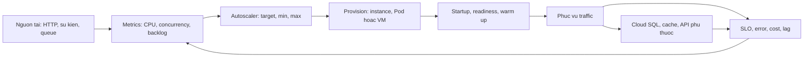
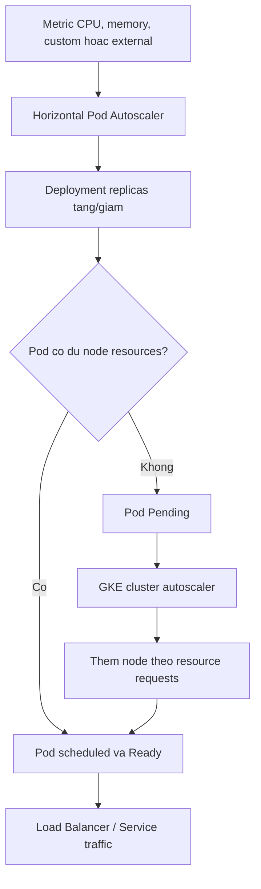
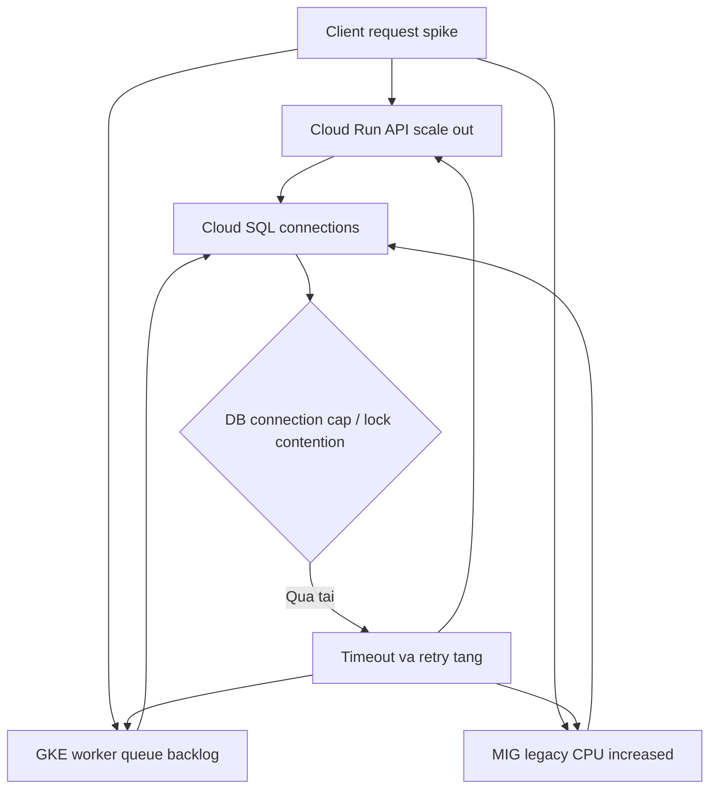

# Tối ưu autoscaling giữa Cloud Run, GKE và Compute Engine

Autoscaling giúp ứng dụng xử lý lưu lượng tăng đột biến mà không phải duy trì toàn bộ năng lực ở mức tải cực đại. Tuy nhiên, “scale càng nhanh càng tốt” có thể làm tăng hóa đơn, tạo quá nhiều kết nối đến Cloud SQL, khiến Pod tranh chấp CPU hoặc gây ra các đợt khởi động lại khi tải dao động. **Tối ưu autoscaling** là chọn đúng tín hiệu và giới hạn năng lực cho từng nền tảng, sau đó kiểm chứng đồng thời **độ trễ, lỗi, độ ổn định và chi phí**.

Trong chương **Hiệu năng và FinOps** của module **CLOUD_PROVIDERS_GCP**, kiến thức về project, IAM, VPC, Compute Engine, GKE, Cloud Run, dịch vụ dữ liệu và quan sát hệ thống được kết nối thành một phương pháp tối ưu hạ tầng có thể thực hành. Bài này tập trung vào ba kiểu workload phổ biến: dịch vụ HTTP trên **Cloud Run**, ứng dụng container được điều phối bằng **GKE**, và ứng dụng chạy trên nhóm máy ảo **Compute Engine managed instance group (MIG)**.

**Sau bài học, người học có thể** phân biệt cơ chế scale của ba nền tảng; tính được một ngưỡng capacity ban đầu; cấu hình ví dụ cho Cloud Run, HPA/cluster autoscaler và MIG; nhận diện khi scaling gây hại cho dependency; thực hiện load test và ra quyết định FinOps dựa trên SLO, không chỉ dựa vào phần trăm CPU.

## 1. Autoscaling là vòng điều khiển, không phải một con số

Một autoscaler lặp lại các bước: **đo tín hiệu → so với mục tiêu → đề xuất số replica → cấp phát năng lực → quan sát kết quả**. Tín hiệu có thể là số request đồng thời, CPU, hàng đợi, số Pod chưa được lên lịch, tải HTTP load balancer hoặc chỉ số từ Cloud Monitoring.



Phải phân biệt bốn khoảng thời gian:

1. **Detection delay:** độ trễ thu thập metric và vòng điều khiển xác định cần mở rộng.
2. **Provisioning delay:** thời gian cấp instance/Pod/VM, kéo image, nạp cấu hình.
3. **Readiness / warm-up:** ứng dụng sẵn sàng nhận request và đạt throughput ổn định; JVM còn có JIT, class loading, connection pool.
4. **Scale-in / stabilization:** thời gian chờ giảm tải để tránh liên tục tạo–xóa tài nguyên và làm rơi request đang xử lý.

**Scaling up** nâng capacity; **scaling out** tăng số bản sao; **scaling in** giảm bản sao. Hai kiểu thay đổi khác nhau có thể tác động khác nhau đến chi phí, HA và giới hạn kết nối. Với Google Cloud, hãy xác định mục tiêu ở cấp **request, Pod hay VM** trước khi sửa cấu hình.

### 1.1. Profile tải tối thiểu

| Thông tin | Cách thu thập | Tại sao quan trọng |
| --- | --- | --- |
| RPS/QPS theo thời gian | Cloud Monitoring, load balancer, tracing | Phân biệt tải đều, theo giờ, đột biến, queue |
| p50/p95/p99 latency | Request metrics và tracing | Scaling thiếu năng lực thường xuất hiện ở tail latency |
| Error rate và loại lỗi | 429, 503, 5xx, timeout, OOM | Phân biệt hết capacity với lỗi ứng dụng/dependency |
| CPU, memory, GC, thread/connection count | Metrics của container, VM, JVM | CPU thấp chưa chắc hệ thống còn năng lực |
| Startup + readiness time | Deployment events, logs, tracing | Ước lượng thời gian cần scale trước đỉnh tải |
| Hệ phụ thuộc | Database connections, cache hit, API quotas | Chặn scale quá đà làm nghẽn hệ sau |
| Cấu trúc chi phí | Billing export, SKUs, resource utilization | Đo cost/request, cost/transaction, baseline idle cost |

Mỗi workload cần có **SLO rõ ràng**, ví dụ: 99% request thành công; p95 latency dưới 250 ms ở 300 RPS; giữ tối đa 200 kết nối DB. Đây là các **giá trị giả định cho bài tập**, không phải ngưỡng mặc định của Google Cloud.

## 2. Ma trận chọn cơ chế autoscaling

| Tiêu chí | Cloud Run services | GKE (Standard/Autopilot) | Compute Engine MIG |
| --- | --- | --- | --- |
| Đơn vị mở rộng | Container **instance** của service/revision | **Pod** qua HPA; **node** qua cluster autoscaler | **VM** trong MIG |
| Tín hiệu chính | CPU, request concurrency, on-demand requests; hỗ trợ tùy chỉnh target | HPA: CPU/memory/custom/external; cluster autoscaler: nhu cầu scheduling dựa trên Pod requests | CPU, HTTP load-balancing capacity, Cloud Monitoring metric, lịch |
| Scale to zero | Có thể về 0 service instances khi min=0 | HPA và cluster autoscaler là hai cơ chế riêng; khả năng về 0 Pod/node phụ thuộc cấu hình, phiên bản, Autopilot/Standard | Min replicas có thể đặt theo khả năng hỗ trợ/policy, nhưng VM startup và readiness chậm hơn container |
| Thời gian khởi tạo | Tạo container instance, phụ thuộc image/startup và quota | HPA tạo Pod; nếu thiếu node còn thêm thời gian provision node | Boot VM, startup script, ứng dụng và health checks |
| Công việc vận hành | Ít quản trị hạ tầng | Điều phối Pod, resource requests, node capacity và policy | Image template, MIG, autoscaler, health checks và cập nhật VM |
| Khả năng điều khiển | Concurrency, CPU/memory, min/max, billing, scaling targets | HPA behavior, metrics, Pod requests, node pool bounds, scheduling | Policy và bounds của MIG, initialization, scale-in controls |
| Chi phí thường cần theo dõi | vCPU/memory thời gian xử lý hoặc vòng đời, requests, min instances, egress | Pod requests/capacity, node/cluster overhead, idle headroom, disks, networking | VM uptime, disk, LB, idle headroom, network |
| Phù hợp | HTTP/event container stateless, tải biến động | Nhiều microservice, cần orchestration, custom metrics, workload đa loại | Ứng dụng VM/legacy, agent đặc thù, cần mức kiểm soát OS |

**Lưu ý khi so sánh:** Cloud Run services, Cloud Run jobs và worker pools có mô hình chạy/billing khác nhau. GKE Autopilot không phải một kiểu Cloud Run; tính năng scale node của GKE cũng không tương đương scale Pod của HPA. MIG của node pool GKE phải do **GKE cluster autoscaler** quản lý; không cấu hình thêm autoscaler Compute Engine trực tiếp lên MIG đó vì hai bộ điều khiển sẽ xung đột.

## 3. Tính sizing ban đầu từ tải thực tế

### 3.1. Little's Law để ước lượng số request đồng thời

Ở trạng thái ổn định, Little's Law:

\[
L \approx \lambda \times W
\]

Trong đó `L` là số request đồng thời trung bình đang ở trong hệ, `\lambda` là throughput request/giây và `W` là thời gian xử lý trung bình tính bằng giây (đo trên cùng ranh giới hệ thống).

**Ví dụ giả định:** 600 request/giây, trung bình 0,2 giây/request → khoảng **120 request đang xử lý đồng thời**. Nếu một Cloud Run instance chịu được **20 concurrent requests** mà vẫn đạt SLO, và tạm lập kế hoạch tại **60% năng lực concurrency đã benchmark**, ước lượng:

```text
Concurrent requests trung bình = 600 RPS × 0,2 giây = 120
Slot hữu ích/instance ≈ 20 × 0,60 = 12
Instance cơ sở ≈ ceil(120 / 12) = 10 instance
```

Đây chỉ là **phương pháp lập kế hoạch**, không phải công thức chính xác của Cloud Run autoscaler. Hệ thống còn chịu CPU, warm-up, concurrency limits, adaptive concurrency tuning, skew và burst; p95/p99 không thể suy ra từ `W` trung bình. Muốn đáp ứng burst nhanh, cần benchmark headroom và xem xét min instances.

### 3.2. Công thức HPA/MIG theo tỷ lệ utilization

Mô hình đơn giản cho autoscaler dựa target utilization:

\[
N_{\mathrm{mới}} \approx \left\lceil N_{\mathrm{hiện}} \times
\frac{U_{\mathrm{đo}}}{U_{\mathrm{mục\ tiêu}}}\right\rceil
\]

Ví dụ có 6 Pod, CPU utilization đo được 90% **so với CPU requests**, target HPA là 60% → `ceil(6 × 90/60) = 9` Pod. Controller Kubernetes còn có stabilization, tolerance, metric freshness và giới hạn min/max nên kết quả tức thời có thể khác.

Với MIG, 6 VM CPU 90% và target 60% cũng gợi ý 9 VM, **nếu CPU là tín hiệu chi phối**. Nếu cấu hình nhiều tín hiệu, Compute Engine lấy khuyến nghị kích thước lớn nhất trong các tín hiệu. Không trộn CPU utilization của Pod so với `requests.cpu` với CPU utilization của VM rồi so trực tiếp bằng một tỷ lệ.

**Quy tắc:** chọn `min` để giữ năng lực tối thiểu và tránh cold start; chọn `max` theo năng lực backend/quota/budget và tải đỉnh đã kiểm thử. `max` là guardrail có đánh đổi: chạm trần có thể tăng pending queue, latency và 429/503.

## 4. Cloud Run: cân bằng concurrency, CPU, min/max và billing

Cloud Run services tự động điều chỉnh container instances theo CPU, request concurrency và on-demand demand. Theo tài liệu hiện hành, các target utilization mặc định cho CPU và concurrency là **60%**, và dịch vụ hỗ trợ chỉnh các target này khi cần; cơ chế Adaptive Concurrency Tuning cũng có thể điều chỉnh mức concurrency hiệu quả. Không mặc định một instance luôn nhận đủ số request bằng giới hạn cấu hình khi CPU đã cao.

### 4.1. Điều khiển số instance với concurrency

`concurrency` là **số request đồng thời tối đa trên một instance**, không phải RPS. Giá trị lớn hơn có thể giảm số instance và chi phí khi ứng dụng xử lý I/O bất đồng bộ tốt; giá trị thấp hơn giúp tránh tranh chấp CPU/memory và kích thích scale out sớm hơn.

- **I/O-bound** (đợi DB/HTTP): có thể chịu concurrency cao hơn, nhưng phải theo dõi pool kết nối và timeout.
- **CPU-bound** (nén, mã hóa, xử lý ảnh): concurrency quá cao làm tăng queue ở bên trong instance và tail latency.
- **JVM/Java Spring**: theo dõi thread pool, DB connection pool, memory/GC; không chọn concurrency chỉ theo số vCPU.
- **Multi-vCPU nhưng single-threaded hotspot**: CPU trung bình trên tất cả vCPU có thể thấp dù một core đã đầy; hạ concurrency đôi khi giúp autoscaler phản ứng hiệu quả hơn.
- **Request dài/streaming**: số concurrent request giữ slot lâu; phân tích pattern riêng, không đo chỉ bằng trung bình RPS.

### 4.2. Ví dụ cấu hình service đang tồn tại

Dưới đây là lệnh **minh họa để thực hiện trong project thử nghiệm sau khi đã đo tải**; thay tên service/region thực tế, xác minh quyền, quota và chi phí:

```bash
gcloud run services update orders-api \
  --region=asia-southeast1 \
  --concurrency=40 \
  --cpu=1 \
  --memory=512Mi \
  --min=2 \
  --max=30 \
  --cpu-throttling
```

Ý nghĩa:

| Cấu hình | Tác động | Điều phải xác minh |
| --- | --- | --- |
| `--concurrency=40` | Tối đa 40 request/instance theo cấu hình | Mỗi instance xử lý hiệu quả bao nhiêu request tại p95 mục tiêu? |
| `--cpu=1`, `--memory=512Mi` | Resources một instance | CPU saturation, memory/GC, startup, OOM |
| `--min=2` | Giữ tối thiểu 2 instance ấm ở service-level | Chi phí idle; có đủ giảm cold start theo SLO không? |
| `--max=30` | Trần mở rộng ở service-level | DB pool, API quotas và lưu lượng nếu bị giới hạn |
| `--cpu-throttling` | Chọn request-based billing / CPU allocation | Có workload nền sau khi response kết thúc không? |

Tài liệu hiện hành phân biệt **service-level** `--min`/`--max` với **revision-level** `--min-instances`/`--max-instances`. Ưu tiên service-level trừ khi có nhu cầu cụ thể theo revision. Trong đợt rollout, traffic splitting và tình huống thay instance, số instance thực tế đôi khi tạm **vượt giới hạn max**; vì vậy không xem max là một khóa chi phí hay DB connection cứng tuyệt đối.

**Cẩn thận với backend:** nếu mỗi instance mở pool tối đa 5 kết nối DB, 30 instances có thể tạo khoảng 150 kết nối — chưa kể batch jobs, các revision đang tồn tại và số instance vượt trần tạm thời. Tính biên dự phòng trước khi áp dụng; dùng backpressure/pooling và quota thay vì kỳ vọng `--max` ngăn mọi quá tải.

### 4.3. Billing và min instances

Hai chế độ billing cho **Cloud Run services**:

- **Request-based (mặc định):** thời gian dùng CPU được tính khi xử lý request và trong giai đoạn startup/shutdown; idle instances được giữ bằng `min` vẫn có chi phí idle theo quy tắc billing.
- **Instance-based:** tính tài nguyên suốt vòng đời instance, kể cả lúc idle; CPU có thể được cấp ngoài lúc xử lý request. Khi cần background work, xem xét instance-based và min instances; nhưng instance vẫn có thể bị chấm dứt, vì vậy công việc dài và cần retry nên dùng cơ chế như Cloud Tasks/Cloud Run jobs phù hợp.

Ví dụ xem cấu hình hiện tại trước/sau điều chỉnh:

```bash
gcloud run services describe orders-api \
  --region=asia-southeast1
```

Min instances giúp giảm cold start nhưng tăng baseline cost. Đặt min dựa vào traffic thấp nhất thường xuyên và yêu cầu khởi tạo, không mặc định giữ 100% năng lực peak. Nếu sửa concurrency mà không chỉnh pool, service có thể đổi từ bottleneck CPU sang bottleneck DB. Theo dõi Cloud Run instance count, request count, latency, CPU, pending/429 và cấu hình revision trong Cloud Monitoring.

### 4.4. Khi nào nên chọn cơ chế khác?

Cloud Run rất phù hợp HTTP APIs và một số workflow nhận sự kiện; nhưng các workload cần orchestration Kubernetes, mạng/pod scheduling đặc thù hoặc ứng dụng gắn chặt với VM có thể hợp với GKE/MIG hơn. Với worker không có request HTTP, chọn đúng loại Cloud Run resource (jobs/worker pools) hoặc GKE queue worker theo đặc tính tải; tránh tạo HTTP endpoint giả chỉ để kích hoạt scale.

## 5. GKE: HPA tăng Pod, cluster autoscaler tăng node

GKE có **hai vòng điều khiển độc lập nhưng liên quan**:



- **HPA** tăng/giảm replica count của Deployment/StatefulSet theo CPU, memory hoặc custom/external metrics. HPA **không trực tiếp tạo node**.
- **Cluster autoscaler** thêm/xóa node khi Pod không thể schedule hoặc node dư và Pod có thể được chuyển đi. Quyết định chủ yếu dựa **resource requests của Pod**, không trực tiếp dựa % CPU thực tế của node.
- **VPA** giúp rightsizing requests/limits; một số mode thay request cần tái tạo Pod. Tránh cấu hình VPA và HPA cùng điều khiển một metric CPU/memory theo cách xung đột; kiểm tra tính năng phối hợp được GKE hỗ trợ trước khi áp dụng. Với JVM, cần lưu ý các giới hạn VPA hiện hành và theo dõi heap/native memory.

### 5.1. HPA mẫu cho một Java HTTP API

Đây là YAML **minh họa** cho Kubernetes Deployment và HPA. Image, endpoint `/ready` và resource requests phải được điều chỉnh theo ứng dụng thật:

```yaml
apiVersion: apps/v1
kind: Deployment
metadata:
  name: orders-api
spec:
  replicas: 3
  selector:
    matchLabels:
      app: orders-api
  template:
    metadata:
      labels:
        app: orders-api
    spec:
      terminationGracePeriodSeconds: 45
      containers:
        - name: api
          image: asia-southeast1-docker.pkg.dev/PROJECT_ID/REPO/orders-api:TAG
          ports:
            - containerPort: 8080
          resources:
            requests:
              cpu: "500m"
              memory: "512Mi"
            limits:
              memory: "1Gi"
          readinessProbe:
            httpGet:
              path: /ready
              port: 8080
            periodSeconds: 5
            timeoutSeconds: 2
---
apiVersion: autoscaling/v2
kind: HorizontalPodAutoscaler
metadata:
  name: orders-api
spec:
  scaleTargetRef:
    apiVersion: apps/v1
    kind: Deployment
    name: orders-api
  minReplicas: 3
  maxReplicas: 30
  metrics:
    - type: Resource
      resource:
        name: cpu
        target:
          type: Utilization
          averageUtilization: 60
  behavior:
    scaleDown:
      stabilizationWindowSeconds: 300
```

**Tại sao cần requests?** HPA dựa % CPU utilization sẽ tính theo `resources.requests.cpu`; thiếu request phù hợp làm HPA không tính đúng metric. Nếu đặt `500m` mà Pod thường dùng `300m`, đó là 60% utilization theo request, không phải 60% CPU toàn bộ node. Requests còn là đầu vào cho scheduler/cluster autoscaler; khai báo quá cao khiến node lãng phí, quá thấp dễ gặp CPU contention và memory OOM.

Readiness probe ngăn Pod chưa sẵn sàng nhận traffic; termination grace phù hợp cùng graceful shutdown/connection draining để giảm lỗi khi scale-in. Với Spring Boot, route `/ready` cần được cấu hình và kiểm thử trước khi dùng.

Các bước quan sát:

```bash
kubectl get hpa orders-api
kubectl describe hpa orders-api
kubectl get pods -l app=orders-api -w
kubectl top pods -l app=orders-api
```

Đọc mục `Events` trong `kubectl describe hpa` khi không scale; kiểm tra Metrics Server/custom metrics pipeline, target, requests và giới hạn min/max. Với queue-driven workers, dùng custom/external metric như backlog hoặc age of oldest message, theo khả năng adapter và cơ chế autoscaler được hỗ trợ, vì CPU thấp không có nghĩa hàng đợi không tăng.

### 5.2. Bật node autoscaling trên GKE Standard

Ví dụ node pool **đã có** trong cluster Standard:

```bash
gcloud container clusters update CLUSTER_NAME \
  --location=asia-southeast1 \
  --node-pool=POOL_NAME \
  --enable-autoscaling \
  --total-min-nodes=3 \
  --total-max-nodes=15
```

`--total-min-nodes` và `--total-max-nodes` xác định biên node **toàn node pool** ở các phiên bản GKE hỗ trợ; khác với `--min-nodes`/`--max-nodes` có thể tính **theo zone** trong regional pool. Xác nhận phiên bản và topology cluster trước khi copy. Với GKE Autopilot, hệ thống cấp phát node dựa trên Pod và chính sách Autopilot; người dùng vẫn phải có cơ chế tăng số Pod phù hợp workload.

**Nếu HPA muốn 30 Pods nhưng node chỉ chứa 12 Pods**, 18 Pods có thể ở trạng thái Pending cho đến khi có node mới. Nguyên nhân thực tế có thể là max nodes quá thấp, thiếu CPU quota, affinity/taints, giới hạn vùng, hoặc Pod requests quá lớn so với loại node.

**Quy tắc không được bỏ qua:** không bật Compute Engine MIG autoscaler riêng cho nhóm instance do GKE quản lý. Điều này xung đột với GKE cluster autoscaler.

### 5.3. Chống thrashing và scale-in gây gián đoạn

- Dùng `behavior.scaleDown.stabilizationWindowSeconds` cho HPA; với GKE, khoảng ổn định scale-down mặc định thường là 300 giây. Đừng giảm quá nhanh nếu traffic có nhịp cao–thấp liên tiếp.
- Kiểm tra PodDisruptionBudget, số replica tối thiểu, topology spread, anti-affinity và khả năng drain; PDB không biến việc scale-in thành không thể gián đoạn nếu ứng dụng không graceful shutdown.
- Dùng startup/readiness/liveness probes đúng nhiệm vụ; liveness probe quá chặt làm restart hàng loạt khi CPU cao.
- Kích thước `requests` nên dựa benchmark và utilization; Autopilot có cơ chế tính resource và yêu cầu riêng, vì vậy đánh giá tổng cost theo mode cluster.
- HPA target CPU 60% không đảm bảo p95 thấp; query bị treo, DB lock hoặc memory pressure có thể xảy ra khi CPU vẫn thấp.
- Với workload JVM, nếu thử VPA auto-updates phải xét Pod recreation, memory/heap và hạn chế HPA/VPA của phiên bản GKE.

## 6. Compute Engine: autoscale VM trong managed instance group

Compute Engine autoscaler tăng/giảm VM trong **Managed Instance Group (MIG)**, có thể dựa trên CPU, HTTP load-balancing capacity, Cloud Monitoring metric và schedules. Đây là lựa chọn phù hợp khi workload yêu cầu VM image, dịch vụ hệ điều hành hoặc middleware chưa tiện chuyển thành container.

Autoscaling của MIG độc lập với **autohealing**: một VM hỏng health check có thể được thay bởi autohealing ngay cả khi không có quyết định scale. Cần thiết kế instance template và ứng dụng sao cho VM có thể tạo/xóa an toàn, state được lưu bên ngoài, startup script idempotent và dịch vụ dùng health check.

### 6.1. Ví dụ chính sách CPU autoscaling

Ví dụ cho một MIG theo **region** đã tồn tại:

```bash
gcloud compute instance-groups managed set-autoscaling orders-mig \
  --region=asia-southeast1 \
  --min-num-replicas=2 \
  --max-num-replicas=20 \
  --target-cpu-utilization=0.60 \
  --cool-down-period=120 \
  --stabilization-period=300
```

Các giá trị minh họa cần hiệu chỉnh:

- `--target-cpu-utilization=0.60`: target CPU trung bình khoảng 60%. CPU VM thấp khi request đang đợi DB nên có thể dùng tín hiệu khác.
- `--cool-down-period=120`: là **initialization period** cho VM/app mới khởi tạo trong thuật ngữ autoscaler. Đặt sát thời gian startup thực tế, kể cả app warm-up, để thuật toán không tính năng lực sớm.
- `--stabilization-period=300`: giúp điều khiển giảm quy mô theo quan sát ổn định; cần kiểm tra tác động và hành vi phiên bản.
- `min/max`: giới hạn số VM; giá trị min=2 chỉ thực sự tạo khả năng chịu lỗi nếu topology, load balancer và ứng dụng được bố trí phù hợp.

Khi dùng nhiều tín hiệu (CPU, load balancing, Cloud Monitoring), autoscaler thường chọn **số VM lớn nhất mà mỗi tín hiệu đề xuất**. Điều này bảo vệ năng lực nhưng có thể tốn chi phí nếu metric nhiễu hoặc bị báo sai; nên đặt mục tiêu và lọc dữ liệu phù hợp.

### 6.2. Scale based on traffic hoặc workload đặc thù

- **HTTP services phía sau load balancer:** tín hiệu dựa serving capacity có thể bám thực tế phục vụ tốt hơn CPU; cần kiểm tra backend service, health checks và capacity setting.
- **CPU-bound batch:** CPU target hợp lý khi mọi VM có workload tương đồng; cần kiểm tra job drain/lease trước khi VM bị xóa.
- **Custom metrics:** số phiên đang chạy, queue backlog hoặc mức công việc mỗi VM có thể hữu ích; kiểm tra các metric và mode hỗ trợ khi tạo policy.
- **Tải theo lịch:** dùng scaling schedules chuẩn bị capacity cho giờ cao điểm có thể dự báo; không thay thế cơ chế tự mở rộng theo tải không dự kiến.

Không dùng autoscaler cho **unmanaged instance group** và kiểm tra giới hạn của MIG có stateful configuration. Không lưu dữ liệu chỉ trên local disk của VM có thể bị xóa do scale-in.

### 6.3. Giảm thời gian boot và chi phí

Chuẩn bị custom VM image đã cài ứng dụng/phụ thuộc, tối ưu startup script và health check; nhưng vẫn cần có cơ chế cập nhật image, security patches và rollout. Regional MIG giúp phân phối capacity qua zone khi cấu hình phù hợp. Với VM tạo theo nhu cầu, đo chi phí idle headroom và thời gian boot; giảm `min` quá thấp sẽ gây latency hoặc lỗi khi bật tải đột ngột.

Một MIG tính phí theo tài nguyên VM đang chạy, disk, load balancer, network và các dịch vụ liên quan. Bản thân autoscaling policy không có phụ phí riêng, nhưng thêm VM làm tăng hóa đơn. Khi tải đều, so sánh committed use discounts/loại máy với phương án chạy container trước khi quyết định.

## 7. Một kiến trúc chung, nhiều autoscaler và điểm nghẽn downstream

Một công ty có thể vận hành API trên Cloud Run, bộ xử lý trên GKE và dịch vụ legacy trên MIG. Khi API tăng tải, **cả ba có thể scale theo một tín hiệu gián tiếp**, nhưng chúng có thể cùng gọi vào một database. Thiết kế cần ngăn các vòng feedback gây khuếch đại sự cố:



### 7.1. Ước lượng trần trước khi mở rộng

Giả định **đây là ví dụ tính toán, không phải quota Google Cloud**:

- DB cho ứng dụng dùng tối đa 300 connections an toàn, sau khi giữ biên cho quản trị và job.
- Cloud Run có thể lên 30 instances × pool 5 connections = 150.
- GKE worker có thể lên 20 Pods × pool 5 connections = 100.
- MIG legacy có thể lên 10 VMs × pool 5 connections = 50.

Tổng **150 + 100 + 50 = 300**; nếu vượt max do rollout hoặc retry storm, hệ sẽ dễ quá tải. Cần điều chỉnh giới hạn theo hành vi thực, chia pool theo dịch vụ, giới hạn concurrency/work queue, dùng connection pooling/proxy khi phù hợp và dự trữ headroom. Điều tra slow query, lock và quota thay vì chỉ tăng máy.

### 7.2. Chống vòng xoắn retry–autoscale

1. **Bounded concurrency** ở tầng ingress/worker, giới hạn queue và ưu tiên giữ hệ có thể phục hồi.
2. Timeout rõ ràng và retry có exponential backoff + jitter + giới hạn lần thử, chỉ retry thao tác idempotent.
3. Theo dõi **queue age, queue depth, failure rate**, không chỉ CPU; nếu backend không tăng được throughput, scale thêm frontend chỉ tăng chi phí.
4. Phân tách autoscaling signals giữa các tầng; tránh dùng cùng một metric tổng hợp mà không tính dependency.
5. Dùng circuit breaker/load shedding hoặc nhận 429/503 có chủ đích khi vượt năng lực, cùng client-side backoff.
6. Giám sát quota vCPU/memory, node, IP, Cloud SQL connections và API rate limit trước khi đặt các giá trị `max` rất cao.

## 8. FinOps: chọn cấu hình theo chi phí trên mỗi giao dịch đạt SLO

Autoscaling là một **bài toán tối ưu đa mục tiêu**. Hai cấu hình có hóa đơn hằng tháng khác nhau chưa chắc có hiệu quả kinh tế khác nhau nếu một cấu hình gây request lỗi, tăng thời gian chờ hoặc làm chi phí downstream tăng.

### 8.1. Các thước đo cần đặt cạnh nhau

| Chỉ số | Cách dùng |
| --- | --- |
| **Cost per successful request / transaction** | Tổng chi phí dịch vụ cùng phần phụ thuộc được quy bổ / số giao dịch thành công |
| **p95/p99 latency dưới peak** | Bảo đảm không đổi latency lấy hóa đơn nhỏ hơn |
| **Error rate / throttling / 429 / 5xx** | Phát hiện việc tiết kiệm nhờ từ chối traffic |
| **Utilization và idle capacity** | Phân biệt headroom cần cho SLO với lãng phí |
| **Scale efficiency** | Tăng replica thêm có tăng throughput hay chỉ tăng contention? |
| **Warm-up/cold start penalty** | Quy đổi min instances và image optimization thành trải nghiệm người dùng |
| **RTO/RPO và availability** | Không cắt HA capacity làm mất yêu cầu vận hành |
| **Cost variance** | Chênh lệch giữa dự toán và hóa đơn, nguyên nhân spike |

Ví dụ minh họa:

```text
Cấu hình A: chi phí quy bổ 90 đơn vị; 100.000 request, 99.800 thành công
=> chi phí/1.000 request thành công = 90 / 99.800 × 1.000 ≈ 0,902

Cấu hình B: chi phí quy bổ 80 đơn vị; 100.000 request, 96.000 thành công
=> chi phí/1.000 request thành công = 80 / 96.000 × 1.000 ≈ 0,833
```

B có chi phí/1.000 request thành công thấp hơn trên phép tính này, **nhưng nếu SLO thành công là 99% thì B không đủ điều kiện lựa chọn**. Để so sánh thật cần tính cả chi phí retries, latency, mất doanh thu và tăng tải backend; ví dụ không mang đơn giá thực tế.

### 8.2. Phân loại cơ chế billing

- **Cloud Run services:** phân biệt request-based và instance-based billing; min instances và concurrency ảnh hưởng thời gian resources được cấp và trả phí; các dịch vụ Cloud Run khác có chính sách riêng.
- **GKE Standard:** xem giá VM node, cluster management, disk, network; node trống hoặc Pod overrequest đều gây lãng phí. Node autoscaler không thể xóa node nếu có Pod không di chuyển được.
- **GKE Autopilot:** xem cách tính phí theo resource requests/compute class của workload và các phí còn lại; autoscaling node của Autopilot không miễn trừ mọi chi phí.
- **Compute Engine MIG:** chi phí VM/disk/network theo thực dùng, min instances, loại máy và mức sử dụng; autoscaler tự nó không tính phí bổ sung nhưng VM mới thì có.
- **Phụ thuộc chung:** Cloud SQL, Memorystore, Pub/Sub, Cloud Logging, Cloud Monitoring và egress có thể tăng chi phí dù số compute giảm.

Dùng **Billing export sang BigQuery**, budgets/alerts và pricing calculator để phân bổ chi phí theo service, environment, team. Budgets/alerts mặc định là **thông báo**, không phải hệ thống tự động dừng hạ tầng. Nếu cần hard guardrail, thiết kế quota/limit và chính sách điều khiển riêng có xử lý failure mode.

### 8.3. Tối ưu theo thứ tự ít rủi ro

1. Sửa vấn đề ứng dụng: truy vấn N+1, thiếu caching, CPU hotspot, thread block hoặc quá nhiều request đến backend.
2. Right-size CPU/memory/pool; tại GKE kiểm tra `requests`/`limits`, tại VM kiểm tra machine family, tại Cloud Run kiểm tra concurrency và vCPU.
3. Đo headroom và giảm min instances/replicas **có kiểm soát**, sau đó đo lại cold start, failover và p95.
4. Điều chỉnh autoscaling target và stabilization, scale-in để tránh thrashing.
5. Chỉ tăng max sau khi đã xác minh backend và quota chịu được lưu lượng.
6. So sánh mô hình billing/commitment và chọn workload placement phù hợp; tránh di chuyển Cloud Run → GKE hoặc ngược lại chỉ dựa giá một CPU-second.

## 9. Quy trình kiểm thử, quan sát và triển khai an toàn

### 9.1. Ma trận load test

Dùng công cụ tạo tải phù hợp như k6, Locust, JMeter hoặc hệ thống hiện tại, nhưng **chỉ chạy trên môi trường/budget được phê duyệt**. Kiểm thử bên ngoài cần tôn trọng quyền truy cập và kiểm soát lưu lượng.

| Bài thử | Cách chạy | Điều kiểm chứng |
| --- | --- | --- |
| Baseline | Tải ổn định ở mức thấp 20–30 phút | SLO, idle cost, utilization, baseline replica count |
| Ramp-up | Tăng từng bậc 50 → 100 → 200 → 400 RPS | Thời gian scale-out, latency, giới hạn capacity |
| Burst | 5× tải trong thời gian ngắn | Cold start, pending, lỗi 429/503, DB connection spike |
| Plateau | Giữ tải cao đủ lâu | CPU/memory/GC, saturation, throughput thật, quota |
| Scale-in | Trả về 10–20% tải | Stabilization, idle cost, dropped connections |
| Dependency throttle | Giới hạn DB/queue trong lab | Retry storm, backpressure, scaling phản tác dụng |
| Rollout/zone failure | Deploy revision hoặc thay node/VM | Readiness, graceful shutdown, SLO và HA |
| Seasonal pattern | Replay tải giờ cao điểm thực tế | Schedules/min capacity có hữu ích hay không? |

**Đánh giá trên cùng một tập phép đo:** latency percentiles, throughput **thành công**, số instance/Pod/node/VM theo thời gian, CPU/memory, queue, DB connections, 4xx/5xx, startup delay và chi phí. Nếu đổi nhiều tham số cùng lúc sẽ không biết thay đổi nào giúp hay gây lỗi; hãy A/B theo từng nhóm cấu hình, ghi lại hình ảnh/version/region.

### 9.2. Checklist triển khai

- **Preflight:** ghi baseline SLO/cost, giới hạn ngân sách và quota, min/max, dependency connection budget và phương án rollback.
- **Tune từng vòng:** thử tăng/giảm concurrency hoặc CPU target/HPA requests/MIG utilization ở staging với replay traffic gần production.
- **Review kế hoạch:** nếu Cloud Run tạo revision mới hoặc GKE rollout Pod mới, xác nhận traffic split, readiness và rollback.
- **Rollout canary:** cho một phần nhỏ traffic vào cấu hình mới, giữ tiêu chí dừng khi p95/error/cost vượt ngưỡng.
- **Quan sát sau rollout:** so sánh SLO, cost/request, latency, retry, 429/5xx, DB connection và quota ít nhất qua các chu kỳ tải đại diện.
- **Ghi quyết định:** lưu cấu hình trước/sau, benchmark, người phê duyệt, vì sao chọn min/max/target và ngày cần review khi workload thay đổi.

### 9.3. Dashboard và tín hiệu cảnh báo

| Nền tảng | Metric/triệu chứng | Chẩn đoán sơ bộ |
| --- | --- | --- |
| Cloud Run | instance count chạm max, request pending, 429, p95 tăng | Hết service capacity hoặc downstream chậm |
| Cloud Run | CPU trung bình thấp, p95 cao, concurrency cao | Blocking I/O, DB pool, single-thread hot core, GC |
| GKE | HPA desired replicas > current, Pod Pending | Node pool max/quota/scheduling hoặc image startup |
| GKE | CPU thấp, queue age tăng | HPA theo sai signal; nên xét external metric |
| GKE | Nodes nhiều nhưng dùng ít, không scale in | Resource overrequest, PDB/affinity/Pods không thể di chuyển |
| MIG | group size chạm max, LB backend unhealthy | Autoscale bounds, health check, initialization |
| MIG | CPU ổn nhưng latency tệ | Tín hiệu CPU không đo được hàng đợi/blocking |
| Cả ba | DB connection/timeout/lock tăng cùng replicas | Backpressure, query/pool, quota backend |
| Cả ba | Cost spike khi traffic giảm | Min capacity cao, scale-in trì hoãn hoặc instance-based billing |

## 10. Sự cố thường gặp và quyết định sửa

| Triệu chứng | Nguyên nhân khả dĩ | Thử nghiệm/xử lý |
| --- | --- | --- |
| Cloud Run có 429 khi burst | Chạm max hoặc không kịp khởi tạo | Xem request queue và instance count; tối ưu startup, min phù hợp; chỉ tăng max sau khi xét DB |
| Cloud Run CPU 25% nhưng service chậm | Multi-vCPU hotspot, lock hoặc I/O wait | Profiling CPU theo core và tracing; thử hạ concurrency hoặc sửa code |
| Cloud Run tốn tiền khi idle | Min instances quá lớn hoặc instance-based billing | Xem min/billing, lượng request nền; giảm min hoặc đổi execution model nếu hợp yêu cầu |
| HPA không tăng Pod dù CPU cao | Thiếu `requests.cpu`, metric lỗi, đã chạm max | `kubectl describe hpa`, kiểm tra requests, metric availability và policy |
| HPA tăng Pod nhưng không có Pod Ready | Node thiếu, image pull, probe/affinity/quota | Kiểm tra Pending reason, cluster autoscaler, node capacity và readiness |
| Node count không giảm | Pod requests cao, PDB/affinity, node không drain được | Kiểm tra scheduling và gỡ ràng buộc hợp lý, không tắt PDB bừa bãi |
| MIG tăng VM chậm | Initialization thấp/sai, quota, boot image chậm | Đo startup/health check, kiểm tra MIG autoscaler decisions |
| Scale-in làm mất tác vụ | Ứng dụng không graceful shutdown hoặc state chỉ ở local | Drain request, idempotent queue, lưu state ngoài, kiểm tra termination |
| Autoscaler tăng liên tục nhưng throughput đứng yên | DB/API downstream bão hòa hoặc lock contention | Giới hạn đồng thời, điều tra backend; đừng chỉ tăng replicas |
| Giá tăng mạnh sau đổi target | Target quá thấp, min quá cao, node fragmentation | So sánh utilization và cost/successful transaction với SLO |

**Không dùng** autoscaling thay cho xử lý lỗi ứng dụng: memory leak, N+1 query, deadlock hay retry không có giới hạn thường không được giải quyết bằng thêm replica.

## 11. Bài tập thực hành và câu hỏi đánh giá

**Bối cảnh:** Một sản phẩm thương mại điện tử trên Google Cloud có ba thành phần:

- `orders-api` viết Java/Spring chạy trên Cloud Run; 50 RPS thông thường, tăng lên 500 RPS trong 15 phút khi flash sale, phụ thuộc Cloud SQL.
- `inventory-worker` trên GKE Standard xử lý Pub/Sub; CPU tương đối thấp nhưng queue age tăng khi flash sale; node pool đang có 3 node.
- `legacy-pricing` chạy trên regional Compute Engine MIG; mỗi VM boot khoảng 120 giây, ứng dụng cần một phút warm-up trước khi nhận traffic.

SLO là p95 của `orders-api` dưới 300 ms, error rate dưới 1%, thời gian chờ xử lý hàng đợi dưới 60 giây, DB chịu an toàn tối đa 250 connections cho toàn hệ; chi phí phải giảm ngoài giờ cao điểm.

**Nhiệm vụ:**

1. Xây workload profile cho cả ba dịch vụ; nêu p95, throughput, CPU, concurrency, queue age, startup time và số connection cần đo.
2. Cloud Run: đề xuất `min/max/concurrency` và billing mode; ước lượng capacity bằng Little's Law nếu thời gian trung bình mỗi request là 0,2 giây và concurrency benchmark an toàn là 20/instance.
3. GKE: thiết kế HPA cho worker dựa **queue backlog hoặc queue age** nếu CPU không phản ánh tải; chỉ rõ cơ chế metric adapter và liên hệ với cluster autoscaler/node pool min/max.
4. Compute Engine: đề xuất target CPU hoặc load balancing metric, min/max, initialization time và stabilization; dự tính ảnh hưởng tới traffic khi boot VM.
5. Lập **connection budget**: giả định Cloud Run mỗi instance có tối đa 4 DB connections, GKE mỗi Pod 3, MIG mỗi VM 2. Cần chọn min/max sao cho tổng có biên an toàn so với 250 connections kể cả thời gian rollout.
6. Thiết kế 6 giai đoạn load test từ baseline, ramp, burst, plateau, scale-in đến DB throttling; định nghĩa điều kiện dừng và rollback.
7. Làm bảng so sánh hai phương án và chọn theo **đạt SLO trước, cost per successful transaction sau**, không dùng hóa đơn thấp làm lý do chấp nhận lỗi cao.

**Tiêu chí hoàn thành:** giải thích được **tại sao** tín hiệu scaling phản ánh nhu cầu ứng dụng; phân biệt HPA và cluster autoscaler; bảo vệ dependency; có bằng chứng đo đạc và không quên startup lag, min capacity và chi phí tài nguyên idle.

## Tài liệu tham khảo chính thức

- [Cloud Run — About instance autoscaling](https://cloud.google.com/run/docs/about-instance-autoscaling)
- [Cloud Run — Custom scaling controls](https://cloud.google.com/run/docs/configuring/scaling-controls)
- [Cloud Run — Concurrency](https://cloud.google.com/run/docs/about-concurrency)
- [Cloud Run — Set maximum concurrency](https://cloud.google.com/run/docs/configuring/concurrency)
- [Cloud Run — Minimum instances](https://cloud.google.com/run/docs/configuring/min-instances)
- [Cloud Run — Maximum instances](https://cloud.google.com/run/docs/configuring/max-instances)
- [Cloud Run — Billing settings](https://cloud.google.com/run/docs/configuring/billing-settings)
- [GKE — Horizontal Pod autoscaling](https://cloud.google.com/kubernetes-engine/docs/concepts/horizontalpodautoscaler)
- [GKE — Configure HPA](https://cloud.google.com/kubernetes-engine/docs/how-to/horizontal-pod-autoscaling)
- [GKE — Cluster autoscaler](https://cloud.google.com/kubernetes-engine/docs/concepts/cluster-autoscaler)
- [GKE — Configure cluster autoscaler](https://cloud.google.com/kubernetes-engine/docs/how-to/cluster-autoscaler)
- [GKE — Vertical Pod autoscaling](https://cloud.google.com/kubernetes-engine/docs/concepts/verticalpodautoscaler)
- [GKE — Autopilot overview](https://cloud.google.com/kubernetes-engine/docs/concepts/autopilot-overview)
- [Compute Engine — MIG autoscaling](https://cloud.google.com/compute/docs/autoscaler)
- [Compute Engine — Scaling based on CPU](https://cloud.google.com/compute/docs/autoscaler/scaling-cpu)
- [Compute Engine — Autoscaler decisions](https://cloud.google.com/compute/docs/autoscaler/understanding-autoscaler-decisions)
- [Google Cloud — Pricing calculator](https://cloud.google.com/products/calculator)
- [Google Cloud — Cloud Billing export to BigQuery](https://cloud.google.com/billing/docs/how-to/export-data-bigquery)
- [Google Cloud — Monitoring overview](https://cloud.google.com/monitoring/docs/monitoring-overview)

**Ghi chú vận hành:** các flag CLI, edition, mức giới hạn, giá và tính năng autoscaling thay đổi theo phiên bản/region. Trước khi triển khai production, kiểm tra tài liệu hiện hành cho cấu hình GKE/Cloud Run/MIG cụ thể, chạy benchmark có kiểm soát và xác nhận budget, quota, IAM, SLO và phương án rollback.
