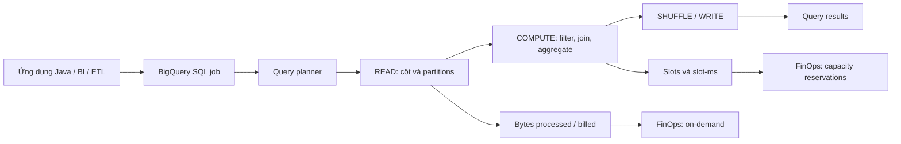

# Kiểm soát bytes scanned và slot utilization của BigQuery

BigQuery là dịch vụ phân tích dữ liệu không máy chủ của Google Cloud. Hai nhóm tín hiệu quan trọng khi tối ưu hiệu năng và chi phí là **bytes scanned** (số byte dữ liệu truy vấn phải đọc/xử lý) và **slot utilization** (mức sử dụng năng lực tính toán của BigQuery theo thời gian). Chúng liên quan nhưng không thay thế nhau: một query đọc ít byte vẫn có thể dùng rất nhiều slot để join, sort hoặc xử lý hàm phức tạp; ngược lại, query quét một lượng lớn dữ liệu có thể ngắn và đơn giản về mặt tính toán.

Trong module `CLOUD_PROVIDERS_GCP`, người học khám phá Google Cloud từ việc tổ chức project, IAM và VPC đến Compute Engine, GKE, Cloud Run, dịch vụ lưu trữ và cơ sở dữ liệu. Qua các tình huống triển khai, người học biết lựa chọn dịch vụ, bảo vệ tài nguyên, tự động hóa phát hành và theo dõi độ tin cậy cùng chi phí. Bài học này nối kiến thức đó với thực hành **Performance Engineering và FinOps**: giảm dữ liệu đọc không cần thiết, đo năng lực slot đã sử dụng, lựa chọn mô hình giá phù hợp và đặt guardrails cho người dùng, ứng dụng Java, dashboard và batch ETL.

Các ví dụ sử dụng BigQuery project `ANALYTICS_PROJECT_ID`, dataset `mart`, bảng `fact_orders`, location `asia-southeast1` và một số ngưỡng chỉ để minh họa. Thay placeholder theo môi trường; không chạy truy vấn hoặc DDL lên production nếu chưa được phê duyệt. Giá dịch vụ, quota, tính năng edition và cơ chế autoscaling có thể thay đổi; cần kiểm tra bảng giá và tài liệu Google Cloud hiện hành trước khi lập ngân sách.

## Mục tiêu học tập

Sau bài học, người học có thể:

- Phân biệt bytes processed, bytes billed, data scanned, slot, slot-ms, slot-hours, elapsed time và reservation capacity.
- Giải thích sự khác biệt giữa **on-demand query pricing** và **capacity-based pricing** theo BigQuery editions.
- Ước lượng lượng dữ liệu query sẽ xử lý bằng query validator hoặc dry run và đặt `maximum_bytes_billed` để hạn chế rủi ro.
- Giảm bytes scanned nhờ column pruning, partition pruning, clustering, thiết kế bảng và truy vấn đúng.
- Đọc `INFORMATION_SCHEMA.JOBS_BY_PROJECT`, `JOBS_TIMELINE_BY_PROJECT`, `RESERVATIONS_TIMELINE_BY_PROJECT` để điều tra usage.
- Tính số slot dùng trung bình và nhận diện contention, autoscaling hoặc reservation bị cấp thừa.
- Xây dashboard, cost guardrails, IAM và runbook tối ưu BigQuery theo SLO và ngân sách.

## 1. Mô hình thực thi BigQuery: bytes và slots

### Hai nguồn tài nguyên khác nhau

BigQuery xử lý SQL theo một query plan gồm các stages và steps. Dữ liệu được đọc từ storage, lọc, join, aggregate, shuffle và ghi kết quả. **Bytes scanned/processed** là tín hiệu về khối lượng dữ liệu đọc/xử lý; **slots** là đơn vị tính toán ảo mà BigQuery phân bổ động cho công việc.



| Chỉ số | Ý nghĩa | Cách dùng |
|---|---|---|
| `total_bytes_processed` | Tổng byte BigQuery báo cáo đã xử lý cho job, theo thống kê query. | Kiểm tra data footprint và tác động column/partition pruning. |
| `total_bytes_billed` | Số byte dùng làm cơ sở tính phí bytes ở on-demand, theo quy tắc tối thiểu và làm tròn. | Ước tính chi phí truy vấn **nếu** job dùng on-demand. |
| `total_slot_ms` | Tổng số **slot-milliseconds** BigQuery dùng cho job. | Đo compute consumption, tính slot-hours đã sử dụng. |
| `start_time`, `end_time` | Khoảng thời gian thực thi; khác với thời gian đợi trước khi bắt đầu. | Tính average slots hoặc phân tích latency. |
| `period_slot_ms` | Slot-ms được tiêu thụ trong một time slice của job timeline. | Xây đường biểu diễn số slot sử dụng theo giây/phút. |
| `reservation_id` | Reservation mà job được gán, nếu có. | Tập hợp job theo nhóm năng lực tính toán. |
| `cache_hit` | Query có lấy kết quả từ query result cache không. | Phân biệt chi phí đọc dữ liệu với query chạy lại từ cache. |

Một slot là đơn vị tính toán BigQuery, không phải một CPU core cố định mà ứng dụng có thể trực tiếp quản lý. BigQuery quyết định phân bổ và tái phân bổ slots theo stages, query complexity và năng lực có sẵn.

### Hai ví dụ để tránh nhầm lẫn

- Query A đọc 1 TiB nhưng chỉ chọn một cột và aggregate đơn giản: **bytes cao**, có thể dùng slots tương đối hiệu quả, nhưng on-demand vẫn có chi phí bytes đáng kể.
- Query B đọc 2 GiB rồi thực hiện join many-to-many và sort dữ liệu lớn: **bytes thấp hơn**, nhưng shuffle, CPU, slot-ms và latency có thể rất cao.

Vì vậy tối ưu BigQuery cần ít nhất hai trục: **dữ liệu phải đọc** và **tài nguyên tính toán phải tiêu thụ**, cộng thêm SLO về latency/throughput.

## 2. BigQuery tính phí compute như thế nào?

### On-demand query pricing

Ở mô hình on-demand, chi phí query dựa trên **số byte được tính phí** thay vì số slot-ms ứng dụng đã dùng. Không cần tự tạo reservation. Các đặc điểm quan trọng:

- Hệ thống dùng giá theo data processed; đơn giá phụ thuộc location và bảng giá hiện hành.
- Áp dụng ngưỡng tối thiểu, thông thường tối thiểu **10 MiB cho mỗi query** và **10 MiB cho mỗi bảng được tham chiếu**, theo quy tắc pricing.
- Query result cache có thể giúp truy vấn lặp lại không phải đọc dữ liệu và có thể không phát sinh phí query khi đáp ứng điều kiện cache.
- Miễn phí/trial allowance và các loại dữ liệu đặc biệt có quy tắc riêng; không tự tính bill bằng `bytes_processed × giá` khi chưa kiểm tra `total_bytes_billed`, free tier và giá khu vực.
- Có thể kiểm soát rủi ro bằng dry run, `maximum_bytes_billed` và custom on-demand query quotas.

### Capacity-based pricing theo BigQuery editions

Ở mô hình capacity, tổ chức tạo **slot reservations** thuộc edition (ví dụ Standard, Enterprise, Enterprise Plus tùy nhu cầu) và gán project/folder/organization hoặc nhóm workload theo cơ chế assignment. Hóa đơn compute dựa vào **slot capacity baseline, autoscaled slots, commitments và các điều khoản billing**, không phải tổng bytes billed của từng query.

| Đặc điểm | On-demand | Capacity / editions |
|---|---|---|
| Đơn vị chi phí compute chủ yếu | Bytes billed theo query. | Slot-hours/capacity và autoscale usage theo edition. |
| Provisioning | Không cần tạo reservation. | Cấu hình reservation, baseline, autoscaling/assignments. |
| Tối ưu chi phí trực tiếp | Giảm bytes billed. | Right-size slots và thời gian bật năng lực. |
| Tối ưu hiệu năng | Cải thiện SQL/stages, on-demand scheduling. | Cải thiện SQL, giảm contention, điều chỉnh slots/concurrency. |
| Giới hạn chi phí | `maximum_bytes_billed`, query usage quotas. | Reservation baseline/max autoscale, commitments, controls. |
| Nguy cơ | Query quét nhiều byte, dashboard chạy lặp. | Capacity idle nhưng vẫn trả phí, autoscale thường xuyên, workload tranh chấp slots. |

**Điểm mấu chốt:** giảm bytes scanned trong capacity không nhất thiết làm hóa đơn compute giảm ngay trong ngày nếu baseline slots vẫn giữ nguyên. Tuy nhiên nó thường giúp giảm slot-ms, cải thiện SLO, giảm nhu cầu autoscale và tạo cơ sở giảm baseline về sau. Ngược lại, `total_slot_ms` của một job on-demand không thể nhân trực tiếp với giá slot-hour để suy ra hóa đơn của job đó.

### Ví dụ cách đọc số liệu

Giả sử một job có:

```text
total_bytes_processed = 500 GiB
total_bytes_billed    = 500 GiB (minh họa; thực tế có rounding)
total_slot_ms         = 3_600_000 slot-ms
duration              = 120 giây
```

Khi đó:

- **Used slot-hours:** `3_600_000 / 3_600_000 = 1 slot-hour`.
- **Average slots during execution:** `3_600_000 / 120_000 = 30 slots`.
- **On-demand estimate:** `(total_bytes_billed / 2^40) × đơn giá theo TiB`, có xét chính sách billing.
- **Capacity estimate:** phải xem lượng slots reservation đã được provision/autoscaled trong thời gian tương ứng, không được lấy một used slot-hour này thay cho chi phí hóa đơn.

## 3. Ước lượng bytes scanned trước khi thực thi

### Console query validator và dry run

Trong BigQuery Studio, query validator hiển thị ước lượng số byte sẽ được xử lý trước khi chạy SQL. Để kiểm tra từ CLI:

```bash
bq query \
  --use_legacy_sql=false \
  --location=asia-southeast1 \
  --dry_run \
  'SELECT order_id, amount
   FROM `ANALYTICS_PROJECT_ID.mart.fact_orders`
   WHERE order_date >= DATE "2026-11-01"
     AND order_date < DATE "2026-11-08"'
```

`--dry_run` xác nhận cú pháp, quyền và tính toán thống kê/ước lượng mà không thực thi query data processing thông thường. Output cho biết bytes estimated. Dùng dry run trước khi sửa dashboard, tạo scheduled query hoặc chạy SQL trên bảng lớn.

**Giới hạn dry run:** ước lượng là upper bound và có thể cao hơn bytes billed thực tế, đặc biệt với clustering (block pruning thực hiện khi chạy). Với bảng có row-level access policies, dry run có thể báo `0` để bảo vệ khỏi side-channel attacks; không nên hiểu số 0 đó là query miễn phí.

### Hạn chế bytes billed trước khi chạy

Đối với on-demand, sử dụng `maximum_bytes_billed`:

```bash
bq query \
  --use_legacy_sql=false \
  --location=asia-southeast1 \
  --maximum_bytes_billed=1073741824 \
  'SELECT order_id, amount
   FROM `ANALYTICS_PROJECT_ID.mart.fact_orders`
   WHERE order_date = DATE "2026-11-01"'
```

Giới hạn `1,073,741,824` bytes là **1 GiB**. Nếu estimate vượt ngưỡng, BigQuery từ chối job trước thực thi; không thu phí query đó. API cũng hỗ trợ `JobConfigurationQuery.maximumBytesBilled`. Với clustered tables, upper-bound estimate có thể vượt ngưỡng ngay cả khi thực tế được cluster pruning làm giảm scan; đừng tự động nâng ngưỡng mà không xem xét query và khung ngân sách.

`maximum_bytes_billed` là guardrail cho mô hình on-demand; **không phải giới hạn tổng chi phí reservation slots** của capacity-based pricing.

### Phân biệt đơn vị

1 KiB = 1024 bytes, 1 MiB = 1024² bytes, 1 GiB = 1024³ bytes, 1 TiB = 1024⁴ bytes. Bảng giá BigQuery thường dùng đơn vị dữ liệu theo TiB; tránh nhầm MB (10⁶) với MiB (2²⁰), hoặc số byte processed với số dòng trả về.

## 4. Giảm bytes scanned bằng column pruning

### Không dùng `SELECT *` theo thói quen

BigQuery là hệ thống lưu trữ dạng cột. Chỉ chọn các cột cần thiết để giảm dữ liệu đọc, I/O và chi phí truy vấn on-demand.

```sql
-- Không tối ưu: đọc quá nhiều cột để hiện 20 dòng.
SELECT *
FROM `ANALYTICS_PROJECT_ID.mart.fact_orders`
WHERE order_date = DATE '2026-11-01'
LIMIT 20;

-- Tốt hơn: chỉ chọn cột thực sự cần.
SELECT order_id, tenant_id, status, amount
FROM `ANALYTICS_PROJECT_ID.mart.fact_orders`
WHERE order_date = DATE '2026-11-01'
LIMIT 20;
```

`LIMIT` thường **không giảm lượng dữ liệu đọc** đối với bảng không clustered: BigQuery vẫn phải đọc dữ liệu cần thiết để xác định kết quả. Trong một số truy vấn clustered, `LIMIT` có thể cho phép dừng scan sớm sau khi đọc đủ blocks, nhưng không nên dựa vào đó làm phương pháp kiểm soát chi phí chung.

Nếu schema rất rộng và chỉ vài cột không cần dùng:

```sql
SELECT * EXCEPT (raw_payload, debug_blob)
FROM `ANALYTICS_PROJECT_ID.mart.fact_orders`
WHERE order_date = DATE '2026-11-01';
```

`SELECT * EXCEPT` có thể tránh đọc các cột bị loại, nhưng định nghĩa output vẫn phụ thuộc schema đang thay đổi; với dashboard/API ổn định nên liệt kê cột tường minh.

### Đừng dùng query scan để xem thử bảng

Dùng **Preview** trên Console hoặc `bq head` để xem một ít dữ liệu thay vì chạy `SELECT * LIMIT 1000` trên bảng rất lớn. Giữ quyền xem dữ liệu phù hợp với IAM và data classification.

### Lợi ích với bảng nested/repeated

Với `STRUCT`, `ARRAY` hoặc JSON column lớn, chỉ truy cập field cần dùng khi có thể. Dùng `UNNEST` đúng ngữ cảnh để tránh nhân bản rows quá mức; kiểm tra bytes processed và query plan nếu biểu thức `UNNEST`/join làm tăng shuffle.

## 5. Partition pruning và clustering

### Partitioning: bỏ qua những vùng thời gian không cần đọc

Ví dụ bảng ghi giao dịch theo ngày, có cột `order_date DATE`:

```sql
CREATE TABLE `ANALYTICS_PROJECT_ID.mart.fact_orders` (
  order_id STRING,
  tenant_id STRING,
  order_date DATE,
  status STRING,
  amount NUMERIC,
  raw_payload STRING
)
PARTITION BY order_date
CLUSTER BY tenant_id, status
OPTIONS (require_partition_filter = TRUE);
```

`require_partition_filter = TRUE` giúp ngăn truy vấn vô tình quét toàn bảng mà không có filter phù hợp. Bảng trên chưa có dữ liệu; ví dụ minh họa DDL, không chạy nếu resource production đã tồn tại.

Filter giúp BigQuery prune partition:

```sql
SELECT tenant_id, SUM(amount) AS revenue
FROM `ANALYTICS_PROJECT_ID.mart.fact_orders`
WHERE order_date >= DATE '2026-11-01'
  AND order_date < DATE '2026-11-08'
GROUP BY tenant_id;
```

Với bảng ingestion-time partitioned, dùng pseudo column `_PARTITIONTIME` hoặc `_PARTITIONDATE`:

```sql
SELECT event_type
FROM `ANALYTICS_PROJECT_ID.raw.events_ingested`
WHERE _PARTITIONDATE BETWEEN DATE '2026-11-01' AND DATE '2026-11-07';
```

Hai ví dụ khác nhau về schema: chỉ dùng `_PARTITIONDATE` khi bảng thực sự dùng ingestion-time partitioning hoặc có pseudo column tương ứng. Với column partitioned tables, filter trực tiếp trên partition column để planner xác định partitions; tránh bọc cột này trong phép tính hoặc dùng join filter khó suy ra nếu không cần.

### Clustering: bỏ qua blocks theo giá trị thường lọc

Clustering tổ chức dữ liệu thành storage blocks có thứ tự theo các clustering columns. Với bảng `CLUSTER BY tenant_id, status`, truy vấn sau có thể được block pruning:

```sql
SELECT order_id, amount
FROM `ANALYTICS_PROJECT_ID.mart.fact_orders`
WHERE order_date BETWEEN DATE '2026-11-01' AND DATE '2026-11-07'
  AND tenant_id = 'tenant-a'
  AND status = 'PAID';
```

Hiệu quả phụ thuộc kích thước bảng, độ chọn lọc, data distribution và cách query lọc các clustering columns. **Phân biệt partition pruning và cluster block pruning:** partition pruning thường phản ánh rõ trong dry-run estimate; clustering có thể giảm số byte thực sự được đọc **khi chạy**, nên pre-execution estimate có thể cao hơn bytes billed.

### Date sharding và wildcard

Nếu dữ liệu nằm trong các bảng `events_20261101`, `events_20261102`, ...:

```sql
SELECT event_type
FROM `ANALYTICS_PROJECT_ID.raw.events_202611*`
WHERE _TABLE_SUFFIX BETWEEN '01' AND '07';
```

Dùng filter `_TABLE_SUFFIX` với giá trị hằng để BigQuery có thể giới hạn bảng được đọc. Tuy nhiên, tạo quá nhiều bảng theo ngày (oversharding) làm tăng metadata overhead và khó quản trị; thường nên dùng một bảng time-partitioned thay vì vô số bảng shard.

### Thứ tự tối ưu hữu ích

1. Chọn đúng dataset/bảng, tránh wildcard rộng.
2. Chỉ chọn cột cần thiết.
3. Filter thời gian/partition có giá trị tĩnh hoặc tham số rõ ràng.
4. Filter clustering columns theo workload thực tế.
5. So sánh dry run và **actual** `total_bytes_processed`/`total_bytes_billed` sau chạy thử.
6. Kiểm tra query plan, shuffle và slot-ms để bảo đảm cải tiến không làm compute tăng bất thường.

## 6. Giảm lãng phí compute mà không chỉ nhìn bytes

### Filter và aggregate trước khi join

Join các bảng lớn có thể tạo shuffle đắt đỏ; hãy lọc hai phía và aggregate dữ liệu hợp lý trước khi join.

```sql
-- Tổng chi tiêu mỗi tenant trong tuần, rồi mới join tenant dimension.
WITH weekly_sales AS (
  SELECT tenant_id, SUM(amount) AS revenue
  FROM `ANALYTICS_PROJECT_ID.mart.fact_orders`
  WHERE order_date >= DATE '2026-11-01'
    AND order_date < DATE '2026-11-08'
    AND status = 'PAID'
  GROUP BY tenant_id
)
SELECT t.tenant_name, s.revenue
FROM weekly_sales AS s
JOIN `ANALYTICS_PROJECT_ID.mart.dim_tenants` AS t
  USING (tenant_id);
```

Không phải mọi pre-aggregation đều giúp tốt hơn; đối chiếu với execution plan và kết quả đúng đắn. Tránh join many-to-many ngoài ý muốn (row explosion), phép `CROSS JOIN` không cần thiết và lặp CTE nặng nhiều lần.

### Materialize kết quả trung gian hoặc aggregate thường dùng

Nếu một dashboard mỗi phút đều đọc một năm giao dịch để tính tổng theo ngày, có thể tạo bảng aggregate nhỏ hoặc materialized view phù hợp thay vì scan dữ liệu gốc mỗi lần. Cần cân nhắc chi phí refresh, storage, incremental maintenance, freshness và quyền truy cập. Không khẳng định mọi materialized view đều được BigQuery rewrite tự động trong mọi query.

```sql
-- Ví dụ bảng aggregate vật lý, có thể xây bằng scheduled ETL:
CREATE OR REPLACE TABLE `ANALYTICS_PROJECT_ID.mart.daily_sales_summary`
PARTITION BY order_date AS
SELECT order_date, tenant_id, SUM(amount) AS revenue
FROM `ANALYTICS_PROJECT_ID.mart.fact_orders`
WHERE order_date >= DATE '2026-11-01'
GROUP BY order_date, tenant_id;
```

DDL trên thay thế toàn bộ summary table. Trong production cần thiết kế incremental update và ngày tính toán phù hợp để tránh scan lại toàn bộ dữ liệu khi refresh. Với large fact table, scheduled incremental MERGE/INSERT có thể hiệu quả hơn.

### Result cache, BI Engine và approximate functions

- Query result cache có thể tránh đọc lại dữ liệu cho những truy vấn đáp ứng điều kiện cache; đừng coi cache hit là tối ưu SQL hoặc làm căn cứ capacity planning duy nhất.
- BI Engine có thể tăng tốc một số workload dashboard/in-memory phù hợp; yêu cầu và phạm vi tính năng cần đánh giá riêng.
- Một số phép tổng hợp cho phép dùng `APPROX_COUNT_DISTINCT`/approximate aggregate để giảm compute khi chấp nhận sai số; không thay bằng approximate khi nghiệp vụ cần đếm chính xác.
- Tránh regex/UDF phức tạp, repeated transforms và excessive shuffles nếu có thể dùng biểu thức đơn giản hoặc bảng đã xử lý.

## 7. Đo bytes billed và slot-ms qua INFORMATION_SCHEMA.JOBS

### Metadata của job

BigQuery cung cấp `INFORMATION_SCHEMA.JOBS_BY_PROJECT` để xem job trong project có quyền và location tương ứng. Một số trường:

| Trường | Công dụng |
|---|---|
| `creation_time` | Mốc job được tạo; dùng để filter partition của view. |
| `user_email` | Principal chạy query; giúp phân bổ usage theo team/service account. |
| `job_id`, `job_type`, `statement_type` | Xác định job, phân biệt query và script parent. |
| `total_bytes_processed`, `total_bytes_billed` | Data processed/billed cho query. |
| `total_slot_ms` | Lượng compute đã dùng. |
| `start_time`, `end_time` | Tính execution duration và average slots. |
| `reservation_id` | Reservation được gán, nếu có. |
| `cache_hit`, `error_result` | Phân biệt cache hit và job lỗi. |
| `labels` | Phân nhóm theo `team`, `env`, `workload` nếu job được gắn label. |

`INFORMATION_SCHEMA` views cần **region qualifier**; query execution location phải trùng location của view. Ví dụ project chạy job tại Singapore:

```sql
SELECT
  job_id,
  user_email,
  total_bytes_processed,
  total_bytes_billed,
  total_slot_ms,
  cache_hit,
  reservation_id
FROM `ANALYTICS_PROJECT_ID.region-asia-southeast1.INFORMATION_SCHEMA.JOBS_BY_PROJECT`
WHERE creation_time >= TIMESTAMP_SUB(CURRENT_TIMESTAMP(), INTERVAL 1 DAY)
  AND job_type = 'QUERY'
  AND (statement_type IS NULL OR statement_type != 'SCRIPT')
ORDER BY creation_time DESC
LIMIT 100;
```

Filter `statement_type != 'SCRIPT'` loại **script parent job** để tránh đếm trùng thống kê với các child jobs. Một số job có `statement_type` NULL, nên dùng `(statement_type IS NULL OR statement_type != 'SCRIPT')` khi muốn giữ chúng.

### Top người dùng theo bytes và slot-ms trong 7 ngày

```sql
SELECT
  user_email,
  COUNT(*) AS query_jobs,
  COUNTIF(cache_hit) AS cache_hits,
  ROUND(SAFE_DIVIDE(SUM(total_bytes_billed), POW(1024, 4)), 3)
    AS total_billed_tib,
  ROUND(SAFE_DIVIDE(SUM(total_slot_ms), 3600000), 2)
    AS used_slot_hours
FROM `ANALYTICS_PROJECT_ID.region-asia-southeast1.INFORMATION_SCHEMA.JOBS_BY_PROJECT`
WHERE creation_time >= TIMESTAMP_SUB(CURRENT_TIMESTAMP(), INTERVAL 7 DAY)
  AND job_type = 'QUERY'
  AND state = 'DONE'
  AND (statement_type IS NULL OR statement_type != 'SCRIPT')
GROUP BY user_email
ORDER BY total_billed_tib DESC;
```

**Không coi `total_billed_tib` là hóa đơn** khi query dùng capacity reservations. Tương tự, `used_slot_hours` là năng lực thực tế job đã tiêu thụ, không phải tổng slot-hours đã mua/provision. Với row-level security hoặc một số loại job, metadata byte có thể NULL hoặc không đầy đủ; xử lý những trường hợp đó trước khi kết luận.

### Average slots của một query

```sql
SELECT
  job_id,
  TIMESTAMP_DIFF(end_time, start_time, SECOND) AS elapsed_seconds,
  total_slot_ms,
  ROUND(
    SAFE_DIVIDE(
      total_slot_ms,
      TIMESTAMP_DIFF(end_time, start_time, MILLISECOND)
    ), 2
  ) AS average_slots
FROM `ANALYTICS_PROJECT_ID.region-asia-southeast1.INFORMATION_SCHEMA.JOBS_BY_PROJECT`
WHERE creation_time >= TIMESTAMP_SUB(CURRENT_TIMESTAMP(), INTERVAL 1 DAY)
  AND job_type = 'QUERY'
  AND state = 'DONE'
  AND start_time IS NOT NULL
  AND end_time IS NOT NULL
  AND (statement_type IS NULL OR statement_type != 'SCRIPT')
ORDER BY total_slot_ms DESC
LIMIT 20;
```

Công thức: **average slots = total_slot_ms / elapsed_milliseconds**. Một query dùng trung bình 30 slots trong 120 giây có `30 × 120 × 1000 = 3.600.000 slot-ms`. Average slots là giá trị trung bình theo toàn duration, không biểu thị peaks; query có thể dùng hàng trăm slots ở một stage ngắn rồi chờ các stage khác.

## 8. Đo slot utilization theo thời gian với JOBS_TIMELINE

### Vì sao `total_slot_ms` chưa đủ?

Hai workload đều tiêu thụ 1.000 slot-hours/ngày nhưng có hình dạng rất khác:

- Workload A sử dụng đều khoảng 42 slots trong cả ngày.
- Workload B chạy ETL dồn trong một giờ với khoảng 1.000 slots, còn lại gần như idle.

Nếu right-size reservation chỉ dựa vào trung bình ngày, A có thể không cần baseline lớn, B có thể cần autoscale, dời lịch hoặc điều phối batch. Dùng **timeline** để thấy các peaks và contention.

### Query theo phút

Mỗi row trong `JOBS_TIMELINE_BY_PROJECT` đại diện một giây thực thi của một job. `period_slot_ms / 1000` tương đương số slots trung bình của job đó trong một giây. Tổng slot-ms của một phút chia cho `60.000` cho số slot trung bình theo phút.

```sql
SELECT
  reservation_id,
  TIMESTAMP_TRUNC(period_start, MINUTE) AS minute,
  ROUND(SUM(period_slot_ms) / 60000.0, 2) AS avg_slots_used
FROM `ANALYTICS_PROJECT_ID.region-asia-southeast1.INFORMATION_SCHEMA.JOBS_TIMELINE_BY_PROJECT`
WHERE job_creation_time >= TIMESTAMP_SUB(CURRENT_TIMESTAMP(), INTERVAL 2 DAY)
  AND period_start >= TIMESTAMP_SUB(CURRENT_TIMESTAMP(), INTERVAL 1 DAY)
  AND period_start < TIMESTAMP_TRUNC(CURRENT_TIMESTAMP(), MINUTE)
  AND job_type = 'QUERY'
  AND (statement_type IS NULL OR statement_type != 'SCRIPT')
GROUP BY reservation_id, minute
ORDER BY minute DESC, reservation_id;
```

Chỉ so sánh **phút đầy đủ** để tránh lấy một time window chưa hết 60 giây rồi chia cho 60. Một phút không có job có thể không có row; khi biểu đồ cần giá trị zero, tạo bảng thời gian và left join. Nếu reservation dùng nhiều job projects, view `BY_PROJECT` của một project không cho tổng usage của toàn reservation; cần tổng hợp đúng scope (`BY_ORGANIZATION` khi được phép, hoặc nhiều project).

### Dấu hiệu slot contention

Trong query details, xem execution stages, timeline và performance insights. `JOBS_TIMELINE` có `period_estimated_runnable_units` cho biết lượng việc có thể chạy thêm nếu có nhiều slots; giá trị lớn trong các thời điểm dùng nhiều slots gợi ý bị hạn chế compute. Cũng kiểm tra:

- Query đã chờ scheduling lâu trước khi bắt đầu chưa?
- Nhiều jobs đồng thời có cạnh tranh cùng reservation không?
- Stages có shuffle/partition skew, spill hoặc repartition bất thường không?
- Autoscale đã ở ngưỡng max và reservation có mượn idle slots không?
- Query plan có join explosion hay UDF nặng khiến tăng slot-ms không?

**Không kết luận “cứ slot utilization 100% là xấu”:** nếu SLO vẫn đạt và không có queuing, slots được sử dụng tối đa có thể là dấu hiệu hiệu quả. Ngược lại, utilization thấp kéo dài với baseline trả phí cao là tín hiệu cần right-size.

## 9. Reservations, baseline, autoscale và slot utilization

### Reservation là capacity pool

BigQuery reservations cấp slot capacity cho nhóm workload. Trong capacity pricing, có thể cấu hình baseline slots, autoscaling, assignments và tùy edition/region có khả năng dùng idle slots từ reservation khác. Một project query chỉ chạy trong reservation khi assignment có hiệu lực theo mô hình quản trị; không phải đặt tên reservation trong SQL là đủ.

| Thành phần | Ý nghĩa | Gợi ý quản trị |
|---|---|---|
| Baseline slots | Slot capacity được cấp liên tục cho reservation. | Dựa vào nhu cầu nền ổn định, tránh dư quá nhiều. |
| Autoscale slots | Capacity bổ sung khi tải tăng, trong giới hạn cấu hình. | Kiểm soát max và quan sát thường xuyên chạm trần. |
| Idle slot sharing | Có thể sử dụng idle capacity từ reservations khác theo điều kiện edition/region/setting. | Không xem borrowed slots là bảo đảm vĩnh viễn. |
| Assignments | Liên kết project/folder/organization/workload với reservation. | Tách ETL và interactive BI khi có SLO khác nhau. |
| Commitments | Cam kết capacity trong khoảng thời gian để tối ưu đơn giá khi có tải ổn định. | Chỉ mua sau khi phân tích usage và ngân sách. |

Thứ tự tiêu thụ thường là baseline, idle slots đủ điều kiện, rồi autoscale. Những thiết lập này có giới hạn theo edition và vùng; cần xem tài liệu BigQuery hiện hành.

### Xem lịch sử reservation capacity

`RESERVATIONS_TIMELINE_BY_PROJECT` ở **reservation administration project** cho biết các snapshot metadata theo phút; `per_second_details` có dữ liệu autoscale/capacity theo giây khi phát sinh thay đổi.

```sql
SELECT
  period_start,
  reservation_id,
  edition,
  slot_capacity AS baseline_slots,
  autoscale.max_slots AS autoscale_max_slots,
  autoscale.current_slots AS minute_snapshot_autoscale_slots,
  ignore_idle_slots
FROM `ADMIN_PROJECT_ID.region-asia-southeast1.INFORMATION_SCHEMA.RESERVATIONS_TIMELINE_BY_PROJECT`
WHERE period_start >= TIMESTAMP_SUB(CURRENT_TIMESTAMP(), INTERVAL 1 DAY)
ORDER BY period_start DESC, reservation_id;
```

`autoscale.current_slots` trong snapshot phút có thể bỏ lỡ thay đổi trong phút; dùng `UNNEST(per_second_details)` để kiểm tra các giây có thay đổi. Không giả định array này luôn chứa 60 dòng: khi không có thay đổi và reservation không autoscale, nó có thể rỗng. `slot_capacity` là baseline, không đồng nghĩa toàn bộ capacity tối đa kể cả mượn idle slots và autoscale.

### Tính utilization đúng mẫu số

Một phép tính đơn giản:

```text
avg_slots_used = sum(period_slot_ms) / elapsed_milliseconds
approx_utilization = avg_slots_used / available_slots
```

Nhưng **available_slots là biến số động**, không mặc định bằng baseline. Nó có thể bao gồm baseline, borrowed idle slots và autoscaled slots; còn reservation có thể cho reservations khác mượn idle capacity. Muốn tính tỷ lệ theo đúng thời gian cần ghép timeline usage với per-second capacity và policy sharing của toàn reservation.

Ví dụ 80 slots trung bình trên baseline 100 slots có tỷ lệ `80%` **so với baseline**, không nhất thiết là 80% **so với slots thực sự available** nếu còn borrowed/autoscale capacity. Gắn nhãn rõ chỉ số trong dashboard (`used / baseline`, `used / allocated`, `autoscale slot seconds`) và tránh coi một tỷ lệ duy nhất là hóa đơn.

### Đọc hóa đơn capacity

Chi phí capacity cần tính từ baseline/commitment/autoscale theo **edition, region, billing duration và hợp đồng**. Autoscale có cơ chế thời gian tính phí riêng; tài liệu BigQuery editions hiện mô tả ngưỡng thời gian mặc định theo phút và tùy chọn fluid scaling. Không lấy `SUM(total_slot_ms)` của các job làm nguồn duy nhất để dự toán chi phí capacity: slots baseline có thể phải trả phí khi idle, còn idle slots mượn từ nhóm khác có cơ chế chia sẻ riêng.

## 10. Khi nào tăng hoặc giảm slot capacity?

### Dấu hiệu thiếu slots

- P95 query latency vượt SLO đồng thời `period_estimated_runnable_units` hoặc thời gian chờ tăng.
- Reservation liên tục đạt mức autoscale max, interactive BI jobs bị queued khi ETL chạy.
- Throughput giảm dù input bytes và SQL gần như không thay đổi.
- Query plan cho thấy stages có công việc sẵn sàng nhưng cần thêm slots để tiến hành nhanh hơn.

Hành động theo thứ tự: xem SQL/query plan, giảm scan và shuffle, tách lịch ETL, phân nhóm workload, cấu hình autoscale rồi mới cân nhắc tăng baseline hoặc commitment.

### Dấu hiệu dư slots

- Baseline giữ cao cả ngày nhưng timeline slots used thấp trong phần lớn thời gian.
- Không có queuing/SLO issues, autoscale rất hiếm hoặc không dùng.
- Workload chạy vài giờ/ngày trong khi capacity trả phí nhiều giờ.

Có thể chuyển một phần baseline sang autoscale, điều chỉnh reservation, dời ETL, gộp pool hoặc phân bổ dùng chung khi phù hợp edition. Đừng giảm đột ngột mà chưa thử tải đỉnh; tiết kiệm slot cost không được đổi lấy incident production.

### Tách workload

Một cấu hình quản trị tham khảo:

- **Interactive BI/dashboard:** ưu tiên latency và dự báo concurrency.
- **ETL/batch:** có thể dời lịch, chịu latency cao hơn và dùng autoscale khi cần.
- **Sandbox/ad hoc:** hạn chế rủi ro query quét lớn, quota theo project/user, tách quyền/tài nguyên.
- **Critical reporting:** có SLO, lịch chạy, owner và policy autoscaling riêng.

Không phải mọi trường hợp đều cần reservation riêng; quá nhiều reservation nhỏ có thể phân mảnh năng lực và tăng phức tạp quản trị.

## 11. Dashboard và cảnh báo BigQuery FinOps

### Metrics cần theo dõi

| KPI | Cách thu thập | Dấu hiệu |
|---|---|---|
| Bytes billed theo ngày/tuần | `JOBS_BY_PROJECT.total_bytes_billed` cho on-demand. | Query ad hoc/dashboard quét bất thường. |
| Bytes processed/query | `JOBS_BY_PROJECT.total_bytes_processed`. | SQL hoặc schema thay đổi làm đọc nhiều dữ liệu hơn. |
| Used slot-hours | `SUM(total_slot_ms)/3,600,000`. | Compute work tăng. |
| Avg slots used theo phút | `JOBS_TIMELINE.period_slot_ms`. | Peaks và sự chồng lấn ETL/BI. |
| Autoscale max/current | `RESERVATIONS_TIMELINE`, Cloud Monitoring. | Tải đạt trần hoặc tăng phí autoscale. |
| Query p95 latency, queueing | Jobs Explorer, query plan/timeline. | Chất lượng dịch vụ giảm. |
| Cache hit rate | `cache_hit` của query jobs. | Dashboard có thể đang mất lợi ích cache. |
| Slot contention / shuffle | Query performance insights, timeline. | Thừa shuffle, skew hoặc thiếu compute. |
| Chi phí billed thực tế | Cloud Billing reports/export. | So sánh với budgets và allocation. |

Trong Google Cloud Console, có thể sử dụng BigQuery **Jobs explorer** và **Administrative resource charts** để xem slot usage, bytes processed, running/queued jobs và reservation usage. Với quản trị đa project, cần xác nhận quyền và scope của tài khoản đang xem.

### Alert và mức độ ưu tiên

1. **Anomaly bytes:** số billed TiB/day tăng bất thường so với 7–28 ngày trước, phân nhóm theo team/principal.
2. **SLO:** p95 query duration hoặc job queue time vượt giới hạn trong nhiều cửa sổ.
3. **Contention:** nhiều query cùng peak slots, autoscale chạm max và latency tăng.
4. **Waste:** baseline slots idle thường xuyên trong thời gian dài.
5. **Security/operational:** service account mới chạy nhiều query scan toàn bảng hoặc query không có partition filters.

Budget alerts là cơ chế thông báo, **không tự động dừng chi tiêu**. Đối với guardrail cứng, dùng maximum bytes billed/on-demand quotas hoặc controls phù hợp với reservation; xác định trách nhiệm phản ứng khi ngân sách hoặc hiệu năng vượt ngưỡng.

## 12. Quyền truy cập, jobs labels và phân bổ chi phí

### IAM cho người chạy truy vấn

Một workload cần quyền tạo job trong project và quyền đọc dữ liệu ở dataset/table tương ứng, ví dụ `roles/bigquery.jobUser` cho project và `roles/bigquery.dataViewer` trên dataset. Không cấp BigQuery Admin chỉ để chạy query.

Để xem job metadata toàn project qua `JOBS_BY_PROJECT` hoặc `JOBS_TIMELINE_BY_PROJECT`, tài khoản cần quyền `bigquery.jobs.listAll`; khi giám sát reservation cần quyền `bigquery.reservations.list` trên administration project, có trong các vai trò quản trị/viewer phù hợp. Chọn vai trò có quyền tối thiểu và kiểm tra dữ liệu metadata nhạy cảm như user email, job labels hoặc SQL text.

### Jobs labels

Khi ứng dụng Java, Cloud Run service hoặc Cloud Composer chạy query, gắn labels như `team`, `env`, `workload`, `cost_center` khi API/client hỗ trợ. Labels giúp nhóm FinOps tổng hợp metadata:

```sql
SELECT
  COALESCE(
    (SELECT l.value FROM UNNEST(j.labels) AS l WHERE l.key = 'team' LIMIT 1),
    'unlabeled'
  ) AS team,
  ROUND(SUM(IFNULL(j.total_bytes_billed, 0))/POW(1024, 4), 3) AS billed_tib,
  ROUND(SUM(IFNULL(j.total_slot_ms, 0))/3600000, 2) AS used_slot_hours
FROM `ANALYTICS_PROJECT_ID.region-asia-southeast1.INFORMATION_SCHEMA.JOBS_BY_PROJECT` AS j
WHERE j.creation_time >= TIMESTAMP_SUB(CURRENT_TIMESTAMP(), INTERVAL 7 DAY)
  AND j.job_type = 'QUERY'
  AND (j.statement_type IS NULL OR j.statement_type != 'SCRIPT')
GROUP BY team
ORDER BY billed_tib DESC;
```

Đây là **usage allocation**, không phải một hóa đơn chính xác nếu dữ liệu chạy trong capacity reservations. Cloud Billing export mới là nguồn chuẩn để đối chiếu số tiền thực tế; cần định nghĩa rõ cách chia baseline slot cost theo team (dựa trên reservations, chargeback hoặc showback).

### Query guardrails

- Bật `require_partition_filter` cho những bảng lớn truy cập theo thời gian khi phù hợp.
- Dùng `maximum_bytes_billed` trong client/job config cho on-demand queries không tin cậy hoặc ad hoc.
- Cân nhắc custom on-demand query quotas theo user/project để hạn chế scan quá mức.
- Với capacity, đặt reservation autoscale limit và controls về assignment/concurrency phù hợp.
- Sử dụng service accounts tách ETL, BI và sandbox để truy vết.
- Chạy dry run hoặc query validator trước khi thực thi SQL thay đổi; sau khi chạy thử, đọc execution/query plan trong BigQuery Console hoặc qua `jobs.get` (không giả định có lệnh SQL `EXPLAIN` như ở database khác).
- Lập lịch dữ liệu aggregation/materialization và các dashboard refresh để giảm query lặp.

## 13. Quy trình tối ưu mẫu: dashboard đơn hàng

### Hiện trạng

Dashboard chạy SQL sau mỗi phút, đọc bảng giao dịch theo ngày với hàng chục cột, join sang bảng tenant và group theo trạng thái. Một truy vấn kiểu:

```sql
SELECT *
FROM `ANALYTICS_PROJECT_ID.mart.fact_orders`
WHERE EXTRACT(MONTH FROM order_date) = 11
ORDER BY amount DESC
LIMIT 100;
```

Các vấn đề:

- `SELECT *` khiến query đọc các cột không cần thiết như `raw_payload`.
- `EXTRACT(MONTH FROM order_date)` bỏ qua năm và có thể làm partition pruning kém hiệu quả.
- `LIMIT` không giải quyết chi phí scan nonclustered table.
- Dashboard có thể quét dữ liệu qua nhiều năm và lặp lại mỗi phút.

Nếu bảng được cấu hình `require_partition_filter = TRUE` như phần DDL trước đó, kiểu filter không giúp xác định partition cần đọc có thể bị **từ chối trước khi chạy** thay vì thực thi và quét rộng. Ví dụ SQL “hiện trạng” dùng để nhận biết anti-pattern, không phải mẫu hợp lệ cho bảng có guardrail đó.

### Cải tiến SQL

```sql
SELECT order_id, tenant_id, status, amount
FROM `ANALYTICS_PROJECT_ID.mart.fact_orders`
WHERE order_date >= DATE '2026-11-01'
  AND order_date < DATE '2026-12-01'
  AND tenant_id = 'tenant-a'
ORDER BY amount DESC
LIMIT 100;
```

Với bảng partitioned theo `order_date` và clustered theo `tenant_id`, query này dùng column pruning + partition pruning + cluster pruning. Dry run cho biết upper-bound estimate; sau khi chạy cần so sánh actual bytes billed và slot-ms. Nếu dashboard thường cần tổng theo ngày, sử dụng bảng summary/mart thích hợp có thể hiệu quả hơn nữa.

### Đo trước và sau

Ghi cho cùng workload, dữ liệu và cửa sổ đo:

| Metric | Trước | Sau | Ý nghĩa |
|---|---|---|---|
| Dry-run estimated bytes | Giá trị đo A | Giá trị đo B | Dự kiến data scan, có thể upper bound. |
| `total_bytes_billed` | Giá trị A | Giá trị B | Thay đổi chi phí on-demand. |
| `total_slot_ms` | Giá trị A | Giá trị B | Thay đổi compute effort. |
| p95 latency | Giá trị A | Giá trị B | Ảnh hưởng người dùng. |
| Result correctness | Baseline | Phải tương đương | Tối ưu không được đổi ý nghĩa nghiệp vụ. |
| Reservation autoscale | Baseline | Theo dõi nhiều ngày | Đánh giá tiết kiệm capacity dài hạn. |

Không dùng một query chạy từ result cache để so sánh với một query thật phải đọc storage. Cần kiểm soát `cache_hit`, concurrency và thời gian đo; với workload production, thử nghiệm từng bước để giảm rủi ro.

## 14. Case study: ETL tranh slots với báo cáo tương tác

Giả sử một tổ chức có:

- ETL cuối ngày chạy 30–60 phút, join và aggregate nhiều bảng.
- Ứng dụng Java/Spring Boot và BI dashboard chạy queries nhỏ nhưng cần p95 dưới vài giây.
- Cả hai đang dùng một reservation capacity, baseline slots phải trả tiền liên tục.

### Phân tích

1. Xem Jobs Explorer và chart slot usage trong giờ ETL. Kiểm tra `JOBS_TIMELINE` cho từng project, `reservation_id` và peak `period_slot_ms`.
2. Lọc ETL jobs theo principal/labels. Xem bytes billed, total slot-ms, query plan, join/shuffle và partition pruning.
3. Đối chiếu timeline reservation (baseline, autoscale, idle sharing) với queuing/SLO của dashboard.
4. Dùng query governor: giảm `SELECT *`, filter partition, preaggregate hoặc materialize intermediate tables; cân nhắc chuyển ETL sang khung giờ thấp tải.
5. Nếu contention vẫn còn, cân nhắc reservation/assignment riêng hoặc điều chỉnh autoscaling và max capacity. Chỉ tăng baseline khi bằng chứng cho thấy tải ổn định cần năng lực bổ sung.

### Kết luận FinOps

Nếu giảm được ETL từ 60 phút xuống 20 phút và slot-ms giảm, hệ thống có thể tránh autoscale hoặc giảm nhu cầu baseline. Tuy nhiên không thể khẳng định chi phí reservation giảm 2/3 chỉ vì runtime ETL giảm 2/3: billing phụ thuộc provisioned/autoscaled slots, minimum billing duration và commitments. Đối chiếu Cloud Billing export trong vài chu kỳ để xác nhận.

## 15. Những lỗi thường gặp

| Triệu chứng | Nguyên nhân có thể | Hướng điều tra |
|---|---|---|
| Dry run báo bytes rất cao | `SELECT *`, thiếu partition filter, clustered table estimate upper bound. | Chỉ chọn cột cần, filter partition, so sánh actual bytes. |
| `maximum bytes billed` từ chối query dù thực tế có thể ít | Pre-run estimate cao trước cluster pruning hoặc ngưỡng nhỏ. | Kiểm tra dry run, plan và chỉnh cap theo risk policy; không tự nâng bừa. |
| Query có `LIMIT 100` mà vẫn tốn nhiều bytes | `LIMIT` không giảm scan của nonclustered table. | Column/partition pruning hoặc Preview. |
| BigQuery báo query chậm nhưng bytes thấp | Join explosion, sort, skew, UDF, slot contention. | Query plan, stages, shuffle, timeline và slot-ms. |
| `total_bytes_billed=0` | Query result cache hoặc loại job không phát sinh billed bytes theo metadata. | Kiểm tra `cache_hit`, job type, pricing model và billing. |
| Avg slot utilization thấp cả ngày | Reservation baseline dư hoặc workload chạy theo đỉnh ngắn. | Xem per-minute/per-second timeline, right-size baseline. |
| Autoscale chạm max và BI query bị queued | ETL/BI tranh reservation, thiếu slots hoặc query kém hiệu quả. | Xem `period_estimated_runnable_units`, reservation timeline, assignments. |
| Query `INFORMATION_SCHEMA` không tìm thấy | Sai `region-...`, location của job không trùng query location, thiếu quyền. | Chọn đúng region và IAM; view names có phân biệt hoa/thường. |
| Tổng slot-ms bị tính hai lần | Tính cả parent `SCRIPT` và child jobs. | Exclude parent `statement_type='SCRIPT'`. |
| Hóa đơn capacity không khớp used slot-hours | Baseline/commitments/autoscaling, idle periods và billing minimums. | Dùng reservation timeline và Cloud Billing export. |
| Data scanned tăng đột ngột | Partition filter mất hiệu lực, schema thêm cột lớn hoặc dashboard query đổi. | Diff SQL/schema, dry run, job labels và query metadata. |
| IAM từ chối xem job toàn project | Thiếu `bigquery.jobs.listAll` hoặc reservation list permission. | Cấp vai trò viewer phù hợp ở đúng scope, không dùng Owner. |

## 16. Checklist kiểm soát bytes và slots

- [ ] Biết project/dataset/location và compute pricing model đang áp dụng.
- [ ] Đã phân biệt bytes processed, bytes billed, slot-ms và slots baseline/autoscale.
- [ ] Chạy dry run/query validator cho query mới hoặc thay đổi lớn.
- [ ] On-demand queries có `maximum_bytes_billed`/usage quota khi cần hard guardrail.
- [ ] Không dùng `SELECT *` hoặc `LIMIT` để giả định scan rẻ hơn.
- [ ] Bảng lớn có partition/cluster phù hợp access pattern và `require_partition_filter` khi hợp lý.
- [ ] SQL filter trực tiếp trên partition columns và điều kiện cluster hiệu quả.
- [ ] Wildcard/sharded tables được giới hạn bằng suffix hoặc chuyển sang partitioned tables.
- [ ] Join/aggregation có query plan, slot-ms, shuffle/row explosion được kiểm tra.
- [ ] Dashboard lặp nhiều được cân nhắc aggregate/materialized views/cache.
- [ ] `JOBS_BY_PROJECT` được dùng đo bytes, slot-ms, principal và labels theo region.
- [ ] `JOBS_TIMELINE` theo dõi peaks, contention và slot usage per time slice.
- [ ] `RESERVATIONS_TIMELINE` theo dõi baseline, autoscale, idle sharing trong administration project.
- [ ] Dashboard ghi rõ mẫu số khi báo slot utilization; không nhầm used slot-hours với billed slot-hours.
- [ ] Reservation assignments/baselines/max slots dựa trên SLO và dữ liệu nhiều ngày.
- [ ] Dùng Cloud Billing export để kiểm chứng chi phí thực, không nhân thẳng used slot-hours thành hóa đơn.
- [ ] IAM và job labels cho phép audit, showback/chargeback theo team.
- [ ] Có alert cho bytes anomalies, queuing/p95 SLO và autoscale peaks.
- [ ] Có owner/runbook và định kỳ rà soát cấu hình sau khi workload thay đổi.

## 17. Kết luận

BigQuery tối ưu tốt khi quản trị cả **data scan** và **compute utilization**. Với on-demand, bytes billed quyết định phần lớn query compute cost, vì vậy column pruning, partition pruning, clustering, materialization và dry-run guardrails mang lại lợi ích trực tiếp. Với BigQuery editions, reservation baseline, autoscale, commitments và thời gian capacity hoạt động mới quyết định phần lớn hóa đơn compute; giảm bytes scan vẫn cải thiện hiệu năng và tạo dư địa giảm năng lực cấp phát.

Các trường `total_bytes_processed`, `total_bytes_billed`, `total_slot_ms`, `period_slot_ms` cùng reservation timeline cung cấp dữ liệu để đo thay vì đoán. Người vận hành cần kết hợp những chỉ số này với query plan, SLO, IAM, Cloud Billing export và đặc thù BI/ETL. Mục tiêu FinOps không phải giữ slot utilization luôn thấp hoặc luôn 100%, mà là **hoàn thành đúng workload trong thời gian yêu cầu với mức chi phí và rủi ro có thể kiểm soát**.

## Tài liệu tham khảo

- [BigQuery: Optimize query computation](https://docs.cloud.google.com/bigquery/docs/best-practices-performance-compute)
- [BigQuery: Estimate and control costs](https://docs.cloud.google.com/bigquery/docs/best-practices-costs)
- [BigQuery: Query plan and timeline](https://docs.cloud.google.com/bigquery/docs/query-plan-explanation)
- [BigQuery: Troubleshoot query issues](https://docs.cloud.google.com/bigquery/docs/troubleshoot-queries)
- [BigQuery: Introduction to workload management and reservations](https://docs.cloud.google.com/bigquery/docs/reservations-intro)
- [BigQuery: Understand slots](https://docs.cloud.google.com/bigquery/docs/slots)
- [BigQuery: Introduction to editions](https://docs.cloud.google.com/bigquery/docs/editions-intro)
- [BigQuery: Monitor reservations](https://docs.cloud.google.com/bigquery/docs/reservations-monitoring)
- [BigQuery: Administrative resource charts](https://docs.cloud.google.com/bigquery/docs/admin-resource-charts)
- [BigQuery: INFORMATION_SCHEMA.JOBS](https://docs.cloud.google.com/bigquery/docs/information-schema-jobs)
- [BigQuery: INFORMATION_SCHEMA.JOBS_TIMELINE](https://docs.cloud.google.com/bigquery/docs/information-schema-jobs-timeline)
- [BigQuery: INFORMATION_SCHEMA.RESERVATIONS_TIMELINE](https://docs.cloud.google.com/bigquery/docs/information-schema-reservation-timeline)
- [BigQuery: Query pricing](https://cloud.google.com/bigquery/pricing)
- [BigQuery: Use partitioned tables](https://docs.cloud.google.com/bigquery/docs/partitioned-tables)
- [BigQuery: Introduction to clustered tables](https://docs.cloud.google.com/bigquery/docs/clustered-tables)
- [BigQuery: Introduction to materialized views](https://docs.cloud.google.com/bigquery/docs/materialized-views-intro)
