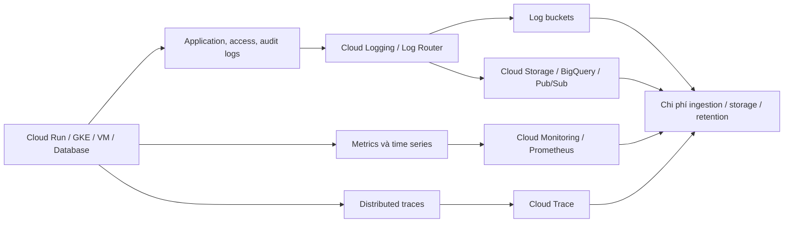
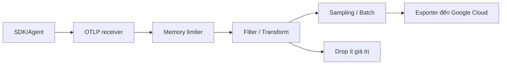

# Giảm chi phí logs, metrics và dữ liệu quan sát

Một hệ thống Google Cloud cần logs, metrics và traces để phát hiện lỗi, điều tra sự cố, đáp ứng yêu cầu kiểm toán và đo độ tin cậy. Nhưng lượng telemetry thường tăng theo số request, số pod, số nhãn và thời gian lưu giữ. Khi triển khai thêm Cloud Run, GKE, Compute Engine, Cloud SQL hoặc Pub/Sub, một cấu hình quan sát không được kiểm soát có thể tạo chi phí đáng kể dù khối lượng người dùng chỉ tăng nhẹ.

**FinOps cho observability không có nghĩa tắt logging hoặc xóa tất cả metrics.** Mục tiêu là giữ các tín hiệu cần cho SLO, bảo mật, tuân thủ và ứng cứu sự cố; giảm hoặc chuyển tuyến dữ liệu lặp lại, quá chi tiết và không được sử dụng. Đặc biệt, phải phân biệt **giảm dữ liệu phát sinh**, **giảm dữ liệu được thu nhận/lưu**, **giảm độ dài retention** và **giảm chi phí thực tế trên hóa đơn**: mỗi thay đổi tác động một phần khác nhau của chuỗi dữ liệu.

Bài này thuộc chương **Hiệu năng và FinOps** của module **CLOUD_PROVIDERS_GCP**. Kiến thức áp dụng cho Google Cloud Logging, Cloud Monitoring, Managed Service for Prometheus, Cloud Trace và các hệ thống thu thập OpenTelemetry trên Cloud Run, GKE và VM. Các nguyên tắc lựa chọn dịch vụ, IAM, kiểm soát chi phí và giữ độ tin cậy được áp dụng xuyên suốt.

## 1. Mục tiêu học tập

Sau bài học, bạn có thể:

- Xác định nguồn chi phí của log storage, metric ingestion/sampling, trace và các bản xuất telemetry.
- Thiết lập baseline từ Cloud Billing, dashboards và metadata về lưu lượng trước khi tối ưu.
- Phân lớp log cần giữ, log có thể giảm tần suất và log không nên đưa vào kho phân tích dài hạn.
- Dùng structured logging, severity, sampling, Log Router sink và exclusion filter một cách có kiểm soát.
- Chọn retention khác nhau cho security, application, debug và access logs; hiểu các giới hạn của bucket `_Required`.
- Kiểm soát metric cardinality, histogram, scrape interval, nhãn pod/tenant/request và duplicate ingestion.
- Thiết kế sampling cho traces và bộ lọc OpenTelemetry Collector mà không che khuất lỗi quan trọng.
- Đo tác động đến alerting, SLO, incident response và compliance trước khi mở rộng chính sách tiết kiệm.
- Lập báo cáo hiệu quả FinOps dựa trên tổng chi phí thực, không chỉ dựa trên số GiB hoặc số mẫu metric.
- Áp dụng rollout an toàn, có owner, dashboard và kế hoạch khôi phục tín hiệu quan sát.

## 2. Bản đồ chi phí trong hệ thống observability

Một request đến ứng dụng có thể sinh nhiều loại telemetry:



Không phải mọi đường trên sơ đồ đều luôn phát sinh phí. Đơn giá, free allotment, billing SKU, dữ liệu được tính phí và retention khác nhau theo dịch vụ, nguồn metric, vùng, loại bucket và chính sách giá hiện hành. Khi đưa ra quyết định tài chính, kiểm tra trang giá và SKU trong Cloud Billing của tổ chức thay vì dựa vào một con số thuộc bài học.

| Nguồn | Yếu tố làm tăng chi phí | Đòn bẩy có thể điều chỉnh |
|---|---|---|
| Cloud Logging | Dung lượng log được lưu/thu nhận tính phí, retention, route bản sao | Ít log lặp, filter theo sink, giảm retention hợp lệ |
| Logs export | Dữ liệu được gửi sang BigQuery, Storage, Pub/Sub; nơi đích có chi phí riêng | Hạn chế export theo use case, lifecycle và partition |
| Cloud Monitoring custom metrics | Số điểm dữ liệu, volume hoặc đơn vị tính theo loại metric | Giảm metric không cần, label cardinality và tần suất thích hợp |
| Managed Service for Prometheus | Số mẫu thời gian được thu thập, cardinality và scrape interval | Metric relabeling, giảm series, tăng interval có kiểm chứng |
| Cloud Trace | Khối lượng spans được thu nhận, metadata và sampling | Head/tail sampling, lọc endpoint ít giá trị, giới hạn attributes |
| Dashboard và alert | Query volume, số lượng/bề rộng chuỗi; chi phí gián tiếp vận hành | Recording rules, query hợp lý, SLO-driven alerts |
| Collector/agent | CPU, RAM, network và bộ đệm | Processor hợp lý, batching, giảm duplicate pipeline |

**Quan trọng:** Dashboard rẻ không đồng nghĩa telemetry rẻ, và log bị loại khỏi một bucket không có nghĩa log cũng bị loại khỏi mọi destination khác.

## 3. Đặt mục tiêu FinOps mà không làm giảm khả năng vận hành

Trước khi sửa hệ thống, ghi rõ:

- **Business/SRE owner** của telemetry.
- Các SLI/SLO và alert bắt buộc phải hoạt động.
- Security/audit logs bắt buộc theo luật, hợp đồng và chính sách nội bộ.
- Thời gian điều tra sự cố cần truy vấn dữ liệu chi tiết.
- Thời gian lưu phục vụ pháp lý, điều tra bảo mật hoặc forensic.
- Mức tiết kiệm mục tiêu, chi phí triển khai và rủi ro mất tín hiệu.
- Thời gian rollout, tiêu chí PASS và cách khôi phục cấu hình cũ.

Một mục tiêu tốt: “giảm 25% chi phí lưu log ứng dụng không quan trọng trong 30 ngày, trong khi các alert SLO, error logs, trace của lỗi và audit log vẫn đáp ứng tiêu chí đã kiểm thử”. Một mục tiêu xấu: “giảm mọi loại telemetry 50%” mà không biết tác động.

### 3.1. Phân loại telemetry theo giá trị

| Nhóm | Ví dụ | Chiến lược |
|---|---|---|
| Bắt buộc bảo mật/tuân thủ | Audit events, thay đổi IAM, truy cập dữ liệu nhạy cảm theo yêu cầu | Giữ đúng chính sách, bảo vệ tính toàn vẹn |
| Tín hiệu vận hành cốt lõi | SLO metrics, errors, latency, saturation, failed jobs | Giữ độ phủ và độ phân giải cần thiết |
| Hữu ích khi điều tra | Structured request summaries, sampled traces, query diagnostics | Sampling/chuyển tuyến theo rủi ro |
| Debug tạm thời | Payload debug, nội dung loop, chi tiết thử nghiệm | Tắt mặc định hoặc bật có thời hạn |
| Trùng lặp hoặc vô ích | Health check thành công lặp lại, log tương đương ở hai lớp | Loại bỏ có kiểm chứng |

Tránh đưa các loại “hữu ích khi điều tra” vào danh sách loại bỏ vĩnh viễn. Nhiều loại cần có khả năng bật lại trong incident và có giới hạn chi phí rõ ràng.

## 4. Đo baseline trước khi tối ưu

### 4.1. Bắt đầu bằng Cloud Billing

Trong Google Cloud Console, mở **Billing > Reports** hoặc **Cost table**, lọc theo billing account, project, thời gian, service và SKU. Để phân tích sâu và đặt dashboard nội bộ, dùng **Cloud Billing export to BigQuery**.

Cần tách:

- Chi phí Cloud Logging, Cloud Monitoring, Cloud Trace theo SKU.
- Chi phí BigQuery, Cloud Storage và Pub/Sub do telemetry export tạo ra.
- Chi phí GKE node, Cloud Run hoặc VM để chạy Collector/agent.
- Các khoản credit, free tier, hợp đồng hoặc committed use đã được áp dụng.
- Sự thay đổi về traffic và số workload trong cùng kỳ.

Không tính toàn bộ chi phí BigQuery là “chi phí quan sát”. Phải có dataset, sink hoặc label giúp quy chi phí export telemetry so với dữ liệu nghiệp vụ.

### 4.2. Ví dụ truy vấn BigQuery Billing Export

Sau khi bật billing export, xác nhận tên bảng thật theo billing account và export type. Ví dụ cho standard export:

```sql
-- Thay đầy đủ project, dataset, table theo cấu hình Billing Export.
SELECT
  service.description AS service_name,
  sku.description AS sku_name,
  ROUND(SUM(cost), 2) AS gross_cost,
  ROUND(SUM(IFNULL(
    (SELECT SUM(c.amount) FROM UNNEST(credits) AS c), 0
  )), 2) AS credits_amount,
  ROUND(SUM(cost) + SUM(IFNULL(
    (SELECT SUM(c.amount) FROM UNNEST(credits) AS c), 0
  )), 2) AS net_cost
FROM
  `BILLING_PROJECT.BILLING_DATASET.gcp_billing_export_v1_ACCOUNT_ID`
WHERE usage_start_time >= TIMESTAMP('2026-11-01T00:00:00Z')
  AND usage_start_time < TIMESTAMP('2026-12-01T00:00:00Z')
GROUP BY 1, 2
ORDER BY net_cost DESC;
```

Lọc các SKU liên quan đến observability **sau khi** nhìn thấy tên service và SKU thực. Bảng standard/detailed export có thể khác tên, schema và độ trễ cập nhật; credits có thể là khoản âm, còn chi phí chưa gồm tất cả thuế/điều chỉnh tùy phạm vi export. Kiểm tra điều kiện thời gian và timezone khi so sánh báo cáo hàng tháng.

### 4.3. Baseline từ Cloud Logging

Trước khi thay đổi sink, thu:

- Dung lượng log theo project và log bucket.
- Top resource type: `cloud_run_revision`, `k8s_container`, `gce_instance` và các loại khác.
- Top service/namespace/container phát nhiều dữ liệu nhất.
- Phân bố severity: DEBUG, INFO, WARNING, ERROR, CRITICAL.
- Những logger và event type lặp lại nhiều nhất.
- Số bản sao log được gửi đến nhiều bucket/destination.
- Retention hiện hành và mục tiêu sử dụng từng bucket.
- Số log entry hoặc byte trung bình trên một request.

Chỉ dùng `COUNT(*)` trên Logs Explorer để xem số entry là chưa đủ: một entry JSON vài KB và một entry vài chục byte có chi phí lưu khác nhau.

### 4.4. Baseline metrics và traces

Ghi lại:

- Số metric descriptors, active series và sample rate.
- Series nhiều nhãn và có cardinality cao nhất.
- Những histogram có quá nhiều bucket hoặc dimensions.
- Tần suất scrape và số target/pod.
- Số spans theo service, endpoint, status và sampling policy.
- Các tracing attributes có độ dài lớn hoặc chứa dữ liệu nhạy cảm.
- Tỷ lệ error traces được giữ khi có incident.
- Dashboards/alerts nào đang sử dụng từng tín hiệu.

Không xóa một metric chỉ vì ít được mở trên Metrics Explorer. Nó có thể đang là input cho alert, SLO, autoscaler hoặc hệ thống vận hành khác.

## 5. Giảm log ngay tại nguồn

Giảm dữ liệu **trước khi tạo và gửi** thường giúp tiết kiệm thêm CPU, network và tài nguyên Collector. Nhưng phải giữ lỗi và bằng chứng vận hành.

### 5.1. Dùng severity đúng

| Severity | Nội dung nên ghi | Hướng tối ưu |
|---|---|---|
| DEBUG | Thông tin nội bộ phục vụ điều tra | Tắt mặc định, bật tạm khi cần |
| INFO | Lifecycle và sự kiện nghiệp vụ có giá trị | Ghi gọn, gộp thống kê, sampling khi hợp lý |
| WARNING | Hành vi không mong muốn nhưng có thể phục hồi | Giữ theo phân loại rủi ro |
| ERROR | Yêu cầu hoặc nghiệp vụ thất bại | Giữ dữ liệu điều tra thiết yếu |
| CRITICAL/ALERT | Sự cố lớn, rủi ro mất dịch vụ/dữ liệu | Giữ và cấu hình cảnh báo theo quy trình |

Không hạ severity từ ERROR thành INFO chỉ để exclusion filter loại bỏ log đó. Nếu alert hiện dựa vào log severity, thay đổi severity có thể làm mất tín hiệu sự cố.

### 5.2. Structured logging thay cho stack trace lặp lại

Ví dụ một log JSON gọn, có ý nghĩa:

```json
{
  "severity": "INFO",
  "event_type": "checkout_completed",
  "service": "checkout-api",
  "environment": "production",
  "http_route": "/api/orders/{id}",
  "duration_ms": 83,
  "result": "SUCCESS",
  "trace_id": "TRACE_ID"
}
```

Cách này thuận tiện tìm kiếm theo event type và route, thay vì mỗi request in cả payload, headers, JSON body và nhiều dòng debug. Các trường `trace_id` hoặc request ID có thể hữu ích **trong log**, nhưng không nên chuyển chúng thành labels của time-series metrics.

Một log structured được thiết kế hợp lý cần có schema, validation và giới hạn kích thước. Không tự do thêm mọi object của request vào `jsonPayload`. Hãy scrub password, access token, cookie, PII và secret trước khi gửi.

### 5.3. Tránh log mỗi vòng lặp

Ví dụ Java/Spring không nên ghi mỗi 100 ms rằng một job vẫn đang chờ:

```java
// Không nên trong hot loop:
while (poller.isRunning()) {
    log.info("waiting for messages");
    poller.poll();
}
```

Thay bằng metric/gauge về queue age và một log summary theo sự kiện:

```java
long processed = 0;
long failed = 0;

for (Job job : batch) {
    try {
        handle(job);
        processed++;
    } catch (RuntimeException ex) {
        failed++;
        log.error("Batch item failed: itemId={}", job.id(), ex);
    }
}

log.info("Batch complete: processed={}, failed={}", processed, failed);
```

Với vòng lặp có hàng triệu item, ngay cả log lỗi cũng có thể gây “error storm”. Nên giữ ví dụ lỗi đại diện, counter metric, phân nhóm nguyên nhân và mức trần log rate, đồng thời đảm bảo vẫn có thông tin truy vết đầy đủ theo yêu cầu bảo mật và nghiệp vụ.

### 5.4. Khả năng bật debug có thời hạn

Dùng cấu hình theo service hoặc feature flag để bật DEBUG trong một khoảng thời gian, kèm owner, TTL và cơ chế tự quay về INFO. Không lưu DEBUG vô hạn vì một lần xử lý incident từ tháng trước.

## 6. Cloud Logging: Log Router, sinks và exclusion filters

Cloud Logging nhận entry từ nhiều nguồn rồi **Log Router** định tuyến đến các sink. Sink có inclusion filter; một số sink hỗ trợ exclusion filters để bỏ những log phù hợp khỏi đường định tuyến của sink đó. Các destination có thể là log bucket, BigQuery, Cloud Storage hoặc Pub/Sub.

### 6.1. Hiểu các log buckets mặc định

- `_Required`: dành cho một số audit logs bắt buộc; Google Cloud quản lý chính sách retention và không thể dùng một exclusion thông thường để loại các entry bắt buộc khỏi đây.
- `_Default`: bucket lưu nhiều logs thông thường theo cấu hình routing hiện tại; có thể điều chỉnh routing/exclusions theo chính sách và quyền phù hợp.
- **User-defined buckets:** tổ chức có thể tạo bucket theo nhu cầu retention, region, owner hoặc lớp dữ liệu.

Không nhầm **log view** với **log bucket**: view chủ yếu kiểm soát phạm vi truy vấn và quyền đọc, không phải công cụ làm giảm bytes đã lưu. Tương tự, thay đổi alert policy không tự giảm dữ liệu metrics đã thu nhận.

### 6.2. Xem sink và bucket hiện hành

Các lệnh chỉ đọc để khảo sát:

```bash
gcloud logging sinks list --project=PROJECT_ID

gcloud logging sinks describe _Default \
  --project=PROJECT_ID

gcloud logging buckets list \
  --location=global \
  --project=PROJECT_ID
```

Lệnh xem bucket cần chạy theo location phù hợp; không mặc định mọi bucket đều ở `global`. Khi liệt kê sink, đối chiếu cả inclusion filter, exclusions, destination và quyền ghi ở destination. Một log có thể được lưu ở nhiều nơi nếu nhiều sink match.

### 6.3. Ví dụ exclusion filter có kiểm soát

Giả sử ứng dụng Cloud Run ghi structured INFO `request_summary` theo từng request và đã có request count/latency metrics đủ để giám sát. Một filter mẫu:

```text
resource.type="cloud_run_revision"
severity=INFO
jsonPayload.event_type="request_summary"
```

Filter này **chỉ là tập entry ứng viên**, không có nghĩa phải xóa mọi request summary. Sau khi phân tích incident use cases, có thể cân nhắc chỉ loại phần lớn entry bằng chức năng `sample` trong Logging filter:

```text
resource.type="cloud_run_revision"
severity=INFO
jsonPayload.event_type="request_summary"
sample(insertId, 0.90)
```

Khi filter trên được đặt làm **exclusion filter** của sink phù hợp, nó chọn xấp xỉ 90% entry có `insertId` để loại khỏi đường đi của sink đó, tức mục tiêu giữ khoảng 10% ở sink này. Kết quả thực tế còn phụ thuộc dữ liệu có trường insertId ổn định và những sink khác. **Đây không phải thay đổi mặc định nên áp dụng cho mọi dịch vụ**.

Những lưu ý trước khi triển khai:

- Không áp exclusion tương tự với ERROR/CRITICAL hoặc audit cần giữ.
- Xác nhận đó là application log, không phải nguồn duy nhất của điều tra request lỗi.
- Nếu cùng entry được route vào BigQuery hoặc bucket khác, chi phí ở destination khác vẫn có thể phát sinh.
- Kiểm tra mục tiêu là giảm log storage, không phải “ngăn ứng dụng tạo entry”.
- Xem lại alert và project-/bucket-scoped logs-based metrics có phụ thuộc vào tập entry được chọn không.
- Lưu lại filter, owner, version và thời điểm rollout để có thể khôi phục.

### 6.4. Thứ tự tối ưu

Ưu tiên theo thứ tự:

1. Giảm log quá chi tiết tại source.
2. Đảm bảo log được gán severity/event type đúng.
3. Tách nhóm log theo retention và compliance.
4. Giảm hoặc sample log ít giá trị tại collector hoặc routing layer.
5. Cắt bỏ sink trùng không có người sử dụng.
6. Rà soát BigQuery/Cloud Storage export lifecycle.
7. Đo lại billable usage và SLO sau ít nhất một chu kỳ thích hợp.

Exclusion filter không thay thế việc sửa code gây log storm. Cũng không được kỳ vọng log đã bị loại khỏi sink có thể được truy vấn lại ở chính bucket đó.

## 7. Retention: giữ đúng thời gian, đúng nơi

### 7.1. Phân lớp retention

Một chính sách minh họa:

| Nhóm | Nhu cầu | Phương án |
|---|---|---|
| Security/audit bắt buộc | Phù hợp quy định và investigation | Bucket/chính sách retention không thể tự ý giảm |
| Application errors | Phục vụ điều tra và postmortem | Retention đủ bao phủ cửa sổ incident |
| Request summaries | Dữ liệu mẫu cho troubleshooting | Retention ngắn hơn nếu SLO metric đã đủ |
| DEBUG của sự cố | Điều tra tạm thời | TTL ngắn và có ticket |
| Log archival | Kiểm toán hoặc phân tích ít truy vấn | Export có kiểm soát, lifecycle storage phù hợp |

Các mốc 7, 30, 90 hay 365 ngày cần dựa vào chính sách và đặc điểm pricing. Đối với một số loại bucket, Cloud Logging có retention mặc định và quy tắc charge khi tăng retention. Thay đổi retention không hoàn tác chi phí đã phát sinh ở kỳ trước và có thể làm mất lịch sử khi entry đến hạn.

### 7.2. Không thay đổi bucket _Required

`_Required` chứa các log bắt buộc theo chính sách Google Cloud. Không cố “tiết kiệm” bằng cách loại bỏ hoặc làm ngắn retention của bucket này. Khi tính savings, tách phần có thể kiểm soát khỏi chi phí và dữ liệu bắt buộc.

### 7.3. Export không miễn phí

Một sink export đến BigQuery, Cloud Storage hoặc Pub/Sub có thể phát sinh:

- Chi phí lưu trữ BigQuery/Cloud Storage.
- Query/scan hoặc processing.
- Message delivery, network traffic và dữ liệu trùng.
- Lifecycle/retention của destination.
- Chi phí pipeline xử lý như Dataflow hoặc Cloud Run.

Một số team vừa giữ log ở `_Default`, vừa export đầy đủ sang BigQuery vô thời hạn. Nếu không có use case riêng, tổ chức đang trả cho nhiều bản sao. Trước khi xóa export, kiểm tra job, dashboard, alert, kiểm toán và hệ thống downstream đang sử dụng nó.

## 8. Logs-based metrics và cảnh báo

Logs-based metrics chuyển log entry phù hợp thành metric, ví dụ số lần đăng nhập lỗi hoặc số job import thất bại.

- **System-defined logs-based metrics:** metrics được Google Cloud cung cấp theo loại log/phạm vi tương ứng.
- **User-defined logs-based metrics:** do team định nghĩa filter và labels; có thể tạo metric volume hoặc cardinality đáng kể.
- **Log-based alerting:** alert dựa trên log filter, tùy kiểu signal và yêu cầu nghiệp vụ.

Cần phân biệt logs-based metrics cấp project với bucket-scoped metrics vì đường tính toán có thể khác nhau. Khi thay đổi sink/exclusion, hãy kiểm tra chính xác metric đang dựa trên entry nào; không giả định mọi metric chắc chắn bị giảm hay vẫn giữ nguyên.

### 8.1. Tránh labels quá chi tiết

Sai lầm thường gặp là tạo label `user_id`, `request_id`, `trace_id` hoặc `session_id` cho logs-based metric. Ví dụ:

```text
failed_login_total{
  service="auth",
  user_id="user-847392",
  request_id="req-934857..."
}
```

Mỗi tổ hợp label tạo một time series riêng, làm tăng cardinality và có thể chạm quota trước khi tăng giá trị giám sát. Metric phục vụ SLO thường chỉ cần service, region, status class hoặc failure category có giá trị giới hạn.

Thay bằng:

```text
failed_login_total{
  service="auth",
  region="asia-southeast1",
  failure_category="invalid_credentials"
}
```

Giữ user_id/trace_id trong log hoặc hệ thống audit có IAM thích hợp nếu cần điều tra; không đưa chúng thành metric labels.

### 8.2. Chọn metric thay vì log khi phù hợp

Nếu câu hỏi vận hành chỉ là “tỷ lệ lỗi checkout trong 5 phút”, counter metric thường hiệu quả hơn việc lưu và query từng log INFO thành công. Nhưng metric chỉ giữ phép tổng hợp, không thể thay thế tất cả dữ liệu forensic. Có thể kết hợp:

- Counter/histogram để giám sát SLO.
- ERROR logs với context và correlation ID để điều tra.
- Sampled success logs hoặc traces để hiểu luồng request.
- Audit logs phục vụ security/compliance.

## 9. Cardinality: nguyên nhân khiến metrics tăng mạnh

Một time series được phân biệt bởi **metric name + tập label values**. Với nhãn độc lập tương đối, số series có thể tăng gần bằng tích số giá trị của mỗi label.

Ví dụ:

```text
http_requests_total labels:
  method: 4 values
  route: 30 values
  status_class: 5 values
  pod: 20 values

Approximate active series:
  4 × 30 × 5 × 20 = 12,000
```

Nếu thêm `user_id` có 100.000 giá trị, số tổ hợp khả dĩ tăng cực lớn (dù không nhất thiết tất cả cùng active). Đó là lý do mọi metric label phải có **cardinality budget**.

### 9.1. Nhãn nguy hiểm

Tránh dùng giá trị gần như duy nhất:

- Email, customer ID, user ID, session ID.
- Request ID, transaction ID, trace/span ID.
- Raw URL có query string hoặc path chứa UUID.
- IP address cá nhân.
- Object name đầy đủ, SQL query text.
- Full exception message hoặc stack trace.

Thay raw URL `/orders/10929382` bằng route template `/orders/{id}`. Thay HTTP status code 100–599 bằng `status_class` khi đủ cho alert; chỉ giữ status cụ thể ở metric chẩn đoán có owner nếu cần.

### 9.2. Xem lại label của Kubernetes

Các nhãn pod UID, container ID và ephemeral instance ID có thể tăng churn mạnh khi workload autoscale. Trong GKE:

- Giữ `cluster`, `namespace`, `workload`, `service` khi chúng cần thiết.
- Cân nhắc loại bỏ `pod_uid` hoặc `container_id` khỏi metric tổng hợp.
- Giữ metric per-pod để chẩn đoán trong thời gian ngắn nếu phù hợp.
- Phân biệt target labels do collector sinh và application labels.
- Theo dõi lượng series tạo mới sau deploy/canary.

Không xóa nhãn mà HPA, autoscaler, alert hoặc dashboard cần dùng khi chưa có phép thay thế đã được test.

## 10. Managed Service for Prometheus: sample volume

Với Prometheus, sample count thường phụ thuộc:

```text
samples_per_day ≈ active_series × (86,400 / scrape_interval_seconds)
```

Giả sử có 12.000 series liên tục trong 24 giờ:

| Scrape interval | Samples/ngày | So với 15 giây |
|---|---:|---:|
| 15 giây | 69.120.000 | 100% |
| 30 giây | 34.560.000 | 50% |
| 60 giây | 17.280.000 | 25% |

Đây là phép tính số mẫu giả định, **không phải dự báo hóa đơn trực tiếp**. Nếu thời gian active, target count và retry thay đổi, sample thật cũng khác. Việc tăng scrape interval có thể làm giảm độ phân giải khi phát hiện lỗi ngắn; cần đánh giá yêu cầu burn-rate alert và autoscaling.

### 10.1. Giảm series trước khi giảm tần suất

Một bước thông thường:

1. Liệt kê metric nhiều series nhất.
2. Xác định label gây cardinality lớn.
3. Xác nhận dashboard/alert nào dùng label đó.
4. Loại bỏ hoặc aggregate label tại instrumentation/collection layer.
5. Kiểm tra alert/SLO và query kết quả.
6. Chỉ sau đó cân nhắc tăng scrape interval.

Không nên giảm metric latency và error rate xuống 5 phút chỉ để tiết kiệm nếu SLO cần phát hiện lỗi nhanh. Có thể giữ tín hiệu SLO ở 15–30 giây và đưa các chỉ số capacity ít biến động sang 60 giây hoặc tần suất phù hợp.

### 10.2. Histogram và số lượng bucket

Với classic Prometheus histograms, mỗi tổ hợp label có nhiều series `_bucket` cộng `_sum` và `_count`. Nếu chọn quá nhiều bucket và giữ các nhãn pod/route/status chi tiết, tổng series sẽ tăng theo cấp số nhân.

Chọn bucket theo SLO thực tế. Ví dụ latency threshold 100/300/800 ms cần bucket đủ phân biệt quanh các ngưỡng đó; không tạo hàng trăm bucket chỉ để có biểu đồ đẹp hơn. Khi đổi bucket phải xác nhận cách tính quantile, SLI và PromQL không bị thay đổi ngoài dự kiến.

### 10.3. Recording rules

Nếu dashboard liên tục chạy query aggregate phức tạp theo service, recording rule có thể lưu kết quả đã tổng hợp giúp giảm chi phí query hoặc tải xử lý ở một số kiến trúc. Tuy nhiên, recording rules **cũng tạo time series mới**, nên không mặc định giảm ingestion cost. Phải kiểm tra metric nào còn ingest, series nào được sinh thêm và query nào đã được thay.

## 11. OpenTelemetry Collector: giảm dữ liệu trước exporter

OpenTelemetry Collector có thể chạy trên GKE, VM hoặc một deployment riêng. Pipeline điển hình:



Các processor có thể giúp:

- **filter:** bỏ telemetry ít giá trị như health-check success khi có metric khác bao phủ.
- **transform:** đổi tên/chuẩn hóa route, xóa hoặc gộp attributes có cardinality cao.
- **attributes/resource:** bỏ thông tin nhạy cảm hoặc nhãn không cần thiết.
- **batch:** giảm overhead và hỗ trợ hiệu quả truyền tải.
- **memory_limiter:** bảo vệ Collector trước áp lực bộ nhớ; không phải công cụ tối ưu chi phí chính.

Ví dụ cấu hình OTel Collector **minh họa**, cần điều chỉnh theo distribution, processor và exporter có sẵn:

```yaml
receivers:
  otlp:
    protocols:
      grpc: {}

processors:
  memory_limiter:
    check_interval: 5s
    limit_mib: 512
    spike_limit_mib: 128
  filter/drop_noise:
    error_mode: ignore
    logs:
      log_record:
        - 'attributes["event.type"] == "healthcheck_ok"'
  batch: {}

exporters:
  otlp:
    endpoint: telemetry-gateway.example.internal:4317
    tls:
      insecure: false

service:
  pipelines:
    logs:
      receivers: [otlp]
      processors: [memory_limiter, filter/drop_noise, batch]
      exporters: [otlp]
```

Đây không phải cấu hình kết nối trực tiếp tới Cloud Logging. Exporter/endpoint phải thuộc hệ thống telemetry được phê duyệt, hỗ trợ TLS và xác thực phù hợp. Nếu dùng Google Cloud exporter hoặc Managed Service for Prometheus thì cấu hình export và auth khác. Không áp filter lên mọi pipeline mà chưa đánh giá scope.

### 11.1. Chặn dữ liệu nhạy cảm

Dù mục tiêu chính là chi phí, Collector cũng là nơi có thể scrub các attributes chứa PII. Xóa token, cookie, email hoặc payload nhạy cảm trước exporter. Tuy nhiên, processor không thay thế validation tại ứng dụng; tránh sinh dữ liệu nhạy cảm từ đầu vẫn là phương án tốt hơn.

### 11.2. Tránh double ingestion

Trên GKE, có thể vô tình bật cả managed collection và một collector riêng cho cùng Prometheus target; hoặc app export trực tiếp và qua gateway song song. Kiểm tra topology từng metric và trace:

- Mỗi signal có chủ sở hữu và một đường gửi mặc định.
- Không cấu hình hai scraper cho cùng target nếu không cố ý.
- Tránh loop Collector xuất sang chính endpoint mình thu.
- Tách staging/production credentials và resource labels.
- So sánh số samples/series trước-sau để phát hiện duplicate.

## 12. Cloud Trace: sampling mà vẫn giữ dấu vết lỗi

Traces ghi các spans của một request qua nhiều dịch vụ. Khối lượng span phụ thuộc request rate, số spans/request, sampling policy và instrumentation. Không nên lưu 100% toàn bộ spans thành công trên hệ thống traffic rất cao nếu không cần.

### 12.1. Head sampling và tail sampling

| Cách | Quyết định | Ưu điểm | Đánh đổi |
|---|---|---|---|
| Head sampling | Khi trace bắt đầu | Ít overhead và dễ dự đoán lượng dữ liệu | Có thể bỏ sót lỗi chỉ biết ở cuối request |
| Tail sampling | Sau khi thu đủ thông tin trace trong khoảng chờ | Có thể ưu tiên errors và slow traces | Cần memory/buffer, điều phối state và tăng latency |
| Dynamic/adaptive | Theo service, endpoint, thời gian hoặc rủi ro | Phân bổ ngân sách theo giá trị | Chính sách phức tạp, cần giám sát riêng |

Head sampling 10% **không đảm bảo** giữ 100% traces lỗi. Nếu cần ưu tiên lỗi, có thể dùng tail sampling tại Collector được thiết kế và scale phù hợp; đồng thời luôn giữ error metrics/logs thiết yếu.

### 12.2. Ví dụ chính sách chọn traces

Một chính sách minh họa:

- Giữ traces lỗi HTTP 5xx hoặc span status ERROR với tỷ lệ cao.
- Giữ traces rất chậm khi vượt p99 target.
- Sampling 5–10% traces thành công, hoặc thay đổi theo traffic.
- Hạn chế spans health-check, readiness và polling ít giá trị.
- Giữ metadata service, route template, status class và correlation ID cần điều tra.
- Không gửi request body, access token hoặc dữ liệu cá nhân nhạy cảm.

Các tỷ lệ là ví dụ. Tỷ lệ thực phải dựa vào lưu lượng, billable spans, độ chính xác debug và thống kê xác suất. Trace sampling có thể làm thay đổi mức đại diện của truy vấn phân tích; không dùng trực tiếp số lỗi trong sampled traces làm error rate chính thức.

### 12.3. Không để tracing chi phối SLO

Tính request count, error rate và latency SLI từ metrics có độ phủ đủ rộng, không dựa hoàn toàn trên sampled traces. Khi một service có traffic thấp hoặc lỗi hiếm, chỉ lấy 1% traces có thể khiến điều tra trở nên bất khả thi. Hãy thiết kế sampling theo service và điều kiện incident.

## 13. Chiến lược dành cho Cloud Run

Cloud Run có thể tạo **request logs**, **container logs** và thông tin hệ thống theo đặc tính runtime. Một request có thể xuất hiện nhiều lần nếu application vừa ghi “request received”, vừa ghi “request done” và platform cũng có request log.

### 13.1. Giảm lặp

- Dùng platform request metadata khi đủ cho latency/status/route.
- Ứng dụng chỉ ghi log nghiệp vụ cho những event có giá trị.
- Không in toàn bộ headers, cookies và request body.
- Giảm INFO lặp ở health checks và polling.
- Tạo span/metric thay cho log progress theo từng bước nhỏ.
- Giữ ERROR log chi tiết với trace correlation.

Nếu cần đối chiếu request thất bại, bảo đảm platform log, application error log và trace có thể liên kết. Không bỏ cả ba đường chỉ vì thấy chúng “trùng”.

### 13.2. Kiểm soát tải log storm

Khi dependency lỗi hàng loạt, một service có thể ghi hàng nghìn stack trace giống nhau mỗi giây. Để không làm tăng chi phí vô hạn:

- Aggregate/throttle log message trùng ở application.
- Dùng metric counter số lỗi theo nhóm nguyên nhân.
- Ghi ví dụ lỗi representative theo khoảng thời gian.
- Giữ error correlation và sự kiện đầu tiên/cuối cùng cần thiết.
- Dùng rate limiting có kiểm soát trong logger/Collector.

**Không được để log suppression che giấu số lượng lỗi thực.** Dù giảm stack trace, counter metric và alert vẫn cần phản ánh tổng số lỗi.

## 14. Chiến lược dành cho GKE

GKE có số container/pod lớn, thời gian sống ngắn và có thể scale nhanh; log và metric cardinality dễ tăng mạnh.

### 14.1. Quản lý thu log container

- Xác định namespace/workload có log rate cao.
- Phân lớp system logs và application logs.
- Kiểm tra có thu cả stdout và file log trùng nội dung không.
- Giảm debug output mặc định trong sidecar/service mesh.
- Dùng structured JSON theo schema.
- Không gán mọi pod UID/instance ID làm metric label ở cấp tổng hợp.
- Cân nhắc namespace-level hoặc workload-level logging policy khi được hỗ trợ và phê duyệt.

### 14.2. Sidecars và service mesh

Một request đi qua API gateway, ingress, sidecar và application có thể sinh nhiều access log tương đương. Mỗi lớp cần trả lời câu hỏi riêng:

- Gateway: request edge, WAF, client-facing status.
- Mesh: east-west service calls, policy và mTLS diagnostics.
- Application: business event, exception và context.

Không cần lưu toàn bộ payload và access log của cả ba lớp với cùng retention nếu không có use case. Nhưng security/audit và network forensic có thể yêu cầu dữ liệu ở gateway hoặc mesh; phải kiểm tra owner trước khi giảm.

### 14.3. Prometheus ở cấp cluster

Metric endpoint có thể xuất hàng nghìn series từ mỗi pod. Kiểm tra scrape target, service discovery, relabeling và giới hạn series. Giảm metric debug ít dùng ở instrumentation layer, chuẩn hóa route template và dọn label có cardinality cao trước khi dữ liệu vào Managed Service for Prometheus.

## 15. Compute Engine, Cloud SQL và các dịch vụ dữ liệu

### 15.1. VM và Ops Agent

Trên Compute Engine, Ops Agent hoặc agent khác thu logs và metrics theo cấu hình. Tránh cấu hình nhiều agent cùng đọc một file hoặc cùng export một stream. Với log app tự quản lý:

- Chọn file path/pattern chính xác.
- Loại rotated/compressed file không cần ingest.
- Cấu hình multiline stack trace theo khả năng agent để tránh tách một exception thành nhiều entry.
- Chọn severity từ nội dung khi có thể.
- Kiểm tra log rotation tại nguồn và retention cục bộ.

### 15.2. Database diagnostics

Cloud SQL, AlloyDB hoặc database self-managed có các logs phục vụ slow query, deadlock, audit và performance troubleshooting. Không tắt slow query/error logs chỉ vì tăng volume ở giai đoạn kiểm thử tải. Thay vào đó:

- Chọn threshold query phù hợp nghiệp vụ.
- Phân biệt debug diagnostics tạm thời với audit bắt buộc.
- Giữ dữ liệu performance cần cho capacity.
- Kiểm soát log payload chứa SQL parameters/PII.
- Giám sát DB connections, latency, locks và disk mà không cần log từng query thành công.

### 15.3. Pub/Sub và pipelines dữ liệu

Các consumer/worker đôi khi log mỗi message đã xử lý. Với hàng triệu message/ngày, điều này dễ tạo log volume khổng lồ. Cân nhắc:

- Counter processed/failed per subscription.
- Metric oldest unacked age, backlog, retry rate.
- Log lỗi representative có event ID.
- Audit/security events cần thiết.
- Batch summary thay cho “message processed” ở mọi message.

Nếu cần trace nghiệp vụ theo event ID, có thể dùng log sampling theo khóa hoặc giữ log ở các bước quan trọng, thay vì ghi toàn bộ payload ở từng hop.

## 16. Đo savings bằng mô hình định lượng

### 16.1. Ví dụ log volume

Giả sử hệ thống ghi 300 GiB log/ngày. Trong đó 60% là INFO request summaries ít giá trị; policy mới loại khỏi bucket tính phí 80% của nhóm này:

```text
Log baseline:       300 GiB/day
Candidate portion:   60%
Excluded portion:    80%

Reduction = 300 × 0.60 × 0.80
          = 144 GiB/day

Remaining volume ≈ 156 GiB/day
For 30 days: volume difference ≈ 4,320 GiB
```

Đây chỉ là **giảm khối lượng tại phạm vi bucket giả định**. Số tiền tiết kiệm thực tế còn tùy giá theo SKU, free allowances, volume ở sink khác, retention, credits, billing period và chi phí export. Nếu cùng logs vẫn được đẩy sang BigQuery, chi phí BigQuery có thể không giảm.

### 16.2. Ví dụ metrics cardinality

Một workload có 12.000 active series scrape 15 giây:

```text
Before: 12,000 × (86,400 / 15) = 69,120,000 samples/day

After removing unnecessary labels:
  3,000 × (86,400 / 15) = 17,280,000 samples/day

Difference = 51,840,000 samples/day (75% fewer)
```

Nếu chỉ đổi interval từ 15 sang 60 giây với 12.000 series, số mẫu giả định cũng giảm 75%, nhưng độ phân giải thay đổi. Giảm cardinality bằng cách bỏ nhãn vô giá trị thường bảo toàn tốc độ đo tốt hơn. Cả hai cách phải kiểm tra dashboard, alert và SLO.

### 16.3. Net savings

```text
Net savings
  = baseline billing cost (normalized)
  - new billing cost (normalized)
  - added destination/collector/query cost
  - operational cost of the new solution
```

Khi so sánh hai kỳ, chuẩn hóa theo RPS, số workload, số ngày và sự kiện incident. Một tháng không có sự cố sẽ phát sinh ít error logs hơn dù chưa có thay đổi kỹ thuật.

## 17. Thiết kế dashboard FinOps cho observability

Dashboard hiệu quả nên có cả chi phí và mức độ an toàn:

| Nhóm | KPI | Mục đích |
|---|---|---|
| Tổng chi phí | Logging/Monitoring/Trace theo service/SKU/project | Biết chi tiêu thực tế |
| Unit economics | Cost per 1M requests / per 1K jobs | So sánh công bằng khi tải thay đổi |
| Logs | GiB/ngày, bytes/request, severity mix | Tìm dịch vụ và logger tốn nhất |
| Metrics | Active series, samples/ngày, top labels | Phát hiện cardinality explosion |
| Traces | Spans/giây, sampling rate, error trace coverage | Kiểm soát volume và khả năng debug |
| SLO | Error rate, p95, burn rate, alert freshness | Đảm bảo chất lượng tín hiệu |
| Governance | Telemetry owner, exception expiry, retention | Tránh chính sách bị quên |

Khi phát hiện cost spike, phân tích trước theo service/SKU, rồi theo project/workload, rồi theo nguyên nhân instrumentation. Không điều chỉnh retention hoặc exclusion theo cảm tính từ tổng chi phí.

## 18. Phân bổ chi phí cho team và workload

Google Cloud billing có project, labels/tags và SKU tùy dịch vụ. Cách chargeback/showback:

1. Tách project theo môi trường và ownership khi có thể.
2. Đặt label/tag tổ chức trên workload và tài nguyên được hỗ trợ.
3. Sử dụng billing export để tổng hợp theo project/SKU/cost center.
4. Bổ sung danh mục sink/bucket và collector để chia shared cost hợp lý.
5. Ghi mỗi optimization với owner, PR/change ticket, baseline và kỳ đo.
6. Rà soát hàng tháng hoặc sau release làm tăng traffic/series.

Không giả định mọi byte log có sẵn label chargeback đến từng team. Bucket tập trung và metrics scope nhiều project có thể khiến phần chi phí không thể chia chính xác bằng billing labels; cần phân bổ theo usage share có ghi rõ phương pháp.

## 19. Tối ưu có kiểm soát và rollback telemetry policy

Giảm chi phí bằng cách xóa tín hiệu cần thiết có thể khiến sự cố production kéo dài lâu hơn số tiền tiết kiệm. Vì vậy policy phải được rollout như một thay đổi production.

### 19.1. Từng giai đoạn

1. **Observe:** thu baseline billing và usage trong khoảng thời gian đại diện.
2. **Classify:** phân loại logs, metrics, traces theo giá trị và yêu cầu compliance.
3. **Design:** xác định filter, metric label changes, retention hoặc sampling mới.
4. **Dry run:** chạy query dự kiến để ước lượng số log match; kiểm tra dashboard/alert dependencies.
5. **Pilot:** áp dụng cho một service, namespace hoặc môi trường staging.
6. **Verify:** kích hoạt lỗi thử nghiệm, xác minh log/metric/trace và alert vẫn hoạt động.
7. **Rollout:** tăng phạm vi theo từng wave, theo dõi usage và incidents.
8. **Reconcile:** đối chiếu Cloud Billing thực tế sau kỳ tính phù hợp.
9. **Document:** cập nhật runbook, owner và điều kiện bật debug trở lại.

### 19.2. Ma trận kiểm chứng

| Test case | Tín hiệu phải còn |
|---|---|
| HTTP 500 từ Cloud Run | Error-rate metric, ERROR log và trace liên kết khi được lấy mẫu |
| Kết nối Cloud SQL thất bại | Database error metric/log và alert |
| Pub/Sub backlog tăng | Oldest unacked age/undelivered count và alert |
| GKE pod crash loop | Restart signal, container error và dashboard |
| Hành vi IAM trái phép | Audit trail cần theo quy định, security alert phù hợp |
| Health check thành công lặp | Có thể giảm log chi tiết nếu availability metric vẫn có |
| Incident bật DEBUG | Có thể bật có thời hạn và xác nhận log xuất hiện |

Nếu sau tối ưu không thể phát hiện hoặc điều tra một lỗi quan trọng, rollback filter hoặc sampling policy. Chỉ nên đánh đổi độ phân giải khi owner/SRE xác nhận mức độ giám sát vẫn đạt tiêu chí đã duyệt.

### 19.3. Cơ chế hoàn tác

- Version-control Log Router exclusions và cấu hình Collector bằng IaC.
- Có cách disable exclusion filter thay vì xóa cấu hình không thể truy vết.
- Lưu lại dashboard và alert policy trước thay đổi.
- Giữ configuration backup và người có quyền khôi phục.
- Sau rollback kiểm tra log mới được route/ingest; **dữ liệu từng bị loại bỏ không tự xuất hiện trở lại**.
- Với retention đã làm dữ liệu cũ hết hạn, khôi phục policy không lấy lại lịch sử đã xóa.

## 20. Những điều không được hy sinh vì chi phí

### 20.1. SLO và phát hiện sự cố

Giữ các tín hiệu:

- Request volume và error ratio đáng tin cậy.
- p95/p99 latency theo service quan trọng.
- Saturation, resource exhaustion và dependency failures.
- Queue backlog và job completion/failure.
- SLO burn-rate alert hoặc quy tắc cảnh báo được phê duyệt.

Không dùng traces đã sampling thấp làm nguồn duy nhất cho error budget calculation. SLO phải dựa trên metric có độ phủ được hiểu rõ.

### 20.2. Security và compliance

Không tự ý loại bỏ:

- Audit logs bắt buộc của tổ chức hoặc nhà cung cấp.
- Cảnh báo truy cập trái phép hoặc thay đổi quyền IAM.
- Dấu vết phục vụ forensic theo retention policy.
- Bằng chứng giao dịch và dữ liệu bắt buộc theo hợp đồng.
- Logs cần cho điều tra sự kiện có ảnh hưởng người dùng.

Đồng thời đừng ghi quá mức dữ liệu nhạy cảm chỉ vì muốn forensic đầy đủ. Hạn chế PII ở nguồn, dùng quyền truy cập tối thiểu, mã hóa và tách bucket phù hợp.

### 20.3. Quota và cardinality limit

Cardinality không chỉ tăng hóa đơn mà có thể vượt quotas, ảnh hưởng ingest hoặc query. Khi giảm cardinality cần đo alert latency và coverage, không chỉ series count. Nếu bỏ label `route` khỏi metric lỗi mà alert dựa vào lỗi một endpoint critical, có thể đánh mất khả năng phát hiện lỗi cục bộ.

## 21. Những lỗi thường gặp

| Lỗi | Hậu quả | Phương án tốt hơn |
|---|---|---|
| Tắt logging toàn bộ production | Không đủ dữ liệu điều tra và audit | Giảm debug/INFO nhiễu, giữ tín hiệu critical |
| Chỉ giảm retention | Volume mới vẫn tăng mạnh; lịch sử có thể mất | Sửa nguồn và routing trước |
| Exclusion ở một sink rồi tính toàn bộ savings | Bản sao log ở sink khác vẫn được lưu | Kiểm tra mọi destination và hóa đơn |
| Dùng log view để tiết kiệm storage | Chỉ thay đổi phạm vi truy cập/query | Điều chỉnh routing/bucket/retention |
| Xóa metric không kiểm tra alert | SLO hoặc autoscaler mất tín hiệu | Lập dependency inventory và chạy alert test |
| Gán user_id/request_id vào metric labels | Cardinality explosion | Log correlation riêng; metrics labels hữu hạn |
| Tăng scrape interval cực lớn | Mất độ phân giải lỗi ngắn | Điều chỉnh theo SLO, giảm series trước |
| Tạo quá nhiều histogram buckets | Tăng mạnh series/samples | Chọn bucket quanh ngưỡng quan trọng |
| Head sample traces quá thấp | Bỏ sót lỗi hiếm và incident | Tail sampling hoặc chính sách theo service |
| Xóa lỗi khỏi logs để tiết kiệm | Error storms khó debug | Counter giữ 100%, throttle stack trace có kiểm chứng |
| Vừa scrape managed vừa scrape tự quản | Ingest trùng và lệch query | Một collection owner cho mỗi target |
| Export toàn log vào BigQuery không thời hạn | Storage và query cost tăng | Lọc theo mục đích, partition và lifecycle |
| So chi phí hai kỳ khác traffic | Kết luận savings không chính xác | Chuẩn hóa cost/request và workload |
| Rollback filter sau khi log đã drop | Dữ liệu đã bỏ không thể truy hồi | Pilot và kiểm thử trước khi drop |

## 22. Bài thực hành: tối ưu hệ thống checkout

**Bối cảnh:** ứng dụng checkout chạy Cloud Run; một worker trên GKE tiêu thụ Pub/Sub; Cloud SQL lưu dữ liệu; logs được gửi Cloud Logging, metrics qua Cloud Monitoring/Prometheus và traces qua OpenTelemetry.

### 22.1. Dữ liệu mẫu

Giả định trước tối ưu:

- 300 GiB application logs/ngày.
- 60% bytes là request summaries INFO.
- 12.000 active Prometheus series tại interval 15 giây.
- 100% request thành công đang được instrument vào traces.
- Hai sink đang lưu bản sao một phần log vào log bucket và BigQuery.

Đây là số giả định phục vụ tính toán, không phải thông tin về một hệ thống thật.

### 22.2. Thực hiện

1. Lập bảng Cloud Billing export theo service, SKU, project và tháng.
2. Xác định top logger/event type tạo bytes, chia theo severity.
3. Tìm ra request summary INFO đang trùng với HTTP platform logs và metric.
4. Thiết kế exclusion filter chỉ cho event type cụ thể tại sink đích; preview tỷ lệ match.
5. Giữ ERROR/CRITICAL, security/audit và các lỗi payment.
6. Chạy test HTTP 500, DB timeout và queue backlog để kiểm tra alerts.
7. Tối ưu metric labels: bỏ request ID, dùng route template; giữ SLO dimensions.
8. Tính số samples lý thuyết trước/sau theo số active series và scrape interval.
9. Chọn trace sampling ưu tiên errors/slow requests, giữ correlation.
10. Rà soát BigQuery sink: còn consumer nào không, có thể giảm nhóm log và retention không.
11. Pilot một workload, so sánh SLO và chất lượng incident debugging.
12. Sau kỳ billing phù hợp, báo cáo gross/net cost normalized per 1M requests.

### 22.3. Tiêu chí hoàn thành

- Báo cáo cho thấy savings theo billing SKU thực tế hoặc ghi rõ chưa đủ chu kỳ.
- Có bản đồ telemetry dependency, owner và retention.
- Alert error rate, p95 và Pub/Sub backlog vẫn hoạt động.
- Một incident mô phỏng có đủ error log và trace để điều tra.
- Không có metric label chứa user ID/request ID.
- Không vi phạm yêu cầu audit/compliance.
- Có rollback plan cho filter, sampling và Collector config.

## 23. Checklist trước khi áp dụng production

- [ ] Đã thu baseline 2–4 tuần hoặc khoảng thời gian đại diện.
- [ ] Đã xem pricing và billing SKU hiện hành của dự án.
- [ ] Đã tách Logging, Monitoring, Trace, export và collector cost.
- [ ] Đã phân loại log theo security, SLO, forensic, debug và noise.
- [ ] `_Required` và retention audit bắt buộc không bị tác động.
- [ ] Sink/exclusion chỉ áp dụng đúng phạm vi và đã preview log match.
- [ ] Không còn xuất dữ liệu trùng không có consumer.
- [ ] Bucket retention phù hợp với incident window và compliance.
- [ ] Logs-based metrics/alert có dependency review.
- [ ] Metric labels được kiểm soát cardinality và bảo vệ PII.
- [ ] Scrape intervals phù hợp với SLO và độ phân giải cần thiết.
- [ ] Histogram buckets được chọn theo use case.
- [ ] Managed Prometheus/OTel không double ingest.
- [ ] Trace sampling vẫn giữ khả năng phân tích lỗi và slow requests.
- [ ] Cloud Run/GKE/VM application logs không nhân bản ngoài dự kiến.
- [ ] Đã test HTTP error, DB failure, pod crash và queue backlog.
- [ ] Dashboard SLI/SLO và alert policy vẫn hoạt động.
- [ ] Filter và collector config được version-control, có rollback plan.
- [ ] Savings được đối chiếu với Cloud Billing và normalized theo traffic.
- [ ] Owner và thời hạn xem lại policy được ghi rõ.

## Kết luận

Giảm chi phí observability trên Google Cloud cần bắt đầu từ **giá trị của từng tín hiệu**, không phải từ nhu cầu xóa dữ liệu hàng loạt. Application logs nên có cấu trúc và severity đúng; Log Router và buckets cần phản ánh mục tiêu retention; logs-based metrics và Prometheus cần nhãn có cardinality giới hạn; traces nên được lấy mẫu theo mức độ rủi ro.

Một giải pháp tốt giảm volume được tính phí và chi phí downstream **mà không làm mất** SLO, audit, incident response và khả năng truy vết. Hãy đo baseline, tối ưu ở nguồn, pilot thay đổi, xác nhận alert/forensic còn đủ, theo dõi billing thực tế và duy trì cách rollback telemetry policy. FinOps hiệu quả là ít dữ liệu thừa hơn nhưng quyết định vận hành vẫn chính xác.

## Tài liệu tham khảo

- [Google Cloud Observability pricing](https://cloud.google.com/stackdriver/pricing)
- [Cloud Logging: Log Router overview](https://cloud.google.com/logging/docs/routing/overview)
- [Cloud Logging: Exclusions](https://cloud.google.com/logging/docs/routing/overview#exclusions)
- [Cloud Logging: Storage, buckets and retention](https://cloud.google.com/logging/docs/storage)
- [Cloud Logging: Retention configuration](https://cloud.google.com/logging/docs/storage/retention)
- [Cloud Logging: Structured logging](https://cloud.google.com/logging/docs/structured-logging)
- [Cloud Logging: Logs-based metrics overview](https://cloud.google.com/logging/docs/logs-based-metrics)
- [Cloud Logging: Cloud Audit Logs](https://cloud.google.com/logging/docs/audit)
- [Cloud Monitoring: Managed Service for Prometheus](https://cloud.google.com/stackdriver/docs/managed-prometheus)
- [Cloud Monitoring: Prometheus metric collection](https://cloud.google.com/monitoring/prometheus)
- [Cloud Trace documentation](https://cloud.google.com/trace/docs)
- [Google Cloud Billing: Export billing data to BigQuery](https://cloud.google.com/billing/docs/how-to/export-data-bigquery)
- [Google Cloud Run: View and configure logging](https://cloud.google.com/run/docs/logging)
- [Google Kubernetes Engine: Logging](https://cloud.google.com/kubernetes-engine/docs/how-to/logging)
- [OpenTelemetry Collector: Transforming telemetry](https://opentelemetry.io/docs/collector/transforming-telemetry/)

