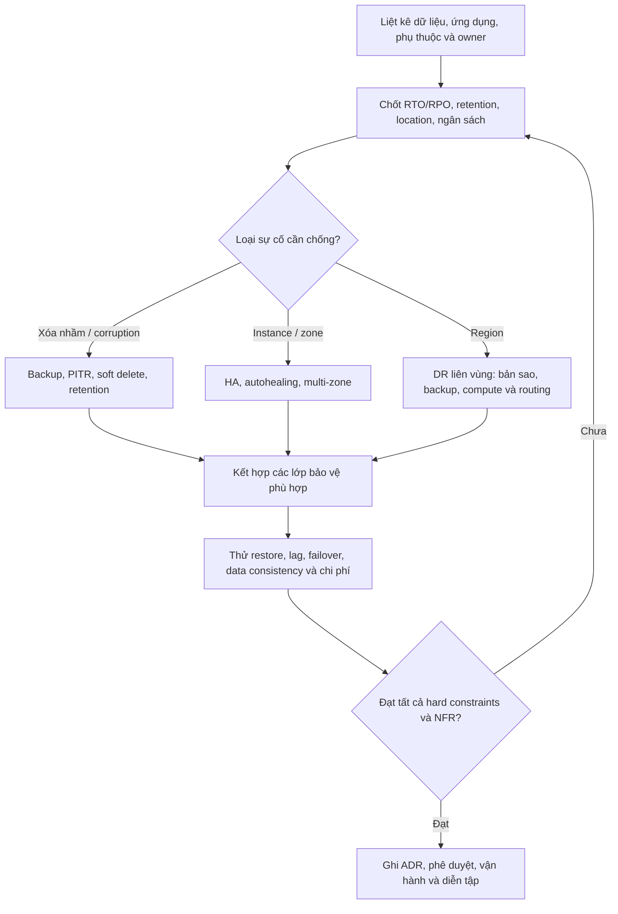
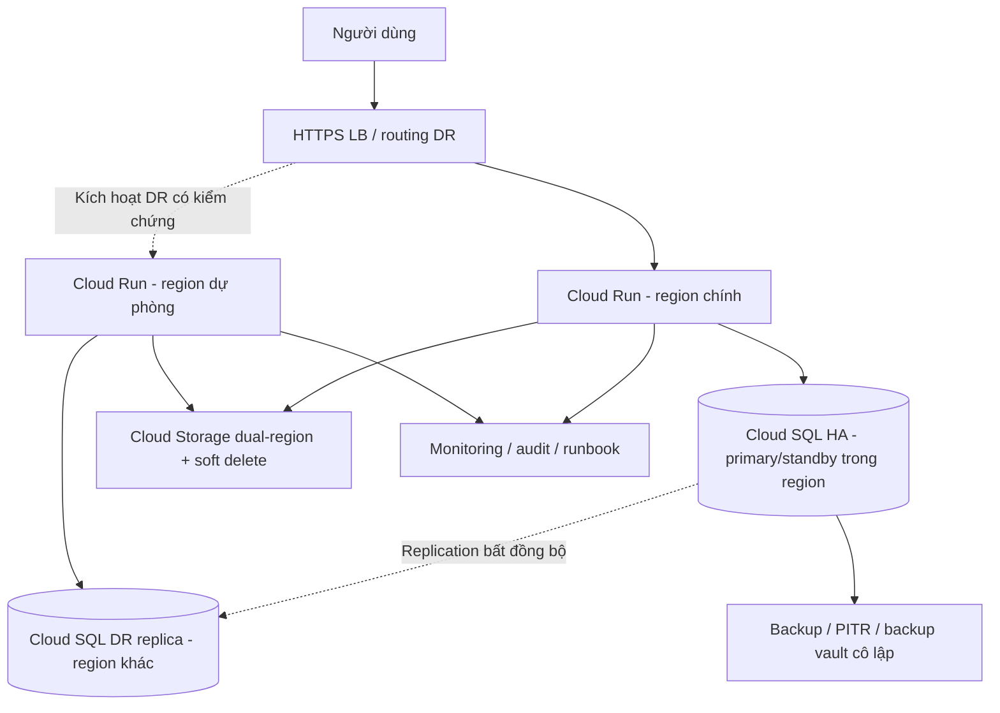

# Lựa chọn backup, replication và high availability

## 1. Bài toán: ba cơ chế bảo vệ ba loại rủi ro khác nhau

Một dịch vụ đặt hàng trên Google Cloud có thể vận hành tốt nhiều tháng nhưng ngừng phục vụ vì một zone gặp sự cố, một quản trị viên xóa nhầm bảng dữ liệu, hoặc cả region không thể truy cập. Ba tình huống đó đòi hỏi những biện pháp khác nhau. **High availability (HA)** giúp giảm gián đoạn khi thành phần đang phục vụ lỗi; **replication** tạo hoặc duy trì bản sao dữ liệu/tài nguyên ở vị trí khác; **backup** lưu điểm khôi phục để quay về trạng thái trước đó.

Trong chương **Sao lưu và phục hồi thảm họa** của mô-đun `CLOUD_PROVIDERS_GCP`, lựa chọn phải xuất phát từ yêu cầu kinh doanh, mô hình lỗi và dữ liệu thực tế. Kiến thức về project, IAM, VPC, Compute Engine, GKE, Cloud Run, Cloud SQL, Cloud Storage và giám sát độ tin cậy cùng chi phí giúp thiết kế giải pháp vừa bảo vệ tài nguyên vừa có thể **khôi phục bằng quy trình đã thử nghiệm**.

Sau bài học, người học có thể:

1. Phân biệt backup, snapshot, point-in-time recovery (PITR), replication, HA, failover và disaster recovery (DR).
2. Chuyển RTO, RPO, retention, data residency và ngân sách thành tiêu chí lựa chọn có thể kiểm chứng.
3. Chọn cơ chế phù hợp cho Cloud SQL, Compute Engine disks, Cloud Storage, GKE và dữ liệu giao dịch phân tán.
4. Giải thích vì sao replication và HA **không thay thế** backup trước xóa nhầm, lỗi logic hay ransomware.
5. Xây dựng giải pháp nhiều lớp, runbook, bài thử restore, failover và failback.

> **Nguyên tắc:** Không đánh dấu “đã có DR” chỉ vì bật backup hoặc tạo read replica. Một giải pháp đạt yêu cầu khi người vận hành biết **khôi phục cái gì, tại đâu, mất bao lâu, có thể mất bao nhiêu dữ liệu và ai có quyền thực hiện**.

## 2. Định nghĩa và phạm vi bảo vệ

| Cơ chế | Tác dụng chính | Phạm vi lỗi thường giải quyết | Điểm không giải quyết |
|---|---|---|---|
| **Backup** | Lưu recovery point theo lịch, có thể restore sau đó | Xóa nhầm, corruption, mất dữ liệu, phục hồi từ thời điểm cũ | Cần thời gian restore; không tự giữ dịch vụ luôn chạy |
| **Snapshot** | Ảnh tại thời điểm của đĩa/volume, một dạng điểm khôi phục | Tạo lại volume/VM, rollback theo tính năng sản phẩm | Snapshot đang chạy có thể chỉ *crash-consistent* |
| **PITR** | Phục hồi về thời điểm cụ thể bằng backup và nhật ký giao dịch | Xóa dữ liệu, batch sai, lỗi logic | Bị giới hạn bởi cửa sổ log, quyền và đường restore hỗ trợ |
| **Replication** | Đồng bộ hoặc sao chép cập nhật sang bản sao khác | Hỏng phần cứng, vùng lỗi, phục vụ đọc hoặc DR | Có thể sao chép cả dữ liệu bị xóa/sai; bản sao bất đồng bộ có độ trễ |
| **HA** | Duy trì dịch vụ khi một thành phần gặp lỗi | Lỗi instance, node hoặc zone tùy topology | Không mặc nhiên chịu lỗi cả region hoặc xóa nhầm |
| **DR** | Khôi phục chức năng nghiệp vụ sau thảm họa | Mất region, dữ liệu hỏng quy mô lớn, sự cố kéo dài | Đòi kiến trúc, runbook, trách nhiệm, diễn tập và kinh phí |

Ví dụ bảng `orders` bị xóa nhầm lúc 10:05: read replica có thể nhận lệnh xóa gần như ngay lập tức; HA tiếp tục phục vụ **dữ liệu đã bị xóa**. Cần backup/PITR trước 10:05, hoặc biện pháp chống xóa thích hợp. Ngược lại, nếu primary database gặp lỗi hạ tầng nhưng dữ liệu không hỏng, HA hoặc replica có thể phục hồi **nhanh hơn** tải lại toàn bộ backup.

### 2.1. Durability, availability, recoverability

- **Durability:** dữ liệu đã ghi có được giữ an toàn trước các hỏng hóc xác định không? Phụ thuộc bản sao, địa điểm lưu và ngữ nghĩa xác nhận ghi.
- **Availability:** người dùng có truy cập và hoàn thành thao tác khi cần không? Dữ liệu an toàn trong backup nhưng ứng dụng đang restore vẫn không khả dụng.
- **Recoverability:** có thể khôi phục **đúng phiên bản, dữ liệu, quyền, cấu hình và dependency** trong thời hạn yêu cầu không?

Không suy SLA của sản phẩm thành SLO toàn hệ thống. API còn phụ thuộc DNS, identity, DB, queue, mạng, quota, mã ứng dụng và nhà cung cấp bên ngoài.

### 2.2. Replication đồng bộ và bất đồng bộ

**Synchronous replication** xác nhận ghi sau khi các bản sao cần thiết nhận dữ liệu theo giao thức của dịch vụ, giúp giới hạn mất dữ liệu cho các sự cố mà topology bảo vệ; đổi lại có thể tăng write latency. **Asynchronous replication** cho phép primary xác nhận trước khi bản sao xa nhận đủ dữ liệu, giảm ảnh hưởng đến thời gian ghi nhưng có nguy cơ mất các giao dịch **chưa replicate** khi primary mất.

Không áp dụng kết luận của sản phẩm này sang sản phẩm khác. Cloud SQL HA đồng bộ giữa các zone **trong cùng region**; cross-region Cloud SQL replica có thể trễ. Spanner có topology và quorum khác; lựa chọn regional, dual-region hay multi-region còn phụ thuộc edition, location và workload.

## 3. Chuyển nhu cầu nghiệp vụ thành RTO, RPO và failure domain

**Recovery Time Objective (RTO):** khoảng thời gian ngừng chức năng nghiệp vụ tối đa tổ chức chấp nhận sau sự cố. **Recovery Point Objective (RPO):** lượng dữ liệu tối đa có thể mất, thường biểu diễn bằng thời gian từ recovery point cuối cùng có thể dùng tới sự cố.

```text
09:00       09:45         10:00               10:50
  |-----------|-------------|-------------------|
  |        recovery       sự cố             nghiệp vụ
  |        point                             hoạt động lại
  |
  +-- RPO thực đo = 10:00 - 09:45 = 15 phút
      RTO thực đo = 10:50 - 10:00 = 50 phút
```

Phải lấy thời điểm recovery point **thực sự sử dụng được**, không chỉ thời điểm một job được lên lịch. RTO kết thúc khi **chức năng nghiệp vụ** hoạt động và dữ liệu kiểm tra hợp lệ, không phải khi VM khởi động hoặc health endpoint trả HTTP 200. Với giao dịch, cần xác định đơn nào đã commit trước sự cố nhưng thiếu sau khi DR và tránh replay gây trùng.

### 3.1. Những phạm vi lỗi cần tách

| Tình huống | Phạm vi thiết kế | Ví dụ biện pháp |
|---|---|---|
| Process, node hoặc VM lỗi | Một compute unit | Restart, nhiều replica, health check, autohealing |
| Một zone lỗi | Tài nguyên cùng zone | HA/multi-zone, regional resources |
| Cả region lỗi | API, DB, secret, storage cùng region | DR liên vùng, app dự phòng, routing và data replica/backup ngoài vùng lỗi |
| Xóa nhầm bảng/object | Dữ liệu logic; hạ tầng vẫn khỏe | Backup, PITR, soft delete, versioning |
| Ransomware/tài khoản bị xâm nhập | Source và cả backup nếu chung quyền quản trị | Backup cô lập/bất biến, quyền tách biệt, kiểm toán |
| Deploy/schema lỗi | Nhiều region có thể lỗi cùng lúc | Canary, rollback, point-in-time restore tương thích |

**HA nhiều zone không chống mất region**; **DR đa region không thay thế phục hồi phiên bản trước khi xóa nhầm**; **backup thường xuyên không bảo đảm RTO ngắn** khi kích thước dữ liệu lớn.

### 3.2. Hợp đồng NFR có thể kiểm chứng

Ví dụ ứng dụng Spring Boot lưu đơn hàng ở PostgreSQL:

| Mã | NFR minh họa | Bằng chứng chấp nhận |
|---|---|---|
| NFR-01 | API đặt hàng sẵn sàng ≥ 99,95% theo synthetic probe trong 30 ngày | SLO, định nghĩa request thành công và error budget |
| NFR-02 | Lỗi zone: ngừng tạo đơn tối đa vài phút | Thử failover staging; đo từ phía ứng dụng |
| NFR-03 | Mất region: RTO ≤ 60 phút | Diễn tập chuyển app, DB, routing; giao dịch nghiệp vụ thành công |
| NFR-04 | Mất region: RPO ≤ 15 phút | So sánh committed transactions trước và sau sự cố |
| NFR-05 | Xóa nhầm: có thể khôi phục mốc trước lỗi trong 7 ngày | Kiểm tra PITR/restore và tính đúng đắn dữ liệu |
| NFR-06 | PII và backup chỉ tại location data owner phê duyệt | Rà soát DB, backup vault, replicas, logs, keys |
| NFR-07 | Backup bất biến tối thiểu 30 ngày nếu chính sách yêu cầu | Kiểm tra enforced retention và quyền xóa |

Các số chỉ là **giả định học tập**, không phải SLA hoặc cam kết GCP. Nếu thiếu RPO cho thao tác xóa nhầm, chưa thể chốt lịch backup; nếu RTO nhỏ hơn thời gian restore đo được, phải bổ sung phương án khôi phục nhanh hoặc đàm phán lại yêu cầu.

## 4. Quy trình chọn giải pháp



| Nhu cầu | Cơ chế ưu tiên | Cơ chế đi kèm | Điều dễ bỏ sót |
|---|---|---|---|
| Dev có thể khôi phục trong 24 giờ | Backup/snapshot theo lịch | IaC, lưu cấu hình | Snapshot DB có thể không nhất quán |
| API production cần chịu lỗi zone | HA/multi-zone | Backup/PITR, retry/reconnect hợp lý | HA không chống lỗi dữ liệu logic |
| Giao dịch cần khôi phục mất region | Cross-region DR replica hoặc restore chiến lược | HA primary, backup/PITR, app secondary, routing | Replication lag, split-brain, phí standby/egress |
| Object bị xóa/ghi đè | Soft delete và Object Versioning khi cần | Retention/copy cô lập | Versioning không bảo vệ xóa cả bucket |
| Object cần truy cập khi region lỗi | Cloud Storage dual-/multi-region hoặc buckets dự phòng | Soft delete, failover/read path | Replication không tự giữ lịch sử phiên bản |
| VM ứng dụng truyền thống | MIG và regional resource khi phù hợp | Disk snapshot, Backup and DR, IaC | Snapshot có thể chỉ crash-consistent |
| GKE stateful | Regional/multi-zone cluster | Backup for GKE, DB backup riêng | Backup cluster chưa bao trùm DB ngoài GKE |

**Không dùng scoring để hợp thức hóa vi phạm data residency hoặc retention pháp lý.** Nếu region DR không nằm trong vùng được phép, phải loại phương án dù RTO rất tốt.

## 5. Cloud SQL: kết hợp HA, backup, PITR và DR

### 5.1. HA ở cấp zone, trong một region

Với Cloud SQL PostgreSQL cấu hình **HA (regional)**, primary và standby nằm ở **hai zone trong cùng region**. Cloud SQL sử dụng cơ chế đồng bộ dữ liệu tới các zone trước khi xác nhận commit như tài liệu mô tả. Khi lỗi instance/zone, dịch vụ có thể tự chuyển primary sang standby; ứng dụng cần xử lý ngắt kết nối và kết nối lại.

Điểm đánh đổi:

- Giảm gián đoạn do lỗi zone/instance nhưng **không** chống mất toàn region.
- Phát sinh chi phí tài nguyên HA; kiểm tra edition và pricing hiện tại.
- Failover vẫn có gián đoạn; đo từ phía API, không chỉ trạng thái Console.
- Vẫn cần backup/PITR để xử lý xóa nhầm, schema lỗi hoặc corruption.

[Cloud SQL PostgreSQL — HA](https://docs.cloud.google.com/sql/docs/postgres/high-availability) · [Configure HA](https://docs.cloud.google.com/sql/docs/postgres/configure-ha).

### 5.2. Backup và PITR để quay về thời điểm đúng

Cloud SQL hỗ trợ backup tự động hoặc theo yêu cầu, với các lựa chọn **standard backups** và **enhanced backups** tùy edition/cấu hình. Enhanced backups được quản lý bằng Backup and DR, sử dụng **backup vault** và có các chính sách retention, lịch sao lưu cùng khả năng tách vị trí lưu backup khỏi instance trong các trường hợp hỗ trợ.

**PITR** dùng backup và transaction logs để tạo instance tại một mốc thời gian trong cửa sổ phục hồi. Với PostgreSQL, PITR tạo **instance mới**, không ghi đè instance cũ. Trạng thái bật mặc định phụ thuộc edition và cách tạo instance (Console/CLI/API): phải kiểm tra cấu hình **thực tế**.

| Cách bảo vệ | Khi nên chọn | Giới hạn |
|---|---|---|
| Automated backup | Recovery point định kỳ | RPO phụ thuộc lịch/loại backup; restore có thể lâu |
| On-demand backup | Trước nâng cấp hoặc thay đổi dữ liệu lớn | Chỉ tạo một mốc, không thay lịch sao lưu |
| PITR | Khôi phục trước thao tác xóa nhầm/batch lỗi | Phụ thuộc transaction logs, retention và đường restore hỗ trợ |
| Enhanced backups + backup vault | Quản lý tập trung, retention, cách ly quyền và địa điểm | Quyền, chi phí vault và giới hạn tương thích/restore |
| Export ra Cloud Storage | Migration, đối soát hoặc dữ liệu logic chọn lọc | Không tương đương backup Cloud SQL quản lý; tự chịu trách nhiệm lifecycle |

**Giới hạn CMEK đặc biệt quan trọng:** với **enhanced backups lưu vault khác region**, backup Cloud SQL của instance dùng CMEK vẫn phụ thuộc khóa của instance nằm ở **region nguồn**. Nếu region chứa khóa không khả dụng, backup không thể được giải mã để restore cho tới khi region phục hồi. Tài liệu hiện hành cũng nêu **PITR từ vault backup khác vùng** chỉ restore sang **instance mới tại cùng region với instance nguồn**. Vì thế một vault ở xa chưa đủ bảo đảm DR khi mất region. Cần xác minh phương án restore, vị trí khóa và kịch bản mất region **trước** khi ký RTO.

[Cloud SQL backup options](https://docs.cloud.google.com/sql/docs/postgres/backup-recovery/backup-options) · [Backup overview](https://docs.cloud.google.com/sql/docs/postgres/backup-recovery/backups) · [PITR](https://docs.cloud.google.com/sql/docs/postgres/backup-recovery/pitr) · [Restore](https://docs.cloud.google.com/sql/docs/postgres/backup-recovery/restore).

### 5.3. Cross-region replica cho DR

**Cross-region read replica** duy trì bản sao gần hiện tại ở một region khác. Khi luồng ghi bất đồng bộ, bản sao có thể chậm hơn primary; trước promote/failover phải xác minh dữ liệu đã replicate, đổi endpoint ứng dụng và tránh tình trạng hai primary nhận ghi.

Lựa chọn:

1. **Backup/restore ở region khác:** ít tài nguyên chạy nền hơn nhưng restore database lớn có thể trượt RTO.
2. **Warm standby bằng replica:** có thể giảm RTO, đổi lại phải trả phí instance và replication, theo dõi lag, vận hành promote/failback.
3. **Giải pháp DR nâng cao theo engine/edition:** đánh giá các cơ chế switchover/replica failover được hỗ trợ, giới hạn vùng và phiên bản thực tế.

Không ghi **RPO=0** trong ADR chỉ vì có replica. Cần đo replication lag ở peak load, đếm giao dịch bị thiếu và thử cả split-brain prevention.

[Cloud SQL PostgreSQL — Disaster recovery](https://docs.cloud.google.com/sql/docs/postgres/intro-to-cloud-sql-disaster-recovery) · [Cross-region replicas](https://docs.cloud.google.com/sql/docs/postgres/replication/cross-region-replicas).

## 6. Cloud Storage: replication khác khôi phục object bị xóa

### 6.1. Location, replication và khả dụng dữ liệu

- **Regional bucket:** dữ liệu được đặt theo cơ chế regional; phù hợp khi compute gần dữ liệu, nhưng không tự cung cấp đường truy cập khác region nếu cả region lỗi.
- **Dual-region/multi-region:** có khả năng dự phòng object giữa các region theo topology; phù hợp khi dữ liệu cần sẵn sàng khi region gặp sự cố và data residency cho phép.
- **Turbo replication:** tùy chọn cho dual-region được hỗ trợ, được thiết kế để replicate object mới giữa hai region trong **RPO 15 phút** theo mục tiêu sản phẩm. Đây là chỉ tiêu **replication object**, không phải cam kết RPO 15 phút cho ứng dụng có database và message queue.
- **Cross-bucket replication:** sao chép object mới hoặc cập nhật sang **bucket khác** bất đồng bộ. Các bucket có location, encryption, IAM, lifecycle riêng nên cần thiết kế quyền và khôi phục riêng.

Replication có thể sao chép trạng thái **không mong muốn** hoặc khiến hệ thống tiếp tục phục vụ bản nội dung sai. Đừng đánh đồng redundancy với lịch sử điểm khôi phục.

[Cloud Storage — Availability and durability](https://docs.cloud.google.com/storage/docs/availability-durability) · [Turbo replication](https://docs.cloud.google.com/storage/docs/managing-turbo-replication) · [Cross-bucket replication](https://docs.cloud.google.com/storage-transfer/docs/cross-bucket-replication).

### 6.2. Soft delete, Object Versioning và retention

| Cơ chế | Giá trị | Điều phải cân nhắc |
|---|---|---|
| **Soft delete** | Giữ object/bucket bị xóa hoặc ghi đè trong retention window để restore | Object soft-deleted không đọc trực tiếp; cần quyền restore, có chi phí lưu |
| **Object Versioning** | Giữ noncurrent generations có thể truy cập | Tăng object lưu; **không bảo vệ việc xóa cả bucket** |
| **Retention policy** | Ngăn xóa object trước thời hạn yêu cầu | Chi phí và ràng buộc pháp lý; khóa policy có thể khó/không thể đảo ngược |
| **Bucket độc lập** | Tách quyền, storage class/location và đường phục hồi | IAM, lag, lifecycle và network cost cần quản trị |

Cloud Storage thường bật **soft delete mặc định 7 ngày** cho bucket hỗ trợ theo tài liệu hiện hành; phải kiểm tra bucket thực tế, không coi mặc định là vĩnh viễn. Google khuyến nghị soft delete khi mục đích là bảo vệ trước xóa nhầm; Object Versioning phù hợp khi cần truy cập trực tiếp generation cũ. Với bucket chứa dữ liệu tạm, soft delete có thể làm hóa đơn tăng đáng kể.

[Soft delete](https://docs.cloud.google.com/storage/docs/soft-delete) · [Object Versioning](https://docs.cloud.google.com/storage/docs/object-versioning).

Ví dụ thư viện ảnh sản phẩm cần chịu được region lỗi **và** xóa nhầm: dùng dual-region hoặc kiến trúc buckets dự phòng tại location được phép **để tăng availability**, đồng thời soft delete/versioning/retention phù hợp **để khôi phục**. Đây là hai lớp bảo vệ theo các rủi ro khác nhau.

## 7. Compute Engine, Backup and DR và GKE

### 7.1. Snapshot Compute Engine

Compute Engine hỗ trợ disk snapshots và những cơ chế replication/backup khác nhau theo loại disk. **Snapshot disk đang chạy mặc định có thể chỉ crash-consistent**: những transaction còn trong memory hoặc pending writes có thể chưa được chụp thành trạng thái nhất quán của ứng dụng.

Đối với DB tự quản trên VM, thiết kế **application-consistent snapshot** bằng quy trình quiesce/flush hoặc giải pháp backup nhận biết DB. Nếu cần snapshot nhiều đĩa, kiểm tra cách phối hợp consistency group theo khả năng hỗ trợ. Đừng quên boot image, VM metadata, firewall, network, IAM, KMS keys, secret và cấu hình trong IaC: restore được disk chưa có nghĩa app chạy được.

**HA VM** thường cần nhiều instance, health checks, Managed Instance Groups và load balancing khi workload phù hợp. Một snapshot volume đơn lẻ không tạo ra HA.

[Disk snapshot best practices](https://docs.cloud.google.com/compute/docs/disks/snapshot-best-practices) · [Snapshots](https://docs.cloud.google.com/compute/docs/disks/snapshots).

### 7.2. Backup and DR Service: backup vault cô lập

**Backup and DR Service** cung cấp backup plans, rules, backup vaults và restore cho **workloads được hỗ trợ**. Backup vault là nơi giữ bản sao cách ly; enforced retention giúp bảo vệ trước việc xóa sớm. Tách backup management project khỏi workload project có thể giảm blast radius nếu một service account ứng dụng bị xâm nhập.

Cần xác định:

- Loại tài nguyên, edition và location có hỗ trợ backup/vault/restore cụ thể không?
- Vault ở region hoặc multi-region nào, có phù hợp data residency và kịch bản region down không?
- Retention đủ chống xóa nhầm/ransomware nhưng có tuân thủ yêu cầu xóa dữ liệu hợp pháp không?
- Ai quản lý vault, backup plan, restore, KMS key và project chứa backup?
- Khi source project/region không khả dụng, còn tìm được bản kê cấu hình, key và identity để restore không?

**Bất biến tạo chi phí:** backup còn trong hạn enforced retention không thể tùy ý xóa để giảm tiền. Hãy thử chính sách trên lab và rà soát thời hạn trước khi khóa.

[Backup and DR overview](https://docs.cloud.google.com/backup-disaster-recovery/docs/concepts/backup-dr) · [Backup vault](https://docs.cloud.google.com/backup-disaster-recovery/docs/concepts/backup-vault).

### 7.3. Backup for GKE

Backup for GKE có thể bảo vệ Kubernetes resources và PersistentVolume được hỗ trợ theo cấu hình. Nhưng GKE thường còn dùng Cloud SQL, Cloud Storage, Secret Manager và dịch vụ bên ngoài: **backup cluster không thay backup database và object**. Khi restore, kiểm tra cluster version, CRDs, storage drivers, network, IAM, application consistency và các phụ thuộc.

GKE regional/multi-zone giúp workload chịu lỗi node/zone theo thiết kế. Để phục hồi cả region phải có cluster/compute, artifacts, secrets, quota, kết nối và data source ở vùng khác. **Tạo được Pod chưa đủ để kết luận RTO đã đạt**.

[Backup for GKE](https://docs.cloud.google.com/kubernetes-engine/docs/add-on/backup-for-gke/concepts/backup-for-gke) · [Limits](https://docs.cloud.google.com/kubernetes-engine/docs/add-on/backup-for-gke/concepts/quotas-and-limits).

## 8. Khi nào cân nhắc Spanner?

Với giao dịch SQL cần nhất quán mạnh và tính sẵn sàng qua nhiều region, **Spanner** có thể là ứng viên so với Cloud SQL + DR replication thủ công. Spanner có regional, dual-region, multi-region topology và quorum, với khác biệt về edition, location, chi phí và write latency.

- Chuyển DB sang Spanner **không tự làm toàn ứng dụng multi-region**: compute, API, queue, secrets, IAM, load balancer và failure handling vẫn cần thiết kế.
- Multi-region quorum có thể làm tăng độ trễ ghi; benchmark workload tại khu vực người dùng thực tế.
- Vẫn cần backup/PITR/retention phù hợp để bảo vệ trước lỗi logic và xóa dữ liệu.
- Migration từ PostgreSQL/MySQL có chi phí thay schema, SQL, ORM, transaction semantics và quy trình phát hành.

[Spanner instance configurations](https://docs.cloud.google.com/spanner/docs/instance-configurations) · [Spanner backup](https://docs.cloud.google.com/spanner/docs/backup).

## 9. Thiết kế theo lớp: ứng dụng đặt hàng Spring Boot

### 9.1. Yêu cầu giả định

Một API Spring Boot trên Cloud Run lưu đơn hàng tại Cloud SQL for PostgreSQL, ảnh sản phẩm ở Cloud Storage và gửi email bằng hệ thống queue. Nhóm cần:

| Tiêu chí | Ngưỡng/kỳ vọng |
|---|---|
| Availability | API đặt hàng SLO 99,95% trong 30 ngày |
| Lỗi instance/zone | Có cơ chế tự phục hồi và reconnect, không mất đơn đã xác nhận theo phạm vi HA |
| Mất region | RTO ≤ 60 phút; RPO ≤ 15 phút, đo trên committed transactions |
| Lỗi dữ liệu logic | Có thể phục hồi mốc trước lỗi trong cửa sổ 7 ngày |
| Ảnh sản phẩm | Có khả năng đọc khi một region lỗi, có thể phục hồi object bị xóa |
| Dữ liệu nhạy cảm | Chỉ lưu trong locations, vaults và keys data owner phê duyệt |
| Vận hành | Có alerts, logs, diễn tập DR định kỳ và ngân sách dự phòng |

### 9.2. Kết hợp ba lớp bảo vệ

**Lớp 1 — Chống lỗi instance/zone:** Cloud Run regional dùng health/startup checks và xử lý retry kết nối hợp lý; Cloud SQL HA ở hai zone cùng region; giám sát 5xx, latency, DB CPU, memory và connection pool. Đây là **HA cấp zone**, chưa đáp ứng mất region.

**Lớp 2 — Khôi phục lỗi dữ liệu:** Cloud SQL backups (standard/enhanced phù hợp), PITR window đủ dài, backup vault/retention và IAM cách ly; Cloud Storage soft delete hoặc versioning. Định kỳ restore database vào **instance riêng**, kiểm tra dữ liệu và khả năng chạy API. Backup cần đủ dữ liệu, khóa và metadata để đưa ứng dụng về trạng thái đúng.

**Lớp 3 — Mất region:** ứng viên gồm Cloud SQL cross-region DR replica hoặc backup restore tới region đích, Cloud Run secondary deployment, artifact image, secrets/IAM, quota và global routing phù hợp. Cloud Storage dual-region/replication phục vụ ảnh, cùng bảo vệ chống xóa. Phải kiểm tra vị trí KMS keys, backups, replicas, logs và điều kiện data residency.



Sơ đồ trên là **kiến trúc ứng viên**, không phải kết quả failover đã chứng minh. Database ở vùng DR chỉ được phép ghi sau promote/failover có kiểm soát; phải ngăn hai primary nhận ghi đồng thời (*split-brain*). Mục tiêu RPO 15 phút **chưa được đảm bảo** khi chưa đo replication lag. Phương án backup restore còn phải chứng minh có thể giải mã và tạo tài nguyên mới khi region chính hỏng.

### 9.3. So sánh phương án

| Phương án | Chịu lỗi zone | Xóa nhầm dữ liệu | Mất region | Trade-off |
|---|---|---|---|---|
| **A:** Cloud SQL zonal + backup cùng region | Hạn chế | Có thể restore nếu backup hợp lệ | Chưa có đường phục hồi tin cậy | Chi phí thấp nhưng không đáp ứng DR yêu cầu |
| **B:** Cloud SQL HA + backup/PITR | Tốt hơn, có failover theo phạm vi HA | Có thể PITR/restore | Chưa có DR liên vùng | Tốn tài nguyên HA, vẫn thiếu region recovery |
| **C:** HA + backup/PITR + DR replica/backup cross-region + app dự phòng | Có | Có | Ứng viên nếu DR drill và lag đạt | Thêm replica, egress, backup, IAM, chi phí và công vận hành |
| **D:** App đa region + Spanner topology phù hợp + bảo vệ dữ liệu | Tùy compute và DB topology | Có qua backup/PITR hỗ trợ | Có thể giảm công đoạn DR DB | Chi phí/migration/latency/edition phức tạp hơn |

Với bộ NFR trên, **A và B không đủ** để chịu mất region. **C và D chỉ là ứng viên** cho đến khi có bằng chứng test. Nếu chính sách chỉ cho phép dữ liệu ở một region, phải ghi rõ xung đột với mục tiêu chịu mất region; không âm thầm đưa bản sao sang nơi chưa được duyệt.

### 9.4. Quyết định có điều kiện

Giả sử PoC của C cho thấy load test đạt; replication lag trong vùng chấp nhận; DR drill đo RTO **47 phút**, RPO **8 phút**; đối chiếu đơn hàng không trùng và backup restore hoạt động trong vùng đích. Khi đó có thể **đề xuất phê duyệt C** với risk register (độ trễ tăng khi peak, quota vùng dự phòng, chi phí standby, KMS/IAM và thay đổi schema).

Nếu drill đo RTO **85 phút** hoặc RPO **20 phút**, phương án C **không đạt**, dù đã bật đủ các tính năng. Phải cải tiến runbook/capacity/chiến lược dữ liệu hoặc xin chủ sở hữu điều chỉnh NFR.

## 10. Runbook khôi phục có kiểm soát

**Không diễn tập bằng cách xóa dữ liệu thật trên production.** Dùng project staging, dữ liệu giả lập và quyền tách biệt. Runbook gồm:

1. **Khai báo sự cố:** xác định dấu hiệu, phạm vi (instance/zone/region/data corruption), mốc bắt đầu, incident commander và hệ nghiệp vụ ảnh hưởng.
2. **Khoanh vùng:** nếu nghi tài khoản bị xâm nhập hoặc xóa hàng loạt, hạn chế thao tác ghi, bảo toàn logs/evidence và backup; không restore vào môi trường kẻ tấn công còn kiểm soát.
3. **Chọn recovery point:** dựa vào timestamp của giao dịch cuối hợp lệ, danh sách backups, PITR window và replication lag; ghi dữ liệu có thể mất.
4. **Chọn đường phục hồi:** HA failover nếu hỏng zone và dữ liệu đúng; promote DR replica nếu mất region và bản sao đáng tin; restore backup/PITR vào **instance riêng** nếu dữ liệu bị lỗi logic.
5. **Chuẩn bị điểm đến:** quota, network, DNS, service accounts, KMS keys, secrets, image, cloud resources và dependency.
6. **Xác minh dữ liệu:** số lượng/ID đơn, tổng tiền, quan hệ khóa ngoại, checksums/manifest; thử idempotent replay event.
7. **Mở ứng dụng:** chuyển traffic có kiểm soát, đo request thành công và lỗi nghiệp vụ; thực hiện giao dịch mẫu end-to-end.
8. **Đo RTO/RPO:** ghi thời gian bắt đầu/kết thúc, data loss thực tế, bước thủ công và chi phí phát sinh.
9. **Failback:** chỉ quay về region cũ khi đã đối soát; tránh split-brain; cập nhật bài học sự cố, alerts và runbook.

### 10.1. Lệnh kiểm tra trước diễn tập

Các lệnh sau **chỉ đọc metadata**, ngoại trừ `gcloud config set project` thay đổi cấu hình CLI cục bộ. Chạy từ máy quản trị vào **project lab** với danh tính có quyền đọc:

```bash
export PROJECT_ID="my-lab-project"
export INSTANCE="orders-postgres"
export BUCKET="my-lab-product-images"

gcloud config set project "$PROJECT_ID"

# Cloud SQL: region, HA và backup/PITR settings
gcloud sql instances describe "$INSTANCE" \
  --format="yaml(name,region,settings.availabilityType,settings.backupConfiguration)"

# Danh sách backup (kiểm tra nguồn và loại backup/vault tương ứng)
gcloud sql backups list --instance="$INSTANCE"

# Metadata bucket: location, soft delete, versioning, retention
gcloud storage buckets describe "gs://$BUCKET" --format=json
```

Đây **không phải script tự động restore hoặc failover**. Enhanced backups có các đối tượng/vault được quản lý qua Backup and DR; liệt kê backup không thay kiểm tra khả năng truy cập vault và khôi phục. Nếu backup dùng CMEK, thực hành DR phải thử cả đường truy cập khóa. Không ghi secret, token hoặc dữ liệu PII vào log lệnh.

### 10.2. Ma trận thử khôi phục

| Bài thử | Cách thử trong lab | Bằng chứng PASS |
|---|---|---|
| Restore backup định kỳ | Restore sang database riêng, chạy test | Đúng schema, row counts, khóa ngoại, truy vấn nghiệp vụ, thời gian ghi nhận |
| PITR trước lỗi logic | Tạo dữ liệu thử, xóa sai, PITR về mốc trước lỗi | Chọn được thời điểm còn trong retention, không ghi đè production |
| HA failover | Thử theo quy trình Cloud SQL trong staging | Client reconnect, thời gian downtime chấp nhận, giao dịch committed đúng |
| Cross-region DR | Giả lập primary region không phục vụ, chuyển app/DB/routing | RTO/RPO thực đo đạt, đơn mới thành công, không split-brain |
| Cloud Storage object deletion | Xóa một object thử khi soft delete có hiệu lực rồi restore | Phục hồi đúng object/generation và metadata |
| KMS/IAM issue | Mô phỏng thiếu quyền trên tài nguyên lab | Lỗi được phát hiện, cảnh báo đến người trực, runbook giải quyết được |
| Vault cô lập | Khôi phục bằng danh tính DR trong giả định workload account mất quyền | Khôi phục có dữ liệu và cấu hình cần thiết, có audit trail |

## 11. Bảo vệ backup trước tấn công và lỗi cấu hình

Backup đáng tin cần được bảo vệ tương đương dữ liệu gốc:

- **Tách quyền:** service account ứng dụng không được xóa backup hoặc thay retention; backup operators có quyền riêng; restore có phê duyệt/audit.
- **Cách ly:** cân nhắc vault ở project khác và location phù hợp DR, không để một IAM principal có thể xóa đồng thời production và backup.
- **Retention/immutability:** áp dụng enforced retention phù hợp trước ransomware, nhưng cần tính chi phí và yêu cầu pháp lý về xóa dữ liệu.
- **Khóa:** xem vị trí CMEK key, service agents, quyền decrypt, khả năng sử dụng khi source region không khả dụng và kế hoạch quay vòng khóa.
- **Phát hiện:** cảnh báo backup job fail, tuổi backup quá ngưỡng, replication lag, thay đổi IAM/retention, lượng object soft-deleted tăng bất thường.
- **Runbook độc lập:** có bản kê hạ tầng/credentials break-glass có giám sát ở nơi đội DR có thể truy cập ngay cả khi primary project/SSO gặp lỗi.

Nếu chỉ người xây dựng ứng dụng có quyền restore, đội trực có thể không thực hiện được khi người đó vắng mặt. Nếu khóa an toàn nhưng bị thu hồi quyền sử dụng không có cơ chế phục hồi, dữ liệu vẫn không đọc được. Đây đều là rủi ro **recoverability**.

## 12. Chi phí và trade-offs

```text
TCO DR hàng tháng (ước tính)
  = compute và DB standby/replica
  + snapshot/backup/vault storage theo retention
  + transaction logs/PITR và bản sao object
  + request operations + inter-region egress
  + load balancer, logging, monitoring và KMS
  + công vận hành, diễn tập restore và giấy phép
```

Chi phí **lưu backup** khác chi phí **phục hồi**: khi xảy ra sự cố phải có đủ compute, disk, network và nhân lực để dựng lại hệ thống. Backup lâu dài hoặc retention bất biến tăng GB-tháng; standby nóng và active-active tăng phí thường trực, có thể tăng write latency.

Ví dụ mô hình ước tính dung lượng **logic**, không phải báo giá Cloud SQL:

```text
Dữ liệu gốc                    = 1 TiB
Dữ liệu thay đổi mỗi ngày      = 3% = 0,03 TiB
Retention 14 ngày: 1 bản nền + 13 phần thay đổi
Tổng minh họa ~ 1 + 13 × 0,03 = 1,39 TiB
```

Thực tế snapshot/incremental backup có cách tính phí, compression, dedup, retention và overhead khác nhau; mức thay đổi dữ liệu không đều. Dùng Google Cloud Pricing Calculator và Billing export rồi hiệu chỉnh bằng pilot, không lấy 1,39 TiB làm kết quả tính phí chắc chắn.

| Mục tiêu | Tác động phụ | Cách xác minh |
|---|---|---|
| Giảm RTO | Cần standby nóng hơn, replica và capacity DR | Drill mất region, đo đến giao dịch thành công |
| Giảm RPO | Replicate nhanh hơn hoặc giao thức đồng bộ, tăng độ trễ/chi phí | Đo lag, so sánh committed transactions ở peak |
| Chống xóa nhầm lâu hơn | Retention, versioning/soft delete tăng storage cost | Cost breakdown và restore test |
| Tăng isolation của backup | Tăng IAM/project/vault/KMS và công vận hành | Restore bằng danh tính DR độc lập |
| Giảm tiền bằng cách bỏ replica | RTO restore có thể tăng | Restore volume production tương đương trong lab |
| Đa region | Egress, topology, độ phức tạp consistency | DR drill, compliance và tổng TCO |

Khi ngân sách chưa đáp ứng, báo rõ NFR nào còn rủi ro và xin chủ sở hữu điều chỉnh có thẩm quyền; **không tự ý cắt backup, audit logs hay retention bắt buộc**.

## 13. Sai lầm phổ biến

| Nhận định sai | Vì sao sai | Điều chỉnh |
|---|---|---|
| “Có read replica nên không cần backup” | Replica nhận cả xóa nhầm/corruption và không có recovery point độc lập | Backup/PITR + retention + restore drill |
| “Cloud SQL HA chống được mất region” | HA primary/standby nằm ở các zone cùng region | DR liên vùng hoặc phục hồi tại region khác |
| “Snapshot VM là bản sao nhất quán của DB” | Snapshot đang chạy có thể chỉ crash-consistent | Application-consistent backup, flush/quiesce, kiểm chứng |
| “Backup job thành công nghĩa là restore được” | Có thể thiếu key, quyền, dependency, bản backup lỗi | Restore định kỳ vào hệ thống sạch, test nghiệp vụ |
| “Vault khác region chắc chắn restore được” | CMEK key tại vùng nguồn có thể bị mất truy cập | Thử whole-region DR kể cả key access |
| “Dual-region bucket chống được xóa nhầm” | Replication/availability khác retention và soft delete | Bổ sung điểm phục hồi object |
| “Object Versioning bảo vệ xóa bucket” | Versioning không bảo vệ bucket-level deletion | Soft delete/retention phù hợp |
| “RPO ứng dụng bằng RPO một bucket” | Dữ liệu ở nhiều nguồn và giao dịch phân tán | Đối soát luồng kinh doanh end-to-end |
| “Restore VM/Pod xong là hết RTO” | Thiếu configs, DB, keys, network, DNS, endpoint | Đo đến khi khách hàng thao tác thành công |
| “Nhiều bản sao luôn tốt hơn” | Chi phí, tấn công, residency và rủi ro thao tác tăng | Chọn theo yêu cầu, topology và bằng chứng |

## 14. Bài tập thiết kế phục hồi cho ba workload

Hãy lập ma trận quyết định cho:

| Workload | Mức quan trọng | Sự cố cần chống | RTO / RPO giả định |
|---|---|---|---|
| Cổng nhân sự nội bộ trên VM, cập nhật mỗi ngày | Trung bình | Mất VM hoặc xóa file | RTO 8 giờ, RPO 24 giờ |
| API đặt hàng Cloud Run + Cloud SQL PostgreSQL | Cao | Lỗi zone, region, xóa nhầm DB | Region: RTO 60 phút, RPO 15 phút; PITR 7 ngày |
| Thư viện ảnh trên Cloud Storage | Trung bình/cao | Mất region và xóa nhầm ảnh | Khả dụng đọc khi region lỗi; phục hồi object đã xóa trong 7 ngày |

Với mỗi workload:

1. Chọn một lớp HA nếu cần, cơ chế bản sao/DR nếu cần và cơ chế backup/restore về thời điểm cũ. Giải thích lý do.
2. Xác định location, owner, IAM separation, chính sách key/retention và failure domains.
3. Dự toán standby, storage, vault, egress, observability và công vận hành.
4. Viết test RTO/RPO và tính nhất quán dữ liệu. Chỉ ghi **PASS** khi đã thực hiện test, có logs và biên bản.

**Hướng giải:** VM có thể dùng snapshot/backup theo lịch và IaC kèm restore drill; API đặt hàng cần Cloud SQL HA **và** PITR/backup, thêm DR liên vùng đã thử; ảnh cần replication/location phù hợp **và** soft delete/versioning. RPO 15 phút cho đơn hàng không được hứa chỉ vì có replica. Nếu policy vùng dữ liệu cấm region DR, ghi rõ xung đột và escalations.

## 15. Checklist nghiệm thu và tài liệu chính thức

Trước khi chấp thuận kiến trúc:

- [ ] Có inventory dữ liệu gốc, các dependency và phân loại nhạy cảm.
- [ ] Mỗi loại sự cố có RTO, RPO, retention và owner được phê duyệt.
- [ ] Đã phân biệt lỗi process/zone/region, dữ liệu logic và ransomware.
- [ ] HA, replication, backup được dùng theo mục đích **khác nhau**.
- [ ] Đã kiểm tra tính năng backup/PITR/vault/soft delete theo engine, edition và location.
- [ ] Backup không thể bị cùng một tài khoản xóa cả nguồn lẫn bản sao; retention có kiểm soát.
- [ ] Key và quyền decrypt còn dùng được khi source region hoặc project gặp sự cố.
- [ ] Restore vào môi trường sạch, kiểm tra dữ liệu/ứng dụng và đo thời gian thực.
- [ ] DR drill kiểm tra lag, failover, failback, split-brain và giao dịch nghiệp vụ.
- [ ] IAM, quota, secrets, image, network và routing sẵn tại vùng DR.
- [ ] SLO alerts theo dõi backup job, tuổi backup, replication lag, failed restore và IAM changes.
- [ ] TCO tính cả retention, standby, egress, logging và các lần diễn tập.

### Tài liệu Google Cloud

- [Disaster recovery planning guide](https://docs.cloud.google.com/architecture/dr-scenarios-planning-guide) — RTO/RPO và mô hình sự cố.
- [Backup and DR Service](https://docs.cloud.google.com/backup-disaster-recovery/docs/concepts/backup-dr) — backup plans và workloads.
- [Backup vaults](https://docs.cloud.google.com/backup-disaster-recovery/docs/concepts/backup-vault) — isolation và enforced retention.
- [Cloud SQL HA](https://docs.cloud.google.com/sql/docs/postgres/high-availability) — primary/standby trong các zone.
- [Cloud SQL backup options](https://docs.cloud.google.com/sql/docs/postgres/backup-recovery/backup-options) — backup standard/enhanced và giới hạn CMEK.
- [Cloud SQL PITR](https://docs.cloud.google.com/sql/docs/postgres/backup-recovery/pitr) — recovery point và giới hạn theo vùng.
- [Cloud SQL DR](https://docs.cloud.google.com/sql/docs/postgres/intro-to-cloud-sql-disaster-recovery) — cross-region recovery.
- [Cloud Storage soft delete](https://docs.cloud.google.com/storage/docs/soft-delete) và [Object Versioning](https://docs.cloud.google.com/storage/docs/object-versioning) — bảo vệ dữ liệu xóa nhầm.
- [Cloud Storage availability](https://docs.cloud.google.com/storage/docs/availability-durability) — dual-region và replication.
- [Compute Engine snapshot best practices](https://docs.cloud.google.com/compute/docs/disks/snapshot-best-practices) — crash/application consistency.
- [Backup for GKE](https://docs.cloud.google.com/kubernetes-engine/docs/add-on/backup-for-gke/concepts/backup-for-gke) — backup/restore Kubernetes.
- [Spanner configurations](https://docs.cloud.google.com/spanner/docs/instance-configurations) — regional, dual/multi-region.
- [Google Cloud Pricing Calculator](https://cloud.google.com/products/calculator) — tính phí theo topology và tải thực tế.

**Kết quả mong đợi:** người học có thể bảo vệ lựa chọn backup, replication và HA bằng **kịch bản lỗi, RTO/RPO, bằng chứng restore, quyền dữ liệu, rủi ro còn lại và tổng chi phí**, sau đó cập nhật thiết kế khi workload hoặc chính sách thay đổi.
