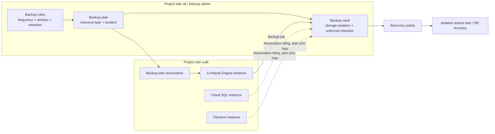

# Backup and DR Service và tổ chức kế hoạch bảo vệ

> **Chương:** Sao lưu và phục hồi thảm họa  
> **Mô-đun:** `CLOUD_PROVIDERS_GCP` — học Google Cloud từ tổ chức project, IAM và VPC đến Compute Engine, GKE, Cloud Run, lưu trữ và cơ sở dữ liệu; qua các tình huống triển khai, người học lựa chọn dịch vụ, bảo vệ tài nguyên, tự động hóa phát hành và theo dõi độ tin cậy cùng chi phí.  
> **Phạm vi:** Google Cloud **Backup and DR Service**, mô hình sao lưu vào **backup vault** được quản lý, **backup plan**, **backup rule** và **backup plan association**; thiết kế bảo vệ ứng dụng, kiểm thử phục hồi, an toàn vận hành và quản lý chi phí. Ví dụ chỉ dành cho project thử nghiệm, không được chạy trực tiếp trên production khi chưa có phê duyệt.

## 1. Mục tiêu học tập

Sau bài học, người học có thể:

1. Phân biệt **backup**, **replication**, **high availability (HA)** và **disaster recovery (DR)**, cũng như RPO và RTO.
2. Giải thích vai trò backup vault, backup plan, backup rule, backup plan association, backup job và recovery point.
3. Thiết kế chính sách bảo vệ theo độ quan trọng, lịch sao lưu, retention, địa điểm lưu, yêu cầu ứng dụng và chi phí.
4. Chọn mô hình **Google Cloud console-native** cho tài nguyên GCP được hỗ trợ và nhận diện nhánh **appliance management console** đang trong lộ trình ngừng hỗ trợ.
5. Tổ chức project, IAM, backup vault, backup plan và association để giảm rủi ro xóa hoặc sửa backup khi production bị xâm nhập.
6. Thực hiện quy trình minh họa bảo vệ một Compute Engine VM, kiểm tra job và thử khôi phục có kiểm soát.
7. Lập runbook DR có bài kiểm tra khôi phục, bảng trách nhiệm, cảnh báo, chỉ tiêu và quy trình xử lý sự cố.

### Tình huống mở đầu

Doanh nghiệp có máy ảo xử lý hóa đơn trên Compute Engine, cơ sở dữ liệu Cloud SQL, kho file Filestore và một số dịch vụ chạy trên GKE/Cloud Run. Hệ thống có thể gặp:

- Người vận hành xóa nhầm dữ liệu hoặc xóa VM.
- Tài khoản quản trị bị lộ và cố tình xóa backup.
- Ransomware mã hóa dữ liệu ứng dụng hoặc tạo dữ liệu sai.
- Lỗi khu vực, dependency hoặc cấu hình khiến production không hoạt động.
- Một bản backup tồn tại nhưng không thể khôi phục vì thiếu quyền, thiếu key, sai phiên bản phần mềm hoặc thiếu runbook.

Mục tiêu không chỉ là “có bản sao lưu”, mà phải chứng minh **khôi phục đúng dữ liệu, đúng thời điểm, đúng nơi và trong giới hạn thời gian doanh nghiệp chấp nhận**.

## 2. Backup, HA, replication và DR không thay thế nhau

| Khái niệm | Mục đích | Bảo vệ tốt khi | Không tự giải quyết |
|---|---|---|---|
| High availability (HA) | Duy trì phục vụ khi một thành phần hỏng | Một VM/zone hoặc node lỗi | Xóa nhầm dữ liệu, logic corruption |
| Replication | Sao chép thay đổi sang vị trí khác | Hỏng phần cứng, failover nhanh | Xóa nhầm/ransomware có thể bị sao chép |
| Backup | Lưu recovery points lịch sử có thời hạn | Xóa nhầm, hỏng dữ liệu, khôi phục thời điểm cũ | Khởi động ứng dụng tức thì nếu chưa có runbook |
| Disaster recovery (DR) | Khôi phục dịch vụ đầu-cuối sau thảm họa | Mất workload, vùng, dependency | Không có giá trị nếu chưa diễn tập |
| Retention/immutability | Giữ backup và hạn chế xóa trước hạn | Tấn công hoặc nhầm lẫn xóa backup | Không bảo đảm app khôi phục nhất quán |

**RPO (Recovery Point Objective)** là mức mất dữ liệu tối đa có thể chấp nhận. Ví dụ RPO = 6 giờ nghĩa là khi xảy ra sự cố, nghiệp vụ chấp nhận phải khôi phục tới một điểm không cũ hơn 6 giờ trước khi sự cố xảy ra. Lịch backup mỗi 6 giờ **không tự động cam kết RPO 6 giờ**, vì job có thể bắt đầu muộn hoặc thất bại.

**RTO (Recovery Time Objective)** là thời gian tối đa từ khi xảy ra gián đoạn đến lúc dịch vụ phục hồi theo tiêu chí vận hành. Thời gian này bao gồm phát hiện sự cố, ra quyết định, provision tài nguyên, restore, cấu hình, DNS, kiểm tra dữ liệu và mở lại traffic.

**Ví dụ:** Một VM backup 00:00 và 12:00, lỗi tại 11:50, bản gần nhất là 00:00 ⇒ mất gần 12 giờ dữ liệu dù tài liệu marketing ghi “backup hàng ngày”. Phải tính **tuổi thực của điểm khôi phục thành công gần nhất**, không chỉ lịch kỳ vọng.

## 3. Hai kiến trúc của Google Cloud Backup and DR

Tại thời điểm biên soạn (19/11/2026), tài liệu Google Cloud phân biệt hai cách quản lý:

| Tiêu chí | Google Cloud Backup and DR — console-native | Backup and DR for the management console — legacy |
|---|---|---|
| Điểm vận hành chính | Google Cloud console, `gcloud backup-dr`, Backup and DR API, Terraform | Dedicated appliance management console và backup/recovery appliances |
| Kiến trúc | Google-managed backup vault; không cần triển khai appliance cho workload được hỗ trợ | Console + appliance trong VPC + có thể cần agent trên host |
| Chính sách | Backup vault, backup plan, backup rule, association | Backup template, policy, resource profile, storage pool |
| Workload điển hình | Compute Engine instance/disk, Cloud SQL, AlloyDB, Filestore | VMware/GCVE, Oracle, SQL Server và hệ thống tự quản lý khác |
| Bảo vệ chống xóa | Enforced retention và tùy chọn lock tại vault | Phụ thuộc storage target/cơ chế legacy |
| Hướng triển khai mới | **Ưu tiên khi workload được hỗ trợ** | Chỉ đánh giá cho hệ thống legacy/vận hành chuyển đổi theo roadmap |

**Cảnh báo lộ trình:** Google Cloud đã thông báo **deprecated** đối với nhánh appliance management console từ **30/09/2026**; lịch tài liệu công bố là ngừng sao lưu mới qua legacy stack từ **30/09/2027** và kết thúc standard restore support vào **31/03/2028**. Phải xác minh lại trang *Feature deprecations* trước khi lên dự án migration; không thiết kế hệ thống mới phụ thuộc nhánh legacy mà không có phê duyệt rủi ro.

Bài học này ưu tiên **console-native Backup and DR**. Khi nói “backup plan” trong phần thực hành, đó là resource `backupdr.googleapis.com` chứ **không phải** backup template trong appliance management console.

### 3.1. Phạm vi workload và giới hạn

Đối với console-native backup vault, các workload được tài liệu liệt kê gồm:

- **Compute Engine instance và disk**: hỗ trợ bảo vệ bằng backup plan vào vault; cần kiểm tra loại disk/VM, snapshot consistency và giới hạn cấu hình.
- **Cloud SQL instance**: bảo vệ theo plan; nếu cần point-in-time recovery (PITR), đánh giá bảo vệ transaction logs và điều kiện engine.
- **AlloyDB for PostgreSQL cluster**: backup vault và điều kiện bảo vệ logs/retention theo tài liệu riêng.
- **Filestore instance**: sử dụng backup plan/vault khi cấu hình nguồn/vị trí tương thích.

Đối với **GKE**, cần phân tích chiến lược backup của workload Kubernetes (Kubernetes resources, PVC, application/database consistency), có thể dùng **Backup for GKE** và cơ chế chuyên biệt khác; **không** giả định backup plan của Compute Engine VM tự bảo vệ ứng dụng trong cluster. Với **Cloud Run**, cần bảo vệ **dữ liệu và cấu hình bên ngoài** (Cloud SQL, Cloud Storage, secrets, IaC) và quản lý image/version, không tìm snapshot của container stateless.

## 4. Kiến trúc console-native: vault → plan → association



**Đường đứt nét chỉ quan hệ logic:** Cloud SQL và Filestore cần plan/association và tài nguyên hợp lệ riêng; không có nghĩa một plan dành cho Compute Engine dùng chung được cho mọi resource type.

### 4.1. Backup vault

**Backup vault** là kho do Google quản lý, tách biệt với tài nguyên production, tổ chức các đối tượng:

- **Vault**: nơi thiết lập location, access restriction, encryption, minimum enforced retention và cơ chế lock.
- **Data source**: đại diện nguồn dữ liệu/tài nguyên đang được bảo vệ, thường hình thành khi có backup đầu tiên.
- **Backup**: điểm khôi phục riêng lẻ với thời điểm tạo, hạn lưu và trạng thái.

Vault không phải bucket Cloud Storage thông thường mà quản trị viên tùy ý xóa object. **Minimum enforced retention** bảo vệ chống xóa backup sớm. Khi retention/lock đã có hiệu lực, backup có thể **không xóa được kể cả bởi project owner** cho đến lúc đủ điều kiện; thiết kế sai có thể kéo theo chi phí dài hạn khó đảo ngược.

### 4.2. Backup plan

**Backup plan** mô tả loại nguồn cần bảo vệ, nơi đặt plan và vault đích, tập các backup rule (lịch, cửa sổ, retention), cùng các tùy chọn phù hợp resource type như bảo vệ transaction logs hoặc on-demand.

Backup plan phải được tạo cùng project và tại location tương thích với vault. Với console-native plan, **region của plan phải trùng region của workload nguồn**; location vault có thể là cùng vùng, vùng khác hoặc multi-region **nếu workload hỗ trợ**. Không suy luận rằng mọi resource đều hỗ trợ mọi topology.

### 4.3. Backup rule

**Backup rule** xác định:

1. Recurrence: `HOURLY`, `DAILY`, `WEEKLY`, `MONTHLY` hoặc `YEARLY`.
2. Backup window: khoảng giờ mà job có thể bắt đầu, **tối thiểu 6 giờ** theo tài liệu hiện hành.
3. Retention: khoảng thời gian bản backup được giữ tới khi đủ điều kiện hết hạn.
4. Tùy chọn: log retention/PITR hoặc cấu hình theo loại workload.

Một plan có thể có nhiều rule để phối hợp backup dày và lịch sử dài. Tần suất `HOURLY` được hỗ trợ theo **khoảng tối thiểu 6 giờ**; không thiết kế mặc định backup mỗi 15 phút chỉ dựa trên loại này.

### 4.4. Backup plan association

**Backup plan association** nối **một tài nguyên nguồn cụ thể** với plan thích hợp. Không chỉ tạo vault và plan là xong: nếu không gắn plan đúng VM/disk/instance, nguồn có thể chưa được bảo vệ.

Một association sai resource ID/project/region hoặc thiếu quyền có thể khiến việc triển khai “có plan” nhưng **không có recovery points thành công**.

## 5. Lập danh mục và phân loại mức bảo vệ

Bước đầu không phải tạo vault; trước hết phải có **inventory các dịch vụ, dữ liệu và phụ thuộc**.

| Thông tin | Ví dụ | Tác động thiết kế |
|---|---|---|
| Business owner | Tài chính / Billing | Ai chấp nhận RPO/RTO và phê duyệt restore |
| Technical owner | Platform SRE | Ai thiết lập plan và chịu on-call |
| Workload | VM hóa đơn, Cloud SQL, Filestore | Resource type và khả năng được hỗ trợ |
| Dữ liệu | Đơn hàng, file đính kèm, logs | Consistency, độ nhạy cảm, compliance |
| Region/source project | `asia-southeast1`, `billing-prod` | Backup plan region và vị trí vault |
| Dung lượng và mức thay đổi | 2 TiB, thay đổi 50 GiB/ngày | Capacity, thời gian job, phí lưu trữ |
| RPO | 6 giờ | Tần suất backup và PITR |
| RTO | 4 giờ | Phương án restore, capacity dự phòng |
| Retention | 30 ngày + lưu trữ dài hạn theo quy định | Vault minimum, backup rules và chi phí |
| Dependencies | DNS, IAM, KMS, VPC, image, secret | Thứ tự khôi phục ứng dụng |
| Tier | Critical / Important / Standard | Mức ưu tiên và lịch diễn tập |

Đặc biệt phân biệt **data backup** với **infrastructure recreation**. Terraform tạo lại VM/network/service account nhưng không tự khôi phục dữ liệu database. Ngược lại, backup database tốt không giúp ứng dụng chạy được nếu mất KMS key, quyền IAM, DNS, VPC hoặc bản container cần thiết.

### 5.1. Ví dụ các cấp độ bảo vệ

| Tier | RPO mục tiêu | RTO mục tiêu | Cách tiếp cận ví dụ |
|---|---|---|---|
| A — doanh thu trực tiếp | 1 giờ | 2 giờ | HA/replication và transaction-log/PITR nếu hỗ trợ; vault bảo vệ dài hạn; DR rehearsal thường xuyên |
| B — nghiệp vụ quan trọng | 6 giờ | 8 giờ | Plan backup mỗi 6 giờ nếu được hỗ trợ, restore runbook và capacity reserve |
| C — dữ liệu hỗ trợ | 24 giờ | 48 giờ | Backup hàng ngày, restore test định kỳ |
| D — dữ liệu tái tạo được | Theo business | Theo business | IaC, image/artifact và backup tối giản |

Các số trên chỉ là **mục tiêu giả định cho thiết kế**, không phải SLA do Backup and DR Service bảo đảm. RPO rất ngắn hoặc RTO gần bằng 0 thường cần kiến trúc HA/replication thêm, không thể thay thế bằng schedule backup.

## 6. Thiết kế vault: vị trí, tách biệt và retention

### 6.1. Centralized hoặc decentralized

**Centralized:** backup vault và plan ở project do đội bảo vệ quản lý, workload ở các service project. Đội backup giữ quyền quản lý vault/retention, đội ứng dụng chỉ được gắn plan hoặc yêu cầu restore theo phân quyền.

**Decentralized:** mỗi project/team có vault và plan riêng. Triển khai đơn giản cho sandbox, nhưng nếu cùng principal kiểm soát cả production lẫn backup thì rủi ro khi tài khoản bị xâm nhập cao hơn.

Khuyến nghị cho dữ liệu quan trọng: **tách project bảo vệ và project sản xuất** khi chính sách tổ chức cho phép, chia quyền quản trị, phân định audit, chọn access restriction và cân nhắc perimeter/organization policies.

### 6.2. Lựa chọn location

| Vault location | Điểm mạnh | Cần kiểm tra |
|---|---|---|
| Regional cùng vùng nguồn | Đường đi dữ liệu và yêu cầu residency đơn giản | Bảo vệ trước lỗi zone, nhưng không mặc nhiên khôi phục ứng dụng khi mất cả region |
| Regional khác vùng nguồn | Tách failure domain, chọn DR destination cụ thể | Hỗ trợ resource type, chi phí truyền dữ liệu, key, đích restore |
| Multi-region (nếu hỗ trợ) | Dữ liệu được duy trì trên nhiều region của multi-region | Phạm vi region hợp lệ, loại workload, phí và yêu cầu compliance |

Tài liệu Backup and DR hiện liệt kê backup vault vùng như `asia-southeast1` và một số multi-region như `ASIA`, `EU`, `US`. Tuy nhiên **không phải** AlloyDB, Filestore hoặc workload legacy nào cũng hỗ trợ vault multi-region. Chọn vùng theo **bảng tương thích workload–vault location** chính thức, thay vì chỉ so sánh hai mã vùng cùng bắt đầu bằng `asia`.

### 6.3. Enforced retention khác expiration

- **Minimum enforced retention (vault)**: khoảng thời gian tối thiểu một backup không được xóa thủ công.
- **Backup rule retention**: thời hạn bảo quản cho từng backup theo plan/rule, phải không thấp hơn minimum tương thích.
- **Retention inheritance mode**: xác định cách backup kế thừa thời điểm kết thúc ràng buộc từ vault hoặc từ thời hạn backup rule; lựa chọn khi tạo vault có thể không đổi được.
- **Retention lock**: nếu đã có hiệu lực, minimum retention không thể giảm; có thể chỉ tăng.
- **Expiration**: thời điểm backup đủ điều kiện được hệ thống xử lý xóa theo chính sách, không phải thời điểm dữ liệu ngay lập tức biến mất.

**Ví dụ minh họa:** vault minimum = 7 ngày, rule retention = 30 ngày. Với mode phù hợp, bản backup được giữ theo rule đến khoảng 30 ngày; không nên cho rằng chỉ vì vault minimum 7 ngày là hệ thống sẽ tự xóa sau 7 ngày. Trong thiết kế đòi chống xóa toàn bộ 30 ngày, cân nhắc `match-backup-expire-time` và xác minh ngữ nghĩa khi tạo.

**Lưu ý cập nhật tháng 11/2026:** từ **01/11/2026**, tài liệu chính thức ghi Backup and DR tự động áp **project-level lien** cho project có vault chứa backup chịu enforced retention. Cần kiểm tra tác động tới teardown/di chuyển project; project lien và vault lock là **hai lớp** bảo vệ khác nhau.

### 6.4. Quy tắc an toàn trước khi khóa

1. Xác định yêu cầu pháp lý và deletion/retention tối đa.
2. Dự báo tổng dung lượng backup trong toàn bộ thời hạn.
3. Xác minh loại resource và giới hạn retention (ví dụ Cloud SQL khác Compute Engine).
4. Kiểm tra quyền quản trị vault và quy trình break-glass.
5. Thử trong project sandbox; **không** áp lock nhiều năm chỉ để xem giao diện.
6. Phê duyệt mức lock và effective date như thay đổi nhạy cảm.
7. Lưu cấu hình IaC/runbook, owner, ngày tái đánh giá và nghĩa vụ thanh toán.

Backup không thể xóa trước hạn **vẫn có thể tính phí lưu trữ** cho toàn thời gian được giữ; xóa application project hoặc ngừng job không đồng nghĩa loại bỏ phí của backup còn trong vault.

## 7. IAM và bảo vệ chống người quản trị bị xâm nhập

Một kiến trúc DR tốt phải giả định attacker có thể có quyền cao tại **project production**. Vì vậy quyền sửa app/VM không nên tự kéo theo quyền xóa vault hoặc sửa retention.

### 7.1. Tách vai trò

| Vai trò vận hành | Quyền chính | Điều không nên cho phép mặc định |
|---|---|---|
| Vault administrator | Tạo vault, chọn retention, access restriction và encryption | Xóa dữ liệu sản xuất hoặc làm operator mọi ứng dụng |
| Backup plan administrator | Tạo/cập nhật plan và backup rules | Tự thay đổi mọi vault security setting |
| Backup operator | Gắn plan, theo dõi jobs, xử lý backup lỗi | Giảm retention không được duyệt |
| Restore operator | Chọn recovery point và khôi phục đến đích được phép | Ghi đè production tùy ý |
| Security reviewer/auditor | Đọc policy, job logs, thay đổi nhạy cảm | Khả năng xóa hoặc phục hồi dữ liệu ngoài phạm vi |
| Application owner | Xác nhận RPO/RTO, dữ liệu và tính nhất quán | Quản trị độc quyền vault của chính mình |

Vai trò IAM dựng sẵn để quản lý vault là `roles/backupdr.backupvaultAdmin`; các vai trò còn lại cần tra **IAM permissions/roles chính thức** theo tác vụ và resource scope. Không cấp `roles/owner` hoặc `roles/editor` chỉ để tránh lỗi `PERMISSION_DENIED`.

### 7.2. Service agents và cross-project

Trong các cấu hình, Backup and DR dùng **service agents** để truy cập tài nguyên nguồn/đích và quản lý backup. Quyền cần thiết phụ thuộc workload và mô hình project; không cấp một quyền rộng cho mọi service agent toàn tổ chức.

Kiểm tra:

- Backup vault/plan được tạo tại project nào?
- Backup plan association được tạo tại project/region của workload nào?
- Service agent nào được hệ thống hướng dẫn cấp quyền ở project nguồn/đích?
- Người tạo plan và người gắn plan có đủ quyền `actAs` hoặc quyền Backup and DR phù hợp hay chưa?
- Org policy, VPC Service Controls hoặc CMEK policy có chặn thao tác hợp lệ không?

### 7.3. Kiểm soát nâng cao

- Tách IAM admin backup khỏi IAM admin production.
- Bật audit cho thay đổi vault, plan, association và restore.
- Dùng Privileged Access Manager (PAM) và multi-party approval cho thao tác rất nhạy cảm, nhất là thay đổi project lien hoặc break-glass.
- Rà soát backup vault access restriction theo tổ chức/project; một số thuộc tính **không thể đổi sau khi tạo**.
- Chỉ cho security reviewer/restore operator truy cập dữ liệu backup có thể chứa PII; có thể cần approval khi restore tới test project.
- Áp dụng chính sách KMS theo vị trí; nếu dùng CMEK, phải kiểm tra **workload được hỗ trợ**, quyền KMS và nguy cơ mất khóa khiến backup không thể đọc.
- Kết hợp Cloud Logging, Cloud Monitoring và SIEM, tránh log token/secret/PII.

## 8. Sắp lịch backup để đạt mục tiêu RPO thực tế

### 8.1. Lập kế hoạch từ RPO rồi mới chọn rule

Giả sử RPO nghiệp vụ là **6 giờ**:

- Một rule `HOURLY` với `hourly-frequency=6` đặt mục tiêu tạo backup mỗi 6 giờ.
- Nhưng nếu job 06:00 chạy trễ 90 phút hoặc thất bại, backup cuối có thể cũ hơn 6 giờ.
- Để kiểm chứng SLO, phải đo **age of last successful restorable backup**, không chỉ “có job chạy trong hôm nay”.
- Nếu dữ liệu quá quan trọng để mất 6 giờ, cần log/PITR hoặc replication phù hợp chứ không dựa trên plan 6 giờ duy nhất.

### 8.2. Chọn backup window

Backup window là **thời gian cho phép bắt đầu** job, không nhất thiết giới hạn job hoàn thành trong cửa sổ. Tài liệu hiện hành yêu cầu window tối thiểu 6 giờ.

- Không dồn mọi workload vào cùng một giờ cao điểm.
- Đánh giá CPU/disk/database impact khi tạo snapshot hoặc quiesce.
- Kiểm tra giờ địa phương và múi giờ theo IANA, đặc biệt thay đổi DST ở nguồn quốc tế.
- Ước lượng biến động dữ liệu, tốc độ ghi, quota và băng thông.
- Job chạy thành công không khẳng định dữ liệu application-consistent nếu ứng dụng chưa được thiết kế phù hợp.

### 8.3. Kết hợp daily, weekly, monthly

Ví dụ chính sách đề xuất theo nghiệp vụ:

| Rule | Tần suất | Retention | Mục đích |
|---|---|---|---|
| Operational | Mỗi 6 giờ | 7 ngày | RPO ngắn, sự cố gần |
| Daily | Hàng ngày | 30 ngày | Phát hiện xóa nhầm muộn |
| Monthly | Hàng tháng | 365 ngày | Điều tra và tuân thủ trung hạn |

Đây là **mẫu thiết kế**, không áp dụng trực tiếp cho mọi loại workload. Kiểm tra giới hạn số rule, compatibility, chi phí lưu trữ và consistency. Dùng một hay nhiều plan phải theo khả năng tài nguyên chứ không nhân bản policy tùy tiện.

## 9. Thực hành: bảo vệ một Compute Engine VM vào backup vault

### 9.1. Giả định và điều kiện trước thực hành

Lab sử dụng:

- Project bảo vệ: `dr-sandbox-admin`.
- Project chứa VM: `app-sandbox-dev`.
- VM test: `invoice-vm-dev` tại zone `asia-southeast1-b`, region `asia-southeast1`.
- Backup vault: `vault-invoice-dev` tại `asia-southeast1`.
- Backup plan: `plan-invoice-6h`, rule 6 giờ, retention 14 ngày.
- Minimum enforced retention của vault: 7 ngày, mode `match-backup-expire-time` nhằm giữ backup tới expiration rule; cân nhắc dự báo chi phí trước khi chọn.
- Dữ liệu chỉ dùng **mẫu giả**, không dùng hóa đơn hoặc thông tin cá nhân thật.

**Trước khi thực hiện:** cần bật Billing, các API được tài liệu yêu cầu, có IAM quyền tạo vault/plan và quyền thao tác nguồn để tạo association. Cần phân biệt VM còn chạy được với VM phục hồi được; hãy chuẩn bị project restore riêng.

### 9.2. Xác định biến và bật API

Các lệnh sau là Bash minh họa, **không tự chạy**:

```bash
export DR_PROJECT_ID="dr-sandbox-admin"
export WORKLOAD_PROJECT_ID="app-sandbox-dev"
export VM_NAME="invoice-vm-dev"
export VM_ZONE="asia-southeast1-b"
export VM_REGION="asia-southeast1"
export VAULT_NAME="vault-invoice-dev"
export PLAN_NAME="plan-invoice-6h"
export ASSOCIATION_NAME="assoc-invoice-vm-dev"

# Cần quyền serviceusage.services.enable ở project thích hợp.
gcloud services enable backupdr.googleapis.com \
  --project="$DR_PROJECT_ID"

# Theo hướng dẫn cho loại workload/association, bật API ở project nguồn.
gcloud services enable backupdr.googleapis.com \
  --project="$WORKLOAD_PROJECT_ID"
```

Các API resource đi kèm như Compute Engine phải được bật ở project VM. Nếu tổ chức có policy ngăn enable API, để nhóm platform xử lý thay vì cấp quyền Owner cho lab.

### 9.3. Tạo backup vault

```bash
gcloud backup-dr backup-vaults create "$VAULT_NAME" \
  --project="$DR_PROJECT_ID" \
  --location="$VM_REGION" \
  --backup-min-enforced-retention=7d \
  --backup-retention-inheritance=match-backup-expire-time \
  --access-restriction=within-org \
  --description="Sandbox vault for invoice VM recoverability"

gcloud backup-dr backup-vaults describe "$VAULT_NAME" \
  --project="$DR_PROJECT_ID" \
  --location="$VM_REGION"
```

**Giải thích các tham số:**

- `--backup-min-enforced-retention=7d`: không cho xóa backup trước 7 ngày, với ràng buộc dịch vụ/backup type.
- `--backup-retention-inheritance=match-backup-expire-time`: backup kế thừa thời điểm enforced retention theo expiry của backup rule; **chỉ chọn sau khi review**, vì mode không đổi được.
- `--access-restriction=within-org`: giới hạn nguồn backup/restore trong tổ chức hiện tại; có thể không phù hợp use case di chuyển cross-organization.
- Nếu không cần CMEK trong lab, dùng khóa quản lý bởi Google theo mặc định; nếu chọn CMEK phải kiểm tra đúng workload/location hỗ trợ.
- Không bật **retention lock** trong lab; khi khóa đã có hiệu lực, việc hạ giá trị retention có thể không thể làm được.

Thao tác tạo có thể bất đồng bộ; nếu CLI trả về operation ID, theo dõi bằng:

```bash
gcloud backup-dr operations describe "projects/DR_PROJECT/locations/REGION/operations/OPERATION_ID"
```

Đường dẫn trong ví dụ là placeholder. Chỉ tiếp tục khi vault hiển thị trạng thái dùng được và IAM đã sẵn sàng.

### 9.4. Tạo backup plan với rule sáu giờ

```bash
gcloud backup-dr backup-plans create "$PLAN_NAME" \
  --project="$DR_PROJECT_ID" \
  --location="$VM_REGION" \
  --resource-type="compute.googleapis.com/Instance" \
  --backup-vault="$VAULT_NAME" \
  --backup-rule="rule-id=every-6h,recurrence=HOURLY,hourly-frequency=6,backup-window-start=0,backup-window-end=24,retention-days=14"

gcloud backup-dr backup-plans describe "$PLAN_NAME" \
  --project="$DR_PROJECT_ID" \
  --location="$VM_REGION"
```

**Các điểm phải kiểm tra:** backup plan nằm cùng project vault; region plan trùng region VM; resource type dùng đúng `compute.googleapis.com/Instance`. Cửa sổ 0–24 cho phép job bắt đầu trong ngày; không có nghĩa backup thành công chính xác từng phút hoặc phải chạy liên tục 24 giờ.

### 9.5. Gắn backup plan vào VM

CLI cần **numeric VM instance ID**, không phải tên hiển thị VM:

```bash
export VM_ID="$(gcloud compute instances describe "$VM_NAME" \
  --project="$WORKLOAD_PROJECT_ID" \
  --zone="$VM_ZONE" \
  --format="value(id)")"

export FULL_PLAN="projects/$DR_PROJECT_ID/locations/$VM_REGION/backupPlans/$PLAN_NAME"

gcloud backup-dr backup-plan-associations create "$ASSOCIATION_NAME" \
  --project="$WORKLOAD_PROJECT_ID" \
  --location="$VM_REGION" \
  --resource="projects/$WORKLOAD_PROJECT_ID/zones/$VM_ZONE/instances/$VM_ID" \
  --backup-plan="$FULL_PLAN"
```

**Không bỏ qua IAM/service agent:** với cross-project, phải hoàn thành các bước cấp quyền theo hướng dẫn của workload Compute Engine và Backup and DR. Nếu association bị từ chối, **không** tự sửa bằng cách cấp Owner cho mọi service agent; phải tra thiếu quyền cụ thể.

### 9.6. Xác minh tình trạng bảo vệ

```bash
gcloud backup-dr backup-plan-associations list \
  --project="$WORKLOAD_PROJECT_ID" \
  --location="$VM_REGION"

gcloud backup-dr backup-plan-associations describe "$ASSOCIATION_NAME" \
  --project="$WORKLOAD_PROJECT_ID" \
  --location="$VM_REGION"
```

Sau khi association thành công:

1. Kiểm tra **Jobs** trong Google Cloud console Backup and DR.
2. Chờ job backup trong backup window đầu tiên hoặc kích hoạt **on-demand** theo thao tác được hỗ trợ (nếu cần kiểm thử sớm).
3. Kiểm tra bản backup hiện trong **Vaulted backups**, đúng VM, đúng vault và timestamp.
4. Đo `last_successful_backup_age` tại thời điểm quan sát.
5. Ghi nhận job ID, nguồn, recovery point, thời gian tạo, dung lượng, phí dự kiến.
6. Chưa đánh dấu bảo vệ đạt chuẩn nếu mới có association mà chưa có **backup thành công có thể phục hồi**.

**Cẩn trọng:** một số thao tác on-demand không thể xếp hàng nếu job khác đang chạy. Không retry liên tục khi gặp lỗi như `Unable to queue the operation`; chờ job hoàn thành và kiểm tra lại.

## 10. Khôi phục: từ backup thành hệ thống sử dụng được

### 10.1. Phân biệt restore test và DR cutover

- **Restore test**: chọn recovery point, khôi phục vào **môi trường cô lập**, kiểm tra dữ liệu và ứng dụng, không đổi traffic production.
- **Operational restore**: phục hồi một object/volume/VM sau sự cố cục bộ, có thể giữ production hiện tại.
- **Disaster recovery cutover**: khôi phục tất cả dependency cần thiết, chuyển traffic, xác thực nghiệp vụ và tuyên bố dịch vụ trở lại; có thể đòi DNS, KMS, IAM, Secret Manager, VPC, database và config bên ngoài backup.

**Backup success ≠ Restore success ≠ Application recovery.** Ba trạng thái cần được đo và ký xác nhận riêng.

### 10.2. Runbook restore Compute Engine VM

1. **Incident commander** xác nhận phạm vi và thời điểm khôi phục mục tiêu; đánh giá sự kiện xóa nhầm, ransomware hay region outage.
2. **Backup operator** liệt kê recovery points trong Vaulted backups, đối chiếu timestamp/retention và kiểm tra backup thành công.
3. **Security** xác minh điểm khôi phục không bị nhiễm mã độc/lỗi cấu hình đã xảy ra từ trước.
4. **Restore operator** chọn khôi phục vào VM mới trong project test/DR được phép; xem đủ các lựa chọn region/zone, machine type, disk, encryption và quyền.
5. **Platform** khởi tạo network cô lập, firewall giới hạn, IAM đúng, không tự mở public IP hoặc route production.
6. **Application owner** kiểm tra khởi động, cấu trúc dữ liệu, dịch vụ Java, dependency, connection và nghiệp vụ đọc/ghi.
7. **SRE** đo thời gian phục hồi thực tế (RTO test), dữ liệu mất so với mục tiêu (RPO test) và chất lượng restore.
8. **Security + Operations** xác nhận an toàn trước khi cho phép cutover; giữ nhật ký thời gian và bằng chứng phê duyệt.
9. **Cleanup owner** dỡ tài nguyên test khi được phép; không xóa backup đang chịu retention.
10. **Postmortem** cập nhật runbook, cảnh báo, lịch backup, capacity và ngân sách.

Tài liệu restore và lệnh CLI khác nhau theo loại resource (VM, disk, Cloud SQL, AlloyDB, Filestore). Không dùng một lệnh khôi phục VM để thay thế quy trình khôi phục database, cũng không mặc định mọi workload hỗ trợ restore trực tiếp sang vùng khác.

### 10.3. Ví dụ tiêu chí nghiệm thu restore test

| Hạng mục | Tiêu chí | Bằng chứng |
|---|---|---|
| Recovery point | Mới hơn giới hạn RPO đã định | Timestamp trong backup catalog |
| Restore operation | Thành công vào project test riêng | Job details và VM/disk mới |
| Integrity | File count, checksum hoặc DB consistency đúng | Test script kết quả PASS |
| Application | Ứng dụng Java chạy, đọc/ghi dữ liệu mẫu đúng | Smoke tests / business tests |
| Security | Không kết nối ngược production khi chưa được phép | IAM, firewall, network inspection |
| RTO | Thời gian tổng <= mục tiêu | Timeline incident → service-ready |
| Cleanup | Không còn VM/đĩa thử ngoài hạn; backup được giữ đúng policy | Inventory và billing report |

Đối với ứng dụng nhiều thành phần, bài test cần khôi phục **phù hợp thời điểm giữa các thành phần**. Ví dụ chỉ phục hồi VM ứng dụng về ngày hôm qua trong khi Cloud SQL ở trạng thái hôm nay có thể gây mismatch nghiệp vụ.

## 11. Consistency: snapshot đĩa và cơ sở dữ liệu

### 11.1. Crash-consistent và application-consistent

- **Crash-consistent**: dữ liệu như thể máy bị mất điện tại một thời điểm, ứng dụng có thể cần replay log hoặc tự phục hồi.
- **Application-consistent**: ứng dụng/database đã phối hợp flush/quiesce/transaction để đạt điểm khôi phục phù hợp ngữ nghĩa ứng dụng.
- **Transaction-log/PITR**: kết hợp backup nền với logs để khôi phục database về thời điểm chi tiết hơn, trong giới hạn được hỗ trợ.

Một VM backup thành công không mặc nhiên bảo đảm một cơ sở dữ liệu bên trong VM đã có snapshot application-consistent. Với database quan trọng, sử dụng cơ chế backup được hỗ trợ của engine và kiểm tra test khôi phục transaction.

### 11.2. Thiết kế theo workload

| Workload | Cần bảo vệ | Điều cần kiểm chứng |
|---|---|---|
| Compute Engine VM | Boot/data disks và metadata khôi phục cần thiết | Loại disk hỗ trợ, filesystem state, app quiesce, service identity |
| Cloud SQL | Database data và khả năng PITR/log nếu yêu cầu | Engine/version, backup/log retention, restore target |
| AlloyDB | Cluster backup và transaction logs | Location compatibility, log retention và restore workflow |
| Filestore | Dữ liệu file share | Dataset size, snapshot/restore semantics, permissions |
| GKE | Kubernetes objects, PV, database và external dependencies | Backup for GKE/backup ứng dụng riêng, namespace, cluster recovery |
| Cloud Run | Configuration/IaC, images, database, buckets, secrets | Image artifact, env vars, secret versions, downstream state |

**Nguyên tắc:** chọn công cụ theo **hình dạng dữ liệu và consistency**, không chỉ theo nơi ứng dụng chạy.

## 12. Tổ chức kế hoạch bảo vệ nhiều project

Một tổ chức có 30 project nên tránh để mỗi nhóm tự tạo vault/plan “theo cảm giác”.

### 12.1. Mô hình tổ chức ví dụ

```text
Organization
├── Folder: security-and-platform
│   └── Project: dr-vaults-prod
│       ├── Vault: financial-prod
│       ├── Plan: financial-vm-6h
│       └── Plan: financial-sql-daily
├── Folder: production
│   ├── Project: billing-prod
│   │   ├── Compute Engine VM
│   │   └── Cloud SQL
│   └── Project: logistics-prod
│       └── Filestore
└── Folder: nonproduction
    └── Project: dr-restore-validation
```

Đây là mô hình **logic**; tài nguyên vault và plan vẫn phải ở đúng location/project và phù hợp loại workload. Không gom mọi resource vào cùng một plan khi resource type hoặc region khác nhau.

### 12.2. Ma trận trách nhiệm (RACI rút gọn)

| Hoạt động | Business owner | Backup admin | SRE/App owner | Security |
|---|---|---|---|---|
| Xác định RPO/RTO và retention | Accountable | Consulted | Consulted | Consulted |
| Tạo vault/plan | Informed | Responsible | Consulted | Approves controls |
| Gắn association và kiểm tra job | Informed | Responsible | Responsible | Informed |
| Kiểm thử application restore | Accepts result | Supports | Responsible | Reviews |
| Thay đổi retention lock | Approves cost/compliance | Implements | Consulted | Approves |
| Cutover khi thảm họa | Accountable | Supports | Responsible | Consulted |

RACI cần gắn vào on-call thực tế, không để tên nhóm chung chung mà không có cá nhân/phân ca chịu trách nhiệm.

### 12.3. Tách production và backup project

Trong cơ chế centralized, security team cần kiểm soát:

- Backup vault project và tổ chức/organization boundary.
- Quyền IAM của service agents đọc nguồn và ghi backup.
- Quyền restore đến project đích: **người có quyền restore có thể truy cập nội dung rất nhạy cảm**.
- Security logging có retention và quyền riêng.
- Project liens, retention lock và quy trình đóng project.
- Khi backup nằm khác vùng nguồn, kế hoạch phí inter-region, KMS và data residency.

Nếu rủi ro mất cả một region là trọng yếu, bổ sung **restore exercise tại region đích** và xác định các dependency không thể khôi phục từ vault một mình.

## 13. Vận hành: jobs, metrics, cảnh báo và compliance

### 13.1. Các chỉ số cần theo dõi

| Chỉ số | Ý nghĩa | Cách xử lý |
|---|---|---|
| Last successful backup age | Tuổi recovery point cuối | Cảnh báo nếu vượt ngưỡng RPO nội bộ |
| Backup job success rate | Tỷ lệ job thành công | Điều tra lỗi lặp lại/quota |
| Backup duration | Mất bao lâu để có point mới | Điều chỉnh window và capacity |
| Protected resources coverage | % workload quan trọng có association và point hợp lệ | Inventory reconciliation |
| Restore success rate | Xác suất/khả năng khôi phục được | Diễn tập lại và sửa runbook |
| Measured restore time | RTO đã quan sát | Nâng automation và capacity |
| Retention compliance | Backup giữ đúng hạn/tầng và không xóa sớm | Review vault/plan/lock |
| Backup storage growth | Tăng dung lượng backup | Budget, retention, thay đổi dữ liệu |
| Unusual admin action | Thay đổi vault, association, restore | Audit và incident response |

### 13.2. Theo dõi job

Trong Google Cloud console Backup and DR:

1. Mở **Jobs** hoặc trang công việc tương ứng.
2. Lọc theo project/location/workload và khoảng thời gian.
3. Xem status, execution timeline, resource, failure details.
4. Kết hợp Audit Logs cho thao tác quản trị và sự kiện restore.
5. Kiểm tra thực tế recovery point trong **Vaulted backups**; một job hoàn thành không bảo đảm mọi workload đều có bản backup mới.

Không dùng duy nhất số lượng association để báo cáo compliance. Resource có association nhưng chưa từng backup thành công phải được xem là **chưa được bảo vệ thực tế**.

### 13.3. Cảnh báo và diễn tập

- Cảnh báo theo tier: Tier A nhạy hơn Tier C; áp ngưỡng theo **backup age** và restore SLO.
- Diễn tập restore VM/database vào môi trường cô lập định kỳ; nếu chỉ test một lần lúc setup, chưa thể tin vào RTO tháng sau.
- Test ít nhất tình huống xóa nhầm, cấu hình sai, credential bị thu hồi và mất region (khi phù hợp).
- Lưu evidence: thời gian sự cố giả lập, lựa chọn recovery point, số lần retry, bước khôi phục, kết quả kiểm tra dữ liệu, elapsed time, chi phí test.
- Tự động hóa inventory và phát hiện resource mới không có plan.

Cloud Logging/Monitoring và xuất log sang SIEM có thể tính phí; thiết kế dashboard/retention phù hợp để không nhân chi phí vận hành không cần thiết.

## 14. Chi phí: tính tổng vòng đời, không chỉ phí backup job

Các thành phần chi phí cần dự trù:

1. **Dung lượng bản sao lưu** đang được giữ trong backup vault, phụ thuộc loại resource, thay đổi dữ liệu và retention.
2. **Phí quản lý/khối lượng bảo vệ** theo đơn vị sản phẩm và chính sách giá hiện hành.
3. **Phí truyền dữ liệu cross-region/multi-region** nếu áp dụng.
4. **Phí API/resource đích** khi restore: VM, disk, database, networking, KMS, logging.
5. **Chi phí thử nghiệm DR**: VM chạy thử, storage tạm, traffic, công nhân vận hành.
6. **Chi phí duy trì backup không thể xóa** do enforced retention và project lien.
7. **Chi phí bổ sung** của application-aware backup, appliance legacy hoặc công cụ khác nếu sử dụng.

### 14.1. Công thức ước lượng khái niệm

```text
Tổng chi phí hàng tháng ≈
  phí Backup and DR theo mô hình tính giá
+ backup storage (GiB-month / tier / location)
+ network transfer (nếu có)
+ phí tài nguyên tạo trong restore tests
+ KMS / Logging / Monitoring
+ vận hành và tuân thủ

Không giả định:
  full backup mỗi ngày = dung lượng nguồn × số ngày
vì cơ chế incremental/dedup/compression phụ thuộc loại workload.
```

Cần kiểm tra [Pricing chính thức](https://cloud.google.com/backup-disaster-recovery/pricing) và Cloud Billing reports cho project thực. Không lấy một giá cố định chung cho mọi workload, region hoặc gói dịch vụ.

### 14.2. Bẫy chi phí retention

- Khóa retention quá dài có thể khiến dữ liệu không thể xóa khi ứng dụng đã dừng.
- Tăng backup frequency mà không điều chỉnh retention làm số recovery points tăng.
- Backup vào vùng khác mang lại khả năng chống mất vùng tốt hơn nhưng có thể thêm phí truyền dữ liệu.
- Backup catalog tồn tại không có nghĩa dữ liệu đã được cleanup ngay sau khi backup hết hạn.
- Restore test nhiều lần mà không cleanup VM/disk có thể làm chi phí tăng nhanh.

## 15. Sự cố phổ biến và cách chẩn đoán theo tầng

| Triệu chứng | Tầng nghi vấn | Kiểm tra ưu tiên |
|---|---|---|
| Không tạo được vault | API/IAM/location | `backupdr.googleapis.com`, vaultAdmin, location hỗ trợ |
| Vault tạo được nhưng plan lỗi | Plan/vault compatibility | Cùng project, location, resource type, min retention |
| Tạo association thất bại | Resource/region/IAM | VM numeric ID, region plan, service agent, nguồn VM |
| Association hiển thị nhưng không có backup | Job/schedule | Backup window, first job status, quyền và quota |
| Backup job bị lỗi permission | Service agent/Org policy | IAM theo tài nguyên, service enablement, policy constraints |
| Backup không xóa được | Enforced retention | Min retention, rule expiration, lock, lien và backup age |
| Restore không chạy vào project test | Restore IAM/compatibility | Quyền restore, target region/resource type, KMS, network |
| Restore VM xong nhưng app lỗi | Application consistency | Database logs, service configuration, IAM, dependencies |
| Vẫn mất dữ liệu nhiều hơn RPO | Schedule/job failures | Last successful point age, backup run duration, PITR |
| Backup quá tốn tiền | Retention/location/workload | Storage growth, multi-region, test resources, locked retention |
| Không thấy logs | Logging permissions/config | Project logs, log class, filters, retention |
| Không thể dỡ project vault | Project lien / retained backups | Enforced retention, expiry, backup deletion eligibility |

### Quy trình xử lý lỗi không làm hỏng backup

1. Ghi project, location, vault, plan, association, source resource và job ID.
2. Kiểm tra lỗi tại **tầng phát sinh**: API, IAM, compatibility, schedule, storage, restore.
3. Kiểm tra sự kiện gần nhất trong Cloud Audit Logs và timeline thay đổi IaC.
4. **Không** giảm retention/disable security control chỉ để chạy lab.
5. Không retry vô hạn, vì có thể trùng job, tăng tải hoặc phát sinh chi phí.
6. Sửa root cause theo change request, tạo job thử và quan sát recovery point mới.
7. Chỉ đóng ticket khi restore test hoặc kiểm chứng bảo vệ có bằng chứng.

## 16. Ứng phó ransomware và hành vi xóa backup

Khi phát hiện ransomware hoặc tài khoản đặc quyền bị lộ:

1. **Cô lập hệ thống bị ảnh hưởng** theo playbook an ninh, không để tiếp tục ghi vào dữ liệu nguồn.
2. Xác định thời điểm nhiễm và phân biệt bản backup “gần nhất” với bản **sạch gần nhất**.
3. Thu hồi/quay vòng credential, rà soát IAM, service agents, token và policy changes.
4. Kiểm tra vault retention/lock và trạng thái project lien; không cấp quyền xóa vault cho tài khoản xử lý sự cố không cần thiết.
5. Chọn recovery point sạch, **restore vào mạng test cô lập**.
6. Quét malware, kiểm tra integrity và tính nhất quán của database/business transaction.
7. Tái dựng network/IAM/compute bằng IaC đã review, không restore nguyên cấu hình có backdoor.
8. Kiểm chứng RPO/RTO, phê duyệt cutover và giám sát chặt sau chuyển đổi.
9. Lưu evidence phục vụ hậu kiểm, thông báo nội bộ/tuân thủ theo chính sách tổ chức.

**Bất biến không bằng sạch:** immutable backup có thể chứa dữ liệu đã bị mã hóa độc hại trước khi backup chạy. Cần đa dạng recovery points, phát hiện ransomware sớm, kiểm thử dữ liệu và tổ chức sự cố an ninh.

## 17. Sao lưu ứng dụng đa thành phần

Giả sử dịch vụ Java hóa đơn gồm:

- Cloud Run API nhận request.
- Cloud SQL lưu giao dịch.
- Compute Engine batch xử lý xuất hóa đơn.
- Cloud Storage lưu PDF và tệp cấu hình.
- Pub/Sub làm hàng đợi sự kiện.
- Secret Manager và KMS lưu secrets/keys.
- GKE chạy xử lý phụ trợ.

Một backup vault cho Compute Engine không tự bảo vệ mọi phần còn lại. Phải lập **dependency map** và chiến lược cụ thể:

| Thành phần | Bảo vệ/khôi phục | Bài kiểm thử |
|---|---|---|
| Cloud Run | Terraform/manifest, image artifact, revision config | Deploy lại từ commit chuẩn và smoke test |
| Cloud SQL | Backup/PITR theo engine và plan phù hợp | Restore tới thời điểm chọn, đối chiếu giao dịch |
| Compute Engine batch | Backup vault + machine config qua IaC | Restore VM, chạy lại job thử |
| Cloud Storage objects | Versioning/retention/replication hoặc giải pháp backup tương thích | Khôi phục object đã xóa, checksum |
| Pub/Sub | Thiết kế replay/idempotency, lưu trữ sự kiện nếu cần | Reprocess không tạo giao dịch kép |
| Secret Manager/KMS | Quy trình lưu giữ và phục hồi quyền/key theo chính sách, tránh key destruction | Kiểm tra decrypt và truy cập sau khôi phục |
| GKE | Backup for GKE/manifest/PV/datastore strategy | Khôi phục cluster/namespace và PVC |

**Thứ tự khôi phục:** IAM/KMS/VPC/DNS → dữ liệu nền tảng → queue/dịch vụ phụ thuộc → ứng dụng → smoke tests → traffic cutover. Thứ tự có thể thay đổi theo kiến trúc, nhưng không được bỏ phần dữ liệu và secrets chỉ vì VM đã khởi động.

## 18. Tự động hóa và policy-as-code

### 18.1. Dùng Terraform

Google Cloud Terraform provider có các resource Backup and DR cho backup vault và backup plan; khả năng hỗ trợ provider phiên bản ổn định/beta cần được kiểm tra theo môi trường.

Ví dụ cấu trúc tham khảo, dùng `google-beta` theo tài liệu Google Cloud:

```hcl
# Minh họa để review, KHÔNG apply trực tiếp vào production.
resource "google_backup_dr_backup_vault" "invoice" {
  provider       = google-beta
  location       = "asia-southeast1"
  backup_vault_id = "vault-invoice-dev"

  # Định dạng thời lượng theo API, ví dụ 7 ngày = 604800 giây.
  backup_minimum_enforced_retention_duration = "604800s"
}

resource "google_backup_dr_backup_plan" "invoice_vm" {
  provider       = google-beta
  location       = "asia-southeast1"
  backup_plan_id = "plan-invoice-6h"
  resource_type  = "compute.googleapis.com/Instance"
  backup_vault   = google_backup_dr_backup_vault.invoice.name

  backup_rules {
    rule_id               = "every-6h"
    backup_retention_days = 14

    standard_schedule {
      recurrence_type  = "HOURLY"
      hourly_frequency = 6
      time_zone        = "UTC"

      backup_window {
        start_hour_of_day = 0
        end_hour_of_day   = 24
      }
    }
  }
}
```

Trước khi dùng mã trên trong pipeline:

- Pin version của Terraform provider, kiểm tra tham số và hành vi xóa/lock chính thức.
- Dùng môi trường thử nghiệm không có dữ liệu thật.
- Xem `terraform plan` về vị trí, IAM, retention và các thuộc tính immutable.
- Review tách biệt mọi thay đổi vault access restriction, minimum retention hoặc encryption.
- Không tự động `terraform destroy` vault chứa backup chưa hết retention.
- Tổ chức workload association theo resource ID thật, không làm mất association khi instance được recreate có ID mới.
- Dùng deployment/approval riêng cho security control backup và tài nguyên production.

### 18.2. Tự động hóa kiểm tra inventory

Một cơ chế compliance hiệu quả hơn “tạo plan xong rồi quên”:

```text
Inventory Compute Engine / Cloud SQL / AlloyDB / Filestore
   -> Lọc tài nguyên bắt buộc bảo vệ
   -> So với danh sách backup plan associations
   -> Kiểm tra backup job / last successful recovery point
   -> So với chính sách tier RPO/RTO/retention
   -> Tạo cảnh báo hoặc ticket cho khoảng trống
   -> Xác nhận lại bằng restore test
```

Automation không được tự ý cấp quyền rộng, hạ retention hoặc xóa dữ liệu chỉ để sửa báo cáo compliance.

## 19. Bài tập tình huống và tiêu chí nghiệm thu

### 19.1. Bài tập A — Thiết kế policy

Doanh nghiệp có 12 Compute Engine VM, 3 Cloud SQL instances và 2 Filestore instances ở hai project. Team cần RPO 6 giờ cho ứng dụng tài chính và RPO 24 giờ cho file báo cáo, retention 30 ngày, lưu backup tách project.

Hãy lập:

1. Inventory với owner, RPO/RTO, location, type, size và dependency.
2. Phân nhóm plan theo resource type/region/tier, không dùng chung một plan cho mọi workload.
3. Một sơ đồ vault project, access restriction, retention và IAM role separation.
4. Tập rule backup, backup window và cách đo recovery point age.
5. Dự toán chi phí gồm storage, transfers, restore tests và ảnh hưởng enforced retention.
6. Lịch restore tests và người phê duyệt.
7. Danh sách kiểm tra phủ định: không có association, job thất bại, thiếu KMS, sai region, không đủ IAM.

### 19.2. Bài tập B — Lab bảo vệ Compute Engine

- Tạo VM dữ liệu mẫu ở project sandbox.
- Tạo vault minimum retention 7 ngày và plan 6 giờ với retention 14 ngày.
- Gắn association theo numeric instance ID.
- Xác minh job đầu tiên, timestamp và Vaulted backups.
- Khôi phục vào **project test khác** hoặc môi trường cô lập được hỗ trợ.
- Chạy integrity/smoke tests và đo RTO.
- Thử dùng principal không có quyền restore để xác minh bị từ chối.
- Dọn resource thử nghiệm **khi được phép**; không xóa backup trước thời hạn retention.

### 19.3. Điều kiện PASS

| Hạng mục | PASS khi |
|---|---|
| Coverage | Mọi resource bắt buộc có association đúng và backup thành công |
| RPO | Recovery point gần nhất đáp ứng ngưỡng nội bộ qua quan sát thực |
| RTO | Restore test đạt thời gian phục hồi mục tiêu, bao gồm app validation |
| Security | Không cho production admin tùy ý hạ retention/xóa vault |
| IAM | Backup/restore/service agent đúng quyền, không dùng Owner cho lab |
| Residency | Backup vault location hợp lệ theo workload và quy định |
| Observability | Jobs, alerts, logs, runbook, report và owner rõ ràng |
| Cost | Retention/capacity/billing được phê duyệt |
| Recoverability | Ứng dụng chạy với dữ liệu kiểm chứng được, không chỉ có VM mới |

## 20. Checklist production

**Thiết kế**

- [ ] RPO/RTO được business owner phê duyệt và có phương pháp đo.
- [ ] Inventory nguồn đầy đủ; chọn cơ chế backup đúng loại workload.
- [ ] Vault/plan project, region và loại tài nguyên tương thích.
- [ ] Đã quyết định centralized hay decentralized và quyền sở hữu dự phòng.
- [ ] Minimum enforced retention, inheritance, lock và project lien đã review.
- [ ] Data residency, CMEK và access restriction phù hợp luật/quy định.

**Thực thi**

- [ ] Backup and DR API và IAM/service agents đáp ứng đúng project.
- [ ] Backup plan có rule/window/retention đúng tier.
- [ ] Association trỏ đúng resource ID, region và plan.
- [ ] Có recovery point **thành công**, không chỉ association.
- [ ] Kiểm tra cả transaction consistency hoặc application quiesce khi cần.
- [ ] Mọi thay đổi backup policy đi qua change review/IaC.

**Vận hành**

- [ ] Cảnh báo theo backup age, job failures, coverage, restore failures và security events.
- [ ] Restore test có lịch, evidence và mục tiêu RTO/RPO được đo.
- [ ] Runbook DR chứa thứ tự dependencies, network, IAM, KMS, application verification.
- [ ] Có budget, chi phí retention/transfer/restore tests và cleanup.
- [ ] Có kế hoạch migration khỏi appliance management console legacy nếu liên quan.
- [ ] Có quy trình ứng phó ransomware bảo vệ cả môi trường backup.

**Kết luận:** Backup and DR Service giúp chuẩn hóa việc bảo vệ dữ liệu bằng **backup vault tách biệt, lịch backup theo backup plan và association trên từng nguồn**. Nhưng một cấu hình được tạo thành công **không đồng nghĩa** ứng dụng có thể phục hồi theo RPO/RTO. Chỉ khi đã thiết kế đúng lớp quyền/retention, quan sát **recovery points thực tế**, và lặp lại **restore test toàn ứng dụng** thì kế hoạch bảo vệ mới được xem là đáng tin cậy.

## 21. Tài liệu Google Cloud chính thức

Tài liệu dưới đây là nguồn tham khảo để kiểm tra phiên bản tính năng, quyền và giới hạn trước khi triển khai thực tế:

1. [Backup and DR overview](https://docs.cloud.google.com/backup-disaster-recovery/docs/concepts/backup-dr) — thành phần, loại lưu trữ và định hướng dịch vụ.
2. [Backup vault concepts](https://docs.cloud.google.com/backup-disaster-recovery/docs/concepts/backup-vault) — immutability, retention, location compatibility và project isolation.
3. [Create and manage backup vaults](https://docs.cloud.google.com/backup-disaster-recovery/docs/cloud-console/backup-vault-create) — CLI, Terraform, access restriction, CMEK, retention lock, project lien.
4. [Backup plans overview](https://docs.cloud.google.com/backup-disaster-recovery/docs/cloud-console/backup-plan) — resource types, plan/vault compatibility.
5. [Create and manage backup plans](https://docs.cloud.google.com/backup-disaster-recovery/docs/cloud-console/backup-plan-create) — backup rules, windows, retention, gcloud và Terraform.
6. [Overview of backup operations](https://docs.cloud.google.com/backup-disaster-recovery/docs/backup/overview-of-backup-operations) — lịch, on-demand và vận hành backup.
7. [Compute Engine to backup vault quickstart](https://docs.cloud.google.com/backup-disaster-recovery/docs/quickstarts/gce-instances-backup-vault) — ví dụ association theo VM ID.
8. [Back up Compute Engine instances](https://docs.cloud.google.com/backup-disaster-recovery/docs/cloud-console/compute/compute-instance-backup) — association, rule, on-demand và limitations.
9. [Cloud SQL quickstart](https://docs.cloud.google.com/backup-disaster-recovery/docs/quickstarts/csql-quickstart) — lưu backup Cloud SQL vào vault.
10. [Backup and DR management console](https://docs.cloud.google.com/backup-disaster-recovery/docs/concepts/management-console) — mô hình appliance legacy và tác động deprecation.
11. [Backup and DR pricing](https://cloud.google.com/backup-disaster-recovery/pricing) — kiểm tra chi phí.
12. [Backup and DR documentation](https://docs.cloud.google.com/backup-disaster-recovery/docs) — IAM, release notes, limitations và migration guidance.
