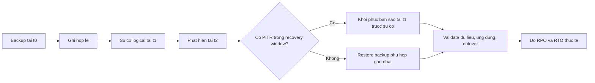
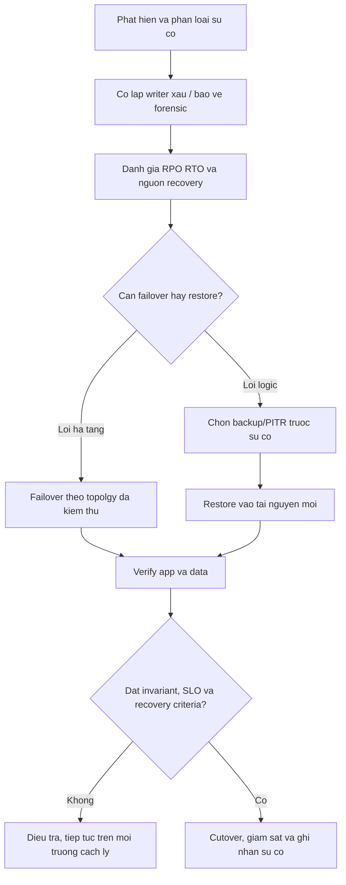

# Chiến lược phục hồi cơ sở dữ liệu theo từng dịch vụ GCP

Một cơ sở dữ liệu có thể hoạt động bình thường trong nhiều năm rồi mất dữ liệu chỉ vì một câu `DELETE` sai, bản triển khai làm hỏng schema, mất quyền truy cập khóa mã hóa hoặc sự cố vùng. **Khả năng có backup không đồng nghĩa với khả năng khôi phục đạt yêu cầu kinh doanh.** Một chiến lược đáng tin cậy phải trả lời được: khôi phục về **thời điểm nào**, tại **vị trí nào**, trong **bao lâu**, dựa vào **bản sao nào**, ai có quyền thao tác và kiểm tra tính đúng bằng gì.

Bài học thuộc chương **Sao lưu và phục hồi thảm họa** của module **CLOUD_PROVIDERS_GCP**. Trong hành trình từ tổ chức project, IAM, VPC đến Compute Engine, GKE, Cloud Run, lưu trữ, cơ sở dữ liệu, tự động hóa phát hành và giám sát độ tin cậy/chi phí, chúng ta đã biết cách chạy ứng dụng trên Google Cloud. Bài này tập trung vào việc **khôi phục lớp dữ liệu sau sự cố** và cách lựa chọn cơ chế phù hợp cho từng dịch vụ.

Phạm vi chính: **Cloud SQL (PostgreSQL/MySQL/SQL Server), AlloyDB for PostgreSQL, Spanner, Firestore và Bigtable**. Phần mở rộng giới thiệu **BigQuery** vì nhiều kiến trúc GCP còn có kho dữ liệu phân tích. Các ví dụ là kịch bản minh họa; giá, retention, lựa chọn edition và tính năng có thể thay đổi theo thời điểm, vùng hoặc phiên bản, nên phải kiểm tra tài liệu chính thức của đúng cấu hình trước khi triển khai.

**Kết quả mong đợi:** người học phân loại được rủi ro, đặt RPO/RTO đo được, chọn backup/PITR/replication phù hợp, xây runbook restore có bước kiểm chứng và thiết kế bài diễn tập phục hồi có kiểm soát.

## 1. Xác định mất mát cần bảo vệ: HA, DR, backup và PITR

Cần phân biệt các cơ chế sau:

| Khái niệm | Bảo vệ chính | Điều không được bảo đảm |
| --- | --- | --- |
| **High availability (HA)** | Giảm gián đoạn do lỗi máy/zone bằng failover hoặc replica | Không bảo vệ khỏi lệnh xóa dữ liệu sai được nhân bản |
| **Replication** | Tạo bản sao phục vụ đọc hoặc tiếp tục hoạt động khi một phần hạ tầng lỗi | Không phải bản lưu bất biến; dữ liệu sai có thể lan sang replica |
| **Backup / snapshot** | Giữ một trạng thái dữ liệu để restore sau đó | RPO phụ thuộc thời điểm backup, RTO phụ thuộc tốc độ restore và ứng dụng |
| **Point-in-time recovery (PITR)** | Phục hồi gần một mốc lịch sử trong **recovery window** | Không thể phục hồi ngoài cửa sổ, khi chưa bật hoặc thiếu log/phiên bản |
| **Export / archive** | Lưu dữ liệu định dạng xuất ra để chuyển hệ hoặc lưu dài hạn | Có thể thiếu metadata, IAM, index, consistency của giao dịch |
| **Disaster recovery (DR)** | Quy trình khôi phục cả dịch vụ sau lỗi lớn: data, compute, mạng, khóa, DNS, ứng dụng | Không hoàn thành chỉ bằng việc bấm “Restore backup” |

**RPO (Recovery Point Objective)**: tổ chức chấp nhận mất tối đa bao nhiêu dữ liệu theo thời gian, ví dụ 15 phút. **RTO (Recovery Time Objective)**: tổ chức chấp nhận dịch vụ gián đoạn tối đa bao lâu, ví dụ 2 giờ. Đây là mục tiêu kinh doanh; kết quả thực tế cần được đo bằng diễn tập.

Ví dụ: 10:00 đã backup, 10:52 dữ liệu bị xóa nhầm và 11:05 phát hiện. Restore backup 10:00 sẽ có rủi ro mất các thay đổi từ 10:00 tới 10:52. Nếu có PITR và log/phiên bản còn đủ, có thể chọn mốc ngay trước sự cố, ví dụ 10:51:50, nhưng **không phải mọi dịch vụ đều hỗ trợ độ chính xác thời gian như nhau**.



**Không chọn RPO chỉ theo thời gian retention.** Có PITR giữ lịch sử 7 ngày không có nghĩa mất dữ liệu tối đa là 7 ngày hay RPO mặc nhiên bằng 0. Cần xét mốc cuối còn khôi phục được, độ trễ nhận log/replication, thời điểm xảy ra lỗi và khoảng thời gian đã xác minh. **Không chọn RTO chỉ theo thời gian tạo tài nguyên**: phải cộng thời gian phát hiện, quyết định, cấp quyền, phục hồi dữ liệu, tạo service/network, kiểm thử và đổi traffic.

## 2. Lập ma trận rủi ro và mục tiêu phục hồi

### 2.1. Ba cấp độ sự cố

1. **Sự cố logic:** thao tác `UPDATE`/`DELETE` sai, schema migration lỗi, ransomware hoặc ứng dụng ghi sai trong khi database vẫn online. Cần backup/PITR ở thời điểm **trước khi lỗi bắt đầu**; failover sang replica cùng dữ liệu sai thường vô ích.
2. **Hỏng một thành phần hoặc zone:** primary không phục vụ được, node lỗi, lỗi hạ tầng cục bộ. Cơ chế HA hoặc chuyển sang replica có thể phục hồi nhanh hơn restore backup; vẫn phải kiểm tra tính nhất quán và đường kết nối.
3. **Mất vùng, project hoặc quyền truy cập:** backup ở cùng vị trí/project có thể không khả dụng. Cần bản sao ngoài phạm vi lỗi, quyền khôi phục độc lập, mạng/compute dự phòng, khóa mã hóa hoạt động tại đích và DNS/traffic runbook.

| Câu hỏi | Ví dụ trả lời để ghi vào DR plan |
| --- | --- |
| Dữ liệu quan trọng nhất? | Sổ cái đơn hàng, không chấp nhận mất giao dịch đã xác nhận |
| RPO và RTO theo loại sự cố? | Logic: RPO 5 phút, RTO 60 phút; mất vùng: RPO 15 phút, RTO 4 giờ |
| Đối tượng phục hồi? | Instance/cluster, database, table, document, subset row |
| Recovery window thực tế? | Ngày và thời điểm sớm nhất có thể phục hồi đã kiểm tra |
| Backup nằm đâu? | Vùng, project, backup vault/cluster, edition, encryption key |
| Ai có quyền? | Break-glass principal, quy trình phê duyệt, audit trail |
| Đích có sẵn không? | VPC, DNS, instance/cluster, quota, KMS, Secrets, ứng dụng |
| Cách xác minh? | Row counts, checksums, golden queries, bất biến giao dịch |
| Ai quyết định cutover/rollback? | Incident commander và database owner theo runbook |

Một hệ thống có thể đặt RPO/RTO khác nhau cho bảng giao dịch và báo cáo tổng hợp có thể tạo lại. Không cần sao lưu mọi dữ liệu ở cùng chu kỳ nếu những dữ liệu ấy có độ quan trọng và nguồn chân lý khác nhau.

### 2.2. Quy tắc thiết kế chéo dịch vụ

- **Giữ bản sao ngoài miền lỗi chính** khi yêu cầu bảo vệ khỏi mất vùng/project; kiểm tra việc backup/copy sang region khác có thật sự được hỗ trợ.
- **Bảo vệ IAM và khóa**: phiên bản CMEK phải còn hoạt động để giải mã bản sao; khả năng phục hồi còn phụ thuộc nơi đặt khóa và quyền truy cập.
- **Tách quyền xóa dữ liệu khỏi quyền xóa/giữ backup** nếu edition/dịch vụ cho phép; ưu tiên retention lock/backup vault/segregated project đúng nhu cầu bảo vệ.
- **Đo restore** trên môi trường thử nghiệm: không coi backup job thành công là bằng chứng có thể phục hồi đầy đủ hệ thống.
- **Ghi lại mốc thời gian theo UTC** và đồng bộ đồng hồ để chọn PITR chính xác; nhầm timezone có thể gây mất dữ liệu còn lớn hơn sự cố ban đầu.
- **Không ghi đè production ngay** nếu có thể restore sang bản sao mới để đối chiếu; ghi đè chỉ sau khi đã có kế hoạch bảo vệ dữ liệu còn lại và được phê duyệt.

## 3. Ma trận phục hồi nhanh theo dịch vụ

| Dịch vụ | Cơ chế khôi phục nổi bật | Restore vào đâu? | Đặc điểm quan trọng |
| --- | --- | --- | --- |
| **Cloud SQL** | Automated/on-demand backups; PITR qua transaction logs; Standard/Enhanced backup | Backup có thể restore sang instance có sẵn hoặc mới theo phạm vi hỗ trợ; **PITR luôn tạo instance mới** | Bật/giữ log, backup, backup location, chọn edition và cách quản lý; backup khác HA/read replica |
| **AlloyDB** | Continuous backup/PITR, automatic/on-demand backup, Standard/Enhanced | **Cluster mới**; PITR phải cùng region với source cluster; restore backup cùng region với backup | Mặc định continuous recovery 14 ngày, cấu hình 1–35 ngày; restore cluster xong cần primary instance |
| **Spanner** | PITR qua version retention; backup full/incremental; copy backup | **Database mới**; để chuyển region/project phải copy backup sang instance đích trước | PITR mặc định 1 giờ, tối đa 7 ngày; backup giữ tới 1 năm; backup có thời điểm giao dịch nhất quán |
| **Firestore (Native)** | PITR theo phiên bản document; scheduled daily/weekly backups; export/import | Backup restore sang **database mới cùng location**; PITR clone sang database mới hoặc phục hồi một phần bằng đọc lịch sử rồi ghi lại | PITR tối đa 7 ngày, độ hạt 1 phút; backup không chứa Security Rules hoặc TTL policies |
| **Bigtable** | Standard/hot backup; automated daily backup; copy backup giữa region/project; replication | **Table mới** trong instance đã tồn tại | Không có PITR tùy thời điểm như RDBMS; từng backup của từng table/cluster, replication eventual giữa clusters |
| **BigQuery** (mở rộng) | Time travel 2–7 ngày, fail-safe, table snapshot/clone, replication/export | Bảng/dataset mới hoặc khôi phục theo cơ chế tương ứng | Dữ liệu phân tích có quy tắc time travel riêng; không thay thế DR của database giao dịch |

Ma trận là tóm tắt, không phải bảng khả năng của mọi edition/region. Các tính năng Enhanced backup, hot backup, khả năng restore xuyên vùng, retention và mức phí cần kiểm tra theo cấu hình tại thời điểm sử dụng.

## 4. Cloud SQL: backup, PITR, HA và phục hồi khác vùng

Cloud SQL quản lý **PostgreSQL, MySQL và SQL Server**. Chiến lược thường kết hợp:

- **Automated backups** và backup theo yêu cầu để có mốc restore.
- **PITR** dựa trên transaction logs khi được bật, nhằm trở về thời điểm trước khi có ghi sai.
- **HA/failover** để giảm thời gian gián đoạn do lỗi instance/zone; **read replicas** để phân bổ đọc và có thể hỗ trợ quy trình DR theo khả năng từng engine.
- **Cross-region backup** và/hoặc cross-region replica cho trường hợp mất vùng, nhưng cách dùng và các giới hạn phải theo engine, edition, backup tier.

### 4.1. Standard và Enhanced backup

Cloud SQL có **Standard backups** do dịch vụ quản lý và **Enhanced backups** tích hợp Backup and DR, sử dụng backup vault và backup plan cho nhu cầu quản trị tập trung, protection/retention mạnh hơn. Không được coi mọi backup là “immutable” khi chưa kiểm tra tier và cấu hình; **enhanced backup có tính năng backup vault/retention lock** cần thiết cho một số mô hình bảo vệ chống xóa.

Tài liệu Cloud SQL for PostgreSQL nêu khả năng **cross-region backups** ở cả hai phương án; với enhanced backup có thể chọn backup vault ở vùng khác. Tuy nhiên, khi sử dụng cross-region backup cho **PITR**, điểm khôi phục tới **instance mới ở region của source instance** theo giới hạn hiện hành của Backup and DR. Khả năng **restore từ backup thường sang instance ở region khác** là một workflow khác và không được đánh đồng với PITR cross-region.

**CMEK:** bản backup của instance dùng customer-managed encryption key có thể phụ thuộc vào key nằm ở vùng nguồn. Nếu vùng khóa không khả dụng, backup có thể tạm thời không giải mã/restore được dù dữ liệu backup đặt ở vùng khác. Với restore tới vùng khác, phải có key hợp lệ tại vùng đích và hiểu rõ cơ chế giải mã của backup gốc.

### 4.2. Kiểm tra thiết lập và diễn tập phục hồi

Các lệnh **chỉ đọc** để kiểm tra trước khi thao tác (thay placeholder, xác nhận project và engine):

```bash
gcloud sql instances describe SOURCE_INSTANCE \
  --project=PROJECT_ID

gcloud sql backups list \
  --instance=SOURCE_INSTANCE \
  --project=PROJECT_ID
```

Trong kết quả kiểm tra **backup configuration**, `pointInTimeRecoveryEnabled`, retention log, backup lịch sử, region, HA, edition, encryption key, backup vault/plan và trạng thái instance. Theo tài liệu Cloud SQL, **PITR luôn tạo instance mới**, không thể PITR trực tiếp vào instance có sẵn.

**Runbook Cloud SQL cho lỗi xóa dữ liệu ở 10:52:**

1. Khoanh vùng nguồn ghi sai, khóa tài khoản hoặc dừng workload gây lỗi; ghi nhận khoảng thời gian sớm nhất bắt đầu thay đổi không đúng.
2. Kiểm tra nguồn còn trong PITR window; nếu log không còn, chọn backup phù hợp nhất và đánh giá RPO lớn hơn.
3. PITR **sang instance mới** tại mốc trước sự cố; với backup restore, ưu tiên khôi phục sang instance mới để đối chiếu khi phù hợp.
4. Đợi operation hoàn tất, kiểm tra schema, roles/users theo engine và thiết lập truy cập/network/TLS, instance-level configs, version, storage; bảo đảm client credentials đúng.
5. Kiểm thử `COUNT` theo bảng, checksums, khóa ngoại, số dư đơn hàng và các transaction quan trọng. Nếu chỉ cần vài bản ghi, cân nhắc trích và chuyển lại một phần từ instance phục hồi, có kiểm soát.
6. Khi phải chuyển cả workload, xác nhận chiến lược xử lý ghi phát sinh sau mốc khôi phục, đổi kết nối/traffic và theo dõi error/latency. Giữ lại bản hiện tại để forensic và rollback theo retention được duyệt.

Đặc biệt, nếu bật PITR trên một instance đang tồn tại, Cloud SQL có thể phải **restart instance**; kiểm tra kế hoạch bảo trì và SLO trước khi đổi cấu hình. Cách PITR được bật mặc định khác nhau theo **edition và đường tạo instance** (Console so với CLI/API/Terraform), vì vậy luôn xác minh bằng `describe` thay vì suy đoán. <https://cloud.google.com/sql/docs/postgres/backup-recovery/configure-pitr>

### 4.3. Lưu ý theo engine

| Engine | Điểm đặc biệt cần kiểm thử |
| --- | --- |
| PostgreSQL | Transaction log/PITR, extensions, roles, logical replication slots, ứng dụng dùng connection pool, sequence và timezone |
| MySQL | Binlog/backup retention, schema/charset/collation, GTID/replication semantics, thủ tục và SQL modes |
| SQL Server | Transaction log retention, SQL Server Agent jobs, SQL logins/users, T-SQL features, khôi phục từ BAK khi được hỗ trợ |

Không giả định backup của Cloud SQL tự phục hồi mọi tài nguyên bên ngoài database: jobs/scheduler, application secrets, DNS, firewall, service accounts, Pub/Sub subscriptions và cấu hình Cloud Run/GKE phải được phục hồi hoặc khai báo riêng.

## 5. AlloyDB: phục hồi liên tục ở mức cluster

AlloyDB for PostgreSQL có **continuous backup and recovery** và **automated/on-demand backups**. Ở tài liệu hiện hành, continuous backup mặc định cho phép chọn mốc trong vòng **14 ngày**, có thể cấu hình từ **1 đến 35 ngày**, độ chính xác thời gian được mô tả đến mức microsecond. Cửa sổ PITR này là một tính năng dịch vụ, không phải cam kết RTO.

### 5.1. Các cách sao lưu và vị trí

- **Continuous recovery**: dùng lịch sử và log để tạo bản sao cluster tại một mốc gần đây; bảo vệ khi dữ liệu bị xóa/cập nhật sai.
- **Automated backups**: các bản incremental theo lịch, hỗ trợ retention theo backup plan và phương án quản trị.
- **On-demand backup**: tạo trước một thay đổi lớn hoặc mốc cần giữ; lưu trữ phù hợp retention, có thể đặt backup ở vùng khác trong các phương án được hỗ trợ.
- **Standard/Enhanced**: Standard do AlloyDB quản lý; Enhanced gắn Backup and DR và backup vault. Tài liệu hiện tại khác nhau về **cross-regional backup support** giữa hai lựa chọn; phải xem chính xác phương án đang dùng. Không áp dụng mặc định quy tắc Cloud SQL cho AlloyDB.

**Restore AlloyDB tạo một cluster mới.** Sau khi restore dữ liệu, còn phải tạo **primary instance** trong cluster mới trước khi ứng dụng có thể kết nối. PITR cần **source cluster còn tồn tại** và cluster mới ở **cùng region với source** theo hướng dẫn hiện hành. Không thể lấy PITR của cluster đã bị xóa rồi khôi phục như thể backup độc lập.

**Cross-region restore từ backup:** on-demand backup có thể được tạo ở region đích theo khả năng dịch vụ, sau đó tạo cluster mới trong **cùng region với backup ấy**. Nếu chỉ giữ backup ở region nguồn và vùng đó đang mất hoàn toàn, khả năng thực hiện copy **sau sự cố** có thể không còn; hãy tạo bản sao vùng đích từ trước.

### 5.2. Runbook AlloyDB

1. Xác định source cluster/region, backup tier, retention window, thời điểm ghi sai, tình trạng source còn tồn tại và quyền IAM/KMS.
2. Nếu source còn tồn tại, trong cùng vùng và PITR có dữ liệu: chọn mốc trước sự cố để tạo **cluster mới**. Nếu mất vùng hoặc xóa source, chọn **on-demand/cross-region backup** đã được giữ ở vùng khả dụng.
3. Đợi cluster restored, tạo primary instance và cấu hình mạng/danh tính/roles, endpoint, ứng dụng; kiểm tra khả năng connect.
4. Đối chiếu schema, bảng, transaction, extensions, query latency, index, số dư/aggregate. Lưu lại kết quả để chứng minh khôi phục đúng mốc.
5. Chuyển ứng dụng theo kế hoạch, xử lý ghi mới và giám sát thời gian phục hồi. Kiểm tra nhu cầu read pool/cross-region replica sau khi dịch vụ hoạt động lại.

Với AlloyDB, **HA của cluster hoặc replica xuyên vùng** có thể giảm downtime khi lỗi hạ tầng, nhưng nếu ứng dụng xóa dữ liệu sai thì thay đổi có thể lan sang replica. Luôn có nguồn backup có thể khôi phục độc lập. <https://cloud.google.com/alloydb/docs/backup/overview>

## 6. Spanner: version retention ngắn hạn và backup nhất quán theo giao dịch

Spanner cung cấp tính nhất quán mạnh và phân tán hạ tầng, nhưng vẫn cần bảo vệ khỏi **lỗi logic** và **xóa nhầm database**.

- **PITR** dựa trên lịch sử phiên bản dữ liệu/schema. Theo tài liệu hiện hành, mặc định giữ **1 giờ**, cấu hình `version_retention_period` lên tới **7 ngày**. Khoảng thời gian cũ không xuất hiện ngay khi vừa tăng retention; phải đợi lịch sử tích lũy.
- **Backups**: tạo full on-demand hoặc full/incremental theo backup schedule; có thể giữ **tới một năm**, tùy expiry của backup.
- **Backup copy**: chuyển bản backup sang instance/region/project khác **trước khi sự cố vùng diễn ra**, phục vụ DR và compliance.
- **Restore**: backup được restore thành **database mới**, không ghi vào database đang tồn tại. Khi restore sang region/project khác, cần copy backup sang instance phù hợp trước.

Spanner backup là **transactionally/externally consistent** tại `versionTime`; điều này hữu ích để đối chiếu bất biến khi restore. Tuy nhiên, database mới phải đủ compute/storage quota để phục vụ dữ liệu và query. Vấn đề edition/instance configuration/CMEK cũng có thể ảnh hưởng việc restore.

### 6.1. PITR Spanner và phép kiểm tra trước khi thao tác

Trong response API của database, xác định:

- `version_retention_period`: cửa sổ lịch sử đang cấu hình.
- `earliest_version_time`: mốc sớm nhất mà dữ liệu lịch sử còn hỗ trợ; giá trị này thay đổi liên tục.
- Mốc lỗi cần phục hồi, các bảng/keys liên quan và liệu chỉ cần **replay chọn lọc** hay khôi phục toàn bộ database.

Nếu lỗi chỉ xóa một số bản ghi, có thể đọc lịch sử bằng timestamp hợp lệ để ghi lại phần dữ liệu cần thiết theo hướng dẫn Spanner; các bản ghi mới cùng khóa sau sự cố phải được hòa giải để không ghi đè dữ liệu hợp lệ.

Khi restore toàn bộ từ backup:

1. Xác minh backup `versionTime` và expiry; nếu muốn vùng khác, đảm bảo bản copy hoàn thành ở instance đích.
2. Tạo **database mới** từ backup; giữ nguyên database đang hoạt động để đối chiếu.
3. Kiểm tra schema, IAM, compute capacity, CMEK và SQL/application clients.
4. Đối chiếu dữ liệu theo các invariant phân tán, ví dụ tổng số dư, số đơn hàng, không bán vượt tồn kho.
5. Chỉ chuyển traffic khi đạt acceptance criteria; kế hoạch rollback phải tính đến giao dịch mới đã ghi sau thời điểm restore.

**Ví dụ:** lệnh ứng dụng sai làm trừ số dư của 3.000 ví trong 10 phút. Multi-region replication không cứu khỏi logic này. PITR 7 ngày hoặc backup trước lỗi giúp tái tạo dữ liệu đúng, nhưng bản khôi phục cần hòa giải những giao dịch hợp lệ đến sau mốc chọn.

## 7. Firestore: scheduled backups và PITR cấp document

Firestore Native mode dùng cấu trúc **document/collection**, vì vậy cách khôi phục khác relational database. Cần phân biệt:

- **PITR**: phiên bản document trong cửa sổ **tối đa 7 ngày**, độ hạt **một phút** cho mốc đọc/clone/export ngoài giờ gần nhất; tính năng cần được bật và dữ liệu lịch sử chỉ tích lũy từ khi bật. Không suy rằng bật lúc 10:00 thì 10:05 đọc được lịch sử từ bảy ngày trước.
- **Scheduled backups**: đặt lịch **daily hoặc weekly**, retention tối đa **14 tuần** theo tài liệu hiện hành. Bản backup là snapshot nhất quán gồm documents và cấu hình indexes; được lưu ở **cùng location** với database nguồn.
- **Export/Import**: có thể export Firestore data vào Cloud Storage và nhập lại; khi sử dụng snapshot timestamp PITR cần tuân thủ format phút và yêu cầu bật PITR.

### 7.1. Phục hồi một phần và toàn bộ

**Khôi phục một tập document bị ghi sai:**

1. Xác định danh sách document/collection và mốc trước khi lỗi xảy ra.
2. Đọc dữ liệu lịch sử theo `read_time` hợp lệ hoặc export collection tại mốc PITR; đối chiếu với dữ liệu sống.
3. Quyết định áp dụng lại chính xác những field/document nào. Nếu document đã có các bản cập nhật **hợp lệ sau lỗi**, phải merge theo nghiệp vụ thay vì overwrite tất cả.
4. Ghi lại bằng batch/transaction hoặc workflow idempotent phù hợp giới hạn Firestore; kiểm tra Security Rules/IAM và audit.

**Phục hồi toàn database:**

- Từ PITR, **clone sang database mới** ở cùng location tại mốc phút hợp lệ; hoặc export PITR data rồi import.
- Từ scheduled backup, **restore sang database mới**. Firestore không restore một scheduled backup trực tiếp đè lên database hiện có.
- Sau khôi phục, **khôi phục/kiểm tra Firebase Security Rules và TTL policies**; Firestore scheduled backup **không chứa** hai loại cấu hình này. Kiểm tra IAM, database ID, indexes, application SDK và paths.

Đây là lỗi vận hành thường gặp: nhìn thấy đủ document trên database mới rồi cho client truy cập, nhưng các ứng dụng web/mobile bị từ chối vì Security Rules của database mới khác database cũ.

### 7.2. Ví dụ CLI kiểm tra và clone Firestore

Đây là thao tác **minh họa trong môi trường staging**. Clone tạo database mới và có thể phát sinh chi phí; không thực hiện với production khi chưa có runbook/phê duyệt:

```bash
# Chỉ đọc: xem cấu hình và PITR window
gcloud firestore databases describe \
  --database='(default)' \
  --project=PROJECT_ID

# Chỉ khi đã xác minh mốc snapshot và destination ID còn trống:
gcloud firestore databases clone \
  --source-database='projects/PROJECT_ID/databases/(default)' \
  --snapshot-time='2026-11-19T08:30:00Z' \
  --destination-database='restore-drill-20261119' \
  --project=PROJECT_ID
```

Mốc `snapshot-time` phải **nằm trong PITR window thực tế** và ở granularity nguyên phút; thời điểm ở ví dụ chỉ để minh họa cú pháp. Clone giữ dữ liệu/index theo phạm vi tài liệu, nhưng đừng giả định mọi policy hay các kết nối phía ứng dụng được tạo lại tự động. <https://cloud.google.com/firestore/native/docs/use-pitr>

## 8. Bigtable: backup theo table/cluster, không có PITR tùy ý

Bigtable phù hợp throughput lớn cho time-series và key-value access. Hệ thống có thể replicate dữ liệu giữa nhiều clusters, nhưng **replication giữa clusters theo mô hình eventual consistency**, vì vậy không tự bảo vệ khỏi xóa nhầm hoặc dữ liệu bị ghi sai.

### 8.1. Standard, hot và copy backup

Bigtable có hai loại backup chính:

| Loại | Khi dùng | Hạn chế cần nhớ |
| --- | --- | --- |
| **Standard backup** | Giữ bản sao table để restore dài hơn hoặc chi phí phục hồi thường ít nhạy cảm | Sau restore vào SSD có thể cần giai đoạn tối ưu để đạt latency bình thường |
| **Hot backup** | Cần đưa table đã restore lên mức latency phục vụ production nhanh hơn | Chỉ hỗ trợ trên SSD với điều kiện tương ứng; không hỗ trợ table dùng tiered storage; bản copy của hot backup trở thành standard |
| **Automated backup** | Tạo backup hàng ngày theo policy; với multi-cluster có thể có bản ở mỗi cluster | Retention theo edition và policy; thời điểm backup giữa clusters khác nhau |
| **Backup copy** | Đặt bản sao ở region/project/instance khác để giảm rủi ro cùng miền lỗi | Copy là standard backup; thời hạn retention riêng và phải copy **trước** thảm họa |

Theo tài liệu hiện hành, automated backups có thể cấu hình retention tối đa **90 ngày**; on-demand backup giữ đến **90 ngày ở Enterprise** hoặc **365 ngày ở Enterprise Plus**, còn **backup copy tối đa 30 ngày**. Các hạn mức còn phụ thuộc edition/quota và thay đổi theo thời gian. Không đặt retention trên 365 ngày chỉ vì bucket Cloud Storage có thể giữ lâu hơn: Bigtable backup không phải object export vào bucket.

### 8.2. Những giới hạn ảnh hưởng trực tiếp đến DR

- Backup Bigtable là bản của **một table tại một cluster**; **không** phải database-wide transaction snapshot và không thể backup nhiều table trong một operation. Các bảng liên quan có thể có thời điểm backup khác nhau.
- Backup ở cluster được tạo có thể **chưa chứa các write chưa replicate từ cluster khác**. Với trường hợp yêu cầu, dùng consistency token/quy trình consistency verification theo tài liệu Bigtable trước khi backup.
- **Restore luôn tạo table mới**; không restore trực tiếp đè table cũ. **Instance đích phải tồn tại** trước khi thực hiện restore.
- Không thể đọc query trực tiếp từ backup. Muốn khôi phục một phần dữ liệu, có thể restore sang table mới, đọc dữ liệu cần thiết rồi ghi trở lại table nguồn bằng client library/Dataflow phù hợp.
- Copy backup giữa regions/projects cần quyền truy cập, network/quota và khả năng truy cập cluster nguồn. Đừng chờ region bị mất mới bắt đầu copy.
- Với CMEK, **key version gắn với backup** phải còn enabled để giải mã. Đây là một phần của backup retention plan, không chỉ của key rotation plan.

### 8.3. Runbook Bigtable

1. Xác định cluster/instance và table bị lỗi, pattern đọc/ghi, app profile routing, thời điểm backup gần nhất; xem backup là standard/hot và có bản copy ngoài region hay không.
2. Tạo sẵn hoặc xác nhận instance/cluster đích đã tồn tại; khôi phục backup vào **table mới**.
3. Nếu standard backup trên SSD, chờ kiểm tra trạng thái optimization/latency trước khi đưa toàn bộ traffic về table mới.
4. Kiểm thử row-key ranges, số đo đại diện, các data versions/cell, schema column family, retention/GC và ứng dụng dùng client library.
5. Nếu cần phục hồi một phần, replay chọn lọc các hàng hợp lệ; nếu cutover toàn table, chuyển routing ở tầng ứng dụng và xác nhận không còn writer dùng table cũ.
6. Kiểm tra replication lag và consistency. Ghi lại độ mất dữ liệu thực tế so với mục tiêu RPO, nhất là khi backup được lấy từ cluster không nhận toàn bộ ghi.

**Ví dụ IoT:** cụm đo ghi liên tục vào Bigtable ở vùng A, replicate đến vùng B. Sau sự cố operator xóa nhầm một dải keys, việc chuyển sang B có thể không cứu dữ liệu đã bị xóa vì delete được replicate. Muốn phục hồi dải keys từ hôm trước, cần backup table trước khi xóa, restore sang table mới rồi copy chọn lọc; việc replay telemetry sau backup có thể cần log sự kiện độc lập nếu RPO yêu cầu rất nhỏ.

## 9. Mở rộng: BigQuery time travel và bảo vệ kho phân tích

BigQuery là **data warehouse** hơn là OLTP database, nhưng dữ liệu bảng phân tích cũng có thể bị `CREATE OR REPLACE TABLE`, truncate hoặc delete sai. BigQuery hỗ trợ:

- **Time travel** với cửa sổ cấu hình **2–7 ngày**, mặc định 7 ngày, để query lịch sử hoặc restore table/dataset theo phạm vi hỗ trợ.
- **Fail-safe** giữ dữ liệu thêm 7 ngày sau time travel trong một số trường hợp, **không phải một cửa sổ query/restore tự phục vụ**; việc khôi phục fail-safe cần phối hợp Cloud Customer Care và hoàn tất trong cửa sổ cho phép.
- **Table snapshots/clones** và export khi cần lưu mốc lâu hơn time travel; phân biệt snapshot cùng region với chiến lược bảo vệ mất region.
- **Cross-region replication/managed DR** cho khả năng phục hồi hạ tầng phân tích ở vị trí khác khi được cấu hình.

Ví dụ truy vấn phiên bản bảng **còn tồn tại** tại thời điểm trước đó:

```sql
SELECT COUNT(*) AS orders_before_error
FROM `PROJECT_ID.DATASET_ID.orders`
FOR SYSTEM_TIME AS OF TIMESTAMP_SUB(CURRENT_TIMESTAMP(), INTERVAL 1 HOUR);
```

Trong truy vấn trên, tên bảng đầy đủ được đặt giữa cặp dấu backtick theo cú pháp BigQuery; khi chạy hãy thay tên project/dataset. Nếu bảng **đã bị xóa**, không thể query trực tiếp bằng `FOR SYSTEM_TIME AS OF`; dùng thủ tục restore bảng đã xóa trong time travel window. Đối chiếu metadata, partitioning, policy tags và quyền sau restore; không giả định time travel tự phục hồi mọi cấu hình bảng.

Phần này chỉ bổ sung góc nhìn phục hồi dữ liệu phân tích; không dùng BigQuery để thay thế kế hoạch PITR của Cloud SQL/AlloyDB/Spanner cho giao dịch ứng dụng.

## 10. Runbook khôi phục tiêu chuẩn và điều kiện cutover

Tạo một runbook có thể thực hiện bởi người trực vận hành mới, với tên tài nguyên, role và link dashboard rõ ràng. Một cấu trúc tham khảo:



### 10.1. Từng bước có thể kiểm chứng

**Bước 1 — Triage và đóng băng trạng thái:** xác định lúc bắt đầu sự cố bằng logs, audit trail, deployment events, truy vấn và dấu vết giao dịch. Hạn chế writer còn gây hại; giữ nguyên log/snapshot forensic.

**Bước 2 — Chọn phương án:** đối chiếu khả năng HA/failover nếu chỉ lỗi hạ tầng, hoặc PITR/backup nếu lỗi logic. Ghi rõ mốc restore UTC, vị trí backup, edition, project, quota, encryption key, tài nguyên đích, quyền IAM.

**Bước 3 — Chuẩn bị đích:** đủ mạng/VPC, private endpoints, peering, subnet, IP, compute, storage, quota, DNS, TLS, database credentials, IAM và Cloud KMS key/version. Đích phải có năng lực chạy ứng dụng sau restore, không chỉ đủ để tạo database.

**Bước 4 — Thực hiện restore:** theo phương án của từng dịch vụ, ưu tiên tạo instance/cluster/database/table **mới**; ghi lại operation ID, thời gian bắt đầu/kết thúc, snapshot/backup ID và mốc dữ liệu.

**Bước 5 — Xác minh dữ liệu:** đếm hàng/document, PK/unique/FK, tổng số dư, bảng giao dịch, các mốc ngày, giá trị NULL, dữ liệu biên và audit các bản ghi đã được cam kết trước sự cố; chạy golden queries.

**Bước 6 — Xác minh ứng dụng:** kết nối từ Cloud Run/GKE/Compute Engine, secret và identity, query latency, transaction commit/rollback, queue consumer, background jobs, retries và read-after-write.

**Bước 7 — Cutover:** xác nhận người chịu trách nhiệm, đóng băng ghi nếu cần, đồng bộ dữ liệu hợp lệ sau mốc restore, thay endpoint/routing, tăng traffic từng bước và quan sát p95/p99, error rate, latency của dependency, chi phí.

**Bước 8 — Ghi nhận RPO/RTO thực tế:** dùng timestamp cuối khôi phục thành công và timestamp dịch vụ trở lại ổn định; nếu không đạt mục tiêu, cập nhật runbook, tần suất backup và topology.

### 10.2. Quyết định rollback phải có trước cutover

Nếu ứng dụng đã ghi vào database mới sau cutover, đổi DNS ngược về database cũ **có thể mất giao dịch mới hoặc tạo split-brain**. Runbook phải có hướng xử lý các write sau cutover, điều kiện dừng, đầu mối phê duyệt và khả năng giữ hệ cũ ở chế độ read-only. Không suy rằng replica hai chiều hoặc reverse replication được sản phẩm hỗ trợ tự động.

Lỗi logic thường cần **chọn lọc** dữ liệu: khôi phục toàn bộ instance về T-1 có thể xóa các giao dịch hợp lệ khác. Cần cân nhắc restore sang bản sao, trích xuất chính xác tập bản ghi lỗi, merge có kiểm thử và lưu audit trail; kế hoạch thực hiện phải tôn trọng ràng buộc transaction của nghiệp vụ.

## 11. Kiểm định backup: diễn tập định kỳ và quan sát

### 11.1. Chỉ số nên báo cáo

| Chỉ số | Ý nghĩa | Ví dụ cách đo |
| --- | --- | --- |
| Backup success rate | Số backup thành công / số backup kỳ vọng | Kiểm tra backup jobs và cảnh báo thất bại |
| Age of last recoverable point | Độ cũ của mốc dữ liệu gần nhất có thể phục hồi | Mốc PITR latest recovery hoặc thời điểm backup gần nhất |
| Restore duration | Thời gian từ khởi tạo restore tới database có thể phục vụ | Operation timestamps + ứng dụng smoke test |
| Effective RPO | Khoảng cách giữa giao dịch cuối đã commit và mốc cuối được restore/verify | Query/audit event ID/timestamp có kiểm chứng |
| Effective RTO | Thời gian gián đoạn thực đo đến khi SLO được phục hồi | Monitoring, incident timeline |
| Restore correctness | Tính đúng dữ liệu phục hồi | Checksums, invariants, golden queries, đối soát |
| Backup isolation | Bản backup có sống sót khi mất region/project hoặc bị xóa nguồn? | Diễn tập quyền, copy, retention, key access |
| DR unit cost | Backup storage + copy transfer + restore compute + vận hành | Billing export, SKU và forecast |

**Cảnh báo:** backup thành công nhưng PITR log retention sai, quyền thiếu hoặc CMEK key đã bị vô hiệu hóa là một trạng thái **chưa phục hồi được**. Không chỉ cảnh báo “backup job failed” mà cần định kỳ làm thử restore thật.

### 11.2. Lịch diễn tập mẫu

- **Hàng tuần:** kiểm tra tuổi backup mới nhất, policy/retention, PITR enabled, replication lag, backup vault/copy và cảnh báo.
- **Hàng tháng:** restore một database/table vào môi trường thử nghiệm, chạy integrity checks và đo RTO ở quy mô đại diện.
- **Hàng quý:** thử kịch bản lỗi logic, key issue hoặc mất vùng giả lập trên staging; xác minh thao tác với quyền break-glass và đường mạng.
- **Sau thay đổi lớn:** kiểm tra lại khi nâng engine/edition, đổi region, KMS, schema, khối lượng dữ liệu hoặc cấu trúc DR.

Đây là lịch tham khảo; đội vận hành tự xác định theo mức quan trọng của dữ liệu và mục tiêu kiểm toán. Diễn tập phải dùng dữ liệu đã được bảo vệ/ẩn danh nếu dữ liệu production chứa thông tin nhạy cảm; xóa tài nguyên thử nghiệm theo chính sách sau khi đã lưu kết quả.

## 12. Bảo mật, tuân thủ và chi phí phục hồi

**IAM:** tách người tạo backup, người restore, người xóa backup, người quản lý KMS và người điều hành incident. Quyền restore có thể tạo bản sao dữ liệu nhạy cảm ở project khác; phải giới hạn project/region đích và ghi audit logs. Dùng tài khoản break-glass có xác thực và quy trình phê duyệt được diễn tập.

**Retention và immutability:** tăng thời gian giữ backup làm tăng khả năng hồi cứu nhưng cũng tăng chi phí và rủi ro lưu dữ liệu quá lâu so với chính sách xóa. Với nhu cầu chống ransomware/xóa trái phép, xem backup vault và retention lock theo dịch vụ/edition hỗ trợ. Không tự nhận rằng mọi backup mặc định đều bất biến vô thời hạn.

**CMEK:** lưu sơ đồ key và key-version dependency. Xóa/disable key gốc có thể khiến backup không giải mã được; việc giữ backup dài hạn phải đi cùng chiến lược giữ key phiên bản tương ứng. Có các trường hợp cross-region backup bị phụ thuộc region khóa gốc. Kiểm tra điều này bằng diễn tập khôi phục sang project/region dự phòng.

**Chi phí:** tổng giá DR không chỉ gồm dung lượng backup:

```text
Chi phi DR thang =
  luu tru backup + PITR/history log
  + sao chep cross-region / network
  + compute / storage / network tai DR site (neu giu san)
  + chi phi restore drill, giam sat, van hanh
  + chi phi trung lap trong thoi gian chuyen doi
```

Các chiến lược có thể đánh đổi:

- RPO ngắn hơn thường cần log/version retention hoặc replication tốt hơn.
- RTO ngắn hơn có thể cần warm standby, tài nguyên đích có sẵn, hot backups hoặc topology multi-region.
- Sao lưu thường xuyên hơn tăng số bản/traffic/cost; nhưng nhiều backup không bảo đảm khôi phục được nếu thiếu IAM/KMS, thiếu runbook hoặc không thử restore.
- Một bảng phân tích có thể tái tạo từ pipeline thì chiến lược backup có thể khác sổ cái giao dịch bắt buộc chính xác.

Dùng Cloud Billing export vào BigQuery, budgets/alerts và bảng giá hiện hành của từng dịch vụ để dự tính TCO. Alerts không phải biện pháp tự động khóa chi phí; quota, retention controls và giới hạn tài nguyên phục hồi phải được thiết kế riêng.

## 13. Tình huống thực hành: khôi phục hệ thống đặt hàng trên GCP

**Bối cảnh giả định:** ứng dụng Java/Spring chạy Cloud Run quản lý đơn hàng trên Cloud SQL for PostgreSQL; hồ sơ giỏ hàng realtime được cache/phản ánh vào Firestore; telemetry và tương tác người dùng được lưu trên Bigtable, báo cáo vào BigQuery. Một migration script sai đã xóa `orders` của khách hàng khu vực A lúc **10:52 UTC**. Phát hiện lúc **11:05 UTC**, vẫn có giao dịch hợp lệ của khu vực B.

Mục tiêu sản phẩm: **RPO ≤ 5 phút**, **RTO ≤ 90 phút** đối với đơn hàng. Firestore/Bigtable chứa phần dữ liệu có thể đồng bộ hoặc tái tạo từ sự kiện, có RPO/RTO riêng.

### 13.1. Chọn chiến lược

1. **Cloud SQL là system of record cho đơn hàng.** Khoanh vùng writer lỗi, xác định PITR window/log và khôi phục instance mới tại mốc trước 10:52 UTC. Không cắt ngay toàn bộ ứng dụng sang bản quá khứ nếu điều đó sẽ xóa các giao dịch hợp lệ khu vực B; cân nhắc trích xuất/merge có khóa giao dịch.
2. **Firestore** chỉ là read model/cache của tiến độ đơn hàng. Không restore toàn Firestore nếu có thể rebuild các document từ nguồn chân lý; nếu có document độc lập mất hẳn thì PITR/backup theo mốc phù hợp.
3. **Bigtable** lưu telemetry có thể replay từ event stream nếu còn dữ liệu nguồn. Nếu không, restore backup table vào table mới rồi đối soát theo row key; không kỳ vọng PITR chính xác 10:51:59 như Cloud SQL.
4. **BigQuery** báo cáo phân tích có thể rebuild/khôi phục bằng time travel trong cửa sổ hỗ trợ; không dùng bảng báo cáo làm nguồn chân lý thay transaction store.
5. **Ứng dụng Cloud Run** vẫn phải khôi phục quyền IAM, database credentials, cấu hình kết nối, VPC/network, secrets và routing; cần kiểm tra audit logs và cố định bản triển khai tốt trước cutover.

### 13.2. Bảng quyết định trong incident

| Câu hỏi kiểm chứng | Ngưỡng bài tập | Người chịu trách nhiệm |
| --- | --- | --- |
| PITR Cloud SQL có mốc trước 10:52? | Có trong earliest/latest recovery time | Database on-call |
| Giao dịch khu vực B sau 10:52 còn nguyên? | 100% transaction IDs hợp lệ được giữ hoặc đối soát | Domain owner |
| Bất biến số dư/doanh thu? | Tổng số tiền, số đơn và khóa duy nhất khớp dữ liệu kỳ vọng | QA/Data owner |
| Cloud Run kết nối an toàn tới instance mới? | Smoke test và integration test PASS | Platform on-call |
| Đạt SLO sau cutover? | p95/error rate trong ngưỡng sản phẩm đã thỏa thuận | SRE/Incident commander |
| RPO/RTO đo được? | RPO ≤ 5 phút, RTO ≤ 90 phút | Incident commander |

Nếu mốc PITR hoặc log không đủ để đạt RPO, không ghi “PASS” chỉ vì đã phục hồi một instance: ghi rõ **mức mất dữ liệu thực tế** và quyết định hòa giải từ nguồn sự kiện, backup hoặc nguồn phụ.

### 13.3. Bài tập cho người học

Hãy tạo bản thiết kế phục hồi cho ba loại workload:

- **A.** Cloud SQL PostgreSQL xử lý giao dịch tài chính và bị xóa dữ liệu logic.
- **B.** Firestore chứa document người dùng; lỗi triển khai cập nhật nhầm 10.000 document.
- **C.** Bigtable chứa sự kiện IoT ở hai clusters, yêu cầu khôi phục khi một region bị gián đoạn.

Với mỗi workload, hãy điền đầy đủ: loại sự cố, RPO/RTO, phương án chọn (HA, PITR, backup, copy, export), nơi dữ liệu được lưu, tài nguyên restore mới hay cũ, ảnh hưởng IAM/CMEK, dữ liệu phát sinh sau mốc restore, quy trình cutover, kiểm chứng tính đúng và chi phí DR.

**Tiêu chí đạt:** không nhầm replication với backup; chỉ chọn PITR nếu dịch vụ hỗ trợ và cửa sổ đã có dữ liệu; chứng minh được khả năng khôi phục **toàn đường đi ứng dụng** chứ không chỉ đối tượng lưu trữ; có timeline, mốc UTC, người chịu trách nhiệm và kết quả diễn tập RPO/RTO.

## Tài liệu chính thức

- [Google Cloud Architecture Center — Architecting disaster recovery for cloud infrastructure outages](https://cloud.google.com/architecture/disaster-recovery)
- [Cloud SQL for PostgreSQL — Backup options](https://cloud.google.com/sql/docs/postgres/backup-recovery/backup-options)
- [Cloud SQL for PostgreSQL — Restore an instance overview](https://cloud.google.com/sql/docs/postgres/backup-recovery/restore)
- [Cloud SQL for PostgreSQL — Configure PITR](https://cloud.google.com/sql/docs/postgres/backup-recovery/configure-pitr)
- [Cloud SQL for PostgreSQL — Perform PITR](https://cloud.google.com/sql/docs/postgres/backup-recovery/pitr)
- [Cloud SQL for SQL Server — Configure PITR](https://cloud.google.com/sql/docs/sqlserver/backup-recovery/configure-pitr)
- [AlloyDB — Data backup and recovery overview](https://cloud.google.com/alloydb/docs/backup/overview)
- [AlloyDB — Restore a cluster from backup](https://cloud.google.com/alloydb/docs/backup/restore)
- [AlloyDB — Use PITR](https://cloud.google.com/alloydb/docs/backup/restore-pitr)
- [Spanner — Backups overview](https://cloud.google.com/spanner/docs/backup)
- [Spanner — Point-in-time recovery](https://cloud.google.com/spanner/docs/pitr)
- [Spanner — Recover data using PITR](https://cloud.google.com/spanner/docs/use-pitr)
- [Spanner — Restore backup overview](https://cloud.google.com/spanner/docs/backup/restore-backup-overview)
- [Firestore Native — Back up and restore data](https://cloud.google.com/firestore/native/docs/backups)
- [Firestore Native — PITR overview](https://cloud.google.com/firestore/native/docs/pitr)
- [Firestore Native — Work with PITR](https://cloud.google.com/firestore/native/docs/use-pitr)
- [Bigtable — Backups overview](https://cloud.google.com/bigtable/docs/backups)
- [Bigtable — Manage backups](https://cloud.google.com/bigtable/docs/managing-backups)
- [BigQuery — Data retention, time travel and fail-safe](https://cloud.google.com/bigquery/docs/time-travel)
- [BigQuery — Restore deleted tables](https://cloud.google.com/bigquery/docs/restore-deleted-tables)
- [BigQuery — Reliability introduction](https://cloud.google.com/bigquery/docs/reliability-intro)

**Ghi chú cuối:** tài liệu Google Cloud cập nhật liên tục. Trước mỗi lần chạy trên production, xác nhận chính xác giới hạn retention, quyền API, edition, khả năng cross-region, giá và ngữ nghĩa restore của dịch vụ đã triển khai. Bài học cung cấp quy trình và ví dụ, còn kế hoạch DR thực tế phải được **diễn tập và đo được**.
