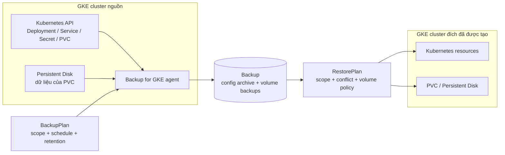

# Khôi phục ứng dụng GKE cùng cấu hình và dữ liệu

## Mục tiêu và bối cảnh

Trong chương **Sao lưu và phục hồi thảm họa**, bài học này hướng dẫn **khôi phục một ứng dụng chạy trên Google Kubernetes Engine (GKE)** sao cho ứng dụng có đủ cấu hình Kubernetes, dữ liệu bền vững và các phụ thuộc để tiếp tục phục vụ nghiệp vụ. Trọng tâm là **Backup for GKE** và quy trình diễn tập khôi phục có kiểm soát, không chỉ là thao tác khởi động lại Pod.

Bài thuộc module **CLOUD_PROVIDERS_GCP**, kết nối hiểu biết về project, IAM, VPC, GKE, Cloud Run, lưu trữ, cơ sở dữ liệu, tự động hóa triển khai, giám sát độ tin cậy và chi phí. Sau bài, người học có thể:

1. Phân biệt backup cấu hình Kubernetes, backup dữ liệu PersistentVolume và backup của dịch vụ ngoài cluster.
2. Định nghĩa **Recovery Point Objective (RPO)**, **Recovery Time Objective (RTO)** và điểm nhất quán dữ liệu phù hợp với ứng dụng.
3. Thiết lập `BackupPlan`, xem `Backup`, tạo `RestorePlan` và khởi chạy `Restore` bằng Google Cloud CLI.
4. Chọn chính sách xử lý xung đột, bảo vệ dữ liệu PVC và kiểm tra ứng dụng sau restore.
5. Xây dựng runbook diễn tập DR, phân quyền an toàn và nhận biết các giới hạn của Backup for GKE.

**Nguyên tắc:** Một tác vụ restore báo hoàn tất có nghĩa tài nguyên Kubernetes được khôi phục theo phạm vi đã chọn. Nó **không tự chứng minh ứng dụng đã Ready, kết nối đến cơ sở dữ liệu thành công hoặc dữ liệu nghiệp vụ nhất quán**. Người vận hành phải kiểm chứng cả hệ thống trước khi chuyển lưu lượng.

## 1. Cần khôi phục những thành phần nào?

Một ứng dụng GKE thường có nhiều lớp trạng thái. Sao lưu thiếu một lớp có thể khiến Pod chạy được nhưng ứng dụng vẫn lỗi.

| Lớp | Ví dụ | Nguồn khôi phục phù hợp |
|---|---|---|
| **Hạ tầng cluster** | GKE Standard/Autopilot, node pools, VPC, subnet, firewall, Workload Identity Federation, Gateway/Ingress controller, add-on | Terraform/IaC, cấu hình project và runbook tạo cluster; **không nằm trong backup workload của Backup for GKE** |
| **Cấu hình Kubernetes** | Namespace, Deployment/StatefulSet, Service, ConfigMap, Secret, ServiceAccount, PVC, Role/RoleBinding, custom resources | Backup for GKE **config backup**, GitOps/Helm/IaC; lựa chọn resource phụ thuộc backup scope |
| **Dữ liệu volume** | Dữ liệu trong Persistent Disk gắn với PVC | Backup for GKE **volume backup** nếu loại volume được hỗ trợ và plan bật `include-volume-data` |
| **Image và package** | Container image, Helm chart, binary | Artifact Registry/repository và quy trình build; Backup for GKE **không sao chép image layers** |
| **Dịch vụ bên ngoài GKE** | Cloud SQL, Cloud Storage, Memorystore, Secret Manager, DNS/load balancer bên ngoài | Backup/replication theo từng dịch vụ và IaC; Backup for GKE **không sao lưu trạng thái các dịch vụ này** |
| **Vận hành** | Monitoring, alert, SLO, chính sách DNS/failover, thông tin liên hệ | Monitoring/IaC, tài liệu runbook và biên bản diễn tập |

Ví dụ, Deployment web tham chiếu image `asia-southeast1-docker.pkg.dev/demo/apps/web@sha256:...`. Nếu restore thành công nhưng registry hoặc quyền kéo image không còn, Pod vẫn ở trạng thái `ImagePullBackOff`. Tương tự, nếu application đọc dữ liệu từ Cloud SQL thì snapshot PVC của Pod **không** sao lưu Cloud SQL.

Với GKE, **restart Pod**, **roll back Deployment** và **restore từ bản backup** là các hành động khác nhau:

- Restart Pod chỉ yêu cầu bộ điều khiển tạo container mới từ cấu hình hiện tại.
- Rollback Deployment/Helm/GitOps khôi phục cấu hình phát hành đã có, thường không hoàn nguyên dữ liệu ứng dụng.
- Restore kết hợp khôi phục tài nguyên Kubernetes tại thời điểm backup và, nếu chọn đúng chính sách, dữ liệu volume. Việc kết nối lại các hệ thống ngoài cluster vẫn phải làm riêng.

Nguồn: [Backup for GKE overview và limitations](https://docs.cloud.google.com/kubernetes-engine/docs/add-on/backup-for-gke/concepts/backup-for-gke).

## 2. Mô hình Backup for GKE

Backup for GKE là dịch vụ được quản lý với **control plane API** và **agent trong GKE cluster**. Agent được cài khi bật add-on hoặc khi tạo backup/restore plan phù hợp. Dịch vụ có các đối tượng:

| Đối tượng | Chức năng |
|---|---|
| `BackupPlan` | Chọn **cluster nguồn**, phạm vi namespace/`ProtectedApplication`, có lấy Secrets/volume hay không, nơi lưu, lịch sao lưu, thời gian giữ và khóa xóa |
| `Backup` | Một bản sao lưu cụ thể tạo từ `BackupPlan`, gồm cấu hình Kubernetes và (nếu bật, có hỗ trợ) dữ liệu volume |
| `RestorePlan` | Mẫu quyết định **cluster đích**, phạm vi cần khôi phục, chính sách xung đột, chính sách dữ liệu volume và transformation rules |
| `Restore` | Một lần chạy khôi phục từ một `Backup` với một `RestorePlan` |
| `VolumeBackup`/`VolumeRestore` | Đối tượng theo dõi snapshot volume và lần khôi phục volume liên quan |
| `ProtectedApplication` | Custom resource tùy chọn để nhóm một phần workload và định nghĩa hooks trước/sau snapshot, phù hợp ứng dụng có trạng thái |



Khi sao lưu, agent đọc mô tả các tài nguyên từ Kubernetes API và quản lý snapshot của các PersistentVolume được hỗ trợ. Khi restore, agent khôi phục các manifests theo rule và tạo/ghép volume dữ liệu phù hợp. **Backup for GKE không tạo cluster đích thay bạn.**

Dịch vụ có thể restore sang cluster khác, kể cả khu vực khác, trong phạm vi giới hạn hiện hành; bảo vệ vùng dữ liệu nguồn chưa đủ nếu kế hoạch DR còn phụ thuộc duy nhất vào VPC, key hoặc registry ở khu vực gặp sự cố. Ngoài ra, nếu đích có controller GitOps (Argo CD/Flux/Config Sync), controller có thể nhanh chóng ghi đè hoặc xóa resource vừa restore; phải phối hợp thứ tự khôi phục và reconciliation.

Nguồn: [Backup for GKE concepts](https://docs.cloud.google.com/kubernetes-engine/docs/add-on/backup-for-gke/concepts/backup-for-gke), [Restore a backup](https://docs.cloud.google.com/kubernetes-engine/docs/add-on/backup-for-gke/how-to/restore).

## 3. Chốt yêu cầu DR trước khi chọn lịch backup

### RPO, RTO và tính nhất quán

- **RPO:** lượng dữ liệu theo thời gian có thể mất sau sự cố. Nếu bản backup gần nhất cách sự cố 4 giờ, mức mất dữ liệu tiềm năng tới 4 giờ, chưa tính ứng dụng ghi dữ liệu ở nơi khác.
- **RTO:** thời gian tối đa từ khi sự cố xảy ra đến lúc **ứng dụng phục vụ đúng nghiệp vụ trở lại**, bao gồm tạo cluster (nếu cần), restore cấu hình/volume, kiểm tra và chuyển traffic.
- **Consistency point:** thời điểm mà dữ liệu của một hoặc nhiều thành phần là một trạng thái có thể phục hồi. Snapshot đĩa thường đem lại **crash consistency**; cơ sở dữ liệu nhiều đĩa/giao dịch có thể cần application quiesce, transaction log, backup-native hoặc hooks.
- **Retention:** khoảng thời gian giữ các bản backup; khác với lịch sao lưu và không tự bảo đảm RPO.

Ví dụ: hệ thống đơn hàng cho phép **RPO 1 giờ**, **RTO 2 giờ**. Một backup chạy mỗi 24 giờ không đáp ứng yêu cầu RPO. Mục tiêu lịch thông minh `target-rpo-minutes=60` cũng **không thay cho diễn tập**: backup thất bại, sao lưu thiếu volume, network sự cố hoặc khôi phục chậm đều có thể khiến RPO/RTO thực tế không đạt.

| Thành phần | RPO ví dụ | RTO ví dụ | Chiến lược |
|---|---:|---:|---|
| Web stateless | Có thể tái tạo từ Git/image | 30 phút | GitOps + image registry + cluster baseline |
| Stateful service dùng PVC | 1 giờ | 2 giờ | Backup for GKE có volume, kiểm tra nhất quán và restore |
| Cloud SQL transactional DB | 5 phút (minh họa) | 1 giờ | Cloud SQL backup/PITR/replication riêng, phối hợp cutover |
| Dữ liệu Cloud Storage | Theo nghiệp vụ | Theo nghiệp vụ | Versioning/retention/replication hoặc cơ chế backup riêng |
| Secret/khóa/danh tính | Cần quản lý an toàn | Trước khi workload khởi chạy | Secret Manager/IAM/KMS/IaC và quản lý vòng đời credential |

Con số chỉ minh họa: RPO và RTO phải do owner nghiệp vụ phê duyệt. Cần xác định **blast radius** (một namespace, cả cluster hay một region), **failure mode** (xóa nhầm, dữ liệu hỏng, outage vùng) và **điểm khôi phục sạch** (bản backup không mang theo lỗi/malware) trước khi diễn tập.

### Ma trận tình huống

| Sự cố | Phương án phù hợp | Cảnh báo |
|---|---|---|
| Xóa nhầm ConfigMap/Deployment | GitOps hoặc restore chọn lọc | Tránh ghi đè cấu hình mới hợp lệ |
| Dữ liệu PVC bị ghi sai | Restore volume data vào môi trường cô lập, đối soát rồi chuyển | Có thể mất dữ liệu phát sinh sau snapshot |
| Namespace hỏng toàn bộ | Restore namespace vào cluster mới hoặc rollback có kiểm soát | Chính sách `delete-and-restore` phá hủy resource đích đang tồn tại |
| Cluster hỏng | Tạo lại cluster bằng IaC rồi restore | Network, quotas, CRDs, registry, IAM phải có trước |
| Region sự cố | Cluster đích vùng khác + backup location thích hợp + kế hoạch DNS | Kiểm tra version, dữ liệu, lưu trữ, keys và network egress |
| Bị xâm nhập/ransomware | Chọn điểm sạch, cách ly quyền, rotation secret, restore kiểm chứng | Không khôi phục ngay credential và cấu hình đã bị chiếm quyền |

## 4. Khảo sát và checklist trước khi khôi phục

Phải biết chính xác **ứng dụng gồm các tài nguyên nào**. Với một ứng dụng `shop` giả định có `Deployment/web`, `StatefulSet/cart-db`, `Service`, `ConfigMap`, `Secret` và `PVC/cart-data`, cần khảo sát:

1. Namespace và ứng dụng nào thuộc backup scope? `ProtectedApplication` có tồn tại không? Có custom resources/CRDs hoặc admission webhooks cần phục hồi theo thứ tự không?
2. PVC nào thật sự chứa dữ liệu? Loại storage driver và reclaim policy là gì? Volume có nằm trong các loại được Backup for GKE hỗ trợ không?
3. Cấu hình cần thiết nào nằm ngoài cluster: Cloud SQL, Artifact Registry, Secret Manager, Cloud DNS, Cloud Armor, VPC, load balancer ngoài GKE?
4. Service account Kubernetes và IAM của workload có được cấp lại trong project/cluster đích không? Đã kiểm tra Workload Identity Federation for GKE?
5. Cluster đích có đủ quota CPU/memory/disk, StorageClass, phiên bản Kubernetes, networking và policy để nhận workload chưa?
6. Cần tạm dừng GitOps hoặc reconcile theo thứ tự nào để tránh controller ghi đè restore?
7. Điểm xác nhận nghiệp vụ sau restore là gì: số đơn, checksum, API health, job định kỳ, luồng thanh toán thử, độ trễ và tỷ lệ lỗi?

**Ràng buộc phiên bản:** Theo hướng dẫn RestorePlan, phiên bản cluster đích phải nằm trong khoảng **phiên bản cluster tạo backup đến tối đa 3 minor version mới hơn**, tính cả hai đầu. Ví dụ backup từ GKE `1.28` chỉ restore theo giới hạn này tới `1.31`; đừng giả định có thể khôi phục từ version mới về version cũ. Cần kiểm tra thêm phiên bản/region/tính năng được hỗ trợ tại thời điểm diễn tập.

**Namespace hệ thống do GKE quản lý** như `kube-system`, `kube-public`, `kube-node-lease` không được khôi phục; dịch vụ sẽ bỏ qua chúng hoặc báo lỗi khi cố chọn trực tiếp. Một số cluster-scoped resource do GKE quản lý cũng không thể đưa vào restore scope; `Node` và `PersistentVolume` được GKE/Backup for GKE xử lý bằng cơ chế riêng.

Nguồn: [RestorePlan prerequisites, version limits and managed namespaces](https://docs.cloud.google.com/kubernetes-engine/docs/add-on/backup-for-gke/how-to/restore-plan).

## 5. Chuẩn bị môi trường, API, IAM và kết nối

### 5.1. Quyền và API

Backup for GKE hỗ trợ GKE Standard và Autopilot theo tài liệu hiện hành. API `gkebackup.googleapis.com` thường được bật tự động cùng GKE API; nếu đã tắt, có thể bật lại. Bật API **không tạo backup** cho cluster và không phát sinh phí Backup for GKE cho đến khi tạo/lưu backup.

Ví dụ trên máy đã cài Google Cloud CLI, khi người vận hành có quyền Service Usage Admin:

```bash
gcloud config set project PROJECT_ID
gcloud services enable gkebackup.googleapis.com \
  --project=PROJECT_ID

gcloud container clusters describe SOURCE_CLUSTER \
  --location=SOURCE_CLUSTER_LOCATION \
  --project=PROJECT_ID
```

Thay mọi tên viết hoa bằng giá trị thực. Lệnh minh họa dùng project/cluster **của lab**, không giả định người chạy đã được phép sửa môi trường production.

| Vai trò | Quyền hoặc IAM role liên quan | Phạm vi |
|---|---|---|
| Người cấu hình và điều phối backup | `roles/gkebackup.backupAdmin` | BackupPlan, Backup trong project |
| Người tạo restore plan và restore | `roles/gkebackup.restoreAdmin` | RestorePlan, Restore trong project |
| Quản trị viên Backup for GKE | `roles/gkebackup.admin` | Quyền rộng hơn, chỉ cấp khi cần |
| Người xem thông tin backup | `roles/gkebackup.viewer` (kiểm tra quyền theo nhu cầu) | Kiểm tra trạng thái, không sửa |
| Người quản trị môi trường đích | Quyền GKE/IAM/Compute, VPC và storage phù hợp | Tạo cluster, namespace, network và cơ chế auth |
| Workload runtime identity | IAM roles tối thiểu của ứng dụng | Truy cập database, KMS, Artifact Registry, Secret Manager… |

Bổ sung quyền cần thiết cho **service agent** do Google quản lý khi dùng cấu hình project/region/khóa riêng. Không cấp quyền quản trị toàn bộ project cho mọi service account của ứng dụng chỉ để restore hoạt động.

**Tách project:** Nếu backup nằm ở project khác hoặc restore vào project khác, tài liệu yêu cầu cấu hình **backup channel/restore channel** và quyền tương ứng; không thể thay ID project trong lệnh rồi coi là đủ. Với CMEK, khóa và quyền sử dụng KMS ở vị trí phù hợp cũng phải sẵn sàng, bao gồm tình huống mất quyền key hoặc key bị hủy.

### 5.2. Cluster đích phải sẵn sàng trước restore

GKE cluster đích cần được tạo sẵn bằng IaC hoặc quy trình nền tảng. Kiểm tra:

- Cluster Standard/Autopilot, version, region/zone, private cluster endpoint, network và DNS.
- Quota, khả năng cấp node, node pool hoặc Autopilot scheduling, loại CPU/memory và StorageClass phù hợp.
- CRDs, operator, CSI driver và chính sách admission/network cần cho các custom resources.
- Artifact Registry chứa **đúng digest image** mà manifests tham chiếu; workload identity và quyền pull image.
- Secret Manager và IAM; API/route từ workload đến Cloud SQL/Storage/Redis/endpoint bên ngoài.
- Ingress/Gateway/Load Balancer và cách chuyển traffic có kế hoạch.
- Controller GitOps biết đây là **diễn tập**, không đồng bộ ngay resource đích theo nhánh production khi chưa muốn.

**Giữ cluster thử nghiệm cô lập:** cấu hình network, service account, scheduler và notification để workload bản sao không gửi email, kích hoạt job hoặc ghi vào DB production. Với StatefulSet, đồng thời chạy nguồn và bản restore có thể gây **split-brain** nếu cùng trỏ vào hệ thống dữ liệu có quyền ghi.

## 6. Tạo BackupPlan có cả cấu hình và dữ liệu

### 6.1. Phạm vi và lịch backup

BackupPlan có thể bao phủ toàn cluster, namespace chọn lọc, namespace labels hoặc `ProtectedApplication`. Trong lab `shop`, chọn riêng namespace để dễ kiểm tra. Lệnh dưới đây dùng **lịch cron** cùng chính sách lưu 30 ngày và khóa xóa 7 ngày (giá trị minh họa, cần kiểm tra chính sách tổ chức):

```bash
gcloud beta container backup-restore backup-plans create shop-daily \
  --project=PROJECT_ID \
  --location=BACKUP_REGION \
  --cluster=projects/PROJECT_ID/locations/SOURCE_CLUSTER_LOCATION/clusters/SOURCE_CLUSTER \
  --selected-namespaces=shop \
  --include-secrets \
  --include-volume-data \
  --cron-schedule="0 2 * * *" \
  --backup-retain-days=30 \
  --backup-delete-lock-days=7
```

Các tuỳ chọn quan trọng:

- `--selected-namespaces=shop` bảo vệ namespace đã chọn. Muốn toàn bộ phạm vi dùng `--all-namespaces` thay thế (không kết hợp cả hai). Chọn `ProtectedApplication` khi cần nhóm workload ở phạm vi nhỏ hơn namespace.
- `--include-secrets` đưa Kubernetes `Secret` nằm trong phạm vi vào bản backup. Có thể tăng độ tiện lợi khi khôi phục nhưng yêu cầu IAM/độ nhạy cảm/rotation đặc biệt; nếu tổ chức dùng Secret Manager, cần thiết kế cơ chế tái cấp secret riêng.
- `--include-volume-data` yêu cầu sao lưu dữ liệu PersistentVolume được hỗ trợ. Nếu thiếu, restore PVC có thể sinh volume trống hoặc cần kết nối volume tồn tại theo chính sách.
- `--cron-schedule` tạo backup định kỳ, các mốc giờ của lịch cron cần hiểu theo tài liệu dịch vụ (UTC). Có thể dùng **smart scheduling** với `--target-rpo-minutes` thay cho cron; không đặt hai chế độ lịch cùng lúc.
- `--backup-retain-days` giới hạn thời gian giữ; `--backup-delete-lock-days` bảo vệ bản backup khỏi bị xóa trước khoảng thời gian khóa, tăng an toàn nhưng giảm linh hoạt và có thể tăng chi phí.
- Có thể chỉ định CMEK với `--encryption-key` khi cần, sau khi cấu hình đúng vị trí/role của key.

Tạo backup plan có thể tự động cài agent vào cluster nếu chưa có; đợi agent sẵn sàng. **Việc lập lịch không bảo đảm bản backup đầu tiên đã hoàn thành**; phải kiểm tra trạng thái thực tế.

### 6.2. Tạo backup thủ công và xác nhận

Trước một đợt thay đổi lớn hoặc để diễn tập, tạo backup ngay từ plan:

```bash
gcloud beta container backup-restore backups create shop-before-upgrade \
  --project=PROJECT_ID \
  --location=BACKUP_REGION \
  --backup-plan=shop-daily \
  --wait-for-completion

gcloud beta container backup-restore backups list \
  --project=PROJECT_ID \
  --location=BACKUP_REGION \
  --backup-plan=shop-daily

gcloud beta container backup-restore backups describe shop-before-upgrade \
  --project=PROJECT_ID \
  --location=BACKUP_REGION \
  --backup-plan=shop-daily
```

Kiểm tra trạng thái hoàn thành thành công, thời điểm tạo, retention, phiên bản cluster nguồn và phạm vi. Trên Console, phần **Backups → Storage contents** cho biết từng PVC/volume backup. Có thể tải **backup index** để xác minh resource Group/Version/Kind có mặt trong bản backup:

```bash
gcloud beta container backup-restore backups get-backup-index-download-url \
  shop-before-upgrade \
  --project=PROJECT_ID \
  --location=BACKUP_REGION \
  --backup-plan=shop-daily
```

Đường dẫn tải chỉ tồn tại trong khoảng thời gian ngắn; không chia sẻ công khai nếu index chứa thông tin nhạy cảm. **Bản backup thành công nhưng thiếu đúng PVC cần thiết vẫn chưa thể dùng cho RPO đã cam kết.** Ghi danh sách workload, số volume, timestamps và kết quả kiểm tra vào runbook.

Nguồn: [Plan a set of backups](https://docs.cloud.google.com/kubernetes-engine/docs/add-on/backup-for-gke/how-to/backup-plan), [Back up your workloads](https://docs.cloud.google.com/kubernetes-engine/docs/add-on/backup-for-gke/how-to/backup).

## 7. Khôi phục dữ liệu phải phù hợp tính nhất quán ứng dụng

### 7.1. Crash-consistent khác application-consistent

Backup for GKE mặc định có thể snapshot dữ liệu volume dưới dạng **crash-consistent** đối với khối lượng được hỗ trợ. Điều này tương tự máy chủ mất điện đột ngột: các block đã được ghi bền vững xuất hiện trong snapshot, nhưng các dữ liệu còn trong bộ nhớ, transaction của nhiều volume hoặc nhiều dịch vụ chưa chắc nhất quán với nhau.

Nếu một ứng dụng có **PostgreSQL, MySQL hoặc queue stateful chạy trong GKE**, cần xác định:

- Database có thể tự recover từ transaction log khi snapshot crash-consistent không?
- Dữ liệu và WAL/transaction log có ở nhiều volume không, có snapshot đồng bộ không?
- Có cần quiesce/flush writes hoặc cơ chế dump/database-native backup?
- Có khả năng backup từng replica khác nhau dẫn đến inconsistent point không?
- Có cần đồng bộ RPO với database ngoài cluster (Cloud SQL/AlloyDB) không?

### 7.2. `ProtectedApplication` và hooks

Backup for GKE có CRD `gkebackup.gke.io/v1` tên `ProtectedApplication` để nhóm một phần resource và khai báo ứng dụng có trạng thái. Một số chiến lược hỗ trợ:

- **BackupAllRestoreAll:** sao lưu và khôi phục các volume của mọi component.
- **BackupOneRestoreAll:** có thể chụp dữ liệu từ một thành phần được chọn và dùng bản đó để khôi phục nhiều bản sao khi topology phù hợp.
- **DumpAndLoad:** ứng dụng tự xuất/nhập dữ liệu qua hooks và volume trung gian trong phạm vi được hỗ trợ.

Hooks trước và sau snapshot có thể flush/quiesce rồi mở lại ghi. Thử từng hook bằng `kubectl exec` trong môi trường test; xác định timeout và `onError`. Hook gây treo ghi quá lâu hoặc thất bại rồi bị bỏ qua có thể tạo bản backup **không đáp ứng điểm nhất quán**.

Ví dụ chỉ để hình dung logic (không phải manifest `ProtectedApplication` hoàn chỉnh):

```text
Trước snapshot:
  ứng dụng chuyển sang trạng thái quiesce, flush bộ nhớ ghi ra đĩa
Chụp dữ liệu:
  Backup for GKE lấy volume snapshot theo cơ chế hỗ trợ
Sau snapshot:
  mở lại luồng ghi, đưa ứng dụng về trạng thái bình thường

Khi restore:
  apply Kubernetes resources theo phạm vi
  khôi phục volume data, chạy load hook nếu strategy dùng DumpAndLoad
  thực hiện kiểm tra schema / transaction / business records
```

Với các hệ thống database production, có thể dùng **backup-native/PITR** cùng Backup for GKE thay vì phụ thuộc hoàn toàn vào volume snapshot. **Khả năng khôi phục đã được diễn tập** mới là tiêu chí cuối cùng.

Nguồn: [ProtectedApplication custom backup and restore logic](https://docs.cloud.google.com/kubernetes-engine/docs/add-on/backup-for-gke/how-to/protected-application).

## 8. Lựa chọn chính sách RestorePlan trước khi nhấn Restore

RestorePlan không chỉ xác định backup nào được dùng; nó quyết định **đè lên tài nguyên nào** trong cluster đích và **dữ liệu PVC sẽ ra sao**.

### 8.1. Xung đột Kubernetes resource

| `namespaced-resource-restore-mode` | Hành vi | Mức độ rủi ro |
|---|---|---|
| `fail-on-conflict` | Nếu group namespace/ProtectedApplication đã tồn tại thì dừng thay vì ghi đè | **An toàn để kiểm thử cluster đích sạch** |
| `merge-skip-on-conflict` | Giữ các resource đang có, chỉ thêm resource chưa tồn tại | Không thay cấu hình hiện có; có thể phục hồi thiếu thành phần |
| `merge-replace-volume-on-conflict` | Giữ resource namespaced hiện có, nhưng có thể thay dữ liệu volume gắn PVC | **Có thể mất dữ liệu đang ghi** |
| `merge-replace-on-conflict` | Thay các resource trùng bằng bản backup, bao gồm xử lý volume | **Có thể phá dữ liệu/cấu hình mới** |
| `delete-and-restore` | Xóa nhóm namespace/ProtectedApplication ở đích rồi khôi phục lại từ backup | **Phá hủy**, chỉ dùng theo runbook rollback đã phê duyệt |

Cluster-scoped resources có chính sách riêng: `use-existing-version` giữ resource đang có; `use-backup-version` thay phiên bản đang có bằng bản backup và có thể gây hậu quả lớn, ví dụ thay CRD có thể làm mất CRs liên quan. Với cluster có sẵn operator, thường nên giữ version đang có và chuẩn bị CRDs qua IaC trước.

**Đặc biệt với PersistentVolume reclaim policy:** trong chế độ thay thế dữ liệu/nguồn, volume cũ có thể bị giữ thành orphan (`Retain`) hoặc bị xóa (`Delete`). Không chọn mode phá hủy chỉ vì muốn ghi đè một ConfigMap.

### 8.2. Chính sách volume

| `volume-data-restore-policy` | Kết quả | Dùng khi nào |
|---|---|---|
| `restore-volume-data-from-backup` | Tạo PV mới từ backup dữ liệu volume được hỗ trợ | Khôi phục trong diễn tập hoặc trên cluster đích độc lập |
| `reuse-volume-handle-from-backup` | Dùng lại handle của volume gốc, kết nối lại đĩa gốc | Chỉ khi topology phù hợp, đĩa còn tồn tại và không tạo xung đột với workload nguồn |
| `no-volume-data-restoration` | Khôi phục cấu hình PVC, để storage driver tạo đĩa trống hoặc bind với PV có sẵn | Ứng dụng stateless, dữ liệu được phục hồi bằng phương pháp khác |

Nếu một PVC không có volume backup thì ngay cả lựa chọn `restore-volume-data-from-backup` cũng **không tự tạo ra dữ liệu đã mất**. Có thể dùng **volume-specific overrides** hoặc **volume-type policy bindings** khi ứng dụng pha trộn loại đĩa, nhưng cần xác nhận từng PVC trong kế hoạch.

Nguồn: [Handle resource conflicts during restore](https://docs.cloud.google.com/kubernetes-engine/docs/add-on/backup-for-gke/how-to/resource-conflict), [Volume data restore policies](https://docs.cloud.google.com/kubernetes-engine/docs/add-on/backup-for-gke/how-to/volume-data-restore-policy).

## 9. Ví dụ khôi phục ứng dụng `shop` sang cluster thử nghiệm

### 9.1. Kịch bản

- Project nguồn và backup: `PROJECT_ID`.
- GKE nguồn: `SOURCE_CLUSTER` tại `SOURCE_CLUSTER_LOCATION`.
- Cluster đích thử nghiệm: `TARGET_CLUSTER` tại `TARGET_CLUSTER_LOCATION`.
- Region lưu backup: `BACKUP_REGION`.
- Region chứa restore plan/cluster đích: `RESTORE_REGION`, cùng region với cluster đích.
- Namespace nghiệp vụ: `shop`.
- BackupPlan: `shop-daily`.
- Backup cụ thể: `shop-before-upgrade`.

**Cluster đích đã tồn tại** và đã chuẩn bị network, CRDs, StorageClass, IAM, image, Secret Manager theo mục 5. Phạm vi lab này **không chứa dữ liệu production đang hoạt động ở đích**.

### 9.2. Tạo RestorePlan an toàn cho cluster đích sạch

```bash
gcloud beta container backup-restore restore-plans create shop-dr-restore \
  --project=PROJECT_ID \
  --location=RESTORE_REGION \
  --backup-plan=projects/PROJECT_ID/locations/BACKUP_REGION/backupPlans/shop-daily \
  --cluster=projects/PROJECT_ID/locations/TARGET_CLUSTER_LOCATION/clusters/TARGET_CLUSTER \
  --selected-namespaces=shop \
  --namespaced-resource-restore-mode=fail-on-conflict \
  --cluster-resource-conflict-policy=use-existing-version \
  --cluster-resource-scope-no-group-kinds \
  --volume-data-restore-policy=restore-volume-data-from-backup

gcloud beta container backup-restore restore-plans describe shop-dr-restore \
  --project=PROJECT_ID \
  --location=RESTORE_REGION
```

Lựa chọn `--cluster-resource-scope-no-group-kinds` giúp **không ghi đè cluster-scoped resources** trong lab. Điều này đồng nghĩa CRD, StorageClass và các thành phần cluster-scoped cần thiết phải được chuẩn bị bằng IaC/operator trước khi restore; nếu ứng dụng có CRs mà đích chưa có CRD, restore có thể lỗi. Trường hợp restore toàn bộ cluster-scoped resources phải được đánh giá riêng về quyền, version và rủi ro.

`fail-on-conflict` bảo vệ khỏi vô ý xóa namespace đang có. Nếu namespace `shop` đã tồn tại, thao tác có thể báo conflict; hãy đánh giá việc làm sạch **môi trường lab** bằng quy trình được phép hoặc tạo cluster/namespace đích phù hợp. Không tự động xóa namespace production để “cho lệnh chạy qua”.

**Cross-project:** nếu backup plan ở project khác target, trước tiên cấu hình backup/restore channel được Google Cloud hỗ trợ, điều chỉnh đường dẫn và IAM của hai dự án. Đừng thay mỗi `PROJECT_ID` rồi bỏ qua bước này.

### 9.3. Chạy một lần Restore

```bash
gcloud beta container backup-restore restores create shop-dr-test-001 \
  --project=PROJECT_ID \
  --location=RESTORE_REGION \
  --restore-plan=shop-dr-restore \
  --backup=projects/PROJECT_ID/locations/BACKUP_REGION/backupPlans/shop-daily/backups/shop-before-upgrade

gcloud beta container backup-restore restores describe shop-dr-test-001 \
  --project=PROJECT_ID \
  --location=RESTORE_REGION \
  --restore-plan=shop-dr-restore

gcloud beta container backup-restore volume-restores list \
  --project=PROJECT_ID \
  --location=RESTORE_REGION \
  --restore-plan=shop-dr-restore \
  --restore=shop-dr-test-001
```

Đợi **Restore** và từng **VolumeRestore** kết thúc thành công theo Console/CLI. Lệnh restore tạo tài nguyên Kubernetes, rồi các controller tiếp tục scheduling Pod; ứng dụng **có thể chưa Ready khi Restore chuyển sang trạng thái thành công**.

### 9.4. Kết nối đúng cluster và kiểm tra Kubernetes

Chỉ chạy những lệnh dưới đây khi đã xác nhận `kubectl` trỏ vào **cluster đích**:

```bash
gcloud container clusters get-credentials TARGET_CLUSTER \
  --location=TARGET_CLUSTER_LOCATION \
  --project=PROJECT_ID

kubectl config current-context
kubectl get namespace shop
kubectl get deploy,sts,svc,ingress,pods,pvc -n shop
kubectl get events -n shop --sort-by=.metadata.creationTimestamp
kubectl rollout status deployment/web -n shop --timeout=10m
kubectl describe pvc cart-data -n shop
```

Đối với StatefulSet, có thể thêm `kubectl rollout status statefulset/cart-db -n shop --timeout=10m` nếu ứng dụng mẫu có StatefulSet `cart-db` và đã định nghĩa health probes phù hợp.

Kiểm tra bổ sung:

- Các `PVC` ở trạng thái `Bound` và được gắn với volume mong muốn; kích thước, access mode, StorageClass/zone hợp lệ.
- Deployment/StatefulSet có số replica `Ready` mong đợi; không có `CrashLoopBackOff`, `ImagePullBackOff` hay lỗi mount.
- ConfigMap, Secret, RBAC, Workload Identity Federation và ServiceAccount tham chiếu đúng dự án/namespace; không log nội dung secret.
- Pod có DNS/route/firewall để gọi các phụ thuộc ngoài cluster, nhưng đường ghi tới production vẫn bị khóa cho đến khi được phép.
- Số liệu nghiệp vụ sau restore đúng với **điểm backup**, ví dụ kiểm tra bản ghi/cart ID hoặc checksum tài liệu mẫu, không chỉ số byte của volume.
- Application health, log, metric, TLS, service discovery và synthetic transaction đều đạt điều kiện nghiệm thu.

Ví dụ kiểm tra chỉ số dữ liệu mẫu trong Pod (lệnh thực tế tùy ứng dụng, không mặc định mọi app dùng PostgreSQL):

```bash
kubectl logs deployment/web -n shop --tail=100
kubectl get pvc -n shop -o wide

# Với cơ sở dữ liệu phải dùng công cụ và account đọc riêng của DB.
# Đối soát số bản ghi/transaction theo điểm backup đã lưu trong runbook.
```

Sau khi dữ liệu hợp lệ, mới chuyển traffic bằng DNS/load balancer/Gateway theo change plan. **Restore bản backup không tự làm failover DNS**.

Nguồn: [Create RestorePlan](https://docs.cloud.google.com/kubernetes-engine/docs/add-on/backup-for-gke/how-to/restore-plan), [Restore a backup](https://docs.cloud.google.com/kubernetes-engine/docs/add-on/backup-for-gke/how-to/restore).

## 10. Runbook phục hồi production và kế hoạch quay lại

Khi xảy ra sự cố thật, dùng runbook có owner, hạn quyết định và kênh liên lạc rõ ràng.

### Giai đoạn 1 — Phân loại sự cố và chọn điểm phục hồi

1. Incident commander xác nhận phạm vi lỗi: chỉ Pod, namespace, storage hay toàn cluster/region.
2. Đóng hoặc hạn chế ghi vào hệ thống bị hỏng nếu tiếp tục ghi gây mất tính nhất quán; ghi dấu thời điểm bắt đầu sự cố.
3. Xác định RPO/RTO, sự kiện nghiệp vụ đã commit và bản backup **sạch** gần nhất có đầy đủ volume/config.
4. Nếu có DB ngoài GKE, chọn **điểm khôi phục nhất quán xuyên dịch vụ** theo chiến lược backup/PITR của DB; không coi một GKE backup là toàn bộ bức tranh.
5. Kiểm tra quyền và trạng thái target cluster, network, registry, keys, IAM, quotas và version.

### Giai đoạn 2 — Khôi phục trong vùng an toàn

1. Chuẩn bị cluster đích với IaC, CRDs/operators và security baseline.
2. Cô lập ứng dụng phục hồi khỏi production writer, worker/cron/queue nếu chúng có thể gây side effects.
3. Tạo/xác nhận RestorePlan với namespace scope, conflict policy và volume policy được phê duyệt; ưu tiên `fail-on-conflict` trên cluster đích sạch.
4. Tạo Restore, quan sát logs, `VolumeRestore`, PVC/PV và controller events.
5. Chạy smoke test, dữ liệu đối soát và bảo mật; ghi lại duration của từng pha.

### Giai đoạn 3 — Cutover và xác nhận

1. Đóng luồng ghi ở cluster nguồn nếu vẫn còn hoạt động để tránh **split-brain**.
2. Cập nhật ingress/Gateway, DNS, load balancer hoặc traffic routing theo cơ chế được tổ chức dùng.
3. Mở ghi có kiểm soát ở cluster đích, quan sát SLI/SLO, lỗi, p95/p99 latency, số giao dịch, queue lag và replication/trạng thái DB.
4. Xác nhận trạng thái, thông báo hoàn tất và cập nhật CMDB/runbook.

### Giai đoạn 4 — Quay lại nếu khôi phục thất bại

Rollback **không luôn là chuyển DNS ngược lại**. Sau khi ứng dụng đích nhận ghi mới, dữ liệu ở nguồn có thể đã cũ. Muốn quay lại nguồn cần:

- Dừng ghi ở đích, ghi danh sách giao dịch mới, đối soát hoặc sao chép ngược bằng công cụ nghiệp vụ phù hợp.
- Xác nhận nguồn sạch và tương thích schema; xem xét việc mất dữ liệu có nằm trong RPO đã phê duyệt không.
- Chuyển routing về nguồn chỉ khi được chủ nghiệp vụ/incident commander đồng ý.
- Giữ bằng chứng về nguyên nhân lỗi, backup, thời điểm, metric và quyết định để làm postmortem.

**Điểm nguy hiểm:** `delete-and-restore` hoặc `merge-replace-on-conflict` trên namespace đang phục vụ production có thể xóa cấu hình và dữ liệu mới, ảnh hưởng reclaim policy của đĩa. Phê duyệt phương án và sao lưu hiện trạng trước khi thực hiện một thao tác thay thế có tính phá hủy.

## 11. Quan sát, xử lý lỗi và kiểm chứng sau restore

### 11.1. Trạng thái và bằng chứng vận hành

| Kiểm tra | Bằng chứng | Ý nghĩa |
|---|---|---|
| BackupPlan | Lịch, scope, retention, lần chạy gần nhất | Có bảo vệ đúng namespace/ứng dụng không |
| Backup | `state` thành công, timestamps, backup index và volume backups | Có điểm phục hồi thực tế, đầy đủ dữ liệu không |
| RestorePlan | Target cluster, namespace, conflict và volume policy | Có thể vô tình ghi đè resource hiện có không |
| Restore/VolumeRestore | `state`, `stateMessage`, lỗi từng volume | Có lỗi snapshot/provision/attach không |
| GKE/Kubernetes | Pod readiness, PVC Bound, events, controller/operator status | Ứng dụng đã được reconcile thành công chưa |
| Nghiệp vụ | Transaction mẫu, checksum/số bản ghi, SLO và tích hợp bên ngoài | Có thể chuyển traffic an toàn chưa |
| DR exercise | Thời gian thao tác và độ trễ dữ liệu thực tế | RTO/RPO có đạt mục tiêu không |

Các lệnh xem thông tin thêm:

```bash
gcloud beta container backup-restore restore-plans list \
  --project=PROJECT_ID \
  --location=RESTORE_REGION

gcloud beta container backup-restore restores list \
  --project=PROJECT_ID \
  --location=RESTORE_REGION \
  --restore-plan=shop-dr-restore

kubectl get pods -n shop -o wide
kubectl describe pod POD_NAME -n shop
kubectl get events -n shop --sort-by=.lastTimestamp
```

Để điều tra lỗi VolumeRestore, dùng `gcloud beta container backup-restore volume-restores list/describe` rồi kiểm tra `stateMessage`, PVC/StorageClass, disk quota/zone, permission. Nếu Restore hoàn tất nhưng Pod không Ready, tiếp tục xử lý bằng `kubectl describe`, events, logs và controller status; **không chạy restore mới ngay lập tức** nếu lỗi chỉ là scheduler chưa đủ node hay image pull bị cấm.

### 11.2. Bảng xử lý sự cố

| Hiện tượng | Nguyên nhân gợi ý | Hướng xử lý |
|---|---|---|
| RestorePlan không tạo được | Sai cluster path/region, thiếu IAM, cluster đích chưa có | Kiểm tra tên resource đầy đủ, vị trí và role |
| Restore báo conflict | Namespace/application đã tồn tại, policy `fail-on-conflict` | Không xóa bừa; tạo môi trường đích sạch hoặc duyệt chính sách khác |
| PVC Pending | StorageClass/CSI driver thiếu, quota hoặc zone không phù hợp, PV restore thất bại | Xem `VolumeRestore`, describe PVC, storage quota và StorageClass |
| Pod `ImagePullBackOff` | Image digest đã bị xóa, registry/IAM khác | Khôi phục image trong Artifact Registry, cấp quyền pull phù hợp |
| Pod `CrashLoopBackOff` | Secret/ConfigMap thiếu, DB chưa sẵn sàng, schema không khớp | Xem logs và dependency readiness |
| CR không restore được | CRD/operator chưa có hoặc version khác | Cài CRDs phù hợp theo GitOps/IaC trước khi restore |
| GitOps xóa resource vừa restore | Controller reconciliation theo repo | Phối hợp freeze/reconcile theo runbook, xác nhận desired state |
| API hoạt động nhưng dữ liệu thiếu | Snapshot không bao gồm PVC, lỗi consistency, external DB chưa phục hồi | Kiểm tra backup index, VolumeBackup, DB-native backup |
| Phục hồi chậm hơn RTO | Tạo cluster/node/PV mất thời gian, DNS TTL, image pull, network | Tách thời gian theo pha, diễn tập, tối ưu warm standby và quy trình |

Nguồn: [Troubleshoot restore errors](https://docs.cloud.google.com/kubernetes-engine/docs/add-on/backup-for-gke/troubleshoot/restore-errors).

## 12. Chi phí, bảo mật và chính sách giữ backup

### Chi phí cần tính đủ

Backup for GKE có chi phí quản lý backup, lưu trữ backup và network egress liên vùng theo chính sách dịch vụ. Theo tài liệu Google Cloud cập nhật năm **2026**, mô hình giá quản lý backup đã chuyển sang tính theo **namespace được bảo vệ** (thay cho pod-based trước đó); chi phí lưu trữ theo lượng dữ liệu backup. Giá theo khu vực thay đổi, không nên cố định USD/GB trong thiết kế.

Ngoài phí Backup for GKE, cần tính cluster đích, Compute Engine/Autopilot, Persistent Disk sau restore, Artifact Registry, mạng liên vùng, Cloud Logging/Monitoring và việc vận hành song song trong giai đoạn thử nghiệm. Nếu cross-project backup/restore, các chiều phí được tính theo quy tắc gắn với **backup project** trong hướng dẫn pricing.

Để giảm chi phí mà vẫn đáp ứng DR:

- Dùng backup scope phù hợp thay vì luôn chọn tất cả namespaces.
- Cân đối `cron-schedule`/smart scheduling, retention và lịch dọn backup, nhưng giữ số điểm phục hồi đáp ứng RPO.
- Tính phí khi tăng dung lượng PVC/snapshot, chọn backup vùng thứ hai và diễn tập nhiều lần.
- Thiết lập Cloud Billing budget, cost labels và cảnh báo tăng chi phí, nhưng không xóa bản backup còn trong retention policy chỉ để tiết kiệm.
- Theo dõi backup có bị tạo quá nhiều hoặc retention bị đặt sai; không xóa backup khi đang làm bằng chứng điều tra sự cố.

### Bảo mật dữ liệu backup

- **Backup chứa Secrets**: một backup config có thể có credential nhạy cảm. Giới hạn `roles/gkebackup.*` và quyền truy cập backup, tách nhiệm vụ bảo vệ/khôi phục, audit thao tác.
- **Khóa mã hóa**: nếu dùng CMEK, đảm bảo KMS key, quyền truy cập và tính khả dụng trong kịch bản mất region/project, tránh khóa không còn truy cập được khiến backup vô dụng.
- **Retention/delete lock**: giữ ít nhất số ngày đáp ứng mục tiêu doanh nghiệp và cân nhắc chính sách chống xóa ngoài ý muốn.
- **Clean-room restore**: khi nghi ngờ bị tấn công, chọn bản backup sạch, rotate secret, khôi phục ở mạng cách ly, quét image và kiểm tra policy trước khi mở lưu lượng.
- **Least privilege và separation of duties**: quyền tạo/xóa backup, thay RestorePlan, chạy restore và thay traffic được phân định, không gộp vào một token không kiểm soát.

Nguồn: [Backup for GKE pricing](https://docs.cloud.google.com/kubernetes-engine/docs/add-on/backup-for-gke/concepts/about-pricing), [Backup for GKE enablement and IAM](https://docs.cloud.google.com/kubernetes-engine/docs/add-on/backup-for-gke/how-to/install).

## 13. Diễn tập DR mẫu cho đội vận hành

Giả sử shop có web stateless và một service lưu cart vào Persistent Disk trong namespace `shop`. Nhóm xác định RPO ≤ 1 giờ, RTO ≤ 2 giờ (mục tiêu minh họa) và có cluster dự phòng ở region khác với nguồn.

**Trước diễn tập:** ghi snapshot logical baseline của cart (ví dụ danh sách 100 cart IDs thử nghiệm), trạng thái workloads, backup plan và bản backup. Tạo một phiên dữ liệu test nhất quán, xác nhận image digests vẫn trong registry, tài khoản đích đọc được secret và DB ngoài cluster nếu có. Đặt network cô lập để bản phục hồi không gửi thông báo ra production.

**Thực hiện:** khởi tạo hoặc chọn cluster đích đã chuẩn bị, dùng RestorePlan `fail-on-conflict` và `restore-volume-data-from-backup`, chạy Restore theo mục 9. Quan sát `VolumeRestore` và PVC, đợi Pods Ready, kiểm tra cart IDs, chạy smoke test qua endpoint nội bộ, đo thời gian từng pha.

**Nghiệm thu:** nếu bản backup gần nhất trước thời điểm sự cố giả định là 45 phút, chi phí dữ liệu mất theo thời gian có thể đáp ứng RPO 1 giờ; nhưng phải kiểm tra **dữ liệu thực tế** được ghi bền vững. Nếu ứng dụng mất 2 giờ 20 phút để tạo cluster, restore volume, nhận image và chuyển DNS, thì **RTO 2 giờ không đạt**, dù gcloud đã báo Restore thành công.

**Cải tiến:** nếu RTO trượt vì thời gian tạo cluster, cân nhắc warm standby/chuẩn bị IaC và CRDs trước; nếu RPO trượt vì backup thất bại, cải thiện lịch, alert và khả năng quiesce; nếu dữ liệu không nhất quán, bổ sung hooks hoặc backup-native. Ghi findings và owner trước buổi diễn tập tiếp theo.

## 14. Checklist trước khi tuyên bố “đã khôi phục thành công”

- [ ] Có owner ứng dụng, incident commander, RPO/RTO mục tiêu và điểm khôi phục được phê duyệt.
- [ ] BackupPlan có scope đúng, gồm Secrets và dữ liệu volume cần thiết theo chính sách.
- [ ] Backup được chọn có trạng thái hoàn tất, backup index đầy đủ, các VolumeBackup mong đợi tồn tại.
- [ ] Cluster đích đã tạo, version/location/quota/StorageClass/CRD/operator/network/IAM phù hợp.
- [ ] Cloud SQL, Cloud Storage, Secret Manager, image registry và các phụ thuộc ngoài cluster có kế hoạch khôi phục tương ứng.
- [ ] RestorePlan ghi rõ namespace, policy conflict và volume restore policy; tác động xóa/ghi đè đã được xem xét.
- [ ] Môi trường diễn tập cách ly writer/cron/job và kiểm soát tương tác với production.
- [ ] `Restore` và `VolumeRestore` hoàn tất; PVC đã Bound, Pods/Controllers Ready theo kỳ vọng.
- [ ] Có smoke test, data reconciliation và SLO/monitoring sau restore.
- [ ] Đã thử chuyển traffic/failback phù hợp và biết cách tránh split-brain.
- [ ] Đo **RPO/RTO thực tế**, ghi lessons learned, logs, quyết định và việc cần cải thiện.
- [ ] Backup/restore artifacts được giữ hoặc xóa theo policy đã phê duyệt; dữ liệu nhạy cảm được bảo vệ.

## 15. Câu hỏi tự kiểm tra

1. Tại sao backup được gắn `--include-volume-data` vẫn có thể không khôi phục đủ dữ liệu nghiệp vụ của ứng dụng?
2. Backup for GKE lưu cấu hình của cluster (node pool, VPC, machine type) hay chỉ cấu hình workload? Cần dùng công cụ nào để tái tạo cluster?
3. So sánh `fail-on-conflict`, `merge-replace-volume-on-conflict` và `delete-and-restore` theo khả năng mất dữ liệu.
4. Khi nào cần `ProtectedApplication` với hook quiesce/dump, và vì sao snapshot crash-consistent chưa bảo đảm database application-consistent?
5. RestorePlan trỏ vào cluster đích đã có namespace giống bản backup. Bạn sẽ làm gì trước khi sửa mode để restore tiếp?
6. Khi Restore báo thành công nhưng PVC `Pending` và Pod `ImagePullBackOff`, bạn sẽ kiểm tra phần nào trước?
7. Một ứng dụng dùng PVC trên Persistent Disk và Cloud SQL ngoài GKE: hãy mô tả cách chọn điểm khôi phục nhất quán và tránh split-brain.
8. Vì sao một buổi diễn tập chỉ đo thời gian lệnh `gcloud restores create` là chưa đủ để kết luận RTO?
9. Với mục tiêu khôi phục sang region khác, điều gì cần kiểm tra về version, key, image, network và location của backup?
10. Hãy đề xuất một runbook DR một trang cho ứng dụng `shop` có RPO 1 giờ, RTO 2 giờ và hai service phụ thuộc nhau.

## Tài liệu Google Cloud chính thức

- [Backup for GKE: overview, scope and limitations](https://docs.cloud.google.com/kubernetes-engine/docs/add-on/backup-for-gke/concepts/backup-for-gke)
- [Enable Backup for GKE API](https://docs.cloud.google.com/kubernetes-engine/docs/add-on/backup-for-gke/how-to/install)
- [Enable Backup for GKE in a cluster](https://docs.cloud.google.com/kubernetes-engine/docs/add-on/backup-for-gke/how-to/enable-gke-cluster)
- [Create and manage BackupPlans](https://docs.cloud.google.com/kubernetes-engine/docs/add-on/backup-for-gke/how-to/backup-plan)
- [Back up workloads, inspect backups and volume backups](https://docs.cloud.google.com/kubernetes-engine/docs/add-on/backup-for-gke/how-to/backup)
- [Create and manage RestorePlans](https://docs.cloud.google.com/kubernetes-engine/docs/add-on/backup-for-gke/how-to/restore-plan)
- [Restore a Backup](https://docs.cloud.google.com/kubernetes-engine/docs/add-on/backup-for-gke/how-to/restore)
- [Define volume data restore behavior](https://docs.cloud.google.com/kubernetes-engine/docs/add-on/backup-for-gke/how-to/volume-data-restore-policy)
- [Handle resource conflicts during restore](https://docs.cloud.google.com/kubernetes-engine/docs/add-on/backup-for-gke/how-to/resource-conflict)
- [ProtectedApplication, hooks and consistency](https://docs.cloud.google.com/kubernetes-engine/docs/add-on/backup-for-gke/how-to/protected-application)
- [Restore troubleshooting](https://docs.cloud.google.com/kubernetes-engine/docs/add-on/backup-for-gke/troubleshoot/restore-errors)
- [Backup for GKE pricing](https://docs.cloud.google.com/kubernetes-engine/docs/add-on/backup-for-gke/concepts/about-pricing)

*Tài liệu được đối chiếu ngày 19/11/2026. Các lệnh dùng nhóm `gcloud beta container backup-restore` theo tài liệu hiện hành; tên cờ, tính năng, phạm vi IAM và giá có thể thay đổi. Trước khi triển khai production, kiểm tra docs và môi trường thật, quyền thay đổi và runbook được duyệt.*

