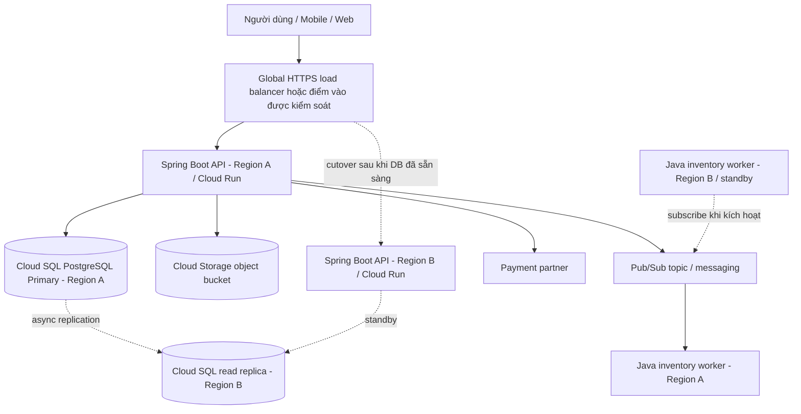

# Thực hành kế hoạch DR cho ứng dụng Java nhiều tầng

> **Chương:** Sao lưu và phục hồi thảm họa  
> **Module:** CLOUD_PROVIDERS_GCP — Khám phá Google Cloud từ tổ chức project, IAM và VPC đến Compute Engine, GKE, Cloud Run, dịch vụ lưu trữ và cơ sở dữ liệu. Qua các tình huống triển khai, người học biết lựa chọn dịch vụ, bảo vệ tài nguyên, tự động hóa phát hành và theo dõi độ tin cậy cùng chi phí.
>
> **Bối cảnh thực hành:** Một hệ thống đặt hàng Spring Boot (Java) có web frontend, REST API, PostgreSQL, object storage, hàng đợi sự kiện và các tích hợp ngoài. Học viên lập kế hoạch khôi phục sau sự cố mất cả region Google Cloud, thực hiện diễn tập **trong môi trường DR thử nghiệm** rồi đánh giá RTO/RPO, dữ liệu và khả năng vận hành.

## 1. Mục tiêu và cách đánh giá bài thực hành

Sau bài này, bạn có thể:

1. Phân rã ứng dụng Java nhiều tầng và phân loại từng loại dữ liệu để xác định cách khôi phục phù hợp.
2. Thiết kế **DR liên vùng** cho Cloud Run + Cloud SQL PostgreSQL + Cloud Storage và các dịch vụ phụ thuộc, không nhầm lẫn HA theo zone với DR mất region.
3. Đặt mục tiêu **RTO** (thời gian phục hồi) và **RPO** (mức mất dữ liệu chấp nhận) theo nghiệp vụ; đo số thực tế trong diễn tập.
4. Viết và thực thi runbook **declare → fence writes → restore/promote → update app/network → validate → handover**, có người chịu trách nhiệm và hạn chót.
5. Phân biệt **failover**, **restore từ backup/PITR**, **rollback ứng dụng** và **failback**; nhận biết nguy cơ *split-brain* và ghi trùng.
6. Lập bằng chứng nghiệm thu, lịch diễn tập định kỳ và danh sách cải tiến sau mỗi lần diễn tập.

**Nguyên tắc an toàn của bài:** Các câu lệnh minh họa kiểm tra trạng thái chỉ đọc. Những thao tác có thể làm thay đổi dữ liệu, promote replica hoặc chuyển traffic chỉ được thực hiện trong **project/lab đã được cho phép**, có kế hoạch và người phê duyệt. Tuyệt đối không tạo sự cố ở production để “kiểm tra DR”.

## 2. Tình huống mẫu: Java API, database và tài nguyên dùng chung

Công ty có hệ thống bán hàng. Người dùng gọi web/frontend, ứng dụng Spring Boot tạo đơn hàng trong PostgreSQL, phát sự kiện để worker cập nhật kho, lưu hóa đơn PDF trong Cloud Storage và gọi một dịch vụ thanh toán bên ngoài.



**Giả định lựa chọn để luyện tập:**

- **Region A:** `asia-southeast1`, phục vụ traffic bình thường. **Region B:** `asia-southeast2`, chuẩn bị năng lực dự phòng, có thể thay bằng cặp region được chính sách dữ liệu cho phép và dịch vụ hỗ trợ.
- **Compute/application:** Spring Boot chạy trên Cloud Run ở cả hai region bằng **cùng image digest** và cấu hình ứng dụng được kiểm soát phiên bản. Region B ở trạng thái *warm standby* hoặc bật theo runbook.
- **Database:** Cloud SQL for PostgreSQL primary **HA trong Region A**; một **cross-region read replica bất đồng bộ** tại Region B. Đích DR cần đủ CPU/memory/storage, khả năng kết nối mạng và IAM để trở thành primary.
- **File/object:** Cloud Storage có chính sách durability/geo redundancy đáp ứng yêu cầu; nếu chọn dual-region thì phải dùng cặp region và tính năng được hỗ trợ, không mặc định mọi cặp region tùy ý đều dùng được.
- **Messaging:** Phải kiểm tra độc lập độ bền dữ liệu, tồn đọng subscription, thời gian giữ message, quyền và chiến lược tránh consumer xử lý cùng sự kiện hai lần.
- **Cấu hình/secret:** Artifact Registry image, Secret Manager, KMS, IAM, VPC, Cloud DNS/LB, certificate, quota, pipeline Terraform và dữ liệu cấu hình có phương án truy cập khi Region A không dùng được.

Cloud Run bản thân là dịch vụ theo **region**. Việc deploy ở Region B không giải quyết bài toán database; nếu endpoint chuyển sang Region B trước khi PostgreSQL được promote, ứng dụng có thể chỉ đọc hoặc ghi thất bại. Với ứng dụng có trạng thái, thiết kế **chuyển traffic có điều kiện** sau khi cơ sở dữ liệu và các dependency quan trọng đã sẵn sàng.

## 3. Chốt yêu cầu nghiệp vụ: RTO, RPO và mức phục vụ tối thiểu

RTO và RPO là **mục tiêu**, không phải bảo đảm mặc định của Google Cloud hay của việc đã tạo backup.

- **Recovery Time Objective (RTO):** kể từ khi sự cố làm mất năng lực phục vụ, tối đa bao lâu phải khôi phục được mức dịch vụ đã định.
- **Recovery Point Objective (RPO):** khoảng mất dữ liệu theo thời gian tối đa được nghiệp vụ chấp thuận khi khôi phục.
- **Actual RTO:** chênh lệch từ thời điểm gián đoạn nghiệp vụ đến thời điểm các tiêu chí phục hồi được xác minh, ghi theo đồng hồ thống nhất.
- **Actual RPO:** khoảng giữa bản ghi/giao dịch cuối đã commit ở nguồn trước sự cố và điểm dữ liệu cuối đã được phục hồi ở đích; nếu nguồn đang mất kết nối và chưa thể biết đầy đủ, ghi rõ **chưa xác định** hoặc **giới hạn đo được**, không tự báo 0.

Ví dụ yêu cầu được **giả định** trong lab:

| Nghiệp vụ / dữ liệu | RTO mục tiêu | RPO mục tiêu | Đầu ra được xem là phục hồi |
| --- | --- | --- | --- |
| Xem danh mục sản phẩm | 30 phút | 60 phút cho cache tái tạo được | HTTP 2xx, dữ liệu xem được, p95 trong ngưỡng. |
| Tạo và tra cứu đơn hàng | 60 phút | 15 phút (chỉ để tập đo rủi ro) | Tạo/đọc đơn thành công, không duplicate, có đối soát. |
| Hóa đơn PDF trong bucket | 90 phút | Theo thiết kế replication/backup đã đo | File có thể tải, checksum đối chiếu, không mất hóa đơn đã phát hành. |
| Worker xử lý tồn kho | 120 phút | Theo cơ chế message retention + checkpoint | Không mất bản ghi quan trọng, xử lý trùng có idempotency. |

**Quan trọng:** Nếu hợp đồng kinh doanh yêu cầu **không được mất một đơn hàng đã xác nhận**, RPO 15 phút **không đáp ứng**. Phải có kiến trúc ghi dữ liệu, kiểm soát giao dịch và phương án đối soát phù hợp với RPO = 0; **cross-region replica bất đồng bộ không bảo đảm RPO = 0** khi Region A bất ngờ mất. Mục tiêu 15 phút trong lab chỉ là tiêu chí thử nghiệm, cần dữ liệu để xác định có đạt hay không.

Mỗi RTO/RPO cần phân tách theo nguyên nhân:

| Kịch bản | Tính chất | Kỹ thuật ưu tiên |
| --- | --- | --- |
| Một zone lỗi nhưng region còn hoạt động | Sự cố thành phần | HA Cloud SQL trong region, Cloud Run tự phục hồi theo thiết kế. |
| Mất Region A kéo dài | Sự cố hạ tầng liên vùng | Deploy/activate Region B, promote cross-region replica, chuyển traffic có điều kiện. |
| Ứng dụng ghi nhầm/xóa dữ liệu | **Logical corruption** có thể lan sang replica | Backup/PITR đến thời điểm tốt trước lỗi, kiểm tra dữ liệu; replica không thay thế backup. |
| Secret/key/identity bị vô hiệu | Sự cố bảo mật/cấu hình | Kênh truy cập khẩn theo chính sách, bản cấu hình phục hồi và kiểm toán. |
| Worker xử lý trùng event | Tính đúng đắn nghiệp vụ | Idempotency/deduplication, outbox/checkpoint và đối soát. |

## 4. Quyết định kiến trúc: HA, backup, warm standby và failback

| Lựa chọn | Cách phục hồi | Đặc điểm | Phù hợp khi |
| --- | --- | --- | --- |
| **Backup/restore** (*cold*) | Dựng mới và phục hồi DB/dữ liệu | Chi phí dự phòng có thể thấp, RTO tăng theo kích thước dữ liệu/quota; RPO tùy lịch backup/PITR. | Workload ít quan trọng, chịu downtime dài. |
| **Pilot light** | Duy trì dữ liệu và cấu hình nền tảng, khởi động phần compute khi có sự cố | Đỡ tốn compute liên tục nhưng cần khởi tạo và xác minh nhanh. | RTO trung bình, có IaC kiểm thử. |
| **Warm standby** | API, cấu hình mạng và database replica đã sẵn; điều khiển traffic khi có sự cố | RTO thấp hơn khi các bước promote/routing được luyện tập; chi phí chạy hai region. | Ứng dụng quan trọng có thể chấp nhận một khoảng chuyển đổi. |
| **Active-active** | Các region đồng thời phục vụ theo thiết kế đa vùng | Khó hơn nhiều với ghi trạng thái, phân vùng dữ liệu, nhất quán và idempotency; tốn chi phí. | Nghiệp vụ/sơ đồ dữ liệu thực sự hỗ trợ. |

**HA Cloud SQL theo zone không đủ cho mất toàn region.** Cross-region read replica dùng sao chép bất đồng bộ, thường **promote theo thao tác có chủ đích**; không coi replica là một primary tự chuyển vùng ngay khi API sụp. Một số tính năng **Advanced DR** dành cho Cloud SQL Enterprise Plus có hỗ trợ designated DR replica, replica failover/switchover và DNS write endpoint theo điều kiện riêng. Không dùng lệnh hoặc giả định của Advanced DR cho instance/edition không hỗ trợ.

**PITR** khôi phục Cloud SQL về một mốc thời gian trong cửa sổ log được giữ; thao tác tạo **instance mới**. Đây là công cụ xử lý lỗi dữ liệu, không phải thay thế mặc định cho cross-region failover. Vị trí backup, retention, thời hạn log và khả năng truy cập **CMEK khi region chứa khóa gặp sự cố** phải được kiểm tra; backup ở region khác chưa chắc phục hồi được nếu khóa giải mã nằm trong region không thể truy cập.

## 5. Danh mục phụ thuộc và các điều kiện sẵn sàng ở Region B

Trước diễn tập, điền bảng này và ký nhận bởi App Lead, DBA, Platform, Security và Business Owner:

| Tầng | Bảo vệ / đường phục hồi | Bằng chứng phải có trước diễn tập | Owner |
| --- | --- | --- | --- |
| DNS / global LB / TLS | Có cấu hình route đến Region B, health check, cert và quota | Kịch bản chuyển traffic và trở lại đã thử | Platform |
| Java API (Cloud Run) | Image digest khả dụng ở Region B; env/secret, service account, min instances theo kế hoạch | Deploy success, URL đích, probe, logs và cấu hình so sánh | App + SRE |
| PostgreSQL (Cloud SQL) | HA primary Region A + replica cross-region, backup/PITR | Replication Running, lag được đo, restore drill thành công | DBA |
| Object storage | Chọn bucket location/replication, retention, lifecycle và quyền ở Region B | Lấy được object mẫu, checksum, độ trễ replication thực đo | Platform |
| Messaging | Topics/subscriptions, dead-letter, retention, quyền consumer, idempotent handlers | Publish/consume đúng, phát lại không tăng số đơn sai | App |
| Networking | VPC, private access, DNS database, firewall, egress, NAT/connector/PSC theo mô hình đã chọn | Kết nối API Region B → DB Region B, webhook/outbound partner thành công | Network |
| Identity/secrets | IAM tối thiểu; Secret Manager, KMS/CMEK và principal sẵn dùng | Kiểm tra quyền tối thiểu và truy cập secret trong lab | Security |
| Monitoring / incident | Cloud Monitoring, Logging, alert, dashboard, runbook, nhóm trực | Alert test, log/audit trail, incident channel hoạt động | SRE |
| Hạ tầng IaC | Terraform modules/state, artifact repo, CI/CD, quota tại Region B | `plan` và kiểm tra drift, triển khai lặp lại được | Platform |
| Nghiệp vụ và đối tác | Quy trình khóa ghi, test account, payment/SSO/webhook allowlist | UAT và kịch bản thử đầu cuối được phê duyệt | Business + QA |

**Bẫy thường gặp:** Cloud Run đã tồn tại ở Region B nhưng không thể kéo image, đọc secret, kết nối Cloud SQL private IP, gọi cổng thanh toán hoặc mở rộng do quota. Kiểm tra **đường đi đầy đủ của một giao dịch**, không chỉ trạng thái deploy.

## 6. Chuẩn bị lab và trạng thái baseline

### 6.1. Phạm vi và quyền

Lab có **hai project hoặc hai môi trường tách biệt** production; toàn bộ ID là placeholder:

```text
LAB_PROJECT     = "gcp-dr-lab"
PRIMARY_REGION  = "asia-southeast1"
DR_REGION       = "asia-southeast2"
SERVICE         = "orders-api"
PRIMARY_DB      = "orders-primary-lab"
DR_DB_REPLICA   = "orders-dr-replica-lab"
RUNBOOK_ID      = "DR-JAVA-MULTITIER-01"
TEST_REQUEST_ID = "dr-test-20261119-001"
```

Điều kiện bắt buộc: quota đủ chạy DR, chi phí budget riêng, quyền IAM đã được người quản trị cho phép, Cloud SQL Admin API/Cloud Run/Artifact Registry/Secret Manager các API cần thiết được bật, backup/PITR có retention phù hợp và kênh incident. Không dùng tài khoản Owner dài hạn cho toàn bộ runbook.

Chọn một phương án lab **không cần mô phỏng mất cả region thật**: dùng failover logic giả lập bằng **ngắt kết nối ở môi trường thử**, thay route qua một LB hoặc chuyển endpoint mà chỉ test clients truy cập. Không xóa hoặc dừng DB production; không chặn mạng dùng chung để gây sự cố.

### 6.2. Thu số liệu ban đầu

Trước diễn tập, ghi:

1. Thời gian đo bằng UTC và timezone sử dụng trong biên bản; đồng bộ clock trên tác nhân kiểm thử.
2. Danh sách image digests đang triển khai ở cả hai region; cấu hình Spring Boot, database endpoint, version schema/Flyway và quyền truy cập secret.
3. Dung lượng DB, thời điểm backup mới nhất, khoảng PITR khả dụng, trạng thái replica và mức lag.
4. Test dataset có **10–20 request ID duy nhất**, hash/checksum cho file mẫu và số event đã xử lý.
5. Latency p95, tỷ lệ 5xx, tỷ lệ giao dịch thành công, connection pool và backlog ở workload bình thường.
6. Danh sách người theo dõi: Commander, DBA, App, Platform, QA/Business; deadline được thống nhất trước diễn tập.

### 6.3. Lệnh kiểm tra **chỉ đọc** trước diễn tập

Dùng các lệnh sau khi đã thay placeholder bằng môi trường được phép:

```bash
gcloud run services describe orders-api \
  --project=gcp-dr-lab \
  --region=asia-southeast1 \
  --format="value(status.url)"

gcloud run services describe orders-api \
  --project=gcp-dr-lab \
  --region=asia-southeast2 \
  --format="value(status.url)"

gcloud sql instances describe orders-primary-lab \
  --project=gcp-dr-lab \
  --format="value(state,region)"

gcloud sql instances describe orders-dr-replica-lab \
  --project=gcp-dr-lab \
  --format="value(state,region)"
```

Tình trạng `RUNNABLE` hoặc URL có tồn tại **không chứng minh** toàn bộ luồng nghiệp vụ đã sẵn sàng. Cần xác minh trạng thái replication và lag trong Cloud SQL Console/Cloud Monitoring, đường mạng riêng, IAM, ứng dụng truy cập DB theo đúng chế độ và kiểm thử đầu cuối.

## 7. Chuẩn bị ứng dụng Java để có thể chuyển vùng

### 7.1. Tách cấu hình theo môi trường

Cùng một container image nên có thể khởi chạy ở cả hai region mà không chứa hostname/database password hard-code. Mẫu `application.yaml` của Spring Boot:

```yaml
spring:
  datasource:
    url: jdbc:postgresql://${DB_HOST}:${DB_PORT:5432}/${DB_NAME}
    username: ${DB_USER}
    password: ${DB_PASSWORD}
    hikari:
      maximum-pool-size: 10
      connection-timeout: 5000
management:
  endpoint:
    health:
      probes:
        enabled: true
  endpoints:
    web:
      exposure:
        include: health,info
```

Các giá trị trên là **ví dụ lab**; `DB_PASSWORD` phải được cấp thông qua Secret Manager/cơ chế bảo mật được duyệt, không commit vào Git hoặc in trong log. Với kết nối private Cloud SQL, kiểm tra **private networking** ở từng region; với Cloud SQL Auth Proxy/Java Connector, dùng danh tính service account phù hợp. Không mở database ra Internet chỉ để failover nhanh hơn.

Spring Boot Actuator khi bật probes cung cấp nhóm kiểm tra như `/actuator/health/liveness` và `/actuator/health/readiness`. **Liveness không nên phụ thuộc trực tiếp database**, vì DB hỏng có thể gây restart hàng loạt mà không khắc phục nguyên nhân. Readiness cần được thiết kế để phản ánh khả năng đáp ứng traffic của **phiên bản ứng dụng**, và đối với chế độ DR phải tránh báo “sẵn sàng nhận ghi” trước khi database được promote. Cấu hình probe LB/Cloud Run phải khớp cơ chế thực tế; chỉ tạo endpoint không đồng nghĩa hệ thống định tuyến đã sử dụng nó.

### 7.2. Giữ giao dịch nhất quán và chống ghi trùng

Trong kịch bản mất region, một client có thể gửi lại request vì timeout dù database đã commit. Các quy tắc cần thực hành:

- Mỗi lệnh tạo đơn dùng **idempotency key / request ID** do client sinh, lưu cùng giao dịch; PostgreSQL có unique constraint trên khóa đó.
- Các cập nhật database và thông điệp nghiệp vụ cần có **outbox pattern** hoặc một cơ chế nhất quán được chấp thuận. Không giả định “đã publish Pub/Sub” nghĩa database cũng commit.
- Worker phải xử lý message theo cách có thể retry; consumer đối soát trạng thái nghiệp vụ trước khi tạo hóa đơn/trừ kho. Không giả định giao hàng đúng một lần end-to-end.
- Ứng dụng phải nhận biết phiên bản schema và có backward-compatible migration để bản phục hồi không gặp schema không tương thích.
- Trong DR phải duy trì **một writer có thẩm quyền**. Nếu Region A bất ngờ hoạt động lại, tuyệt đối không cho các ứng dụng cũ tiếp tục ghi vào primary cũ.

SQL minh họa ràng buộc tránh request tạo đơn trùng:

```sql
CREATE TABLE order_requests (
    request_id VARCHAR(120) PRIMARY KEY,
    order_id UUID NOT NULL UNIQUE,
    accepted_at TIMESTAMPTZ NOT NULL DEFAULT CURRENT_TIMESTAMP
);
```

Đây chỉ là phần của thiết kế idempotency: cùng `request_id` còn phải trả về cùng kết quả đã lưu, và worker cần chống trùng ở tầng message/side effect. Không chạy `CREATE TABLE` trên production để kiểm thử bài DR.

### 7.3. Lưu cấu hình và bản dựng có thể tái tạo

Chuẩn bị trước:

- Container image ở **Artifact Registry location độc lập Region A** hoặc bản sao có thể kéo trong Region B; sử dụng digest tránh “cùng tag nhưng khác code”.
- Hạ tầng Cloud Run/DB/network/secret references có thể dựng lại từ IaC, nhưng **Terraform state và quyền truy cập backend** cũng phải sẵn khi Region A bị ảnh hưởng.
- Secret, certificate, key, allowlist webhook và cấu hình external systems có đường phục hồi; tự động hóa có **bước xác nhận** trước thay đổi có tác động tới production.
- Bản ghi version ứng dụng, migration schema, feature flag, file cấu hình và liên kết build artifact phục vụ audit.

## 8. Chuẩn bị dữ liệu: replica, backup, PITR và object

### 8.1. Cloud SQL PostgreSQL

Kết hợp nhiều lớp vì mỗi lớp giải quyết một loại rủi ro:

1. **Cloud SQL HA trong Region A:** tăng khả năng chịu lỗi zone; không tự bảo vệ khỏi mất toàn region.
2. **Cross-region read replica trong Region B:** phục vụ DR khi primary region không sẵn; replication **asynchronous**, có lag và nguy cơ mất dữ liệu đã commit nhưng chưa tới replica.
3. **Backups và PITR:** phục hồi khi dữ liệu bị xóa/corrupt, trong cửa sổ lưu giữ; việc promote replica **không xóa được lỗi logical đã được replicate**.
4. **Restore drill vào instance riêng:** xác minh thời gian khôi phục, dữ liệu, quyền truy cập, network, extension, phiên bản và ứng dụng có thể chạy.

Trước lần diễn tập, xác minh các tín hiệu sau:

| Thông số | Trạng thái yêu cầu trước drill | Cách ghi bằng chứng |
| --- | --- | --- |
| Replication state | `Running` trong giai đoạn bình thường | Cloud SQL Console/Monitoring screenshot có thời gian. |
| Replication lag | Dưới ngưỡng đã duyệt tại thời điểm test | Biểu đồ lag, LSN/checkpoint nếu cần. |
| Backup | Có backup hợp lệ theo retention | ID backup, timestamp, vị trí và trạng thái. |
| PITR | Đã bật và còn recovery window theo chính sách | Earliest/latest recovery time và nhật ký restore drill. |
| DR replica capacity | Có thể đáp ứng tải khi trở thành primary | CPU/memory/storage, benchmark hoặc đo tải. |
| Key / IAM | Người xử lý có quyền, CMEK có đường truy cập trong tình huống vùng hỏng | Bằng chứng policy và thử giải mã/restore đúng phạm vi. |

**Khi planned switchover/rehearsal**, có thể **ngừng nguồn ghi và chờ replica bắt kịp** trước promotion để chủ động hạn chế mất dữ liệu. **Khi Region A đã mất**, không chắc biết được các giao dịch cuối chưa đồng bộ; ghi lại khoảng sai lệch và đối soát khi dữ liệu nguồn khả dụng. Không tuyên bố RPO = 0 dựa trên một số đo lag cũ.

Sau promote kiểu replica thông thường, replica trở thành **standalone writable primary**, không tự động tiếp tục đồng bộ ngược với primary cũ. Phải có bước bổ sung để tái lập HA, backup/PITR và cross-region replication theo chính sách.

### 8.2. Cloud Storage và hồ sơ PDF

Cloud Storage bucket location liên vùng (dual-region hoặc multi-region, tùy vùng/chính sách) có cơ chế replication tự động, nhưng **độ trễ sao chép mới** vẫn quan trọng với file vừa được tải lên. Với dual-region, Google Cloud có tùy chọn **turbo replication** để giảm cửa sổ dữ liệu chưa có bản sao ở vùng còn lại. Những con số phục hồi của object storage **không tự suy ra** RPO/RTO của toàn ứng dụng.

Hãy thử với file PDF giả lập:

1. Upload file test có ID cố định, lưu metadata: object name, generation, kích thước, hash.
2. Kiểm tra file hiện diện và tải được từ đường truy cập ứng dụng DR.
3. So sánh checksum, IAM đọc object, metadata và đường dẫn trong database.
4. Xác minh trường hợp file chưa kịp replicate và phương án phát lại/tái tạo, không chỉ kiểm tra HTTP 200.
5. Kiểm tra retention/soft delete/object versioning nếu yêu cầu bảo vệ xóa nhầm; không sử dụng lifecycle rule vô tình xóa bằng chứng cần giữ.

**Chú ý:** Nếu doanh nghiệp sử dụng bucket khu vực riêng hoặc cặp region không thuộc cấu hình dual-region được hỗ trợ, cần thiết kế việc sao chép sang bucket khác và phép đo backlog/độ trễ rõ ràng. Không giả định bật một setting là đã có nhiều vùng chịu lỗi cho mọi bucket.

## 9. Runbook DR: từ phát hiện tới xác nhận phục hồi

Runbook phải có **số phiên bản, thời gian, owner, thao tác, cách xác nhận, điều kiện thất bại và hành động tiếp theo**. Mốc thời gian mẫu sau tính từ lúc hệ thống ngừng phục vụ, mục tiêu 60 phút cho luồng tạo đơn trong lab. **Các mốc là giả định để diễn tập**; thời gian thực tế phải đo lại.

| Mốc | Owner | Hành động | Bằng chứng / quyết định |
| --- | --- | --- | --- |
| **T+0–5 phút — Detect** | SRE on-call | Nhận alert (5xx tăng, synthetic check thất bại); xác minh cả đường mạng và phụ thuộc DB, ghi thời điểm bắt đầu outage. | Incident ID, biểu đồ SLI và khách hàng bị ảnh hưởng. |
| **T+5–10 — Classify** | Commander + Platform + DBA | Phân biệt lỗi ứng dụng, lỗi zone, lỗi region, database corruption; kiểm tra khả năng phục hồi tại Region A và Region B. | Kết luận sự cố, phạm vi và phương án đề xuất. |
| **T+10–15 — Go/No-go** | Commander + Business | Quyết định **declare DR** khi điều kiện và mức ảnh hưởng đủ; khóa thay đổi song song và thông báo. | Decision log có người duyệt và thời gian. |
| **T+15–25 — Protect data** | DBA + App | Chặn hoặc cô lập writers ở nguồn nếu khả thi, ghi checkpoint và lag cuối được biết, chuẩn bị Region B. | Bằng chứng **một writer**, thống kê RPO dự kiến/chưa biết. |
| **T+25–35 — Promote/restore** | DBA | Chọn promote replica có kiểm soát khi phù hợp; nếu logical corruption thì chọn backup/PITR thay vì promote replica đã nhiễm lỗi. | DB primary mới ở Region B, kết nối đọc/ghi được, restore/promote audit. |
| **T+35–45 — Activate Java** | App/Platform | Cập nhật DB endpoint/secret cho Cloud Run Region B; xác minh image digest, schema, worker và dependency; chỉ cho phép nhận writes khi DB ổn định. | Readiness, health, kết nối và smoke test nội bộ. |
| **T+45–50 — Route traffic** | Platform/Network | Chuyển routing có điều kiện qua LB/DNS/endpoint theo thiết kế, kiểm tra TLS/SSO/webhook và lưu lượng đến đích. | Dashboard traffic phân vùng, kiểm tra client thực. |
| **T+50–60 — Validate** | QA + Business + SRE | Kiểm tra giao dịch tạo/đọc đơn, file PDF, message processing, lỗi 5xx, latency, consistency và RPO đo được. | **Accept / Continue incident / Fail** theo bảng mục 10. |
| **Sau T+60** | Commander + Operations | Nếu chưa đạt RTO, tiếp tục incident/escalation, không giả mạo kết quả; nếu đạt, theo dõi tăng cường rồi ký nhận. | Tường trình và lịch cập nhật stakeholder. |

### Các cổng Go/No-go cụ thể

**Declare DR / Go** khi: đã kiểm chứng tác động đủ lớn và chiến lược DR phù hợp; Region B có năng lực/credentials; DBA chấp nhận nguy cơ RPO đã biết hoặc không đo được; có biện pháp chống split-brain; đủ người để vận hành và đối soát.

**No-go đối với promote** khi: DB đích chưa ổn định hoặc không tin cậy, phát hiện logical corruption đã replicate, chưa thể đảm bảo một writer, hoặc rủi ro dữ liệu vượt mức Business Owner chấp nhận. Trong trường hợp này, chọn nhánh **restore từ backup/PITR** hoặc duy trì service ở chế độ giới hạn có thông báo; không tự động vượt qua kiểm soát để đạt RTO trên giấy.

**Điểm không thể hoàn nguyên đơn giản:** Sau khi Region B nhận giao dịch mới, chỉ đưa DNS về Region A sẽ làm mất các giao dịch ấy nếu primary cũ chưa được đồng bộ ngược. Failback cần kế hoạch dữ liệu riêng.

## 10. Diễn tập DR trong môi trường không sản xuất

### 10.1. Thiết kế bài test

Dùng project lab có dữ liệu giả; không tạo lỗi hạ tầng thật của Google Cloud. Một cách an toàn là **giả lập Region A không nhận traffic từ test clients** hoặc chuyển test endpoint sang Region B theo kịch bản. Chuẩn bị sẵn DB replica và bản ứng dụng cùng image.

**Bước A — Khởi tạo:** Tạo 10 đơn test có request ID cố định qua Region A; ghi các ID, giá trị, UTC timestamp và trạng thái event. Upload hai file PDF mẫu, ghi hash; đặt baseline request p95, error rate và replication lag.

**Bước B — Diễn tập mất Region A:** Commander tuyên bố incident giả lập, bấm giờ `T0` từ lần synthetic test không đạt SLO. Không chạm production. Đội kỹ thuật kiểm tra lại Region B, xác nhận dữ liệu và khóa ghi tại lab source trước promote.

**Bước C — Khôi phục:** Với **planned drill**, chờ replica bắt kịp rồi thực hiện promote được phê duyệt; triển khai/đổi cấu hình Java Region B, chuyển traffic của test client. Với tình huống giả lập **unplanned loss**, không giả vờ dữ liệu đã hoàn toàn đồng bộ: ghi giá trị lag cuối, sử dụng kịch bản mất dữ liệu giả lập và lập biên bản chênh lệch.

**Bước D — Kiểm thử:** Gửi 10 request với key mới đến endpoint DR; gửi lặp một request để xác nhận idempotency, kiểm tra worker và file, so sánh đơn hàng đã commit trước/đang/ sau sự cố.

**Bước E — Kết thúc:** Ghi actual RTO/RPO hoặc nhãn `unknown` khi thiếu chứng cứ; đánh giá nguy cơ và chi phí; làm failback theo mục 11 nếu là lab, khôi phục topology ban đầu và kiểm tra backup của primary mới.

### 10.2. Mẫu kịch bản kiểm thử

| Test ID | Thao tác | Kỳ vọng / ngưỡng ví dụ | Dữ liệu ghi nhận |
| --- | --- | --- | --- |
| DR-01 | GET `/actuator/health/readiness` ở Region B với client được phép | Thành công khi DB có thể phục vụ theo vai trò và app đã activate | HTTP status, UTC timestamp, phiên bản app |
| DR-02 | POST tạo một đơn test với idempotency key mới | Có đúng một order, nhận mã định danh hợp lệ | Request ID, DB row, response |
| DR-03 | POST lại với **cùng** idempotency key | Không tạo thêm order hay trừ tồn kho hai lần | Row count, worker log, business ledger |
| DR-04 | Đọc đơn từ Region A đã commit trước checkpoint | Các đơn đã replicate vẫn tồn tại; thiếu dữ liệu phải được báo đúng | Reconciliation report |
| DR-05 | Đọc file PDF mẫu qua Region B | Tải được, hash bằng nguồn tại checkpoint đã công bố | Object path, generation, hash |
| DR-06 | Kiểm tra event và xử lý đơn | Không thiếu message còn trong retention, không tạo side effect trùng | Topic/subscription backlog, event ID |
| DR-07 | Tạo tải tương đương baseline | p95, throughput và 5xx trong SLO được duyệt | Cloud Monitoring dashboard |
| DR-08 | Đo RTO thực tế | ≤ 60 phút theo bài mẫu, thời gian tính từ vi phạm SLO đến phục vụ đạt gate | T0/Taccept, dashboard và biên bản |
| DR-09 | Đo RPO thực tế | ≤ 15 phút theo bài mẫu **nếu đo được**; nếu không, FAIL/INCONCLUSIVE theo tiêu chí nhóm | Last commit và last recovered ID/UTC |
| DR-10 | Xác minh chỉ một writer | Primary cũ bị fence, ứng dụng/worker nguồn không thể ghi cùng lúc | Policy, connection tests, log DB |

**Chấp nhận (Accept)** chỉ khi các tiêu chí **bắt buộc** đạt, owner ký và không có lỗi Sev 1/2 chưa xử lý. Nếu hoàn thành trong 50 phút nhưng mất một đơn hàng trái với mức được duyệt thì **không PASS**. Nếu nguồn mất hẳn và không thể đo RPO, ghi **INCONCLUSIVE**, có kế hoạch xác minh sau; không ghi là 0.

### 10.3. Thu thập chứng cứ có thể kiểm tra lại

Mẫu bản ghi cho từng buổi diễn tập:

```yaml
exercise_id: "DR-JAVA-MULTITIER-01"
environment: "non-production"
incident_scenario: "simulated region outage"
primary_region: "asia-southeast1"
recovery_region: "asia-southeast2"
t0_utc: "YYYY-MM-DDTHH:mm:ssZ"
acceptance_utc: "YYYY-MM-DDTHH:mm:ssZ"
rto_target_minutes: 60
rto_actual_minutes: null
rpo_target_minutes: 15
rpo_actual_minutes: null
rpo_status: "PENDING | VERIFIED | INCONCLUSIVE"
last_primary_commit_id: "lab-order-010"
last_recovered_commit_id: null
approved_by: "Business Owner"
commander: "SRE Lead"
db_owner: "DBA Lead"
app_owner: "Java Lead"
rollback_or_failback_plan: "DR-JAVA-MULTITIER-01-failback"
evidence:
  - "timeline-and-decision-log"
  - "synthetic-test-results"
  - "replication-and-backup-report"
  - "order-reconciliation"
  - "cloud-monitoring-dashboard"
status: "PENDING"
```

Lưu số đo vào kho tài liệu có quyền truy cập thích hợp. Không chèn secret, database password, token, thông tin khách hàng thật hoặc bản sao dữ liệu nhạy cảm vào biên bản.

## 11. Failback: đưa hệ thống về Region A sau sự cố

**Không thực hiện failback bằng cách đổi URL về primary cũ**. Sau khi Region B trở thành primary và nhận ghi, Region A có thể chứa dữ liệu lỗi thời. Quy trình phải được duyệt, tương tự một đợt migration có quản lý:

1. **Đóng incident ở mức ổn định**, xác định Region B là nguồn dữ liệu đúng hiện tại; ghi giới hạn RPO đã biết của sự cố vừa qua.
2. **Khôi phục topology dự phòng:** sau khi Region A hoạt động lại, chuẩn bị replica mới từ primary Region B hoặc cơ chế đồng bộ/backup phù hợp; xác nhận data replication, schema và người có quyền.
3. **Theo dõi replication lag và đối soát:** nếu failback theo kế hoạch, tạm dừng writes vào Region B và đợi dữ liệu đến Region A đạt checkpoint có chứng cứ.
4. **Chuyển vai trò primary có kiểm soát** theo tính năng/edition đang sử dụng; chặn mọi đường ghi tới primary cũ và phòng split-brain.
5. **Cập nhật Java/config, worker và routing** theo đúng thứ tự: DB sẵn, app readiness đạt, traffic được chuyển, client được kiểm tra.
6. **Smoke test và ký nhận** RTO của đợt failback riêng, dữ liệu trước/sau và SLO; khôi phục backup/replica để có khả năng DR lần nữa.
7. **Review:** nêu các giao dịch phải bù hoặc đối soát, thay đổi quyền/giá trị cấu hình và bài học cần cập nhật vào IaC/runbook.

Cloud SQL **Advanced DR** trên edition được hỗ trợ có quy trình designated DR replica và switchover/failover khác so với promotion replica thường. Đọc hướng dẫn chính thức cho loại instance thực tế; không áp dụng câu lệnh chung cho mọi edition.

## 12. Khôi phục khi nguồn dữ liệu bị hỏng: bài test riêng

**Logical corruption** (ví dụ migration SQL xóa nhầm cột, delete hàng loạt hoặc bản ghi sai) có thể được nhân bản sang DR replica rất nhanh. Chuyển region lúc này không phục hồi dữ liệu đúng.

Tổ chức một bài diễn tập **PITR trong lab**:

1. Ghi checkpoint UTC có dữ liệu tốt và lưu một nhóm bản ghi đối chứng.
2. Tạo dữ liệu lỗi **trên database thử nghiệm** đã được cho phép.
3. Từ Cloud SQL, chọn **PITR đến thời điểm còn tốt**; quá trình này tạo **instance mới**, cần xác nhận recovery window và quyền truy cập.
4. Kiểm tra schema, migration/version, record count, tổng số tiền/đơn và quyền kết nối, không chỉ thấy DB trạng thái RUNNABLE.
5. Chuyển test client sang instance được phục hồi, đo RTO của quá trình **restore + config + test** và RPO theo checkpoint.
6. Khôi phục/thu hồi tài nguyên diễn tập theo lịch được duyệt, giữ bản ghi kết quả và kiểm tra backup sau phục hồi.

Nếu dùng enhanced backups/cross-region backup vault, cần kiểm tra điều kiện restore/PITR theo region và CMEK: **PITR từ vault ở region khác vẫn có giới hạn vị trí instance đích**. Do đó một bản backup “nằm ở xa” chưa đủ chứng minh phục hồi linh hoạt khi mọi dịch vụ/khóa của region gốc đều mất.

## 13. Quan sát, cảnh báo và quyền điều phối

### 13.1. Giám sát đủ các tầng

| Nhóm tín hiệu | Chỉ số / sự kiện | Mục đích |
| --- | --- | --- |
| API Java | HTTP 5xx, success rate, p95/p99 latency, request count, readiness | Phát hiện ảnh hưởng người dùng và xác nhận dịch vụ trở lại. |
| Cloud Run | Revision, traffic share, instance count, restart/startup failures, request concurrency | Kiểm tra Region B đã được activate và có sức tải. |
| PostgreSQL | Primary/replica state, replication lag, CPU/storage, connections, backup/PITR status | Ước lượng rủi ro dữ liệu và năng lực phục hồi. |
| Pub/Sub / worker | Unacked messages, oldest outstanding age, error/DLQ, duplicate handling | Biết có backlog/lặp nghiệp vụ sau DR. |
| Cloud Storage | Object hiện diện, checksum và quyền đọc, replication time (nếu có), sự kiện lỗi | Kiểm chứng hồ sơ phục hồi. |
| IAM/network | Lỗi 401/403, TLS, DNS, egress, Cloud Audit Logs | Phát hiện đích thiếu quyền hoặc đường đi. |
| DR process | Thời gian declare/decision/promote/switch/accept, ticket, escalation | Tính RTO thực tế và học từ diễn tập. |

Có ít nhất hai đường **phát hiện độc lập** nếu hệ thống quan trọng: synthetic request từ ngoài workload và metrics dịch vụ. Không dùng một dashboard nằm hoàn toàn trong Region A làm nguồn thông tin duy nhất khi Region A gặp sự cố.

### 13.2. Phân công trách nhiệm

| Vai trò | Quyền quyết định / thực hiện |
| --- | --- |
| **Incident Commander** | Tuyên bố DR, chọn nhánh phục hồi, chỉ đạo truyền thông và quyết định dừng khi tiêu chí không đạt. |
| **Business Owner** | Chấp thuận ngưỡng ảnh hưởng/RPO, nghiệm thu các luồng quan trọng, quyết định duy trì chế độ giới hạn. |
| **DBA Lead** | Bằng chứng replication, promote/restore, kiểm soát writer và đối soát dữ liệu. |
| **Java/App Lead** | Image/config/schema, health endpoints, idempotency, smoke test và worker processing. |
| **Platform/Network** | LB/DNS/IAM/VPC/quota, traffic steering, DR IaC và artifact availability. |
| **SRE/Operations** | Synthetic tests, dashboards, log sự cố, on-call và trực sau chuyển đổi. |
| **Security** | Xác minh quyền, audit, secret/KMS và ngoại lệ an toàn khi phục hồi. |

Quy trình phải có **người thay thế** cho các vai trò trọng yếu và đường liên lạc ngoài hạ tầng bị lỗi.

## 14. Chi phí, bảo mật và lịch diễn tập

DR liên vùng tăng chi phí: database replica, backup, storage replication, traffic liên vùng, Cloud Run min instances, load balancer, logging và chi phí diễn tập. Hãy đánh giá giữa các phương án `cold`, `pilot light`, `warm` và `active-active` trên **chi phí hằng tháng + RTO/RPO đã đo + rủi ro nghiệp vụ**.

- Bảo vệ backup bằng IAM tối thiểu, retention theo chính sách và quyền/khóa khôi phục được kiểm chứng. Không để người vận hành thông thường vừa có quyền xóa primary vừa xóa toàn bộ backup mà không kiểm soát.
- Sẵn sàng quota/limit trong Region B; chạy workload production đầy đủ khi DR có thể đắt hơn trạng thái standby. Đưa DR budget riêng vào kế hoạch FinOps.
- Diễn tập có nhịp **ít nhất theo chính sách tổ chức**, ví dụ quý/lần cho hệ thống quan trọng và ngay sau thay đổi kiến trúc dữ liệu lớn; những con số là gợi ý vận hành, không phải yêu cầu chung của Google Cloud.
- Mỗi lần diễn tập có **công bố phạm vi, kết quả, actual RTO/RPO, lỗi, owner, hạn sửa và lần kiểm tra lại**. Đừng chỉ xác nhận đã chạy script.

### Lịch kiểm chứng ví dụ

| Chu kỳ | Hành động | Bằng chứng |
| --- | --- | --- |
| Hằng ngày | Kiểm tra backup job, replica lag, lỗi read replica, synthetic health region dự phòng. | Dashboard/alert triage. |
| Hằng tuần | Kiểm tra artifact/image, IAM/secret references, drift IaC, quota Region B. | Readiness checklist. |
| Hằng tháng | Restore một backup lab vào instance mới, so checksum và nghiệp vụ. | Restore test report. |
| Hằng quý | Diễn tập DR end-to-end trong lab với Commander và Business Owner. | Decision log, RTO/RPO, SLO, retrospective. |
| Sau sự cố/thay đổi lớn | Cập nhật runbook, kiến trúc và test case, thử lại failure mode liên quan. | Change record và kết quả nghiệm thu. |

## 15. Bài tập tổng hợp và tiêu chí hoàn thành

**Đề bài:** Một ứng dụng Spring Boot có hai API `GET /orders/{id}` và `POST /orders`, PostgreSQL, Cloud Storage để lưu hóa đơn, Pub/Sub để phát sự kiện và một payment partner. Region A ngừng hoạt động trong lúc có 100 giao dịch đang xử lý. Region B có Cloud Run standby và Cloud SQL replica bất đồng bộ; replica mới nhất được quan sát **chậm 3 phút** trước sự cố.

Học viên cần:

1. Vẽ dependency graph, ghi rõ thành phần nào có trạng thái, cần backup, replica hoặc khôi phục lại từ source-of-truth.
2. Định nghĩa RTO/RPO cho **tạo đơn**, **tra cứu**, **hóa đơn** và **worker**; đánh dấu những mục tiêu không thể bảo đảm bởi replication bất đồng bộ.
3. Viết runbook từ T0 tới T+60 với tối thiểu 8 bước, owner, tín hiệu hoàn thành và ngưỡng dừng.
4. Đưa ra phương án **fencing primary cũ**, thống nhất writer và xử lý request trả timeout nhưng có thể đã commit.
5. Chỉ ra cách tìm/đối soát những order có nguy cơ mất khi replication chậm; không kết luận RPO = 3 phút nếu số đo là cũ.
6. Chuẩn bị kiểm thử idempotency, file checksum, backlog Pub/Sub, p95/5xx, và bằng chứng Cloud SQL restore/PITR.
7. Tính actual RTO từ hai timestamp có bằng chứng; với actual RPO chưa đo được, ghi INCONCLUSIVE và hướng điều tra.
8. Lập failback plan sau khi Region A trở lại, đảm bảo dữ liệu Region B đã trở thành nguồn đúng.
9. Viết báo cáo DR cuối buổi: `PASS / FAIL / INCONCLUSIVE`, nguy cơ còn tồn tại, chi phí và người được giao sửa.

**Bảng tự đánh giá:**

| Điều kiện | Đạt khi |
| --- | --- |
| Kiến trúc DR | Bảo vệ đủ tầng, kể cả IAM/secret/network/artifact/messaging; không nhầm HA với DR. |
| Dữ liệu | Chỉ một writer; có đối soát, RPO bằng chứng, xử lý duplicate và backup/PITR. |
| Thời gian | Có timeline, người chịu trách nhiệm, điểm quyết định và actual RTO đo từ tác động người dùng. |
| Chức năng | API, file, worker, thanh toán thử nghiệm và kết nối end-to-end đạt. |
| Vận hành | Có runbook, giám sát, escalation, kế hoạch failback và đánh giá sau buổi diễn tập. |
| Kết quả | Business Owner/Commander ký nhận đúng trạng thái; thất bại được ghi minh bạch và có hành động khắc phục. |

## 16. Tài liệu chính thức

1. Google Cloud Architecture Center — [Architecting disaster recovery for cloud infrastructure outages](https://docs.cloud.google.com/architecture/disaster-recovery): khái niệm RTO/RPO, failure modes, chiến lược bảo vệ.
2. Cloud Run — [Serve traffic from multiple regions](https://docs.cloud.google.com/run/docs/multiple-regions): triển khai nhiều region và cấu hình global load balancing.
3. Cloud Run — [Automate cross-region failover with service health](https://docs.cloud.google.com/run/docs/configuring/configure-service-health): health-based routing, điều kiện và giới hạn. **Chỉ phù hợp khi database/write path cũng đã được điều phối.**
4. Cloud SQL PostgreSQL — [About disaster recovery](https://docs.cloud.google.com/sql/docs/postgres/intro-to-cloud-sql-disaster-recovery): role của cross-region replica, dữ liệu mất do async replication, phòng split-brain.
5. Cloud SQL PostgreSQL — [Promote replicas for regional migration or disaster recovery](https://docs.cloud.google.com/sql/docs/postgres/replication/cross-region-replicas): preflight lag, promotion và tái lập topology.
6. Cloud SQL PostgreSQL — [Use advanced disaster recovery](https://docs.cloud.google.com/sql/docs/postgres/use-advanced-disaster-recovery): designated DR replica, edition và đặc thù switchover.
7. Cloud SQL PostgreSQL — [Backups overview](https://docs.cloud.google.com/sql/docs/postgres/backup-recovery/backups), [PITR](https://docs.cloud.google.com/sql/docs/postgres/backup-recovery/pitr) và [Backup options](https://docs.cloud.google.com/sql/docs/postgres/backup-recovery/backup-options): lưu giữ và phục hồi dữ liệu.
8. Cloud Storage — [Data availability and durability](https://docs.cloud.google.com/storage/docs/availability-durability): redundancy, replication, turbo replication và các giới hạn.
9. Backup for GKE — [Plan a set of restores](https://docs.cloud.google.com/kubernetes-engine/docs/add-on/backup-for-gke/how-to/restore-plan): lựa chọn thay thế nếu tầng Java triển khai trên GKE thay cho Cloud Run.

> **Lưu ý:** Những thông số, địa chỉ, tên project, ngưỡng và lệnh trong bài là dữ liệu minh họa. Khi triển khai vào doanh nghiệp phải đối chiếu phiên bản dịch vụ, giới hạn vùng, edition, quyền truy cập, yêu cầu bảo vệ dữ liệu và quy trình thay đổi hiện hành; quan trọng nhất là **thử thực tế và lưu chứng cứ**, không xem cấu hình DR là đủ chứng minh sẽ phục hồi đúng hạn.
